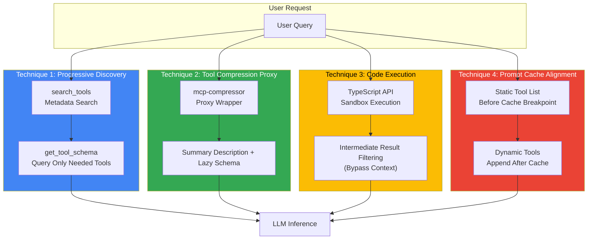

## Overview

Model Context Protocol (MCP) servers return all tool definitions in response to a `tools/list` request. Whether a host injects all of those definitions into the context immediately on connection is **not mandated by the MCP specification** — the host (client) decides — so "upfront loading of all tools on connection" is a **common strategy in naive host implementations**, not required behavior ([MCP spec: Tools](https://modelcontextprotocol.io/specification/2025-06-18/server/tools), [MCP Client Best Practices](https://modelcontextprotocol.io/docs/develop/clients/client-best-practices)). Under that strategy each tool consumes 300–1,000+ tokens in JSON Schema, so an **assumed arithmetic example** of 10 servers × 20 tools × 500 tokens on average occupies roughly **100,000 tokens** in the context window before user input (this figure is the product of assumed values, not a published measurement). This document explains how to quantify token overhead and presents four optimization techniques: Progressive Discovery, tool compression, Code Execution, and prompt cache alignment.

:::info Document Location
- This Document: MCP token optimization techniques (design perspective)
- [Tiered Gateway Architecture](../../model-serving/inference-routing/tiered-gateway-architecture.md): Agent Data Plane architecture context
- [AI Gateway Guardrails](../../operations-mlops/governance/ai-gateway-guardrails.md): MCP server Tool Allow-list and security policies
:::

---

## Background: Quantifying the Problem

### Upfront Loading Cost

MCP servers return all tool metadata (name, description, JSON Schema) when `tools/list` is called (per the spec this response supports `cursor`/`nextCursor` pagination). If a host includes those definitions as-is in the system prompt sent to the LLM, **the more tools it exposes, the higher the initial context window occupancy**. Occupancy is therefore driven by the host's injection strategy, not forced by the server.

#### Cited Cases (note: each uses a different configuration) {#measured-cases-sources-cited}

The three cases below use different tool sets, processed data, and methodologies, so their numbers cannot be substituted for one another or summed.

- **StackOne Analysis (assumed arithmetic)**: the calculation 10 MCP servers × 20 tools × 500 tokens on average = **100,000 tokens** is an example multiplying assumed values, not a measurement. Actual values depend on tool composition and tokenizer ([Source](https://www.stackone.com/blog/mcp-token-optimization/))
- **Atlassian Measurement**: GitHub MCP server (94 tools) without compression — tool descriptions occupy about **17,600 tokens** ([Source](https://www.atlassian.com/blog/developer/mcp-compression-preventing-tool-bloat-in-ai-agents))
- **Anthropic Case (tool-definition loading)**: instead of preloading hundreds-to-thousands of tool definitions, loading only the definitions needed on demand in a code-execution environment reduced usage from **150,000 → 2,000 tokens (98.7% reduction)**. This figure applies to the **tool-definition loading** scenario and is separate from the intermediate-result (spreadsheet) filtering example discussed in "Technique 3" below ([Source](https://www.anthropic.com/engineering/code-execution-with-mcp))

### Compound Cost

Token overhead increases costs across three dimensions.

**Table 1. Three dimensions in which token overhead increases cost**

| Dimension | Impact | Quantitative Example |
|------|------|----------|
| **Input Token Cost** | Tool definitions transmitted per request | Claude Sonnet 4.5: $3/M tokens → 100k tool definitions = $0.30/request |
| **Context Window Exhaustion** | User conversation length constraint | 100k preemption out of 200k window → 50% effective availability |
| **Prompt Cache Hit Rate Degradation** | Cache invalidation on tool list changes | Retransmission on every dynamic tool addition/removal |

---

## Architecture: 4 Optimization Techniques

**Figure 1. Data flow of the four token-optimization techniques applied to a user request**



---

## Technique 1: Progressive Discovery

### Concept

Tool definitions are **lazy loaded** as needed. On initial connection, only tool names and one-line descriptions are transmitted; detailed schemas are retrieved when the LLM selects a specific tool.

### 3-Step Flow

MCP Client Best Practices recommend a three-layer pattern (Catalog→Inspect→Execute). Here `search_tools`, `get_tool_schema`, and `invoke_tool` are **host-defined meta-tools**, not MCP wire methods, and their names vary by implementation (for example, the official MCP docs use `get_tool_details` for the Inspect step). Internally they still call MCP's `tools/list` and `tools/call`.

1. **Catalog (Search)**: `search_tools(query="file operations")` → Returns tool names and one-line descriptions
2. **Inspect (Schema Retrieval)**: `get_tool_schema(tool_name="read_file")` → Returns the JSON Schema for that single tool
3. **Execute (Invocation)**: `invoke_tool(tool_name="read_file", args={...})` → Actual execution

### Hybrid Threshold

MCP Client Best Practices suggest **1–5% of the context window** as an example threshold. A hybrid approach that switches to Progressive Discovery when tool-definition tokens exceed the threshold is practical. The following is **conceptual pseudocode shown before implementation**; the actual wire calls, token accounting, and per-server identity handling must be implemented in an adapter.

```python
# pseudo-code (conceptual): threshold-based exposure strategy
# NOTE: this is non-executable pseudocode illustrating the design concept.
def plan_tool_exposure(mcp_servers: list, context_window: int):
    threshold = context_window * 0.05  # e.g. 5%
    budget_used = 0
    exposed = []          # tools to pre-expose with full schema
    catalog = []          # tools to expose as catalog (name + description) only

    for server in mcp_servers:
        # tools/list is paginated via cursor/nextCursor
        for tool in paginate(server.list_tools()):
            full_tokens = estimate_tokens(tool.input_schema)
            # catalog entries also cost name + description tokens (not zero)
            catalog_tokens = estimate_tokens(tool.name, tool.description)
            # keep a server-qualified identifier to avoid cross-server name collisions
            qualified = f"{server.name}/{tool.name}"
            if budget_used + full_tokens < threshold:
                exposed.append(qualified)       # pre-expose (upfront)
                budget_used += full_tokens
            else:
                catalog.append(qualified)       # catalog only
                budget_used += catalog_tokens   # catalog tokens also count against the budget

    # The search_tools/get_tool_schema wrappers themselves also consume tokens and
    # must be counted; on get_tool_schema the adapter hydrates the real inputSchema
    # from the origin server.
    return exposed, catalog
```

The key corrections to this pseudocode are as follows. Catalog (lazy) entries still consume name and description tokens, so they must be counted against the budget (counting only schema tokens can exceed the stated 1–5% cap for large catalogs). A string like `schema: "lazy"` is not a valid wire `inputSchema` — it is only a catalog placeholder. Because tool names can collide across servers, keep a server-qualified identifier (`server/tool`), and have the adapter hydrate the genuine definition when a tool is actually invoked.

### Trade-offs

**Table 2. Advantages and disadvantages of Progressive Discovery**

| Advantages | Disadvantages |
|------|------|
| Removes detailed schemas from initial context (reduction magnitude varies by tool set composition) | Added round-trip for schema retrieval per tool call increases latency |
| Frees context window space | LLM cannot see the full tool list at a glance |
| Improves prompt cache stability | Repeated retrieval possible in multi-step reasoning |

---

## Technique 2: Tool Compression Proxy

### Atlassian mcp-compressor

Atlassian Labs open-sourced a proxy (`mcp-compressor`) that wraps existing MCP servers to reduce tool-description overhead. The core idea is to replace a server's full tool inventory with a small wrapper interface and expand the full schema of an individual tool **only when needed** (on-demand lookup). Two wrapper tools are always exposed.

1. **get_tool_schema**: Fetch the full input schema and documentation for one specific tool
2. **invoke_tool**: Execute the selected tool on the origin server with structured inputs

For the most aggressive compression tier, an optional third helper is added.

3. **list_tools (optional)**: Enumerate tool names and short descriptions only when the agent explicitly asks

In other words, the reduction comes not from deleting parameters but from moving detailed metadata out of the initial prompt into an **on-demand lookup step**. The full schema remains retrievable at any time via `get_tool_schema`, so call fidelity is preserved.

### Performance by Compression Strength

Atlassian measurement for the GitHub MCP server (94 tools). The token counts below refer to the **tool-description volume exposed in the initial prompt**; full schemas are returned separately at lookup time.

**Table 3. Initial-exposure tokens and reduction rate by compression strength (GitHub MCP server, 94 tools, Atlassian measurement)**

| Compression Strength | Initial-Exposure Tokens | Reduction Rate | Note (description detail) |
|----------|--------|-------|------|
| No Compression | 17,600 | 0% | Full schemas exposed in the initial prompt |
| Low | 3,900 | 78% | Descriptions condensed but detail retained |
| Medium | 3,300 | 81% | Descriptions condensed further |
| High | 2,200 | 87% | Name + minimal description |
| Extreme | 500 | 97% | Name + one-line description (most aggressive tier) |

The reduction range (70–97%) is the range Atlassian published, and the token count at each tier can vary by server and tokenizer. Because it is a proxy, it can be adopted without modifying the original MCP server or agent code; compression strength is controlled via proxy settings.

### Suitable Scenarios

- **Large Tool Sets**: Agents using 50+ tools
- **Static Tool Configuration**: Environments where tool lists rarely change
- **Token Cost Optimization Priority**: When cost is more important than latency

---

## Technique 3: Code Execution / Programmatic Tool Calling

### Concept

Tools are exposed as **programming APIs** (e.g., TypeScript file tree) instead of JSON Schemas, and the LLM writes and executes code in a sandbox to invoke tools. Intermediate results are filtered within the execution environment, so they **do not pass through the model context**.

### Anthropic Case

Anthropic's published article distinguishes **two separate inefficiencies** that code execution addresses, and the two examples are different in kind, so their numbers must not be transferred between them.

- **Tool-definition loading reduction**: Instead of preloading hundreds-to-thousands of tool definitions, tools are exposed as a file tree (TypeScript) and only the needed definitions are read on demand. In this scenario Anthropic reports **150,000 → 2,000 tokens (98.7% reduction)**. That is, 98.7% is a **tool-definition** reduction figure.
- **Intermediate-result filtering**: Rather than round-tripping large intermediate results (e.g., a meeting transcript, a large spreadsheet) through the model context, code filters them inside the execution environment and returns only what is needed. The article's example of this kind is TypeScript code that moves a Google Drive transcript into Salesforce, noting that a 2-hour meeting transcript could consume roughly 50,000 additional tokens. The article does not state a specific before/after token pair such as "10,000 rows → 5 rows," so the 98.7% figure is **not** applied to this kind of case.

([Source](https://www.anthropic.com/engineering/code-execution-with-mcp))

These figures are what Anthropic reported in its own example environment; they do not transfer directly to the gateway architecture described in this document or to any specific billing.

### Cloudflare Code Mode

Cloudflare's "Code Mode" runs the **LLM-generated code** in an isolated sandbox (a Workers Dynamic Worker isolate, V8 runtime). The origin MCP servers themselves do not run inside this sandbox. Cloudflare converts MCP tools into a TypeScript API exposed to the code; when the generated code calls that API, access to the external MCP servers and APIs is **brokered** through a binding that enforces authorization. The boundary is thus split between "the isolate where generated code runs" and "the external servers that actually perform the tools."

([Source](https://blog.cloudflare.com/code-mode-mcp/))

### Trade-offs

**Table 4. Advantages and disadvantages of Code Execution**

| Advantages | Disadvantages |
|------|------|
| Removing tool-definition preloading can yield large token savings (the tool-definition reduction in Anthropic's reported case was 98.7%) | Requires sandbox infrastructure (Cloudflare Workers, Lambda, etc.) |
| Intermediate result filtering enables large data processing | Security and resource isolation costs |
| Converts tool definition tokens → code execution tokens | Depends on LLM code generation capability |

### Security Considerations

Code Execution permits arbitrary code execution, so **sandbox isolation** is mandatory. Refer to the Tool Allow-list and Scoped Token sections in [AI Gateway Guardrails](../../operations-mlops/governance/ai-gateway-guardrails.md) to restrict executable API scope.

---

## Technique 4: Prompt Cache Alignment

### Problem

When MCP servers dynamically add/remove tools, the cached prefix is invalidated **from the point of change onward** in the `tools` array. However, because caching applies to a prefix, the **stable prefix before the change point** can still be reused. So "every tool change invalidates the whole cache" is an overstatement; the blast radius depends on whether the change is before or after the cache boundary.

### Placement Strategy

In the Anthropic API, caching references the **entire prefix in the order `tools` → `system` → `messages`**, up to and including the block marked with `cache_control`. The key, therefore, is to place **static tool definitions near the front of `tools` and set `cache_control` at that point**, and place session-varying dynamic tools after it, outside the cache boundary.

The following is a **conceptual example** modeled on the Anthropic Messages API (it is not runnable code; `tools` must be passed as the native `tools` field — not dumped as a string into the system prompt — for caching and tool registration to work correctly).

```python
# pseudo-code (conceptual): cache-friendly placement using cache_control
request = {
    "model": "claude-sonnet-4-5",
    "system": "You are a customer support agent.",
    "tools": [
        # Static tools: stable prefix. Marking the last static tool block with
        # cache_control caches the tools+system prefix up to this point.
        {"name": "search_kb",     "input_schema": {"...": "..."}},
        {"name": "create_ticket", "input_schema": {"...": "..."},
         "cache_control": {"type": "ephemeral"}},
        # Dynamic tools: placed after the cache boundary, so changing them
        # preserves the cached prefix in front.
        {"name": "session_custom_action", "input_schema": {"...": "..."}},
    ],
    "messages": [{"role": "user", "content": user_query}],
}
```

A **literal string like `<cache_breakpoint />` does not activate any provider's caching** — caching is specified only via the `cache_control` field. Also, dumping tool definitions as JSON into the system prompt string does **not register them as native tools** with the model, so they must be passed via the native `tools` field.

### Static vs. Dynamic Classification Criteria

**Table 5. Examples of static and dynamic tools and their placement relative to the cache breakpoint**

| Tool Type | Example | Placement Position |
|---------|------|----------|
| **Static** | `search_kb`, `create_ticket`, `get_weather` | **Before** cache breakpoint |
| **Dynamic** | User-specific custom actions, session temporary tools | **After** cache breakpoint |

### Effect

Anthropic Prompt Caching's **90% reduction** applies to the **input-token unit price on a cache hit (read)**. This reflects a **specific model and point-in-time price** — the then-current Claude Sonnet 4.5 input of $3/M → cached read of $0.30/M — and is not a reduction of the total request cost or of the **first cache write**. A cache **write** actually costs more than the base input price (with a premium that depends on the 5-minute or 1-hour TTL), and a cache miss gets no discount. Net savings therefore depend on write cost, hit rate, and TTL.

Assuming all 100k static-tool tokens are **read from cache**, at the Sonnet 4.5 prices above the per-request input cost drops from $0.30 (=100k × $3/M) to $0.03 (=100k × $0.30/M), i.e. about **$0.27 saved per request**. That value is the upper bound when the full 100k is a cache hit; accounting for the first request's cache-write premium and the hit rate, the measured average saving is smaller. Note that model names and prices in the public price list may change, so check the [current Prompt caching pricing](https://platform.claude.com/docs/en/build-with-claude/prompt-caching) before applying.

---

## Deep Dive: Gateway-Level Integration

### Relationship with Agent Data Plane

The [Tiered Gateway Architecture](../../model-serving/inference-routing/tiered-gateway-architecture.md) separates model request routing in Tier 1–2 from the Agent Data Plane's handling of tool calls, MCP/A2A connections, and stateful sessions. MCP/A2A can also use HTTP as a transport; the distinction is the responsibility each component owns.

Token optimization applies at the following layers.

**Table 6. Token-optimization responsibility and implementation method by gateway layer**

| Layer | Optimization Responsibility | Implementation Method |
|------|------------|----------|
| **Agent Data Plane (agentgateway)** | MCP server discovery and schema retrieval (Progressive Discovery) | Provides `search_tools` / `get_tool_schema` APIs |
| **Tier 2 ② LLM API Gateway (Bifrost/LiteLLM)** | Prompt cache alignment, tool compression proxy integration | Separate static/dynamic tool placement, mcp-compressor wrapping |
| **Client SDK** | Code Execution sandbox invocation | Exposes TypeScript/Python APIs, filters execution results |

### Governance Integration

Tool Allow-list, MCP server Fingerprint, and Scoped Token policies refer to the "§5.2 Tool Allow-list + Scoped Token" section in [AI Gateway Guardrails](../../operations-mlops/governance/ai-gateway-guardrails.md). Token optimization addresses **efficiency**, while Guardrails addresses **security**. Both perspectives are independent and should be applied simultaneously.

---

## Conclusion

First measure where tokens are being used. If tool definitions account for a large share, consider Progressive Discovery, which loads definitions when needed, or a tool-compression proxy. If tools return large intermediate results, Code Execution can reduce that data in the execution environment before sending the necessary result to the model. This approach requires operating a sandbox.

Account for prompt-cache billing savings separately from reductions in the number of tokens sent in context. The cited examples use different tools and data. Compare input-token counts, actual cost, and tool-call accuracy on the same request set before choosing a combination.

---

## References

### Official Documentation

- [MCP Client Best Practices](https://modelcontextprotocol.io/docs/develop/clients/client-best-practices) — Progressive Discovery, 1-5% threshold, Catalog→Inspect→Execute flow
- [Anthropic Engineering: Code Execution with MCP](https://www.anthropic.com/engineering/code-execution-with-mcp) — 98.7% token reduction case, sandbox architecture
- [Anthropic Engineering: Advanced Tool Use](https://www.anthropic.com/engineering/advanced-tool-use) — Tool-use optimization patterns

### Technical Blogs

- [StackOne: MCP Token Optimization](https://www.stackone.com/blog/mcp-token-optimization/) — Analysis of 100,000 token upfront loading problem
- [Atlassian Labs: MCP Compression](https://www.atlassian.com/blog/developer/mcp-compression-preventing-tool-bloat-in-ai-agents) — mcp-compressor, 94-tool server measurement (17,600 → 500 tokens)
- [Cloudflare: Code Mode with MCP](https://blog.cloudflare.com/code-mode-mcp/) — Workers sandbox-based Code Execution

### Related Documentation (Internal)

- [Tiered Gateway Architecture](../../model-serving/inference-routing/tiered-gateway-architecture.md) — Agent Data Plane (agentgateway), MCP/A2A protocol layer
- [AI Gateway Guardrails](../../operations-mlops/governance/ai-gateway-guardrails.md) — Tool Allow-list, MCP server Fingerprint, Scoped Token
- [AWS Native Agentic Platform](../platform-selection/aws-native-agentic-platform.md) — MCP integration context with Bedrock AgentCore and Strands
