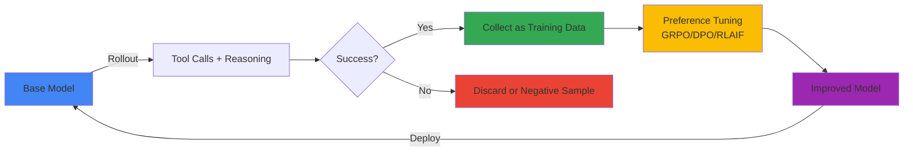
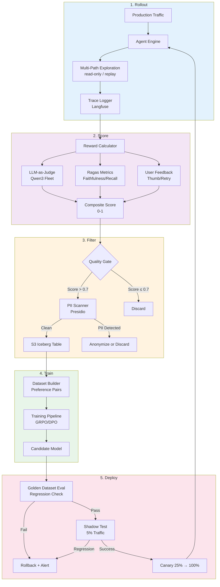
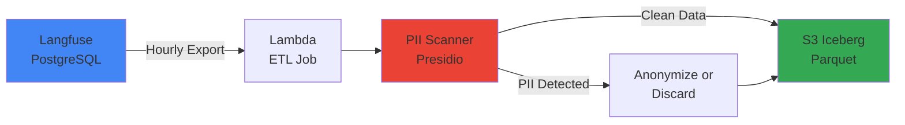

:::warning Self-Hosted Open-Weight Models Only
This loop applies only to models whose weights you are licensed to modify and host yourself (for example Qwen3, Llama 4, or GLM-5 under their respective licenses — review each model's license for fine-tuning and redistribution terms before use). It does not apply to models consumed as a managed service through Amazon Bedrock (such as Anthropic Claude or Amazon Nova): you cannot retrain weights you do not host. Amazon Bedrock AgentCore is the agent **runtime** (sessions, memory, tools, identity); the model behind an AgentCore agent is a separate choice, so "runs on AgentCore" and "self-hosted open-weight" are independent decisions. Also account for resident GPU memory: a large open-weight model such as Llama 4 or GLM-5 must still fit the training and serving hardware you provision.
:::

:::info ADR Required
Before production deployment, consensus on scope, automation boundaries, data governance, and rollback criteria is needed. See [ADR — Self-Improving Agent Loop Decision](./adr-self-improving-loop.md) for detailed consensus items.
:::

## Autoresearch Discourse and Enterprise Interpretation

### Karpathy's Core Argument

In March 2026 Andrej Karpathy published [autoresearch](https://github.com/karpathy/autoresearch), a project in which an AI agent is given a small but real single-GPU LLM training setup (a simplified [nanochat](https://github.com/karpathy/nanochat)) and left to experiment autonomously: it edits the training file `train.py`, trains for a fixed **5-minute budget**, checks whether validation bits-per-byte (`val_bpb`) improved, keeps or discards the change, and repeats. The project itself is a research-training loop over a toy model, not a production serving system. We take it only as a conceptual starting point and adapt it, with substantial additional controls, to the enterprise setting described below. The ideas we borrow:

1. **Tool-use Rollout**: an agent explores multiple candidate paths (here, candidate responses using tools such as code execution, web search, or a calculator)
2. **Success as Signal**: paths judged successful become a signal for the next round of learning
3. **Self-Supervised Loop**: accumulate the agent's own success/failure data and retrain, reducing reliance on fresh human labels
4. **Compound Growth (aspiration, not a guarantee)**: the hope is that a stronger model generates more useful traces that train a still-stronger model; whether this compounds in a given deployment is an empirical question, not an assumption

**Figure 1. The autoresearch loop: rollout, success judgment, preference tuning, and redeployment**



**Example**: Math problem-solving Agent
- **Rollout**: "53 × 47 = ?" with 5 approaches (direct calculation, Python execution, Wolfram Alpha, approximation, decomposition)
- **Success**: Python execution and decomposition reach correct answer 2491
- **Training**: DPO learning with success paths as preferred samples, failure paths as rejected
- **Next Iteration**: Model bias increases to try Python execution first for complex calculations

### Enterprise Environment Constraints

Applying Karpathy's idealism to enterprise environments requires considering these constraints:

**Table 1. Constraints and solution directions when applying a self-improving loop in enterprise environments**

| Constraint | Description | Solution Direction |
|------|------|----------|
| **Data Governance** | Production traces may contain PII, confidential information | Presidio PII scanner, k-anonymity, consent tracking |
| **Cost** | LLM calls increase N-fold per rollout (N=number of exploration paths) | Optimize cost-quality trade-off, prioritize low-cost models |
| **Reward Modeling** | Definition of "success" is ambiguous (customer satisfaction? accuracy? latency?) | Composite reward: LLM-as-judge + Ragas + user feedback |
| **Mode Collapse** | Generate only specific patterns repeatedly (diversity loss) | Entropy regularization, diverse sampling |
| **Regulatory** | Audit log and model card update required for each model change | Version control, audit trail, [Agent Versioning](../../../aidlc/enterprise/agent-versioning/index.md) integration |

:::tip Enterprise Insight
Self-improving loop should be interpreted as **"automated reinforcement under human supervision"**, not **"full automation"**. Quality gates and human-in-the-loop verification are essential at each iteration.
:::

---

## 5-Stage Loop Architecture

### Overall Architecture Diagram

**Figure 2. The five stages of the loop: Rollout, Score, Filter, Train, and Deploy**



:::danger Side effects during multi-path exploration
Generating several candidate responses to the *same* live request is safe only if the extra paths are **read-only**. A tool call that mutates state (sends an email, places an order, writes to a system of record) must execute **at most once per request**, on the single authorized path whose answer is returned to the user. Returning only the baseline answer does **not** by itself prevent a candidate path from performing a write. Before running any exploration against production traffic, require the candidate paths to use read-only tool stubs or idempotency keys, or replay from logged traces offline, and prove zero side effects. The `shadow=True` flag used later in this document is an application-level marker; it is not an automatic tool side-effect sandbox.
:::

### Stage 1: Rollout — Production Traffic Collection


**Goal**: Collect Agent execution traces for actual user requests.

**Execution Cycle**: Continuous (Real-time)

**Input**: User request, context, Agent state  
**Output**: Trace (prompt, tool calls, intermediate reasoning, final response, latency, token count)

**Collection Mechanism** (illustrative — pin your Langfuse SDK):

The Langfuse SDK API differs across major versions (the v2 `langfuse.trace()`/`span()` client-object API was superseded by the v3+ OpenTelemetry-based observe/context API). Pin the SDK version you deploy and use its documented decorator/context manager; `@trace_agent_call` below is an **application-defined helper**, not an SDK symbol. Trace export must never take down the request: isolate it so a tracing failure is logged but the user still gets a response, and do not let it swallow genuine agent errors.

```python
# Illustrative. Replace with your pinned Langfuse SDK's decorator/context API (v2 vs v3+ differ).
from langfuse import Langfuse  # pin e.g. langfuse==2.x or 3.x explicitly

langfuse = Langfuse()

def execute_agent(user_query: str, context: dict):
    # Real agent work runs regardless of tracing outcome.
    docs = vector_db.search(user_query)
    response = llm.generate(prompt=build_prompt(user_query, docs))
    if response.requires_tool:
        response.tool_result = execute_tool(response.tool_name, response.tool_args)

    try:
        # Record a trace/span tree using your SDK's documented API.
        _record_trace(langfuse, user_query, context, response)
    except Exception:  # Tracing failure must not break the user response.
        logger.exception("trace export failed")  # isolated; agent errors are NOT caught here
    return response
```

**Diversity Assurance**: Generating multiple responses per request with temperature variation (e.g. 0.7/0.9/1.1) can increase candidate diversity; whether it improves the trained model is an empirical question to measure, not a guarantee.

**Failure Isolation**: As shown above, trace export runs in a guarded block so the user response is returned even if collection fails. Export asynchronously where possible.

---

### Stage 2: Score — Reward Calculation

**Goal**: Quantify "how good each response is" by assigning 0-1 score to each trace.

**Execution Cycle**: Hourly batch

**Input**: Langfuse trace ID batch  
**Output**: `{trace_id: reward_score}` table

**Composite Reward Formula**:

```python
# Positive quality signals are a convex combination (weights sum to 1.0),
# producing a base score in [0, 1]. Latency is applied afterwards as a
# separate bounded penalty (see compute_reward below), not as a weighted term.
base_score = (
    w1 * llm_judge_score +      # LLM-as-Judge (0-1)
    w2 * ragas_faithfulness +   # Ragas faithfulness (0-1)
    w3 * ragas_context_recall + # Ragas context recall (0-1, omitted/renormalized if no reference)
    w4 * user_feedback_score    # Thumbs up=1, down=0, neutral=0.5
)

# Default weights (hypotheses to tune); must sum to 1.0
w1, w2, w3, w4 = 0.35, 0.25, 0.20, 0.20
```

**LLM-as-Judge Prompt**:

```python
judge_prompt = f"""
Evaluate the following Agent response:

**Question**: {question}
**Context**: {context}
**Answer**: {answer}

Evaluation Criteria:
1. Accuracy: Factual accuracy based on context
2. Completeness: Covers all aspects of the question
3. Clarity: Easy for user to understand
4. Conciseness: Delivers only core without unnecessary information

Return score between 0-1 and reasoning in JSON.
{{"score": 0.85, "reasoning": "Accurate and complete but slightly verbose"}}
"""

judge_response = cheap_llm.generate(judge_prompt)  # Use low-cost model e.g. Qwen3-8B (cost reduction)
```

**Ragas Evaluation**:

`context_recall` always requires a `reference` (ground truth) to compare against, so it cannot be computed when ground truth is absent — skip it and renormalize the remaining weights rather than passing `None`. Build the dataset with real lists (one entry per column) and only include metrics whose inputs are present.

```python
from ragas import evaluate
from ragas.metrics import Faithfulness, LLMContextRecall
from datasets import Dataset

columns = {"question": [question], "answer": [answer], "contexts": [contexts]}
metrics = [Faithfulness()]
if ground_truth is not None:  # context_recall needs a reference; omit it otherwise
    columns["ground_truth"] = [ground_truth]
    metrics.append(LLMContextRecall())

ragas_result = evaluate(Dataset.from_dict(columns), metrics=metrics)
```

**User Feedback Integration**:

```python
# Fetch user feedback scores via your pinned Langfuse SDK's documented scores API
# (method name/shape differs across SDK versions — verify against the version you deploy).
scores = get_feedback_scores(trace_id=trace_id, name="user-feedback")  # app-level adapter
# Define behavior when zero or multiple scores exist (here: neutral 0.5 when missing).
if not scores:
    user_score = 0.5
else:
    latest = scores[-1].value  # or aggregate per your policy
    user_score = 1.0 if latest == "positive" else 0.0 if latest == "negative" else 0.5
```

**Cost Optimization**:
- LLM-as-Judge uses a low-cost model (e.g. Qwen3-8B, Llama 4 Scout)
- Cache Ragas results keyed on **all** scoring inputs and versions (question + contexts + answer + metric version), not question+context alone — otherwise a different answer could reuse another response's score
- Prioritize user feedback — skip LLM-as-Judge when a feedback score already exists

---

### Stage 3: Filter — Data Curation & PII Gate

**Goal**: Select only high-quality traces as training data and remove sensitive information.

**Execution Cycle**: Hourly batch

**Input**: Scored traces  
**Output**: Clean training dataset (S3 Iceberg table)

**Quality Gates**:

This stage performs two **separate** jobs that should not be conflated. (a) A **safety/consent filter** removes traces that must never be used — PII that cannot be anonymized, missing training consent, or policy violations — regardless of quality. (b) **Preference-pair eligibility** then decides how a trace is used: a low-score or failed answer is not necessarily discarded, because it is exactly the `rejected` side of a preference pair. Do not throw away eligible low-quality answers before pairing (see Stage 4).

```python
def partition_traces(scored_traces):
    """Safety filter first; keep quality signal for later pairing."""
    eligible = []
    for trace in scored_traces:
        # Safety/consent gate — hard exclusions only.
        if not trace.training_consent or trace.unresolvable_pii:
            continue

        # Per-request latency outlier (seconds) — this is a single request's
        # latency, NOT a P99 percentile over a population.
        if trace.latency_seconds > 30:
            continue

        # Deduplicate identical (question, answer) pairs.
        if is_duplicate(trace):
            continue

        eligible.append(trace)  # low reward_score / errors are kept as candidate negatives

    return eligible
```

**PII Scanning (Presidio)** (pin presidio-analyzer, e.g. 2.2.360):

The default `AnalyzerEngine()` loads an **English** spaCy pipeline, so calling `analyze(language='ko')` on it is misconfigured. Build one Korean engine (and reuse the same configured instance everywhere, including the ETL job below). Presidio ships no Korea-specific recognizers, so add custom pattern recognizers for RRN and account numbers. Treat empty results as "nothing matched by the configured recognizers", **not** proof the text is PII-free: pattern/NLP recognizers have false negatives, and this scans only the fields you pass (here `question` and `answer`) — context, tool arguments, and logs are not covered unless you scan them too.

```python
from presidio_analyzer import AnalyzerEngine, PatternRecognizer, Pattern
from presidio_analyzer.nlp_engine import NlpEngineProvider
from presidio_anonymizer import AnonymizerEngine

# Korean NLP engine (default AnalyzerEngine supports English only).
nlp_config = {
    "nlp_engine_name": "spacy",
    "models": [{"lang_code": "ko", "model_name": "ko_core_news_lg"}],
}
nlp_engine = NlpEngineProvider(nlp_configuration=nlp_config).create_engine()
analyzer = AnalyzerEngine(nlp_engine=nlp_engine, supported_languages=["ko"])

# Korea-specific custom recognizers (Presidio provides none).
analyzer.registry.add_recognizer(PatternRecognizer(
    supported_entity="KR_RRN", supported_language="ko",
    patterns=[Pattern("rrn", r"\d{6}-\d{7}", 0.85)]))
analyzer.registry.add_recognizer(PatternRecognizer(
    supported_entity="KR_ACCOUNT", supported_language="ko",
    patterns=[Pattern("account", r"\d{3}-\d{2,6}-\d{2,7}", 0.8)]))

anonymizer = AnonymizerEngine()

def scan_and_anonymize(text: str) -> tuple[str, bool]:
    """Detect PII then anonymize. Returns (anonymized text, PII matched)."""
    results = analyzer.analyze(text=text, language="ko")
    if not results:
        return text, False  # No recognizer matched — not a guarantee of PII-free
    anonymized = anonymizer.anonymize(text=text, analyzer_results=results)
    return anonymized.text, True

# Process trace (only question and answer are scanned here)
for trace in eligible_traces:
    trace.question, q_has_pii = scan_and_anonymize(trace.question)
    trace.answer, a_has_pii = scan_and_anonymize(trace.answer)
    if q_has_pii or a_has_pii:
        trace.metadata["pii_detected"] = True
```

**Query-frequency filter** (drop rare query patterns; this is **not** a k-anonymity guarantee):

The check below counts **records** sharing a normalized query pattern, not **distinct people**, and only over the query pattern — not over all released quasi-identifiers. Five queries from one person pass it. True k-anonymity requires each released record to be indistinguishable from at least k−1 *other individuals* across every quasi-identifier. Use this only as a coarse rare-pattern filter, and never describe its output as anonymized.

```python
def filter_rare_query_patterns(traces, min_count=5):
    """Drop traces whose normalized query pattern appears fewer than min_count times.
    NOTE: counts records, not distinct subjects — not a k-anonymity guarantee."""
    pattern_counts = defaultdict(int)
    for trace in traces:
        pattern_counts[extract_pattern(trace.question)] += 1  # pattern after entity removal

    return [t for t in traces if pattern_counts[extract_pattern(t.question)] >= min_count]
```

**Storage — S3 + Iceberg** (adapter boundary — convert to Arrow before append):

PyIceberg's `table.append()` expects a **PyArrow `Table`** whose schema matches the Iceberg table, not a plain list of dicts. Load a **configured** catalog (name + properties), reference the table by its **namespace-qualified** identifier, and build an Arrow table with validated types (including timezone-aware timestamps). Treat the dict-to-Arrow mapping as an explicit adapter.

```python
import pyarrow as pa
from pyiceberg.catalog import load_catalog

# Configured catalog (name + connection properties), namespace-qualified table id.
catalog = load_catalog("training_data")  # resolves properties from config/env
table = catalog.load_table("agent.training_traces")  # namespace.table

# Adapter: dicts → Arrow table with an explicit schema matching the Iceberg table.
arrow = pa.Table.from_pylist(
    [{"trace_id": t.id, "question": t.question, "answer": t.answer,
      "reward": float(t.reward_score), "ts": t.timestamp}  # tz-aware timestamp
     for t in eligible_traces],
    schema=pa.schema([
        ("trace_id", pa.string()), ("question", pa.string()), ("answer", pa.string()),
        ("reward", pa.float64()), ("ts", pa.timestamp("us", tz="UTC")),
    ]),
)
table.append(arrow)
```

**Regulatory Compliance** (design policy — confirm with counsel):
- **GDPR/PIPA**: this design uses **opt-in consent** before using a trace for training (consistent with the consent check below); do not use traces without a confirmed lawful basis
- **Data Retention**: delete source traces after a retention window you set (e.g. 90 days) as a chosen policy
- **Audit Log**: record all PII detection/anonymization events in CloudTrail/Audit DB

---

### Stage 4: Train — Preference Tuning

**Goal**: Retrain model with reinforcement learning using high-quality traces.

**Execution Cycle**: Weekly or Monthly

**Input**: S3 Iceberg table (preference pairs)  
**Output**: Candidate model checkpoint

**Preference Pair Construction**:

Self-improving loop uses the higher-reward answer as `preferred` and the lower-reward answer as `rejected` **among responses to the identical request**. Grouping by the question text alone is wrong: two responses to the same words but under a different tenant, system prompt, retrieved context, tool state, or model version are **not comparable**, and pairing them produces invalid preferences and can leak one tenant's content into another's training signal. Group by a composite identity key, preserve the full serialized prompt, and keep privacy/consent eligibility separate from reward ranking.

```python
def identity_key(trace):
    # Everything that must match for two answers to be comparable.
    return (trace.tenant_id, trace.model_version, trace.system_prompt_hash,
            trace.question, trace.context_hash, trace.tool_state_hash)

def build_preference_pairs(traces):
    """Group only identical-context responses to generate valid pairs."""
    grouped = defaultdict(list)
    for trace in traces:
        if not trace.training_consent:   # eligibility is separate from ranking
            continue
        grouped[identity_key(trace)].append(trace)

    pairs = []
    for key, trace_list in grouped.items():
        if len(trace_list) < 2:
            continue  # Cannot pair

        sorted_traces = sorted(trace_list, key=lambda t: t.reward_score, reverse=True)
        preferred, rejected = sorted_traces[0], sorted_traces[-1]

        # Reward difference must be large enough for a meaningful pair
        if preferred.reward_score - rejected.reward_score < 0.2:
            continue

        pairs.append({
            "prompt": preferred.serialized_prompt,  # full prompt, not just question text
            "chosen": preferred.answer,
            "rejected": rejected.answer,
            "reward_diff": preferred.reward_score - rejected.reward_score,
        })

    return pairs
```

**Training Method Selection Guide**:

The convergence-stability levels (Very high/High/Medium/Low) are the author's qualitative assessment, not measurements.

**Table 2. Data requirement, compute, and convergence stability by preference-tuning method**

| Method | Data Requirement | GPU-hours (hypothetical, 7B–8B) | Convergence Stability | Suitable Scenario |
|------|-------------|---------------------|------------|-------------|
| **GRPO** | 1k+ pairs | tens of GPU-hours | Medium | Initial self-improvement, fast iteration |
| **DPO** | 5k+ pairs | tens of GPU-hours | High | Stable learning after sufficient data |
| **RLAIF** | 10k+ pairs + reward model | tens–hundreds of GPU-hours | Low | When complex reward modeling needed |
| **RFT** | 10k+ high-quality traces | lowest (SFT level) | Very high | When golden dataset for supervised learning available |

:::note GPU-hours are environment-dependent
The ranges above are rough estimates for 7B–8B models, not measurements from this design. Actual time depends heavily on model size, dataset size, hardware, and hyperparameters. As one published data point, full DPO fine-tuning of a 7B model took 2–4 hours on 16×A100 (Zephyr-7B), i.e. roughly 32–64 GPU-hours.
:::

:::tip Selection Guide
These stage thresholds are proposed planning assumptions, not validated optima.
- **Initial (data &lt;2k pairs)**: GRPO — fast to start with little data
- **Mid-stage (data 5k-10k pairs)**: DPO — balance of stability and effectiveness
- **Maturity (data &gt;10k)**: RLAIF or RFT — complex reward modeling
:::

**GRPO Training Example (NeMo-RL, conceptual)**:

NeMo-Aligner was archived on 2025-11-19; GRPO now lives in NeMo-RL. The real NeMo-RL `grpo` module exposes a `setup(master_config, tokenizer, dataset, val_dataset, processor=None)` entry point whose `master_config` is a `MasterConfig` combining `policy`, `loss_fn`, `env`, `data`, `grpo`, `logger`, `cluster`, and `checkpointing` sections, and GRPO is on-policy — it generates fresh groups of responses from prompts during training rather than consuming pre-built preference pairs. The snippet below is **conceptual pseudocode** that names the knobs; it is not a runnable call. Build the full `MasterConfig` and a Ray cluster from the NeMo-RL examples before running.

```python
# Conceptual — see NeMo-RL v0.4.0 nemo_rl/algorithms/grpo.py for the real MasterConfig/setup contract.
grpo_section = {
    "num_prompts_per_step": 64,       # prompts sampled per step
    "num_generations_per_prompt": 4,  # on-policy rollouts generated per prompt
    "normalize_rewards": True,
    # kl_coef / clipping live in the loss_fn (ClippedPGLoss) section, not here.
}
# master_config = {"policy": ..., "loss_fn": ..., "env": ..., "data": ...,
#                  "grpo": grpo_section, "logger": ..., "cluster": ..., "checkpointing": ...}
# policy, generation, clusters, dataloaders, loss_fn, logger, ckpt, state, cfg = setup(
#     master_config, tokenizer, dataset, val_dataset)
# grpo_train(policy, generation, dataloaders, ..., master_config)
```

**DPO Training Example (TRL)**:

```python
from transformers import AutoModelForCausalLM, AutoTokenizer
from trl import DPOTrainer, DPOConfig  # TRL v0.19.1

model = AutoModelForCausalLM.from_pretrained("Qwen/Qwen3-8B")
tokenizer = AutoTokenizer.from_pretrained("Qwen/Qwen3-8B")

dpo_config = DPOConfig(
    beta=0.1,  # Temperature for DPO loss
    learning_rate=5e-7,
    per_device_train_batch_size=2,
    gradient_accumulation_steps=8,
    max_length=2048,
    num_train_epochs=1,
)

trainer = DPOTrainer(
    model=model,
    args=dpo_config,
    train_dataset=preference_dataset,  # {"prompt", "chosen", "rejected"} format
    processing_class=tokenizer,  # TRL >=0.13 renamed the tokenizer argument to processing_class
)

trainer.train()
model.save_pretrained("qwen3-8b-dpo-2026-04-18")
```

**Training Monitoring**:

```python
# Track real-time metrics with Wandb integration
import wandb

wandb.init(project="self-improving-agent", name="grpo-2026-04-18")
# ... log metrics inside the training loop, e.g. wandb.log({"reward_mean": r, "kl": kl, ...})
```

Metrics to track (prose, not code):
- Reward mean/std (per batch)
- KL divergence (policy drift vs base model)
- Loss curve
- Validation accuracy (golden dataset)
- Training time per epoch

**Cost Estimate (hypothetical: Qwen3-8B, 5k pairs, DPO)**:
- GPU: 8× H100 (one p5.48xlarge) × 25 hours = 25 instance-hours = 200 GPU-hours
- Cloud cost: 25 instance-hours × $55.04/hr (p5.48xlarge on-demand, reflecting the ≈44% reduction effective 2025-06-01; confirm the current rate for your Region and term) ≈ $1,376 per run
- At this per-run figure: weekly training ≈ $1,376 × 4 ≈ $5.5k/month; monthly training ≈ $1.4k/month
- These are planning estimates for one run, not a measured benchmark; the broad GPU-hour table above and the Zephyr-7B timing are not measurements of this specific experiment.

---

### Stage 5: Deploy — Regression Verification & Gradual Deployment

**Goal**: Verify new trained model has not regressed vs baseline before deploying to production.

**Execution Cycle**: Once after training completion

**Input**: Candidate model checkpoint  
**Output**: Production deployment or rollback

**Golden Dataset Evaluation**:

```python
from ragas import evaluate
from datasets import Dataset

# Golden Dataset (100-200 QA validated by domain experts)
golden_data = load_golden_dataset("s3://golden-eval/agent-qa-v2.jsonl")

# Evaluate baseline model
baseline_results = evaluate_model(baseline_model, golden_data)

# Evaluate candidate model
candidate_results = evaluate_model(candidate_model, golden_data)

# Statistical comparison
from scipy.stats import ttest_rel

t_stat, p_value = ttest_rel(baseline_results, candidate_results)

if p_value < 0.05 and mean(candidate_results) > mean(baseline_results):
    print("✅ Candidate model is statistically significantly better")
    decision = "PROCEED_TO_SHADOW"
elif mean(candidate_results) < mean(baseline_results) * 0.95:
    print("❌ 5%+ regression detected → rollback")
    decision = "ROLLBACK"
else:
    print("⚠️ No significant difference → additional verification needed")
    decision = "MANUAL_REVIEW"
```

**Shadow Test (5% Traffic)**:

```python
# Inference Gateway configuration (LiteLLM + LaunchDarkly feature flag)
import asyncio
from ldclient import LDClient, Config, Context

ld_client = LDClient(Config(sdk_key="sdk-key"))  # LDClient takes a Config, not sdk_key= directly

def select_model(user_id: str) -> str:
    context = Context.builder(user_id).kind("user").build()
    # variation(flag_key, context, default) — there is no get_variant in the SDK.
    # The flag's targeting rules do the 5% sampling; the default is the safe fallback.
    variant = ld_client.variation("agent-model-shadow-test", context, "control")
    return "qwen3-8b-baseline" if variant == "control" else "qwen3-8b-candidate"

# Only the eligible 5% run the candidate at all; baseline is always authoritative.
async def execute_with_shadow(query: str, user_id: str):
    baseline_resp = await agent_call(model="qwen3-8b-baseline", query=query)

    if select_model(user_id) == "qwen3-8b-candidate":
        # Shadow path is read-only and must not affect the user response.
        try:
            candidate_resp = await asyncio.wait_for(
                agent_call(model="qwen3-8b-candidate", query=query, shadow=True),
                timeout=SHADOW_TIMEOUT_SECONDS,
            )
            log_shadow_comparison(query, baseline_resp, candidate_resp)
        except Exception:
            logger.exception("shadow candidate failed")  # bounded; does not touch baseline_resp

    return baseline_resp  # Baseline is what the user gets, regardless of shadow outcome
```

**Regression Monitoring (24 hours)**:

Run these as **separate** queries and compare the results in your dashboard or alerting layer — `vs` is not PromQL. Aggregate away per-pod/instance labels with `sum by (model)` so the candidate and baseline series are comparable, and decide behaviour when a denominator is zero (no traffic yet).

```promql
# Candidate error rate (aggregate over pods; guard against divide-by-zero in the alert layer)
sum by (model) (rate(agent_errors_total{model="candidate"}[1h]))
  / sum by (model) (rate(agent_requests_total{model="candidate"}[1h]))

# Baseline error rate (same shape, different label value)
sum by (model) (rate(agent_errors_total{model="baseline"}[1h]))
  / sum by (model) (rate(agent_requests_total{model="baseline"}[1h]))

# Latency P99 per model
histogram_quantile(0.99, sum by (model, le) (rate(agent_latency_bucket{model="candidate"}[1h])))
histogram_quantile(0.99, sum by (model, le) (rate(agent_latency_bucket{model="baseline"}[1h])))

# User feedback positive ratio (candidate)
sum(rate(user_feedback_positive{model="candidate"}[1h]))
  / sum(rate(user_feedback_total{model="candidate"}[1h]))
```

**Auto-rollback trigger** (a valid Prometheus recording/alerting rule file; the rollback itself is an external adapter):

```yaml
# prometheus-rules.yaml — a Prometheus rule group, not Alertmanager config.
groups:
  - name: self-improving-agent
    rules:
      - alert: CandidateModelRegression
        # Require a minimum request floor so a tiny denominator cannot trip the alert.
        expr: |
          (
            sum(rate(agent_errors_total{model="candidate"}[30m]))
              / sum(rate(agent_requests_total{model="candidate"}[30m]))
          )
          > 1.5 *
          (
            sum(rate(agent_errors_total{model="baseline"}[30m]))
              / sum(rate(agent_requests_total{model="baseline"}[30m]))
          )
          and sum(rate(agent_requests_total{model="candidate"}[30m])) > 0.1
        for: 30m
        labels:
          severity: critical
        annotations:
          summary: "Candidate error rate >1.5x baseline → trigger rollback"
```

The rollback is **not** performed by Prometheus. Route the alert through Alertmanager to a webhook that calls an authenticated, idempotent rollback adapter (for example a Lambda that sets the LaunchDarkly flag's candidate rollout to 0%). Implement that adapter explicitly; the YAML above only detects the condition.

**Canary Deployment (on Shadow success)**:

```python
# Gradually increase ratio in LaunchDarkly console
# Day 1: 5% (shadow) → 5% (live)
# Day 2: 25%
# Day 3: 50%
# Day 4: 100%

# 24-hour monitoring at each stage → proceed to next if no regression
```

---

## Reward Design

### LLM-as-Judge + Ragas + User Feedback Weights

**Default weights (hypotheses to tune, not validated optima)**:

```python
# Positive weights form a convex combination (sum to 1.0). Latency is a
# separate bounded penalty applied after, so it is NOT a weight here.
REWARD_WEIGHTS = {
    "llm_judge": 0.35,        # LLM-as-Judge evaluation
    "faithfulness": 0.25,     # Ragas faithfulness (prevent hallucination)
    "context_recall": 0.20,   # Ragas context recall (retrieval quality)
    "user_feedback": 0.20,    # Thumbs up/down
}
LATENCY_PENALTY_MAX = 0.05    # separate cap, subtracted after the base score

def compute_reward(trace):
    score = 0.0

    # 1. LLM-as-Judge
    judge_score = llm_judge_evaluate(trace.question, trace.answer, trace.context)
    score += REWARD_WEIGHTS["llm_judge"] * judge_score

    # 2. Ragas faithfulness
    faith_score = ragas_faithfulness_score(trace.answer, trace.context)
    score += REWARD_WEIGHTS["faithfulness"] * faith_score

    # 3. Ragas context recall — requires a reference; renormalize if absent
    if trace.ground_truth is not None:
        recall_score = ragas_context_recall_score(trace.context, trace.ground_truth)
        score += REWARD_WEIGHTS["context_recall"] * recall_score
    else:
        # Redistribute the recall weight across the other positive signals
        score /= (1.0 - REWARD_WEIGHTS["context_recall"])

    # 4. User feedback (missing-signal policy: neutral 0.5)
    feedback_score = 1.0 if trace.user_feedback == "positive" else \
                     0.0 if trace.user_feedback == "negative" else 0.5
    score += REWARD_WEIGHTS["user_feedback"] * feedback_score

    # 5. Latency penalty — per-request latency in seconds (NOT a P99 percentile)
    if trace.latency_seconds > 10:
        penalty = min(LATENCY_PENALTY_MAX, (trace.latency_seconds - 10) / 100)
        score -= penalty

    return max(0.0, min(1.0, score))  # Clamp to 0-1 range
```

### Weight Tuning Experiment

**Optimal Weight Search with A/B Test**:

```python
# Define experiment groups (weights shown in full; each dict must sum to 1.0)
experiments = [
    {"name": "baseline",
     "weights": {"llm_judge": 0.35, "faithfulness": 0.25, "context_recall": 0.20, "user_feedback": 0.20}},
    {"name": "user-first",
     "weights": {"llm_judge": 0.20, "faithfulness": 0.20, "context_recall": 0.20, "user_feedback": 0.40}},
    {"name": "quality-first",
     "weights": {"llm_judge": 0.10, "faithfulness": 0.40, "context_recall": 0.30, "user_feedback": 0.20}},
]

# Run separate training pipeline for each experiment group
for exp in experiments:
    model = train_with_rewards(base_model, preference_pairs, reward_weights=exp["weights"])

    # Golden dataset evaluation
    results = evaluate(model, golden_dataset)

    # Production test (Canary 5%)
    production_metrics = deploy_canary(model, traffic_pct=0.05, duration_hours=24)

    # Track business metrics
    print(f"{exp['name']}: Accuracy={results.accuracy}, User Satisfaction={production_metrics.satisfaction}")
```

**Iterative Optimization**:
1. Train model with initial weights
2. Collect business metrics after production deployment (user satisfaction, task completion rate)
3. Retrain after weight adjustment
4. Finalize optimal combination after 2-3 iterations

---

## Data Curation & PII Gate

### Langfuse Trace → S3 Iceberg Table

**Data Flow**:

**Figure 3. ETL and PII-gate flow loading Langfuse traces into an S3 Iceberg table**



**Lambda ETL Job** (adapter sketch — verify against your Langfuse version and schema):

Several contracts matter here. (1) psycopg2 executes through a **cursor** (`cur = conn.cursor(); cur.execute(...)`), and default rows are **tuples**, not dicts — use a `RealDictCursor` or index by position. (2) Modern Langfuse (v3+) does not expose this exact Postgres `traces` table; prefer the versioned export API or a schema adapter you own. (3) Use the **configured Korean** Presidio engine from the Filter stage, not a default `AnalyzerEngine()`. (4) PyIceberg needs an Arrow table, not a list. (5) A "last hour" query with no durable watermark can drop or duplicate rows across runs — track a persisted high-water mark and dedupe by trace id. Until an offline/adapter test covers this path, treat the result as unverified.

```python
import os
import psycopg2
from psycopg2.extras import RealDictCursor
import pyarrow as pa
from pyiceberg.catalog import load_catalog
# analyzer is the SAME configured Korean engine built in the Filter stage.

def lambda_handler(event, context):
    # 1. Durable watermark bounds the window; half-open [since, until) avoids gaps/overlap.
    since, until = load_watermark(), now_utc()
    conn = psycopg2.connect(os.environ["LANGFUSE_DB_URL"])
    with conn.cursor(cursor_factory=RealDictCursor) as cur:  # rows as dicts
        cur.execute(
            """
            SELECT id, input, output, metadata, score
            FROM traces
            WHERE created_at >= %(since)s AND created_at < %(until)s
              AND score > 0.7
            """,
            {"since": since, "until": until},
        )
        rows = cur.fetchall()

    # 2. PII scanning with the configured Korean engine
    clean = []
    for row in rows:
        hits = analyzer.analyze(text=row["input"], language="ko") \
             + analyzer.analyze(text=row["output"], language="ko")
        if hits:
            if should_anonymize(row):
                row = anonymize_row(row, hits)
            else:
                continue  # discard
        clean.append(row)

    # 3. Dedupe by trace id, then write an Arrow table to Iceberg
    clean = dedupe_by_id(clean)
    arrow = pa.Table.from_pylist(clean, schema=TRACES_SCHEMA)
    catalog = load_catalog("glue")
    catalog.load_table("training_data.agent_traces").append(arrow)

    commit_watermark(until)  # advance only after a successful write
    return {"status": "success", "traces_processed": len(clean)}
```

### Presidio PII Scanner

**Supported Entities (Korean)**:
- Name, email, phone number, SSN, credit card number, address, IP address

**Add Custom Recognizers**:

```python
from presidio_analyzer import Pattern, PatternRecognizer

# Korean account number pattern (set the language so it binds to the Korean engine)
account_number_recognizer = PatternRecognizer(
    supported_entity="KR_ACCOUNT_NUMBER",
    patterns=[Pattern("account", r"\d{3}-\d{2}-\d{6}", 0.8)],
    supported_language="ko",
)

analyzer.registry.add_recognizer(account_number_recognizer)
```

### Query-frequency filter (not k-anonymity) {#k-anonymity}

**Concept**: Drop query patterns seen fewer than `min_count` times. This is a coarse rare-pattern filter, **not** a k-anonymity guarantee: it counts records (not distinct people) over the query pattern alone, so it does not establish indistinguishability across quasi-identifiers. Do not label its output as anonymized.

**Implementation**:

```python
from collections import defaultdict

def filter_rare_query_patterns(traces, min_count=5):
    """Remove traces whose normalized query pattern is below min_count.
    Counts records, not distinct subjects — not a k-anonymity guarantee."""

    # 1. Extract query pattern (remove named entities)
    pattern_groups = defaultdict(list)
    for trace in traces:
        pattern = extract_pattern(trace.question)  # "John Doe" → "[NAME]", "2026-04-18" → "[DATE]"
        pattern_groups[pattern].append(trace)

    # 2. Remove groups below min_count
    filtered = []
    for pattern, group in pattern_groups.items():
        if len(group) >= min_count:
            filtered.extend(group)
        else:
            print(f"⚠️ Pattern '{pattern}' removed (count={len(group)} < {min_count})")

    return filtered

def extract_pattern(text: str) -> str:
    """Replace named entities with placeholders"""
    # Extract entities with NER model and replace
    entities = ner_model.predict(text)
    for entity in entities:
        text = text.replace(entity.text, f"[{entity.label}]")
    return text
```

### Terms & Regional Storage Requirements

:::warning These are design choices requiring legal review, not legal advice
The items below mix (a) **policies this design proposes** (e.g. SLAs, retention windows, a chosen storage Region) with (b) **obligations that depend on applicable law and your specific processing**. Do not treat the specific day counts or the opt-in/opt-out choice as established legal requirements — the lawful basis, consent model, retention period, and transfer mechanism must be confirmed by qualified counsel for your jurisdiction, data categories, and purpose.
:::

**Korean PIPA (Personal Information Protection Act, 개인정보보호법)** — considerations to confirm with counsel:
- Automated decisions and profiling may require a lawful basis and user rights handling; this design **chooses opt-in consent for training use** as its policy (and the same choice is applied in the collection check below, so the two are consistent).
- Cross-border transfer has its own conditions; this design **chooses to store in a domestic Region (ap-northeast-2)** to avoid relying on a transfer mechanism, which is a design decision, not the only lawful option.

**GDPR** — considerations to confirm with counsel:
- Data-subject rights (including erasure) must be honored; this design **targets erasure within an SLA you set** (e.g. 7 days) — an operational SLA, not a fixed statutory deadline.
- Data minimization motivates deleting source traces after training; this design **chooses a 90-day retention window** as its policy. Propagate withdrawal/erasure to every copy (raw traces, contexts, logs, derived datasets), not just the question/answer fields scanned earlier.

**Consent Tracking** (policy chosen above: opt-in before training use):

```python
# User consent table
consent_table = {
    "user_id": "u123",
    "consent_to_training": True,
    "consent_date": "2026-04-01",
    "withdraw_date": None,
}

# Verify consent when collecting trace (opt-in: absence of consent means do NOT use)
if not user_consents[trace.user_id].consent_to_training:
    continue  # Cannot use as training data
```

---

## Preference Tuning Selection Guide

### GRPO (Group Relative Policy Optimization)

**Principle**: Update policy based on relative rewards of multiple responses (rollouts) to the same prompt. GRPO is a variant of PPO that removes the critic (value) model and estimates the baseline from group scores, which saves memory. It still uses a reference model to compute the KL-divergence penalty (DeepSeekMath original paper, β=0.04).

**Advantages**:
- Effective even with small data (starting from ~1k pairs, workload-dependent)
- Fast convergence relative to critic-based PPO in many setups
- No critic (value) model required → saves memory

**Disadvantages**:
- Convergence can be unstable (sensitive to learning-rate tuning)
- Harder to express complex reward functions

**Usage Example** (conceptual):

```python
# Conceptual — see NeMo-RL v0.4.0 nemo_rl/algorithms/grpo.py.
# GRPO is on-policy: it generates fresh response groups from prompts during training.
grpo_section = {
    "num_prompts_per_step": 64,
    "num_generations_per_prompt": 4,  # rollouts per prompt
    "normalize_rewards": True,
    # kl_coef lives in the loss_fn (ClippedPGLoss) section.
}
# setup(master_config, tokenizer, dataset, val_dataset) → grpo_train(...)
```

**Suitable Scenario**: Initial self-improvement when fast iteration required

---

### DPO (Direct Preference Optimization)

**Principle**: Learn implicit reward using preferred/rejected pairs directly. Directly optimize policy without reward model.

**Advantages**:
- Stable convergence
- Automatic KL divergence control with reference model
- Simple implementation (TRL library)

**Disadvantages**:
- Requires sufficient data (5k+ pairs)
- Long training time (200 GPU-hours)

**Usage Example**:

```python
from trl import DPOTrainer, DPOConfig  # TRL v0.19.1

config = DPOConfig(
    beta=0.1,                 # DPO temperature
    learning_rate=5e-7,
    max_length=2048,
    num_train_epochs=1,
)

trainer = DPOTrainer(
    model=base_model,
    args=config,
    train_dataset=preference_dataset,  # {"prompt", "chosen", "rejected"} format
    processing_class=tokenizer,  # TRL >=0.13 renamed the tokenizer argument to processing_class
)

trainer.train()
```

**Suitable Scenario**: Stable learning after sufficient data

---

### RLAIF (Reinforcement Learning from AI Feedback)

**Principle**: Learn reward model from AI-generated feedback and optimize policy with PPO. RLHF variant replacing "Human" with "AI".

**Advantages**:
- Can express complex reward functions
- Advantageous for large-scale training

**Disadvantages**:
- Reward model training overhead (additional GPU-hours)
- Unstable convergence (sensitive to hyperparameters)
- High implementation complexity

**Usage Example** (conceptual — not runnable as written):

A reward model is trained on *pairwise* comparisons with a ranking loss, so use TRL's `RewardTrainer` with a `RewardConfig` rather than the plain `transformers.Trainer` (which has no pairwise reward objective). TRL v0.19.1's `PPOTrainer` requires `args` (a `PPOConfig`), a `processing_class`, a `value_model`, a `reward_model`, a `train_dataset`, and reference/policy models — a bare `config=` keyword is not its signature. Treat the snippet below as pseudocode naming the pieces.

```python
# Conceptual — see TRL v0.19.1 trl/trainer/reward_trainer.py and ppo_trainer.py for exact signatures.
# 1. Reward model (pairwise ranking objective)
from trl import RewardTrainer, RewardConfig
from transformers import AutoModelForSequenceClassification, AutoTokenizer

reward_model = AutoModelForSequenceClassification.from_pretrained("Qwen/Qwen3-8B", num_labels=1)
tokenizer = AutoTokenizer.from_pretrained("Qwen/Qwen3-8B")
# RewardTrainer expects {"chosen", "rejected"} pairs, not a 4-tuple comparison record.
# reward_trainer = RewardTrainer(model=reward_model, args=RewardConfig(...),
#                                train_dataset=paired_comparisons, processing_class=tokenizer)

# 2. PPO policy optimization
from trl import PPOTrainer, PPOConfig
# ppo_trainer = PPOTrainer(args=PPOConfig(...), processing_class=tokenizer,
#                          model=policy_model, ref_model=reference_model,
#                          value_model=value_model, reward_model=reward_model,
#                          train_dataset=prompt_dataset)
```

**Suitable Scenario**: When complex reward modeling needed (e.g., multi-step reasoning, creativity evaluation)

---

### RFT (Rejection Sampling Fine-Tuning)

**Principle**: Select only high-reward responses from multiple rollouts for supervised fine-tuning. Reinforce with SFT without RL.

**Advantages**:
- Most stable convergence
- Simple implementation (same as SFT)
- Best efficiency when high-quality dataset available

**Disadvantages**:
- Requires golden dataset (10k+ high-quality traces)
- Lack of exploration (only selected responses learned)

**Usage Example** (conceptual — not runnable as written):

Raw `{"prompt", "completion"}` dicts are not training-ready: a causal-LM SFT run needs tokenization, label construction (typically masking the prompt tokens so loss is computed on the completion), and a data collator. Use TRL's `SFTTrainer` (which applies a chat template / tokenization) or tokenize explicitly before `transformers.Trainer`. Also keep the golden evaluation set separate from the SFT training set — do not train on the data you use to measure regression.

```python
# Conceptual — tokenization/labels/collator omitted for brevity.
# 1. Select high-reward traces for training (not the golden eval set)
high_quality_traces = [t for t in training_traces if t.reward_score > 0.9]

# 2. Build an SFT dataset, then tokenize with the model's chat template
sft_records = [{"prompt": t.question, "completion": t.answer} for t in high_quality_traces]

# 3. SFT via TRL's SFTTrainer (handles templating/tokenization/labels)
from trl import SFTTrainer, SFTConfig
# trainer = SFTTrainer(model=base_model, args=SFTConfig(learning_rate=2e-5, num_train_epochs=3),
#                      train_dataset=sft_records, processing_class=tokenizer)
# trainer.train()
```

**Suitable Scenario**: When golden dataset validated by domain experts available

---

### Practical Comparison — dimensions, not a benchmark {#practical-comparison-qwen3-7b-5k-pairs-baseline}

The table below lists the **dimensions** to compare and their qualitative tendencies; it is not a measured result. The GPU-hour and cost figures that earlier drafts placed here were unsourced and internally inconsistent (e.g. a "5k pairs baseline" alongside 10k-pair minimums for RLAIF/RFT, and RFT shown as both "lowest" and costlier than DPO). Before publishing any quantitative ranking, run the methods on your own data and hardware and report the runs, configs, dataset, and hardware.

**Table 3. Comparison dimensions and qualitative tendencies by preference-tuning method (not measured results)**

| Dimension | GRPO | DPO | RLAIF | RFT |
|--------|------|-----|-------|-----|
| **Minimum data (planning assumption)** | ~1k pairs | ~5k pairs | ~10k pairs + reward model | ~10k high-quality traces |
| **Convergence stability (tendency)** | medium | high | lower | high |
| **Implementation complexity** | medium | low | high | low |
| **Reward flexibility** | low | medium | high | low |
| **Relative compute (tendency, not a measurement)** | lower | medium | highest | SFT-level |

**Recommended Roadmap** (proposed sequence, validate at each step):
1. **Phase 1 (1-2 months)**: fast proof-of-concept with GRPO
2. **Phase 2 (3-6 months)**: switch to DPO after data accumulation
3. **Phase 3 (6+ months)**: introduce RLAIF when complex reward is needed, or run RFT in parallel when a golden dataset is available

---

## Safety — Reward Hacking Detection and Defense

### What is Reward Hacking?

Reward hacking occurs when a model learns to increase its evaluation score without improving the quality that score is meant to measure. For example, if longer answers receive higher completeness scores, the model may become more verbose without becoming more useful.

**Examples**:
- **Excessive verbosity**: Write long to increase completeness score → unnecessarily long answers
- **Template repetition**: "Follow these steps: 1) ... 2) ..." pattern scores high → all answers follow same format
- **Overconfidence**: "Absolutely certain" assertive expressions get high LLM-as-Judge scores → confident hallucinations

### Diverse Rollout Sampling

**Strategy**: Generate diverse responses to same question to ensure diversity.

```python
def diverse_rollout(prompt: str, n=4):
    """Sampling for diversity"""
    responses = []

    for i in range(n):
        # Temperature, top_p variation
        temp = 0.7 + i * 0.1  # 0.7, 0.8, 0.9, 1.0
        top_p = 0.9 - i * 0.05  # 0.9, 0.85, 0.8, 0.75

        response = llm.generate(
            prompt=prompt,
            temperature=temp,
            top_p=top_p,
            max_tokens=512,
        )
        responses.append(response)

    return responses
```

**Diversity Metric Monitoring**:

```python
from sentence_transformers import SentenceTransformer
from sklearn.metrics.pairwise import cosine_similarity

embedder = SentenceTransformer("sentence-transformers/paraphrase-multilingual-mpnet-base-v2")

def measure_diversity(responses: list[str]) -> float:
    """Average cosine similarity between responses (lower is more diverse)"""
    embeddings = embedder.encode(responses)
    similarities = cosine_similarity(embeddings)

    # Exclude diagonal (similarity with self)
    avg_sim = (similarities.sum() - len(responses)) / (len(responses) * (len(responses) - 1))

    return 1 - avg_sim  # Diversity score (higher is more diverse)

# Alert configuration
if measure_diversity(batch_responses) < 0.3:
    alert("⚠️ Insufficient response diversity → possibility of mode collapse")
```

### Entropy Regularization

**Purpose**: Maintain entropy of output distribution to prevent model from being excessively biased toward specific patterns.

```python
import torch
import torch.nn.functional as F

def entropy_regularized_loss(logits, labels, attention_mask, entropy_coef=0.01):
    """Cross-entropy + entropy regularization for causal LM training.

    Shapes: logits [B, T, V], labels [B, T]. For a causal LM, shift so position t
    predicts token t+1, flatten to 2D for F.cross_entropy (which expects the class
    axis at dim 1), and mask padding so it is excluded from both terms.
    """
    # Causal shift
    shift_logits = logits[:, :-1, :].contiguous()  # [B, T-1, V]
    shift_labels = labels[:, 1:].contiguous()      # [B, T-1]
    shift_mask = attention_mask[:, 1:].contiguous().bool()

    # Flatten for cross_entropy: [N, V] vs [N]; ignore padded positions
    flat_logits = shift_logits.view(-1, shift_logits.size(-1))
    flat_labels = shift_labels.view(-1).masked_fill(~shift_mask.view(-1), -100)
    ce_loss = F.cross_entropy(flat_logits, flat_labels, ignore_index=-100)

    # Entropy over the vocab at each non-padding position, averaged over real tokens
    log_probs = F.log_softmax(shift_logits, dim=-1)
    per_pos_entropy = -(log_probs.exp() * log_probs).sum(dim=-1)  # [B, T-1]
    entropy = per_pos_entropy[shift_mask].mean()

    # Subtract to encourage higher entropy; entropy_coef needs calibration and does
    # NOT by itself prevent mode collapse.
    return ce_loss - entropy_coef * entropy
```

**Entropy Monitoring**:

```python
# Track batch entropy during training
wandb.log({"output_entropy": entropy.item()})

# Alert mode collapse if entropy drops sharply
if entropy < 2.0:  # Adjust threshold based on vocab size
    alert("⚠️ Low entropy detected → possible mode collapse")
```

### Policy Drift Monitoring (KL Divergence)

**Purpose**: Track KL divergence to prevent model from drifting too far from base model after retraining.

```python
import torch
import torch.nn.functional as F

def compute_kl_divergence(base_model, new_model, tokenizer, test_prompts, device):
    """Mean KL(new || base) over non-padding token positions.

    Both models must use the SAME tokenizer, run in eval() under no_grad, and read
    tokenized tensors (not raw strings). F.kl_div(input, target) computes
    sum(target * (log target - input)) = KL(target || input), so to get KL(new||base)
    pass input=base_log_probs and target=new_probs.
    """
    base_model.eval(); new_model.eval()
    kl_values = []
    with torch.no_grad():
        for prompt in test_prompts:
            enc = tokenizer(prompt, return_tensors="pt", padding=True).to(device)
            mask = enc["attention_mask"].bool()  # [B, T]

            base_logp = F.log_softmax(base_model(**enc).logits, dim=-1)  # [B, T, V]
            new_logp = F.log_softmax(new_model(**enc).logits, dim=-1)
            new_p = new_logp.exp()

            # Per-position KL(new || base) = sum_v new_p * (log new_p - log base_p)
            per_pos_kl = (new_p * (new_logp - base_logp)).sum(dim=-1)  # [B, T]
            kl_values.append(per_pos_kl[mask].mean().item())  # mask excludes padding

    return sum(kl_values) / len(kl_values)

# Pre-deployment check (threshold must be calibrated, not assumed)
kl_threshold = 0.5
avg_kl = compute_kl_divergence(base_model, candidate_model, tokenizer, golden_prompts, device)

if avg_kl > kl_threshold:
    alert(f"⚠️ KL divergence {avg_kl:.3f} > {kl_threshold} → excessive policy drift")
    decision = "ROLLBACK"
```

### Human-in-the-Loop Verification

**Strategy**: Verify quality with weekly human review of 1-2% of total training data.

```python
import math
import random

def sample_for_human_review(traces, sample_rate=0.02, min_sample=20):
    """Random + edge-case sample, deduplicated, with a minimum floor."""
    if not traces:
        return []
    target = max(min_sample, int(len(traces) * sample_rate))

    # Edge cases first: large gap between reward and user feedback.
    ranked = sorted(traces, key=lambda t: abs(t.reward_score - t.user_feedback_score),
                    reverse=True)
    selected = {t.id: t for t in ranked[: target // 2]}

    # Fill the rest with a random sample from traces NOT already selected (no duplicates).
    remaining = [t for t in traces if t.id not in selected]
    k = min(target - len(selected), len(remaining))
    for t in random.sample(remaining, k):
        selected[t.id] = t

    return list(selected.values())

# Weekly review
review_batch = sample_for_human_review(last_week_traces)
for trace in review_batch:
    send_to_labeling_ui(trace, reviewer="domain_expert")
```

**Review Result Feedback**:

```python
import math
from scipy.stats import spearmanr

human_labels = load_human_reviews("s3://reviews/week-2026-04-18.json")
reward = [h.reward_score for h in human_labels]
human = [h.human_score for h in human_labels]

# Spearman is undefined when either series is constant or too small, and returns NaN.
# Treat a NaN/undersized result as "cannot conclude", not as passing the gate.
if len(human_labels) < 30 or len(set(reward)) < 2 or len(set(human)) < 2:
    alert("⚠️ Correlation not computable (too few or constant samples) → inconclusive")
else:
    corr, p_value = spearmanr(reward, human)
    if math.isnan(corr):
        alert("⚠️ Correlation is NaN → inconclusive")
    elif corr < 0.7:
        alert(f"⚠️ Reward-human correlation {corr:.2f} < 0.7 → readjust reward function")
```

:::note Holdout and multiple comparisons
Reusing the same golden set to tune the reward function and then to report its correlation inflates significance. Reserve a holdout the tuning loop never sees, and apply a multiple-comparison / clustered-dependence correction before reading the p-value. The 0.7 threshold is a proposed gate, not a validated cutoff.
:::

---

## Organizational Decision Checklist

### Cost-Benefit Analysis

**Investment Cost (monthly, hypothetical — all figures are planning estimates to validate)**:

**Table 4. Monthly investment cost estimates by item (planning assumptions to validate)**

| Item | Cost (USD) | Note |
|------|-----------|------|
| **GPU Training** | $5,500 | Weekly DPO training ≈ $1,376/run × 4 (see Cost Estimate above) |
| **Trace Storage** | $300 | S3 + Iceberg (1TB) |
| **LLM-as-Judge Inference** | $500 | Qwen3-8B, ~10k evaluations/hour |
| **Ragas Evaluation** | $200 | With caching |
| **Infrastructure Operations** | $500 | Lambda, Glue, Athena |
| **Total** | **$7,000** | Monthly operational cost (sum of the rows above) |

**Expected Effect (illustrative targets, not measured results)**:

**Table 5. Illustrative Before/After targets by metric (not measured results)**

| Metric | Before | After | Change |
|--------|--------|-------|--------|
| **Exact Match** | 0.78 | 0.85 | +7%p |
| **User Satisfaction** | 3.5/5 | 4.2/5 | +0.7 (≈+20%) |
| **Task Completion** | 72% | 83% | +11%p |
| **Escalation Rate** | 15% | 9% | −6%p (≈−40% relative) |

**ROI Calculation (illustrative)**:
- Monthly operating cost: $7,000
- Assumed monthly gross saving if the loop lets you avoid one agent hire ($60k/yr): ≈ $5,000/month
- At these assumptions the recurring cost ($7,000) exceeds the recurring saving ($5,000), so there is **no positive recurring ROI** from labor substitution alone — the case must rest on quality/throughput gains you measure. "Payback period" applies to a one-time investment recovered by a positive recurring net benefit; it is not the ratio of a recurring cost to a recurring saving.

### Governance

**Model Card Update** (illustrative — the names, dates, metrics, and approver below are placeholder example values, not a real model record):

```yaml
# model-card.yaml (example values)
model_name: "qwen3-8b-agent-v2"
version: "2.0"
training_date: "2026-04-18"
base_model: "Qwen/Qwen3-8B"

training_data:
  source: "Production traces (2026-01 ~ 2026-03)"
  size: "5,247 preference pairs"
  pii_filtered: true
  consent_verified: true

training_method:
  algorithm: "DPO"
  hyperparameters:
    beta: 0.1
    learning_rate: 5e-7
    epochs: 1

evaluation:
  golden_dataset: "agent-qa-v2 (150 samples)"
  exact_match: 0.85
  faithfulness: 0.88
  user_satisfaction: 4.2/5

safety:
  pii_scanning: "Presidio v2.2"
  k_anonymity: 5
  human_review_rate: 0.02

approval:
  approved_by: "Jane Doe (Lead ML Engineer)"
  approval_date: "2026-04-18"
  deployment_stage: "Canary 5%"
```

**Audit Log**:

```sql
-- Record all training events
CREATE TABLE training_audit_log (
    id UUID PRIMARY KEY,
    event_type VARCHAR(50),  -- 'training_started', 'model_deployed', 'rollback'
    model_version VARCHAR(50),
    triggered_by VARCHAR(100),
    timestamp TIMESTAMP,
    metadata JSONB
);

-- Example query: "Who deployed models in April 2026?"
-- Use a half-open range [start, next-month-start) so the whole last day is included.
-- BETWEEN '2026-04-01' AND '2026-04-30' would stop at 2026-04-30 00:00:00 and miss most of Apr 30.
-- Interpret the bounds in the audit log's stored timezone (store timestamps as UTC / timestamptz).
SELECT * FROM training_audit_log
WHERE event_type = 'model_deployed'
  AND timestamp >= TIMESTAMPTZ '2026-04-01 00:00:00+00'
  AND timestamp <  TIMESTAMPTZ '2026-05-01 00:00:00+00';
```

### Team Capability Check

**Required Capabilities**:

The necessity levels (Very high/High/Medium) are the author's qualitative assessment, not measurements.

**Table 6. Necessity and gap-closure plan by capability required to operate the self-improving loop**

| Capability | Necessity | Current Level | Gap Closure Plan |
|------|--------|----------|--------------|
| **RL Expertise** | Medium | - | External consulting or hiring |
| **MLOps Maturity** | High | - | Build CI/CD pipeline |
| **LLM Evaluation Experience** | Medium | - | Ragas/Langfuse training |
| **Production Operations** | Very high | - | SRE team collaboration |
| **Data Governance** | High | - | Link with Legal/Compliance team |

**Minimum Team Composition**:
- ML Engineer (RL experience) × 1
- MLOps Engineer × 1
- Data Engineer × 1
- SRE × 0.5 (part-time)
- Domain Expert (labeling) × 1

### Go/No-Go Criteria

**Go (Proceed) Conditions**:
- $4k monthly budget secured
- Minimum 3 months production trace accumulation (&gt;2k traces)
- Golden dataset prepared (&gt;100 samples)
- MLOps pipeline established (CI/CD, monitoring)
- Legal/Compliance approval (PII handling, consent)
- Secure RL/MLOps expertise (internal or external)

**No-Go (Stop) Conditions**:
- Insufficient data (&lt;1k traces)
- Insufficient team capability (no RL expertise)
- Unresolved compliance (no PII handling plan)
- Negative ROI (cost &gt; expected effect)

**Phase-by-Phase Decision**:

1. **Phase 0 (Pilot, 1 month)**: Small-scale experiment with GRPO, 500 traces, $500 budget
   - **Go Criteria**: Exact Match +3%p improvement or more
2. **Phase 1 (PoC, 3 months)**: Expand with DPO, 5k traces, $12k budget
   - **Go Criteria**: User Satisfaction +10% or more, no regression
3. **Phase 2 (Production, 6+ months)**: Establish regular learning loop
   - **Go Criteria**: ROI &gt; 1.5, quality gate pass rate &gt;95%

---

## References

### Official Documentation

- [TRL (Transformer Reinforcement Learning)](https://github.com/huggingface/trl) — HuggingFace RL library
- [NeMo-RL](https://github.com/NVIDIA/NeMo-RL) — NVIDIA reinforcement learning toolkit (successor to the archived NeMo-Aligner)
- [Presidio PII Scanner](https://microsoft.github.io/presidio/) — Microsoft PII detection
- [Ragas Documentation](https://docs.ragas.io/) — RAG evaluation framework

### Papers / Technical Blogs

- [DPO: Direct Preference Optimization (NeurIPS 2023)](https://arxiv.org/abs/2305.18290) — DPO paper
- [DeepSeekMath: GRPO (2024)](https://arxiv.org/abs/2402.03300) — GRPO original paper
- [DeepSeek-R1: Incentivizing Reasoning Capability in LLMs (2025)](https://arxiv.org/abs/2501.12948) — RL-based reasoning improvement
- [Constitutional AI: RLAIF (Anthropic 2022)](https://arxiv.org/abs/2212.08073) — RLAIF paper
- [Andrej Karpathy — autoresearch (March 2026)](https://github.com/karpathy/autoresearch) — autonomous ML research-loop project

### Related Documents (Internal)

- [Agent Versioning](../../../aidlc/enterprise/agent-versioning/index.md) — Model version management
- [Agent Monitoring](../../operations-mlops/observability/agent-monitoring.md) — Langfuse tracing
- [Ragas Evaluation](../../operations-mlops/governance/ragas-evaluation.md) — RAG quality evaluation
- [Cascade Routing Tuning](../../model-serving/inference-routing/cascade-routing-tuning.md) — Routing optimization

:::danger Reward Hacking Disclaimer
Self-improving loop **cannot be fully automated**. Reward hacking, mode collapse, and policy drift can occur anytime. Human-in-the-loop verification and statistical monitoring are **essential**. Blind automation can lead to model quality degradation.
:::

---

## Next Steps

If considering Self-improving loop adoption:

1. **[Cascade Routing Tuning](../../model-serving/inference-routing/cascade-routing-tuning.md)** — Ensure training data diversity by prioritizing low-cost models first
2. **[Continuous Training Pipeline](../../reference-architecture/model-lifecycle/continuous-training/index.md)** — Design automated regular training pipeline
3. **[Agent Versioning](../../../aidlc/enterprise/agent-versioning/index.md)** — Model version management and progressive deployment strategy
4. **[Agent Monitoring](../../operations-mlops/observability/agent-monitoring.md)** — Langfuse-based trace collection and cost tracking
