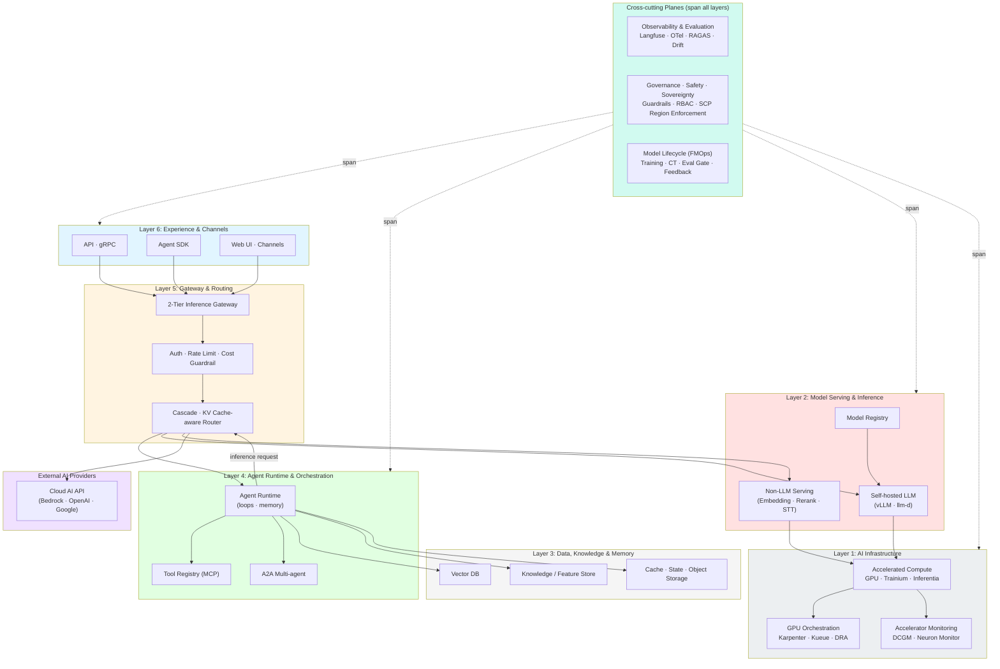
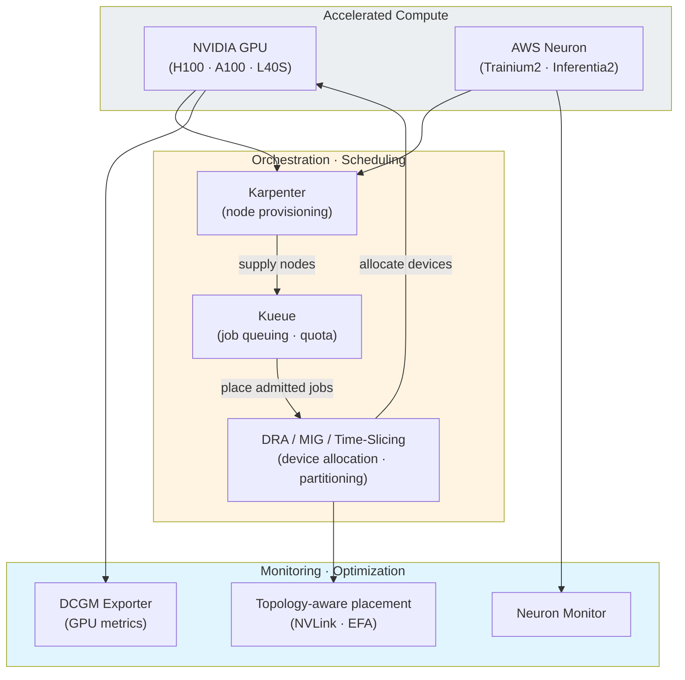
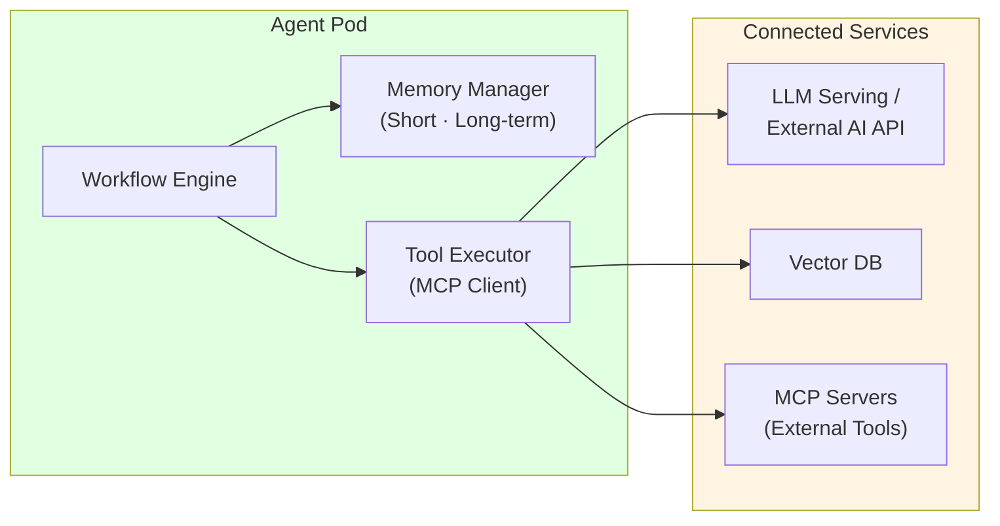
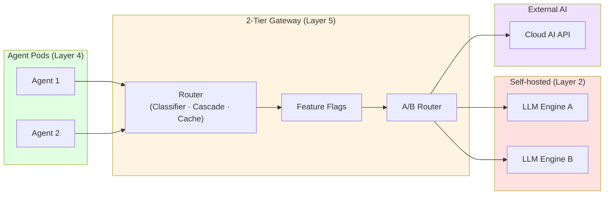
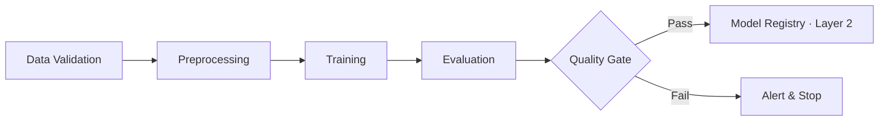
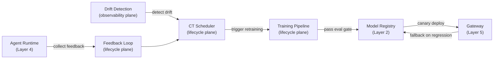
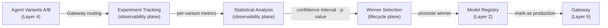
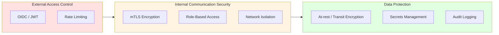
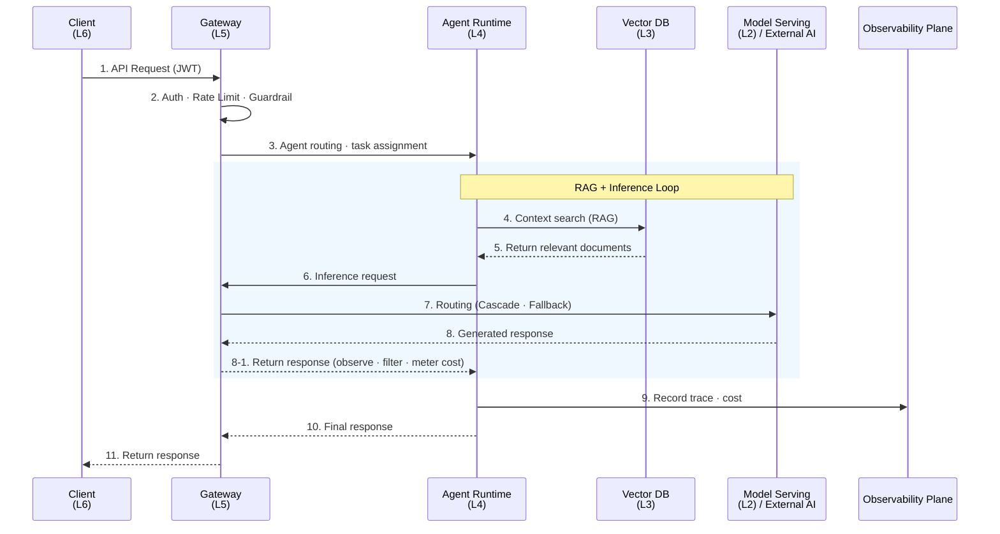

import { LayerRoles, TenantIsolation, RequestProcessing } from '@site/src/components/ArchitectureTables';

## Overview

An Agentic AI platform provides the environment in which agents call models and tools to perform tasks. This architecture separates **functions that process requests** from **operating responsibilities shared across those functions**.

The request-processing functions form **6 runtime layers**: **accelerated compute infrastructure**, **model serving**, **data/knowledge/memory**, **agent orchestration**, **intelligent inference routing**, and **multi-channel exposure**. **Observability & evaluation**, **governance/safety/sovereignty**, and **model lifecycle (FMOps)** apply across those layers, so they form **3 cross-cutting planes**. For a detailed analysis of the challenges, see [Technical Challenges](./agentic-ai-challenges.md).

:::info Target Audience
This document is intended for solution architects, platform engineers, and DevOps engineers. A basic understanding of Kubernetes and AI/ML workloads is required.
:::

---

## Separating Layers from Planes

Earlier layer models placed concerns such as evaluation, drift detection, and feedback across multiple layers, blurring responsibility boundaries. This architecture clearly distinguishes two kinds of building blocks.

- **Runtime Layer**: Six layers that group the request-processing functions by responsibility. The layer number denotes the abstraction level of each responsibility (Layer 1 infrastructure → Layer 6 experience); it does not mean a request flows one-way in numeric order. A real request enters at Layer 6, descends to the Layer 5 gateway and the Layer 4 Agent, and when inference is needed it goes **back through the Layer 5 gateway** to call Layer 2 model serving — a loop rather than a strict top-down path (see [Data Flow](#data-flow) below for the exact path). The platform is built bottom-up (Layer 1 → Layer 6).
- **Cross-cutting Plane**: Three concerns that do not belong to any single layer but **span all layers vertically**. Observability & evaluation, governance/safety/sovereignty, and model lifecycle fall into this category.

:::tip Why separate into planes
Quality evaluation (RAGAS), drift detection, feedback collection, and Guardrails are not functions of a single layer but **concerns that operate across all layers**. Placing them as separate layers causes the same function to be described redundantly in multiple layers, dispersing responsibility. Separating them into planes makes "where inference happens (layer)" and "how it is observed, controlled, and improved (plane)" orthogonal. The specific decomposition into 6 runtime layers and 3 cross-cutting planes is a design choice of this document, not a verbatim copy of a published reference model. It shares the **problem framing (separation of concerns and cross-cutting operations)** with Chip Huyen's *AI Engineering* (2025) Infrastructure / Model / Application 3-tier model, the FTI (Feature–Training–Inference) pipeline pattern, and the cross-cutting operational perspective of the AWS Well-Architected Generative AI Lens. However, the number and boundaries of the layers and planes do not map one-to-one onto those sources, so consult the originals for the precise correspondence.
:::

---

## Overall System Architecture

The Agentic AI Platform consists of **6 runtime layers** and **3 cross-cutting planes** that span them. Each layer has clear responsibilities and enables independent scaling and operation through loose coupling.

**Figure 1. Overall system architecture of 6 runtime layers and 3 cross-cutting planes**



**Core Design Principles:**

- **Orthogonal separation of layers and planes**: Separate "where inference happens (6 layers)" from "how it is observed, controlled, and improved (3 planes)" to eliminate concern duplication
- **AI Infrastructure as a first-class layer**: Make accelerated compute (GPU·Trainium·Inferentia) and its orchestration, monitoring, and performance optimization an explicit bottom-most layer (Layer 1)
- **Self-hosted + External AI Hybrid**: Unified management of self-hosted models and external AI Provider APIs through the same gateway (Layer 5)
- **2-Tier Cost Tracking**: Dual tracking at infrastructure level (accelerator hours · model unit price × tokens) and application level (per-agent-step costs)
- **MCP/A2A Standard Protocols**: Standardized communication between agents and tools (MCP) and between agents (A2A) for interoperability
- **Closed-loop FMOps**: A closed loop where production feedback triggers retraining and new models must pass an evaluation gate before deployment (model lifecycle plane)
- **Sovereignty-aware**: Meet data sovereignty requirements through SCP region enforcement, in-country regions, and hybrid/on-premises self-hosting (governance plane)

### Layer & Plane Roles

<LayerRoles />

### Mapping from the Former 8-Layer Model

The previous version used 8 layers, but evaluation, drift, feedback, and Guardrails were duplicated across multiple layers. The model has been reorganized into 6 layers + 3 planes as follows.

**Table 1. Mapping between the former 8-layer model and the current 6 layers + 3 planes**

| Former (8-layer) | Current (6 layers + 3 planes) |
|------------------|-------------------------------|
| Layer 1: Client & Feedback | Layer 6: Experience & Channels (Feedback → lifecycle plane) |
| Layer 2: Gateway & Governance | Layer 5: Gateway & Routing (Governance → governance plane) |
| Layer 3: Agent & Orchestration | Layer 4: Agent Runtime & Orchestration |
| Layer 4: Model Serving & Lifecycle | Layer 2: Model Serving (Lifecycle → lifecycle plane) |
| Layer 5: Data & Feature | Layer 3: Data, Knowledge & Memory |
| Layer 6: Observability & Insights | Observability & Evaluation plane |
| Layer 7: Training & Feedback | Model Lifecycle plane |
| Layer 8: Evaluation & Quality | Observability & Evaluation plane + Governance plane (Guardrails) |
| *(none)* | **Layer 1: AI Infrastructure (new)** |

---

## Core Components: Runtime Layers

The six layers are described in reverse request order (bottom-most infrastructure → top-most experience). The platform is built up from Layer 1. The request flow descends Layer 6 (entry) → Layer 5 (gateway) → Layer 4 (Agent); when the Agent needs inference, it goes back through the Layer 5 gateway to call Layer 2 (model serving), which runs on the Layer 1 accelerated compute.

### Layer 1: AI Infrastructure

The bottom-most layer responsible for **accelerated compute resources and their operation**. Accelerators such as GPU·Trainium·Inferentia are the most expensive resources in Agentic AI, so beyond simple provisioning, orchestration, monitoring, and performance optimization must be integrated into a single layer. This layer operates as a combination of many components and provides a stable accelerated-compute abstraction to the layer above (Layer 2, model serving).

**Figure 2. Accelerated compute, orchestration, and telemetry in Layer 1 AI Infrastructure**



Karpenter (node supply), Kueue (job admission/quota), and device allocation (DRA/MIG/Time-Slicing) are **independent control responsibilities**, not a single serial pipeline. Karpenter supplies nodes, Kueue admits jobs within quota, and the device-allocation layer assigns accelerators to admitted Pods. The three are configured and operated independently.

**Table 2. Responsibility and key components by functional area in Layer 1 AI Infrastructure**

| Functional Area | Responsibility | Key Components |
|-----------------|----------------|----------------|
| **Accelerated Compute** | Provide accelerators for LLM/non-LLM inference and training | NVIDIA GPU, AWS Trainium2/Inferentia2 |
| **Node Orchestration** | Workload-driven dynamic node provisioning, Spot usage | Karpenter, Cluster Autoscaler |
| **Job Scheduling** | GPU job queuing, per-team quota, fair sharing | Kueue, KAI Scheduler |
| **GPU Partitioning** | Share a single GPU across workloads (isolation level differs by mechanism, see below) | MIG, Time-Slicing, DRA |
| **Accelerator Monitoring** | Real-time tracking of utilization, temperature, memory, power | DCGM Exporter, Neuron Monitor |
| **Performance Optimization** | Topology-aware placement, high-speed networking | NVLink/NVSwitch-aware scheduling, EFA |

:::warning GPU partitioning mechanisms differ in isolation level
MIG, Time-Slicing, and DRA all let multiple workloads use a single GPU, but they provide different isolation, so they must not be treated as equivalent.

- **MIG (Multi-Instance GPU)**: A **hardware partitioning** feature available only on supported NVIDIA GPUs (such as A100 and H100). It physically partitions the GPU so each instance gets dedicated memory, compute, and cache paths, providing **memory and performance isolation** between instances.
- **Time-Slicing**: Multiple workloads **time-share** one GPU in turns. It does not isolate memory, so one workload can over-consume memory or affect another's performance. It suits low-risk sharing where hardware isolation is not required.
- **DRA (Dynamic Resource Allocation)**: A Kubernetes **device request/allocation mechanism**, not a partitioning scheme in itself. Depending on the driver, it is used to flexibly request and assign MIG partitions or Time-Slicing shares.

Therefore, when regulatory compliance or strong tenant isolation is required, choose a mechanism that provides hardware isolation such as MIG, and use Time-Slicing only on the premise that it does not isolate memory.
:::

**Why a separate layer:**

The operation of accelerated compute is separated in responsibility from model serving (Layer 2). Model serving owns "which model is served and how"; AI Infrastructure owns "on which accelerator that inference runs and how efficiently." GPU monitoring, scheduling, and partitioning evolve independently of serving engines such as vLLM and llm-d, and training workloads (lifecycle plane) share the same infrastructure layer.

:::info Detailed Guides
For GPU node strategy, Karpenter·KEDA·DRA resource management, the NVIDIA GPU stack (GPU Operator·DCGM·MIG), and the AWS Neuron stack, see the Accelerated Computing Infrastructure section of [Model Serving & Inference Infrastructure](../../model-serving/index.md).
:::

---

### Layer 2: Model Serving & Inference

The layer responsible for inference of self-hosted models and non-LLM models. It runs on the accelerated compute provided by Layer 1 and processes inference requests routed from the Layer 5 gateway.

#### Self-hosted LLM Serving

Operates high-performance LLM serving engines supporting PagedAttention, KV cache optimization, and distributed inference. Open-source inference engines such as vLLM and llm-d are autoscaled on Kubernetes.

#### Non-LLM Serving

Non-LLM models such as embedding, reranking, and STT (Whisper) are served separately via Triton Inference Server and similar. The RAG pipeline (Layer 3) and agents (Layer 4) call these.

#### Model Registry

Centrally manages versions, metadata, and performance metrics of all deployed models. The training pipeline in the model lifecycle plane registers new models, and only models that pass the evaluation gate are served through this registry.

```
s3://model-registry/
├── llama-3-70b/
│   ├── v1.0.0/
│   │   ├── model.safetensors
│   │   ├── metadata.json
│   │   └── evaluation_metrics.json
│   ├── v1.1.0/
│   └── v1.2.0/ (current production)
└── mistral-7b/
```

:::info Detailed Guides
For vLLM model serving, llm-d distributed inference (KV Cache-aware routing), MoE serving, and the NeMo training framework, see [Model Serving & Inference Infrastructure](../../model-serving/index.md). Model transformations such as fine-tuning and distillation are covered in [Model Lifecycle](../../reference-architecture/model-lifecycle/index.md).
:::

---

### Layer 3: Data, Knowledge & Memory

The layer that provides the data, knowledge, and memory used by agents and the RAG pipeline.

#### Vector DB (RAG Store)

Converts documents into embedding vectors for storage and provides relevant context via similarity search upon agent requests.

**Design Considerations:**
- **Multi-tenant isolation**: Partition Keys **physically separate** data per tenant. However, a Partition Key is only a data-placement mechanism, not access control, so you must also enforce **tenant-ID authorization at the query layer** (restricting each tenant to its own partition) to prevent cross-tenant reads.
- **Index strategy**: High-performance Approximate Nearest Neighbor search with HNSW index
- **Hybrid search**: Improved search quality by combining Dense Vector + Sparse Vector (BM25)

#### Knowledge / Feature Store

Manages input features and domain knowledge used for ML model training and inference. Sharing the **same feature definition** at training and inference time is a necessary condition for reducing training-serving skew, but it does not by itself eliminate skew: you also need point-in-time-correct joins to prevent label leakage, plus consistency of feature versions, materialization timing, and values between the online and offline stores. Combining ontology and knowledge graphs **can help** with provenance tracking and reducing RAG hallucination, but the effect depends on graph quality, coverage, and retrieval design, so it must be confirmed by evaluation.

```
Online Store (Redis/DynamoDB)
  └─ Low-latency feature lookup · for real-time inference (target latency depends on backend, data size, and network; e.g. single-digit ms must be verified by measurement)

Offline Store (S3 Parquet)
  └─ Large-scale feature storage · for batch training
```

#### Cache · State · Object Storage

Stores session state, short-term memory, and LangGraph checkpointer state. Supports checkpointing and recovery for long-running agent tasks.

:::info Detailed Guides
For the 3-plane design of the ontology-based Knowledge Feature Store, see [Knowledge Feature Store](../advanced-patterns/knowledge-feature-store.md); for Milvus vector DB operations, see [Milvus Vector DB](../../operations-mlops/data-infrastructure/milvus-vector-database.md).
:::

---

### Layer 4: Agent Runtime & Orchestration

The layer where AI agents execute. Each agent runs as an independent container, with its lifecycle managed by a workflow engine.

**Figure 3. Agent Pod and connected services in Layer 4 Agent Runtime**



**Table 3. Features and descriptions provided by the Agent Runtime**

| Feature | Description |
|---------|-------------|
| **State Management** | Maintains conversation context and task state, checkpointing |
| **Tool Execution** | Asynchronous execution of registered tools via MCP protocol |
| **Memory Management** | Combines short-term memory (session) with long-term memory (vector DB) |
| **Inter-Agent Communication** | Multi-agent collaboration via A2A protocol |
| **Error Recovery** | Retry and fallback for failed tasks (policy differs by action and idempotency, see below) |

#### Tool Registry

Centrally manages tools available to agents in a declarative manner. Tools are exposed through **MCP servers**, and a single MCP server typically exposes **multiple tools** (tools and servers are not 1:1). Agents invoke these tools via the standard MCP protocol. Targets that do not speak MCP directly — such as external REST/gRPC APIs — are wrapped as MCP tools by an **adapter**. Separately, **A2A (Agent-to-Agent) is a distinct protocol from MCP**, used to delegate work between agents. The "A2A Tools" row below denotes an adapter that wraps an A2A call behind the MCP tool interface; it does not mean A2A is a sub-feature of MCP.

**Table 4. Tool types managed by the Tool Registry, with purpose and examples**

| Tool Type | Purpose | Example |
|-----------|---------|---------|
| **API Tools** | External REST/gRPC service calls (exposed as MCP tools via an adapter) | CRM lookup, order processing |
| **Search Tools** | Vector DB search, document search | RAG context augmentation |
| **Code Execution** | Code execution in sandbox environments | Data analysis, calculations |
| **A2A Tools** | Delegating tasks to other agents (A2A protocol exposed via an adapter) | Specialist agent collaboration |

:::warning Automatic retry assumes idempotent external actions
"Automatic retry on failure" is safe for **idempotent actions** such as lookups, but applying it as-is to **non-idempotent actions with side effects** (payments, orders, message sends) can cause duplicate execution. It is especially risky in **uncertain-commit** situations where the request was sent but the response was lost. For each tool, therefore, define (1) an idempotency key or a retry-safety flag, (2) reconciliation/confirmation lookups for non-idempotent actions, and (3) a resume contract based on a durable checkpoint — and declare retry-eligibility per action.
:::

:::info Detailed Guides
For Kagent-based Kubernetes agent management, see [Kagent](../../operations-mlops/observability/kagent-kubernetes-agents.md); for AWS Native AgentCore-based agent operations, see [AWS Native Platform](../platform-selection/aws-native-agentic-platform.md).
:::

---

### Layer 5: Gateway & Routing

The layer that intelligently routes model inference requests. It unifies self-hosted models (Layer 2) and external AI providers into a single endpoint.

**Figure 4. 2-Tier gateway request flow in Layer 5 Gateway & Routing**



**Routing Strategies:** The benefits below (latency, cost savings, etc.) depend on traffic, cache hit rate, and model mix, so treat them as **policies to verify by measurement** before and after adoption.

**Table 5. Routing strategies and their behavior in the Layer 5 gateway**

| Strategy | Description |
|----------|-------------|
| **Model-based routing** | Distributes to appropriate model backends based on request headers/parameters |
| **KV Cache-aware routing** | Can reduce TTFT when the Prefix Cache hits (no effect on a cache miss); benefit scales with hit rate |
| **Cascade routing** | Tries low-cost model first → switches to high-performance model **on quality-threshold miss or failure**. The definition of "failure" (quality threshold / error) must be stated |
| **Weight-based routing** | Traffic ratio splitting for Canary/Blue-Green deployments |
| **Fallback** | Automatic failover to alternative provider on outage (Circuit Breaker) |

#### Cost Guardrails

Sets cost limits per request, per agent, and per tenant. Cost control must be **distinguished by enforcement strength**.

- **Hard stop**: When a ceiling must be respected, reserve the estimated cost **before** processing the request (preflight reservation) and reject the request if the remaining budget is insufficient. Falling back to a cheaper model or only sending an alert **after** the budget is already exceeded **cannot prevent further charges**.
- **Soft alert / fallback**: Allows overshoot while switching to a cheaper model or sending an alert. In this case, define the allowed overshoot range as well; it does not guarantee a cost ceiling.

(Policy enforcement itself integrates with the governance plane.)

Operational details for Layer 5 are covered in the following documents.

- Per-tenant key/budget hierarchy and the three-level isolation model: [AI Gateway Multi-Tenancy](../../operations-mlops/governance/ai-gateway-multi-tenancy.md)
- Token metering, showback/chargeback, and the budget policy matrix: [LLM FinOps Chargeback](../../operations-mlops/governance/llm-finops-chargeback.md)
- Optimizing token overhead when agents use MCP tools through the gateway: [MCP Tool Token Optimization Patterns](../advanced-patterns/mcp-token-optimization.md)

:::info Detailed Guides
For the 2-Tier Gateway architecture (kgateway + Bifrost), Cascade Routing tuning, and Semantic Router, see [Inference Gateway](../../reference-architecture/inference-gateway/index.md).
:::

---

### Layer 6: Experience & Channels

The top-most layer where users and external systems enter the platform. It exposes agent capabilities through various channels (API, SDK, Web UI, messenger/contact channels).

**Table 6. Entry points of Layer 6 Experience & Channels, with description and use**

| Entry Point | Description | Use |
|-------------|-------------|-----|
| **API · gRPC** | REST/gRPC endpoints | System integration, backend calls |
| **Agent SDK** | Python/JS client SDK | Application-embedded agents |
| **Web UI** | Dashboard/chat interface | Direct operator/user interaction |
| **Channels** | Messenger, contact center (AICC), voice channels | Omni-channel customer touchpoints |

Users submit ratings and corrections through this layer. The **model lifecycle plane** owns the work of processing that feedback and turning it into training data.

---

## Core Components: Cross-cutting Planes

The following 3 planes do not belong to any single layer but span the 6 runtime layers vertically.

### Observability & Evaluation Plane

Centrally collects and evaluates traces, metrics, costs, and quality arising across all layers.

#### LLM Tracing

Records the input, output, latency, and token usage of all LLM calls. Detailed traces for debugging are kept in development, sampled traces in production. Based on Langfuse and OpenTelemetry, it traces the full flow from Layer 4 (Agent) to Layer 2 (Serving).

#### 2-Tier Cost Tracking

- **Infrastructure level**: Layer 1 accelerator hours, model unit price × tokens
- **Application level**: Per-agent-step cost, per-tenant/per-model budget tracking

#### Quality Evaluation (RAGAS)

Quantitatively measures RAG/Agent quality. Rather than a single layer, it comprehensively evaluates quality spanning data (Layer 3), serving (Layer 2), and Agent (Layer 4).

**RAGAS Metrics:**
- Context Precision / Context Recall: retrieval accuracy and recall
- Faithfulness: the degree to which the generated answer is grounded in context
- Answer Relevancy: relevance between question and answer

**Agent Success Rate:**
- Task Completion Rate, Tool Execution Accuracy, Multi-step Coherence

#### Drift Detection

Drift must be distinguished by type, and different metrics detect different things.

- **Covariate (data) drift**: A change in the input distribution P(X). Metrics such as PSI and KL Divergence detect **input-distribution change**; example thresholds are PSI > 0.25 and KL Divergence > 0.1 (these are proposed values to calibrate to your data, window, and features).
- **Concept drift**: A change in the **relationship** P(Y\|X) between inputs and outputs itself. PSI/KL, which look only at the input distribution, cannot directly identify concept drift; it must be judged from a change in prediction quality once ground truth arrives.
- **Quality degradation**: A drop in output-quality metrics such as RAGAS or Agent success rate. This can arise not only from concept drift but from prompt, retrieval (RAG), tool, or model causes.

A threshold breach is therefore **a starting point for diagnosis, not an immediate retraining trigger**. Diagnose the cause (prompt/retrieval/tool/model) first, and only trigger retraining in the model lifecycle plane through an authorized procedure when weight retraining is judged necessary. A PSI/KL threshold breach alone does not prove that weight retraining is required.

:::info Detailed Guides
For Langfuse-based agent monitoring, see [Agent Monitoring](../../operations-mlops/observability/agent-monitoring.md); for an LLMOps tool comparison, see [LLMOps Observability](../../operations-mlops/observability/llmops-observability.md); for RAG evaluation, see [Ragas Evaluation](../../operations-mlops/governance/ragas-evaluation.md).
:::

---

### Governance, Safety & Sovereignty Plane

Enforces safety, policy, regulatory compliance, and data sovereignty across the platform.

#### Guardrails Enforcement

Validates LLM input/output with NeMo Guardrails or Guardrails AI:
- PII Leakage Detection
- Prompt Injection Detection
- Toxic Content Filtering
- Factuality Check

Guardrails apply simultaneously at Layer 5 (gateway entry) and Layer 4 (agent output), so they are defined as a plane rather than a single layer.

#### Policy · Access Control (RBAC)

Enforces OIDC/JWT authentication, role-based access control, per-tool invocation permission limits, and tenant isolation. Callable tools per agent are declaratively defined under the principle of least privilege.

#### Data Sovereignty · Region Enforcement

Organizations with data sovereignty requirements (finance, public sector, regulated industries) must confine inference, training, and data storage within specific geographic boundaries. Each means below controls **only a specific boundary**, so an organization must first identify the required processing, storage, telemetry, and control-plane boundaries and all profiled destinations, then combine them. This table shows **what each means controls and the residual flow it leaves**, not a blanket claim that the platform "meets sovereignty" automatically.

**Table 7. Control scope and residual flow by data-sovereignty / region-enforcement means**

| Means | What it controls | What it does NOT control (residual flow) | Applied At |
|-------|------|------|-----------|
| **SCP Region Enforcement** | Denies the **API call endpoint** in unapproved Regions via `aws:RequestedRegion` | Restricts only the endpoint Region; the Region where a service processes data internally follows the service's behavior | Account/OU boundary |
| **Bedrock Geographic CRIS** | Keeps inference **within a geography** (e.g. US, EU, APAC) | A geography spans multiple Regions/countries, so it **does not guarantee in-country** processing; insufficient for single-country requirements | Layer 5 → External AI |
| **In-country Self-hosting** | Keeps model inference/weights in a specific **in-country Region or on-premises** | Side flows such as logs, metrics, and the management plane need separate control | Layer 1·2 |
| **Hybrid (EKS Hybrid Nodes)** | Places the data plane (workloads) on-premises/in-country | The **control plane (the EKS-managed part) remains AWS-hosted**, so it is not full on-premises isolation | Layer 1 |

:::info Detailed Guides
For SCP region enforcement policies, Bedrock Geographic cross-Region inference, and EKS Hybrid Nodes-based hybrid/sovereign deployment patterns, see [Sovereign & Hybrid Deployment](../platform-selection/sovereign-hybrid-deployment.md) and the [AI Platform Selection Guide](../platform-selection/ai-platform-decision-framework.md). For the Guardrails technology stack, see [AI Gateway Guardrails](../../operations-mlops/governance/ai-gateway-guardrails.md); for compliance mapping (SOC2·ISMS-P), see [Compliance Framework](../../operations-mlops/governance/compliance-framework.md).
:::

---

### Model Lifecycle (FMOps) Plane

Owns the closed loop that continuously improves models based on production feedback. Training, fine-tuning, evaluation, retraining, and feedback all belong to this plane, and the output (new models) is delivered to the Layer 2 Model Registry.

#### Training Pipeline Orchestration

Automates training workflows with Kubeflow Pipelines or Argo Workflows. Defines data validation → preprocessing → training → evaluation → registration stages as a DAG. Training workloads share the accelerated compute of Layer 1 AI Infrastructure.

**Figure 5. Training pipeline DAG and quality gate in the FMOps plane**



#### Continuous Training (CT) Scheduler

Can run retraining on drift detection (observability plane). Supports schedule-based (Cron) or event-based (drift threshold exceeded) triggers. The specific numbers in the trigger conditions below are unvalidated **proposed values (examples)**; calibrate them to your data before use, and run retraining only on approved training data through a prespecified experiment procedure.

**Trigger conditions (proposed values, calibration required):**
- Schedule-based: `0 0 * * 0` (every Sunday)
- Drift-based: PSI > 0.25 or KL Divergence > 0.1 (an input-distribution-change signal — diagnose the cause before retraining)
- Quality degradation: Agent Success Rate < 85% sustained for 7 days

#### Evaluation Gate

A gate that validates model quality before deployment. Automatically measures Accuracy, RAGAS metrics, and Guardrails pass rate, blocking deployment if quality thresholds are not met. New models are canary-deployed (e.g. 10%), then judged for regression against prespecified metrics, direction, and effect size. A statistical test suited to comparing metric distributions (e.g. the Mann-Whitney U test) may be used, but an arbitrary `p < 0.05` alone does not prove the presence or absence of regression; define the test direction, effect size, power, and a multiple-comparison policy as well. On a confirmed regression, roll back (the canary percentage and thresholds are proposed values).

#### Feedback Loop

Recycles production feedback (user ratings, corrections, A/B test results) into training data. In preference learning (e.g. DPO), treat the **original bad answer as the rejected sample and the user's validated correction as the chosen sample**. The "hard negative" in the pseudocode below refers to constructing this rejected/chosen pair; it does not mean training on the corrected (good) answer as a negative example. Also keep recycled data separate from the evaluation holdout to prevent data leakage.

```
Positive Feedback (thumbs up)
  → Add to training dataset as a chosen example

Negative Feedback (thumbs down)
  → If user provides a correction: form a preference pair (original = rejected, correction = chosen)
  → If no correction: filter out of the training dataset
```

:::info Detailed Guides
For the MLOps pipeline (EKS), continuous training (GRPO/DPO), trace-to-dataset, and evaluation/rollout, see [Model Lifecycle](../../reference-architecture/model-lifecycle/index.md).
:::

---

## Layer & Plane Integration Flows

Shows how runtime layers and cross-cutting planes interact to form a complete FMOps pipeline. All three flows reveal a structure where **planes span layers**.

### Feedback → Training → Serving Loop

The full loop where production feedback triggers retraining and a new model is deployed. The lifecycle plane and observability plane span the runtime layers.

**Figure 6. The Feedback → Training → Serving loop, from feedback collection through retraining and canary deployment**



**Flow description:**
1. Layer 4 (Agent Runtime) collects user feedback and forwards it to the lifecycle plane's Feedback Loop
2. The observability plane's Drift Detection detects input data drift
3. The lifecycle plane's CT Scheduler receives the retraining trigger and runs the Training Pipeline (using Layer 1 accelerated compute)
4. On passing the evaluation gate, the new model is registered in the Layer 2 Model Registry
5. The Layer 5 Gateway validates the new model with a 10% canary deployment
6. On regression detection, automatic rollback to the previous version in the Model Registry

### Evaluation → Rollback Path

The path that detects quality regression and automatically rolls back. The observability plane detects and the lifecycle plane responds.

**Figure 7. The Evaluation → Rollback path, from quality-regression detection through traffic cutover**

```mermaid
graph LR
    A["LLM Tracing<br/>(observability plane)"] -->|detect quality regression| B["Eval Gate<br/>(lifecycle plane)"]
    B -->|confirm with statistical test| C["Alert System<br/>(observability plane)"]
    C -->|execute rollback policy| D["Model Registry<br/>(Layer 2)"]
    D -->|select last stable version<br/>(control plane)| CTRL["Deployment Controller<br/>(Layer 2)"]
    CTRL -->|rolling redeploy · check readiness| POD["Serving Pods<br/>(Layer 2)"]
    POD -->|shift traffic once ready| E["Gateway<br/>(Layer 5)"]
    E -->|user-traffic cutover| F["Production Restored"]
```

**Flow description:**
1. The observability plane detects a RAGAS score drop
2. The lifecycle plane's Eval Gate confirms significance with a statistical test (test direction, effect size, and power defined in advance)
3. If judged a significant regression, the Alert System executes the rollback policy
4. **Control plane**: the Layer 2 Model Registry selects the last stable version (a registry stage transition is a metadata change, not a traffic cutover in itself)
5. **Deploy/readiness**: a Deployment Controller rolling-redeploys the previous version and checks pod readiness, draining, in-flight requests, and cache/state compatibility
6. **Traffic cutover**: once the new pods are ready, the Layer 5 Gateway shifts user traffic
7. Recovery complete

:::note "5 minutes" is a recovery objective to be verified by measurement
"Atomic swap within 5 minutes" is an unverified **recovery objective**; the actual time depends on model loading, pod readiness, cache warming, and capacity. Control-plane version selection, rolling pod readiness, and user-traffic cutover are **separate steps**, and none is instantaneous or atomic. To claim a recovery time as a number, measure it with observed rollback fixtures.
:::

### A/B Testing → Production

The path that experiments with two Agent/Model variants and deploys the winner to production.

**Figure 8. The A/B Testing → Production path, from two-variant experiment through promoting the winner to production**



**Flow description:** The numbers below (50:50, n, p, improvement) are **proposed example gates**; before the experiment, prespecify the randomization unit, metric direction, effect size, power, and multiple-comparison policy.
1. Layer 4 (Agent Runtime) runs the two A/B variants
2. Layer 5 (Gateway) splits requests (e.g. 50:50). State the **randomization unit** (request/session/user); it determines whether samples are independent or paired
3. The observability plane's Experiment Tracking collects per-variant metrics (size the sample via a power analysis; e.g. n ≥ 1000 is a proposed value)
4. The observability plane's Statistical Analysis runs a test suited to comparing metric distributions (e.g. the Mann-Whitney U test). This test asks whether the two distributions differ; it does not directly test "mean improvement"
5. Select the winner only when a significant difference in the prespecified direction (e.g. p < 0.05) **and** a practically meaningful effect size (e.g. improvement > 5%) both hold (numbers are proposed gates)
6. The lifecycle plane marks the winner variant as production in the Layer 2 Model Registry
7. Layer 5 (Gateway) shifts traffic to the winner

---

## Deployment Architecture

### Namespace Structure

Namespaces are separated by function for separation of concerns and security, and each namespace applies **least privilege (Pod Security Standards)** by default. Pod Security's `privileged` is an "unrestricted" policy that allows known privilege escalations and can bypass container isolation, so you must not set serving and training namespaces to `privileged` merely because they use GPUs. Ordinary GPU model Pods can run without host privilege at `baseline` (or an exception tailored to the device-plugin requirement), and **only the privileged components that genuinely need host access** — drivers, system operators — are separated out as narrow exceptions.

**Table 8. Layer/plane, components, Pod Security, and GPU requirement by namespace**

| Namespace | Layer / Plane | Components | Pod Security | GPU |
|-----------|---------------|-----------|-------------|-----|
| **ai-infra** | Layer 1 | GPU Operator, Karpenter, Kueue, DCGM Exporter | baseline (privileged exception only for host-access components such as GPU drivers / device plugins) | Required |
| **ai-inference** | Layer 2 | LLM Serving Engine, Triton, Model Registry | baseline (serving Pods need no host privilege; document only backend-specific device-access exceptions) | Required |
| **ai-data** | Layer 3 | Vector DB, Cache, Knowledge/Feature Store | baseline | - |
| **ai-agents** | Layer 4 | Agent Runtime, Tool Registry, A2A | baseline | - |
| **ai-gateway** | Layer 5 | Inference Gateway, Auth, A/B Router | restricted | - |
| **observability** | Observability plane | Tracing, Metrics, RAGAS, Drift Detection | baseline | - |
| **ai-governance** | Governance plane | Guardrails, Policy, Regression Detection | baseline | - |
| **ai-training** | Lifecycle plane | Training Pipeline, CT Scheduler, Eval Gate | baseline (narrow privileged exception only for Pods that need it, e.g. distributed-training communication) | Required |

Here "privileged" refers to the Pod Security Standards **policy level (a relaxation of the namespace admission policy)**, which is distinct from a container's `securityContext.privileged: true` flag. Where possible, grant only the minimum per-component privileges needed (specific devices/capabilities) instead of relaxing the policy.

Layer 6 (Experience & Channels) is exposed via the Ingress/ALB in front of ai-gateway and external channel connectors, without a dedicated namespace.

---

## Scalability Design

### Horizontal Scaling Strategy

Each component can be horizontally scaled independently.

**Table 9. Horizontal scaling trigger and method by component**

| Component | Layer | Scaling Trigger | Method |
|-----------|-------|----------------|--------|
| GPU Nodes | Layer 1 | Pending Pods, GPU request volume | Karpenter Node Auto-provisioning |
| LLM Serving | Layer 2 | GPU utilization, queue depth | HPA + KEDA |
| Vector DB | Layer 3 | Query latency, index size | Independent Query/Index Node scaling |
| Agent Pod | Layer 4 | Message queue length, active session count | Event-driven Autoscaling (KEDA) |
| Gateway | Layer 5 | Request count, concurrent connections | HPA |
| Training Pipeline | Lifecycle plane | Training job queue length | Spot Instance Auto-provisioning |

### Multi-Tenant Support

Supports multi-tenancy through a combination of namespace isolation, resource quotas, and network policies, enabling multiple teams or projects to share the same platform. This covers **infrastructure (Kubernetes) level** isolation; for tenant isolation on the LLM request path — gateway keys/budgets, vector DB namespaces, per-team trace separation — the three-level isolation model in [AI Gateway Multi-Tenancy](../../operations-mlops/governance/ai-gateway-multi-tenancy.md) is canonical.

<TenantIsolation />

---

## Security Architecture

The Agentic AI Platform applies a **3-layer security model** covering external access, internal communication, and data protection.

**Figure 9. The 3-layer security model: external access, internal communication, and data protection**



**Agent-Specific Security Considerations:** The items below are **measured mitigations**, not guarantees that they "block" an attack on their own. Define each item's failure behavior (fail-closed/open) and verify its effectiveness by evaluation.

- **Prompt injection mitigation**: An input validation layer (Guardrails) **can filter out a substantial fraction** of malicious prompts, but LLM-based filters are bypassable, so do not assume complete blocking. Keep authorization, tool-broker controls, and egress restrictions as **separate controls outside the filter**.
- **Tool execution permission limits**: Declaratively define callable tools per agent and apply least privilege. This is enforced at the **tool-broker/authorization layer**, not by an LLM output filter.
- **PII leakage mitigation**: Output filtering **reduces** sensitive-information exposure but does not guarantee complete blocking, so pair it with data access controls and egress restrictions.
- **Execution time limits**: Timeout and maximum step count settings to prevent agent infinite loops

:::danger Security Notice
- Identify internal vs external communication segments and apply mTLS **to the actual endpoints** (it is not applied uniformly to every call, and external provider APIs may terminate TLS differently). A Guardrails server such as NeMo Guardrails has no built-in authentication, TLS, or rate limiting, so **reinforce it at an external layer** such as the gateway or service mesh.
- Store API keys and tokens in Secrets Manager
- Perform regular security audits and patch vulnerabilities
:::

---

## Data Flow

The complete flow of how user requests are processed through the platform.

**Figure 10. The data-flow sequence of a user request processed across the layers**



<RequestProcessing />

---

## Monitoring and Observability

### Key Monitoring Areas

**Table 10. Target metrics and purpose by monitoring area**

| Area | Target Metrics | Purpose |
|------|---------------|---------|
| **Agent Performance** | Request count, P50/P99 latency, error rate, step count | Agent performance tracking |
| **LLM Performance** | Token throughput, TTFT, TPS, queue wait time | Model serving performance |
| **Resource Usage** | CPU, memory, GPU utilization/temperature | Resource efficiency |
| **Cost Tracking** | Per-tenant/per-model token cost, infrastructure cost | Cost governance |
| **Quality** | RAGAS score, Agent success rate, Guardrails pass rate | Quality SLO compliance |
| **Training** | Training frequency, model promotion rate, drift detection count | MLOps pipeline health |

**Example Alert Rules:**
- Agent P99 latency > 10s → Warning
- Agent error rate > 5% → Critical
- GPU utilization < 20% (sustained 30 min) → Cost Warning
- Token cost reaches 80% of daily budget → Budget Warning
- RAGAS Faithfulness < 0.85 (sustained 1 hour) → Quality Warning
- Agent Success Rate < 90% (sustained 7 days) → Retraining Trigger

---

## Platform Requirements

**Table 11. Required capability and description by layer/plane**

| Area | Layer / Plane | Required Capability | Description |
|------|---------------|-------------------|-------------|
| AI Infrastructure | Layer 1 | Accelerated compute + GPU orchestration | GPU/Trainium/Inferentia, Karpenter·Kueue·DRA, DCGM monitoring |
| Model Serving | Layer 2 | LLM inference engine | PagedAttention, KV Cache optimization, distributed inference, Model Registry |
| Data Layer | Layer 3 | Vector DB + Cache + Knowledge Store | RAG search, session state storage, long-term memory, feature management |
| Agent Framework | Layer 4 | Workflow engine | Multi-step execution, state management, MCP/A2A protocols |
| Gateway | Layer 5 | Gateway API + routing | Intelligent model routing, mTLS, Rate Limiting, External AI integration |
| Experience·Channels | Layer 6 | API/SDK/UI/Channels | Multi-channel exposure, feedback collection |
| Observability | Observability plane | LLM tracing + evaluation | Token cost tracking, Agent Trace analysis, RAGAS, drift detection |
| Governance·Sovereignty | Governance plane | Multi-layer security + sovereignty enforcement | OIDC/JWT, RBAC, Guardrails, SCP region enforcement, compliance |
| Model Lifecycle | Lifecycle plane | Distributed training + CT + eval gate | LoRA/QLoRA fine-tuning, automatic retraining, regression detection, rollback |

For specific technology stacks and implementation methods, see [AWS Native Platform](../platform-selection/aws-native-agentic-platform.md) or [EKS-Based Open Architecture](../platform-selection/agentic-ai-solutions-eks.md).

---

## Conclusion

Core principles of the Agentic AI Platform architecture:

1. **Orthogonal separation of layers and planes**: Separate "where inference happens (6 runtime layers)" from "how it is observed, controlled, and improved (3 cross-cutting planes)" to eliminate concern duplication
2. **AI Infrastructure as a first-class layer**: Make accelerated compute and its orchestration, monitoring, and performance optimization an explicit bottom-most layer
3. **Hybrid AI**: Unified management of self-hosted models and external AI providers through a single gateway
4. **Standard Protocols**: Standardized tool connections and inter-agent communication via MCP/A2A
5. **Integrated observability & evaluation**: Monitor and evaluate traces, costs, and quality across the entire request flow in a single plane
6. **Governance & sovereignty**: Multi-layer security + agent-specific safety (Guardrails) + data sovereignty (SCP region enforcement, in-country, hybrid)
7. **Closed-loop FMOps**: Automate feedback → drift detection → retraining → evaluation gate → deployment
8. **Quality-first**: Every model change must pass the evaluation gate's statistical validation before production promotion

:::tip Implementation Guide
Specific methods for implementing this platform architecture are covered in the following documents:

- [Technical Challenges](./agentic-ai-challenges.md) — Key challenges faced when building the platform
- [AWS Native Platform](../platform-selection/aws-native-agentic-platform.md) — Managed service-based implementation
- [EKS-Based Open Architecture](../platform-selection/agentic-ai-solutions-eks.md) — EKS + open-source based implementation
:::

## References

### Industry Reference Architectures

- [AWS Well-Architected Generative AI Lens](https://docs.aws.amazon.com/wellarchitected/latest/generative-ai-lens/generative-ai-lens.html) — AWS official generative AI design principles, cross-cutting operational perspective
- [CNCF Cloud Native AI Whitepaper](https://www.cncf.io/reports/cloud-native-artificial-intelligence-whitepaper/) — CNCF cloud native AI layering and infrastructure patterns
- [a16z: Emerging Architectures for LLM Applications](https://a16z.com/emerging-architectures-for-llm-applications/) — LLM app reference architecture (orchestration/data/model separation)
- [Chip Huyen, *AI Engineering* (O'Reilly, 2025)](https://www.oreilly.com/library/view/ai-engineering/9781098166298/) — Infrastructure/Model/Application 3-tier, FTI pipeline

### Official Documentation

- [Kubernetes Gateway API](https://gateway-api.sigs.k8s.io/) — K8s official gateway API
- [MCP (Model Context Protocol)](https://modelcontextprotocol.io/) — MCP protocol specification
- [CNCF Cloud Native Architecture](https://www.cncf.io/) — Cloud native architecture patterns
- [OpenTelemetry](https://opentelemetry.io/) — Observability standard

### Papers / Technical Blogs

- [A2A (Agent-to-Agent Protocol)](https://a2a-protocol.org/latest/) — Google multi-agent communication protocol
- [LangChain Architecture Patterns](https://blog.langchain.dev/) — Agent architecture patterns
- [Building Production-Ready LLM Applications](https://huyenchip.com/2023/04/11/llm-engineering.html) — Production LLM engineering
- [AWS Well-Architected Framework for AI/ML](https://aws.amazon.com/architecture/) — AI/ML workload design principles

### Related Documents (Internal)

- [Technical Challenges](./agentic-ai-challenges.md) — Analysis of 5 key challenges
- [Knowledge Feature Store](../advanced-patterns/knowledge-feature-store.md) — Ontology-based feature management
- [MCP Tool Token Optimization Patterns](../advanced-patterns/mcp-token-optimization.md) — Optimizing MCP tool token overhead for Layer 4 agents
- [AI Gateway Multi-Tenancy](../../operations-mlops/governance/ai-gateway-multi-tenancy.md) — Layer 5 tenant isolation and budget enforcement
- [LLM FinOps Chargeback](../../operations-mlops/governance/llm-finops-chargeback.md) — Token metering and cost allocation methodology
- [Model Serving & Inference Infrastructure](../../model-serving/index.md) — vLLM, llm-d, MoE deployment guides
- [Operations & Governance](../../operations-mlops/index.md) — Langfuse, RAGAS, Guardrails operations
- [Reference Architecture](../../reference-architecture/index.md) — Step-by-step implementation guides
