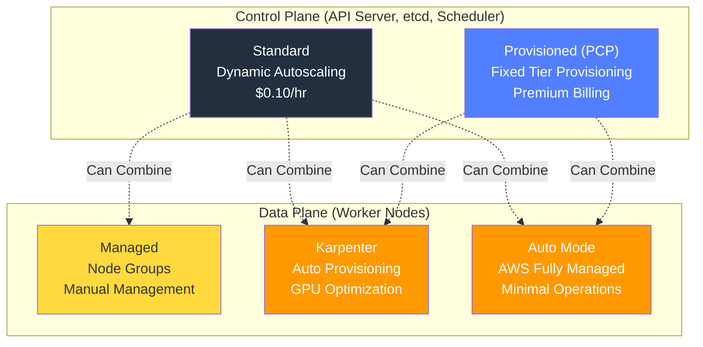
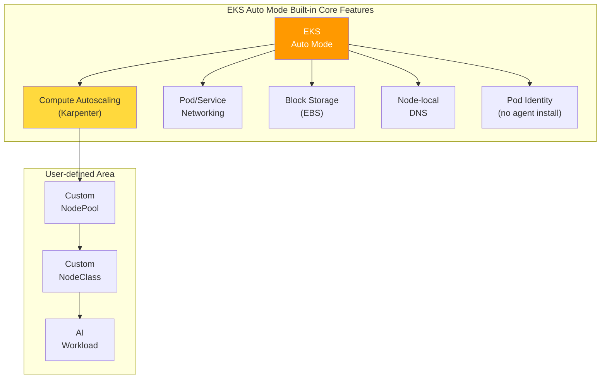
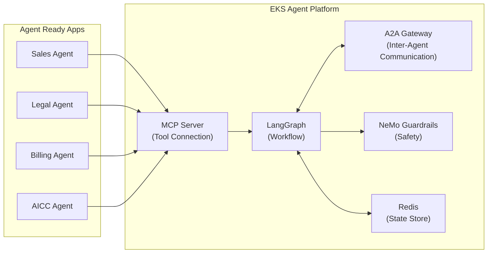
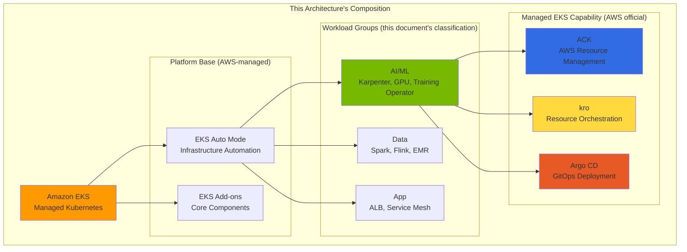
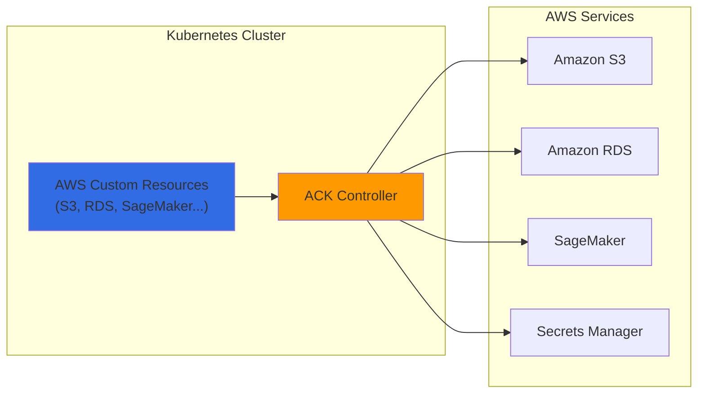
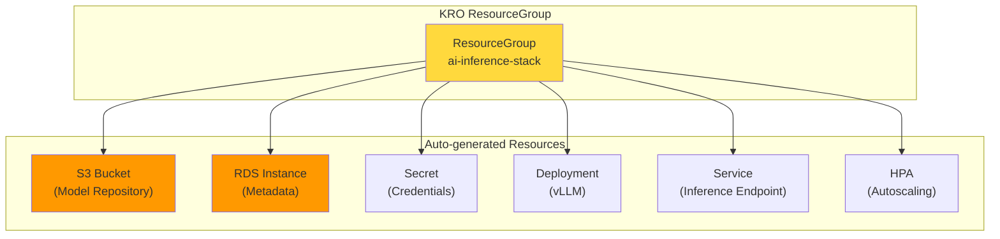
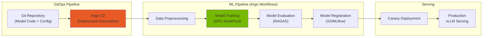
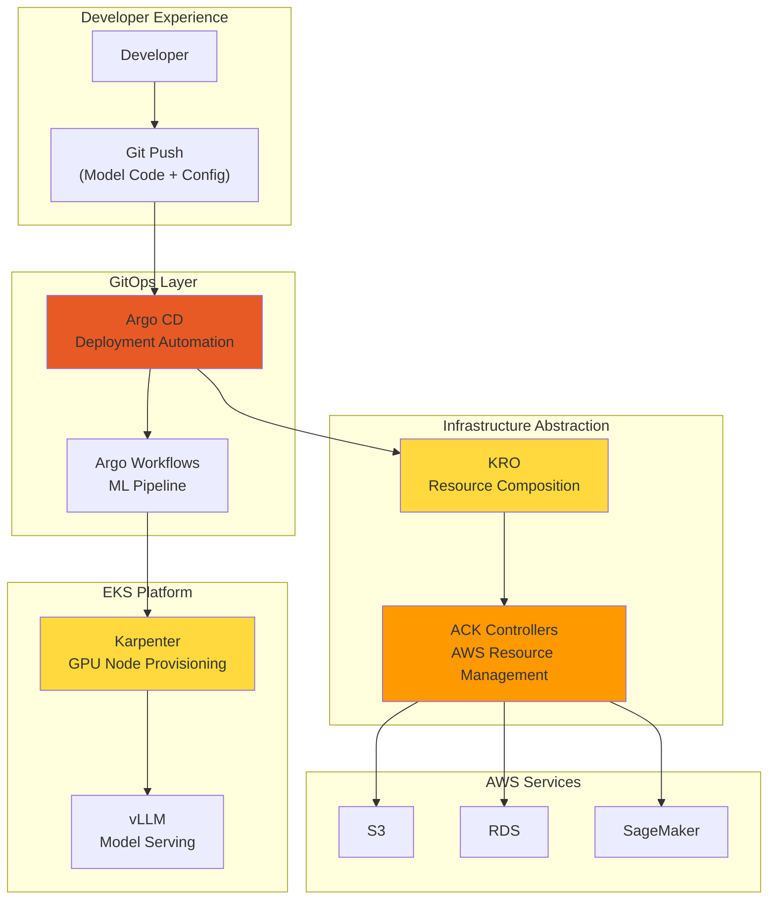
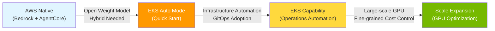

import Tabs from '@theme/Tabs';
import TabItem from '@theme/TabItem';
import {
  EksKarpenterLayers,
  ClusterAutoscalerVsKarpenter,
  KarpenterKeyFeatures,
  EksAutoModeVsStandard,
  DeploymentTimeComparison,
  EksIntegrationBenefits,
  EksCapabilities,
  AckControllers,
  AutomationComponents,
  EksAutoModeBenefits,
  ChallengeSolutionsSummary,
  EksClusterConfiguration
} from '@site/src/components/AgenticSolutionsTables';

:::info Prerequisite Documents
Before reading this document, refer to the following documents first:
- [Platform Architecture](../foundations/agentic-platform-architecture.md) — Structure and core layers of Agentic AI Platform
- [Technical Challenges](../foundations/agentic-ai-challenges.md) — 5 core challenges
- [AI Platform Selection Guide](./ai-platform-decision-framework.md) — Managed vs open-source decision-making
- [AWS Native Platform](./aws-native-agentic-platform.md) — Managed service-based alternative approach (for comparison reference)
:::

---

## Why EKS-based Open Architecture?

[AWS Native Platform](./aws-native-agentic-platform.md) is a powerful approach for getting started quickly. Custom agent workflows (LangGraph, MCP/A2A), multi-provider routing, and open-weight models can also be built with AWS Native services (for example, Bedrock AgentCore Runtime and AgentCore Gateway); the items below are therefore not service exclusions but the concrete control and placement requirements that lead this guide to choose an **EKS-based open architecture**:

- **Direct control of model weights and runtime**: Host open-weight models (Llama, Qwen, DeepSeek, etc.) on your own containers and GPU nodes, managing the inference engine version, quantization, and batching strategy yourself
- **Hybrid placement**: Unify on-premises GPU and cloud into a single Kubernetes cluster (EKS Hybrid Nodes)
- **Kubernetes-native custom workflows**: Place and scale LangGraph, MCP, and A2A components at the Pod and CRD level
- **Self-operated multi-provider routing**: Run gateways such as the Bifrost 2-Tier Gateway inside the cluster
- **Fine-grained GPU cost optimization**: Tune Spot, MIG, and Consolidation to your workload characteristics

:::tip Platform Comparison
For a 5-axis comparison of AWS Native, SageMaker Unified Studio, EKS open architecture, and hybrid approaches, refer to [AI Platform Selection Guide](./ai-platform-decision-framework.md#platform-comparison-matrix).
:::

**Key Message: AWS Native → EKS is a complementary relationship.** A realistic approach is to **start with AWS Native and expand to EKS as needed**. Both approaches can coexist within the same VPC.

---

## Quick Start with EKS Auto Mode

### EKS Cluster Configuration Options: Control Plane and Data Plane

EKS cluster configuration is divided into **two independent layers**.

**Figure 1. EKS control plane and data plane configuration options**



### Provisioned Control Plane (PCP)

**PCP** is a premium option that provisions control plane capacity in advance with fixed tiers, ensuring consistent API server performance. The seats, Pod scheduling, and etcd values below are the **capacity limits provisioned** for each tier, not a guarantee of a specific application's measured throughput or latency.

#### PCP Tier Specifications (K8s v1.30–v1.33) {#pcp-tier-specifications}

**Table 1. PCP tier capacity limits and added cost**

| Tier | API Concurrency (seats) | Pod Scheduling | etcd DB | SLA | Added Tier Cost |
|------|:-----------------:|:----------:|:------:|:---:|-----:|
| **Standard** | Dynamic (AWS auto-adjusted) | Dynamic | 8GB | 99.95% (5-min intervals) | No added tier cost |
| **XL** | 1,700 | 167/sec | 16GB | 99.99% (1-min intervals) | $1.65/hr |
| **2XL** | 3,400 | 283/sec | 16GB | 99.99% (1-min intervals) | $3.40/hr |
| **4XL** | 6,800 | 400/sec | 16GB | 99.99% (1-min intervals) | $6.90/hr |
| **8XL** | 13,600 | 400/sec | 16GB | 99.99% (1-min intervals) | $13.90/hr |

> Source: [AWS EKS Provisioned Control Plane Official Documentation](https://docs.aws.amazon.com/eks/latest/userguide/eks-provisioned-control-plane.html), [Amazon EKS pricing](https://aws.amazon.com/eks/pricing/) (prices as of retrieval). The seat and Pod scheduling figures above apply to K8s v1.30–v1.33; v1.34 and later increase the per-tier capacity, so check the corresponding version table in the official documentation. **PCP tier cost is billed in addition to the standard EKS cluster fee ($0.10/cluster-hr under standard support, about $73/month)**; Standard mode has no added tier cost.

#### Tier Selection Criteria: Metric-based Judgment

:::warning Worker Node Count Is Not a PCP Tier Selection Criterion
PCP tier should be selected based on **Kubernetes control plane metrics**.
:::

**Key Monitoring Metrics** (the thresholds below are **example operating policies** that leave headroom below each tier's limit; validate and adjust them against your workload):

**Table 2. Key monitoring metrics and example criteria for PCP tier selection**

| Metric | Prometheus Query | Example Judgment Criterion |
|--------|----------------|----------|
| **API Inflight Seats** (Most Important) | `apiserver_flowcontrol_current_executing_seats` | Sustained above 1,200 seats (~70% of the XL limit of 1,700) → consider a higher tier |
| **Pod Scheduling Rate** | `rate(scheduler_schedule_attempts_total{result="scheduled"}[5m])` | Sustained 100/sec or higher → consider XL, 200/sec or higher → consider 2XL |
| **etcd DB Size** | `apiserver_storage_size_bytes` | Standard etcd caps at 8GB, so above 6GB (~75%) consider a PCP tier that provides 16GB |

:::info PCP vs Auto Mode — Different Layers
**PCP** is a control plane capacity option, and **Auto Mode** is a data plane management option. Both features **can be used in combination**.
:::

### Control Plane × Data Plane Comparison and Combination

<EksClusterConfiguration />

:::tip Recommended Configuration by AI Platform Scale
- **Small-scale (PoC/Demo)**: Standard + Auto Mode — Minimal operational burden, 99.95% SLA
- **Medium-scale (Production Inference)**: Standard + Karpenter — GPU cost optimization, 99.95% SLA
- **Large-scale (Enterprise AI)**: PCP XL + Auto Mode — API seats ≤ 1,700, 99.99% SLA
- **Extra-large-scale (Training Cluster)**: PCP 4XL+ + Karpenter — API seats ≤ 6,800+, fine-grained GPU control
:::

---

### Amazon EKS and Karpenter: Maximizing Kubernetes Advantages

In Amazon EKS, Karpenter provisions nodes for Pods that cannot be scheduled, using their resource requests and scheduling constraints. Operators define the allowed instances and placement conditions in a NodePool, the node configuration in a NodeClass, and the drivers and device plugins needed by GPU workloads. Karpenter adds node capacity; application replica counts are managed separately. Compare node readiness time, instance choices, and cost with Cluster Autoscaler using the same workload.

:::info Karpenter Detailed Guide
For Karpenter v1.2+ GA features, NodePool configuration, GPU instance comparison, and cost optimization strategies, refer to [GPU Resource Management](../../model-serving/gpu-infrastructure/gpu-resource-management.md).
:::

<EksKarpenterLayers />

### EKS Auto Mode: Complete Automation

**EKS Auto Mode** manages Karpenter (compute autoscaling), Pod and service networking, local DNS, block storage, and GPU support as **built-in core components rather than separately installed add-ons**. Each item in the diagram below is not something you install and upgrade as an individual add-on, but a capability Auto Mode provides at the node level.

**Figure 2. Core features built into EKS Auto Mode**



:::warning CoreDNS when mixing Auto Mode and non-Auto Mode nodes
Auto Mode nodes use a node-local DNS running as a system service on each node instead of the traditional CoreDNS **Deployment**. If you run Auto Mode and non-Auto Mode nodes in the same cluster, the non-Auto Mode nodes cannot reach the node-local DNS, so you **must retain the existing CoreDNS Deployment**. Source: [EKS Auto Mode networking](https://docs.aws.amazon.com/eks/latest/userguide/auto-networking.html).
:::

#### EKS Auto Mode vs Manual Configuration Comparison

<EksAutoModeVsStandard />

#### EKS Auto Mode Configuration for GPU Workloads

EKS Auto Mode automatically configures and manages Karpenter. When you define a GPU NodePool and your workload's scheduling constraints (instance family, GPU memory, `nvidia.com/gpu` requests, and so on), Auto Mode provisions a matching accelerated instance to run the AI workload. An actual deployment also requires choosing an instance family suited to the model, the per-Region GPU quota, and the container image.

:::tip NodePool Configuration Details
For detailed configuration including GPU NodePool composition, Spot/On-Demand strategy, Consolidation policy, refer to [GPU Resource Management](../../model-serving/gpu-infrastructure/gpu-resource-management.md).
:::

:::info EKS Auto Mode and GPU Support
EKS Auto Mode supports selected accelerated computing instances, including NVIDIA GPU and AWS Trainium/Inferentia, and **automatically manages the kernel drivers and device plugins (NVIDIA/Neuron) those instances require at the node level**. This automatic management covers the drivers and device plugins; the Neuron SDK, frameworks, and inference runtime your application uses are packaged and managed by you in the container. For supported instances and example NodePools, see the [accelerated workload deployment guide](https://docs.aws.amazon.com/eks/latest/userguide/auto-accelerated.html).

**re:Invent 2024/2025 New Features:**
- **EKS Hybrid Nodes (GA)**: Integrate on-premises GPU infrastructure into EKS cluster
- **EKS Pod Identity Target IAM Roles (2025-06)**: Cross-account IAM role chaining support
- **Native Inferentia/Trainium Support**: Automatic Neuron driver/device-plugin configuration (application Neuron SDK is separate)
- **Provisioned Control Plane**: Pre-provisioning for large-scale AI training workloads
:::

---

### Agentic AI Components Deployable on Auto Mode

All core components of the Agentic AI platform can be deployed on EKS Auto Mode.

#### Inference: vLLM + llm-d

**vLLM** is an open-weight LLM inference engine, and **llm-d** provides intelligent routing considering KV cache state.

:::info Model Serving Stack Configuration
- **vLLM**: An inference engine that self-hosts open-weight model architectures published on Hugging Face (Llama, Qwen, DeepSeek, Mistral, etc.), supporting not only text generation but also pooling tasks such as embedding, reranking, and classification — PagedAttention-based KV cache optimization. Commercial APIs such as GPT and Claude do not publish their weights and cannot be hosted by vLLM; those are proxied as external APIs through the Bifrost gateway.
- **Triton Inference Server**: A general-purpose serving server that can handle both non-LLM inference (embedding, reranking, Whisper STT) and LLM inference across multiple backends (TensorRT, ONNX, PyTorch, etc.)
- **llm-d**: Maximizes prefix cache hit rate with KV Cache-aware routing

For detailed configuration, refer to [vLLM Model Serving](../../model-serving/inference-frameworks/vllm-model-serving.md) and [llm-d Distributed Inference](../../model-serving/inference-frameworks/llm-d-eks-automode.md).
:::

#### Gateway: kgateway + Bifrost (2-Tier Gateway)

Separates traffic management and model routing with 2-Tier Gateway architecture:
- **Tier 1 (kgateway)**: Gateway API-based authentication, rate limiting, traffic management
- **Tier 2 (Bifrost)**: Model abstraction, fallback, cost tracking, cascade routing

> For detailed architecture, refer to [Inference Gateway Routing](../../model-serving/inference-routing/routing-strategy.md).

#### Agent: LangGraph + NeMo Guardrails + MCP/A2A

Agent workflows on EKS consist of:

**Figure 3. Components of an EKS-based agent workflow**



- **LangGraph**: Multi-step agent workflow definition, conditional branching, parallel execution
- **NeMo Guardrails**: A **content-level defense-in-depth** layer that performs prompt-injection mitigation, PII leak mitigation, and output validation. It does not itself provide authentication, authorization, TLS, or rate limiting, so access control must be enforced by a fronting API gateway, reverse proxy, or sidecar (source: [NeMo Guardrails SECURITY](https://github.com/NVIDIA/NeMo-Guardrails/blob/develop/SECURITY.md)). For tool comparison and implementation details, refer to [AI Gateway Guardrails](../../operations-mlops/governance/ai-gateway-guardrails.md)
- **MCP**: Agent Ready apps provide tools in a standardized way
- **A2A**: Inter-agent communication protocol (transport security and authentication are configured separately in the deployment)
- **Redis (ElastiCache)**: Agent **state** management via the LangGraph checkpointer — a state store, not a work queue.

Agent Pod autoscaling is driven by queue length against a **real work queue** (such as a Redis List) monitored by KEDA's Redis Lists scaler (`listName`, `listLength`), separate from the state store. The checkpointer key-value store itself does not expose a queue-length signal.

> For details, refer to [Kagent Agent Management](../../operations-mlops/observability/kagent-kubernetes-agents.md) and [AWS Native Platform — AgentCore & MCP](./aws-native-agentic-platform.md#mcp-protocol-and-eks-integration). For Guardrails technology stack (Input/Output Guard, Tool Allow-list, kgateway/Bifrost integration), refer to [AI Gateway Guardrails](../../operations-mlops/governance/ai-gateway-guardrails.md).

#### RAG + Observability

- **Milvus**: Vector DB — Core of RAG system ([Details](../../operations-mlops/data-infrastructure/milvus-vector-database.md))
- **Langfuse**: Production LLM tracing, token cost tracking ([Architecture](../../operations-mlops/observability/agent-monitoring.md), [Deployment Guide](../../reference-architecture/integrations/monitoring-observability-setup.md))
- **Prometheus + Grafana**: Infrastructure metrics monitoring

---

### EKS-based Easy Deployment

<DeploymentTimeComparison />

#### EKS Deployment Methods by Solution

<EksIntegrationBenefits />

#### Easy Deployment Example

For deployment guide, refer to [Reference Architecture](../../reference-architecture/).

:::info GPU Cost Optimization Details
For GPU cost optimization strategies including Spot instance usage, Consolidation, and schedule-based cost management, refer to [GPU Resource Management](../../model-serving/gpu-infrastructure/gpu-resource-management.md) document.
:::

:::info GPU Security and Troubleshooting
For GPU Pod security policies, Network Policy, IAM, MIG isolation, and GPU troubleshooting guide, refer to [EKS GPU Node Strategy](../../model-serving/gpu-infrastructure/eks-gpu-node-strategy.md) document.
:::

---

## Minimize Infrastructure Operational Burden with EKS Capability

### What is EKS Capability?

**EKS Capability** is a **fully managed cluster feature** from AWS that provides declarative continuous deployment (Argo CD), AWS resource management (ACK), and Kubernetes resource orchestration (kro). These features run within EKS rather than on your worker nodes, and are independent cloud resources you can pick and enable individually (source: [EKS Capabilities](https://docs.aws.amazon.com/eks/latest/userguide/capabilities.html)).

In the diagram below, only the **"Managed EKS Capability"** block (ACK, kro, Argo CD) consists of official AWS EKS Capabilities; the AI/Data/App groups are this architecture's own classification of workloads for explanation and are not official capabilities.

**Figure 4. EKS Capability and workload group composition**



### Core EKS Capabilities for Agentic AI

<EksCapabilities />

:::warning Argo Workflows Requires Separate Installation
**Argo Workflows** is not officially supported as an EKS Capability, so **direct installation is required**.

For deployment guide, refer to [Argo Workflows Official Documentation](https://argoproj.github.io/argo-workflows/installation/).
:::

---

### ACK (AWS Controllers for Kubernetes)

**ACK** directly provisions and manages AWS services through Kubernetes Custom Resources. It can be **enabled as a fully managed EKS Capability or installed yourself via a Helm chart**.

**Figure 5. ACK controller provisioning flow for AWS resources**



**ACK Usage Examples in AI Platform:**

<AckControllers />

**S3 Bucket Creation Example with ACK:**

```yaml
apiVersion: s3.services.k8s.aws/v1alpha1
kind: Bucket
metadata:
  name: agentic-ai-models
  namespace: ai-platform
spec:
  name: agentic-ai-models-prod
  versioning:
    status: Enabled
  encryption:
    rules:
    - applyServerSideEncryptionByDefault:
        sseAlgorithm: aws:kms
  tags:
  - key: Project
    value: agentic-ai
```

### KRO (Kubernetes Resource Orchestrator)

**KRO** **combines multiple Kubernetes resources and AWS resources into one abstracted unit** to deploy complex infrastructure simply.

**Figure 6. Resources grouped by a KRO ResourceGroup**



**Deploy AI Inference Stack as a single resource with kro:**

The following is an **example instance** of an `AIInferenceStack` API that a platform team first defines with a `ResourceGraphDefinition` (RGD). A kro instance's `apiVersion` is `kro.run/v1alpha1`, and its `kind` (`AIInferenceStack`) and `spec` schema are generated by that RGD. This manifest alone does not deploy anything; **the corresponding RGD must already be applied to the cluster**.

```yaml
# AIInferenceStack instance example (requires the corresponding RGD first)
apiVersion: kro.run/v1alpha1
kind: AIInferenceStack       # custom kind defined by the RGD
metadata:
  name: llama-inference
  namespace: ai-platform
spec:
  modelName: llama-3-70b
  # A 70B model's GPU memory requirement depends on precision and tensor parallelism.
  # e.g. FP16 weights (~140GB) do not fit on a single g5.12xlarge (4x A10G 24GB = 96GB),
  #      so quantization (e.g. INT8/FP8) or multi-GPU nodes/tensor parallelism are needed.
  gpuType: g5.12xlarge
  minReplicas: 2
  maxReplicas: 20
```

> For how to author an RGD and the instance-creation flow, see the [kro ResourceGraphDefinition deployment guide](https://kro.run/docs/getting-started/deploy-a-resource-graph-definition/).

### Argo-based ML Pipeline Automation

Combining **Argo Workflows** and **Argo CD** enables **full MLOps pipeline automation in GitOps style** from AI model training, evaluation, to deployment.

**Figure 7. Argo-based GitOps ML pipeline**



### ACK + KRO + ArgoCD Integration Architecture

**Figure 8. Integrated ACK, KRO, and Argo CD deployment architecture**



<AutomationComponents />

:::info Benefits of Complete Automation — Delegate Infrastructure Operations to EKS and Focus on Agent Development
- **Developer**: Model deployment with just Git push
- **Platform Team**: Minimize infrastructure management burden
- **Cost Optimization**: Dynamic provisioning of only necessary resources
- **Consistency**: Same deployment method across all environments
:::

---

## Conclusion and Next Steps

### Progressive Journey: AWS Native → Auto Mode → EKS Capability

**Figure 9. Progressive expansion path from AWS Native to EKS Capability**



### EKS Auto Mode: Recommended Starting Point

<EksAutoModeBenefits />

### Solution Summary by Challenge

<ChallengeSolutionsSummary />

### EKS Auto Mode GPU Limitations and Hybrid Strategy

EKS Auto Mode is optimal for general workloads and basic GPU inference, but has limitations for advanced GPU features.

**Table 3. EKS Auto Mode suitability by workload type**

| Workload Type | Auto Mode Suitability | Reason |
|---|---|---|
| API Gateway, Agent Framework | Suitable | Non-GPU, automatic scaling sufficient |
| Observability Stack | Suitable | Non-GPU, minimize management burden |
| Basic GPU Inference (Full GPU) | Suitable | AWS-managed GPU stack sufficient |
| MIG Partitioning Needed | **Unsuitable** | Auto Mode manages the node AMI as immutable, so the node-level settings MIG partitioning requires cannot be applied (a NodeClass can tune networking, storage, etc., but not the OS/AMI). The GPU Operator itself can be installed |
| Run:ai GPU Scheduling | **Unsuitable** | Run:ai does not support Bottlerocket or Amazon Linux on EKS, so it must run with the full GPU Operator stack on self-managed Karpenter nodes using a supported OS. Confirm mode-by-mode compatibility against the vendor support matrix before adopting |

**Recommended hybrid configuration**: Operate Auto Mode (general workloads) + Karpenter (advanced GPU features) in a single cluster. For detailed configuration, refer to [EKS GPU Node Strategy](../../model-serving/gpu-infrastructure/eks-gpu-node-strategy.md).

### Gateway API Limitations and Workarounds

EKS Auto Mode's built-in load balancer does not directly support Kubernetes Gateway API. To use kgateway, provision an NLB with a separate Service (type: LoadBalancer) that targets the kgateway proxy. In Auto Mode, `loadBalancerClass: eks.amazonaws.com/nlb` is set as the default, and new deployments use `aws-load-balancer-type: external`.

```yaml
apiVersion: v1
kind: Service
metadata:
  name: kgateway-proxy
  namespace: kgateway-system
  annotations:
    service.beta.kubernetes.io/aws-load-balancer-type: "external"
    service.beta.kubernetes.io/aws-load-balancer-nlb-target-type: "ip"
    service.beta.kubernetes.io/aws-load-balancer-scheme: "internet-facing"
    # TLS termination: configured by the two annotations below, not by the port name.
    service.beta.kubernetes.io/aws-load-balancer-ssl-cert: "arn:aws:acm:<region>:<account>:certificate/<cert-id>"
    service.beta.kubernetes.io/aws-load-balancer-ssl-ports: "443"
spec:
  type: LoadBalancer
  loadBalancerClass: eks.amazonaws.com/nlb   # Auto Mode default (can be omitted)
  selector:
    # Replace with the actual kgateway proxy Pod labels (example below).
    app.kubernetes.io/name: kgateway
  ports:
    - name: https
      port: 443
      targetPort: 8443
```

:::warning Verify TLS and the selector
Naming the port `https` does **not** configure TLS. To terminate TLS at the NLB, use the `aws-load-balancer-ssl-cert` (ACM certificate ARN) and `aws-load-balancer-ssl-ports` annotations above. The `selector` must match the actual kgateway proxy Pod labels, and the port/target mapping should be confirmed against the kgateway version you deploy. The official annotation page is internally inconsistent about legacy `type` values, so validate the applied annotations on a real cluster rather than asserting the outcome (source: [EKS Auto Mode NLB annotations](https://docs.aws.amazon.com/eks/latest/userguide/auto-configure-nlb.html)).
:::

> For complete 2-Tier Gateway architecture design, refer to [LLM Gateway 2-Tier Architecture](../../model-serving/inference-routing/routing-strategy.md).

### Key Recommendations

1. **Start with EKS Auto Mode**: Create new clusters with Auto Mode to leverage automatic Karpenter configuration
2. **Advanced GPU Features on Karpenter Nodes**: Add Karpenter NodePool when GPU Operator needed for MIG, Run:ai, etc.
3. **GPU NodePool Custom Definition**: Add GPU NodePool suited to workload characteristics (separate inference/training/experimentation)
4. **Use Spot Instances for interruption-tolerant workloads**: The Spot share is not a fixed number; decide it per workload based on interruption tolerance, checkpoint/recovery ability, and available capacity. Apply it to workloads that can absorb interruptions (stateless or checkpointable batch inference) and configure On-Demand fallback.
5. **Enable Consolidation by Default**: Leverage auto-enabled Consolidation in EKS Auto Mode
6. **KEDA Integration**: Link metric-based Pod scaling with Karpenter node provisioning

### Choose Deployment Path

<Tabs>
<TabItem value="auto-mode" label="EKS Auto Mode (Recommended for Most)">

**When Suitable:**
- Startups and small teams
- Kubernetes beginner teams
- Standard Agentic AI workloads

**Getting Started:**

For deployment guide, refer to [EKS Auto Mode Official Documentation](https://docs.aws.amazon.com/eks/latest/userguide/automode.html).

**Advantages:** AWS manages node provisioning, upgrades, and security patches, greatly reducing infrastructure operations burden. You still manage applications, NodePools, and cost, and an Auto Mode management fee applies in addition to EC2 cost.

</TabItem>
<TabItem value="karpenter" label="EKS + Karpenter (Maximum Control)">

**When Suitable:**
- Large-scale production workloads
- Complex GPU requirements (mixed instance types)
- Cost optimization as top priority

**Getting Started:**

For deployment guide, refer to [Karpenter Official Documentation](https://karpenter.sh/docs/getting-started/).

**Advantages:** Fine-grained instance control and custom AMIs. The savings depend on how far you apply Spot and Consolidation versus On-Demand, so judge them by measuring your actual workload's usage, interruption rate, and total cost of ownership (TCO).

</TabItem>
<TabItem value="hybrid" label="Hybrid (Combine Advantages of Both)">

**When Suitable:**
- Growing platform (start simple, expand complex)
- Mixed workload types (CPU agents + GPU LLM)

**Getting Started:**

For deployment guide, refer to [Reference Architecture](../../reference-architecture/).

**Advantages:** Progressive complexity increase, GPU cost optimization, AWS-managed + custom combination

</TabItem>
</Tabs>

### Reference Documents for Scaling

**Table 4. Reference documents by area for scaling**

| Area | Document | Content |
|------|------|------|
| GPU Node Strategy | [EKS GPU Node Strategy](../../model-serving/gpu-infrastructure/eks-gpu-node-strategy.md) | Auto Mode + Karpenter + Hybrid Node + Security/Troubleshooting |
| GPU Resource Management | [GPU Resource Management](../../model-serving/gpu-infrastructure/gpu-resource-management.md) | Karpenter scaling, KEDA, DRA, cost optimization |
| NVIDIA GPU Stack | [NVIDIA GPU Stack](../../model-serving/gpu-infrastructure/nvidia-gpu-stack.md) | GPU Operator, DCGM, MIG, Time-Slicing |
| Model Serving | [vLLM Model Serving](../../model-serving/inference-frameworks/vllm-model-serving.md) | vLLM configuration, performance optimization |
| Distributed Inference | [llm-d Distributed Inference](../../model-serving/inference-frameworks/llm-d-eks-automode.md) | KV Cache-aware routing |
| Training Infrastructure | [NeMo Framework](../../model-serving/inference-frameworks/nemo-framework.md) | Distributed training, EFA network |

---

## References

### Official Documentation

- [Amazon EKS Documentation](https://docs.aws.amazon.com/eks/) — EKS official documentation
- [EKS Auto Mode](https://docs.aws.amazon.com/eks/latest/userguide/automode.html) — Auto Mode guide
- [Karpenter Documentation](https://karpenter.sh/docs/) — Karpenter official documentation
- [KEDA - Kubernetes Event-driven Autoscaling](https://keda.sh/) — Event-driven autoscaling

### Papers / Technical Blogs

- [vLLM: Easy, Fast, and Cheap LLM Serving](https://blog.vllm.ai/) — vLLM official blog
- [Efficient Memory Management for LLM Serving](https://arxiv.org/abs/2309.06180) — PagedAttention paper
- [NVIDIA Developer Blog: AI on Kubernetes](https://developer.nvidia.com/blog/) — GPU workload optimization

### Related Documents (Internal)

- [Platform Architecture](../foundations/agentic-platform-architecture.md) — Overall system design
- [Technical Challenges](../foundations/agentic-ai-challenges.md) — 5 core challenges
- [GPU Resource Management](../../model-serving/gpu-infrastructure/gpu-resource-management.md) — Karpenter, KEDA, DRA
- [vLLM Model Serving](../../model-serving/inference-frameworks/vllm-model-serving.md) — vLLM deployment guide
