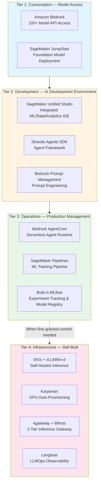
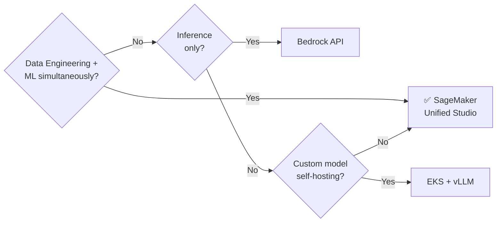
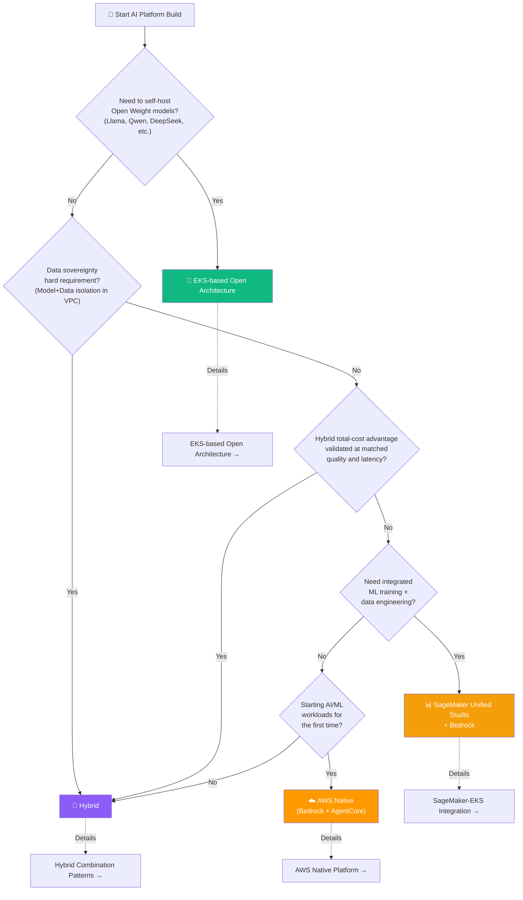
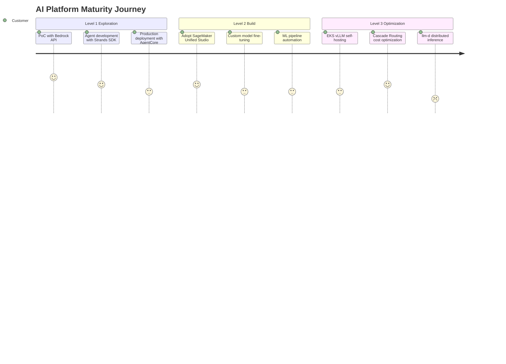
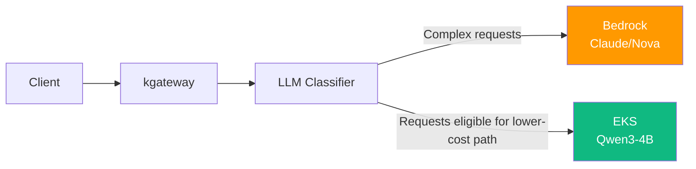
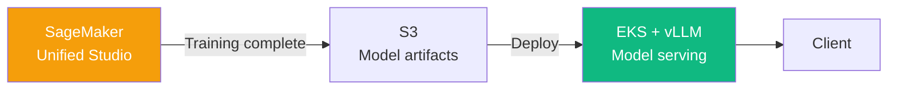
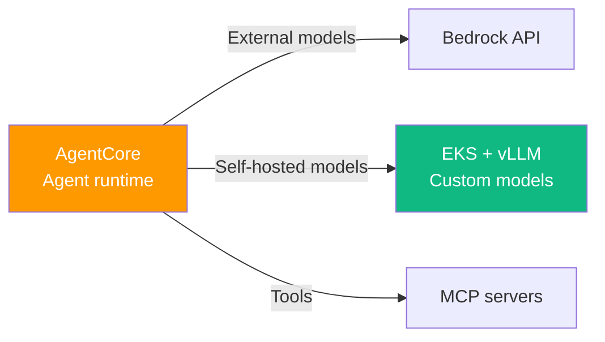

import { PlatformComparisonMatrix, MaturityPathTable, HybridPatternSummary } from '@site/src/components/DecisionFrameworkTables';

When customers start developing AI directly, the first question they face is "Should we use managed services or build with open source?" This document provides a decision framework to select the optimal approach among **SageMaker Unified Studio**, **Bedrock AgentCore**, and **EKS-based open architecture** based on customer circumstances.

AI platform construction paths are broadly divided into three categories:

- **(A) AWS Managed**: Start with no infrastructure operations using Bedrock + Strands SDK + AgentCore
- **(B) EKS + Open Source**: Secure maximum control with self-hosting using vLLM, llm-d, Langfuse, etc.
- **(C) Hybrid**: Achieve balance of cost, control, and speed by combining Bedrock and EKS

:::info Prerequisites
Before reading this document, refer to the following:
- [Platform Architecture](../foundations/agentic-platform-architecture.md) — 6 layers + 3 planes design blueprint
- [Technical Challenges](../foundations/agentic-ai-challenges.md) — 5 core challenge analysis
:::

---

## AWS AI Platform Service Landscape

This document groups AWS AI services into 4 tiers by role. This is this guide's classification, not an AWS-defined product hierarchy; each tier represents a complementary responsibility (model access, development environment, operations, infrastructure). The tiers are not maturity stages you must pass through in order — they are building blocks you combine based on requirements. For example, you can use Tier 1 Bedrock inference together with Tier 4 EKS self-hosting without any maturity progression.

**Key Tier Distinctions**:
- **Tier 1-3**: AWS managed services let you start without operating server/GPU infrastructure. Even so, operational responsibilities such as IAM, network boundaries, cost, prompt/model evaluation, and observability remain with you.
- **Tier 4**: Choose it when you need fine-grained control over the model-serving layer, must self-host weights outside the supported model set, or have data sovereignty requirements such as processing within a VPC; it carries Kubernetes/GPU operational burden.
- The tiers are complementary, so you **combine them by requirement with no fixed progression order**. You can use Tier 1 and Tier 4 together from the start, or use only specific tiers.

---

## SageMaker Unified Studio

### Integrated AI Development Environment

**SageMaker Unified Studio** is an integrated AI development environment first shown in preview at re:Invent in December 2024 and made generally available (GA) in March 2025, designed to perform ML/data/analytics tasks in a single IDE. Previously, teams had to use fragmented tools like SageMaker Studio Classic, Athena, and Glue Studio separately, but Unified Studio consolidates them into one.

### Key Differentiators

| Feature | Description | Improvement vs Previous |
|---------|-------------|------------------------|
| **Unified IDE** | JupyterLab + SQL Editor + No-code Interface | Data+ML integration vs SageMaker Studio Classic |
| **Built-in MLflow** | Experiment tracking, model registry, model comparison | No need to operate separate MLflow server |
| **Lakehouse Integration** | Apache Iceberg tables, Glue Catalog native integration | One-stop data engineering → ML pipeline |
| **Governance Collaboration** | Amazon DataZone-based IAM sharing, data lineage tracking | Secure data/model sharing between teams |
| **Unified Compute** | Manage training, notebooks, pipelines in single environment | Prevent resource fragmentation |

### Positioning: When to Choose?

:::tip Key Message
SageMaker Unified Studio is a **development environment (Tier 2)**. It has a **complementary relationship** with Bedrock (inference) or EKS (serving), and provides the greatest value when data teams and ML teams need to collaborate on a single platform.
:::

---

## Platform Comparison Matrix

The optimal approach varies based on customer circumstances. Compare each platform option across 5 key evaluation dimensions.

<PlatformComparisonMatrix />

:::info Detailed Cost Analysis
For detailed cost comparison between self-hosting and Bedrock (break-even points, Cascade Routing savings), refer to [Coding Tools Cost Analysis](../../reference-architecture/integrations/coding-tools-cost-analysis.md).
:::

---

## Decision Flowchart

A decision flow you can use in customer meetings. Find the optimal approach by answering key questions.

:::warning The Flowchart is a Starting Point
This flowchart is the starting point for conversation, not the final conclusion. Each branch does not map automatically to a single technology, so check the following conditions as well.

- **Q1 (self-host Open Weight)**: "Yes" does not immediately mean EKS. First check whether the weights are supported by managed hosting such as Bedrock Marketplace, Bedrock Custom Model Import, or SageMaker AI endpoints; choose EKS self-hosting when they are not, or when you need control over the serving stack.
- **Q2 (data sovereignty)**: A VPC/region isolation requirement does not necessarily mean hybrid. First define the **concrete country/region scope** where processing and storage are allowed, then decide whether that scope can be met with region pinning (SCP) plus a Bedrock inference profile, or whether self-hosting is required.
- **Default after Q3**: Not every non-new workload converges on hybrid. Check the team's Kubernetes/GPU operating capability and actual operating capacity; without that capability, staying on a managed path is usually better.

Actual customer situations are complex, and hybrid is one design you choose based on requirements.
:::

---

## The Fourth Decision Axis: Data Sovereignty

The flowchart above used workload, volume, and capability as criteria, but in regulated industries **data sovereignty** acts as a hard constraint that takes precedence over all other criteria. Sovereignty requirements appear on a Public → In-country → Hybrid → Air-gapped spectrum; the stronger the requirement, the lower the managed-service dependency and the larger the share of self-hosting/on-premises.

| Sovereignty Level | Inference Location | Recommended Approach |
|-------------------|--------------------|--------------------|
| **Public** | No region constraint | AWS Native |
| **In-country** | Fixed to a specific country region | First confirm the processing scope the target country requires. A Bedrock inference profile (CRIS) can span a geography that covers multiple countries, so if single-country residency is the requirement, choose a profile that includes only that country's region (or a single-Region call) and enforce the region with an SCP. |
| **Hybrid** | On-premises + in-country | EKS Hybrid Nodes + self-hosting. Hybrid Nodes **require a reliable connection** between on-premises/edge nodes and the AWS-managed control plane. |
| **Air-gapped** | Fully isolated | On-premises EKS (use EKS Anywhere's airgapped installation for disconnected environments). EKS Hybrid Nodes do not become air-gapped by cutting the link and are not a fit for DDIL environments, so for full isolation use the EKS Anywhere disconnected lifecycle, not Hybrid Nodes. |

It is safest to treat data sovereignty as the **first filter** of the decision. When a sovereignty constraint forces EKS self-hosting or hybrid, it takes precedence over conclusions based on cost or volume. Note, however, that "In-country" requires confirming the target country's processing scope and then selecting the matching region/profile, and that in "Air-gapped" the connected Hybrid Nodes and the disconnected EKS Anywhere are different products with different operating models.

:::info Sovereign & Hybrid Details
For SCP region enforcement policies, Bedrock Geographic cross-Region inference, and EKS Hybrid Nodes-based hybrid/in-country self-hosting implementation, see [Sovereign & Hybrid Deployment](./sovereign-hybrid-deployment.md).
:::

---

## Recommended Path by Customer Maturity

Starting points and expansion paths vary based on the customer's current AI/ML maturity level.

The durations below are initial planning inputs for stage-specific work. Define milestones such as API integration, pilot operation, and production acceptance before estimating a schedule from team readiness.

<MaturityPathTable />

**Detailed Guide by Level**:
- **Level 1 (Exploration)**: → [AWS Native Platform](./aws-native-agentic-platform.md)
- **Level 2 (Build)**: → [SageMaker-EKS Integration](../../reference-architecture/integrations/sagemaker-eks-integration.md)
- **Level 3 (Optimization)**: → [EKS-based Open Architecture](./agentic-ai-solutions-eks.md), [Inference Gateway](../../model-serving/inference-routing/routing-strategy.md)

---

## Hybrid Combination Patterns

The following four examples separate service responsibilities. Validate fit against data boundaries, operating capability, and quality, latency, and cost requirements.

<HybridPatternSummary />

### Pattern 1: Bedrock + EKS SLM (Cascade Routing)

**When to use**: A request subset meets quality requirements on a self-hosted SLM, and its share and the total operating cost of both paths can be measured.

**Value to validate**: Reduce actual total cost while meeting quality and latency requirements. Request share alone does not establish lower GPU fixed costs or preserved quality.

**Reference**: [Inference Gateway & Cascade Routing](../../model-serving/inference-routing/routing-strategy.md)

---

### Pattern 2: SageMaker Training + EKS Serving

**When to use**: When training custom models and lowering inference costs

**Value to validate**: When you build a model with SageMaker managed training and serve it on EKS, measure whether the actual total cost (including GPU fixed cost, utilization, and operations) is lower than alternatives such as Bedrock at matched quality and latency. Serving on EKS does not by itself guarantee cost efficiency.

**Reference**: [SageMaker-EKS Integration](../../reference-architecture/integrations/sagemaker-eks-integration.md)

---

### Pattern 3: AgentCore + Self-Hosted Models

**When to use**: When operating Agent runtime serverlessly but self-hosting specific domain models

**Value to validate**: Confirm with evaluation data whether the self-hosted domain model is actually higher quality (accuracy) than managed models such as Bedrock on the same tasks, and measure whether that benefit offsets the added operating cost and latency. Customization and self-hosting do not by themselves guarantee domain accuracy.

**Reference**: [AWS Native Platform](./aws-native-agentic-platform.md)

---

### Pattern 4: Full Stack (SageMaker + Bedrock + EKS)

The most complex but most flexible pattern:
- **Data & Training**: SageMaker Unified Studio + Pipelines
- **Production Inference**: Bedrock API (high-reliability tasks) + EKS vLLM (high-volume tasks)
- **Agent Runtime**: AgentCore (serverless) + Kagent (Kubernetes-native)
- **Observability**: CloudWatch (managed) + Langfuse (self-hosted)

This pattern is chosen by large enterprises to meet different requirements across teams. Due to high architectural complexity, clear operational responsibility boundaries and a service catalog are essential.

**Reference**: For technical implementation of hybrid architecture, refer to [SageMaker-EKS Integration](../../reference-architecture/integrations/sagemaker-eks-integration.md).

---

## Cost Simulation Summary

Monthly request count alone does not determine the best option or its cost. Collect the following inputs for the same task set and service requirements.

| Option | Inputs to collect | Conditions to verify |
|--------|-------------------|----------------------|
| Bedrock API | Model, region, inference mode, input/output/cache tokens | Quality, latency, and actual billing |
| Bedrock + EKS SLM | Routing share, API billing, SLM fixed costs | Classification errors, fallback, and idle capacity |
| EKS self-hosting | Node hours, capacity, total infrastructure/operating cost | Peak load, availability, and capacity ranges |
| IDE subscription tools | Actual task credits and subscription spend | Matched task completion and feature scope |

:::info Detailed Cost Analysis
For billing units, hypothetical break-even arithmetic, and fixed-cost boundaries for cascade routing, see [Coding Tools Cost Analysis](../../reference-architecture/integrations/coding-tools-cost-analysis.md).
:::

---

## Customer Discovery Checklist

11 key questions to identify the optimal approach in customer meetings.

1. **Are you currently operating AI/ML workloads?** *→ Determine maturity level*
2. **What is your monthly inference request volume?** *→ Cost optimization path*
3. **Do you need to self-host Open Weight models?** *→ EKS necessity*
4. **Do you have data sovereignty or VPC isolation requirements?** *→ Self-hosting/hybrid*
5. **Does your team have Kubernetes operations experience?** *→ Assess operational burden*
6. **Do you perform ML training and data engineering together?** *→ SageMaker Unified Studio*
7. **What is your monthly budget range?** *→ Cost structure matching*
8. **When is your target production deployment date?** *→ Time-to-value path*
9. **Do you need to operate on-premises/edge nodes with a reliable connection back to AWS?** *→ EKS Hybrid Nodes (requires a reliable connection; not supported on other clouds or on AWS Regions/Local Zones/Outposts)*
10. **Do you also need to run workloads on other clouds (multi-cloud)?** *→ EKS Hybrid Nodes do not apply; select a supported Kubernetes management option separately, such as each cloud's managed Kubernetes or EKS Anywhere*
11. **What AWS services are you currently using?** *→ Leverage existing investments*

---

## References

### Official Documentation

- [Amazon SageMaker Unified Studio](https://docs.aws.amazon.com/sagemaker-unified-studio/latest/userguide/what-is-sagemaker-unified-studio.html) — Integrated AI development environment
- [Amazon Bedrock Documentation](https://docs.aws.amazon.com/bedrock/) — Bedrock official documentation
- [Amazon EKS Best Practices](https://aws.github.io/aws-eks-best-practices/) — EKS recommendations
- [AWS Well-Architected Framework](https://aws.amazon.com/architecture/well-architected/) — Architecture framework

### Papers / Technical Blogs

- [AWS Machine Learning Blog (index)](https://aws.amazon.com/blogs/machine-learning/) — Blog index page for finding platform-selection posts (not a single article that substantiates a specific comparison)
- [Cost Optimization for LLM Inference](https://huyenchip.com/2023/04/11/llm-engineering.html) — Cost optimization strategies
- [AWS Architecture Center (index)](https://aws.amazon.com/architecture/) — Index page for finding architecture material such as hybrid patterns (not a single article that substantiates a specific pattern)
- [Building Production ML Systems](https://developers.google.com/machine-learning/guides/rules-of-ml) — Production ML guide

### Related Documents (Internal)

- [Platform Architecture](../foundations/agentic-platform-architecture.md) — 6 layers + 3 planes
- [Technical Challenges](../foundations/agentic-ai-challenges.md) — 5 core challenges
- [AWS Native Platform](./aws-native-agentic-platform.md) — Managed service details
- [EKS-based Open Architecture](./agentic-ai-solutions-eks.md) — Self-hosting details
- [Sovereign & Hybrid Deployment](./sovereign-hybrid-deployment.md) — Data sovereignty, SCP region enforcement, EKS Hybrid Nodes
