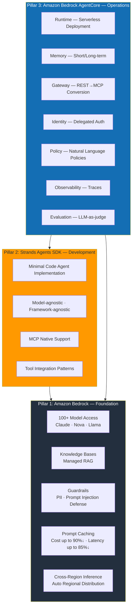
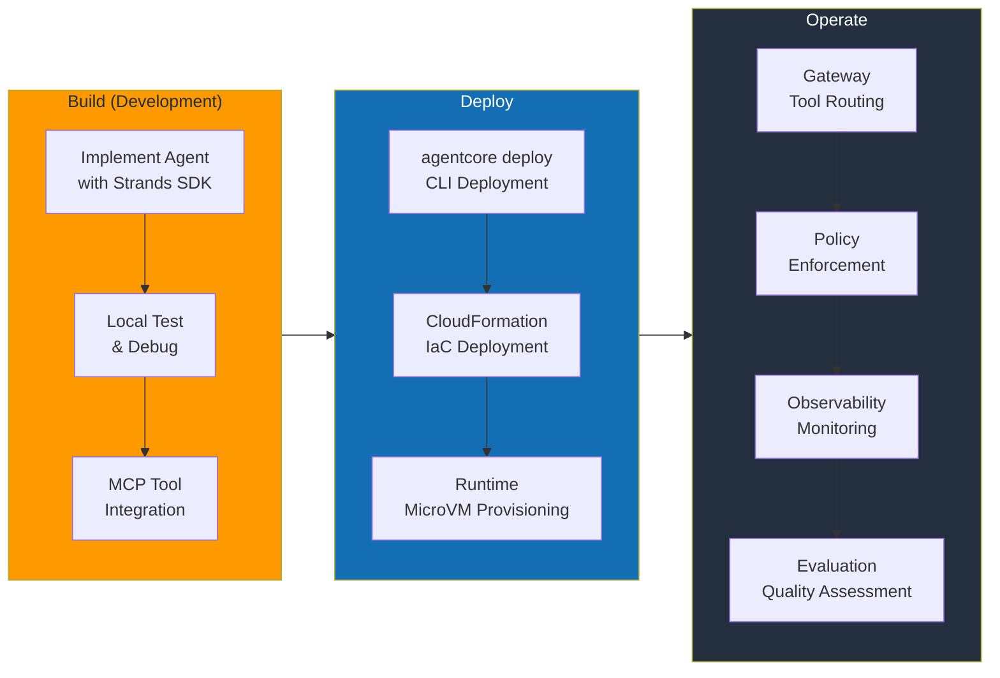
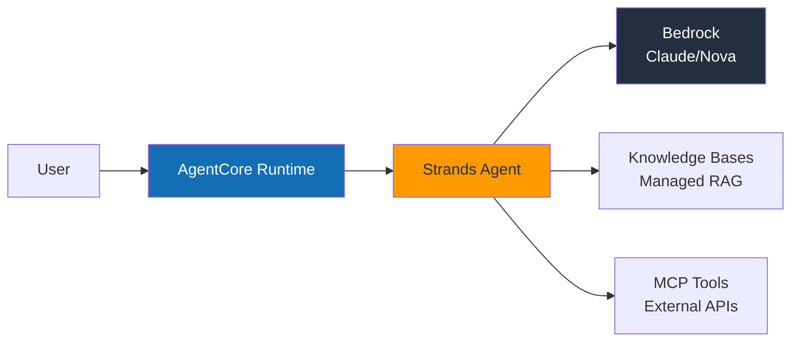
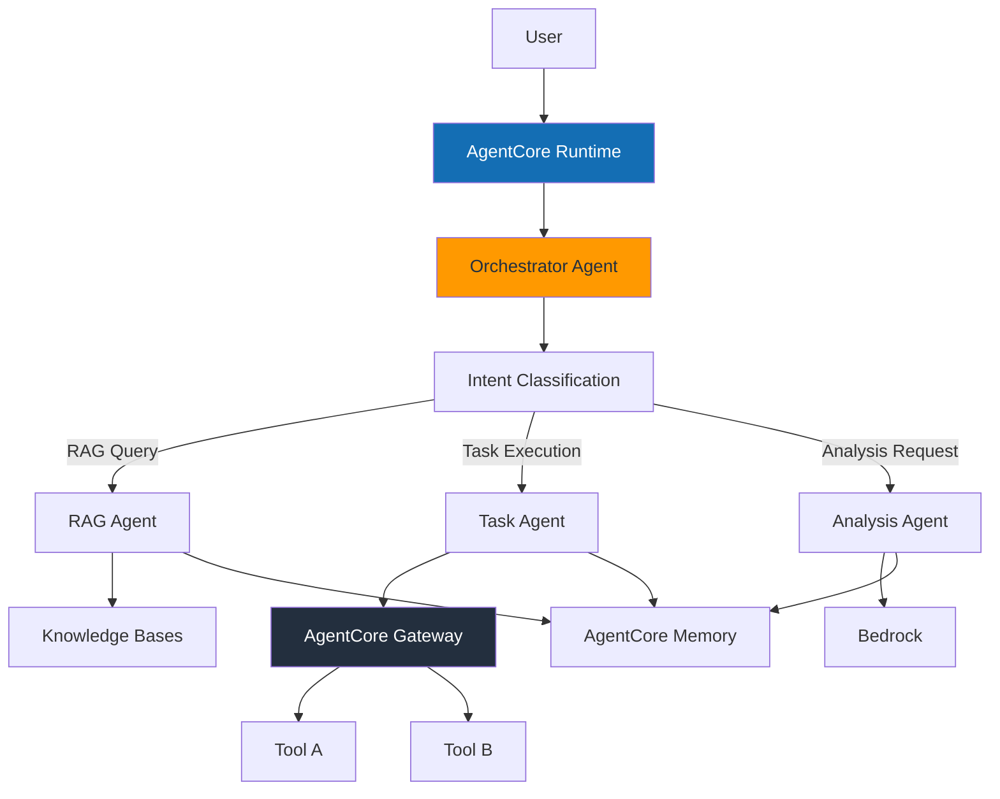
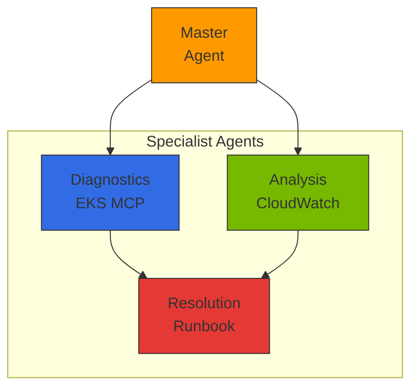

import { EKSMCPFeatures, KagentVsAgentCore, MultiAgentPatterns, MCPServerEcosystem } from '@site/src/components/BedrockMcpTables';

## Overview

AWS managed services can reduce the infrastructure your team operates directly. Check which GPU management, scaling, availability, and security functions each service provides. The development team still defines the agent's task, model and tool connections, permissions, data-handling policies, and response-quality criteria, and verifies that the system meets them.

The AWS Agentic AI stack consists of three pillars.

| Pillar | Service | Role |
|--------|---------|------|
| **Foundation** | Amazon Bedrock | Model access, RAG, guardrails, prompt caching |
| **Development** | Strands Agents SDK | Agent framework, MCP native, tool integration |
| **Operations** | Amazon Bedrock AgentCore | Serverless deployment, memory, gateway, policy, evaluation |

:::info Key Perspective
This document covers the **Agent development optimization approach** provided by AWS managed services. The strategy is to delegate areas where managed services are sufficient to AWS, focusing team capabilities on Agent business logic. However, this approach is the **first step** in a multi-model journey. When cost pressure from traffic growth, need for domain-specific SLMs, or data sovereignty requirements arise, the realistic optimum is to expand to [EKS-based Open Architecture](./agentic-ai-solutions-eks.md) and **combine self-hosted models with Bedrock in a hybrid approach**.
:::

### Challenge Resolution Mapping

How the 5 key challenges covered in [Technical Challenges](../foundations/agentic-ai-challenges.md) are addressed with the AWS Native approach:

| Challenge | AWS Native Solution |
|-----------|-------------------|
| GPU resource management and cost optimization | Bedrock serverless inference — no GPU management required |
| Intelligent inference routing and gateway | Bedrock Cross-Region Inference + AgentCore Gateway |
| LLMOps observability and cost governance | AgentCore Observability + CloudWatch |
| Agent orchestration and safety | Strands SDK + Bedrock Guardrails + AgentCore Policy |
| Model supply chain management | Bedrock Model Evaluation + Prompt Management |

:::tip Core Value of AWS Native
Separate the operations a managed service handles from your team's responsibilities for permissions, data, and application validation. If you host an SDK such as Strands yourself, you also operate its runtime environment. See the security documentation for [Amazon Bedrock](https://docs.aws.amazon.com/bedrock/latest/userguide/security.html) and [AgentCore](https://docs.aws.amazon.com/bedrock-agentcore/latest/devguide/security.html) for those boundaries. Compare configurations needing more control with the [EKS-based Open Architecture](./agentic-ai-solutions-eks.md).
:::

---

## AWS Agentic AI Service Architecture

### 3-Pillar Architecture



---

## Amazon Bedrock: Foundation Layer

Amazon Bedrock provides the **foundational infrastructure** for the Agentic AI Platform. It offers single API access to over 100 foundation models, with managed support for RAG, guardrails, and prompt caching.

### Key Features

| Feature | Description | Scope and prerequisites |
|---------|-------------|-----------|
| **Model Access** | 100+ models: Claude, Nova, Llama, Mistral, etc. | A single Converse/Invoke API switches models by model ID, but each model differs in context length, modalities, tool-use support, and region/quota, so switching may still require prompt and parameter changes. Access must be enabled per model. |
| **Knowledge Bases** | Document parsing → chunking → embedding → indexing → search | You configure a data source (e.g. an S3 bucket), an embedding model, and a vector store, then run ingestion; the IAM role needs read access to the source and write access to the vector store. "One-click" refers to the managed pipeline, not zero configuration. |
| **Guardrails** | PII filtering, prompt injection defense, topic restrictions | Policies are defined in the console or API and then attached to each model invocation (`guardrailIdentifier`); they apply only where that configuration is wired in. |
| **Prompt Caching** | Caching of repeated contexts | Vendor-reported upper bounds for Claude on Bedrock are **up to ~90% input-token cost** and **up to ~85% latency** reduction on cache hits; actual savings depend on cache-hit rate, prompt structure, and model, and only cached input tokens are discounted. See the [Anthropic prompt caching guide](https://platform.claude.com/docs/en/build-with-claude/prompt-caching). |
| **Cross-Region Inference** | Automatic cross-region traffic distribution | Routes a request to another region in a predefined profile when the source region is capacity-constrained; it is not a disaster-recovery or availability guarantee. |
| **Prompt Management** | Prompt version control, A/B testing | Prompt history tracking, rollback support |
| **Model Evaluation** | Automated model evaluation, batch processing | LLM-as-a-judge, human evaluation workflows |

:::tip Prompt Caching Usage
Agents with long system prompts or repetitive tool definitions can reduce cost and latency by enabling Prompt Caching, with the per-model limits noted above. The benefit scales with the cache-hit rate, so it is most effective when a large context prefix (such as a reused RAG context or tool definitions) repeats across requests.
:::

---

## Strands Agents SDK: Development Framework

**Strands Agents SDK** is an open-source agent framework released by AWS under Apache 2.0. It implements production-grade Agents with minimal code and supports various model providers beyond Bedrock through its model-agnostic design.

### Minimal Code Agent Implementation

The examples below are written against **Strands Agents SDK (`strands-agents`) 1.x**. `calculator` and `web_search` are placeholders for tools you provide — either functions decorated with `@tool` (see [Custom Tool Definition](#custom-tool-definition)) or tools imported from a package such as `strands-agents-tools`. They are not built-in strings resolved from bare names.

```python
from strands import Agent
from strands.models import BedrockModel
from strands_tools import calculator  # provided by the strands-agents-tools package

# Minimal Agent — model plus the tools you supply
agent = Agent(
    model=BedrockModel(model_id="anthropic.claude-sonnet-4-20250514-v1:0"),
    tools=[calculator],
)
result = agent("Convert the current temperature in Seoul to Celsius and Fahrenheit")
```

### MCP Native Support

`MCPClient` takes a transport callable (or a `url=` for streamable HTTP); there is no `server_url` parameter. It is a context manager, so the Agent must be used while the connection is open.

```python
from strands import Agent
from strands.models import BedrockModel
from strands.tools.mcp import MCPClient
from mcp.client.streamable_http import streamablehttp_client

# MCP server connection over streamable HTTP; tools are discovered from the server
mcp_client = MCPClient(lambda: streamablehttp_client("http://mcp-server:8080/mcp"))

with mcp_client:
    tools = mcp_client.list_tools_sync()  # discover the server's tools
    agent = Agent(
        model=BedrockModel(model_id="anthropic.claude-sonnet-4-20250514-v1:0"),
        tools=tools,
    )
    result = agent("Look up recent order history and check delivery status")
```

### Custom Tool Definition

```python
from strands import Agent, tool

@tool
def lookup_customer(customer_id: str) -> dict:
    """Looks up customer information."""
    # Business logic implementation
    return {"name": "John Doe", "tier": "GOLD", "since": "2023-01"}

@tool
def create_ticket(title: str, priority: str, description: str) -> dict:
    """Creates a customer inquiry ticket."""
    return {"ticket_id": "TK-2026-0042", "status": "OPEN"}

agent = Agent(
    model=BedrockModel(model_id="anthropic.claude-sonnet-4-20250514-v1:0"),
    tools=[lookup_customer, create_ticket],
    system_prompt="You are a customer service Agent. Look up customer information and create tickets when needed.",
)
```

### Strands SDK Key Characteristics

| Characteristic | Description |
|---------------|-------------|
| **Apache 2.0** | Free for commercial use, forkable |
| **Model-agnostic** | Supports various backends: Bedrock, OpenAI, Anthropic API, Ollama, etc. |
| **Framework-agnostic** | Runs on any runtime: FastAPI, Flask, Lambda, etc. |
| **MCP Native** | Built-in Model Context Protocol support, no separate adapter needed |
| **AgentCore Integration** | Packages into an AgentCore Runtime via the `agentcore` CLI (`configure` then `deploy`); related resources are attached separately |
| **Streaming Responses** | Per-token streaming, real-time UX support |

---

## Amazon Bedrock AgentCore: Operations Platform

AgentCore is a platform that provides **capabilities for production Agent operations** as a managed service. It reached **General Availability on October 13, 2025** with a modular set of services. The services available at GA were Runtime, Memory, Gateway, Identity, and Observability (plus the built-in Code Interpreter and Browser tools); **Policy and Evaluations were added later as previews at re:Invent in December 2025**. Confirm the current status and region availability of each service against the [AgentCore developer guide](https://docs.aws.amazon.com/bedrock-agentcore/latest/devguide/agents-tools-runtime.html) before you depend on it.

### Core Services {#7-core-services}

#### 1. Runtime — Serverless Agent Deployment

AgentCore Runtime provides an isolated execution environment. On the default serverless compute type it runs each session in a **Firecracker MicroVM**; it can also run on the **Instances** compute type (managed EC2 capacity provisioned in your account via a capacity provider), which has a different isolation and billing model.

| Item | Specification |
|------|--------------|
| Isolation Level | Firecracker MicroVM on the serverless compute type (hardware-level isolation); the Instances compute type runs on provisioned EC2 capacity |
| Session Duration | Up to 8 hours per session on the serverless compute type |
| Scaling | Serverless compute type auto-scales from 0 and scales to 0 when idle; the Instances compute type keeps provisioned capacity |
| Deployment | `agentcore` CLI (`configure` then `deploy`) or CloudFormation |
| Cold Start | Typically within seconds on the serverless compute type; this is observed behavior, not a published SLA |

```bash
# Deploy a Strands Agent to AgentCore
# 1. Create the agent (name, entrypoint, memory)
agentcore add agent --name customer-service --entrypoint agent.py --memory longAndShortTerm

# 2. Deploy
agentcore deploy --target default -y
```

#### 2. Memory — Short/Long-term Memory Management

A managed memory service that enables Agents to remember conversation context and user preferences.

| Memory Type | Description | Usage Example |
|------------|-------------|---------------|
| **Short-term Memory** | In-session conversation history | Referencing previous questions in multi-turn conversations |
| **Long-term Memory** | Persistent cross-session information | User preferences, past interaction patterns |
| **Auto-summarization** | Automatically summarizes long conversations | Retaining key information when context window is exceeded |
| **User Profiles** | Personalization learning | "This user prefers concise answers" |

#### 3. Gateway — Intelligent Tool Routing

AgentCore Gateway **automatically converts REST APIs to MCP protocol** and uses semantic tool search to select only relevant tools from hundreds of registered tools.

:::info Semantic Tool Search
Even with 300 tools registered, the Gateway analyzes the user request and delivers only the 4 relevant tools to the Agent. This saves LLM context window and improves tool selection accuracy.
:::

| Feature | Description |
|---------|-------------|
| **REST → MCP Conversion** | Automatically wraps existing REST APIs as MCP tools |
| **Semantic Search** | 300 tools → 4 relevant auto-filtered |
| **Tool Registry** | Centralized tool registration and version management |
| **Auth Propagation** | Safely propagates user authentication to tools |

#### 4. Identity — Delegated Authentication

| Feature | Description |
|---------|-------------|
| **IdP Integration** | Okta, Amazon Cognito, OIDC-compatible providers |
| **Delegated Auth** | Agent authenticates to tools on behalf of the user (OAuth 2.0 token exchange) |
| **Fine-grained Permissions** | Per-tool, per-resource access control |
| **Audit Logs** | All authentication events recorded in CloudTrail |

#### 5. Policy — Natural Language Policy Definition

AgentCore Policy lets you express **authorization** rules that the runtime compiles and evaluates deterministically to permit or forbid an action. An authorization decision returns allow/deny; it does not itself rewrite or redact payloads.

```text
# Authorization policy example (permit/forbid)
Policy: "Only allow refund processing for Gold tier and above customers"
→ Compiled → Deterministic allow/deny decision at request time (no LLM call)
```

Masking or redacting PII is a **payload transformation**, which is a separate concern. It is enforced by a configured Guardrail (sensitive-information filters) attached to the model invocation, or by an interceptor on the data path (for example at the Gateway). Policy can require that such a control be present, but the transformation itself is done by the Guardrail or interceptor — and only on paths where it is wired in, so direct calls that bypass that path are not covered. See [AgentCore Policy](https://docs.aws.amazon.com/bedrock-agentcore/latest/devguide/policy.html) and [Bedrock Guardrails](https://docs.aws.amazon.com/bedrock/latest/userguide/guardrails-use.html).

```text
# PII handling (not an authorization rule)
Requirement: "Mask PII before calling external APIs"
→ Configure a Guardrail / Gateway interceptor on the egress path to redact PII
→ Verify the redaction with tests, including paths that do not pass through the Gateway
```

| Characteristic | Description |
|---------------|-------------|
| **Natural Language Input** | Non-developers can draft authorization rules |
| **Deterministic Execution** | Compiled authorization policies produce allow/deny without an LLM |
| **Real-time Enforcement** | Policy verification on every request at runtime |
| **Audit Trail** | Complete history of policy application/rejection |

#### 6. Observability — Integrated Monitoring

| Feature | Description |
|---------|-------------|
| **CloudWatch Integration** | AgentCore emits default service metrics to CloudWatch; full agent/tool/token traces require enabling CloudWatch Transaction Search and emitting spans (for example via the ADOT instrumentation). Alarms are configured per metric. |
| **OpenTelemetry** | OTel-compatible instrumentation; you add the instrumentation to your agent to produce spans |
| **Per-step Traces** | Agent reasoning → tool calls → responses, once tracing is enabled and the spans are instrumented |
| **Cost Dashboard** | Per-model, per-Agent, per-session cost views built from the emitted telemetry |

#### 7. Evaluation — Continuous Quality Monitoring

| Feature | Description |
|---------|-------------|
| **LLM-as-judge** | LLM evaluates Agent response quality against the configured evaluators |
| **Built-in Evaluators** | The managed set of built-in evaluators (such as accuracy, relevance, harmfulness, and consistency); confirm the current list and count in the [AgentCore developer guide](https://docs.aws.amazon.com/bedrock-agentcore/latest/devguide/observability-configure.html) |
| **A/B Testing** | Quantitative measurement of quality impact from prompt/model changes, using evaluation datasets you supply |
| **Continuous Monitoring** | Quality tracking on production traffic once evaluation is configured |
| **Human Evaluation Workflows** | Automated evaluation paired with expert review, when you set up the review workflow |

---

## Architecture Patterns

### Build → Deploy → Operate Workflow



### Simple Agent Pattern

Suitable for Agents performing single tasks such as FAQ, billing lookup, and status checks.



### Complex Agent Pattern (Multi-step)

Suitable for Agents that call multiple tools sequentially/in parallel and branch based on intermediate results.



### Multi-Agent Pattern

Independent Agents collaborate to handle complex business processes. Strands provides a `GraphBuilder` that builds a directed graph of agent nodes; there is no `MultiAgentOrchestrator` class. Build the graph with `add_node(executor, node_id)` and `add_edge(from_id, to_id)`, call `build()`, then invoke the resulting `Graph` by calling it (or `await graph.invoke_async(task)`), which returns a `GraphResult`. The snippet below is written against **Strands Agents SDK 1.x**; the tool names are placeholders you supply.

```python
from strands import Agent
from strands.models import BedrockModel
from strands.multiagent import GraphBuilder

# Define specialist Agents (tools shown are placeholders you provide)
research_agent = Agent(
    model=BedrockModel(model_id="anthropic.claude-sonnet-4-20250514-v1:0"),
    system_prompt="You are a research specialist.",
)

analysis_agent = Agent(
    model=BedrockModel(model_id="anthropic.claude-sonnet-4-20250514-v1:0"),
    system_prompt="You are a data analysis specialist.",
)

writer_agent = Agent(
    model=BedrockModel(model_id="anthropic.claude-sonnet-4-20250514-v1:0"),
    system_prompt="You are a report writing specialist.",
)

# Build the graph — sequential execution: research → analysis → writer
builder = GraphBuilder()
builder.add_node(research_agent, "research")
builder.add_node(analysis_agent, "analysis")
builder.add_node(writer_agent, "writer")
builder.add_edge("research", "analysis")
builder.add_edge("analysis", "writer")
builder.set_entry_point("research")
graph = builder.build()

result = graph("Write a Q1 2026 market trends report")  # returns a GraphResult
```

---

## Deployment Guide

The practical deployment methods for the AWS Native Agentic AI Platform consist of three approaches:

### Deployment Methods Overview

| Approach | Tool | Suitable Scenario |
|----------|------|------------------|
| **CLI Deployment** | `agentcore deploy` | Quick prototyping, single Agent deployment |
| **IaC Deployment** | CloudFormation / CDK | Production environments, reproducible infrastructure |
| **Full-stack Template** | FAST Templates | Full stack (Agent + API + UI) bootstrap |

### Strands + AgentCore Concept

**Strands Agent Structure (conceptual):**

The snippet below shows the agent object only. A Lambda `handler` that returns the agent's result is **not** the AgentCore Runtime application contract: a Runtime entrypoint is defined with the AgentCore runtime adapter (for example the `BedrockAgentCoreApp` wrapper that exposes the HTTP contract the Runtime invokes), not an arbitrary Lambda handler.

```python
from strands import Agent
from strands.models import BedrockModel
from strands_tools import calculator  # placeholder tool you provide

# Agent definition (packaging into a Runtime entrypoint is shown by the adapter, not this handler)
agent = Agent(
    model=BedrockModel(model_id="anthropic.claude-sonnet-4-20250514-v1:0"),
    tools=[calculator],
    system_prompt="You are a math assistant.",
)
```

**AgentCore Deployment Workflow:**
1. Write Agent code (Python) and wrap it in a Runtime entrypoint with the AgentCore runtime adapter
2. `agentcore configure` then `agentcore deploy` → builds the artifact and creates the Runtime
3. Endpoint created → Agent callable via the Runtime's HTTP/invoke contract
4. Memory, Gateway, and Policy are **separate resources you create and attach explicitly** (with their own IAM permissions); `deploy` does not auto-connect them

### CloudFormation IaC Pattern

Using AWS CloudFormation allows declarative management of Agents and related resources (Knowledge Base, Guardrails, etc.). The template below is **deliberately partial**: the required fields are shown, and the configuration blocks marked `# supply ...` must be filled in from the current schema before deploying. Field names and the ARN attribute are taken from the [AWS::BedrockAgentCore::Runtime reference](https://docs.aws.amazon.com/AWSCloudFormation/latest/TemplateReference/aws-resource-bedrockagentcore-runtime.html).

```yaml
Resources:
  CustomerServiceRuntime:
    Type: AWS::BedrockAgentCore::Runtime
    Properties:
      AgentRuntimeName: customer_service_runtime   # Required; pattern [a-zA-Z][a-zA-Z0-9_]{0,47} (no hyphens)
      AgentRuntimeArtifact:                        # Required
        # supply ContainerConfiguration (e.g. the ECR image URI of the packaged agent)
        {}
      RoleArn: !GetAtt AgentRuntimeRole.Arn        # Required; execution role for the runtime
      NetworkConfiguration:
        # supply NetworkMode and, for VPC access, the VPC configuration
        {}
      ProtocolConfiguration: HTTP                  # One of MCP | HTTP | A2A | AGUI

  CustomerServiceEndpoint:
    Type: AWS::BedrockAgentCore::RuntimeEndpoint
    Properties:
      Name: default
      AgentRuntimeArn: !GetAtt CustomerServiceRuntime.AgentRuntimeArn  # GetAtt attribute is AgentRuntimeArn, not Arn

  KnowledgeBase:
    Type: AWS::Bedrock::KnowledgeBase
    Properties:
      Name: customer-faq
      RoleArn: !GetAtt KnowledgeBaseRole.Arn       # Required; role with access to the data source and vector store
      KnowledgeBaseConfiguration:                  # Required; e.g. VECTOR with an embedding model ARN
        # supply Type and the embedding/model configuration
        {}
      StorageConfiguration:
        Type: OPENSEARCH_SERVERLESS                # One supported backend; others are available
        # supply the backend-specific configuration (e.g. OpenSearchServerlessConfiguration)
```

:::note Omitted prerequisites
`AgentRuntimeRole` and `KnowledgeBaseRole` IAM roles, the container image for `AgentRuntimeArtifact`, the embedding model and vector-store configuration, and (if used) VPC networking are not shown. Create them before deploying; this template is for structure, not a complete stack.
:::

:::info Production Deployment Guide
For detailed kubectl/helm commands, complete YAML manifests, and Python boto3 deployment scripts, refer to the [Reference Architecture](../../reference-architecture/) section. This document focuses on **concepts and patterns** of the AWS Native approach.
:::

---

## Enterprise Use Cases

The results below are only cited where a public primary source is available. Figures without a citation are illustrative of the architecture, not verified outcomes.

### Yanolja: AIOps Automation

| Item | Details |
|------|---------|
| **Challenge** | Automatically analyze and resolve infrastructure operations issues |
| **Architecture** | Strands + AgentCore + Bedrock Knowledge Bases |
| **Results** | **~50% reduction** in manual work and shorter incident response time, as described in the cited case |
| **Core Value** | A log/metric analysis Agent triages issues and recommends responses |
| **Reference** | [AWS Technology Blog](https://aws.amazon.com/ko/blogs/tech/yanolja-aiops-strands-agent-on-agentcore/) |

### Amazon Devices: Manufacturing Agent (illustrative) {#amazon-devices-manufacturing-agent}

| Item | Details |
|------|---------|
| **Challenge** | Automating quality inspection model fine-tuning for manufacturing lines |
| **Architecture** | Strands Agent + Bedrock Fine-tuning + AgentCore |
| **Results** | Not independently cited here; treat any specific time reduction as a target to validate, not a measured result |
| **Core Value** | Agent orchestrates data preprocessing → fine-tuning → evaluation |

---

## Cost Structure

The cost of an AgentCore-based platform follows a **pay-as-you-go** serverless model.

### Billing Model

| Service | Billing Basis | Characteristics |
|---------|--------------|----------------|
| **Bedrock Inference** | Input/output token count | On-demand or provisioned throughput options |
| **AgentCore Runtime** | Serverless compute type: CPU and memory consumed while a session is active, so idle sessions holding memory still incur memory charges until released; the Instances compute type bills for the provisioned EC2 capacity | Session length is capped (up to 8 hours on the serverless compute type); "$0 when idle" applies only after capacity is released on the serverless compute type |
| **Knowledge Bases** | Storage + query count | OpenSearch Serverless is one supported vector store; other backends are available and priced separately |
| **Guardrails** | Processed text units | Billed separately for input/output |
| **Prompt Caching** | Cache reads are discounted; cache writes may be charged | For Claude on Bedrock the cache-read discount reaches **up to ~90%** on cached input tokens; the exact rate depends on the model and only applies to cache hits, not to every request |

### Operational Cost Savings

| Area | Savings Factor |
|------|---------------|
| **GPU Management** | No need for GPU instance provisioning, patching, scaling operations personnel |
| **Infrastructure Operations** | Serverless architecture eliminates cluster management burden |
| **Security Compliance** | AWS holds SOC 2, HIPAA, and ISO 27001 certifications for its services under the shared responsibility model; your application still needs its own controls and attestation |
| **Availability Management** | Multi-AZ placement within a region; Cross-Region Inference reroutes model calls when a region is capacity-constrained but is not whole-system disaster recovery for your agent, data, and dependencies |
| **Monitoring Setup** | Native CloudWatch integration provides a baseline; full tracing still requires the configuration described in Observability above |

:::info Cost Optimization Tips
- **Prompt Caching**: Consider enabling it for Agents with long, repeated prompt prefixes; the benefit depends on the cache-hit rate, so measure before assuming it helps
- **Provisioned Throughput**: Can be cheaper than on-demand for sustained, predictable traffic; whether it saves money (and by how much) depends on utilization and the committed term, so compare against your measured usage rather than assuming a fixed percentage
- **Cross-Region Inference**: Reroutes to another region in the profile when the source region is capacity-constrained; it reduces throttling but does not guarantee it is eliminated, and remains subject to per-region quotas
- **Batch Inference**: Use batch mode for evaluation/analysis tasks that do not require real-time processing to save cost
:::

---

## MCP Protocol and EKS Integration

### MCP (Model Context Protocol) Overview

MCP is a **standard protocol between an AI agent (client) and tools/resources (server)**:

- **Tool Discovery**: Agents dynamically discover the tools a server exposes
- **Context Passing**: Execution context and state passed in a standardized format
- **Result Return**: Tool execution results returned in a structured format

Agent-to-agent collaboration is **not** part of MCP; it is handled by the separate **A2A protocol**. MCP connects an agent to tools and resources, while A2A connects agents to each other. See the [MCP tools specification](https://modelcontextprotocol.io/specification/2025-06-18/server/tools) and the [A2A project](https://github.com/a2aproject/A2A).

:::info MCP Token Cost Perspective
As the number of connected MCP servers grows, upfront loading of tool definitions erodes the context window and input token cost. For token optimization techniques such as Progressive Discovery, tool compression proxies, and Code Execution, see [MCP Tool Token Optimization Patterns](../advanced-patterns/mcp-token-optimization.md). This document focuses on integration methods.
:::

### EKS MCP Server Integration

AWS Labs publishes an EKS-focused MCP server (run locally by the agent) to integrate Kubernetes clusters with AI Agents:

<EKSMCPFeatures />

**EKS MCP Server Setup:**

The EKS MCP server is published by AWS Labs as the `awslabs.eks-mcp-server` package in the [awslabs/mcp](https://github.com/awslabs/mcp) repository (under `src/eks-mcp-server`). It is a **locally run MCP server** that an agent launches as a stdio/subprocess MCP tool provider — it is not a hosted AWS endpoint and is not deployed as an in-cluster workload by this repository. Register it in your MCP client configuration:

```json
{
  "mcpServers": {
    "awslabs.eks-mcp-server": {
      "command": "uvx",
      "args": ["awslabs.eks-mcp-server@latest", "--allow-write"],
      "env": { "AWS_PROFILE": "your-profile", "AWS_REGION": "us-east-1" }
    }
  }
}
```

Permission scope and prerequisites:
- The server uses your AWS credentials (`AWS_PROFILE`/role) and the target cluster's Kubernetes RBAC; the agent can only do what those identities allow.
- Read-only is the default. `--allow-write` (and `--allow-sensitive-data-access`) enable mutating/sensitive operations — grant them only when required and scope the IAM role and RBAC accordingly.
- Confirm the exact package name, flags, and required permissions in the [eks-mcp-server README](https://github.com/awslabs/mcp/blob/main/src/eks-mcp-server/README.md).

**AgentCore + MCP Integration Pattern:**

To let an AgentCore agent use an MCP server, you register the server as an **MCP target on an AgentCore Gateway** — the Gateway exposes the MCP tools to the agent. This is a different service from Amazon Bedrock Agents: the `bedrock-agent` `create_agent` / `create_agent_action_group` APIs belong to Bedrock Agents (Action Groups) and do **not** attach an MCP server to AgentCore. Configure the Gateway and its MCP target per the [AgentCore Gateway guide](https://docs.aws.amazon.com/bedrock-agentcore/latest/devguide/gateway.html):

```text
# AgentCore Gateway with an MCP target (conceptual; use the AgentCore control-plane API/CLI)
1. Create a Gateway (with an authorizer / IAM configuration)
2. Add an MCP target pointing at the EKS MCP server
3. Point the agent at the Gateway endpoint; the agent discovers the MCP tools through it
```

If instead you use **Amazon Bedrock Agents** (not AgentCore), tools are integrated as Action Groups. In that model `apiSchema.payload` must be a **serialized OpenAPI string** (not a Python dict), each operation needs defined `responses`, and `actionGroupExecutor={'customControl': 'RETURN_CONTROL'}` means your application receives the invocation and must dispatch it and return the result — the service does not call the tool for you. Verify shapes against the [bedrock-agent API model](https://raw.githubusercontent.com/boto/botocore/develop/botocore/data/bedrock-agent/2023-06-05/service-2.json).

```python
import json
import boto3

bedrock_agent = boto3.client("bedrock-agent")  # Bedrock Agents, not AgentCore

response = bedrock_agent.create_agent(
    agentName="sre-agent",
    foundationModel="anthropic.claude-sonnet-4-20250514-v1:0",
    instruction="You are an SRE agent for Kubernetes troubleshooting.",
    agentResourceRoleArn="arn:aws:iam::ACCOUNT:role/BedrockAgentRole",
)

openapi_schema = {
    "openapi": "3.0.0",
    "info": {"title": "EKS MCP Tools", "version": "1.0"},
    "paths": {
        "/pod-logs": {
            "post": {
                "description": "Get pod logs",
                "responses": {"200": {"description": "Pod logs"}},
            }
        },
    },
}

bedrock_agent.create_agent_action_group(
    agentId=response["agent"]["agentId"],
    agentVersion="DRAFT",
    actionGroupName="eks-tools",
    actionGroupExecutor={"customControl": "RETURN_CONTROL"},  # your app must dispatch and return results
    apiSchema={"payload": json.dumps(openapi_schema)},        # serialized OpenAPI string, not a dict
)
```

:::info Production Deployment Details
For complete boto3 scripts, IAM policies, and YAML manifests, refer to the [Reference Architecture](../../reference-architecture/) section.
:::

### Hybrid Strategy with Self-hosted Agents

EKS-based self-hosted Agents and Bedrock AgentCore can be used together:

<KagentVsAgentCore />

**Hybrid Approach**: Choosing where an agent runs (EKS self-hosted versus Bedrock AgentCore) is a decision about hosting, operational responsibility, and compute billing — it is not the same as choosing a model's capability. Both runtimes can call the same model provider (including Bedrock models), so "AgentCore for complex reasoning, EKS for cheap frequent calls" conflates runtime location with model choice. Decide runtime placement from operational and total-cost requirements measured under your workload, and decide model and routing separately.

### Multi-Agent Orchestration

AgentCore supports inter-Agent collaboration via MCP/A2A:

<MultiAgentPatterns />



### AWS MCP Server Ecosystem

AWS provides official MCP servers as open source ([github.com/awslabs/mcp](https://github.com/awslabs/mcp)):

<MCPServerEcosystem />

### CloudWatch Gen AI Observability Integration

:::tip CloudWatch Gen AI Observability GA
CloudWatch Generative AI Observability became **generally available on October 13, 2025** and integrates natively with AgentCore across Runtime, Built-in Tools, Gateway, Memory, and Identity. Capturing agent, tool, and token telemetry is **not zero-configuration**: you enable CloudWatch Transaction Search, emit spans (for example via the ADOT instrumentation), and grant the required permissions. It is compatible with frameworks such as Strands Agents, LangChain, and LangGraph, and is available in a specific set of regions. There is no additional charge for the feature beyond standard CloudWatch telemetry pricing. See the [GA announcement](https://aws.amazon.com/about-aws/whats-new/2025/10/generative-ai-observability-amazon-cloudwatch/) and the [configuration guide](https://docs.aws.amazon.com/bedrock-agentcore/latest/devguide/observability-configure.html).
:::

- **Agent Execution Tracing**: End-to-end tracing for full inference flow visibility, once tracing is enabled
- **Tool Call Monitoring**: Per-MCP-server call count, latency, and error rate tracking
- **Token Consumption Analysis**: Per-model input/output token usage and cost tracking
- **Anomaly Detection**: Abnormal patterns surfaced via CloudWatch, integrating with Application Signals and Alarms

---

## Next Steps

- Select optimal approach among managed vs open source vs hybrid → [AI Platform Selection Guide](./ai-platform-decision-framework.md)
- For EKS-based open-source architecture → [EKS-based Open Architecture](./agentic-ai-solutions-eks.md)
- For overall platform design → [Platform Architecture](../foundations/agentic-platform-architecture.md)

## References

### Official Documentation

- [Amazon Bedrock AgentCore Developer Guide](https://docs.aws.amazon.com/bedrock-agentcore/latest/devguide/agents-tools-runtime.html) — AgentCore Runtime and services guide
- [Strands Agents SDK repository](https://github.com/strands-agents/harness-sdk) — Open-source Agent framework
- [Model Context Protocol Specification](https://modelcontextprotocol.io/) — MCP protocol specification
- [AWS MCP Servers (GitHub)](https://github.com/awslabs/mcp) — AWS official MCP servers

### Papers / Technical Blogs

- [CloudWatch Generative AI Observability — GA announcement (Oct 13, 2025)](https://aws.amazon.com/about-aws/whats-new/2025/10/generative-ai-observability-amazon-cloudwatch/) — Observability general availability
- [Yanolja AIOps with Strands Agents on AgentCore](https://aws.amazon.com/ko/blogs/tech/yanolja-aiops-strands-agent-on-agentcore/) — Production agent case study
- [CNS421: Streamline EKS Operations with Agentic AI](https://www.youtube.com/watch?v=4s-a0jY4kSE) — re:Invent 2025 session
- [Agent-to-Agent Protocol Deep Dive](https://a2a-protocol.org/latest/) — Multi-agent communication

### Related Documents (Internal)

- [Platform Architecture](../foundations/agentic-platform-architecture.md) — 6 layers + 3 planes
- [Technical Challenges](../foundations/agentic-ai-challenges.md) — 5 core challenges
- [AI Platform Selection Guide](./ai-platform-decision-framework.md) — Managed vs open source
- [MCP Tool Token Optimization Patterns](../advanced-patterns/mcp-token-optimization.md) — Upfront tool definition loading cost and 4 reduction techniques
- [EKS-based Open Architecture](./agentic-ai-solutions-eks.md) — Self-hosting comparison
