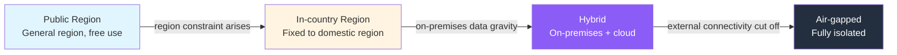
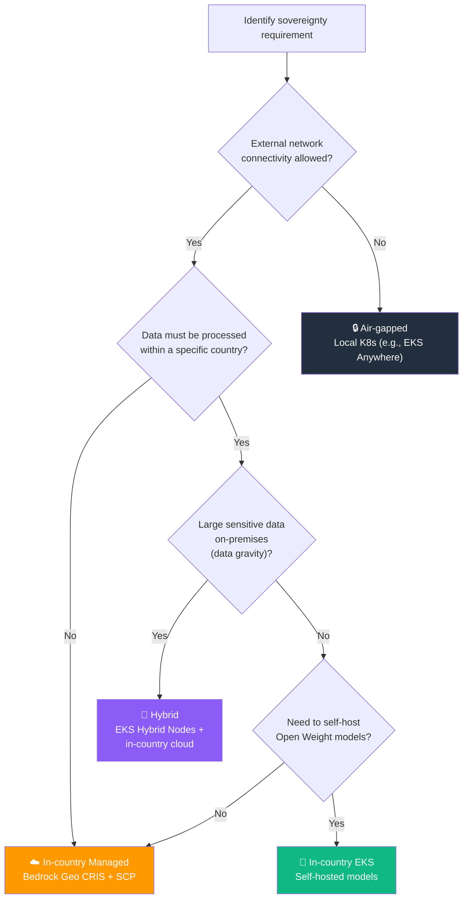
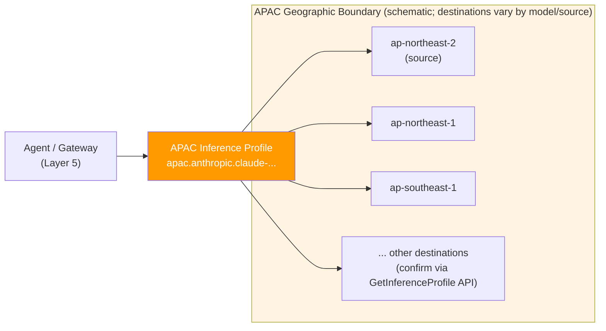
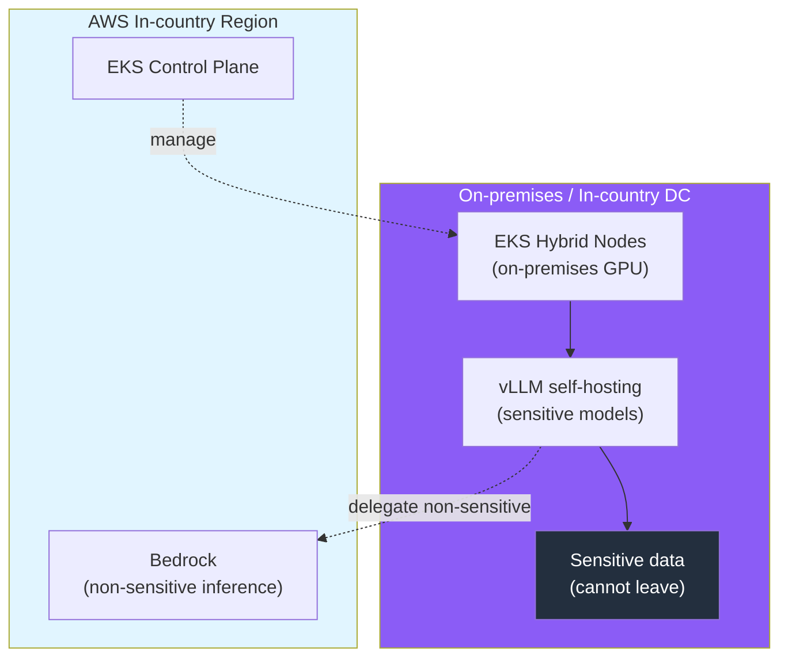

import { SovereigntySpectrum } from '@site/src/components/DecisionFrameworkTables';

## Overview

When adopting Agentic AI in regulated industries such as finance, public sector, healthcare, and autonomous driving, the strongest constraint is **data sovereignty**. The requirement that inference inputs/outputs, training data, and model weights must not leave a specific country or geographic boundary acts as a hard constraint. This document provides a decision framework for which combination of **AWS Native, EKS self-hosting, and hybrid** meets data sovereignty requirements, and summarizes implementation patterns based on **SCP region enforcement**, **Bedrock Geographic cross-Region inference**, and **EKS Hybrid Nodes**.

:::info Prerequisites
Before reading this document, refer to the following:
- [Platform Architecture](../foundations/agentic-platform-architecture.md) — Governance, Safety & Sovereignty plane
- [AI Platform Selection Guide](./ai-platform-decision-framework.md) — Managed vs open source decision
- [EKS-Based Open Architecture](./agentic-ai-solutions-eks.md) — Self-hosted stack, EKS Hybrid Nodes
:::

---

## The Data Sovereignty Spectrum

Data sovereignty requirements are not a single criterion but a **continuous spectrum**. The stronger the requirement, the lower the dependency on managed services and the larger the share of self-hosting/on-premises.

<SovereigntySpectrum />

:::note The "Ops Burden" column is a relative design judgment
In the spectrum table above, labeling In-country as "Low (Geo CRIS + SCP)" is a **design judgment** about relative operational effort across levels. Note, however, that Geographic (Geo) CRIS may route requests to other-country Regions within the same geographic boundary, so for use cases that require **country-level residency** (e.g., domestic finance/public sector), Geo CRIS alone does not satisfy the requirement. Verify the destinations and data flows of a **country-specific profile or a single in-country Region endpoint** for the exact model and source Region before adopting it (see Means 2).
:::

**Figure 1. The four stages of the data sovereignty spectrum**



The table below compares four representative patterns. They are design **choices** selected according to requirements, not stages that converge on one another. "Recommended Approach" is the combination this guide proposes; whether it actually applies must be decided after verifying each means' prerequisites (Means 1–3 below) and your organization's regulatory scope.

**Table 1. Data boundary and proposed approach by sovereignty level**

| Level | Data Boundary | Proposed Approach | Representative Case |
|-------|---------------|---------------------|---------------------|
| **Public** | No region constraint | AWS Native (Bedrock + AgentCore) | General SaaS, internal productivity tools |
| **In-country** | Processing/storage within domestic region (managed) | Country-specific profile (e.g., `jp.*`) or a single in-country Region endpoint + SCP region enforcement. Geographic (Geo) CRIS may route requests to other-country Regions, so it does not by itself meet an "in-country processing/storage" requirement (see Means 2) | Domestic finance, public cloud |
| **Hybrid** | On-premises + in-country cloud | EKS Hybrid Nodes + self-hosted models (requires a persistent connection to an AWS Region) | Manufacturing/autonomous driving with high data gravity |
| **Air-gapped** | External network fully cut off | A separately operated **local Kubernetes with a local control plane** (e.g., EKS Anywhere) + offline registries/artifacts + self-hosting. EKS Hybrid Nodes requires AWS Region connectivity and is not suited to air-gapped (see Means 3 / summary table) | Defense, classified research |

:::tip Many organizations choose In-country or Hybrid
Fully air-gapped carries a high operational burden and is chosen by relatively few organizations; many regulated-industry organizations tend to choose **fixing to an in-country region + self-hosting only sensitive workloads on-premises** (Hybrid). (This is this guide's design judgment, not a figure verified against a specific survey.) Organizations handling large, highly sensitive data such as autonomous driving vision data keep on-premises GPUs due to data gravity, and one approach is to combine general inference with in-country Bedrock/EKS.
:::

---

## Decision Flowchart

**Figure 2. Decision flow from a sovereignty requirement to a deployment approach**



---

## Means 1: SCP-based Region Enforcement

One basic technical control for data sovereignty is **blocking AWS API calls from unapproved regions at the organization level**. It is implemented with AWS Organizations Service Control Policies (SCP). An SCP **does not grant permissions; it only sets the maximum-permission ceiling (a guardrail)**, so even if an SCP allows a region, each account's IAM policy must separately grant the permission for a call to succeed.

Understand the scope and limits of SCPs as well:

- **Who it applies to**: SCPs apply to IAM users/roles in the organization's **member accounts** and do not apply to the organization's management account. Region-out calls from the management account are therefore not blocked by this control.
- **Principal exceptions**: Service-linked roles, roles assumed by other accounts/services, and cross-account access invoked by principals outside the organization may be evaluated in a different `aws:RequestedRegion` context and may not be blocked as intended. Emergency break-glass roles are also explicitly excepted.
- **What it does not cover**: This control governs only the **region a request is directed to**. Data movement that already occurs within an approved region (for example, cross-Region replication, or cross-Region processing/storage a managed service performs in the background) cannot be stopped by an SCP alone, so you must also apply service-specific settings (disabling S3 replication, controlling CRIS destinations, etc.) and network controls.

### Region Deny SCP Pattern

The key is to apply a `Deny` effect with an `aws:RequestedRegion` condition, while **excepting global services (IAM, Organizations, CloudFront, Route 53, etc.) that have no region concept via `NotAction`**. Without the exception, even global service calls are blocked and the account cannot function normally.

```json
{
    "Version": "2012-10-17",
    "Statement": [
        {
            "Sid": "DenyOutsideApprovedRegions",
            "Effect": "Deny",
            "NotAction": [
                "iam:*",
                "organizations:*",
                "kms:*",
                "cloudfront:*",
                "route53:*",
                "sts:*",
                "support:*",
                "globalaccelerator:*",
                "budgets:*",
                "ce:*",
                "health:*",
                "ec2:DescribeRegions"
            ],
            "Resource": "*",
            "Condition": {
                "StringNotEquals": {
                    "aws:RequestedRegion": [
                        "ap-northeast-2",
                        "ap-northeast-1"
                    ]
                },
                "ArnNotLike": {
                    "aws:PrincipalARN": [
                        "arn:aws:iam::*:role/RegionBypassBreakGlassRole"
                    ]
                }
            }
        }
    ]
}
```

The following is an **illustrative policy with two approved regions (`ap-northeast-2` Seoul, `ap-northeast-1` Tokyo)**; each organization must set its own approved regions, excepted services, and exception roles. Do not copy it verbatim — verify each element against your requirements.

**Table 2. Region deny SCP elements and their caveats**

| Element | Role | Caveat |
|---------|------|--------|
| `Effect: Deny` + `aws:RequestedRegion` | Deny requests directed outside approved regions | The absence of a Deny is not an automatic Allow. Effective access is decided by each account's IAM policy |
| `NotAction` list | Exclude region-agnostic global services from the Deny | The `kms:*` entry here **exempts all KMS operations from region control**. But KMS keys are regional resources, and even multi-Region keys are managed independently per Region. If data residency matters, do not except KMS wholesale — narrow the exception to the specific actions you need |
| `aws:RequestedRegion` values | Approved region list | Seoul and Tokyo in this example are in **different countries**. If you need single-country residency, keep only the in-country region |
| `ArnNotLike` (break-glass) | Designate an exception role for emergency operations (audit trail required) | The `*` in `arn:aws:iam::*:role/...` excepts the **same-named role in every matching account**, not exactly one global role. Narrow it to a specific account ID, and protect the break-glass role itself with independent controls (MFA, approval workflow) |

:::warning This example does not guarantee "in-country processing/storage"
This SCP is only an illustrative guardrail that reduces out-of-region API calls. (1) Allowing Seoul and Tokyo together can spread data across two countries; (2) wholesale exceptions such as `kms:*`/`sts:*` disable those services' region control; and (3) an SCP does not turn the **absence** of a Deny into an Allow. If single-country residency is the goal, explicitly narrow the approved regions, excepted services, and excepted principals, and protect the break-glass role independently.
:::

:::warning Watch for SCP and cross-Region inference conflicts when using Bedrock
When using Bedrock Geographic cross-Region inference, allowing only the source region causes inference to **fail**. Resolve this in one of two ways:

1. **Allow destination regions**: Include **all destination regions the inference profile routes to in the SCP allow list**.
2. **Profile-scoped exception**: Instead of opening those destination regions for all services and actions, except cross-Region routing in your region-deny SCP for **that inference profile only**, using the `bedrock:InferenceProfileArn` condition key. Per the official docs, destination regions are carried only on the foundation-model resource evaluation (where `bedrock:InferenceProfileArn` is populated), so you can scope the exception to a specific profile. This exception cannot bypass the region restriction on the originating (source-region) call.

**Important**: An APAC profile's (e.g., `apac.anthropic.claude-sonnet-4`) destinations vary by model and source region across **several regions** (ap-northeast-1/2/3, ap-south-1/2, ap-southeast-1/2/4, etc.). Do not hardcode a region list; confirm the full set of destinations per source region from the **GetInferenceProfile API or the model-specific pages** and reflect it in the SCP. Data can move to unintended regions (India, Australia, etc.).

If you need country-level data residency, use a **country profile** (`jp.*` Tokyo/Osaka, `au.*` Sydney/Melbourne) instead of a geographic profile (`apac.*`), but verify in the official docs which models/source/destinations each profile actually supports (do not assume in-country processing from the profile prefix alone).
:::

### Control Tower Region Deny Control

Organizations using AWS Control Tower can enable the **Region deny control** (at the landing zone level) instead of writing SCPs directly. This managed control is **not identical** to the hand-written SCP above; understand the following characteristics and compare the effective result before treating them as equivalent.

- **Different exception list**: The managed control uses a predefined global-service exception list whose scope is much broader than the example SCP above (dozens of services and specific actions). Maintenance is simpler, but you must confirm for yourself which services are left out of region control.
- **Governed regions only**: Actions are allowed only in regions marked **Governed** in the landing zone settings; regions where Control Tower is unavailable or that you did not place under governance are blocked. **You cannot exclude your home region.**
- **Execution-role exception**: This control excepts the `AWSControlTowerExecution` role via the `aws:PrincipalARN` condition. That is a different principal from the break-glass role in the example above — do not conflate the two exception schemes.
- **Unlisted actions are denied**: Actions not listed in the exception list (`NotAction`) are not permitted outside the governed regions.

---

## Means 2: Bedrock Geographic Cross-Region Inference

To maintain data residency **at the geographic-boundary level** while using managed models (Bedrock), use **Geographic cross-Region inference (CRIS)**. It distributes requests across **regions within a designated geographic boundary (US, EU, APAC, etc.)** rather than a single region, increasing throughput. Per the official docs, your data remains in the regions where it originally resides, but **your input prompts and output results may move outside the source region (to destination regions within the same geographic boundary) during inference, and to the extent data is stored for abuse detection, your input prompts and output results are stored in the destination region**. "Does not leave the geographic boundary" is therefore **not the same as country-level residency**. Inter-region traffic is encrypted over Amazon's secure network.

**Figure 3. Cross-Region inference routing within the APAC geographic boundary**



**Table 3. Characteristics of Geographic cross-Region inference**

| Characteristic | Description |
|----------------|-------------|
| **Data boundary** | Routes to regions within a geography (US/EU/APAC). Data stays in its original region, but inputs/outputs may move to — and (within the abuse-detection scope) be stored in — destination regions in the same geography → **distinct from country-level residency** |
| **Throughput** | Absorbs burst traffic vs single region, mitigates throttling. See the Bedrock service quotas doc for the per-geography cross-region RPM/TPM quotas |
| **Transit encryption** | Inter-region traffic is encrypted over Amazon's secure network |
| **IAM requirement** | Requires invoke access to the inference profile ARN + the foundation model in the source region + all destination regions |

:::info IAM and SCP must both be configured
Geographic CRIS requires invoke-API permissions (`bedrock:InvokeModel`; `bedrock:InvokeModelWithResponseStream` for streaming; `bedrock:Converse`/`bedrock:ConverseStream` for Converse) for ① the inference profile ARN, ② the foundation model in the source region, and ③ **the foundation model in all destination regions**. If your organization has a region deny SCP, either allow the destination regions or add a profile-scoped exception via the `bedrock:InferenceProfileArn` condition. (See the [Means 1](#means-1-scp-based-region-enforcement) warning above.)
:::

---

## Means 3: EKS Hybrid Nodes-based Hybrid/Self-hosting

When data gravity is high (large vision/log data) or sensitive models must be pinned on-premises, **incorporate GPUs from on-premises or in-country data centers into the EKS cluster** with EKS Hybrid Nodes for self-hosting. The control plane stays in an AWS region while the data plane (GPU nodes) stays on-premises, maintaining a single Kubernetes operating model.

:::warning Prerequisite: persistent connectivity to an AWS Region must be permitted
EKS Hybrid Nodes keeps the control plane in an AWS region and requires a **reliable, persistent network connection (Site-to-Site VPN, Direct Connect, etc.)** between the nodes and the control plane. The official docs state that Hybrid Nodes **is not a fit for disconnected, disrupted, intermittent, or limited (DDIL) environments**, so for requirements that do not even permit in-country cloud connectivity (air-gapped), use a local control-plane approach (see the summary table) rather than Hybrid Nodes. Also, placing GPUs on-premises alone does not guarantee that inputs/outputs never leave the boundary — you must also control the egress items in the table below.
:::

**Figure 4. On-premises/cloud split placement with EKS Hybrid Nodes**



**Table 4. Placement and rationale for hybrid components**

| Component | Placement | Reason |
|-----------|-----------|--------|
| EKS Control Plane | AWS in-country region | Managed operations, patching/HA delegated (requires region connectivity) |
| GPU data plane | On-premises (Hybrid Nodes) | Prevent sensitive data egress, data gravity |
| Sensitive model inference | On-premises vLLM | Keep model inputs/outputs on-premises |
| Non-sensitive inference | In-country Bedrock | Reduce operational burden, Cascade delegation |
| **Egress control** | Across the boundary | Node metadata, logs, metrics, tool calls, and Bedrock delegation requests can cross the boundary to AWS/external endpoints, so identify what data goes where and apply approved **masking/classification/redaction** rules and network controls |

**Autonomous driving vision data scenario (design example)**: Vehicle camera raw data is large and sensitive, so it is pinned on-premises; annotation/preprocessing inference runs on on-premises GPUs (Hybrid Nodes) with self-hosted models, and only non-sensitive tasks such as general text summarization and reporting are delegated to managed services in an in-country region. This is one **design direction** — whether it actually reduces cost or satisfies residency can only be judged after you control and verify the data leaving via the delegation path, log/telemetry egress, and tool calls (do not treat it as a verified outcome before that).

:::info EKS Hybrid Nodes Details
For EKS Hybrid Nodes configuration, on-premises GPU incorporation, and networking requirements, see [EKS-Based Open Architecture](./agentic-ai-solutions-eks.md).
:::

---

## Recommended Configuration Summary by Sovereignty Level

**Table 5. Recommended inference, data, and region-control configuration by sovereignty level**

| Sovereignty Level | Inference | Data·Models | Region Control | Key Means |
|-------------------|-----------|-------------|----------------|-----------|
| **Public** | Bedrock (global/geo CRIS) | No region constraint | Optional | AWS Native |
| **In-country (Managed)** | Bedrock Geographic CRIS | In-country region | SCP region enforcement | Means 1 + 2 |
| **In-country (Self-hosted)** | In-country EKS + vLLM | In-country region | SCP region enforcement | Means 1 + 3 |
| **Hybrid** | On-premises vLLM + in-country Bedrock | On-premises + region | SCP + network isolation | Means 1 + 2 + 3 |
| **Air-gapped** | Local self-hosting only | On-premises only | Physical/network isolation | Local control-plane K8s such as EKS Anywhere + offline registries/artifacts (not severing Hybrid Nodes connectivity) |

---

## Compliance Mapping

Map each data sovereignty control to the regulatory requirement it is intended to support.

**Table 6. Key requirement and corresponding means by regulation**

| Regulation | Key Requirement | Corresponding Means |
|------------|-----------------|---------------------|
| **e-Finance Supervisory Regulation (Korea)** | Domestic data processing/storage (applicability and specific clauses unverified) | SCP in-country region enforcement, self-hosting |
| **ISMS-P** | Data location/access control, audit trail (specific certification criteria unverified) | SCP + CloudTrail, RBAC |
| **GDPR** | Restricts **transfers** of personal data outside the EEA (not a blanket in-territory processing mandate). Transfers out of the EEA are allowed under an adequacy decision, appropriate safeguards (SCCs, BCRs, etc.), or a derogation (Chapter V) | EU data can be kept in-territory with EU Geographic CRIS. CRIS alone does not demonstrate GDPR compliance; out-of-EEA transfers require a Chapter V mechanism |
| **Personal Information Protection Act (Korea)** | Conditions for cross-border transfer (consent/notice, etc.). Specific clauses and applicability unverified | Region deny SCP, on-premises isolation |

:::note The regulatory mapping is design guidance
The "Corresponding Means" above connect technical controls to what each regulation typically requires as **design guidance**; they do not legally establish specific clauses, applicability, or actual compliance. The specific provisions and scope of the Korean regulations (e-Finance Supervisory Regulation, ISMS-P, Personal Information Protection Act) are left **unverified** pending review of the primary texts. On GDPR, the Republic of Korea is a country covered by a European Commission **adequacy decision**, so EU→Korea transfers are not necessarily prohibited. Actual application requires legal/compliance review.
:::

:::info Compliance Details
For SOC2·ISMS-P control items and their mapping to platform components, see [Compliance Framework](../../operations-mlops/governance/compliance-framework.md).
:::

---

## Conclusion

Data sovereignty is not a single switch but a spectrum from Public → In-country → Hybrid → Air-gapped, and depending on the requirement you can **propose a combination** of SCP region enforcement, Bedrock Geographic cross-Region inference, and EKS Hybrid Nodes / EKS Anywhere self-hosting. Many regulated-industry organizations tend to choose the Hybrid pattern — **fixing to an in-country region + self-hosting sensitive workloads on-premises** — and consider delegating non-sensitive tasks to managed services to lower cost and operational burden.

Combining these controls does not, however, automatically satisfy each level's sovereignty requirement. Before applying them, verify at least the following:

- **Identity/access**: whether the SCP covers member accounts, principal exceptions, and the management account as intended.
- **Logs/backups/model artifacts**: whether CloudTrail, backups, and model weights do not move outside the approved boundary (e.g., CRIS destinations, cross-Region replication).
- **Tool calls/delegation paths**: what data the agent's tool calls and Bedrock delegation send where, and whether masking/classification rules apply.
- **CRIS destinations**: whether a geographic profile's destination regions and abuse-detection storage conflict with the residency requirement.
- **Disconnected lifecycle**: for air-gapped, whether offline registry/artifact updates and local control-plane operation are feasible.

In other words, this document presents **proposed controls** and **remaining validation items** per sovereignty level; compliance with a specific regulation must be confirmed after designing and verifying the items above, through legal/compliance review.

---

## References

### Official Documentation

- [Service Control Policies (SCP)](https://docs.aws.amazon.com/organizations/latest/userguide/orgs_manage_policies_scps.html) — AWS Organizations SCP guide
- [Region deny control - AWS Control Tower](https://docs.aws.amazon.com/controltower/latest/controlreference/primary-region-deny-policy.html) — Region deny control SCP
- [Geographic cross-Region inference - Amazon Bedrock](https://docs.aws.amazon.com/bedrock/latest/userguide/geographic-cross-region-inference.html) — Geographic boundary inference, IAM·SCP requirements
- [Restrict data transfers across AWS Regions](https://docs.aws.amazon.com/prescriptive-guidance/latest/privacy-reference-architecture/restrict-data-transfers-across-regions.html) — Sample SCP for restricting inter-region data transfers

### Papers / Technical Blogs

- [AWS Well-Architected Generative AI Lens](https://docs.aws.amazon.com/wellarchitected/latest/generative-ai-lens/generative-ai-lens.html) — Generative AI design principles, data governance
- [Financial Services Industry Lens - FSISUS02](https://docs.aws.amazon.com/wellarchitected/latest/financial-services-industry-lens/fsisus02.html) — Data residency design
- [Amazon EKS Hybrid Nodes](https://docs.aws.amazon.com/eks/latest/userguide/hybrid-nodes-overview.html) — Incorporating on-premises nodes

### Related Documents (Internal)

- [Platform Architecture](../foundations/agentic-platform-architecture.md) — Governance, Safety & Sovereignty plane
- [AI Platform Selection Guide](./ai-platform-decision-framework.md) — Managed vs open source vs hybrid
- [EKS-Based Open Architecture](./agentic-ai-solutions-eks.md) — EKS Hybrid Nodes self-hosting
- [Compliance Framework](../../operations-mlops/governance/compliance-framework.md) — SOC2·ISMS-P mapping
