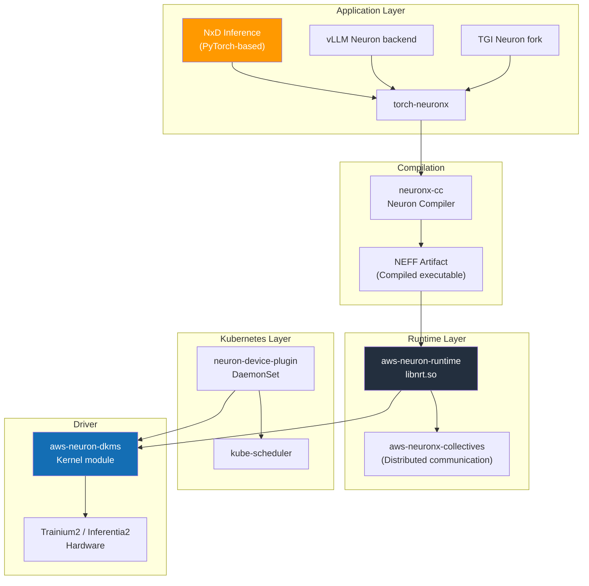
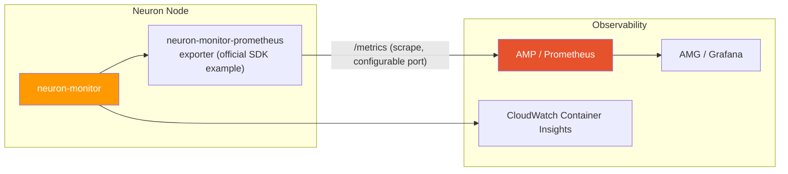

AWS Neuron is a software stack for running training and inference workloads on AWS-designed AI accelerators (Trainium, Inferentia). Similar to how NVIDIA's CUDA + GPU Operator combination abstracts NVIDIA GPUs as Kubernetes resources, Neuron SDK + Neuron Device Plugin abstracts Trainium/Inferentia chips as Kubernetes resources on EKS.

This document covers the Neuron software stack, Device Plugin, Karpenter configuration, and inference framework selection criteria for operating Trainium2/Inferentia2 instances on EKS. For NVIDIA GPU-based stacks, refer to [NVIDIA GPU Stack](./nvidia-gpu-stack.md); for overall node type selection, see [EKS GPU Node Strategy](./eks-gpu-node-strategy.md).

**Table 1. Role and core components by Neuron stack layer**

| Layer | Role | Core Components |
|-------|------|----------------|
| **Infrastructure Automation** | Neuron driver, runtime, Device Plugin | aws-neuron-dkms, neuron-device-plugin |
| **Compiler** | Model → NEFF (Neuron Executable) compilation | neuronx-cc (Neuron Compiler) |
| **Runtime** | NeuronCore execution, memory management | aws-neuron-runtime, neuronx-collectives |
| **Inference Framework** | Large-scale LLM serving | NxD Inference, vLLM Neuron backend, TGI Neuron |
| **Observability** | NeuronCore metrics, profiling | neuron-monitor, neuron-top, neuron-ls |

---

## 1. Why Neuron

### 1.1 Three Reasons to Choose Neuron

**1) Cost Efficiency (Per-Token TCO) — a hypothesis to validate**

AWS markets Trainium2/Inferentia2 as offering lower per-token cost than similar-performance GPUs, but this is **not a universal, confirmed fact across all models, traffic patterns, and regions** — treat it as a hypothesis you must validate on your own workload. The comparison figures in AWS materials are measured under specific model/batch/precision conditions, so treat the following only as **selection considerations** where an advantage is more likely to appear:

- Stable inference traffic sustained long-term (e.g., &gt;3 months)
- Standard Transformer-family models based on FP8/INT8/BF16
- Workloads eligible for AWS Reserved/Savings Plans

When comparing cost, do not use the advertised hourly rate; compute **cost per accepted token measured under the same latency/throughput SLO**, recalculated with current prices for your target model, region, and date. This document states no price figures; verify current pricing with the AWS pricing pages and Pricing Calculator.

**2) Capacity Availability — a time- and region-dependent hypothesis**

When NVIDIA H100/H200/B200 supply is tight, Trainium2 may be relatively easier to procure, but accelerator availability depends on region, point in time, and account quota, so **it cannot be stated as a universal procurement advantage**. The claim that Neuron becomes a practical alternative when p5/p5en inventory is scarce in certain regions is a hypothesis based on past, region-specific observation; verify On-Demand/Spot/Capacity Reservation availability for your target region in the AWS console or with your account team immediately before deploying.

**3) Continuity with Bedrock**

Some Foundation Models served by Bedrock (Claude, Llama, Titan, etc.) run internally on the Neuron stack (AWS has publicly confirmed Trainium2 use for Bedrock; AWS CMO Julia White stated in an October 2025 interview that "more than half of Bedrock runs on Trainium"). Choosing Neuron in the Bedrock → Self-hosted migration path lets you reuse **operational patterns** (monitoring, NEFF cache management, governance). However, Bedrock is a fully managed API service: its internal compiled artifacts (NEFF) are **not exposed to or exportable by customers**, so this is not a reuse of Bedrock's compiled artifacts. Moreover, NEFF is tied to batch size, TP configuration, and the Neuron SDK major version, so compiled-artifact compatibility is not guaranteed across those changes.

### 1.2 Suitable/Unsuitable Workloads

**Table 2. Suitable, caution-required, and unsuitable Neuron workloads**

| Category | Workloads |
|----------|-----------|
| **Suitable** | Standard Llama/Mistral/Qwen-family inference, large-scale long-term operations, FP8/BF16-based serving, Bedrock-style governance |
| **Caution Required** | Newly released models with novel architectures (support delay), workloads dependent on custom CUDA kernels, some AWQ/GPTQ quantization formats |
| **Unsuitable** | Research/experimental environments with frequent model architecture changes, code tightly coupled to CUDA-only libraries (Triton inference server custom kernels) |

:::info Neuron vs NVIDIA Decision Principles
- **Model ecosystem recency is critical** → NVIDIA GPU (H100/H200/B200)
- **Long-term operational TCO / Capacity is critical** → Trainium2 / Inferentia2
- **Hybrid operations with Bedrock** → Prioritize Neuron review
:::

---

## 2. Instance Lineup

This is the Neuron instance lineup as of April 2026 based on AWS official product pages and EC2 user guides. Actual regional availability must be verified in the AWS console.

### 2.1 Inference-Only Instances (Inferentia2)

**Table 3. Inferentia2 inference-only instance specifications**

| Instance | Chips | NeuronCore | Total Accelerator Memory | vCPU | Memory | Network |
|----------|-------|-----------|-------------------------|------|--------|---------|
| inf2.xlarge | 1× Inferentia2 | 2 | 32 GB | 4 | 16 GB | Up to 15 Gbps |
| inf2.8xlarge | 1× Inferentia2 | 2 | 32 GB | 32 | 128 GB | Up to 25 Gbps |
| inf2.24xlarge | 6× Inferentia2 | 12 | 192 GB | 96 | 384 GB | 50 Gbps |
| inf2.48xlarge | 12× Inferentia2 | 24 | 384 GB | 192 | 768 GB | 100 Gbps |

### 2.2 Training/Inference Dual-Purpose Instances (Trainium1/Trainium2)

**Table 4. Trainium1/Trainium2 training/inference dual-purpose instance specifications**

| Instance | Chips | NeuronCore | Total Accelerator Memory | vCPU | Memory | Network |
|----------|-------|-----------|-------------------------|------|--------|---------|
| trn1.2xlarge | 1× Trainium1 | 2 | 32 GB | 8 | 32 GB | Up to 12.5 Gbps |
| trn1.32xlarge | 16× Trainium1 | 32 | 512 GB | 128 | 512 GB | 800 Gbps EFA |
| trn1n.32xlarge | 16× Trainium1 | 32 | 512 GB | 128 | 512 GB | 1,600 Gbps EFA |
| trn2.48xlarge | 16× Trainium2 | 128 (physical) | 1.5 TB (HBM3) | 192 | 2 TiB | 3.2 Tbps EFA v3 |
| **Trn2 UltraServer** (trn2u, 4×trn2.48xlarge, preview/limited availability) | 64× Trainium2 (4×trn2 NeuronLink) | 512 (physical) | 6 TB (HBM3) | - | - | 12.8 Tbps |

:::caution Version and Specification Notes
- NeuronCore counts and memory capacity are based on AWS official materials, and reporting units may vary with SDK releases. Verify actual devices with `neuron-ls` before deployment.
- The NeuronCore counts above (128 for trn2.48xlarge, 512 for the UltraServer) are **physical NeuronCores**. On Trn2, the Logical NeuronCore (LNC) configuration can collapse two physical cores into one logical core (the default depends on the SDK and runtime environment), so the allocatable core count seen by applications and the Device Plugin can be half the physical count. Do not assume the Device Plugin's `aws.amazon.com/neuroncore` allocatable count always equals the logical core count your application uses; confirm the exposed values with `neuron-ls` and the [Logical NeuronCore configuration](https://awsdocs-neuron.readthedocs-hosted.com/en/latest/general/arch/neuron-features/logical-neuroncore-config.html).
- **Trn2 UltraServer (trn2u)** is defined in AWS official announcements as "an ultraserver combining 4 trn2s with NeuronLink" — it is a group of trn2 instances, not a single EC2 instance, so do not conflate its figures with the single trn2.48xlarge row above. **As of April 2026, it may be in preview or limited availability**; general availability, regional scope, and Spot support must be confirmed with AWS account teams or official documentation.
- inf1 (1st generation Inferentia) is not covered in this document. Use Inferentia2/Trainium2 for new deployments.
:::

---

## 3. Neuron SDK 2.x Stack Architecture

### 3.1 Layer Structure

**Figure 1. Neuron SDK 2.x stack layer structure**



### 3.2 Core Components

**Table 5. Neuron SDK core components and deployment form**

| Component | Description | Deployment Form |
|-----------|-------------|-----------------|
| **aws-neuron-dkms** | Linux kernel module. Creates `/dev/neuron*` device nodes | Pre-installed in AMI or DKMS package |
| **aws-neuron-runtime (libnrt)** | NeuronCore execution, memory management, scheduling | Included in container image |
| **aws-neuronx-collectives** | Collectives for distributed training/inference (AllReduce, AllGather, etc.) | Included in container image |
| **neuronx-cc** | Graph compiler. Converts PyTorch/JAX models to NEFF | Used in development/build stage |
| **torch-neuronx** | PyTorch 2.x frontend. `torch.compile(backend="neuronx")` | pip package |
| **neuron-device-plugin** | Kubernetes Device Plugin. Registers `aws.amazon.com/neuron*` resources | DaemonSet |
| **neuron-monitor / neuron-top / neuron-ls** | Observability and profiling tools | Container image/CLI |

:::info Neuron SDK 2.x (Latest stable version as of April 2026)
Neuron SDK is regularly updated in the 2.x release train. Key features of the latest stable version as of April 2026:

- Official support for Trainium2 (trn2) + Trn2 UltraServer (NeuronLink)
- NxD Inference LLM library (pre-compiled checkpoints for Llama 3/4, DBRX, Mistral families)
- Official vLLM Neuron backend support (continuous batching, PagedAttention-like structure)
- PyTorch 2.5+ / JAX compatibility
- FP8 (E4M3/E5M2) inference path

For exact minor version, check [AWS Neuron SDK Release Notes](https://awsdocs-neuron.readthedocs-hosted.com/en/latest/release-notes/).
:::

### 3.3 Compilation Model and NEFF

Neuron uses **Ahead-of-Time (AOT) compilation**: compile the model before running it, rather than executing it directly in PyTorch eager mode. The `neuronx-cc` compiler converts the model’s computation graph—the operations needed to compute its outputs—into instructions for NeuronCore hardware. It stores the result in NEFF (Neuron Executable File Format) for execution.

```
PyTorch / JAX model
        ↓  torch-neuronx trace/compile
Neuron IR (HLO)
        ↓  neuronx-cc
NEFF (Neuron Executable) — Initial compilation 5-30 min, then cache reuse
        ↓  aws-neuron-runtime
Trainium / Inferentia hardware execution
```

**Operational Implications:**
- First Pod startup can take 20-30+ minutes for NEFF compilation → **Pre-compile and cache in S3/ECR** (a compile cache you create and manage yourself)
- Changing the graph structure (batch size, sequence length, TP configuration, etc.) requires recompilation. However, **when only the weights change**, you can replace them without recompiling via `torch_neuronx.replace_weights()` — but only for models traced with `torch_neuronx.trace(..., inline_weights_to_neff=False)` ([replace_weights API](https://raw.githubusercontent.com/aws-neuron/aws-neuron-sdk/master/frameworks/torch/torch-neuronx/api-reference-guide/inference/api-torch-neuronx-replace-weights.rst)). Since `inline_weights_to_neff` defaults to `True`, you must opt into weight separation at compile time to use this exception. So "any weight change requires recompilation" is the default-configuration behavior, not a universal rule.
- The **pre-compiled checkpoints** NxD Inference provides for official models are distinct from the user compile cache above: they are artifacts AWS/the vendor pre-compiles and publishes for a specific model/SDK/instance combination. Their availability, covered models, and versions must be checked in the [NxD Inference model reference](https://awsdocs-neuron.readthedocs-hosted.com/en/latest/libraries/nxd-inference/developer_guides/model-reference.html) at the time of use and are not guaranteed for every model.

---

## 4. EKS Integration

### 4.1 Neuron Device Plugin Deployment

Neuron Device Plugin registers the node's `/dev/neuron*` devices as Kubernetes extended resources. AWS currently points to a **Helm chart (published to an OCI registry)** as the official installation path.

```bash
# Official Helm chart deployment (per AWS official documentation)
helm upgrade --install neuron-helm-chart \
  oci://public.ecr.aws/neuron/neuron-helm-chart \
  --set "npd.enabled=false"

# Verify installation
kubectl get ds neuron-device-plugin -n kube-system
```

:::caution Legacy raw manifest caveat
Do not `kubectl apply` the widely cited `src/k8/k8s-neuron-device-plugin.yml` raw manifest as-is. Some versions of that manifest's DaemonSet nodeAffinity do not include trn2, so Pods may fail to schedule onto the intended trn2 nodes. Use the Helm chart above, or if you must use a raw manifest, verify before applying that the nodeAffinity instance-type matching (`beta.kubernetes.io/instance-type` / `node.kubernetes.io/instance-type`) includes trn2. Also satisfy the driver/kernel requirements in the [EKS prerequisites](https://awsdocs-neuron.readthedocs-hosted.com/en/latest/containers/kubernetes-getting-started.html) before installing.
:::

After deployment, the following appears in node resources:

```bash
kubectl describe node <trn2-node> | grep aws.amazon.com
# Allocatable:
#   aws.amazon.com/neuron:       16    # trn2.48xlarge: Trainium2 chip count (device unit)
#   aws.amazon.com/neuroncore:  128    # Total NeuronCore count (physical; the exposed value can differ with LNC configuration)
```

### 4.2 Resource Request Patterns

:::caution `neurondevice` resource removed (Neuron 2.20+)
Starting with Neuron SDK 2.20 (2024-09), the `aws.amazon.com/neurondevice` resource was consolidated into `aws.amazon.com/neuron` and removed. The current Device Plugin (v2.22.4 per the master YAML) registers only two resources — `neuron` and `neuroncore`. Referencing `neurondevice` in older YAML will cause scheduling failures.
:::

When requesting Neuron resources in Pod specs, choose one of two units:

**Table 6. Neuron resource request units and when to use them**

| Resource | Meaning | When to Use |
|----------|---------|-------------|
| `aws.amazon.com/neuron` | Neuron chip/device unit (Trainium2 chips in trn2; all cores on the device) | When chip/device-level allocation is clear |
| `aws.amazon.com/neuroncore` | NeuronCore unit (8 per trn2 chip) | For fine-grained core-level scheduling |

```yaml
# Example: Use entire trn2.48xlarge (16 chips = 128 NeuronCores)
apiVersion: v1
kind: Pod
metadata:
  name: llama3-70b-neuron
spec:
  nodeSelector:
    node.kubernetes.io/instance-type: trn2.48xlarge
  tolerations:
    - key: aws.amazon.com/neuron
      operator: Exists
      effect: NoSchedule
  containers:
    - name: server
      image: public.ecr.aws/neuron/pytorch-inference-neuronx:2.x
      resources:
        limits:
          aws.amazon.com/neuron: "16"
        requests:
          aws.amazon.com/neuron: "16"
```

```yaml
# Example: allocate 4 NeuronCores to a single Pod.
# (A Pod is scheduled onto a single node, so you need an instance with >=4 allocatable
#  cores. For example, inf2.xlarge and inf2.8xlarge have only 2 NeuronCores each and are
#  insufficient; choose a single instance that has at least the requested count, such as
#  inf2.24xlarge (12), inf2.48xlarge (24), or trn2.48xlarge. Cores cannot be requested
#  across multiple hosts. Resource values must be integers — fractional "half core"
#  requests are not allowed.)
resources:
  limits:
    aws.amazon.com/neuroncore: "4"
```

### 4.3 Node Taint / Toleration Pattern

The same pattern as NVIDIA GPU nodes is recommended.

```yaml
# Apply taint to node (configured in Karpenter NodePool)
taints:
  - key: aws.amazon.com/neuron
    effect: NoSchedule
```

```yaml
# Declare toleration in Pod
tolerations:
  - key: aws.amazon.com/neuron
    operator: Exists
    effect: NoSchedule
```

### 4.4 AMI Selection

**Table 7. AMI options for Neuron nodes and recommended use**

| AMI | Neuron Driver | Recommended Use |
|-----|--------------|-----------------|
| **EKS Optimized AMI (Neuron)** | Pre-installed | Production standard — `--ami-type AL2023_x86_64_NEURON` or equivalent |
| **Deep Learning AMI (Neuron)** | Pre-installed + Neuron SDK tools | Development/debugging nodes |
| **General AL2023** | Manual installation (DKMS) | Not recommended |

When using Neuron-optimized AMI with EKS managed node groups, `nodeadm` automatically configures Neuron drivers.

---

## 5. Karpenter NodePool Examples

### 5.1 trn2 Training/Large Inference NodePool

```yaml
apiVersion: karpenter.sh/v1
kind: NodePool
metadata:
  name: neuron-trn2
spec:
  template:
    metadata:
      labels:
        accelerator: neuron
        accelerator-family: trainium2
    spec:
      requirements:
        - key: karpenter.k8s.aws/instance-family
          operator: In
          values: ["trn2"]
        - key: karpenter.sh/capacity-type
          operator: In
          values: ["spot", "on-demand"]
        - key: topology.kubernetes.io/zone
          operator: In
          values: ["us-east-2a", "us-east-2b", "us-east-2c"]
      taints:
        - key: aws.amazon.com/neuron
          effect: NoSchedule
      nodeClassRef:
        group: karpenter.k8s.aws
        kind: EC2NodeClass
        name: neuron-nodeclass
  disruption:
    consolidationPolicy: WhenEmpty
    consolidateAfter: 10m
  limits:
    aws.amazon.com/neuron: "64"
```

### 5.2 inf2 Low-Cost Inference NodePool

```yaml
apiVersion: karpenter.sh/v1
kind: NodePool
metadata:
  name: neuron-inf2
spec:
  template:
    metadata:
      labels:
        accelerator: neuron
        accelerator-family: inferentia2
    spec:
      requirements:
        - key: karpenter.k8s.aws/instance-family
          operator: In
          values: ["inf2"]
        - key: karpenter.sh/capacity-type
          operator: In
          values: ["spot", "on-demand"]
      taints:
        - key: aws.amazon.com/neuron
          effect: NoSchedule
      nodeClassRef:
        group: karpenter.k8s.aws
        kind: EC2NodeClass
        name: neuron-nodeclass
  limits:
    aws.amazon.com/neuron: "48"
```

### 5.3 EC2NodeClass (Neuron AMI)

```yaml
apiVersion: karpenter.k8s.aws/v1
kind: EC2NodeClass
metadata:
  name: neuron-nodeclass
spec:
  amiSelectorTerms:
    - alias: al2023@latest   # When using Neuron-optimized AMI variant, explicit id specification recommended
  role: KarpenterNodeRole-eks-genai
  subnetSelectorTerms:
    - tags:
        karpenter.sh/discovery: eks-genai
        subnet-type: private
  securityGroupSelectorTerms:
    - tags:
        karpenter.sh/discovery: eks-genai
  blockDeviceMappings:
    - deviceName: /dev/xvda
      ebs:
        volumeSize: 500Gi   # NEFF cache + model weights storage
        volumeType: gp3
        iops: 16000
        throughput: 1000
        encrypted: true
  metadataOptions:
    httpTokens: required
```

:::tip AMI Selection Notes
In Karpenter EC2NodeClass `amiSelectorTerms`, the behavior of the `al2023` alias depends on the Karpenter provider version. **As of karpenter-provider-aws v1.8.3**, when the instance type is a Neuron family (trn/inf), the `al2023` alias automatically discovers and resolves the matching **Neuron variant AMI (AL2023 x86_64 Neuron)** for that node (the AL2023 family enumerates the `standard`, `nvidia`, and `neuron` variants and attaches instance-type requirements to each). So at this version or later, you often do **not** need to manually pin an SSM parameter or explicit AMI ID just to get pre-installed Neuron drivers. Confirm your Karpenter version and verify that the resolved AMI is the expected Neuron variant via the EC2NodeClass status (`kubectl get ec2nodeclass -o yaml`). Consider installing Neuron DKMS manually via UserData only in environments where variant auto-resolution does not apply.
:::

---

## 6. Inference Frameworks

There are three main frameworks for serving LLMs on Neuron.

### 6.1 NxD Inference (Neuron Distributed Inference)

AWS officially maintains this **large-scale LLM inference library**. Based on PyTorch, it provides Tensor/Pipeline Parallelism, Continuous Batching, PagedAttention-like memory management, and Speculative Decoding for Llama families and major public models. NxD Inference is an **execution library**: serving frontends such as vLLM and TGI (below) call it as a common execution layer, so they are often in a driver/driven relationship rather than fully independent alternatives.

**Features:**
- **Pre-compiled checkpoints** for official models such as Llama 3/4, DBRX, Mistral, Mixtral (availability and coverage must be checked per release in the [model reference](https://awsdocs-neuron.readthedocs-hosted.com/en/latest/libraries/nxd-inference/developer_guides/model-reference.html))
- TP/PP configuration API at NeuronCore level
- Apache 2.0 / AWS Official Support

### 6.2 vLLM Neuron backend

vLLM's Neuron support takes the form of a **vLLM extension (plugin) that drives NxD Inference as its execution backend**. There are two paths: (1) the AWS-maintained vLLM fork ([upstreaming-to-vllm](https://github.com/aws-neuron/upstreaming-to-vllm)) and (2) the upstream vLLM project's plugin ([vllm-neuron](https://raw.githubusercontent.com/vllm-project/vllm-neuron/main/README.md), **beta** as of April 2026). Neuron-specific features are passed through to **NxD Inference configuration** via `override_neuron_config` inside vLLM's `additional_config`. Supported models are a **subset** of the models NxDI supports (e.g., Llama 3.x/4, Qwen 2.5/3).

**Features:**
- Serving uses the standard vLLM entrypoints, e.g. `vllm serve <model> --tensor-parallel-size N` or `python3 -m vllm.entrypoints.openai.api_server --model <model> --tensor-parallel-size N --port 8000`. (The older `vllm --device neuron …` form differs from the current entrypoints.)
- While PagedAttention itself is a CUDA implementation, the Neuron path provides equivalent block-based KV management
- Feature status (continuous batching, chunked prefill, prefix caching, speculative decoding) varies by path and version, so **the plugin/release notes and support matrix must be checked**

### 6.3 TGI (Text Generation Inference) Neuron fork

HuggingFace maintains a TGI fork based on **optimum-neuron**. HuggingFace models are compiled and served on Neuron through the `optimum-neuron[neuronx]` package (per the official README: `pip install --upgrade-strategy eager optimum-neuron[neuronx]`). Install the **Neuron driver and tools first**, and use the `optimum-neuron[vllm]` extra if you need vLLM integration for inference. (`optimum[neuronx]` is incorrect notation — the package is named `optimum-neuron`, not `optimum`.)

**Features:**
- Tightly integrated with HuggingFace Hub-based workflows
- TGI itself has been in maintenance mode since 2025 → new features are slower compared to vLLM
- Compatibility with SageMaker's HuggingFace LLM DLC

### 6.4 Framework Comparison

**Table 8. Neuron inference framework comparison**

| Aspect | NxD Inference | vLLM Neuron backend | TGI Neuron fork |
|------|--------------|--------------------|-----------------| 
| **Maintainer** | AWS Official | vLLM community + AWS contributions | HuggingFace + AWS contributions |
| **Model Coverage** | AWS-selected official models (Llama/Mistral/DBRX, etc.) | Neuron-ported vLLM-supported models | optimum-neuron supported HuggingFace models |
| **Pre-compiled checkpoint** | Provided | Partial | Partial |
| **OpenAI-compatible API** | Supported | Supported | Supported |
| **Continuous Batching** | Supported | Supported | Supported |
| **Speculative Decoding** | Supported (model-specific) | Partially supported | Limited |
| **Prefix Caching** | Model-specific | Limited | Limited |
| **Update Speed** | AWS release cycle | vLLM release cycle (fast) | Slow (maintenance mode) |
| **Recommended Use** | Large-scale production with AWS official models | Diverse models and latest vLLM features | HuggingFace ecosystem continuity |

:::tip Framework Selection Guide
- **Large-scale Llama production** → NxD Inference (pre-compiled checkpoint advantage)
- **Diverse models and latest vLLM features** → vLLM Neuron backend
- **Existing HuggingFace Hub-based pipelines** → TGI Neuron fork
- **New projects** are recommended to choose between NxD Inference or vLLM Neuron
:::

---

## 7. Supported Model Matrix

Based on AWS Neuron official Model Zoo and NxD Inference support matrix. For the latest support coverage, check [AWS Neuron Samples GitHub](https://github.com/aws-neuron/aws-neuron-samples) and [NxD Inference documentation](https://awsdocs-neuron.readthedocs-hosted.com/en/latest/libraries/nxd-inference/index.html).

### 7.1 Major Officially Supported Models (as of April 2026)

**Table 9. Major officially supported models and recommended instances (as of April 2026)**

| Model | Size (active / total) | Recommended Instance | Pre-compiled | Notes |
|------|-----|------------|-------------|------|
| Llama 4 Scout (17Bx16E) | 17B active / 109B total (MoE) | trn2.48xlarge | Check release status | NxD support — check support matrix |
| Llama 4 Maverick (17Bx128E) | 17B active / 400B total (MoE) | trn2.48xlarge / Trn2 UltraServer | Check release status | NxD support — check support matrix |
| Mistral 7B / Mixtral 8x7B | 7B / 47B total | inf2.48xlarge | Check release status | NxD/vLLM supported |
| Mixtral 8x22B | 141B total | trn2.48xlarge | Check release status | MoE, EP required |
| Qwen3 series | 4B-32B | inf2 / trn2 | Check release status | vLLM Neuron recommended |
| DBRX | 132B total (36B active) | trn2.48xlarge | Check release status | MoE |
| DeepSeek V3 | 671B total (37B active) MoE | Trn2 UltraServer | Check release status | Check compilation & memory constraints |

:::caution Pre-compiled column meaning and Llama 4 parameters
- **Parameter notation**: Llama 4 is an MoE model, so activated and total parameters differ. Per Meta's official model card, Scout is 17B activated / 109B total (16 experts) and Maverick is 17B activated / 400B total (128 experts). The earlier table's "Scout 17B / Maverick 70B / Behemoth 288B+" (and the English "Scout/Maverick 8B/70B") were incorrect; Behemoth was not publicly released as of this writing.
- **Pre-compiled column**: Asserting that a model has a pre-compiled checkpoint "provided (✅)" requires evidence of the artifact path and version. Without that evidence we do not assert ✅; the column reads **"Check release status"**. Verify actual availability in the [NxD Inference support matrix](https://awsdocs-neuron.readthedocs-hosted.com/en/latest/libraries/nxd-inference/developer_guides/model-reference.html) and Release Notes at deployment time.
- Support differs per model × hardware × dtype × context-length combination, so this table is for reference only and does not guarantee specific version support.
:::

### 7.2 Quantization Support

**Table 10. Neuron support by quantization format**

| Format | Neuron Support |
|------|------------|
| BF16 | Default |
| FP16 | Supported |
| FP8 (E4M3, E5M2) | Trainium2 Supported, Inferentia2 Limited |
| INT8 (weights) | Supported (model-specific) |
| AWQ | Limited (check model & version) |
| GPTQ | Limited |
| GGUF | Not supported |

---

## 8. Observability

### 8.1 Neuron-Specific Tools

**Table 11. Neuron-specific observability tools and when to use them**

| Tool | Role | When to Use |
|-----|------|---------|
| **neuron-ls** | List Neuron devices on the node | Initial diagnosis |
| **neuron-top** | Real-time NeuronCore utilization, memory, power | Real-time monitoring |
| **neuron-monitor** | Stream metrics in JSON format | Prometheus exporter input |
| **neuron-profile** | Profile NEFF execution | Performance optimization |

### 8.2 Prometheus / CloudWatch Integration

**Figure 2. Neuron metric collection chain (Prometheus/CloudWatch)**



**Collection chain:**
- `neuron-monitor` outputs NeuronCore utilization, memory usage, device temperature, execution status, etc. as a JSON stream
- The `neuron-monitor-prometheus` exporter converts this to Prometheus format. This exporter and its reference Grafana dashboard are shipped as **official AWS Neuron SDK examples** (`src/examples/neuron-monitor/`), not community-only artifacts.
- AMP (Amazon Managed Prometheus) collects via remote-write and dashboards in AMG (Amazon Managed Grafana)
- CloudWatch Container Insights Neuron metrics can also be utilized

For detailed AMP/AMG configuration, refer to [Monitoring & Observability Setup](../../reference-architecture/integrations/monitoring-observability-setup.md).

### 8.3 Key Metrics

The series names and units below are those actually used by the official Grafana dashboard example (`neuron-monitor-grafana.json`). Verify the exact labels and series for your exporter version in the [neuron-monitor user guide](https://awsdocs-neuron.readthedocs-hosted.com/en/latest/tools/neuron-sys-tools/neuron-monitor-user-guide.html).

**Table 12. Key Neuron metric series and usage**

| Metric (series) | Description / Unit | Usage |
|-------|------|------|
| `neuroncore_utilization_ratio` | NeuronCore utilization (0–1 ratio) | HPA/KEDA trigger |
| `neuron_runtime_memory_used_bytes` | Neuron runtime memory used (bytes) | OOM prevention, capacity planning |
| `execution_status_total{status_type="completed"}` | Completed executions (counter) — use `rate()` for throughput. **This is a runtime execution metric and is not the end-to-end request latency (SLO)**; collect request latency separately from the serving framework (e.g., vLLM) metrics | Throughput / success rate |
| `execution_errors_total` | Execution errors (counter) | Hardware/runtime health check |
| `hardware_ecc_events_total` | ECC error events (counter) | Hardware health check |

:::note Latency metric caveat
`neuron-monitor` exposes NeuronCore **runtime execution** metrics. To run autoscaling and SLOs off consistent values, separate the autoscaling trigger (`neuroncore_utilization_ratio`) from user-perceived latency (the serving framework's request-latency metric) and collect each independently.
:::

---

## 9. Limitations and Considerations

### 9.1 Feature Constraints

**Table 13. Neuron feature constraint categories and details**

| Category | Constraint |
|------|------|
| **Custom Kernels** | CUDA-only kernels (FlashAttention custom impl, etc.) require direct porting to Neuron |
| **Quantization** | AWQ/GPTQ some variants, GGUF not supported |
| **Compilation Time** | New model initial compilation 20-30+ minutes → NEFF cache essential |
| **Debugging** | GPU telemetry tool ecosystem is narrower compared to nvidia-smi |
| **Open Source Ecosystem** | No equivalent "integrated orchestrator" like NVIDIA GPU Operator / DCGM — combination of Neuron Device Plugin + separate exporter |

### 9.2 Operational Considerations

:::warning Pre-Production Deployment Checklist
- [ ] Verify that target model is **supported in current version** by NxD Inference or vLLM Neuron backend
- [ ] **Pre-compile model NEFF in CI stage** and manage as artifact in S3/ECR
- [ ] Configure `readinessProbe` / `startupProbe` considering first Pod startup delay (with sufficiently large initialDelaySeconds)
- [ ] Verify that `neuron_core_utilization` is properly collected in HPA/KEDA trigger metrics
- [ ] Verify Trainium2 capacity by region and establish Spot interrupt policy
- [ ] Document model version synchronization policy for hybrid operations with Bedrock
:::

### 9.3 Workloads to Avoid on Neuron

- R&D experiments changing model architecture weekly — compilation cost occurs repeatedly
- Existing stack deeply coupled with Triton Inference Server + custom Python backend
- Rare calls with very small requests (&lt;10 tokens/sec) — warmup/compilation overhead is relatively large

---

## 10. Related Documents

- [EKS GPU Node Strategy](./eks-gpu-node-strategy.md) — AWS accelerator selection guide, NVIDIA vs Neuron
- [NVIDIA GPU Stack](./nvidia-gpu-stack.md) — Comparison criteria with NVIDIA stack
- [GPU Resource Management](./gpu-resource-management.md) — Karpenter/KEDA/DRA-based autoscaling
- [vLLM Model Serving](../inference-frameworks/vllm-model-serving.md) — vLLM-based inference engine (CUDA path)
- [MoE Model Serving](../inference-frameworks/moe-model-serving.md) — MoE architecture concepts and Trainium2 deployment strategy
- [Monitoring & Observability Setup](../../reference-architecture/integrations/monitoring-observability-setup.md) — AMP/AMG, Langfuse, OTel

## References

- [AWS Neuron SDK GitHub (aws-neuron)](https://github.com/aws-neuron/aws-neuron-sdk)
- [AWS Neuron Documentation](https://awsdocs-neuron.readthedocs-hosted.com/)
- [AWS Neuron Samples](https://github.com/aws-neuron/aws-neuron-samples)
- [NxD Inference Documentation](https://awsdocs-neuron.readthedocs-hosted.com/en/latest/libraries/nxd-inference/index.html)
- [Neuron SDK Release Notes](https://awsdocs-neuron.readthedocs-hosted.com/en/latest/release-notes/)
- [AWS Trainium2 Product Page](https://aws.amazon.com/machine-learning/trainium/)
- [AWS Inferentia2 Product Page](https://aws.amazon.com/machine-learning/inferentia/)
- [vLLM Neuron Backend Documentation](https://docs.vllm.ai/en/latest/getting_started/installation.html#neuron-installation)
- [optimum-neuron (HuggingFace)](https://github.com/huggingface/optimum-neuron)
- [AWS Neuron Kubernetes Device Plugin](https://github.com/aws-neuron/aws-neuron-sdk/tree/master/src/k8)
