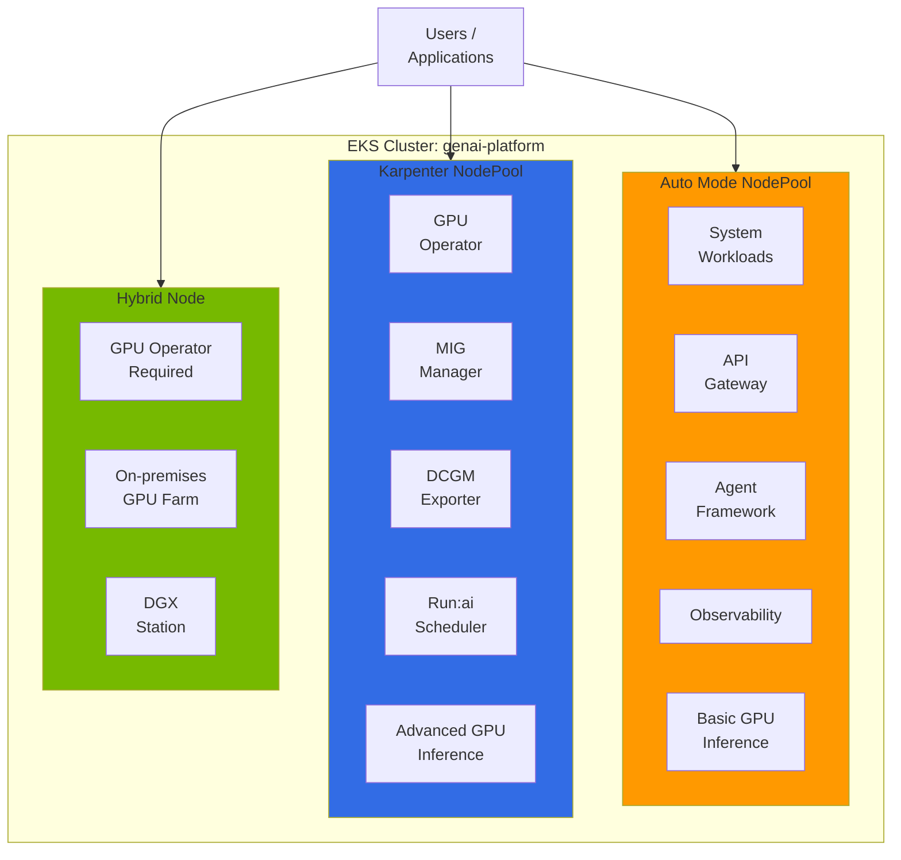
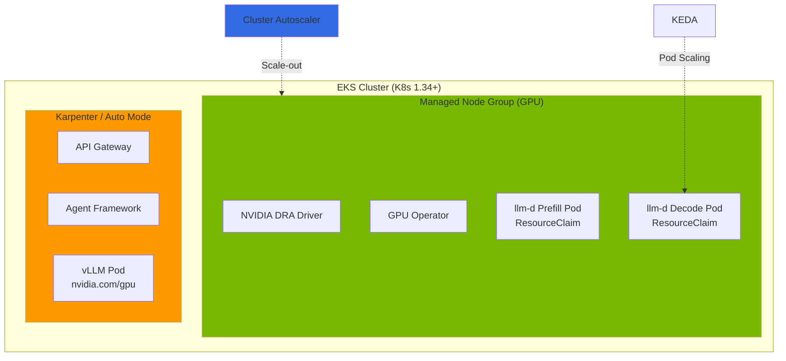
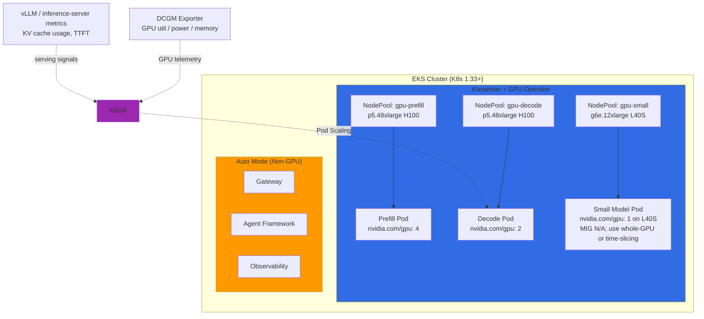
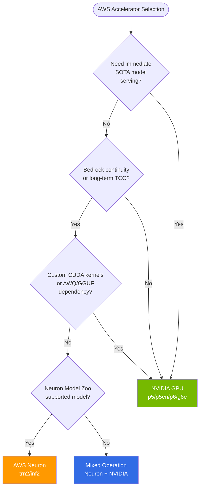
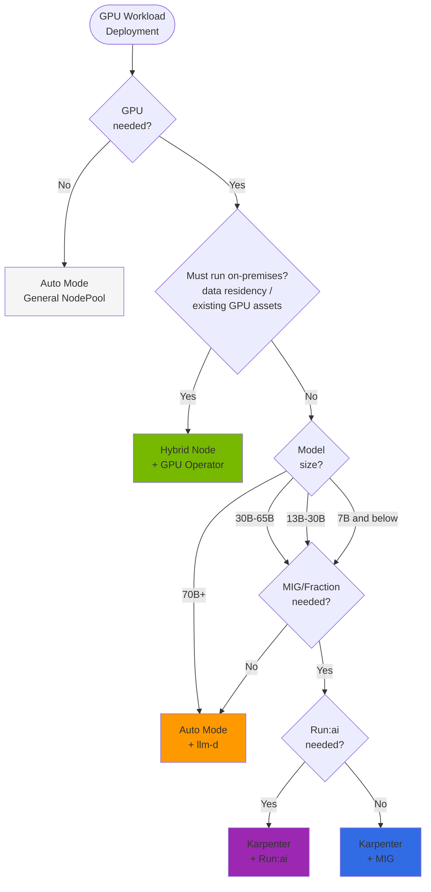

## Overview

When operating GPU workloads on EKS, node type selection directly impacts operational complexity, cost, and feature utilization. GPU inference and training workloads have special requirements unlike general container workloads:

- **Driver dependencies**: NVIDIA GPU drivers, Container Toolkit, Device Plugin
- **Advanced features**: MIG (Multi-Instance GPU), Time-Slicing, Fractional GPU
- **Monitoring**: DCGM (Data Center GPU Manager)-based metrics
- **Scheduling**: Topology-Aware Placement, Gang Scheduling

AWS EKS provides 4 node types for GPU workloads:

| Node Type | Description |
|-----------|-------------|
| **EKS Auto Mode** | AWS fully manages the entire node lifecycle (GPU drivers pre-installed) |
| **Karpenter** | Auto-scaling + Custom AMI, MIG, full user customization |
| **Managed Node Group** | AWS-managed node groups; one of the capacity types that support DRA (Dynamic Resource Allocation), alongside self-managed nodes and Karpenter with static capacity provisioning |
| **Hybrid Node** | Connect on-premises GPU servers to the EKS cluster |

:::tip Basic Principle
You can operate multiple node types **simultaneously** in a single EKS cluster. Configure the optimal node combination matching your workload characteristics.
:::

### Scope of This Document

This document focuses on **node type selection and hybrid architecture design**. Detailed NVIDIA software stack (GPU Operator/DCGM/Dynamo), GPU autoscaling, llm-d distributed inference, and security/troubleshooting are covered in their respective specialized documents (see Section 7 Related Documents).

---

## 2. Node Type Comparison

### 2.1 Feature Comparison Table

| Feature | Auto Mode | Karpenter | Managed Node Group | Hybrid Node |
|---------|-----------|-----------|-------------------|-------------|
| **Management Owner** | AWS fully managed | Self-Managed | AWS managed | On-Premises |
| **Auto-scaling** | Automatic (AWS controlled) | Automatic (NodePool-based) | Manual/Limited | Manual |
| **Custom AMI** | Not available | Available | Available | Available |
| **SSH Access** | Not available | Available | Available | Available |
| **GPU Driver** | Pre-installed (AWS-managed AMI) | Depends on AMI (EKS GPU-optimized AMIs ship the driver; bare AMIs need user install) | Depends on AMI (same as Karpenter) | User-installed |
| **GPU Operator** | **Available** (Device Plugin label disabled) | **Available** | Available | Available |
| **Root Filesystem** | Managed AMI defaults (not user-mutable) | Depends on AMI/OS | Depends on AMI/OS | Depends on AMI/OS |
| **MIG Support** | Not available (managed AMI/OS cannot run MIG Manager) | Available (on MIG-capable GPUs) | Available (on MIG-capable GPUs) | Available (on MIG-capable GPUs) |
| **DRA Compatible** | **Not supported** (DRA not currently compatible with EKS Auto Mode, per EKS docs, as of 2026-09) | **Supported with static capacity provisioning only**; not with dynamically provisioned Karpenter capacity. Upstream Karpenter added DRA request handling from provider [v1.14.0](https://github.com/kubernetes-sigs/karpenter/pull/2384) | **Supported** | **Supported** |
| **DCGM Exporter** | Install via GPU Operator | Included in GPU Operator | Manual installation | Included in GPU Operator |
| **Run:ai Compatible** | **Available** (Device Plugin disabled) | **Available** | Available | Available |
| **Operational Effort** | Lowest (AWS manages lifecycle) | Medium | Medium | High (on-premises ownership) |
| **Billed Compute Cost** | Standard EC2 on-demand/Spot per instance-hour | Standard EC2 on-demand/Spot per instance-hour | Standard EC2 on-demand/Spot per instance-hour | Capex (owned hardware) + Hybrid Node per-vCPU fee |
| **Suitable Workloads** | Simple inference | Advanced GPU features | DRA workloads | On-premises integration |

### 2.2 Selection Guide: When to Use Which Node

**Choose Auto Mode when:**
- You want to quickly start inference services without GPU driver management burden
- Serving large models (70B+) that don't require MIG or Fractional GPU
- System/non-GPU workloads (API Gateway, Agent, Observability)

**Choose Karpenter when:**
- You need flexible control over MIG partitioning, Custom AMI, Spot Instances
- Using projects dependent on GPU Operator ClusterPolicy (Run:ai, KAI Scheduler)
- Optimizing GPU utilization for small/medium models (MIG partitioning)

**Choose Managed Node Group when:**
- DRA (Dynamic Resource Allocation)-based GPU management is required
- Using DRA-exclusive instances like P6e-GB200 UltraServer

**Choose Hybrid Node when:**
- Integrating existing on-premises GPU server assets into EKS
- Data residency requirements

---

## 3. EKS Auto Mode GPU Support and Limitations

### 3.1 GPU Stack Auto-Provided by Auto Mode

EKS Auto Mode pre-installs the following on GPU instances:

1. **NVIDIA GPU Driver** - AWS-managed version, `/dev/nvidia*` devices auto-created
2. **NVIDIA Container Toolkit** - containerd plugin auto-configured
3. **NVIDIA Device Plugin** - `nvidia.com/gpu` resource auto-registered
4. **GPU Resource Registration** - once a GPU node is running, Pods can request `nvidia.com/gpu: 1`

A Pod requesting `nvidia.com/gpu` only schedules if a GPU NodePool is eligible to launch (or has already launched) a matching GPU node. On EKS Auto Mode this requires a NodePool that selects a GPU instance family and tolerates the GPU taint; the built-in general-purpose NodePool does not provision GPU capacity. Verify the image tag, any GPU taints/tolerations and available capacity for your target instance type separately. The manifest below is a workload fragment, not a complete deployment:

```yaml
# Fragment: assumes an eligible GPU NodePool exists and has (or can launch) capacity.
apiVersion: v1
kind: Pod
metadata:
  name: gpu-test
spec:
  # tolerations for the GPU taint and nodeSelector/affinity for the GPU NodePool
  # are required in a real cluster; omitted here for brevity.
  containers:
  - name: cuda-test
    image: nvidia/cuda:12.2.0-runtime-ubuntu22.04
    command: ["nvidia-smi"]
    resources:
      limits:
        nvidia.com/gpu: 1
```

### 3.2 Installing GPU Operator on Auto Mode: Device Plugin Disable Pattern

GPU Operator **can be installed** on Auto Mode, but the reviewed configuration disables more than the Device Plugin. In [awslabs/ai-on-eks PR #288](https://github.com/awslabs/ai-on-eks/pull/288) (reviewed 2026-09), the GPU Operator Helm values set `driver.enabled=false` and `toolkit.enabled=false` because the EKS-managed AMI already ships the driver and container toolkit, and the Device Plugin is disabled on Auto Mode nodes through the NodePool label `nvidia.com/gpu.deploy.device-plugin: "false"`. Node Feature Discovery (NFD), GPU Feature Discovery (GFD), DCGM Exporter and the MIG Manager remain enabled in that configuration. This confirms GPU Operator can run on Auto Mode with the built-in driver/toolkit/device-plugin owned by EKS; it does not by itself demonstrate full GPU Operator feature parity or Run:ai compatibility on Auto Mode, which depend on components (MIG Manager, ClusterPolicy consumers) that still require testing against your target version.

**Why is GPU Operator needed?** Several projects including KAI Scheduler and Run:ai depend on GPU Operator's **ClusterPolicy CRD**. Without ClusterPolicy, these projects cannot even start. This is the core reason for installing GPU Operator on Auto Mode.

```
ClusterPolicy CRD (GPU Operator)
  ↓ depends on
KAI Scheduler (GPU-aware Pod placement)
Run:ai (Fractional GPU, Gang Scheduling)
  ↓ reads
DCGM Exporter (GPU metrics)
NFD/GFD (Hardware labels)
```

For the per-component activation matrix, the Device Plugin disable NodePool label, and complete Helm values for Auto Mode/Karpenter, see [NVIDIA GPU Stack — GPU Operator Configuration per EKS Environment](./nvidia-gpu-stack.md#gpu-operator-configuration-per-eks-environment).

:::caution Actual Auto Mode Limitations
While GPU Operator installation is possible, Auto Mode's **managed AMI and OS are not user-modifiable**, so the following are not available even though a custom NodeClass can still tune infrastructure settings (subnets, security groups, ephemeral storage, networking):
- **MIG Partitioning**: the managed AMI/OS does not run the MIG Manager, so you cannot configure MIG profiles on Auto Mode nodes
- **Custom AMI**: you cannot pin a specific AMI or driver version (the AMI is AWS-managed)
- **SSH/SSM Access**: you cannot directly log in to debug nodes

A custom NodeClass (`kind: NodeClass`, `eks.amazonaws.com/v1`) is itself configurable — the "read-only" restriction applies to the AMI/OS image, not to the whole NodeClass object. If MIG-based GPU partitioning is needed, switch to Karpenter + GPU Operator.
:::

### 3.3 Large GPU Instance Support Status (Verified 2026-04)

Auto Mode large GPU instance support status confirmed during GLM-5 (744B MoE) deployment. p5.48xlarge Spot provisioning was successful, but p5en/p6 have current limitations.

**Detailed Support Status**: See [EKS Auto Mode GPU Instance Support Status](../inference-frameworks/llm-d-eks-automode.md#eks-auto-mode-gpu-instance-support-status-verified-202604)

### 3.4 Auto Mode + MNG Hybrid Limitation

EKS Auto Mode and Managed Node Groups are both supported capacity types that AWS documents as able to coexist in one cluster. During this review a single internal attempt to add an MNG to an Auto Mode cluster for p5en/p6 use did not complete, with the following **observed but not independently reproduced** symptoms:

- MNG creation stayed in `CREATING` state for 30+ minutes
- the backing CloudFormation stack's `Resources` field remained `null`

These are symptoms of one failed provisioning attempt, not a documented platform limitation; the root cause was not isolated and the behavior was not reproduced, so this should be treated as an incident to investigate (capture the CloudFormation events, service quotas and capacity errors) rather than evidence that the hybrid pattern is impossible.

**Recommendation**: for large GPUs (H200+, B200) a well-understood configuration today is **EKS Standard Mode + Karpenter + MNG**; if you need Auto Mode and MNG together, validate the combination in your account first.

### 3.5 Device Plugin Conflict Resolution

Installing GPU Operator with `devicePlugin.enabled=true` on Auto Mode nodes conflicts with the built-in Device Plugin.

```bash
kubectl describe node <gpu-node> | grep nvidia.com/gpu
# Allocatable: nvidia.com/gpu: 0  (expected: 8)
```

**Solution**: Add `nvidia.com/gpu.deploy.device-plugin: "false"` label to NodePool (see Section 3.2)

### 3.6 Node Force Termination Not Available

EC2 instances managed by Auto Mode block direct `ec2:TerminateInstances` calls, so you recover a bad node through the Karpenter/NodeClaim lifecycle rather than by terminating the instance. Recovery procedure:

1. **Keep the workload's demand in place.** Do not delete the Deployment/StatefulSet — deleting the workload removes the demand that triggers a replacement node. If you must drain, let the workload controller reschedule its Pods (for example `kubectl rollout restart`), so the replica count is preserved.
2. **Delete the NodeClaim (or the node) for the unhealthy node:** `kubectl delete nodeclaim <nodeclaim-name>`. Deleting either the node or its NodeClaim cascades to the other; Karpenter sets a finalizer and the Termination Controller taints and gracefully drains the node before removing it.
3. **Karpenter provisions a replacement only if pending Pods still need capacity.** Pre-spin of a replacement happens during the drain when the scheduling simulation finds Pods that require it; there is no fixed interval. Replacement time depends on instance availability and image pull and is not a guaranteed 5–10 minutes.
4. **Verify recovery and handle failures.** Confirm the new node reaches `Ready` and the Pods are `Running`; if a replacement cannot be launched (for example `InsufficientInstanceCapacity` or no eligible NodePool), Karpenter un-taints and retries, and the workload stays pending until capacity is available.

### 3.7 Consolidation and Single-Replica Service Availability (Verified 2026-07) {#consolidation-and-single-replica-service-availability-verified-202607}

Auto Mode's built-in Karpenter runs node consolidation continuously to reduce cost. When a node is consolidated, the Pods on it are rescheduled onto other nodes. **A service running with a single replica can briefly have no `Ready` Pod during this reschedule.** If that service is behind an ALB and its target group ends up with no healthy registered targets, the ALB returns `503 Service Unavailable`; a `503` carrying the response header `server: awselb/2.0` was generated by the ALB itself, not by the application.

Note the distinction the finding calls out: an ALB with **no registered targets** (or all targets in `initial`/`draining`) returns 503, whereas an ALB whose targets are all **unhealthy** can be configured to fail open and still route. To attribute a specific 503 to consolidation you need the ALB access logs and the target-group target-state history, not just the observation that a target was absent.

Observed during this review (not an independently reproduced benchmark): running Langfuse with a single replica on an Auto Mode cluster, consolidation replaced nodes several times a day, and 503s appeared in the gap between target `DeregisterTargets` → new Pod start → `RegisterTargets`. The pattern is visible in CloudTrail as repeated `TerminateInstances` by the `eks-auto-mode-compute` role together with target-group `DeregisterTargets`/`RegisterTargets` events; treat that as correlation to investigate, not proof of causation on its own.

**Mitigation — apply as a set; raising `replicas` alone is not sufficient:**

1. **`replicas: 2` plus a PodDisruptionBudget.** Karpenter honors PDBs, so a `minAvailable: 1` PDB forces sequential eviction. Without a PDB, raising replicas alone can still let both Pods evict back-to-back.

```yaml
apiVersion: policy/v1
kind: PodDisruptionBudget
metadata:
  name: langfuse-web
spec:
  minAvailable: 1
  selector:
    matchLabels:
      app: langfuse-web
```

2. **Spread Pods across failure domains.** If both replicas land on the same node, one consolidation stops both. Spread with `topologySpreadConstraints` (or hostname `podAntiAffinity`). Note that `maxSkew: 1` with `whenUnsatisfiable: DoNotSchedule` only *limits imbalance across the domains that exist*; when only one eligible hostname domain is present, both replicas can still be placed in it. To force Pods onto separate nodes you must guarantee at least two eligible domains — for example set `minDomains: 2` (which makes `DoNotSchedule` keep Pods pending until a second domain appears, at the cost of capacity) or use a required hostname `podAntiAffinity`:

```yaml
topologySpreadConstraints:
  - maxSkew: 1
    minDomains: 2
    topologyKey: kubernetes.io/hostname
    whenUnsatisfiable: DoNotSchedule
    labelSelector:
      matchLabels:
        app: langfuse-web
```

3. **ALB Pod readiness gate.** A Pod can be `Ready` while its ALB target is still `initial`. The AWS Load Balancer Controller injects a readiness gate so a Pod is not counted `Ready` until its target is `Healthy`, which enforces "new target healthy → old target removed" order. This requires the AWS Load Balancer Controller (it injects via a mutating webhook), `target-type: ip` (it does not work with `instance` targets), and a matching Service and TargetGroupBinding that already exist in the namespace; the gate is only injected into Pods **created after** the namespace is labeled:

```bash
kubectl label namespace <ns> elbv2.k8s.aws/pod-readiness-gate-inject=enabled
```

4. **(Alternative) Exclude from disruption.** For a workload that genuinely cannot scale beyond one replica, add the `karpenter.sh/do-not-disrupt: "true"` annotation to the Pod so consolidation skips it. That node is then also excluded from cost optimization.

### 3.8 How to Verify Auto Mode Instance Support {#37-how-to-verify-auto-mode-instance-support}

A `--dry-run=server` apply only runs server-side **admission and schema validation**; it is not persisted and does **not** trigger Karpenter reconciliation or launch an instance. It therefore tells you whether the NodePool manifest is valid, not whether an instance type can actually be provisioned. The manifest below is the object you would validate or apply:

```yaml
apiVersion: karpenter.sh/v1
kind: NodePool
metadata:
  name: gpu-test-dryrun
spec:
  template:
    spec:
      requirements:
        - key: node.kubernetes.io/instance-type
          operator: In
          values: ["p5en.48xlarge"]
      nodeClassRef:
        group: eks.amazonaws.com
        kind: NodeClass
        name: default
  limits:
    nvidia.com/gpu: "8"
```

To actually test support, apply the NodePool for real (an explicitly authorized provisioning test), create a Pod that requests the instance type, and inspect the **NodeClaim created for that test**: if its events show `NoCompatibleInstanceTypes` (or the Pod stays pending with that reason), the instance type is not available to Auto Mode in that cluster/region. Do not infer support or non-support from unrelated existing NodeClaims, and delete the test NodePool/Pod afterward.

---

## 4. Karpenter GPU NodePool Configuration

### 4.1 Why Karpenter

Karpenter is the optimal balance point that maintains Auto Mode's auto-scaling advantages while fully utilizing GPU Operator. For per-item differences with Auto Mode, see the [Feature Comparison Table](#21-feature-comparison-table) above. In short, full Custom AMI, MIG, and Spot support are the deciding factors for choosing Karpenter.

### 4.2 NodePool and Cost Configuration References

Inference/training NodePool YAML, EC2NodeClass, Spot + On-Demand fallback, topology and Gang Scheduling, Spot price comparison, and cost optimization strategies are covered in [GPU Resource Management](./gpu-resource-management.md). For Karpenter-node-specific GPU Operator Helm values, see [NVIDIA GPU Stack — GPU Operator Configuration per EKS Environment](./nvidia-gpu-stack.md#gpu-operator-configuration-per-eks-environment).

Key points from the node strategy perspective:

- **Inference NodePool**: Prefer On-Demand; minimize serving disruption with `consolidationPolicy: WhenEmpty`
- **Training NodePool**: `capacity-type: [spot, on-demand]` for Spot-first + fallback; `consolidateAfter: 30m` only delays Karpenter's **voluntary** consolidation (it does not stop EC2 Spot interruptions, which give a 2-minute notice and can reclaim a node at any time). Spot-based training therefore still requires checkpointing and interruption handling to survive reclamation.
- **Spot savings**: Spot discounts vary continuously by instance type, Region and Availability Zone; p5/p5en/p6 discounts are not a fixed range. Check the current Spot price (for example the EC2 Spot price history or the Spot Instance advisor) for your instance type and Region before quoting a number, and prefer Spot for interruption-tolerant PoC/training workloads rather than latency-sensitive serving.

---

## 5. Recommended Hybrid Architecture

### 5.1 3-Node Type Coexistence Architecture

Operate Auto Mode + Karpenter + Hybrid Node simultaneously in a single EKS cluster.



### 5.2 Per-Workload Node Placement Strategy

| Workload Type | Node Type (example) | GPU Operator | Reason |
|--------------|-----------|--------------|--------|
| **System Components** | Auto Mode | Not needed | CPU-only, no GPU stack |
| **API Gateway / Agent** | Auto Mode | Not needed | CPU workloads |
| **Simple GPU Inference (70B+)** | Auto Mode | Optional | Device Plugin covers plain `nvidia.com/gpu`; add GPU Operator only for DCGM/MIG |
| **MIG-Based Inference** | Karpenter or MNG (MIG-capable GPU) | Needed for MIG Manager | MIG partitioning is driven by the GPU Operator's MIG Manager |
| **Fractional GPU** | Karpenter / Auto Mode | Depends on sharing method | Time-slicing works via the Device Plugin config; Run:ai/KAI need the GPU Operator ClusterPolicy |
| **Model Training** | Karpenter or MNG | Optional | Gang scheduling (e.g. Kueue/Volcano) and Spot do not themselves require the GPU Operator |
| **DRA Workloads** | MNG, self-managed, or Karpenter static capacity | NVIDIA DRA driver (not the Operator) | DRA is unsupported on Auto Mode and on dynamically provisioned Karpenter capacity |
| **On-Premises GPU** | Hybrid Node | Needed | No AWS-managed GPU stack on-premises |

### 5.3 MNG Hybrid for DRA Workloads

DRA (Dynamic Resource Allocation) was made generally available in Kubernetes 1.34, providing attribute-based device selection, topology-aware allocation and device sharing beyond the Device Plugin. Per the EKS documentation (as of 2026-09), **DRA on EKS is supported on EKS managed node groups, self-managed nodes, and Karpenter using static capacity provisioning (K8s 1.33+, recommended 1.34+); it is not currently supported on EKS Auto Mode or on dynamically provisioned Karpenter capacity.** Upstream Karpenter added handling for DRA requests (`ignoreDRARequests`) from provider v1.14.0, but that governs how Karpenter schedules around DRA claims and does not make dynamic Karpenter provisioning a supported DRA capacity type on EKS. DRA devices are published by the NVIDIA DRA driver, which is separate from the GPU Operator. For the per-provisioning-method compatibility table and enablement parameters, see [GPU Resource Management — Node Provisioning Compatibility](./gpu-resource-management.md#node-provisioning-compatibility).



| Workload | Node Type | GPU Allocation Method | Scaling |
|---|---|---|---|
| DRA Workloads (llm-d, P6e-GB200) | **Managed Node Group** | ResourceClaim (DRA) | Cluster Autoscaler |
| Standard GPU Inference (vLLM standalone) | Karpenter / Auto Mode | `nvidia.com/gpu` (Device Plugin) | Karpenter |
| Non-GPU Workloads | Karpenter / Auto Mode | - | Karpenter |

For detailed DRA scale-out strategies, see [GPU Resource Management](./gpu-resource-management.md#dra-workload-scale-out).

### 5.4 Recommended Node Strategy by Model Size

The table below is a **starting-point estimate**, not a measured sizing. Actual GPU memory and utilization depend on weight dtype (FP16/FP8/INT4), context length, batch size and concurrency, so validate with your serving engine before committing. Note the official Meta Llama 3 family ships at 8B and 70B parameter sizes (there is no official "Llama 3 13B"); the 13B–30B row uses other models in that range.

| Model Size | Example | Candidate Node | Rationale (verify by measurement) |
|---|---|---|---|
| **70B+** | Qwen2.5-72B, Llama-3.3-70B | Auto Mode + llm-d | Uses most of the GPU at FP16; management convenience |
| **30B-65B** | Qwen3-32B | Auto Mode or Karpenter | Often >50% GPU at FP16; choose by operational needs |
| **13B-30B** | Qwen2.5-14B, phi-3-medium-14B | Karpenter + MIG 2-way split | A full large GPU may be underused; MIG can raise utilization |
| **7B and below** | Llama-3-8B, Mistral-7B | Karpenter + MIG 4-7 way split | A full large GPU is usually underused; MIG partitioning helps |
| **Multi-Model** | Multiple models simultaneously | Karpenter + MIG | Separate MIG partitions per model |
| **Dev/Test** | Model agnostic | Auto Mode | Quick start |

### 5.5 Cost Impact by Model Size

The following is a **hypothetical allocation example**, not a measured result. The dollar figures assume p5.48xlarge (H100 ×8) On-Demand at a rate of roughly $55.04/hr (~$40,000/month per instance; confirm the current price for your Region, and note AWS adjusts GPU prices over time). The key correction: billed cost is per **EC2 instance-hour**, not per GPU, so savings only materialize when you reduce the number of billed instances for the **same service target** (same model count, request rate and SLO).

Assume a target of serving 8 copies of a 7B model:

| Configuration | 7B Model Copies | GPUs Used | Billed p5.48xlarge Instances | Monthly Billed Cost |
|---|---|---|---|---|
| Full-GPU allocation (1 GPU per copy) | 8 | 8 of 8 on one instance | 1 | ~$40,000 |
| MIG 4-way split (1 MIG slice per copy) | 8 | 2 of 8 on one instance | 1 | ~$40,000 |

In this single-instance example both layouts bill the **same one instance**, so MIG improves per-copy GPU *utilization* and leaves headroom for ~24 more copies on the same instance — it does **not** by itself cut the bill. A real cost reduction appears only when higher density lets you serve the same aggregate demand on **fewer billed instances** (for example consolidating copies that would otherwise have required a second instance). Report utilization and billed-instance count separately, and base any savings claim on measured occupancy.

:::warning Model Size and GPU Utilization
A small model occupying a full large GPU leaves much of that GPU idle. MIG (on MIG-capable GPUs such as A100/H100/H200/B200 — not L40S) or time-slicing raises utilization by packing more copies per GPU. Whether that lowers cost depends on whether the higher density actually removes billed instances, which must be measured.
:::

### 5.6 Optimal Configuration for Current Timeframe (2026-04)

For most LLM serving environments, DRA is not yet essential. Device Plugin + MIG combination can sufficiently cover GPU partitioning and topology placement, and Karpenter's fast scale-out is more favorable for LLM serving SLOs than MNG + Cluster Autoscaler.



The small-model NodePool uses g6e (NVIDIA L40S). L40S is **not** a MIG-capable GPU (MIG requires Ampere-or-newer data-center GPUs such as A100/H100/H200/B200), so a MIG resource like `nvidia.com/mig-3g.40gb` cannot be requested there; use a whole L40S GPU or time-slicing instead. Also note that KV-cache occupancy and TTFT are **inference-server** metrics (for example from vLLM), not DCGM counters; DCGM exposes GPU-level telemetry (utilization, power, framebuffer memory). KEDA scales on both signal sources, from their respective exporters.

| Criteria | Karpenter + Device Plugin | MNG + DRA |
|---|---|---|
| **Scale-out Speed** | Fast (Karpenter) | Slow (Cluster Autoscaler) |
| **GPU Partitioning** | MIG supported (GPU Operator) | DRA native |
| **Operational Complexity** | Single stack | MNG + Karpenter mixed |
| **K8s Version** | 1.32+ | 1.34+ (DRA GA) |
| **Ecosystem Maturity** | Production-proven | Early stage |

### 5.7 Recommended Configuration by Scale

These are **conceptual scenario outlines, not deployable manifests**, and the cost ranges are rough order-of-magnitude figures with no measurement basis — treat them as planning illustrations and size against your own workload and current pricing.

**Small Scale (< 32 GPUs)**

```text
Scenario: Auto Mode + Karpenter (GPU dedicated)
  - Auto Mode: General workloads
  - Karpenter: GPU inference (Device Plugin)
  - GPU Operator: DCGM monitoring
Indicative cost: $5,000 - $15,000/month (unmeasured)
```

**Medium Scale (32 - 128 GPUs)**

```text
Scenario: Karpenter + GPU Operator + KEDA
  - Karpenter NodePool: Separate Prefill / Decode / Small models
  - GPU Operator: MIG, DCGM, NFD/GFD
  - KEDA: KV Cache / TTFT-based Pod scaling
Indicative cost: $15,000 - $80,000/month (unmeasured)
```

**Large Scale (> 128 GPUs)**

```text
Scenario: Karpenter + GPU Operator + Run:ai + Hybrid Node
  - Karpenter: GPU Operator + Run:ai
  - Hybrid Node: On-premises GPU farm integration
  - When adopting P6e-GB200: Add MNG + DRA
Indicative cost: $80,000 - $500,000/month cloud (unmeasured) + Capex (on-premises)
```

### 5.8 DRA Transition Timing

| Condition | Transition Required |
|---|---|
| P6e-GB200 UltraServer Adoption | Required for Multi-Node NVLink (MNNVL) ComputeDomains, which are DRA-only; plain GPU allocation on GB200 does not by itself require DRA |
| Multi-Node NVLink / IMEX Needed | Required (ComputeDomain is a DRA-only resource) |
| CEL-Based Fine-Grained GPU Attribute Selection | Recommended (a DRA capability) |
| GPU Sharing (MPS) | Optional (MPS/time-slicing also work via the Device Plugin) |
| DRA on static capacity (MNG, self-managed, or Karpenter static NodePool) | Supported path once you need DRA; not available on Auto Mode or dynamic Karpenter capacity |

:::tip Transition Strategy
**Now**: Karpenter + GPU Operator (Device Plugin + MIG) — fast, operationally proven production configuration for GPU allocation that does not need DRA.

**When adopting P6e-GB200 with Multi-Node NVLink**: use a DRA-capable capacity type (MNG, self-managed nodes, or Karpenter static capacity) with the NVIDIA DRA driver for ComputeDomains; you can keep non-GPU and non-DRA workloads on Karpenter/Auto Mode.

**For DRA on EKS generally**: DRA is supported on EKS managed node groups, self-managed nodes, and Karpenter static capacity (K8s 1.33+, recommended 1.34+). It is not currently supported on EKS Auto Mode or dynamically provisioned Karpenter capacity, so "Karpenter + DRA" means Karpenter static capacity, not dynamic provisioning.
:::

---

## 6. AWS Accelerator Selection Guide (NVIDIA vs Neuron)

EKS GPU node strategies have traditionally been designed around NVIDIA GPUs (p/g series), but as of 2026, **Trainium2/Inferentia2** based AWS custom accelerators have matured as production alternatives. Neuron stack details are covered in [AWS Neuron Stack](./aws-neuron-stack.md), while this section only summarizes selection criteria for node strategy planning.

### 6.1 NVIDIA GPU vs AWS Neuron Decision Matrix

The comparison below is **directional guidance**, not measured benchmarking. "Day-1" and "porting delay" describe typical ecosystem patterns, not a guarantee for any specific model, and the TCO/cost-per-token rows depend on model, utilization and current pricing — treat them as hypotheses to validate for your workload.

| Criteria | NVIDIA GPU (p5/p5en/p6/g6e) | AWS Neuron (trn2/inf2) |
|------|---------------------------|---------------------|
| **Model Ecosystem Recency** | New open models typically run on CUDA first, but each still needs a compatible serving backend/kernel | AWS porting cycle can lag (weeks to months); check Neuron support for the specific model |
| **Long-Term TCO** | Depends on utilization and current Spot/On-Demand pricing; H100/H200/B200 remain relatively expensive | AWS positions Neuron as favorable cost-per-token (per AWS material); verify for your model and load |
| **Capacity Availability** | Tight depending on Region/timing | Often easier to secure, but Region-dependent |
| **Custom CUDA Kernels** | Full support | Not supported (requires NEFF compilation via the Neuron compiler) |
| **Quantization Formats** | Broad (AWQ/GPTQ/GGUF where the backend supports them) | BF16/FP16/FP8; AWQ/GPTQ support is more limited |
| **Observability Ecosystem** | GPU Operator + DCGM mature | neuron-monitor + OSS exporter |
| **Open-Source Serving** | vLLM, SGLang, TRT-LLM | NxD Inference / vLLM Neuron / TGI Neuron |
| **Bedrock Continuity** | Unrelated | Shares the accelerator path used by parts of the Bedrock stack |
| **Hybrid (On-Premises)** | Possible with Hybrid Node | EC2 only (no on-premises option) |

### 6.2 Selection Flow



### 6.3 Recommended Mixed Operation Pattern

- **Frontier (Latest Models) Layer**: NVIDIA GPU (p5en/p6) — Rapid adoption of new models
- **Volume (High-Frequency Inference) Layer**: Neuron (trn2/inf2) — Low-cost serving of stable models at scale
- **Edge/On-Premises**: Hybrid Node + NVIDIA GPU — Neuron is EC2-only

For detailed Neuron SDK, Device Plugin, Karpenter NodePool, and inference framework selection (NxD Inference / vLLM Neuron / TGI Neuron), see [AWS Neuron Stack](./aws-neuron-stack.md).

---

## 7. Node Strategy Decision Flowchart



The locality/ownership check (`Q0`) is evaluated for any GPU workload, not only large models: data-residency requirements or existing on-premises GPU assets point to Hybrid Node regardless of model size. The model-size branch then covers the full range (70B+, 30B–65B, 13B–30B, 7B and below); for every size below 70B the decision turns on whether MIG/fractional sharing is needed, rather than assuming a single node type per size.

### Decision Summary Table

| Question | Recommended Node Type | GPU Operator |
|----------|----------------------|-------------|
| GPU not needed | Auto Mode | Not needed |
| Simple GPU inference (no MIG) | Auto Mode GPU | Optional (Device Plugin suffices; add for DCGM) |
| MIG needed (MIG-capable GPU) | Karpenter or MNG | Needed for MIG Manager |
| DRA needed | MNG, self-managed, or Karpenter **static** capacity | NVIDIA DRA driver (not the Operator); not on Auto Mode or dynamic Karpenter |
| Fractional GPU / Run:ai | Karpenter / Auto Mode | Needed for Run:ai/KAI ClusterPolicy; time-slicing works via Device Plugin |
| On-premises GPU | Hybrid Node | Needed |
| Cost minimization (Spot acceptable) | Karpenter Spot | Optional |
| Large-scale training (Gang Scheduling) | Karpenter or MNG | Optional |
| P6e-GB200 with Multi-Node NVLink | DRA-capable capacity (MNG / self-managed / Karpenter static) | NVIDIA DRA driver |

---

## 8. Related Documents

### GPU Stack and Monitoring

For detailed NVIDIA GPU software stack including GPU Operator, DCGM, MIG, Time-Slicing, KAI Scheduler, and Dynamo, see the dedicated document.

- **[NVIDIA GPU Stack](./nvidia-gpu-stack.md)** - GPU Operator, DCGM Exporter, MIG Manager, Dynamo, KAI Scheduler

### GPU Resource Management

For GPU autoscaling strategies based on Karpenter, KEDA, and DRA, see:

- **[GPU Resource Management](./gpu-resource-management.md)** - Karpenter NodePool, KEDA Scaling, DRA Scale-out Strategy

### Inference Engines

- **[llm-d EKS Auto Mode](../inference-frameworks/llm-d-eks-automode.md)** - llm-d distributed inference, KV-cache aware routing, Auto Mode/Karpenter node strategy
- **[vLLM Model Serving](../inference-frameworks/vllm-model-serving.md)** - vLLM deployment and optimization

### Hybrid Infrastructure

For EKS Hybrid Node registration of on-premises GPU servers, VPN/Direct Connect configuration, and GPU Operator installation, see:

- **[EKS Hybrid Nodes](/docs/eks-hybrid-nodes)** - On-premises + cloud hybrid architecture

### Deployment and Security

For production deployment YAML, security policies (Pod Security Standards, NetworkPolicy, IAM), and troubleshooting guides for GPU workloads, see Reference Architecture.

- **[Reference Architecture: GPU Infrastructure](../../reference-architecture/model-lifecycle/custom-model-deployment.md)** - GPU security, troubleshooting, deployment guide

### Platform Architecture

- **[EKS-Based Open Architecture](../../design-architecture/platform-selection/agentic-ai-solutions-eks.md)** - Overall Agentic AI platform architecture
