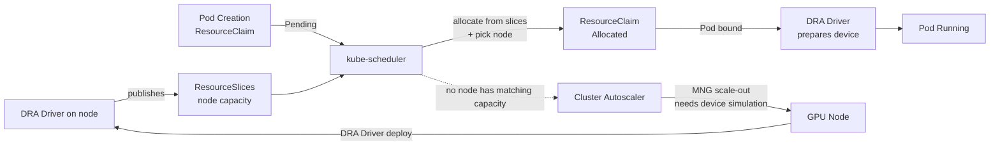
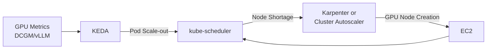
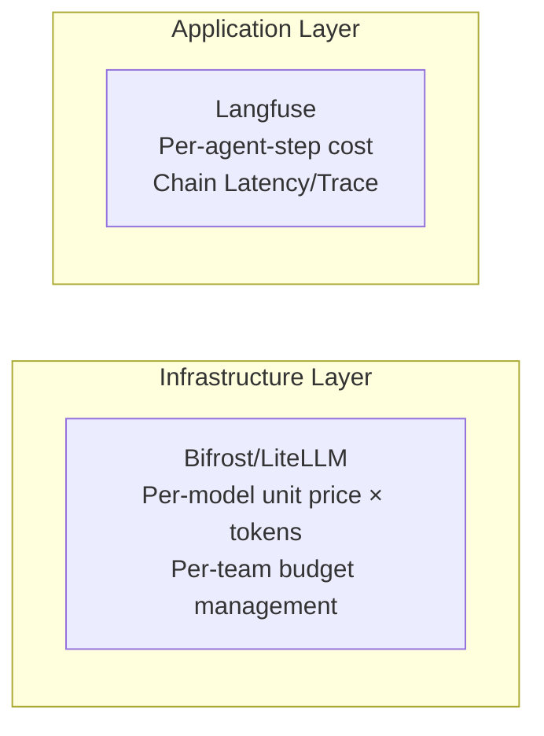

import Tabs from '@theme/Tabs';
import TabItem from '@theme/TabItem';
import { SpecificationTable, ComparisonTable } from '@site/src/components/tables';
import { DraLimitationsTable, ScalingDecisionTable } from '@site/src/components/GpuResourceTables';
import {
  SpotInstancePricingInference,
  SavingsPlansPricingTraining,
  CostOptimizationStrategies,
  KarpenterGpuOptimization
} from '@site/src/components/AgenticSolutionsTables';

GPU resource management strategies in EKS environments are organized around three axes.

**Table 1. Three axes of GPU resource management**

| Axis | Key Question | Core Technologies |
|---|---|---|
| **Provisioning** | Which GPU nodes to create and when? | Karpenter, EKS Auto Mode, Managed Node Group |
| **Scheduling** | Which node to place GPU Pods on? | Device Plugin, DRA, Topology-Aware Routing |
| **Scaling** | How to respond to traffic changes? | KEDA, HPA, Cluster Autoscaler |

This document covers the architecture and design decision criteria for each axis. For GPU Operator details (ClusterPolicy, DCGM, MIG, Time-Slicing, Dynamo, KAI Scheduler, and other NVIDIA software stack components), see [NVIDIA GPU Stack](./nvidia-gpu-stack.md).

---

## Karpenter GPU NodePool

:::info Karpenter GA (v1.0+)
Karpenter has been GA since v1.0, and all examples in this document use the `karpenter.sh/v1` API. The DRA allocator was added to core (`kubernetes-sigs/karpenter`) v1.14.0, and the AWS Provider (`karpenter-provider-aws`) **v1.14.0** that includes it was released on 2026-07-11. With `ignoreDRARequests` set to `false`, self-managed Karpenter v1.14.0+ **accounts for** DRA requests when scheduling Pods onto GPU nodes that already exist. The controller setting `ignoreDRARequests` **defaults to `true` (DRA requests ignored)**, so it must be flipped to `false` for DRA scheduling to work at all. Provisioning a brand-new GPU node directly from a DRA request on AWS is a separate, unverified path (see [Node Provisioning Compatibility](#node-provisioning-compatibility) and [Karpenter DRA Enablement Parameters](#karpenter-dra-enablement-parameters-v1140) below).
:::

### GPU Node Auto-Provisioning Concept

Karpenter analyzes Pending Pod resource requests (`nvidia.com/gpu`, memory, CPU) to automatically provision the optimal EC2 instance. The core value of Karpenter for GPU workloads includes:

- **Instance diversity**: Support for various GPU instances (p4d, p5, g5, g6e, etc.) in a single NodePool
- **Spot/On-Demand mix**: Balance cost and stability with capacity-type
- **Consolidation**: Automatically clean up idle GPU nodes for cost savings
- **Taint-based isolation**: Set `nvidia.com/gpu` taint on GPU nodes to exclude non-GPU workloads

### NodePool Configuration Example

```yaml
apiVersion: karpenter.sh/v1
kind: NodePool
metadata:
  name: gpu-inference-pool
spec:
  template:
    metadata:
      labels:
        node-type: gpu-inference
        workload: genai
    spec:
      requirements:
        - key: kubernetes.io/arch
          operator: In
          values: ["amd64"]
        - key: karpenter.sh/capacity-type
          operator: In
          values: ["on-demand", "spot"]
        - key: node.kubernetes.io/instance-type
          operator: In
          values:
            - p4d.24xlarge    # 8x A100 40GB
            - p5.48xlarge     # 8x H100 80GB
            - g5.48xlarge     # 8x A10G 24GB
        - key: karpenter.k8s.aws/instance-gpu-count
          operator: Gt
          values: ["0"]
      nodeClassRef:
        group: karpenter.k8s.aws
        kind: EC2NodeClass
        name: gpu-nodeclass
      taints:
        - key: nvidia.com/gpu
          value: "true"
          effect: NoSchedule
  limits:
    cpu: 1000
    memory: 4000Gi
    nvidia.com/gpu: 64
  disruption:
    consolidationPolicy: WhenEmptyOrUnderutilized
    consolidateAfter: 30s
  weight: 100
```

**Design Points:**

- `limits.nvidia.com/gpu: 64` — Per-NodePool resource cap. `limits` bounds the total resources Karpenter provisions **for this NodePool**, not for the whole cluster; a cluster-wide ceiling needs the limit replicated across every GPU NodePool or a separate `ResourceQuota`. Karpenter stops provisioning once the pool's total would exceed the limit.
- `disruption.consolidateAfter: 30s` — Delay before Karpenter voluntarily consolidates a node Karpenter itself decides is empty or underutilized. This governs **voluntary** disruption only; it does not affect **involuntary** Spot reclamation, which EC2 initiates independently with a two-minute notice. A short value reclaims idle GPU cost quickly but increases node churn.
- `weight: 100` — Relative priority when several NodePools can satisfy the same Pod; higher weight is preferred first.
- Per-workload separation: inference uses On-Demand + `WhenEmpty` (consolidate only fully empty nodes); training uses `[spot, on-demand]` + `consolidateAfter: 30m` to reduce voluntary churn during long jobs. Neither setting prevents involuntary Spot interruption — training must still checkpoint and resume, since a reclaimed node restarts its Pods elsewhere.

### EC2NodeClass Configuration Example

```yaml
apiVersion: karpenter.k8s.aws/v1
kind: EC2NodeClass
metadata:
  name: gpu-nodeclass
spec:
  amiSelectorTerms:
    - alias: al2023@latest   # family@version is required; a bare "al2023" is rejected by the CRD
  role: KarpenterNodeRole-eks-genai-cluster
  subnetSelectorTerms:
    - tags:
        karpenter.sh/discovery: eks-genai-cluster
        subnet-type: private
  securityGroupSelectorTerms:
    - tags:
        karpenter.sh/discovery: eks-genai-cluster
  blockDeviceMappings:
    - deviceName: /dev/xvda
      ebs:
        volumeSize: 200Gi
        volumeType: gp3
        iops: 16000
        throughput: 1000
        encrypted: true
        deleteOnTermination: true
  metadataOptions:
    httpEndpoint: enabled
    httpPutResponseHopLimit: 2
    httpTokens: required  # IMDSv2
  tags:
    Environment: production
    ManagedBy: karpenter
```

### GPU Instance Type Comparison

<ComparisonTable
  headers={['Instance Type', 'GPU', 'GPU Memory', 'vCPU', 'Memory', 'Network', 'Use Case']}
  rows={[
    { id: '1', cells: ['p4d.24xlarge', '8x A100', '40GB x 8', '96', '1152 GiB', '400 Gbps EFA', 'Large-scale LLM inference'], recommended: true },
    { id: '2', cells: ['p5.48xlarge', '8x H100', '80GB x 8', '192', '2048 GiB', '3200 Gbps EFA', 'Ultra-large models, training'] },
    { id: '3', cells: ['p5e.48xlarge', '8x H200', '141GB x 8', '192', '2048 GiB', '3200 Gbps EFA', 'Large model training/inference'] },
    { id: '4', cells: ['g5.48xlarge', '8x A10G', '24GB x 8', '192', '768 GiB', '100 Gbps', 'Small/medium model inference'] },
    { id: '5', cells: ['g6e.xlarge ~ g6e.48xlarge', 'NVIDIA L40S', 'Up to 8x48GB', 'Up to 192', 'Up to 768 GiB', 'Up to 100 Gbps', 'Cost-efficient inference'] },
    { id: '6', cells: ['trn2.48xlarge', '16x Trainium2', '-', '192', '2048 GiB', '3200 Gbps', 'AWS native training'] }
  ]}
/>

:::tip Instance Selection Guide
- **p5e.48xlarge**: 100B+ parameter models, maximize H200 memory
- **p5.48xlarge**: 70B+ parameter models, highest performance requirements
- **p4d.24xlarge**: 13B-70B parameter models, balanced cost-performance
- **g6e**: 13B-70B models, cost-efficient inference with L40S
- **g5.48xlarge**: 7B and below models, cost-efficient inference
- **trn2.48xlarge**: AWS native training workloads
:::

:::tip EKS Auto Mode
EKS Auto Mode manages node provisioning, but its two **built-in** NodePools (`general-purpose` and `system`) exclude accelerated (GPU) instance families, so they never launch GPU nodes. To run GPU workloads on Auto Mode you must create a **custom NodePool** that selects GPU instances (for example, a `karpenter.k8s.aws/instance-gpu-count` requirement) and tolerates the `nvidia.com/gpu` taint Auto Mode applies to GPU nodes. Once an eligible GPU NodePool exists, Auto Mode provisions instances based on Pod resource requests. See the EKS docs on [built-in node pools](https://docs.aws.amazon.com/eks/latest/userguide/set-builtin-node-pools.html) and [accelerated workloads in Auto Mode](https://docs.aws.amazon.com/eks/latest/userguide/auto-accelerated.html).
:::

---

## Kubernetes GPU Scheduling

### Device Plugin Model

The default method for using GPUs in Kubernetes is the NVIDIA Device Plugin. It registers `nvidia.com/gpu` extended resources with kubelet, and Pods specify GPU count in `resources.requests`.

```yaml
resources:
  requests:
    nvidia.com/gpu: 1
  limits:
    nvidia.com/gpu: 1
```

Device Plugin is simple and stable. Through the NVIDIA Device Plugin's shared-GPU configuration it can also expose **sub-GPU** units — MIG partitions, time-slicing replicas, and MPS slices — not only whole GPUs. Its limitation is in *how* resources are selected and bound: each sharing mode is a statically named `nvidia.com/gpu`-style resource fixed at node startup, so a Pod cannot express attribute-based requirements (e.g. "any MIG profile with ≥20 GB" or "a specific GPU model") and the plugin cannot coordinate the selection across multiple resource types at schedule time. DRA, covered below, adds that attribute-based, Pod-time selection.

### Topology-Aware Routing

`trafficDistribution: PreferSameZone` controls how a Kubernetes **Service** picks among its ready endpoints: kube-proxy prefers endpoints in the client's own availability zone, falling back to other zones when none are ready locally. It affects **client-to-Service** request routing (for example, a gateway calling a vLLM Service) and can cut cross-AZ data-transfer cost and latency for that hop. It is **not** the transport for multi-node tensor-parallel traffic: collective communication between GPU workers runs pod-to-pod over NCCL/EFA/RDMA and is placed by scheduling (node affinity, topology-aware scheduling, Gang Scheduling), not by Service endpoint selection. `PreferSameZone` is a field on the Service spec available since Kubernetes 1.33 (stable; the earlier `topology.kubernetes.io/zone`-based annotation is being superseded). Any latency improvement for distributed workloads depends on co-locating the workers themselves, so treat it as request-routing locality rather than a guaranteed throughput gain.

```yaml
apiVersion: v1
kind: Service
metadata:
  name: vllm-inference
spec:
  selector:
    app: vllm
  ports:
    - port: 8000
  trafficDistribution: PreferSameZone
```

:::caution Using the trafficDistribution field
- `PreferSameZone` is the standard (`PreferClose` is a deprecated alias).
- If the `service.kubernetes.io/topology-mode: Auto` annotation is used together, the annotation takes precedence over the `trafficDistribution` field, so the field is ignored. The annotation is slated for deprecation, so use only the `trafficDistribution` field.
:::

### Gang Scheduling

For large-scale LLM training or tensor parallel inference, multiple GPU Pods must be scheduled **simultaneously**. If only some are placed, the rest remain Pending and occupy resources, creating a deadlock.

**Solutions:**
- **Coscheduling Plugin** (scheduler-plugins): PodGroup CRD to specify minimum Pod count for all-or-nothing scheduling
- **Volcano**: Batch scheduler with native Gang Scheduling support
- **KAI Scheduler**: NVIDIA's GPU-aware scheduler with GPU topology-aware Gang Scheduling (details in [NVIDIA GPU Stack](./nvidia-gpu-stack.md#kai-scheduler))

---

## DRA (Dynamic Resource Allocation)

### Concept and Necessity

DRA is a Kubernetes resource allocation paradigm that overcomes Device Plugin limitations. DRA itself is not GPU-specific — it is a general-purpose framework covering specialized devices such as NICs, interconnects, and FPGAs. The core API model (DeviceClass, ResourceClaim, ResourceSlice) and the per-resource-type driver ecosystem are covered in [Kubernetes DRA](../../../eks-best-practices/resource-cost/kubernetes-dra.md). This section focuses on **operating DRA in EKS GPU environments**.

<DraLimitationsTable />

:::info DRA Maturity
The DRA core reached GA in K8s 1.34 (`resource.k8s.io/v1`, enabled by default) and is locked-to-default in 1.35. For the version history and per-feature maturity, see [Kubernetes DRA — Version History](../../../eks-best-practices/resource-cost/kubernetes-dra.md#version-history).
:::

### GPU Allocation Flow

DRA separates the **declarative resource request** (ResourceClaim) from the **allocation decision**, which the `kube-scheduler` makes — not the driver. The DRA driver's role is to **publish** what each node offers as ResourceSlices and to **prepare** the device on the node once a Pod is bound; the scheduler then evaluates a Pod's ResourceClaim (for example "1 H100 GPU, MIG 3g.20gb profile") against those published slices using CEL and records the allocation in the ResourceClaim's status. For the general API object model and CEL matching principles, see [Kubernetes DRA — Core Model](../../../eks-best-practices/resource-cost/kubernetes-dra.md#the-dra-core-model). The flow below shows this ordering combined with node scale-out on EKS. Scale-out from zero additionally depends on the autoscaler being able to simulate the devices a not-yet-created node would publish (see [Node Provisioning Compatibility](#node-provisioning-compatibility)).

**Figure 1. DRA GPU allocation and node scale-out flow**



### DRA vs Device Plugin Comparison

<ComparisonTable
  headers={['Item', 'Device Plugin', 'DRA']}
  rows={[
    { id: '1', cells: ['Resource Allocation', 'Static registration at node start', 'Dynamic allocation at Pod scheduling'] },
    { id: '2', cells: ['Allocation Unit', 'Whole GPU, or statically preconfigured MIG / time-slicing / MPS units', 'GPU partitioning requested dynamically per Pod (MIG, Time-Slicing)'] },
    { id: '3', cells: ['Attribute-based Selection', 'Not possible (fixed resource names)', 'GPU attribute matching via CEL expressions'] },
    { id: '4', cells: ['Multi-resource Coordination', 'Not possible', 'Pod-level coordination of multiple resources'] },
    { id: '5', cells: ['Karpenter Compatible', 'Fully supported', 'Scheduling onto existing nodes on v1.14.0+ (ignoreDRARequests=false); DRA-driven scale-from-zero on AWS unverified; not supported on v1.13 or below'] },
    { id: '6', cells: ['Maturity', 'Production', 'K8s 1.34+ GA'], recommended: true }
  ]}
/>

### Node Provisioning Compatibility

:::warning DRA node provisioning compatibility (per AWS EKS guidance pinned to 2026-08-03)

AWS's EKS device-management guidance distinguishes **statically provisioned** capacity (nodes that already exist) from **dynamically provisioned** capacity (nodes created on demand). As of the pinned date it states that DRA works with static capacity but not with dynamic Karpenter-created capacity or EKS Auto Mode.

**Table 2. DRA support status by node provisioning method**

| Node Provisioning | DRA with existing (static) nodes | DRA-driven scale-up (new nodes) | Notes |
|---|---|---|---|
| **Managed Node Group** | Supported | Conditional: only via Cluster Autoscaler with DRA simulation (CA 1.34+); requires the DRA driver installed and ResourceSlices simulable | Pods land on existing eligible nodes; scale-up from zero depends on the autoscaler simulating the devices the new node would publish |
| **Self-Managed Node Group** | Supported | Conditional: same CA dependency as MNG | Manual node and driver configuration required |
| **Self-managed Karpenter v1.14.0+** | Supported: scheduling onto existing nodes with `ignoreDRARequests=false` | Not supported: not yet a verified scale-from-zero path on AWS | Core v1.14.0 ships the DRA allocator ([PR #3113](https://github.com/kubernetes-sigs/karpenter/pull/3113)), but the AWS provider does not populate template devices for a not-yet-created instance, so provisioning a new GPU node purely from a DRA request is unverified. See [Karpenter DRA scope](#karpenter-dra-enablement-parameters-v1140) |
| **Self-managed Karpenter ≤ v1.13** | Not supported | Not supported | Skips Pods with `spec.resourceClaims` ([PR #2384](https://github.com/kubernetes-sigs/karpenter/pull/2384)) |
| **EKS Auto Mode** | Not supported | Not supported | AWS's current guidance lists Auto Mode as not supporting DRA; AWS does not publish the internal Karpenter version, so treat this as an AWS support statement rather than an inferred version threshold |
:::

**Behavior differences by version:**

The DRA allocator was merged into core Karpenter v1.14.0, and the AWS Provider v1.14.0 that includes it was released on 2026-07-11. Installing self-managed Karpenter v1.14.0+ with `ignoreDRARequests=false` lets Karpenter **account for** DRA requests when scheduling onto nodes that already exist. Provisioning a **new** GPU node directly from a DRA request is a harder problem, because of the following structural constraints:

1. **ResourceSlice is created after the node exists**: the DRA driver publishes ResourceSlices only after detecting GPUs on a running node, but a provisioner needs that information *before* creating the node (chicken-and-egg problem)
2. **No static instance→ResourceSlice mapping**: with the Device Plugin, `p5.48xlarge → nvidia.com/gpu: 8` is statically known, but with DRA the published content depends on the driver implementation
3. **Simulation requires template devices**: to evaluate a CEL expression before node creation, the provisioner must synthesize the devices the new node *would* publish

The core v1.14.0 allocator adds the simulation machinery, but on AWS the provider's InstanceType construction does not yet populate those template devices, so DRA-driven scale-from-zero on Karpenter is **not a verified path** at the pinned date. For capacity that must scale from zero today, **MNG + Cluster Autoscaler (CA 1.34+)** is the documented option: CA 1.34 does include a DRA-aware simulator (`simulator/dynamicresources/provider`), so it does evaluate ResourceClaims rather than reacting to Pending Pods blindly — the DRA driver and simulable ResourceSlices must be in place for its fit check to succeed. **EKS Auto Mode** does not support DRA per current AWS guidance.

### Karpenter DRA Enablement Parameters (v1.14.0+)

Karpenter v1.14.0+ ships the DRA allocator code, but the **controller is deployed to ignore DRA requests by default**. To let self-managed Karpenter account for DRA requests when scheduling onto GPU nodes, the following parameters must be set explicitly. This enables DRA-aware **scheduling**; whether Karpenter can also provision a brand-new GPU node directly from a DRA request on AWS is a separate, currently unverified capability (the AWS provider does not populate the template devices a pre-creation simulation needs).

**Table 3. Karpenter DRA enablement parameters (v1.14.0+)**

| Layer | Parameter | Default | Setting for DRA |
|---|---|---|---|
| **Karpenter controller** | `settings.ignoreDRARequests` (env `IGNORE_DRA_REQUESTS`) | `true` (ignore DRA requests) | **`false`** — reflect Pods' DRA requests in scheduling simulations |
| **Karpenter version** | core + provider-aws | — | **v1.14.0+** (v1.13 and below skip `spec.resourceClaims` Pods) |

```yaml
# Karpenter Helm values (karpenter-provider-aws v1.14.0+)
settings:
  # Flip the default true (ignore DRA requests) to false so DRA scheduling simulation works
  ignoreDRARequests: false
```

```bash
# When upgrading an existing installation
helm upgrade karpenter oci://public.ecr.aws/karpenter/karpenter \
  --version "1.14.0" \
  --namespace kube-system \
  --reuse-values \
  --set settings.ignoreDRARequests=false
```

:::caution `ignoreDRARequests` is a temporary flag
The official Karpenter documentation notes that this flag "**will be removed once formal DRA support is GA in Karpenter**." That is, the current (v1.14.x) DRA support is early-stage; a future version may enable it by default and drop the flag itself. Check the release notes when upgrading.
:::

:::info NodePool spec requires no changes
The Karpenter upgrade guide's statement that "DRA is additive and requires no configuration changes to existing NodePools" refers to the **NodePool CRD spec**. The `ignoreDRARequests` above is a **controller-global setting** — a separate concern that must be flipped to use DRA.
:::

This Karpenter setting alone does not allocate GPUs. The component that actually advertises and allocates GPUs via DRA is the **NVIDIA DRA driver**, so the cluster and driver layer parameters below must also be in place.

### Full DRA Stack Parameters (3 Layers)

To use GPUs via DRA, parameters across three layers must all be satisfied: **node provisioning (Karpenter) + cluster DRA enablement + NVIDIA DRA driver**.

**Table 4. DRA stack parameters across three layers**

| Layer | Parameter | Default | Setting for DRA |
|---|---|---|---|
| **1. K8s feature gate** | `DynamicResourceAllocation` | on by default on K8s 1.34+ | on (on 1.33 and below, set `--feature-gates=DynamicResourceAllocation=true` on kube-apiserver, scheduler, controller-manager, and kubelet) |
| **1. K8s API group** | `--runtime-config=resource.k8s.io/v1=true` | served by default on 1.34+ | served (EKS control-plane-managed — automatic if cluster is 1.34/1.35) |
| **2. Node provisioning** | Karpenter `ignoreDRARequests` | `true` | **`false`** (see table above) |
| **3. NVIDIA DRA driver GPU allocation** | override gate `gpuResourcesEnabledOverride` (top-level) | **`false`** | **`true`** — turns on the GPU-allocation subsystem; the subsystem field `resources.gpus.enabled` is itself `true` by default (chart v25.12.0) |
| **3. Disable Device Plugin** | GPU Operator `devicePlugin.enabled` | `true` | **`false`** (avoid conflict with DRA driver) |
| **3. Container runtime CDI** | containerd/CRI-O CDI | on by default in GPU Operator v25.10+ | enabled (requires a matching NVIDIA driver; see the driver's own release notes for the exact minimum) |

```bash
# Install NVIDIA DRA driver (chart v25.12.0) — set the override gate that unlocks GPU allocation
helm install nvidia-dra-driver-gpu nvidia/nvidia-dra-driver-gpu \
  --version 25.12.0 \
  --namespace nvidia-dra-driver-gpu --create-namespace \
  --set gpuResourcesEnabledOverride=true \
  --set nvidiaDriverRoot=/run/nvidia/driver   # use "/" for a host-installed driver, "/run/nvidia/driver" for the GPU Driver Container

# Deploy GPU Operator with the Device Plugin disabled (avoid GPU allocation conflict with the DRA driver)
helm upgrade -i gpu-operator nvidia/gpu-operator \
  --namespace gpu-operator --create-namespace \
  --set devicePlugin.enabled=false
```

:::warning The GPU-allocation subsystem is gated behind an override and is early-stage
The NVIDIA DRA driver (`nvidia-dra-driver-gpu`) has two subsystems: **GPU allocation** (`resources.gpus.enabled`) and **ComputeDomain** / Multi-Node NVLink (`resources.computeDomains.enabled`). Both subsystem fields default to `true` in chart v25.12.0, **but GPU allocation is held behind a separate top-level gate `gpuResourcesEnabledOverride`, which defaults to `false`** — so GPU allocation stays off until you set that override to `true`. GPU allocation via DRA is a comparatively new capability of the driver (distinct from the long-stable ComputeDomain path), so pin the chart version and read that version's README and values before relying on it in production. Set `nvidiaDriverRoot` to match where the driver actually lives (`/` for a host-installed driver, `/run/nvidia/driver` for the GPU Driver Container).
:::

### DRA Selection Guide

:::tip When to use DRA
**DRA is the better fit when:**
- You need **attribute-based, per-Pod** GPU selection — e.g. CEL matching on GPU model or MIG profile in a multi-tenant cluster — rather than statically preconfigured sharing. (MIG, Time-Slicing, and MPS themselves are also available through the Device Plugin's shared-GPU config; DRA adds dynamic, expression-based selection of them.)
- You need Pod-level coordination of multiple device types, or topology-aware placement (NVLink, NUMA) expressed as claim constraints.
- Your platform **requires** it: for example, P6e-GB200 UltraServer GPU allocation is documented as DRA-based.

**The Device Plugin is sufficient when:**
- You allocate whole GPUs, or a fixed MIG/time-slicing layout decided at node setup, without per-Pod attribute selection.
- You are on EKS Auto Mode or a Karpenter/K8s combination where DRA is not a supported provisioning path.

**Kubernetes version is about eligibility, not obligation:** DRA core reached GA in K8s 1.34, so 1.34+ *allows* DRA, but a 1.34 cluster with only whole-GPU needs can keep using the Device Plugin. Likewise, running K8s 1.33 or below means DRA is unavailable, not that you are missing a required feature.
:::

---

## KEDA GPU-Based Autoscaling

### Scaling Architecture

GPU workload autoscaling operates as a **2-stage chain**.

**Figure 2. KEDA Pod scaling and node scaling 2-stage chain**



1. **Workload Scaling (KEDA/HPA)**: Adjust Pod count based on GPU metrics
2. **Node Scaling (Karpenter/CA)**: Auto-provision GPU nodes when Pending Pods occur

### LLM Serving Metrics-Based ScaledObject

For LLM serving, **KV cache saturation**, **TTFT**, and **queue depth** are more sensitive scaling signals than simple GPU utilization.

```yaml
apiVersion: keda.sh/v1alpha1
kind: ScaledObject
metadata:
  name: llm-serving-scaler
  namespace: llm-serving            # same namespace as the target Deployment
spec:
  scaleTargetRef:
    name: llm-serving
  minReplicaCount: 2
  maxReplicaCount: 10
  fallback:                         # replica count to hold while a trigger keeps failing
    failureThreshold: 3
    replicas: 4
  triggers:
    # KV cache usage: a 0-1 ratio; model_name is the --served-model-name value
    - type: prometheus
      metricType: Value
      metadata:
        serverAddress: http://<prometheus-host>:9090
        query: avg(vllm:kv_cache_usage_perc{namespace="llm-serving", model_name="exaone"})
        threshold: "0.8"
        ignoreNullValues: "false"
    # Waiting requests per replica
    - type: prometheus
      metricType: AverageValue
      metadata:
        serverAddress: http://<prometheus-host>:9090
        query: sum(vllm:num_requests_waiting{namespace="llm-serving", model_name="exaone"})
        threshold: "10"
        ignoreNullValues: "false"
    # p95 TTFT in seconds for the workload
    - type: prometheus
      metricType: Value
      metadata:
        serverAddress: http://<prometheus-host>:9090
        query: |
          histogram_quantile(0.95,
            sum by (le) (rate(vllm:time_to_first_token_seconds_bucket{namespace="llm-serving", model_name="exaone"}[5m])))
        threshold: "2"
        ignoreNullValues: "false"
```

`serverAddress` and authentication, the vLLM metric names and labels, single-series queries, the handling of empty results and the choice between `Value` and `AverageValue` are explained in [GPU Autoscaling Operations — KEDA Scaling Configuration](../inference-optimization/gpu-autoscaling-operations.md#keda-scaling-configuration). The thresholds are starting points to tune against your SLOs and load tests.

### Disaggregated Serving Scaling Criteria

When operating Prefill and Decode separately, the bottleneck signals differ for each role.

**Table 5. Bottleneck signals and scale criteria for Prefill and Decode**

| | Prefill | Decode |
|---|---|---|
| **Bottleneck Signal** | TTFT increase, input queue backlog | TPS decrease, KV Cache saturation |
| **Scale Criteria** | Input token processing wait time | Concurrent generation session count |
| **Scale Unit** | GPU compute intensive | GPU memory intensive |

### Recommended Scaling Thresholds

<SpecificationTable
  headers={['Workload Type', 'Scale Up Threshold', 'Scale Down Threshold', 'Cooldown']}
  rows={[
    { id: '1', cells: ['Real-time Inference', 'GPU 70%', 'GPU 30%', '60s'] },
    { id: '2', cells: ['Batch Processing', 'GPU 85%', 'GPU 40%', '300s'] },
    { id: '3', cells: ['Conversational Service', 'GPU 60%', 'GPU 25%', '30s'] }
  ]}
/>

### DRA Workload Scale-out

For DRA workloads that must add nodes, the documented path at the pinned date is **MNG + Cluster Autoscaler (CA 1.34+)** with the DRA driver installed (see [Node Provisioning Compatibility](#node-provisioning-compatibility)). Self-managed Karpenter v1.14.0+ with `ignoreDRARequests=false` accounts for DRA requests when scheduling onto existing nodes, but provisioning new GPU nodes from DRA requests is not a verified path on AWS, and EKS Auto Mode does not support DRA per current AWS guidance. The flow below shows the MNG + Cluster Autoscaler + KEDA combination.

```
LLM Metrics (KV Cache, TTFT, Queue)
  → KEDA: Pod scale-out
    → kube-scheduler: ResourceClaim matching attempt
      ├─ Success → Place on existing node
      └─ Failure → Pod Pending
           → Cluster Autoscaler: MNG +1
             → New GPU node → DRA Driver install
               → ResourceSlice creation → Pod placement
```

---

## Cost Optimization Strategies

### GPU Workload Cost Comparison

The prices below are **illustrative example figures**, not a live quote. On-Demand and Spot prices vary by Region and over time, Spot is a fluctuating average rather than a fixed rate, and Savings Plans discounts depend on the commitment term and payment option. Check the [EC2 pricing page](https://aws.amazon.com/ec2/pricing/) and your own account for current numbers.

#### Inference Workloads (per hour)

<SpotInstancePricingInference />

#### Training Workloads (per hour)

<SavingsPlansPricingTraining />

### Cost Optimization Strategy Effects

<CostOptimizationStrategies />

### 4 Key Karpenter-Based Cost Optimization Strategies

<KarpenterGpuOptimization />

The ranges below are **illustrative planning figures, not measured results**; actual savings depend on your baseline instance mix, utilization, Region, and purchase commitments. Treat them as "where to look", then measure against your own on-demand baseline.

**Table 6. Four key Karpenter-based cost optimization strategies**

| Strategy | Core Mechanism | Illustrative Savings vs On-Demand | Target |
|----------|---------------|-----------------|--------|
| **Spot Instance Priority** | `capacity-type: spot` + diverse instance types | up to ~60-90% on the Spot portion (varies by Region/capacity) | Interruption-tolerant inference (stateless) workloads |
| **Time-based Disruption Budget** | Business hours `nodes: 10%`, off-hours `nodes: 50%` | depends on how much capacity is actually idle off-hours | Services with clear business-hour patterns |
| **Consolidation** | `WhenEmptyOrUnderutilized` + `consolidateAfter: 30s` | reclaims idle-node cost; magnitude depends on fragmentation | All GPU workloads |
| **Per-workload Instance Optimization** | Small models→g5, large models→p5, weight for priority | avoids over-provisioning; magnitude depends on current waste | Operating various model sizes |

A `disruption.budgets` entry such as `nodes: 10%` is a **ceiling on voluntary disruption** — it caps how many nodes Karpenter may consolidate at once; it does **not** by itself scale capacity down on a schedule. To reduce capacity during off-hours you combine it with scheduled scaling of the workloads (and therefore of the nodes they require).

:::tip Combined Cost Optimization (worked example, not a guarantee)
The combined figures below are an **arithmetic example** on a hypothetical baseline, not a measured or guaranteed outcome, and the per-strategy percentages are **not additive** — they apply to different, overlapping cost bases. Validate with your own billing data before quoting any number.

**Inference example:** if ~70% of inference capacity runs on Spot (saving ~70% on that portion) and consolidation plus off-hours scaling trim the remaining on-demand base, the *blended* saving can approach a large fraction of the all-on-demand bill — compute it from your real split rather than summing the percentages.

**Training example:** a 1-year Savings Plan commitment on steady training capacity plus Spot for interruption-tolerant experiments (with checkpoint/resume) blends a committed-use discount with Spot pricing; the net depends on the committed-vs-Spot ratio.
:::

### LLMOps Cost Governance

Both infrastructure costs and **token-level costs** must be tracked for complete cost visibility.

**Figure 3. Infrastructure- and application-layer cost tracking**



- **Infrastructure Layer** (Bifrost/LiteLLM): Per-model token pricing, per-team/project budget allocation, monthly cost reports
- **Application Layer** (Langfuse): Per-agent-workflow-step token consumption, end-to-end cost, trace-based bottleneck analysis

:::warning Spot Instance Cautions
- **Interruption handling**: EC2 delivers a Spot interruption notice **up to two minutes** before reclaiming the instance, but this is **best-effort** — the warning can arrive with less lead time or, in rare cases, not at all, and the two minutes is a hard deadline after which the instance is forcibly stopped. Use `terminationGracePeriodSeconds` and a `preStop` hook to drain, but keep the grace period comfortably under two minutes so the kubelet can finish before the deadline.
- **Workload suitability**: "Stateless" means no local persistent state to lose, but it does **not** protect requests in flight — an in-progress token generation on a reclaimed node is cut off. Combine Spot with request draining (stop accepting new requests, finish or fail-fast in-flight ones) and client-side retries so a reclamation degrades gracefully.
- **Availability**: Spot availability for a given instance type and Region fluctuates; specify diverse instance types and let Karpenter fall back to On-Demand when Spot capacity is unavailable.
:::

### Cost Optimization Checklist

<SpecificationTable
  headers={['Item', 'Description', 'Expected Savings']}
  rows={[
    { id: '1', cells: ['Spot Instance Usage', 'Non-production and fault-tolerant workloads', '60-90%'] },
    { id: '2', cells: ['Enable Consolidation', 'Auto-cleanup of idle nodes', '20-30%'] },
    { id: '3', cells: ['Right-sizing', 'Select instances matching workloads', '15-25%'] },
    { id: '4', cells: ['Schedule-based Scaling', 'Reduce resources during off-hours', '30-40%'] }
  ]}
/>

---

## Related Documents

- [Kubernetes DRA](../../../eks-best-practices/resource-cost/kubernetes-dra.md) — DRA as a general-purpose framework — core model, non-GPU resource types, adoption criteria
- [NVIDIA GPU Stack](./nvidia-gpu-stack.md) — GPU Operator, DCGM, MIG, Time-Slicing, Dynamo
- [EKS GPU Node Strategy](./eks-gpu-node-strategy.md) — Auto Mode + Karpenter + Hybrid Node configuration
- [vLLM Model Serving](../inference-frameworks/vllm-model-serving.md) — Inference engine deployment

## References

- [Karpenter Official Documentation](https://karpenter.sh/)
- [KEDA Official Documentation](https://keda.sh/)
- [AWS GPU Instance Guide](https://aws.amazon.com/ec2/instance-types/#Accelerated_Computing)
- [Kubernetes DRA Documentation](https://kubernetes.io/docs/concepts/scheduling-eviction/dynamic-resource-allocation/)
