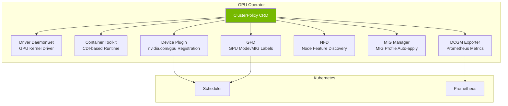
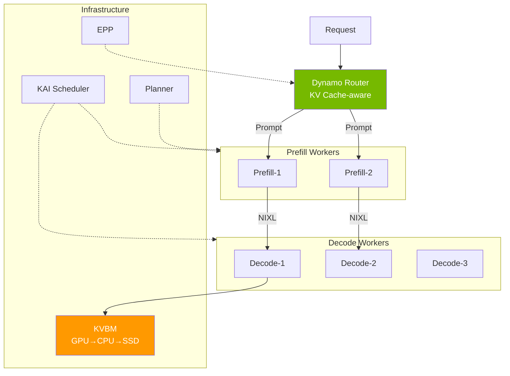

import Tabs from '@theme/Tabs';
import TabItem from '@theme/TabItem';
import { SpecificationTable, ComparisonTable } from '@site/src/components/tables';

The NVIDIA GPU software stack is organized in a layered structure for operating GPUs in Kubernetes environments.

| Layer | Role | Core Component |
|-------|------|---------------|
| **Infrastructure Automation** | Declaratively manage GPU drivers, runtimes, and plugins | GPU Operator (ClusterPolicy CRD) |
| **Monitoring** | Collect GPU state and expose Prometheus metrics | DCGM, DCGM Exporter |
| **Partitioning** | Share a single GPU across multiple workloads | MIG, Time-Slicing |
| **Inference Optimization** | Datacenter-scale LLM serving | Dynamo, KAI Scheduler |

This document covers the architecture and design decision criteria for each component. For GPU node provisioning (Karpenter), scaling (KEDA), and cost optimization, see [GPU Resource Management](./gpu-resource-management.md).

---

## GPU Operator Architecture

### Concept

GPU Operator is an orchestration layer that bundles the entire GPU stack under a single **ClusterPolicy CRD**. Each component can be independently enabled/disabled, and GPU environments are automatically configured when nodes are added.

:::info GPU Operator v25.10.1 (as of 2026-03)

| Component | Version | Role |
|-----------|---------|------|
| GPU Operator | **v25.10.1** | GPU stack lifecycle management |
| NVIDIA Driver | **580.126.18** | GPU kernel driver |
| DCGM | **v4.5.2** | GPU monitoring engine |
| DCGM Exporter | **v4.5.2-4.8.1** | Prometheus metrics exposure |
| Device Plugin | **v0.19.0** | K8s GPU resource registration |
| GFD | **v0.19.0** | GPU node labeling |
| MIG Manager | **v0.13.1** | MIG partition auto-management |
| Container Toolkit (CDI) | **v1.17.5** | Container GPU runtime |

**v25.10.1 Key New Features:** Blackwell (B200/GB200) support, HPC Job Mapping, CDMM (Coherent Driver Memory Management), CDI (Container Device Interface)
:::

### Component Structure



**Component Roles:**

- **Driver DaemonSet**: Installs GPU kernel driver on nodes. Set `enabled: false` for AL2023/Bottlerocket as it's pre-installed in the AMI
- **Container Toolkit (CDI)**: Injects GPU devices into container runtime. CDI (Container Device Interface)-based for runtime independence
- **Device Plugin**: Registers `nvidia.com/gpu` extended resource with kubelet. Enables kube-scheduler to place GPU Pods
- **GFD (GPU Feature Discovery)**: Exposes GPU model, driver version, MIG profiles as node labels. Used for nodeSelector/nodeAffinity
- **NFD (Node Feature Discovery)**: Exposes hardware features (CPU, PCIe, NUMA, etc.) as node labels
- **MIG Manager**: Auto-applies MIG profiles based on ConfigMap. Reconfigures on node label changes
- **DCGM Exporter**: Exposes DCGM metrics in Prometheus format

### GPU Operator Configuration per EKS Environment

| Environment | Driver | Toolkit | Device Plugin | MIG | Notes |
|-------------|--------|---------|---------------|-----|-------|
| **EKS Auto Mode** | ❌ (AWS auto) | ❌ (AWS auto) | ❌ (disabled via label) | ❌ | DCGM/NFD/GFD work normally |
| **Karpenter (Self-Managed)** | ❌ (AL2023 AMI) | ❌ (AL2023 AMI) | ✅ | ✅ | Full support |
| **Managed Node Group** | ❌ (AL2023 AMI) | ❌ (AL2023 AMI) | ✅ | ✅ | Full support |
| **Hybrid Node (On-premises)** | ✅ (required) | ✅ (required) | ✅ | ✅ | GPU Operator required |

:::caution AMI-specific GPU Driver Constraints
- **AL2023 / Bottlerocket**: GPU driver pre-installed in AMI. Both `driver` and `toolkit` must be `enabled: false`
- **EKS Auto Mode**: AWS auto-manages drivers. Device Plugin disabled via node label `nvidia.com/gpu.deploy.device-plugin: "false"`
:::

### GPU Operator on EKS Auto Mode

On Auto Mode, AWS manages GPU drivers and Device Plugin, but **GPU Operator installation is still useful when**:

- **DCGM Exporter**: GPU metrics collection (Auto Mode itself does not provide DCGM)
- **GFD/NFD**: Per-GPU-model node labeling for nodeSelector usage
- **KAI Scheduler**: Compatibility with projects depending on ClusterPolicy

```yaml
# Auto Mode NodePool — Only Device Plugin disabled via label
apiVersion: karpenter.sh/v1
kind: NodePool
metadata:
  name: gpu-auto-mode
spec:
  template:
    metadata:
      labels:
        nvidia.com/gpu.deploy.device-plugin: "false"
    spec:
      requirements:
        - key: eks.amazonaws.com/instance-family
          operator: In
          values: ["p5", "p4d"]
      nodeClassRef:
        group: eks.amazonaws.com
        kind: NodeClass
        name: default
```

Auto Mode Helm values keep the Device Plugin globally enabled and selectively disable it via node labels.

```yaml
# GPU Operator Helm values for Auto Mode
driver:
  enabled: false          # Pre-installed in the AMI by AWS
toolkit:
  enabled: false          # Pre-installed in the AMI by AWS
devicePlugin:
  enabled: true           # Globally enabled, selectively disabled via node labels
dcgmExporter:
  enabled: true
  serviceMonitor:
    enabled: true
nfd:
  enabled: true
gfd:
  enabled: true
```

### GPU Operator Configuration for Karpenter Nodes

On Karpenter (self-managed) nodes, enable the full stack including MIG Manager. The GPU Operator ClusterPolicy does not accept a per-component `nodeSelector`, so to selectively disable an operand on specific nodes, use the `nvidia.com/gpu.deploy.<component>: "false"` node label. Auto Mode nodes already carry the Device Plugin disable label (`nvidia.com/gpu.deploy.device-plugin: "false"`), so the full stack is deployed only on Karpenter nodes. Operand tolerance of GPU node taints is set globally via `daemonsets.tolerations`.

```yaml
# helm install gpu-operator nvidia/gpu-operator -f values.yaml
driver:
  enabled: false          # AL2023: Pre-installed in AMI
toolkit:
  enabled: false          # AL2023: Pre-installed in AMI
devicePlugin:
  enabled: true           # Globally enabled, selectively disabled via node labels
migManager:
  enabled: true
  config:
    name: default-mig-parted-config
    default: "all-balanced"
dcgmExporter:
  enabled: true
  serviceMonitor:
    enabled: true
    interval: 15s
nfd:
  enabled: true
gfd:
  enabled: true
# Operand DaemonSet tolerations are set globally, not per component
daemonsets:
  tolerations:
    - key: nvidia.com/gpu
      operator: Exists
      effect: NoSchedule
```

**Key configuration points:**
- Operand placement is controlled by node labels (`nvidia.com/gpu.deploy.<component>: "false"`), not a per-component `nodeSelector`, because the ClusterPolicy template (both v25.10.1 and v26.3.2) does not render a `nodeSelector` value inside component blocks.
- `driver/toolkit: false` — Pre-installed in the AL2023 AMI
- `migManager: true` — Enables MIG functionality on Karpenter nodes. How MIG resources are exposed depends on the `mig.strategy` setting described under "MIG Pod request" below.

---

## DCGM Monitoring

### Overview

NVIDIA DCGM (Data Center GPU Manager) is a monitoring engine that collects GPU state and exposes metrics to Prometheus. GPU Operator automatically deploys DCGM Exporter as a DaemonSet.

### Deployment Method Selection

<Tabs>
  <TabItem value="daemonset" label="DaemonSet (Recommended)" default>

| Item | Details |
|------|---------|
| **Resource Efficiency** | 1 instance per node — minimal overhead |
| **Management** | Auto-managed by GPU Operator |
| **Metrics Scope** | Collects all GPU metrics on the node |
| **Suitable Environment** | Production environments (most cases) |

  </TabItem>
  <TabItem value="sidecar" label="Sidecar (Special Use)">

| Item | Details |
|------|---------|
| **Resource Efficiency** | 1 instance per Pod — higher overhead |
| **Metrics Scope** | Collects only the Pod's GPU metrics |
| **Suitable Environment** | Multi-tenant billing, when per-Pod isolation is needed |

K8s 1.33+ stabilized Sidecar Containers (`restartPolicy: Always`) can be used to operate alongside the Pod lifecycle.

  </TabItem>
</Tabs>

### Key GPU Metrics

<SpecificationTable
  headers={['Metric', 'Description', 'Usage']}
  rows={[
    { id: '1', cells: ['DCGM_FI_DEV_GPU_UTIL', 'GPU core utilization (%)', 'HPA/KEDA trigger'] },
    { id: '2', cells: ['DCGM_FI_DEV_MEM_COPY_UTIL', 'Memory bandwidth utilization (%)', 'Memory bottleneck detection'] },
    { id: '3', cells: ['DCGM_FI_DEV_FB_USED / FB_FREE', 'Framebuffer used/free (MiB)', 'OOM prevention, capacity planning'] },
    { id: '4', cells: ['DCGM_FI_DEV_POWER_USAGE', 'Power usage (W)', 'Cost and thermal management'] },
    { id: '5', cells: ['DCGM_FI_DEV_GPU_TEMP', 'GPU temperature (C)', 'Thermal throttling prevention'] },
    { id: '6', cells: ['DCGM_FI_DEV_SM_CLOCK', 'SM clock speed (MHz)', 'Performance monitoring'] }
  ]}
/>

### Prometheus Integration Concept

DCGM Exporter exposes Prometheus-format metrics at the `:9400/metrics` endpoint. Setting `dcgmExporter.serviceMonitor.enabled=true` during GPU Operator installation auto-creates the ServiceMonitor.

**Collection chain:**

```
GPU Hardware → DCGM Engine → DCGM Exporter (:9400) → Prometheus → Grafana/KEDA
```

**Key design decisions:**
- **Collection interval**: 15s (default). For LLM serving, 10s recommended
- **Metrics filtering**: Control cardinality by collecting only needed metrics via `/etc/dcgm-exporter/dcp-metrics-included.csv`
- **Pod-GPU mapping**: Setting `DCGM_EXPORTER_KUBERNETES=true` adds `pod`, `namespace`, `container` labels to metrics

---

## GPU Partitioning Strategies

### MIG (Multi-Instance GPU)

MIG partitions Ampere/Hopper/Blackwell architecture GPUs (A100, H100, H200, B200) into up to 7 **hardware-isolated** GPU instances. Each MIG instance has independent memory, cache, and SM (Streaming Multiprocessor), guaranteeing stable performance without inter-workload interference.

**MIG Core Value:**
- **Hardware isolation**: Memory, SM, L2 cache completely separated for QoS guarantee
- **Concurrent execution**: Multiple inference workloads run simultaneously, each isolated from interference by the others; absolute throughput per instance is bounded by the SMs and memory the selected profile allocates, so a smaller profile delivers proportionally less than the full GPU
- **GPU Operator auto-management**: MIG Manager auto-applies profiles based on ConfigMap

**A100 40GB MIG Profiles:**

<SpecificationTable
  headers={['Profile', 'Memory', 'SM Count', 'Suitable workload (BF16 weights)']}
  rows={[
    { id: '1', cells: ['1g.5gb', '5GB', '14', '≤2B weights, or short-context small models; 7B-class needs INT8/FP8 quantization'] },
    { id: '2', cells: ['1g.10gb', '10GB', '14', '≤4B BF16, or 7B quantized to INT8/FP8'] },
    { id: '3', cells: ['2g.10gb', '10GB', '28', '≤4B BF16, or 7B quantized; 2x the SMs of 1g.10gb for higher throughput'] },
    { id: '4', cells: ['3g.20gb', '20GB', '42', '≤7B BF16, or 13B quantized'] },
    { id: '5', cells: ['4g.20gb', '20GB', '56', '≤7B BF16, or 13B quantized; same memory as 3g.20gb, more SMs'] },
    { id: '6', cells: ['7g.40gb', '40GB', '98', '≤13B BF16, or ~30B quantized; the full A100'] }
  ]}
/>

:::info Basis for model sizing
The "Suitable workload" column is a conservative weights-only lower bound, assuming BF16 weights occupy roughly 2 bytes per parameter (KV cache, activations, and fragmentation are additional). For example, a 70B model needs about 140 GB of BF16 weights alone, so it does not fit in a single 7g.40gb (40 GB) partition; serving 70B on a single A100 requires multi-GPU tensor parallelism or aggressive quantization. SM counts follow the A100-SXM4-40GB MIG profiles (1g = 14 … 7g = 98, i.e. 7 slices × 14 SMs). Actual throughput varies widely with the model, quantization (FP8/INT8/AWQ), batch size, sequence length, TP/PP configuration, and serving-engine version, so benchmark your target configuration before deployment. Relative comparison across profiles is governed by SM count and memory.
:::

**MIG Profile Management:**

GPU Operator's MIG Manager watches node labels (`nvidia.com/mig.config`) and auto-applies MIG profiles. Define profiles in a ConfigMap, and MIG Manager reconfigures GPUs when node labels change. The ConfigMap name `default-mig-parted-config` below matches `migManager.config.name` in the Helm values above.

:::warning MIG reconfiguration is not disruption-free
Changing the MIG mode or geometry causes MIG Manager to **terminate all GPU pods on the affected GPU** before reconfiguring (NVIDIA GPU Operator MIG documentation). GPU workloads on that node stop during reconfiguration, and some environments (notably some CSPs) require a node **reboot**, so cordon/drain the node first. Reconfiguration only succeeds when no user workloads are running on the GPUs; if the prerequisites are not met, the `nvidia.com/mig.config.state` label is reported as `failed`. In production, perform this in a maintenance window and plan it together with a PodDisruptionBudget and a drain procedure.
:::

```yaml
# MIG Profile ConfigMap (mig-parted format)
apiVersion: v1
kind: ConfigMap
metadata:
  name: default-mig-parted-config
  namespace: gpu-operator
data:
  config.yaml: |
    version: v1
    mig-configs:
      all-1g.5gb:          # 7 small instances
        - devices: all
          mig-enabled: true
          mig-devices:
            "1g.5gb": 7
      mixed-balanced:      # Mixed configuration
        - devices: all
          mig-enabled: true
          mig-devices:
            "3g.20gb": 1
            "2g.10gb": 1
            "1g.5gb": 2
      single-7g:           # Single large
        - devices: all
          mig-enabled: true
          mig-devices:
            "7g.40gb": 1
```

How a Pod requests MIG devices depends on the Device Plugin's `mig.strategy` setting, specified as `mig.strategy` in the GPU Operator Helm values; the default is `single`.

- **`mig.strategy: single`** (chart default): used when all GPUs on a node are partitioned into the same single profile. MIG devices are exposed as the generic `nvidia.com/gpu` resource, so a Pod requests:

```yaml
# mig.strategy=single — MIG slices are exposed as nvidia.com/gpu
resources:
  requests:
    nvidia.com/gpu: 1
  limits:
    nvidia.com/gpu: 1
```

- **`mig.strategy: mixed`**: used when different profiles coexist on one node. Only this strategy exposes per-profile `nvidia.com/mig-<profile>` resources, so for the request below to be valid you must set `mig.strategy=mixed` in the Helm values (the Karpenter values above do not set `mig.strategy`, so they default to `single`).

```yaml
# mig.strategy=mixed — per-profile named resources are exposed
resources:
  requests:
    nvidia.com/mig-1g.5gb: 1
  limits:
    nvidia.com/mig-1g.5gb: 1
```

### Time-Slicing

Time-Slicing shares GPU computing time across multiple Pods based on time division. Unlike MIG, it's **available on all NVIDIA GPUs** but lacks inter-workload memory isolation.

**Configuration:**

GPU Operator's ClusterPolicy references a ConfigMap to enable Time-Slicing.

```yaml
# Time-Slicing ConfigMap
apiVersion: v1
kind: ConfigMap
metadata:
  name: time-slicing-config
  namespace: gpu-operator
data:
  any: |-
    version: v1
    sharing:
      timeSlicing:
        resources:
          - name: nvidia.com/gpu
            replicas: 4    # Each GPU shared by 4 Pods
```

Pods request `nvidia.com/gpu: 1` as usual. Time-Slicing **oversubscribes** the GPU by the configured `replicas` count — it only increases the advertised resource count and does not guarantee a fixed compute slice or memory quota per Pod. The sharing Pods run on the same GPU in time-sliced turns and contend for memory and compute.

### MIG vs Time-Slicing Comparison

<ComparisonTable
  headers={['Item', 'MIG', 'Time-Slicing']}
  rows={[
    { id: '1', cells: ['Isolation level', 'Hardware isolation (memory, SM, cache)', 'Software time-sharing (no isolation)'] },
    { id: '2', cells: ['Supported GPUs', 'A100, H100, H200, B200', 'All NVIDIA GPUs'] },
    { id: '3', cells: ['Max partitions', '7 instances', 'As set by replicas (not a hardware partition; contention grows)'] },
    { id: '4', cells: ['Performance predictability', 'Guaranteed (QoS)', 'Varies with concurrent workload count'] },
    { id: '5', cells: ['Memory safety', 'OOM does not affect other instances', 'OOM affects other workloads'] },
    { id: '6', cells: ['Suitable environment', 'Production inference, multi-tenant', 'Dev/test, batch inference'], recommended: true }
  ]}
/>

:::warning Time-Slicing Performance Characteristics
- **Scheduling model**: GPU contexts are time-sliced and run in alternating turns per process. Unlike CUDA MPS, this is time division rather than concurrent kernel execution, so context-switching cost and queueing latency are added.
- **Performance variability**: Throughput and latency depend on the number of concurrent workloads and each workload's kernel characteristics. Overhead and degradation vary widely with the configuration, so no fixed percentage can be guaranteed — measure with your target workloads.
- **No memory isolation**: No memory quota is enforced, so one workload's OOM can affect others.
- **Suitable**: Batch inference, dev/test environments | **Not suitable**: Real-time inference (SLA), high-performance training
:::

---

## Dynamo: Datacenter-Scale Inference Optimization

### Overview

**NVIDIA Dynamo** is an open-source framework that optimizes datacenter-scale LLM inference. It supports vLLM, SGLang, and TensorRT-LLM as backends. In an independent benchmark (SemiAnalysis InferenceX), serving DeepSeek R1 on GB200 NVL72 with Dynamo (Disaggregated Serving + wide expert parallelism) reached up to 7x per-GPU throughput versus a B200 system without Dynamo — a comparison across different hardware, not a software-only speedup. NVIDIA's own same-hardware Disaggregated-vs-Aggregated comparison is in the 1.4x–2.5x range. Treat the 7x figure as workload- and hardware-specific, and benchmark your own configuration.

:::info Dynamo v1.0 GA (2026-03)
- **Serving modes**: Aggregated + Disaggregated equally supported
- **Core technologies**: Flash Indexer, NIXL, KAI Scheduler, Planner, EPP
- **Deployment**: Kubernetes Operator + CRD (DGDR)
- **License**: Apache 2.0
:::

### Core Architecture

Dynamo supports both Aggregated Serving and Disaggregated Serving. In Disaggregated mode, Prefill (prompt processing) and Decode (token generation) are separated for independent scaling.



### Core Components

| Component | Role | Benefit |
|-----------|------|---------|
| **Disaggregated Serving** | Separate Prefill/Decode workers | Independent per-phase scaling, maximize GPU utilization |
| **Flash Indexer** | Radix tree-based per-worker KV cache indexing | Prefix matching optimization, maximize KV reuse |
| **KVBM** | GPU → CPU → SSD 3-tier cache | Maximize memory efficiency, support large-scale contexts |
| **NIXL** | NVIDIA Inference Transfer Library | Ultra-fast GPU-to-GPU KV cache transfer (NVLink/RDMA). Shared by Dynamo, llm-d, production-stack, aibrix |
| **Planner** | SLO-based autoscaling | Profiling → SLO target-based automatic Prefill/Decode scaling |
| **EPP** | Endpoint Picker (Gateway API Inference Extension) | An Inference Scheduler implementation that selects which endpoint to route a request to based on metrics; integrates with the K8s Gateway API Inference Extension |
| **AIConfigurator** | Auto TP/PP recommendation | Optimal parallelization based on model size, GPU memory, network topology |

### llm-d Selection Guide

llm-d and Dynamo both handle LLM inference routing/scheduling and overlap at the routing layer. They are not strictly mutually exclusive, however: both share the vLLM backend and NIXL KV transfer, and Dynamo can integrate llm-d as an internal component (see "Migration Path" below), making it closer to a superset. The table below compares the responsibilities and maturity each project emphasizes; choose based on operational complexity and the features you need.

```
llm-d:    Client → llm-d Router → vLLM Workers
Dynamo:   Client → Dynamo Router → Prefill Workers → (NIXL) → Decode Workers
```

<ComparisonTable
  headers={['Item', 'llm-d', 'Dynamo']}
  rows={[
    { id: '1', cells: ['Architecture', 'Aggregated + Disaggregated', 'Aggregated + Disaggregated (equal support)'] },
    { id: '2', cells: ['KV Cache Routing', 'Prefix-aware', 'Prefix-aware + Flash Indexer (radix tree)'] },
    { id: '3', cells: ['KV Cache Transfer', 'NIXL', 'NIXL (NVLink/RDMA)'] },
    { id: '4', cells: ['Pod Scheduling', 'K8s default scheduler', 'KAI Scheduler (GPU-aware)'] },
    { id: '5', cells: ['Autoscaling', 'HPA/KEDA integration', 'Planner (SLO-based) + KEDA/HPA'] },
    { id: '6', cells: ['Backend', 'vLLM', 'vLLM, SGLang, TRT-LLM'] },
    { id: '7', cells: ['Complexity', 'Low — add router to existing vLLM', 'High — replace entire serving stack'] },
    { id: '8', cells: ['Maturity', 'v0.5+', 'v1.0 GA'] }
  ]}
/>

| Scenario | Recommendation (heuristic) |
|----------|---------------|
| Add routing to existing vLLM | **llm-d** |
| Small cluster, prioritize minimal operational complexity | **llm-d** |
| Gateway API-based K8s native | **llm-d** |
| Large cluster, throughput maximization is the priority | **Dynamo** |
| Long context (128K+) workloads | **Dynamo** (3-tier KV cache) |
| Fast adoption, low operational complexity | **llm-d** |

The "scale" distinctions above are heuristics, not fixed GPU-count thresholds. The actual crossover point depends on model size, traffic pattern, the gain from disaggregation, and operational capacity, so validate it in your target environment.

:::tip Migration Path
Starting with llm-d and transitioning to Dynamo as scale grows is practical. Both share vLLM backend and NIXL KV transfer. The key differences are Dynamo's Flash Indexer, KAI Scheduler, and Planner. Dynamo 1.0 can integrate llm-d as an internal component, making it viewable as a superset rather than a complete alternative.
:::

---

## KAI Scheduler

KAI Scheduler is NVIDIA's **GPU-aware Kubernetes Pod scheduler**. Unlike the default kube-scheduler, it recognizes GPU topology (NVLink, PCIe), MIG slices, and Gang Scheduling to determine optimal Pod placement.

### Core Features

| Feature | Description |
|---------|-------------|
| **GPU Topology Awareness** | Minimizes communication cost by recognizing NVLink/PCIe connection structure |
| **MIG-aware Scheduling** | Recognizes MIG slices as individual scheduling units |
| **Gang Scheduling** | Guarantees all Pods are placed simultaneously in distributed training |
| **Fair-share Scheduling** | Per-namespace/team GPU quota management |
| **Preemption** | Priority-based Pod replacement |

### Design Considerations

- **ClusterPolicy dependency**: KAI Scheduler requires GPU Operator's ClusterPolicy to be installed
- **EKS Auto Mode**: KAI Scheduler usable after installing GPU Operator with Device Plugin disabled via label
- **Relationship with kube-scheduler**: KAI Scheduler does not replace kube-scheduler; it operates as a Secondary Scheduler delegated only for GPU workloads

:::info KAI Scheduler ≠ Autoscaling
KAI Scheduler is a scheduler that decides **which node to place Pods on**. It is separate from autoscaling (KEDA/HPA) that increases Pod count or provisioning (Karpenter) that adds nodes.
:::

---

## Related Documents

- [GPU Resource Management](./gpu-resource-management.md) — Karpenter, KEDA, DRA, cost optimization
- [EKS GPU Node Strategy](./eks-gpu-node-strategy.md) — Auto Mode + Karpenter + Hybrid Node configuration
- [vLLM Model Serving](../inference-frameworks/vllm-model-serving.md) — vLLM-based inference engine
- [llm-d EKS Auto Mode](../inference-frameworks/llm-d-eks-automode.md) — llm-d detailed architecture

## References

- [NVIDIA GPU Operator Documentation](https://docs.nvidia.com/datacenter/cloud-native/gpu-operator/latest/)
- [NVIDIA DCGM Exporter](https://github.com/NVIDIA/dcgm-exporter)
- [NVIDIA Dynamo GitHub](https://github.com/ai-dynamo/dynamo)
- [NIXL - NVIDIA Inference Transfer Library](https://github.com/ai-dynamo/nixl)
- [KAI Scheduler](https://github.com/NVIDIA/KAI-Scheduler)
