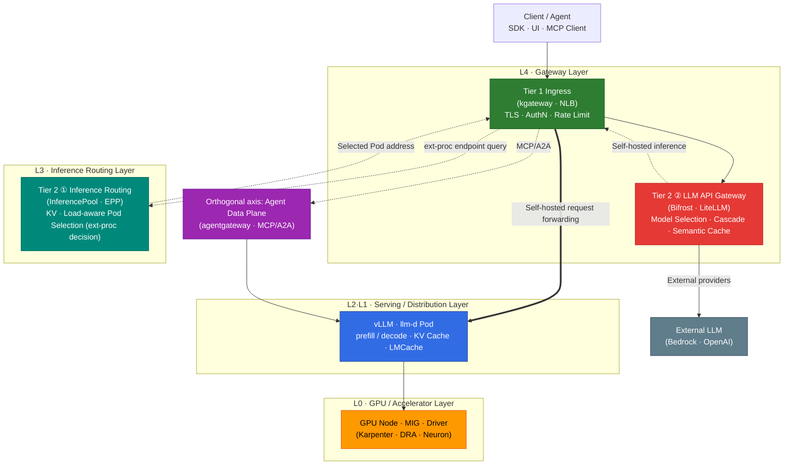

import { DocCard, DocCardGrid } from '@site/src/components/DocCards';
import { TieredGatewayDiagram } from '@site/src/components/GatewayApiTables';

## Overview

This guide helps platform engineers design and operate LLM inference on EKS GPUs and accelerators. Follow the request path to understand six areas you can tune: GPU node placement, serving-engine memory management, distributed topology, in-cluster routing, gateway policies, and caching.

The sections below explain how these areas work together and link to detailed implementation and deployment guides.

## Category Structure

- **Accelerated Computing Infrastructure Layer**: The layer that manages GPU and AWS custom accelerator (Trainium/Inferentia) instances, drivers, schedulers, and partitioning on top of Kubernetes. Determines which nodes get accelerator allocation and how.
- **Inference Framework Layer**: The AI framework layer that actually serves models, performs distributed inference, and fine-tunes on the secured GPUs. vLLM, llm-d, MoE, and NeMo belong here.
- **Inference Optimization & Routing Layer**: The layer that optimizes performance and cost through KV cache, Disaggregated Serving, LMCache, cache-hit strategy, and gateway routing.

<DocCardGrid columns={3}>
  <DocCard
    to="/docs/agentic-ai-platform/model-serving/gpu-infrastructure"
    icon="🖥️"
    title="Accelerated Computing Infrastructure"
    description="EKS GPU node strategy, Karpenter·KEDA·DRA-based resource management, NVIDIA GPU stack (ClusterPolicy·DCGM·MIG·Time-Slicing), AWS Neuron Stack (Trainium2/Inferentia2)."
    color="#326ce5"
  />
  <DocCard
    to="/docs/agentic-ai-platform/model-serving/inference-frameworks"
    icon="🚀"
    title="Inference Frameworks"
    description="vLLM PagedAttention·Multi-LoRA, llm-d distributed inference·KV Cache-aware routing, MoE model serving, NVIDIA NeMo training·fine-tuning framework."
    color="#ff6b6b"
  />
  <DocCard
    to="/docs/agentic-ai-platform/model-serving/inference-optimization"
    icon="⚡"
    title="Inference Optimization & Routing"
    description="KV cache optimization, Disaggregated Serving, LMCache, cache-hit strategy, tiered gateway and Cascade routing strategies."
    color="#00897b"
  />
</DocCardGrid>

:::tip Learning Order
After grasping the full picture with the map below, reading in the order **Accelerated Computing Infrastructure → Inference Frameworks → Inference Optimization & Routing** is natural. First decide "which nodes, partitioning, and driver stack to use" in Accelerated Computing Infrastructure, then cover "how to deploy vLLM and llm-d on top of that" in Inference Frameworks, and finally "how to optimize performance/cost and route traffic" in Inference Optimization & Routing.
:::

## End-to-End Path of an Inference Request

An LLM inference request passes through multiple layers from the client to GPU computation. Each layer has a different responsibility, and which decisions are made at which layer changes latency, throughput, and cost.

Each layer's role is as follows.

- **L4 Gateway**: Handles external traffic ingress (Tier 1) and model abstraction, Cascade, and caching (Tier 2 ②).
- **L3 Inference Routing**: For self-hosted models, **decides** which Pod to send a request to, considering KV cache and load. The decision is delegated to the gateway (proxy) via ext-proc; the EPP returns only the selected endpoint address, and the gateway performs the actual request forwarding.
- **L2·L1 Serving/Distribution**: The layer that actually generates tokens — handles prefill/decode processing and KV cache management.
- **L0 GPU/Accelerator**: The physical layer where computation runs — covers node selection, partitioning, and the driver stack.

### Two Kinds of Routing — Routing ≠ Inference

Inference infrastructure contains **two routing decisions with different natures**, and conflating them leads to misaligned gateway choices.

- **Across-model routing (Tier 2 ②)**: Decides "which **model** to send to." Complexity-based Cascade, cost tracking, and external provider fallback fall here. Handled by LLM API Gateways such as Bifrost or LiteLLM.
- **Within-model routing (Tier 2 ①)**: Decides "which **Pod** of the same model to send to among many." Selection is based on KV cache locality and real-time load metrics. Handled by the Gateway API Inference Extension (InferencePool · EPP).

Definitions and the correspondence between the two layers are covered in detail in [Tiered Gateway Architecture](./inference-routing/tiered-gateway-architecture.md) and [Routing Strategy — Gateway Layer Separation](./inference-routing/routing-strategy.md#gateway-layer-separation).

## Layered Tuning Model

The tuning levers that govern inference performance, organized by layer, are as follows. For detailed behavior and configuration of each lever, refer to the deep-dive documents on the right.

| Layer | Key Tuning Levers | Affected Metrics | Deep-Dive Document |
|------|--------------|----------|----------|
| **L0** GPU/Accelerator | Instance selection · MIG · Time-Slicing · DRA · Neuron | GPU utilization · cost | [GPU Resource Management](./gpu-infrastructure/gpu-resource-management.md) |
| **L1** Serving Engine | PagedAttention · Continuous Batching · FP8 KV · Prefix Caching · Chunked Prefill · Speculative Decoding · Quantization · TP/PP/EP | TTFT · TPS · memory | [vLLM Model Serving](./inference-frameworks/vllm-model-serving.md) · [KV Cache Optimization](./inference-optimization/kv-cache-optimization.md) |
| **L2** Distributed Topology | Prefill/Decode disaggregation · NIXL · LWS multi-node | Large-model throughput | [Disaggregated Serving](./inference-optimization/disaggregated-serving.md) |
| **L3** Inference Routing | KV cache-aware · prefix-cache scorer (Pod selection within the same model) | Cache hit rate · P99 | [KV Cache-Aware Routing](./inference-optimization/kv-cache-optimization.md#kv-cache-aware-routing) |
| **L4** Gateway | Model Cascade · context-aware (model selection) · cost tracking · Rate Limit · L7 limitations | Cost · availability | [Tiered Gateway](./inference-routing/tiered-gateway-architecture.md) · [Routing Strategy](./inference-routing/routing-strategy.md) |
| **L5** Cache Layer | KV/prefix cache · prompt cache · semantic cache · LMCache | Cache hit rate · cost | [LMCache](./inference-optimization/lmcache.md) · [Cache-Hit Strategy](./inference-optimization/cache-hit-strategy.md) |

:::tip Reading order
Reading from lower layers (L0 GPU) upward (L4 Gateway) gives the infrastructure perspective; reading along the request path (L4 → L0) gives the traffic perspective. For performance metrics (TTFT · TPS · cache hit rate) and the recommended 3-Tier composition, see [Inference Optimization Overview](./inference-optimization/index.md).
:::

## Roles and Functions of the Inference Gateway

The "Inference Gateway" is not a single component but a bundle of multiple layers with different responsibilities. Across the platform, in-cluster inference Pod routing and external LLM provider proxying are explicitly separated.

<TieredGatewayDiagram locale="en" />

| Layer | Role | Representative Implementations |
|------|------|------------|
| **Tier 1** Ingress | Receive external traffic, TLS termination, authentication, rate limiting | kgateway · AWS LBC · Envoy Gateway |
| **Tier 2 ①** Inference Routing | In-cluster inference Pod selection (KV · load-aware) | Gateway API Inference Extension |
| **Tier 2 ②** LLM API Gateway | Model abstraction, Cascade, cost tracking, Semantic Caching | Bifrost · LiteLLM · OpenRouter |

Each layer's role definition and solution selection criteria are covered in [Tiered Gateway Architecture](./inference-routing/tiered-gateway-architecture.md), and solution comparisons along with Cascade and Semantic strategies are covered in [Routing Strategy](./inference-routing/routing-strategy.md).

## Limitations of Conventional L7 Gateways

Using a general-purpose L7 gateway **only with its defaults (request-count-based distribution)** does not reflect the characteristics of LLM inference traffic, which produces the following limitations. These are limitations of a configuration not tuned or extended for inference, rather than inherent limitations of L7 gateways themselves.

- **An unconfigured Round-Robin lowers prefix cache reuse**: When requests sharing the same system prompt are distributed to different Pods each time, each Pod may repeat the same prefill computation. However, if multiple Pods are already warmed with the same prefix, reuse can still occur under round-robin, so the effect depends on the number of replicas and their cache holdings.
- **Default settings do not reflect token-based cost or streaming**: A default configuration that judges load only by request count cannot reflect the actual computational cost, which scales with token length. Token/streaming awareness is an optional capability that can be added via plugins or an ext-proc extension.
- **Model server metrics not integrated**: A configuration that does not integrate inference-engine internal state such as KV cache usage and queue depth may forward requests to overloaded Pods.

These limitations reduce to a **tradeoff between cache locality and load balancing**: chasing locality alone concentrates traffic on specific Pods, while chasing load alone reduces cache reuse. This tradeoff is tuned either by a separate inference routing layer (Tier 2 ①) that considers KV cache and load together, or by adding ext-proc / prefix-scorer plugins to an L7 gateway. For detailed rationale, see [KV Cache Optimization — Existing Problem: Round-Robin Limitations](./inference-optimization/kv-cache-optimization.md#existing-problem-round-robin-limitations) and [Routing Strategy — Gateway Layer Separation](./inference-routing/routing-strategy.md#gateway-layer-separation).

## Prefill / Decode / Disaggregated Serving

LLM inference is split into a **prefill stage** that processes the input prompt and a **decode stage** that generates tokens one at a time. The two stages have different computational characteristics: prefill tends to be compute-bound and decode tends to be memory-bandwidth-bound. Co-locating them on the same GPU can cause them to interfere and add latency, but the degree depends on batching, sequence length, and traffic pattern. Long prompts can also be processed over several steps with chunked prefill, reducing interference with decode, so prefill is not necessarily processed "in one shot."

**Disaggregated Serving** is an architecture that separates prefill and decode onto distinct GPU groups and moves the KV cache between them via a transport engine such as NIXL. Because the split incurs KV-cache transfer and batching costs, its benefit is an optional design to be judged by measurement on the target workload. Large MoE models that do not fit on a single node can combine this with multi-node deployment based on LWS (LeaderWorkerSet). Detailed architecture and a GLM-5 deployment example are covered in [Disaggregated Serving](./inference-optimization/disaggregated-serving.md), and the AWS managed implementation is covered in [HyperPod Inference Operator — Disaggregated Prefill/Decode](./inference-frameworks/hyperpod-inference-operator.md#disaggregated-prefilldecode-dpd).

## Context-aware Routing

Context-aware routing is a strategy that selects an appropriate model or path by looking at the **content and complexity** of the request. Simple queries are sent to lightweight models, and complex reasoning is sent to large models, balancing cost and quality.

- **LLM Classifier**: Routes by classifying requests into complexity tiers
- **RouteLLM**: Selects models via an MF (Matrix Factorization) classifier
- **vLLM Semantic Router**: Meaning-based routing

For detailed implementations and evaluation results, see [Request Cascading — Intelligent Model Routing](./inference-routing/request-cascading.md). The relationship to meaning-based caching is covered in [Semantic Caching Strategy](./inference-optimization/semantic-caching-strategy.md).

## KV Cache-Aware Routing

KV cache-aware routing is a strategy that, among multiple Pods of the same model, sends a request to **the Pod that already holds a KV cache matching the request's prefix**. Avoiding prefill recomputation can lower TTFT, but it is not always faster: if the Pod holding the cache is already overloaded or that cache has been evicted, the locality benefit disappears, so the actual effect depends on the balance of locality, load, and eviction state.

- **prefix-cache scorer**: Scores each Pod's prefix cache holdings
- **EPP (Endpoint Picker)**: Delegated via ext-proc to pick the optimal Pod
- **llm-d vs NVIDIA Dynamo**: Different implementation approaches and KV offload layers

For a detailed comparison, see [KV Cache Optimization — KV Cache-Aware Routing](./inference-optimization/kv-cache-optimization.md#kv-cache-aware-routing) and [Routing Strategy — Gateway API Inference Extension](./inference-routing/routing-strategy.md#gateway-api-inference-extension).

## LMCache

**LMCache** is a KV cache tier that offloads KV cache beyond GPU memory to CPU and disk layers and shares it across inference instances. vLLM's in-GPU prefix cache is valid only within a single inference engine (a replica that can itself span multiple Pods/nodes via TP/PP), whereas LMCache provides an external sharing tier that reuses KV cache beyond that boundary, across replicas and nodes. This external sharing does not integrate with routing automatically, however; combining it with `kvaware` routing requires separately reconciling memory compatibility and the integration configuration.

The concept, layer structure, and relationships with vLLM/NIXL are covered in [LMCache](./inference-optimization/lmcache.md).

## Cache-Hit Strategy

Inference caches are split into **three layers**, not a single one, and each has different hit conditions and effects. The "exact identical request" and "similar request" conditions below are only **necessary** conditions for a hit; safe reuse also requires the tenant, authenticated principal, model, tool definitions, and data freshness to match.

| Cache Layer | Hit Condition | Effect |
|----------|----------|------|
| **KV / Prefix Cache** | Same prefix (system prompts, etc.) — includes provider prompt caching | Avoids prefill recomputation, reduces input-token cost and TTFT (does not skip full inference) |
| **Response (Exact) Cache** | **Exact identical request** with the same tenant, model, tools, and data | Returns the stored response verbatim, avoiding inference itself |
| **Semantic Cache** | Semantically similar request (embedding similarity) + a calibrated equivalence threshold | Avoids inference for similar queries (requires threshold and false-positive management) |

Here, the **KV/Prefix Cache** and provider **prompt caching** (OpenAI, Anthropic, etc.) reuse the prompt prefix to reduce input-token cost and TTFT — they do not return a whole response. Returning a whole response is a separate **exact response cache** layer, and a Semantic Cache can return a different answer if it hits on similarity alone, so its threshold must be calibrated and a response-equivalence criterion defined alongside it.

A unified decision framework for how to raise hit rates and where to measure them at each layer is covered in [Cache-Hit Strategy](./inference-optimization/cache-hit-strategy.md). For threshold design of the semantic cache, see [Semantic Caching Strategy](./inference-optimization/semantic-caching-strategy.md); for prefix cache effects, see [KV Cache Optimization](./inference-optimization/kv-cache-optimization.md).

## References

### Official Documentation
- [Gateway API Inference Extension](https://gateway-api-inference-extension.sigs.k8s.io/) — The standard for in-cluster inference routing (InferencePool · EPP)
- [vLLM Documentation](https://docs.vllm.ai/) — Official guide to the vLLM serving engine

### Papers / Tech Blogs
- [PagedAttention (SOSP 2023)](https://arxiv.org/abs/2309.06180) — The vLLM KV cache management paper
- [DistServe (OSDI 2024)](https://arxiv.org/abs/2401.09670) — Research on Prefill/Decode disaggregation (Disaggregated Serving)

### Related Documents (Internal)
- [Inference Optimization Overview](./inference-optimization/index.md) — Core metrics such as TTFT and TPS and the recommended 3-Tier composition
- [Tiered Gateway Architecture](./inference-routing/tiered-gateway-architecture.md) — Single definition of gateway layers
- [KV Cache Optimization](./inference-optimization/kv-cache-optimization.md) — vLLM deep-dive and KV Cache-Aware Routing
