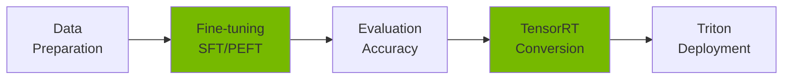
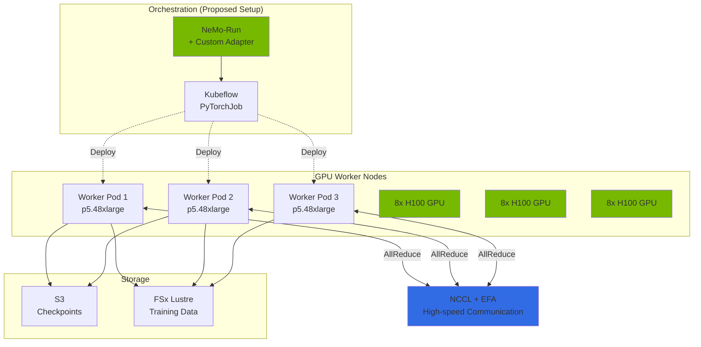
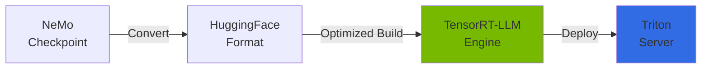
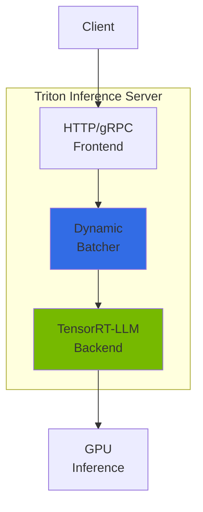
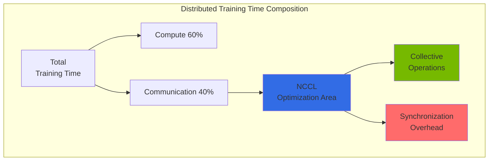
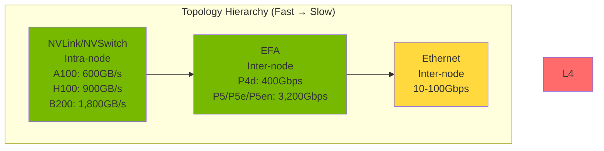

import { NemoComponents, GPURequirements, CheckpointSharding, MonitoringMetrics, NCCLImportance } from '@site/src/components/NemoTables';

NVIDIA NeMo is an end-to-end framework for training, fine-tuning, and optimizing large language models (LLMs). It supports distributed training and efficient model deployment in Kubernetes environments.

## Overview

### Problems NeMo Solves

When using general-purpose LLMs (GPT-4, Claude, etc.) in Agentic AI platforms, the following limitations exist:

- **Lack of Domain Knowledge**: Insufficient understanding of industry/company-specific terminology and context
- **Cost Issues**: API costs surge with large-scale calls (token-per-request billing)
- **Latency**: Response delays from external API calls
- **Data Privacy**: Cannot transmit sensitive data to external services
- **On-premises Requirements**: Regulated industries (finance/healthcare) need self-hosted infrastructure

NeMo addresses these problems through **domain-specific model fine-tuning**.

### NeMo Core Features



<NemoComponents />

**Key Value:**

- **Efficient Fine-tuning**: Train only 0.1% of total parameters with LoRA/QLoRA
- **Distributed Training**: Automatic multi-node, multi-GPU parallelization (Tensor/Pipeline/Data Parallelism)
- **Inference Optimization**: 2-4x performance improvement through TensorRT-LLM conversion
- **Enterprise Support**: Checkpoint management, monitoring, production deployment pipeline

---

## EKS Deployment Architecture

### NeMo on EKS Configuration



:::note Scope of the orchestration layer

The orchestration layer in the diagram above is a setup this guide proposes, not an off-the-shelf workflow that NVIDIA supports. For NeMo 2.0 and later, the launcher NVIDIA supports is [NeMo-Run](https://github.com/NVIDIA/NeMo-Run); the legacy [NeMo Framework Launcher](https://github.com/NVIDIA/NeMo-Framework-Launcher) is scoped to NeMo 1.0-based configurations per its README. Running a NeMo 2.0 job as a Kubeflow Training Operator PyTorchJob requires **implementing your own adapter** that translates NeMo-Run's output (distributed launch commands) into a PyTorchJob manifest; as of 2026-10-13 no official NVIDIA-provided integration was found.

:::

### Container Configuration

**NeMo Container Image:**

```
nvcr.io/nvidia/nemo:25.02
├── PyTorch 2.6.0a0
├── CUDA 12.8
├── NCCL 2.25.x
├── Megatron-LM (NeMo integrated)
├── TensorRT-LLM 0.17.0
└── PyTriton (Triton interface)
```

:::note Component version provenance

The versions above follow the NeMo Framework 25.02 release's Software Component Versions table (PyTorch 2.6.0a0, TensorRT-LLM 0.17.0). CUDA, NCCL, and the Triton interface package are taken from the same release's container; confirm the exact set by inspecting the image manifest (`docker inspect` / layer contents) for your pull, since NVIDIA's live "latest" component table no longer lists the 25.02 row.

:::

**Key Dependencies:**

- **Kubeflow Training Operator**: Distributed training orchestration via PyTorchJob CRD
- **GPU Operator**: Automatic NVIDIA driver, Device Plugin, DCGM installation
- **EFA Device Plugin**: Enable inter-node RDMA communication
- **Karpenter**: GPU node autoscaling

<GPURequirements />

---

## Fine-tuning Guide

### SFT (Supervised Fine-Tuning) Concept

**What is SFT?**: A method to improve specific task performance by additionally training a pre-trained model with domain-specific instruction-response data.

```
Pre-trained Model (general) → SFT → Domain-specific Model
```

**When to Use?**

- Customer FAQ chatbot: Train on specific product/service Q&A
- Financial report generation: Train on financial terminology and formats
- Medical diagnostic assistance: Train on medical terminology and diagnostic patterns

**Data Format:**

```json
{"input": "What is EKS Auto Mode?", "output": "EKS Auto Mode is a fully managed Kubernetes compute option where AWS automatically handles node provisioning, scaling, and security patching."}
{"input": "What are Karpenter's key features?", "output": "Karpenter provides automatic node provisioning, bin-packing optimization, Spot instance integration, and drift detection capabilities."}
```

### PEFT/LoRA: Efficient Fine-tuning

**PEFT (Parameter-Efficient Fine-Tuning)**: Instead of training all model parameters, **train only adapter layers** to save memory and time.

**LoRA (Low-Rank Adaptation)**: The representative PEFT method that freezes original weights and **trains only two low-rank matrices (A, B)**.

```
Original weights W (freeze) + LoRA delta (A × B) = Final weights
```

**LoRA Key Parameters:**

| Parameter | Description | Recommended | Impact |
|-----------|-------------|-------------|--------|
| `dim` (rank) | Rank of the low-rank matrices. Corresponds to the paper's `r`; the NeMo 2.x `LoRA` class names it `dim` (default 32) | 8-64 | Higher = more expressive, more adapter parameters/memory |
| `alpha` | Scaling factor, applied to the adapter output at a ratio of `alpha/dim` (default 32) | Similar to dim | Controls LoRA weight influence |
| `dropout` | Dropout rate (NeMo 2.x default 0.0) | 0.0-0.1 | Prevents overfitting |
| `target_modules` | Modules LoRA is applied to. NeMo uses Megatron fused layer names (default `linear_qkv`, `linear_proj`, `linear_fc1`, `linear_fc2`) | Default, or attention only (`linear_qkv`, `linear_proj`) | Selects target layers |

**Memory Savings (conditional example):**

The figures below are examples under specific conditions and do not generalize to every setup. Actual savings depend on precision (BF16/FP16/4-bit), `dim` (rank), batch size, sequence length, and how optimizer state is stored. The following assumes a 7B model trained in BF16 with Adam optimizer state included.

- **Full Fine-Tuning (7B, BF16, Adam)**: Trains weights, gradients, and optimizer state, so it needs tens to a hundred-plus GB of VRAM (for example, on the order of 2× A100 80GB)
- **LoRA Fine-Tuning (7B, BF16, low-rank adapters only)**: Freezes original weights and trains only a small set of adapters, reducing the requirement to a level feasible on a single A100 80GB
- **Why the difference**: LoRA sharply reduces the trainable parameters and the optimizer state they imply. The original paper ([LoRA, arXiv:2106.09685](https://arxiv.org/abs/2106.09685)) reports roughly a 10,000× reduction in trainable parameters and about a 3× reduction in optimizer-state VRAM for GPT-3 175B; those figures are specific to that paper's setup.

### Fine-tuning Execution Example

```python
# nemo_lora_finetune.py
import nemo_run as run
from nemo.collections import llm
from nemo import lightning as nl

# LoRA configuration (NeMo 2.x: the rank argument is dim, not r)
lora = llm.peft.LoRA(
    dim=32,        # rank of the low-rank matrices
    alpha=32,      # scaling (adapter output scaled by alpha/dim)
    dropout=0.0,
    # NeMo uses Megatron fused layer names (not q_proj/v_proj)
    target_modules=["linear_qkv", "linear_proj"],
)

# Build model/data/trainer as objects (not path strings)
model = llm.LlamaModel(config=llm.Llama31Config8B())
data = llm.FineTuningDataModule(
    dataset_root="/data",       # directory containing train.jsonl, etc.
    seq_length=4096,
    global_batch_size=16,
    micro_batch_size=1,
)
trainer = nl.Trainer(
    devices=8,                  # 8 GPUs
    max_steps=1000,
    strategy=nl.MegatronStrategy(tensor_model_parallel_size=2),
    plugins=nl.MegatronMixedPrecision(precision="bf16-mixed"),
)

# Execute fine-tuning: finetune(model, data, trainer, ..., peft=...)
llm.finetune(
    model=model,
    data=data,
    trainer=trainer,
    log=nl.NeMoLogger(log_dir="/output/llama-3.1-8b-finetuned"),
    peft=lora,
)
```

:::note API scope

This example shows the shape of the NeMo 2.2.0 `nemo.collections.llm` API. `finetune` takes `LightningModule`, `LightningDataModule`, and `Trainer` **objects** plus a `peft` argument — not path strings (`model_path`/`data_path`/`output_path`). Verify the model config class names (such as `Llama31Config8B`) and data-module arguments against the NeMo version and model you use. For recipe-based runs, see the [NeMo llama31_8b recipe](https://github.com/NVIDIA/NeMo/blob/v2.2.0/nemo/collections/llm/recipes/llama31_8b.py).

:::

**Detailed Pipeline**: For data preprocessing, multi-node distributed training, and hyperparameter tuning, refer to the [Custom Model Pipeline](../../reference-architecture/model-lifecycle/custom-model-pipeline.md) document.

---

## Checkpoint Management

### S3-based Checkpoint Storage

NeMo periodically saves **checkpoints (model state snapshots)** during training. This enables:

- **Training Resumption**: Restart from last checkpoint on failure
- **Optimal Model Selection**: Select checkpoint with lowest validation loss
- **Version Management**: Compare checkpoints across experiments

**S3 Storage Structure:**

```
s3://nemo-checkpoints/
└── llama-3.1-8b-finetune/
    ├── checkpoint-epoch=1-step=500/
    │   ├── model_weights.ckpt
    │   ├── optimizer_states.ckpt
    │   └── metadata.yaml
    ├── checkpoint-epoch=2-step=1000/
    └── checkpoint-epoch=3-step=1500/
```

### Large Model Checkpoint Sharding

For 70B+ large models, the total checkpoint size reaches hundreds of GB. NeMo 2.x stores weights and optimizer state across multiple files (shards) using Megatron Core's **distributed checkpoint** format. The split is determined by the **tensor/pipeline parallel ranks and Megatron Core's distributed save layout**, not by a fixed user-set "GB size".

<CheckpointSharding />

**Checkpoint configuration (NeMo 2.x):** Sharding is controlled through `MegatronStrategy` and the `ModelCheckpoint` callback. The following is a conceptual example; verify the exact argument names and defaults against the NeMo/Megatron Core version you use.

```python
from nemo import lightning as nl

strategy = nl.MegatronStrategy(
    tensor_model_parallel_size=4,
    pipeline_model_parallel_size=2,
    # Use the distributed (sharded) checkpoint format
    ckpt_async_save=True,          # async save to minimize training stalls
    ckpt_parallel_save=True,       # per-rank parallel save
)

checkpoint = nl.ModelCheckpoint(
    save_top_k=3,                  # keep top checkpoints by validation loss
    monitor="val_loss",
)
```

**Sharded Storage Structure (conceptual):**

The actual number of files and their names depend on the parallelization layout and Megatron Core version. The following is a conceptual view of the storage layout.

```
s3://checkpoints/llama-405b/
└── checkpoint-step=1000/
    ├── __0_0.distcp   # per-rank distributed checkpoint shard
    ├── __0_1.distcp
    ├── ...
    ├── metadata.json  # shard mapping metadata
    └── common.pt      # common (non-distributed) state
```

:::note Checkpoint size arithmetic

The "Estimated Shards" column in the `<CheckpointSharding />` table above is a **value assumed by dividing the checkpoint byte count by a 10GB shard size**. The stored size depends heavily on **what is saved alongside the weights**.

- Storing **BF16 weights only** for a 405B model: 405e9 × 2 bytes ≈ 810GB
- Storing weights + Adam optimizer state (two FP32 moments) + FP32 master weights: roughly 405e9 × (2 + 4 + 4 + 4) ≈ 5.7TB

So a single value such as "one checkpoint ≈ 400GB" does not hold; the storage precision and whether optimizer state is included must be stated. The shard counts in the `<CheckpointSharding />` table above follow an **explicit assumption** such as "BF16 weights only (810GB) divided into 10GB shards ≈ 81 shards"; including optimizer state multiplies the shard count several-fold.

:::

### Checkpoint Conversion

```python
# NeMo 2.0 → HuggingFace conversion (Python API, verified path)
from nemo.collections.llm import export_ckpt

# path: NeMo checkpoint, target="hf": export to HuggingFace format
export_ckpt(
    path="/checkpoints/llama-finetuned",
    target="hf",
    output_path="/models/llama-finetuned-hf",
)
```

```bash
# Or the CLI (nemo llm export).
# Confirm the argument names (path/target/output_path) with
# `nemo llm export --help` for the NeMo version you use.
nemo llm export \
  path=/checkpoints/llama-finetuned \
  target=hf \
  output_path=/models/llama-finetuned-hf
```

---

## TensorRT-LLM Conversion

### What is TensorRT-LLM?

NVIDIA TensorRT-LLM is an optimization engine for LLM inference. It converts PyTorch models into **highly optimized execution graphs**, improving inference speed by 2-4x.



### Performance Improvement Comparison

| Optimization Technique | Memory Effect | Speed Effect | Description |
|----------------------|---------------|-------------------|-------------|
| **FP8 Quantization** | Halves weight storage (BF16→FP8) | Conditional improvement | Supported on Hopper (SM90) and Ada Lovelace (SM89); not on Ampere (A100) |
| **PagedAttention** | Reduces KV cache fragmentation | - | KV Cache dynamic memory management |
| **In-flight Batching** | - | Higher throughput | Continuous batch processing |
| **Kernel Fusion** | - | Fewer kernel-launch overheads | Operation kernel fusion |

:::note Scope of the figures

The table above summarizes the **mechanism** of each technique. Fixed figures such as "50% memory savings" or "2-4x speedup" depend on measurement conditions (model, sequence length, batch size, GPU, baseline backend) and are therefore not included. In particular, FP8 lowers the **storage precision of weights and activations**; it does not uniformly halve total memory usage, which also includes the KV cache, activations, and execution graph. If you need specific figures, measure them on your own workload against a stated baseline.

:::

### Conversion Concept

```python
from tensorrt_llm import LLM, BuildConfig
from tensorrt_llm.llmapi import QuantConfig, KvCacheConfig
from tensorrt_llm.quantization import QuantAlgo

# TensorRT-LLM 0.17: length/batch limits go in BuildConfig,
# quantization in QuantConfig, and KV cache in KvCacheConfig
build_config = BuildConfig(
    max_input_len=4096,
    max_seq_len=6144,       # input + output length combined
    max_batch_size=64,
)

# FP8 is supported on Hopper (SM90) and Ada Lovelace (SM89)
quant_config = QuantConfig(quant_algo=QuantAlgo.FP8)

llm = LLM(
    model="/models/llama-finetuned-hf",
    build_config=build_config,
    quant_config=quant_config,
    kv_cache_config=KvCacheConfig(),   # PagedAttention (KV cache) config
    enable_chunked_prefill=True,       # the correct 0.17 argument name
)

# Save engine
llm.save("/engines/llama-finetuned-trt")
```

:::note Support scope

The argument names above follow the TensorRT-LLM 0.17 `LLM`/`BuildConfig`/`QuantConfig`/`KvCacheConfig` APIs. 0.17 does not accept top-level keywords such as `max_output_len`, `dtype="fp8"`, `enable_paged_kv_cache`, or `enable_chunked_context`. Per the [support matrix](https://github.com/NVIDIA/TensorRT-LLM/blob/v0.17.0/docs/source/reference/support-matrix.md), FP8 is supported on Hopper (SM90) and Ada Lovelace (SM89); A100 (Ampere) does not support FP8. Conversion time varies widely with model, GPU, and build options, so no figure is given without stated measurement conditions.

:::

---

## Triton Inference Server

### Triton and NeMo Relationship

**Triton Inference Server** is NVIDIA's production inference server that serves TensorRT-LLM engines via HTTP/gRPC API.

```
Client → Triton Server → TensorRT-LLM Backend → GPU
```

### Triton Architecture Concept



**Core Features:**

- **Dynamic Batching**: Automatically group multiple requests to optimize GPU utilization
- **Model Ensemble**: Connect multiple models in a pipeline (e.g., Tokenizer → LLM → Detokenizer)
- **Backend Support**: TensorRT-LLM, PyTorch, ONNX, TensorFlow, etc.
- **Metrics Collection**: Prometheus-compatible metrics (throughput, latency, GPU utilization)

### Model Repository Structure

```
/models/
└── llama-finetuned/
    ├── config.pbtxt  # Triton configuration file
    ├── 1/  # Version 1
    │   └── engine/  # TensorRT-LLM engine directory (not a single file)
    │       ├── config.json          # engine build config
    │       ├── rank0.engine          # per-rank engine (one per TP/PP rank)
    │       └── ...                   # additional rank engines
    └── tokenizer/
        ├── tokenizer.json
        └── tokenizer_config.json
```

:::note Engine bundle

The TensorRT-LLM backend loads an **engine directory** (`config.json` plus per-rank `rankN.engine` files), not a single `model.plan` file. The directory path is given as the `gpt_model_path` value in the `config.pbtxt` below.

:::

**config.pbtxt Core Settings:**

The following are the actual keys rendered in `tensorrtllm_backend` v0.17's `config.pbtxt`. The `fill_template.py` variable name `batching_strategy` is substituted into the `gpt_model_type` key in the template, and the batch scheduler policy is a separate `batch_scheduler_policy` key.

```protobuf
name: "llama-finetuned"
backend: "tensorrtllm"
max_batch_size: 64

parameters {
  key: "gpt_model_type"
  value: { string_value: "inflight_fused_batching" }  # or "V1"
}

parameters {
  key: "gpt_model_path"
  value: { string_value: "/models/llama-finetuned/1/engine" }  # engine directory
}

parameters {
  key: "batch_scheduler_policy"
  value: { string_value: "max_utilization" }  # or "guaranteed_no_evict"
}

parameters {
  key: "max_tokens_in_paged_kv_cache"
  value: { string_value: "8192" }
}
```

---

## NCCL Distributed Communication

### NCCL's Role

**NCCL (NVIDIA Collective Communication Library)** is the core library responsible for **high-speed multi-GPU communication** in distributed GPU training.



**Why is it Important?**

<NCCLImportance />

### Collective Operation Concepts

#### 1. AllReduce (Most Important)

Sums data from all GPUs and distributes the result to all GPUs.

```
Initial state:
GPU 0: [1, 2, 3]
GPU 1: [4, 5, 6]
GPU 2: [7, 8, 9]
GPU 3: [10, 11, 12]

After AllReduce:
All GPUs: [22, 26, 30]  # Element-wise sum
```

**Use Case**: Averaging gradients from each GPU in distributed training

#### 2. AllGather

Collects data from all GPUs and distributes the full data to each GPU.

```
Initial state:
GPU 0: [1, 2]
GPU 1: [3, 4]

After AllGather:
All GPUs: [1, 2, 3, 4]
```

**Use Case**: Gathering distributed tensors in Tensor Parallelism

#### 3. ReduceScatter

Reduces (sums element-wise) the data from all GPUs and then **partitions (scatters)** the result so each GPU holds a different portion of it. Where AllGather "gathers," ReduceScatter "reduces then splits," and **ReduceScatter followed by AllGather equals AllReduce**.

```
Initial state:
GPU 0: [1, 2, 3, 4]
GPU 1: [5, 6, 7, 8]

After ReduceScatter:
GPU 0: [6, 8]   # (1+5), (2+6)
GPU 1: [10, 12] # (3+7), (4+8)
```

**Use Case**: Summing and distributing partial sums in Tensor Parallelism, or implementing AllReduce as ReduceScatter + AllGather. (Passing activations between layers in Pipeline Parallelism is handled by **point-to-point send/recv**, not by a collective.)

#### 4. Broadcast

Copies one GPU's data to all GPUs.

```
Initial state:
GPU 0: [1, 2, 3]
GPU 1: [0, 0, 0]

After Broadcast:
All GPUs: [1, 2, 3]
```

**Use Case**: Distributing model checkpoints from the master GPU

### Network Topology Optimization

NCCL automatically detects the physical connection topology between GPUs and selects the optimal path.



**Per-topology Algorithm Selection:**

- **NVSwitch/NVLink (H100/A100 intra-node)**: Tree algorithm (parallel broadcast) or Ring algorithm (circular transfer)
- **EFA inter-node**: Hierarchical algorithm (intra-node Ring/Tree → inter-node Tree)
- **A100**: NVLink 600GB/s, **H100**: NVLink4 900GB/s, **B200**: NVLink5 1,800GB/s

NCCL selects the algorithm (Ring/Tree/etc.) at runtime based on the detected topology and message size, not purely by GPU generation. The intra-node NVLink figures above are aggregate per-GPU bidirectional bandwidth, which is a different quantity from an instance's inter-node network bandwidth measured in Gbps.

### NCCL Tuning Parameters

By default NCCL **automatically selects** the algorithm, protocol, and channel count to match the topology and message size. So **measure with the defaults first**, and override the variables below only when you have diagnosed a reproducible performance problem for a specific configuration. Forcing values can make performance worse.

```bash
# Settings for AWS EFA (generally required)
export FI_PROVIDER=efa
export FI_EFA_USE_DEVICE_RDMA=1
# The aws-ofi-nccl plugin must be installed and on LD_LIBRARY_PATH
# (see your EFA-enabled node/AMI or EKS node-efa setup)

# Diagnostic logging (when analyzing performance issues)
export NCCL_DEBUG=INFO
```

```bash
# The following are overrides to apply only "after diagnosis" for a
# specific case. Trusting the default auto-selection comes first.

# Pin algorithm/protocol for a specific case (not a general recommendation)
export NCCL_ALGO=Ring     # or Tree
export NCCL_PROTO=Simple  # Simple (throughput) or LL (latency)
```

:::note Caution on channel-count variables

Forcing `NCCL_MIN_NCHANNELS`/`NCCL_MAX_NCHANNELS` to arbitrary "recommended" values is generally not advised. The optimal channel count depends on GPU generation, node count, and message size, and NCCL adjusts it at runtime. The fixed channel-count recommendations seen in older guides (for example, "4-8 channels per node") are not a verified general baseline; if you need to change them, inspect the selected channel count with `NCCL_DEBUG=INFO` and A/B-measure on your own workload. For EFA, also follow the [EKS EFA node guide](https://docs.aws.amazon.com/eks/latest/userguide/node-efa.html) and install the `aws-ofi-nccl` plugin.

:::

---

## Monitoring

### Key Metrics

<MonitoringMetrics />

**Monitoring Stack**: Prometheus + Grafana + DCGM Exporter

For detailed monitoring setup, refer to [Monitoring and Observability Setup](../../reference-architecture/integrations/monitoring-observability-setup.md).

---

## Related Documents

- [GPU Resource Management](../gpu-infrastructure/gpu-resource-management.md) - Karpenter, KEDA, DRA-based GPU autoscaling
- [vLLM Model Serving](./vllm-model-serving.md) - Production inference server
- [MoE Model Serving](./moe-model-serving.md) - Mixture of Experts architecture
- [Custom Model Pipeline](../../reference-architecture/model-lifecycle/custom-model-pipeline.md) - Full pipeline from data preparation to deployment

:::tip Recommendations

- **Before Fine-tuning**: Measure baseline performance with the base model
- **Consider LoRA First**: It can cut memory by reducing trainable parameters and optimizer state, but the savings depend on precision, rank, batch size, and sequence length (see "Memory Savings" above)
- **Consider TensorRT-LLM**: It can improve inference latency/throughput, but the actual gain must be measured for your model, GPU, batch size, and baseline backend
- **NCCL Tuning**: In multi-node training, measure with the default auto-selection first and override only when a reproducible bottleneck is confirmed (forced settings do not always guarantee an improvement)

:::

:::warning Cautions

- **GPU Costs**: Large-scale multi-node training accumulates cost quickly. Actual cost depends on instance type, count, Region, pricing plan (On-Demand/Spot/Reserved), and training duration, so estimate it for your own configuration with the [EC2 pricing page](https://aws.amazon.com/ec2/pricing/) and the [AWS Pricing Calculator](https://calculator.aws/). Making active use of Spot instances and checkpoints can reduce the cost of interruptions
- **Checkpoints Essential**: Configure automatic saving to persistent storage like S3 (prepare for node failure)
- **EFA Security Groups**: All traffic must be allowed within the same security group when using EFA
- **Memory Overflow**: On OOM, decrease `micro_batch_size` or enable `gradient_checkpointing`

:::
