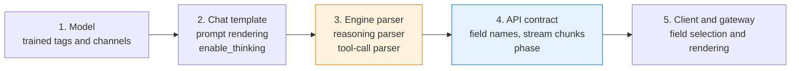

## Overview

Teams serving reasoning models repeatedly report the same symptoms: thinking-like sentences mixed into answers, raw `<think>` tags on screen, and tool calls printed as JSON text. Most of these are not model-quality problems. They occur because the output boundaries the model was trained on and the way the serving stack interprets those boundaries disagree.

The intended reader is a platform or MLOps engineer running open-weight LLMs on EKS with vLLM or SGLang. Differences that apply when managed APIs (OpenAI Responses API, Claude Messages API) are used alongside are covered briefly in a separate section. Safety guardrails such as harmful-output filtering are described in [AI Gateway Guardrails](../../operations-mlops/governance/ai-gateway-guardrails.md).

Version-dependent facts were checked on 2026-10-06 against vLLM v0.31.0 (released 2026-10-05) and the respective official documentation.

## Background

### Symptom classes

Output integrity problems fall into four symptoms. Each symptom has its cause in a different layer, so classify the symptom first.

- **Reasoning leak** — Text that should be separated as reasoning ends up in `content`.
- **Boundary token exposure** — Delimiters such as `<think>`, `</think>`, or harmony's `<|channel|>` appear in the answer.
- **Raw tool-call exposure** — A tool call is not parsed into structured `tool_calls` and remains as text, or its arguments violate the schema.
- **Preamble mixing** — Progress messages such as "Let me look that up first" are prepended to the final answer.

### Structural and probabilistic causes

If a leak reproduces on every run of the same input, or disappears when the engine, parser, or template combination changes, the cause is structural. Structural causes can be removed with configuration and code. Leaks that still occur occasionally after all structural causes are removed come from the model's probabilistic generation, and only those belong to the remediation layer. Building the remediation layer first hides structural causes, and the leak rate then shifts with every engine or model upgrade.

## Five layers that decide output boundaries

Five layers each interpret boundaries before model output reaches the user's screen. A leak occurs when any one layer disagrees with the others.

**Figure 1. The five layers that interpret boundaries before model output reaches the user's screen**



**Table 1. The five layers that set output boundaries and the typical symptom on mismatch**

| Layer | What sets the boundary | Typical symptom on mismatch |
|---|---|---|
| Model | Trained `<think>` tags, harmony channels, tool-call format | Tag format changes in a minor model version and the parser no longer recognizes it |
| Chat template | Thinking on/off flag, whether the start tag is prefilled | The template prefills the start tag while the parser looks for it in the output |
| Engine parser | `--reasoning-parser`, `--tool-call-parser`, stop handling | Missing or mismatched parser merges reasoning into `content` |
| API contract | `reasoning` field name, streaming delta layout, `phase` | Client reads the old field name and gets an empty value |
| Client | Which field is rendered, how multiple messages are joined | Commentary messages rendered together with the final answer |

## Output formats by model family

The table below is compiled from the vLLM [Reasoning Outputs](https://docs.vllm.ai/en/latest/features/reasoning_outputs.html) and [Tool Calling](https://docs.vllm.ai/en/latest/features/tool_calling.html) docs and the SGLang [Reasoning Parser](https://docs.sglang.io/advanced_features/separate_reasoning.html) doc (checked 2026-10-06). A dash (–) means the doc table has no entry, not that the combination is unsupported.

**Table 2. Reasoning boundary notation and reasoning/tool-call parsers by model family**

| Model family | Reasoning boundary | Thinking default and toggle | vLLM reasoning parser | SGLang reasoning parser | vLLM tool-call parser |
|---|---|---|---|---|---|
| Qwen3 | `<think>`…`</think>` | On by default, disable with `enable_thinking=False` | `qwen3` | `qwen3` | `qwen3_xml` for Qwen3-Coder |
| DeepSeek-R1 | R1 starts reasoning without a start tag; R1-0528 emits both tags | Always reasons | `deepseek_r1` | `deepseek-r1` | `deepseek_v3` for R1-0528 |
| DeepSeek-V3.1 | `<think>`…`</think>` | Off by default, enable with `thinking=True` (not `enable_thinking`) | `deepseek_v3` | `deepseek-v3` | `deepseek_v31`; tool calling only in non-thinking mode |
| Gemma 4 | Model-specific channel | Off by default, enable with `enable_thinking=True` or `reasoning_effort` | `gemma4` | – | – |
| GLM-4.5 | `<think>`…`</think>` | – | `glm45` | – | `glm45` |
| MiniMax-M2 | `<think>`…`</think>` | – | `minimax_m2_append_think` | – | – |
| Kimi K2 Thinking | `◁think▷`…`◁/think▷` | Always reasons | `kimi_k2` | `kimi_k2`; tool use requires `--tool-call-parser kimi_k2` | `kimi_k2` |
| gpt-oss | Harmony channels `<\|channel\|>analysis<\|message\|>`…`<\|end\|>` | `reasoning_effort` | `openai_gptoss` | `gpt-oss` | `openai` |

The vLLM reasoning parser names `openai_gptoss` and `kimi_k2` were confirmed in the source registry (`vllm/reasoning/__init__.py`, main on 2026-10-06) rather than the doc table.

gpt-oss is trained on the harmony format. The [OpenAI Harmony guide](https://cookbook.openai.com/articles/openai-harmony) separates three channels: `final` is the user-facing answer, `analysis` is chain of thought that is not held to safety standards and must not be shown to users, and `commentary` carries function calls and sometimes user-facing preambles. Rendering prompts without the harmony format breaks model behavior. When a low-level endpoint such as `/generate` is used directly, prefill rendering, stop tokens (`<|return|>`, `<|call|>`), and parsing must be handled with the `openai-harmony` library ([How to run gpt-oss with vLLM](https://cookbook.openai.com/articles/gpt-oss/run-vllm)).

## Engine configuration

### Pair the reasoning parser with the tool-call parser

Setting only a tool-call parser on a reasoning model can erase the reasoning boundary. vLLM issue [#51679](https://github.com/vllm-project/vllm/issues/51679) reports that with only `--tool-call-parser qwen3_xml`, `</think>` is consumed and reasoning merges into `content` with no boundary (open as of 2026-10-06). The workaround is to also set `--reasoning-parser qwen3`. The vLLM Tool Calling doc also recommends flags that set both parsers for Hunyuan, MiMo, Step-3.5, and others. The `hf` tool parser, by contrast, cannot be combined with other reasoning or tool parsers.

```bash
vllm serve Qwen/Qwen3-Coder-30B-A3B-Instruct \
  --reasoning-parser qwen3 \
  --enable-auto-tool-choice \
  --tool-call-parser qwen3_xml \
  --default-chat-template-kwargs '{"enable_thinking": false}'
```

The `--enable-reasoning` flag found in older material does not appear in the current vLLM docs. Reasoning separation is enabled by setting `--reasoning-parser`.

### Parsers are coupled to the model minor version and chat template

A reasoning parser assumes the output format produced by a specific chat template. Using the `deepseek_r1` parser on Qwen3 with thinking disabled has placed the final answer in `reasoning_content` ([#17349](https://github.com/vllm-project/vllm/issues/17349)). Using the M2 parser on MiniMax-M2.5 has leaked `<think>` tags into `content` ([#38212](https://github.com/vllm-project/vllm/issues/38212), closed 2026-06). Re-validate the parser whenever the model minor version changes, even within the same family. Pin the chat template file version together with the model weights.

### Thinking on/off and effort mapping

vLLM maps `reasoning_effort` to `enable_thinking` automatically: `low`, `medium`, and `high` map to true, `none` maps to false, and an explicit `enable_thinking` in the request takes precedence. Set the server-wide default with `--default-chat-template-kwargs`; request-level `chat_template_kwargs` always win. Effort semantics differ by engine and provider, so measure instead of assuming that the same effort name produces the same behavior.

### Generate reasoning but exclude it from the response

`include_reasoning=false` generates reasoning tokens but leaves them out of the response. It also hides the reasoning span from logprobs and token IDs, so reasoning cannot leak through those paths. It works for both streaming and non-streaming Chat Completions and Responses API calls. With this setting, the `reasoning` value the client reads is always None.

### Thinking budget and the end string

`thinking_token_budget` counts tokens from `reasoning_start_str` and, when the budget is reached, forces the model to emit `reasoning_end_str`. The boundary strings are set with `--reasoning-config`; when unset they are taken from the reasoning parser. On Qwen3.5 this forced end string has been reported to leak into `content` ([#39697](https://github.com/vllm-project/vllm/issues/39697), open as of 2026-10-06). When a budget is used, add a regression test that checks whether the end string remains in the answer.

### Endpoints where reasoning separation applies

vLLM reasoning separation works only on the online endpoints `/v1/chat/completions`, `/v1/messages` (Anthropic Messages compatible), and `/v1/responses`. Serving through offline `LLM.generate` or text completions does not apply the parser, so the application must split reasoning itself. Tool calling parses functions only from `content`, never from `reasoning`.

## Leaks that occur in streaming

If a leak appears only in streaming and not in non-streaming, suspect the engine's streaming boundary handling first.

### Boundary desync when `stop` is set

vLLM issue [#38789](https://github.com/vllm-project/vllm/issues/38789) reported that with the Qwen3 parser, streaming with `stop` set leaks `</think>` and part of the reasoning into `content`. The stop-string buffer delays `delta_text`, but the token IDs the parser sees are not delayed, so the two fall out of sync. That issue closed in 2026-08, but [#51641](https://github.com/vllm-project/vllm/issues/51641), which generalizes the same class to every thinking-token parser (qwen3, deepseek_r1, nemotron, granite, and others) across the Chat and Responses APIs, and its fix PR [#51669](https://github.com/vllm-project/vllm/pull/51669) remain open as of 2026-10-06. MTP (Multi-Token Prediction), speculative decoding, and async output commit several tokens per step and raise the likelihood. Relatedly, stop strings matching inside the reasoning span and ending the request with `content=null` ([#59515](https://github.com/vllm-project/vllm/issues/59515)) was closed on 2026-09-30.

When streaming and `stop` must be used together, apply one of these options.

1. Control termination with the model's EOS and `max_tokens` instead of `stop`.
2. Confirm from the release notes that the engine version in use contains the fix.
3. Add a gateway rule that inspects the `content` stream for boundary tokens (see the remediation layer below).

### Reasoning and content in the same chunk

The DeepSeek parser can populate both `reasoning` and `content` in one streaming chunk ([#43933](https://github.com/vllm-project/vllm/issues/43933), fix PR [#43938](https://github.com/vllm-project/vllm/pull/43938), open as of 2026-10-06). A client that reads `if reasoning ... elif content ...`, as in DeepSeek's official example, drops the `content` of that chunk. The client-side fix is described in the client and gateway contract section.

## Structured output and reasoning

### Grammar constraints start after reasoning ends

vLLM and SGLang do not constrain the reasoning span and apply JSON schema or regex grammars only after the reasoning end token ([SGLang Structured Outputs for Reasoning Models](https://docs.sglang.io/advanced_features/structured_outputs_for_reasoning_models.html)). In vLLM the reasoner checks for `end_token_id` and skips structured output until then. Models that need constraints inside the reasoning span, such as Qwen3 Coder, require `--structured-outputs-config.enable_in_reasoning=True`; the default is false ([vLLM Structured Outputs](https://docs.vllm.ai/en/latest/features/structured_outputs.html)).

### A missed boundary returns unconstrained output with HTTP 200

When the reasoning end boundary is missed, output with no grammar constraint is returned as a normal HTTP 200. vLLM has repeated reports of this class across models and execution modes (status checked 2026-10-06).

**Table 3. vLLM issues where a missed reasoning end boundary skips grammar constraints**

| Issue | Behavior | Status |
|---|---|---|
| [#34650](https://github.com/vllm-project/vllm/issues/34650), [#43388](https://github.com/vllm-project/vllm/issues/43388) | Under MTP, speculative decoding, or async scheduling, `</think>` is missed and the JSON grammar is never applied; code fences or leading noise appear | Fix PRs #44297 and #44993 merged, included from v0.27.0 |
| [#39130](https://github.com/vllm-project/vllm/issues/39130) | On Gemma 4, structured output is disabled when `enable_thinking=false` | Resolved by the Gemma 4 parser replacement (PR #45588), included in v0.27.0 |
| [#37362](https://github.com/vllm-project/vllm/issues/37362) | Opposite direction: with the guidance backend and nemotron_v3, the grammar applies from the first token and breaks reasoning | Closed |
| [#51230](https://github.com/vllm-project/vllm/pull/51230) | On MiniMax-M3, structured output is silently ignored with thinking enabled | Fix PR open |
| [#50948](https://github.com/vllm-project/vllm/issues/50948) | With `enable_in_reasoning=true` on the Qwen parser, grammar-constrained JSON is routed to the `reasoning` field | Open |

### Hitting `max_tokens` during reasoning

The vLLM docs do not describe structured-output behavior when `max_tokens` is reached mid-reasoning. Based on the v0.31.0 source (`vllm/v1/structured_output/__init__.py`, `vllm/reasoning/basic_parsers.py`), the behavior is determined in this order.

1. Until the reasoning end is detected, the grammar start position is placed after the generated tokens, so no bitmask is applied.
2. When the end is detected, `reasoning_ended` latches to true and constraints apply from the following tokens.
3. There is no separate code path for truncation.
4. The base thinking parser returns the whole output as reasoning and `content` as None when the end token is absent.

As a result, a response truncated during reasoning returns `content=None` and `finish_reason=length` without the grammar ever having been applied. This analysis covers parsers that inherit the base thinking parser; model-specific engine parsers may behave differently.

### What format guarantees cover

Structured outputs guarantee format (schema adherence, field types, required keys), not the content of values. Refusals and reaching `max_tokens` are exceptions to the format guarantee. The OpenAI and Anthropic structured outputs docs state the same scope. When reasoning and structured output are combined, apply these rules.

- Validate the response schema separately in the client or gateway.
- Treat a response with `finish_reason=length` and empty `content` as a schema validation failure.
- Include the "reasoning plus structured output" combination in the regression set after engine upgrades.

```python
import json
from jsonschema import validate, ValidationError

def accept_structured(choice, schema) -> dict | None:
    """Return parsed JSON only when the response is complete and schema-valid."""
    if choice.finish_reason != "stop" or not choice.message.content:
        return None  # truncated, refused, or reasoning-only
    try:
        data = json.loads(choice.message.content)
        validate(data, schema)
        return data
    except (json.JSONDecodeError, ValidationError):
        return None
```

## Client and gateway contract

### Field names: `reasoning` and `reasoning_content`

vLLM renamed the reasoning field from `reasoning_content` to `reasoning`. A client that was not updated reads an empty `reasoning_content` even when `reasoning` is populated, and no error is raised. If reasoning disappears after an engine upgrade, or conversely shows up on screen, check which field the client reads first. The SGLang docs still use `reasoning_content`, so placing both engines behind one gateway mixes field names. OpenAI recommends the `reasoning` field to providers that serve gpt-oss through Chat Completions-compatible APIs, but no community standard exists yet ([Verifying gpt-oss implementations](https://cookbook.openai.com/articles/gpt-oss/verifying-implementations)).

In streaming, reasoning arrives as `delta.reasoning`. The OpenAI Python SDK does not define this attribute as a type, so read it with `getattr`. Both fields can arrive in one chunk, so handle each field independently instead of using `if/elif`.

```python
for chunk in stream:
    delta = chunk.choices[0].delta
    reasoning = getattr(delta, "reasoning", None) or getattr(delta, "reasoning_content", None)
    if reasoning:
        trace.append(reasoning)        # keep out of the user-visible stream
    if delta.content:
        visible.write(delta.content)   # do not use elif: both may be set
```

### Field translation in the gateway

When an LLM API Gateway (Tier 2② — see [Tiered Gateway Architecture](../inference-routing/tiered-gateway-architecture.md)) unifies several engines and providers behind one OpenAI-compatible API, check what name the gateway emits for the reasoning field. Depending on the gateway version, the reasoning field may be dropped or merged into `content`, so keep a test that compares responses through the gateway with direct engine responses.

### Returning reasoning in multi-turn history

gpt-oss requires reasoning between tool calls to be passed back for the next sampling step, and the previous turn's `analysis` to be removed after the final answer ([Verifying gpt-oss implementations](https://cookbook.openai.com/articles/gpt-oss/verifying-implementations)). Violating this rule makes the model continue the previous turn's reasoning or disrupts the answer format. For other model families the chat template decides whether reasoning belongs in multi-turn history, so build the history in the form the template expects.

## Output remediation layer

### Role and placement

The output remediation layer handles probabilistic leaks that remain after structural causes are removed. Proxies and libraries that validate, repair, and retry are a recurring pattern in open source as well. Choose one of three placements.

**Table 4. Strengths and constraints of the three placements for the output remediation layer**

| Placement | Strength | Constraint |
|---|---|---|
| LLM API Gateway (Tier 2②) | Applies consistently to every application, metrics collected in one place | Hard to know per-application schemas and domain rules |
| Application | Knows the schema and screen requirements exactly | Duplicated per service |
| Sidecar next to the engine | Deployed and validated with the engine version | One sidecar variant per engine |

A common split puts model-wide rules such as boundary-token and tag detection in the gateway, and schema validation and regeneration decisions in the application. The layer can share a location with the Output Guard that runs safety filters (PII, toxicity), but keep its criteria and metrics separate.

### Detection

1. **Rules** — Check `content` for boundary tokens such as `<think>`, `</think>`, `<|channel|>`, or `◁think▷`; check whether the response passes the schema; check whether `tool_calls` is empty while `content` looks like a function-call JSON.
2. **Heuristics** — Check whether the first sentence of the answer is a progress message such as "Let me". False positives vary by language and domain, so start with flagging and sampling rather than blocking.
3. **Small classifier** — If leaks remain that rules miss, add a classifier trained on leak samples. It adds latency and cost, so introduce it after measuring the miss rate of the rules.

### Action: strip or regenerate

Strip leaks whose position is clear, such as boundary tokens. When reasoning sentences blend into the answer and the boundary is unclear, stripping can damage the answer, so regenerate. Regeneration adds latency and cost, so cap the number of attempts and return an explicit failure when the cap is exceeded. When a tool call remains as text, first try rescue parsing to recover the call from the text; if that fails, report the validation error to the model and have it regenerate (retry-with-feedback).

On Claude, adding fields such as `reasoning` or `thinking` to a JSON schema or tool input to capture reasoning separately can trigger a `reasoning_extraction` refusal ([Refusals and fallback](https://platform.claude.com/docs/en/build-with-claude/refusals-and-fallback)). Separate reasoning through the serving stack's parser or the API's block structure, not through schema fields.

### Remediation in streaming

Tokens already sent to the user in a streaming response cannot be taken back. Boundary-token detection works with a token-level sliding buffer, but decisions that require regeneration need the full response. For responses not rendered immediately, such as structured output, validate after completion instead of streaming; for conversational responses, buffer only up to the first sentence to judge whether it is a preamble, balancing latency against accuracy.

## When managed APIs are used alongside

When self-served models and managed APIs are used in the same application, managed-API leaks come not from engine parsers but from how the client renders the API response structure.

### `phase` in the OpenAI Responses API

Starting with GPT-5.4, Responses API assistant messages distinguish intermediate updates (`commentary`) from final answers (`final_answer`) with a `phase` value ([Prompt guidance](https://developers.openai.com/api/docs/guides/prompt-guidance)). Commentary preambles are output tokens, not reasoning tokens, so they can appear even when reasoning effort is lowered or turned off. Build the filter and history handling on the following criteria.

- Write the filter as "exclude when `phase` is `commentary`", not "show only `final_answer`". OpenAI attaches `final_answer` to the final answer, but some Responses-compatible APIs omit `phase` on the final answer and instruct clients to treat a missing value as the final answer ([Meta Responses API](https://ai.developer.meta.com/docs/protocols/responses)).
- When replaying history manually, send each assistant item's `phase` back unchanged. With `previous_response_id`, the API preserves prior state.
- Chat Completions carries one message per response and cannot represent `phase` ([OpenRouter migration guide](https://openrouter.ai/docs/cookbook/evaluate-and-optimize/model-migrations/gpt-5-4)). Use the Responses API when preambles must be distinguished.
- With `text.format` (structured outputs), users have reported schema-shaped JSON in commentary messages too ([langchain#36290](https://github.com/langchain-ai/langchain/issues/36290)). The official docs do not specify the scope (checked 2026-10-06). Do not concatenate text from multiple messages before parsing; select the final-answer item by `phase` and parse that.

```python
def visible_text(response) -> str:
    parts = []
    for item in response.output:
        if item.type != "message" or getattr(item, "phase", None) == "commentary":
            continue  # missing phase is treated as final answer
        parts += [c.text for c in item.content if c.type == "output_text"]
    return "".join(parts)
```

### Claude Messages API

Claude responses are split into `thinking` and `text` blocks, and no `display` setting returns the raw chain of thought. The default for recent models is `"omitted"`, in which case the thinking block text is an empty string. In streaming, the `content_block_start` event announces the block type and reasoning arrives as `thinking_delta`, so filtering by event type alone works without buffering ([Extended thinking](https://platform.claude.com/docs/en/build-with-claude/thinking)). Claude's structured-output grammar applies only to the model's direct output, not to tool calls, tool results, or thinking, so it can be combined with thinking. Combining it with Citations returns a 400 error, and it is incompatible with prefill ([Structured outputs](https://platform.claude.com/docs/en/build-with-claude/structured-outputs)).

With thinking turned off, mixing internal XML tags such as `<thinking>` into the output or writing tool calls as text is described in the public docs for Claude Opus 5. The docs give three mitigations: turn thinking on with lower effort; remove instructions such as "do not think", which increase leaks; and instead of naming tags directly, use a general instruction such as "Do not include internal or system XML tags in your response." ([Prompting Claude Opus 5](https://platform.claude.com/docs/en/build-with-claude/prompt-engineering/prompting-claude-opus-5)). Whether the same behavior and mitigations apply to other model versions is not confirmed in public docs.

## Diagnosis procedure

When a leak is reported, narrow down the responsible layer in this order.

1. **Collect raw output** — Capture the text before parsing. In vLLM, keep boundary tokens with `skip_special_tokens=false`; in SGLang, run `/generate` output through the `/separate_reasoning` endpoint and compare with the post-parse result.
2. **Check for boundary tokens** — If the raw text contains the end tag but reasoning ended up in `content`, the parser or template is at fault; if the end tag is absent, the model did not emit the boundary (probabilistic, or a mismatched thinking flag in the template).
3. **Compare streaming and non-streaming** — Send the same request both ways and see whether it reproduces only in streaming.
4. **Compare with and without `stop`** — Remove `stop` and see whether it still reproduces.
5. **Compare parser combinations** — Toggle the reasoning parser and vary its combination with the tool-call parser.
6. **Check the client path** — Compare direct engine responses with responses through the gateway and client to see whether field-name translation or `if/elif` handling loses or mixes content.

## Troubleshooting

**Table 5. Output integrity symptoms with their cause, action, and verification**

| Symptom | Cause | Action | How to verify |
|---|---|---|---|
| `</think>` and part of the reasoning appear in `content`, only when streaming | Stop buffer and token IDs out of sync | Use EOS and `max_tokens` instead of `stop`; confirm the engine contains the fix | Reproduce the same request without streaming and without `stop` |
| All reasoning merged into `content` with no boundary | No reasoning parser; tool-call parser used alone | Set `--reasoning-parser` together with the tool-call parser | Check whether the raw text contains the end tag |
| Final answer lands in `reasoning`, `content` empty | Parser from another family; thinking off while the parser assumes a start tag | Switch to the parser that matches the model family | Compare with the parser recommended on the model card |
| Reasoning disappears after an engine upgrade | Client reads `reasoning_content` | Switch to the `reasoning` field; handle both fields | Check field names in a direct engine response |
| Answer characters missing from some streaming chunks | Reasoning and content in one chunk; client uses `if/elif` | Handle both fields independently | Find chunks with both fields set in chunk logs |
| Code fences or prose before the JSON, or schema violations, with HTTP 200 | Reasoning end boundary missed, grammar not applied | Use v0.27.0 or later; add a schema validation layer | Compare with MTP and speculative decoding disabled |
| `content=None`, `finish_reason=length` | `max_tokens` reached during reasoning | Raise `max_tokens` or set `thinking_token_budget`; treat as validation failure | Compare reasoning length with `max_tokens` |
| Tool call left in `content` as JSON text | Missing or mismatched tool-call parser; call generated inside the reasoning span | Set the tool-call parser that matches the model; rescue parsing | Check in the raw text whether the call appears before the reasoning end |
| Managed-API answer starts with "Let me…" | `phase: commentary` messages rendered together | Commentary exclusion filter; replay with `phase` preserved | Check `phase` on each output item |

## Measurement and regression

Without measurement there is no way to tell whether leaks decreased. Collect these metrics in the gateway or application.

- **Reasoning leak rate** — Responses with detected boundary tokens or reasoning patterns divided by total responses, broken down by detection rule.
- **Tool-call parse failure rate** — Among requests with tools defined, the share of responses with empty `tool_calls` and call-shaped `content`, plus the share that fails argument schema validation.
- **Structured-output validation failure rate** — Count schema validation failures and `finish_reason=length` separately.
- **Remediation action rate** — How often strip, regeneration, and rescue parsing occur, and the extra tokens consumed by regeneration.

Store leak samples as a regression set with the raw text and the engine, model, and template versions. When any of the engine, model, chat template, or gateway changes, run the regression set across streaming and non-streaming, with and without `stop`, and with and without structured output, and block the rollout when the leak rate exceeds the baseline. Quality gates follow the same approach as the "Quality Gates" section in [LLM Serving Optimization Monitoring Strategy](../../operations-mlops/observability/llm-serving-optimization-monitoring.md).

## Checklist

- [ ] The reasoning parser and tool-call parser are set together and match the model family.
- [ ] Chat template and model weight versions are pinned, and parsers are re-validated on minor model version changes.
- [ ] Thinking defaults and the `reasoning_effort` mapping have been measured.
- [ ] Paths that combine streaming and `stop` are in the regression tests.
- [ ] The client reads the `reasoning` field and handles both fields in a chunk independently.
- [ ] Structured-output responses are schema-validated, and `length` truncation is treated as failure.
- [ ] Managed APIs use the `phase == commentary` exclusion filter and replay with `phase` preserved.
- [ ] Leak, parse failure, and validation failure rates are collected and tied to the upgrade gate.

## Summary

Most reasoning and tool-call leaks come from disagreement in how five layers interpret boundaries: the model, chat template, engine parser, API contract, and client. They can be removed with configuration and code. Parser combinations, streaming with `stop`, the field rename, and missed reasoning end boundaries happen silently inside HTTP 200 responses and stay invisible without response validation and a regression set. The remediation layer handles only the probabilistic leaks left after structural causes are removed, and its effect is measured with the leak-rate metrics.

## References

### Official documentation
- [vLLM Reasoning Outputs](https://docs.vllm.ai/en/latest/features/reasoning_outputs.html) — reasoning parser list, `reasoning` field, `include_reasoning`, `thinking_token_budget`
- [vLLM Tool Calling](https://docs.vllm.ai/en/latest/features/tool_calling.html) — tool-call parser list and flags, behavior on parse failure
- [vLLM Structured Outputs](https://docs.vllm.ai/en/latest/features/structured_outputs.html) — `enable_in_reasoning` setting
- [SGLang Reasoning Parser](https://docs.sglang.io/advanced_features/separate_reasoning.html) — per-model tags and parsers, `separate_reasoning`, `/separate_reasoning` endpoint
- [SGLang Structured Outputs for Reasoning Models](https://docs.sglang.io/advanced_features/structured_outputs_for_reasoning_models.html) — grammar applied only after the reasoning span
- [OpenAI Harmony guide](https://cookbook.openai.com/articles/openai-harmony) — gpt-oss channel structure and stop tokens
- [Verifying gpt-oss implementations](https://cookbook.openai.com/articles/gpt-oss/verifying-implementations) — provider implementation requirements and multi-turn reasoning handling
- [How to run gpt-oss with vLLM](https://cookbook.openai.com/articles/gpt-oss/run-vllm) — harmony rendering for direct generation
- [OpenAI Prompt guidance](https://developers.openai.com/api/docs/guides/prompt-guidance) — Responses API `phase` parameter
- [OpenAI Structured outputs](https://developers.openai.com/api/docs/guides/structured-outputs) — scope and exceptions of the format guarantee
- [Claude Extended thinking](https://platform.claude.com/docs/en/build-with-claude/thinking) — thinking blocks, `display`, streaming events
- [Claude Structured outputs](https://platform.claude.com/docs/en/build-with-claude/structured-outputs) — guarantee scope and feature compatibility
- [Claude Refusals and fallback](https://platform.claude.com/docs/en/build-with-claude/refusals-and-fallback) — refusals when reasoning fields are forced
- [Prompting Claude Opus 5](https://platform.claude.com/docs/en/build-with-claude/prompt-engineering/prompting-claude-opus-5) — tag leaks with thinking off and mitigations
- [Meta Responses API](https://ai.developer.meta.com/docs/protocols/responses) — handling a missing `phase` on the final answer

### Issues and code (status checked 2026-10-06)
- [vLLM #51641](https://github.com/vllm-project/vllm/issues/51641) — reasoning routed to content when streaming with `stop`
- [vLLM #43933](https://github.com/vllm-project/vllm/issues/43933) — reasoning and content in the same chunk
- [vLLM #51679](https://github.com/vllm-project/vllm/issues/51679) — reasoning merged when the tool-call parser is used alone
- [vLLM #43388](https://github.com/vllm-project/vllm/issues/43388) — grammar not applied after a missed reasoning end
- [vLLM structured output source (v0.31.0)](https://github.com/vllm-project/vllm/blob/v0.31.0/vllm/v1/structured_output/__init__.py) — logic that skips grammar before the reasoning end
- [OpenRouter GPT-5.4 migration guide](https://openrouter.ai/docs/cookbook/evaluate-and-optimize/model-migrations/gpt-5-4) — Chat Completions cannot represent `phase`
- [langchain#36290](https://github.com/langchain-ai/langchain/issues/36290) — structured output in commentary messages

### Related documents
- [vLLM Model Serving](./vllm-model-serving.md) — vLLM architecture and key settings
- [AI Gateway Guardrails](../../operations-mlops/governance/ai-gateway-guardrails.md) — Output Guard and safety filters
- [Tiered Gateway Architecture](../inference-routing/tiered-gateway-architecture.md) — where the LLM API Gateway (Tier 2②) sits
- [LLM Serving Optimization Monitoring Strategy](../../operations-mlops/observability/llm-serving-optimization-monitoring.md) — output quality proxies and quality gates
