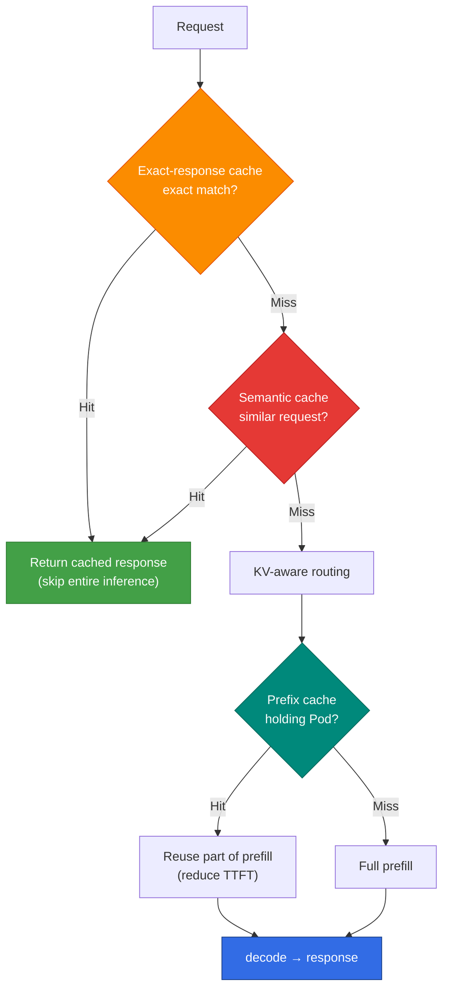

## Overview

Inference caching is not a single layer but consists of **three layers with different hit conditions**. Each layer avoids a different scope of computation and has different levers to raise its hit rate and different measurement points. This document unifies the KV/prefix cache, the exact-response cache, and the semantic cache into a single decision framework and organizes per-layer hit-rate targets and tuning methods.

The detailed implementation of each layer is covered in dedicated documents. This document serves as a map for **looking at all three layers together to decide where to tune**. Its position in the overall inference infrastructure corresponds to the L5 cache layer in the [Inference Infrastructure Overview](../index.md).

## 3-Layer Cache Comparison

**Table 1. Hit condition, computation avoided, and hit unit across the three inference cache layers**

| Layer | Hit Condition | Computation Avoided | Hit Unit | Detailed Document |
|------|----------|-------------|----------|----------|
| **KV / Prefix Cache** | Same prefix (system prompts, common context) | Part of prefill | Pod or shared KV layer | [KV Cache Optimization](./kv-cache-optimization.md) |
| **Exact-Response Cache** | Exact-match request | Entire inference | Gateway / app | [Routing Strategy](../inference-routing/routing-strategy.md) |
| **Semantic Cache** | Semantically similar request (embedding similarity) | Entire inference | Gateway / app | [Semantic Caching Strategy](./semantic-caching-strategy.md) |

:::note Terminology: this document's "exact-response cache" differs from provider "prompt caching"
The second layer, which this document calls the **exact-response cache**, is a gateway/app-level cache that reuses the **entire final response** for a completely identical request and so skips the whole inference. By contrast, the **prompt caching** offered by providers such as Amazon Bedrock reuses the **common prefix tokens** of a request at the serving engine to cut only part of the prefill; it corresponds to the KV / Prefix Cache layer in the table above. Provider prompt caching reuses prefix tokens rather than the whole response, and a cache hit is not guaranteed ([AWS Bedrock prompt caching](https://docs.aws.amazon.com/bedrock/latest/userguide/prompt-caching.html)). To avoid conflating the two, this document names the whole-response reuse layer the "exact-response cache."
:::

The three layers are not mutually exclusive. It is common to **stack them**: avoid entire inference at the gateway via semantic and exact-response caches, and on cache miss reduce prefill via KV/prefix cache at the serving engine.

**Figure 1. Overlapping flow that checks the exact-response, semantic, and KV/prefix caches in order**

This ordering is the design this document chooses. Exact matching (the exact-response cache) is checked **before** similarity matching (the semantic cache), so when a stored exact response exists for a completely identical request, an approximate response cannot override it. Placing the semantic cache first would allow a threshold-passing similar response to be returned even when an exact response is available, which is not recommended unless a quality guard is in place.

## Hit-Rate Strategy by Layer

### KV / Prefix Cache

Prefix cache reuses prefill for requests that share the same system prompt or common context. The levers that raise the hit rate are as follows.

- **Prompt structure alignment**: Fixing the invariant part (system prompts and few-shot examples) at the front of the request lengthens the prefix-match segment.
- **KV cache-aware routing**: Sends requests sharing the same prefix to the Pod holding the cache. Round-Robin neutralizes this cache (see [Limitations of Conventional L7 Gateways](../index.md#limitations-of-conventional-l7-gateways)).
- **Shared KV layer (LMCache)**: Extends the cache outside the GPU, allowing reuse across Pods and nodes (see [LMCache](./lmcache.md)).

For detailed behavior, see [KV Cache Optimization](./kv-cache-optimization.md).

### Exact-Response Cache (Exact Match) {#prompt-cache-exact-match}

Returns a stored response for a completely identical request. The implementation is simple and, unlike similarity matching, has **no false hits arising from approximate matching** (returning a response for a request that is close but semantically different). However, "no false-hit risk" is a guarantee limited to approximate-match errors only: an insufficiently keyed cache or a stale stored response can still cause incorrect reuse. Reuse eligibility must therefore be keyed on more than the request text — include the **tenant/authenticated principal, target model and version, context (tools, system prompt), and freshness (TTL/invalidation)** in the cache key. Because a single-character difference produces a miss, it is effective for formalized requests (fixed templates, batch jobs).

### Semantic Cache (Similarity Match)

Converts requests to embeddings and returns the response of a **semantically similar** past request. Hit rate and quality depend on the similarity threshold, which is a lever that tunes the **precision/recall trade-off** rather than a value that guarantees the response is correct. High embedding similarity means two requests are close; it does not mean the cached response is the right answer for the new request.

- **High threshold**: Fewer matches are accepted, so false hits (returning a response for a semantically different request) drop, but the hit rate falls (lower recall).
- **Low threshold**: Higher hit rate, but a greater risk of returning a past response for a semantically different request (lower precision).

The right threshold cannot be inferred; it must be validated by measuring the false-hit rate on **labeled query/response pairs** for your domain.

Threshold design, cache key composition, and multi-tenancy handling are covered in detail in [Semantic Caching Strategy](./semantic-caching-strategy.md).

## Hit-Rate Targets and Measurement

Cache effectiveness cannot be managed without measurement. Hit rates must be measured separately per layer, looking at both gateway and serving-engine metrics. Note that the **hit unit differs by layer**: the KV/Prefix cache hit rate is the **token-level prefix hit rate** reported by the serving engine (vLLM aggregates prefix cache hits on a token basis; see [vLLM v1 metrics loggers.py](https://raw.githubusercontent.com/vllm-project/vllm/v0.23.0/vllm/v1/metrics/loggers.py)), whereas the exact-response and semantic cache hit rates are the **request-level response hit rate** seen at the gateway. The two must not be compared on the same axis.

**Table 2. Measurement point, hit unit, and proposed starting value by cache layer**

| Metric | Measurement Point | Hit Unit | Proposed Starting Value (before measurement) |
|------|----------|----------|----------|
| **KV Cache Hit Rate** | Serving engine (vLLM metrics) | Token-level prefix | 60% in shared-prompt workloads (proposed) |
| **Semantic Cache Hit Rate** | LLM API Gateway | Request-level response | Workload-dependent (proposed starting value 30%) |
| **False Hit Rate** | Semantic cache quality verification | Request-level response | Minimize via threshold tuning |

:::warning The numbers above are proposed starting values, not measurements
The values in the table are a proposed **starting point** this document suggests, not values measured on a specific workload or cost model. In particular, the claim that "a semantic cache above 30% produces a clear cost effect" depends on each organization's token pricing and embedding/vector-search cost, so it cannot be generalized without verification. Because a semantic cache spends **embedding generation and vector-search cost on every request** to decide a hit, the net cost benefit must be evaluated as (inference cost avoided) − (lookup cost). The starting values are a useful reference for workloads with many shared prompts and repeated queries, but they may be unrealistic for high-diversity requests, so **reset the targets from a baseline measured on actual traffic**.
:::

For observability integration (Langfuse OTel) and dashboard panel composition, see [Semantic Caching Strategy — Observability](./semantic-caching-strategy.md#6-observability-langfuse-integration) and [Routing Strategy — Monitoring & Observability](../inference-routing/routing-strategy.md#monitoring--observability).

## References

### Official Documentation
- [vLLM Automatic Prefix Caching](https://docs.vllm.ai/en/latest/features/automatic_prefix_caching.html) — Official vLLM Prefix Caching documentation
- [Langfuse Documentation](https://langfuse.com/docs) — Observability tool for tracking cache hit rates

### Papers / Tech Blogs
- [PagedAttention (SOSP 2023)](https://arxiv.org/abs/2309.06180) — Foundational paper on KV cache management
- [GPTCache](https://github.com/zilliztech/GPTCache) — Open-source implementation of a semantic cache

### Related Documents (Internal)
- [KV Cache Optimization](./kv-cache-optimization.md) — Prefix Caching and KV Cache-Aware Routing
- [Semantic Caching Strategy](./semantic-caching-strategy.md) — Similarity threshold and cache-key design
- [LMCache](./lmcache.md) — Shared KV cache layer
