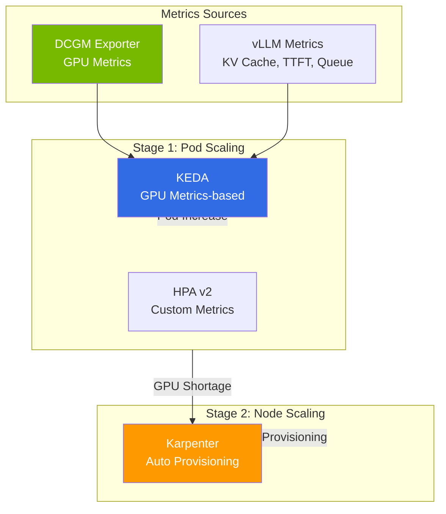

## Overview

In LLM serving operations, GPU uptime directly drives cost, and autoscaling that elastically scales resources up and down with traffic is the key to efficiency. This document consolidates 2-Tier scaling (Pod·node) tailored for LLM serving, the practical constraints of DRA (Dynamic Resource Allocation), and operational lessons learned from deploying large MoE models such as GLM-5 (744B) and Kimi K2.5 (1T).

:::info Related Topics
For GPU cost optimization (Spot·Consolidation·time-based scheduling), see [EKS Cost Management](/docs/eks-best-practices/resource-cost/cost-management); for GPU/vLLM monitoring and Cascade Fallback, see [Agent Monitoring & Operations](../../operations-mlops/observability/agent-monitoring.md); for on-premises GPU integration, see [Hybrid GPU Workloads & SR-IOV Networking](/docs/eks-hybrid-nodes/compute-gpu/gpu-sriov-networking).
:::

## GPU Resource Management & Autoscaling

### 2-Tier Scaling Architecture

LLM serving configures Pod scaling and Node scaling in two stages.



### KEDA Scaling Configuration

Three core scaling signals for LLM serving:

```yaml
apiVersion: keda.sh/v1alpha1
kind: ScaledObject
metadata:
  name: llm-inference-scaler
spec:
  scaleTargetRef:
    name: vllm-deployment
  minReplicaCount: 2
  maxReplicaCount: 8
  triggers:
    # 1. KV Cache saturation — most sensitive signal
    - type: prometheus
      metadata:
        query: avg(vllm:kv_cache_usage_perc)
        threshold: "80"
    # 2. Number of waiting requests
    - type: prometheus
      metadata:
        query: sum(vllm:num_requests_waiting)
        threshold: "10"
    # 3. TTFT SLO violation proximity
    - type: prometheus
      metadata:
        query: |
          histogram_quantile(0.95,
            rate(vllm_time_to_first_token_seconds_bucket[5m]))
        threshold: "2"
```

### Disaggregated Serving Scaling Criteria

Prefill and Decode have different bottleneck signals.

| | Prefill | Decode |
|---|---|---|
| **Bottleneck Signal** | TTFT increase, input queue backlog | TPS decrease, KV Cache saturation |
| **Scaling Criterion** | Input token processing wait time | Concurrent generation session count |
| **GPU Characteristics** | Compute-intensive (compute bottleneck) | Memory-intensive (bandwidth bottleneck) |

### DRA (Dynamic Resource Allocation) Reality

DRA is a Kubernetes feature made generally available in Kubernetes 1.34. Based on device attributes that a DRA driver publishes through `ResourceSlice` objects, it provides CEL-based GPU selection, topology-aware scheduling, and GPU sharing through MIG or time-slicing. Compatibility, however, **depends on how node capacity is provisioned** (per the AWS EKS User Guide, "Manage hardware devices on Amazon EKS"), so verify the conditions before adopting it:

- **Incompatible with Karpenter dynamic provisioning.** Karpenter simulates schedulable resources before a node is created, but a DRA driver publishes its `ResourceSlice` only **after** the node exists, so Karpenter cannot determine a node to place the Pod on.
- **Supported with Karpenter static capacity provisioning, EKS managed node groups (MNG), and self-managed nodes.** DRA therefore requires node capacity to be fixed in advance.
- **Not currently supported on EKS Auto Mode.**
- A **DRA driver and a device plugin for the same device type must not run on the same node simultaneously** (risk of silent oversubscription of the hardware). Uninstall the device plugin before installing the corresponding DRA driver, or run them on separate nodes.

:::info DRA Usage Decision
**When DRA fits:** You need MIG partitioning or GPU sharing, CEL-based attribute GPU selection, or topology-aware placement, and you can fix node capacity statically (Karpenter static, MNG, or self-managed).

**When Device Plugin is sufficient:** You only need whole-GPU allocation, or you use Karpenter dynamic provisioning or Auto Mode. If you need MIG, the NVIDIA device plugin's MIG strategy (single/mixed) can also expose partitioned GPUs.
:::

## Lessons Learned: Large MoE Model Deployment

### Image/Model Download Failure Mitigation

Large model (744GB+) weight download is the most common Cold Start bottleneck in LLM serving. Downloading hundreds of GB from HuggingFace Hub frequently fails due to network instability, timeouts, and disk shortage.

#### Problem Types and Responses

| Problem | Symptoms | Response |
|------|------|------|
| **HF Hub Download Timeout** | Pod CrashLoopBackOff, `ConnectionError` | Raise `HF_HUB_DOWNLOAD_TIMEOUT` + resume download from the interruption point |
| **Large File Partial Download** | Corruption error during model loading | Checksum verification + re-download |
| **Slow Container Image Pull** | `ImagePullBackOff`, several minutes wait | Pre-cache images (Bottlerocket data volume, SOCI) |
| **Multi-node Simultaneous Download** | Network bandwidth contention | S3 caching + init container sequential loading |
| **Slow EFS Download** | 30+ minutes loading time | Switch to NVMe emptyDir |

#### Strategy 1: HuggingFace Transfer Acceleration

As the HuggingFace Hub moved to the Xet storage backend, `huggingface_hub` v0.32.0+ bundles the `hf-xet` (Rust-based chunk-dedup) binary by default and routes all transfers through it. The older `HF_HUB_ENABLE_HF_TRANSFER=1` (`hf_transfer`) is **deprecated** in the official docs and can no longer be used, so to raise throughput set `HF_XET_HIGH_PERFORMANCE=1` (which saturates network bandwidth and uses all CPU cores). The actual speedup depends on network and file layout, so measure it in your own environment rather than assuming a fixed multiplier.

```yaml
env:
  - name: HF_XET_HIGH_PERFORMANCE
    value: "1"              # Xet high-performance mode (hf-xet)
  - name: HF_TOKEN
    valueFrom:
      secretKeyRef:
        name: hf-token
        key: token
  # Per-request response-wait timeout (default 10s). This is not a retry
  # count; it keeps slow connections from failing prematurely.
  - name: HF_HUB_DOWNLOAD_TIMEOUT
    value: "600"
```

#### Strategy 2: S3 Pre-caching + Init Container

This improves Cold Start stability by reducing the impact of network variability. Pre-upload model weights to S3 and copy them to local NVMe in an init container. The manifest below is a complete example; S3 access is granted to the ServiceAccount via IRSA (IAM Roles for Service Accounts). NVMe backing depends on node-side configuration, so also see "Strategy 3" and the "Storage Strategy" section.

```yaml
apiVersion: apps/v1
kind: Deployment
metadata:
  name: vllm-with-s3-cache
  labels:
    app: vllm-with-s3-cache
spec:
  replicas: 1
  selector:
    matchLabels:
      app: vllm-with-s3-cache
  template:
    metadata:
      labels:
        app: vllm-with-s3-cache
    spec:
      # ServiceAccount bound via IRSA to an IAM role with S3 read access
      serviceAccountName: vllm-s3-reader
      initContainers:
        # Stage 1: download from S3 into a staging dir; commit only on success
        - name: model-downloader
          image: amazon/aws-cli:2.15.0
          command: ["/bin/sh", "-c"]
          args:
            - |
              set -euo pipefail
              DEST=/models
              STAGING=/models/.staging
              # Treat the model as cached only when the completion marker exists
              if [ -f "$DEST/.download-complete" ]; then
                echo "Model already cached, skipping download"
                exit 0
              fi
              echo "Downloading model from S3 to staging..."
              rm -rf "$STAGING" && mkdir -p "$STAGING"
              # A sync failure (network/permission error) aborts via set -e → Pod restarts
              aws s3 sync s3://model-cache/qwen3-32b-fp8/ "$STAGING/" --no-progress
              echo "Verifying downloaded shards..."
              # Confirm every shard declared by the safetensors index exists and is non-empty
              INDEX="$STAGING/model.safetensors.index.json"
              test -s "$INDEX"
              python3 - "$INDEX" "$STAGING" <<'PY'
              import json, os, sys
              index_path, root = sys.argv[1], sys.argv[2]
              with open(index_path) as f:
                  shards = set(json.load(f)["weight_map"].values())
              for shard in sorted(shards):
                  p = os.path.join(root, shard)
                  if not os.path.isfile(p) or os.path.getsize(p) == 0:
                      sys.exit(f"missing or empty shard: {shard}")
              print(f"verified {len(shards)} shards")
              PY
              # Only after verification: move into place and write the completion marker
              mv "$STAGING"/* "$DEST"/
              rm -rf "$STAGING"
              touch "$DEST/.download-complete"
              echo "Model verified successfully"
          volumeMounts:
            - name: model-cache
              mountPath: /models
          resources:
            requests:
              cpu: "2"
              memory: 4Gi
      containers:
        - name: vllm
          # vLLM version that supports the Qwen3 architecture (vllm>=0.8.5)
          image: vllm/vllm-openai:v0.8.5
          args:
            - /models
            - "--gpu-memory-utilization=0.95"
          volumeMounts:
            - name: model-cache
              mountPath: /models
          resources:
            limits:
              nvidia.com/gpu: "1"   # GPU request (limits are copied to requests)
      volumes:
        - name: model-cache
          # For emptyDir to be backed by NVMe, the node must use its instance-store
          # volumes as ephemeral storage (Karpenter EC2NodeClass instanceStorePolicy:
          # RAID0); otherwise it lands on the root EBS volume. sizeLimit is an upper
          # bound, not a capacity guarantee.
          emptyDir:
            sizeLimit: 200Gi
```

#### Strategy 3: Container Image Pre-caching

Methods to reduce Pull time for vLLM/SGLang images (10-20GB). Karpenter has no dedicated image pre-pull feature. The settings below only raise the image **garbage-collection (GC) thresholds so already-pulled images are retained longer on the node for reuse**; they do not pre-download images onto new nodes. To actually reduce the cold start itself, combine this with SOCI (lazy loading) described below.

In Karpenter v1, kubelet settings moved from `NodePool` to **`EC2NodeClass.spec.kubelet`**, and the `NodePool` must reference that EC2NodeClass through `nodeClassRef`.

```yaml
apiVersion: karpenter.sh/v1
kind: NodePool
metadata:
  name: gpu-inference
spec:
  template:
    spec:
      # Required: reference the EC2NodeClass to use
      nodeClassRef:
        group: karpenter.k8s.aws
        kind: EC2NodeClass
        name: gpu-inference
---
apiVersion: karpenter.k8s.aws/v1
kind: EC2NodeClass
metadata:
  name: gpu-inference
spec:
  # kubelet settings live on the EC2NodeClass
  kubelet:
    # Raise image GC thresholds to retain already-pulled images longer
    # (this delays image eviction under disk pressure; it is not a pre-pull)
    imageGCHighThresholdPercent: 90
    imageGCLowThresholdPercent: 85
```

**Using SOCI (Seekable OCI) Index:**

SOCI reduces container start time by lazy-loading images, but it only takes effect when you both (1) publish a SOCI index for the image to ECR and (2) configure the node's containerd with the SOCI snapshotter as a proxy plugin. Creating the index alone does not enable it. Reported startup gains vary by platform and image (for example, roughly 50% on Fargate and 30-70% on SageMaker BYOI depending on image size), so read any figure together with its measurement context and benchmark with your own image before relying on it. The benefit is largest for big images with large compressed layers.

```bash
# Create the SOCI index with the soci CLI from awslabs/soci-snapshotter (e.g. v0.16.1)
soci create 123456789012.dkr.ecr.us-east-2.amazonaws.com/vllm:v0.8.5
soci push  123456789012.dkr.ecr.us-east-2.amazonaws.com/vllm:v0.8.5

# Node requirement: configure the SOCI snapshotter as a containerd proxy plugin and set
#   [plugins."io.containerd.grpc.v1.cri".containerd] snapshotter = "soci"
#   (on EKS managed node groups, install/configure the snapshotter via launch template/userdata)
# Note: Bottlerocket uses the overlayfs snapshotter by default; SOCI is not applied
#   automatically. Automatic support on Auto Mode/Bottlerocket needs separate official evidence.
# You can automate index creation with the CloudFormation SOCI Index Builder:
# https://github.com/awslabs/soci-snapshotter
```

#### Strategy 4: Multi-node LWS Model Download Coordination

With LWS multi-node deployment, each Pod is scheduled onto a different node, and if the model cache is node-local NVMe (`emptyDir`), **the cache cannot be shared across nodes**. The default behavior is therefore that Leader and Worker each download independently from S3; a "Leader downloads, Worker waits" coordination does not hold with node-local `emptyDir` alone. The two **independent** Pod fragments below each download directly from S3 on their own node. `set -e` makes a failed download abort the init container so the Pod restarts.

```yaml
# Leader Pod (part of the LWS leaderTemplate). Downloads to node-local NVMe emptyDir.
initContainers:
  - name: model-downloader
    image: amazon/aws-cli:2.15.0
    command: ["/bin/sh", "-c"]
    args:
      - |
        set -euo pipefail
        aws s3 sync s3://model-cache/glm5-fp8/ /models/ --no-progress
    volumeMounts:
      - name: model-cache
        mountPath: /models
```

```yaml
# Worker Pod (part of the LWS workerTemplate). On a different node, downloads independently.
initContainers:
  - name: model-downloader
    image: amazon/aws-cli:2.15.0
    command: ["/bin/sh", "-c"]
    args:
      - |
        set -euo pipefail
        # A node-local emptyDir is per-node, so the Leader's cache cannot be shared — each downloads.
        aws s3 sync s3://model-cache/glm5-fp8/ /models/ --no-progress
    volumeMounts:
      - name: model-cache
        mountPath: /models
```

To genuinely download once and share, use cross-node shared storage (`ReadWriteMany`, e.g. EFS or FSx for Lustre) instead of node-local `emptyDir`, and have the other Pods wait (poll) until a completion marker file appears.

:::tip Download Method Comparison (qualitative)
This table compares the **design characteristics** of each method, not measured benchmarks. Actual time depends heavily on model size, instance network bandwidth, concurrency, and cache state (first download vs. restart), so measure it in your own environment. The "Charges" column lists only billable items — even when the transfer itself is free, S3 storage/requests, EFS/FSx provisioning, and instance runtime are billed separately.

| Method | Transfer Path | Cache State | Billable Items |
|------|--------------|-------------|----------------|
| HF Hub Direct | External → Pod | First download | Instance runtime (no transfer fee), high timeout risk |
| HF Hub + `HF_XET_HIGH_PERFORMANCE` | External → Pod (Xet-accelerated) | First download | Instance runtime |
| S3 Pre-caching + init container | S3 (same region) → node NVMe | First download | S3 storage/requests, instance runtime |
| FSx for Lustre | FSx → Pod (RWX shared) | First/shared | FSx provisioning (standing), instance runtime |
| NVMe Local Cache | Node-local disk read | Only when the Pod restarts on the **same node** with the cache intact | Instance runtime |

The "fast" case for NVMe local cache applies only when already-downloaded weights are **re-read from the same node's local disk** (see the sequential-read bandwidth in the "Storage Strategy" table). Because `emptyDir` is Pod-scoped, deleting and recreating the Pod discards the cache, and scheduling onto a different node forces a re-download.
:::

### EKS Auto Mode GPU Limitations

Core limitations identified during GLM-5 (744B MoE) and Kimi K2.5 (1T MoE) deployments.

#### p6-b200 Not Supported

As of April 2026, EKS Auto Mode's managed Karpenter **cannot provision p6-b200.48xlarge**. NodePool validation passes but actual NodeClaim creation fails with `NoCompatibleInstanceTypes` error.

#### GPU Instance Capacity Acquisition

p5.48xlarge frequently has InsufficientCapacity in Seoul/Tokyo regions. **Available in us-east-2 (Ohio) Spot for $13-15/hr** (85% reduction vs On-Demand $98/hr).

| Region | p5.48xlarge On-Demand | p5.48xlarge Spot | Spot Price |
|------|---------------------|-----------------|----------|
| ap-northeast-2 (Seoul) | InsufficientCapacity | Unconfirmed | — |
| ap-northeast-1 (Tokyo) | InsufficientCapacity | Unconfirmed | — |
| **us-east-2 (Ohio)** | Variable availability | **Available** | **$13~15/hr** |

#### GPU Operator Conflict

Auto Mode provides a built-in Device Plugin on GPU nodes. Installing the NVIDIA GPU Operator on top with `devicePlugin.enabled=true` makes **two Device Plugins advertise the same GPU on the same node**; in the observed case the node's `nvidia.com/gpu` allocatable was reported abnormally (for example, `0`). On Auto Mode nodes, keep the GPU Operator's Device Plugin off with the NodePool label `nvidia.com/gpu.deploy.device-plugin: "false"`, so only the Auto Mode built-in plugin advertises the GPU. The GPU Operator applies its `nvidia.com/gpu.deploy.*` labels only where a label is absent or empty, so it keeps that `false` value ([`addGPUStateLabels`](https://github.com/NVIDIA/gpu-operator/blob/fbe793082611bfdba1621b614edefdd3461bf14d/controllers/state_manager.go)). Setting `devicePlugin.enabled=false` also avoids the conflict, but it turns the Device Plugin off on every node. Because the driver and container toolkit are also AWS-managed on Auto Mode nodes, the configuration reviewed in [awslabs/ai-on-eks PR #288](https://github.com/awslabs/ai-on-eks/pull/288) installs the GPU Operator with `driver.enabled=false` and `toolkit.enabled=false` and keeps DCGM Exporter, NFD and GFD. The `allocatable=0` value is the observed case, not a universal guarantee for every environment.

#### Cannot Directly Terminate EC2 Instances

Nodes provisioned by Auto Mode are EC2 **managed instances**: the service provider, EKS (`Operator`/`Principal` = `eks.amazonaws.com`), owns the instance lifecycle (provisioning, replacement, termination). As a result you **cannot directly modify a managed instance or terminate it with `ec2:TerminateInstances`** (per the AWS EC2 User Guide, "Amazon EC2 managed instances"). The exact enforcement mechanism (a resource-based policy, whether the root account can bypass it, etc.) is not stated in the official docs, so we do not assert one.

Perform node cleanup through Karpenter:

- To replace or clean up a **specific node**, delete that node's `NodeClaim` (`kubectl delete nodeclaim <name>`); Karpenter drains it and terminates the instance gracefully.
- Deleting a `NodePool` tears down **every NodeClaim/node that NodePool owns** (a fleet-wide cascade), so do not use it to replace a single node.

For Karpenter's drain, consolidation, and termination behavior, see the [Karpenter Disruption docs](https://karpenter.sh/docs/concepts/disruption/).

### Serving Framework Compatibility

| Model | vLLM Support | SGLang Support | Notes |
|------|---------|-----------|------|
| Qwen3-32B | Supported (vllm≥0.8.5) | Supported (sglang≥0.4.6.post1) | llm-d default model, Apache-2.0 |
| Kimi K2.5 (1T MoE) | Supported | Supported | INT4 W4A16 Marlin MoE, `gpu_memory_utilization=0.85` |
| GLM-5 (744B MoE, 40B active) | Supported (vllm≥0.19.0) | Supported (sglang≥0.5.10) | DeepSeek Sparse Attention (DSA), MIT license |
| DeepSeek V3.2 | Supported | Supported | MoE, 671B total / 37B active |

:::warning GLM-5 Deployment Caution
Per its model card, GLM-5-FP8 is supported by both vLLM (v0.19.0+) and SGLang (v0.5.10+). The documented single-node vLLM example is `vllm serve zai-org/GLM-5-FP8 --tensor-parallel-size 8 --tool-call-parser glm47 --reasoning-parser glm45`, adding MTP speculative decoding (`--speculative-config`) for high token volume. If a single node's GPUs cannot hold the 744B (40B active) weights and multi-node is required, do not hard-code distribution flags or topology — follow the GLM-5 recipes for vLLM (`recipes/GLM/GLM5.md`, linked from the model card) and the SGLang cookbook.
:::

### Storage Strategy

Storage performance drives large model (hundreds of GB) weight-loading time. The sequential-read figures below are **approximate observed values** that vary by environment; where a service publishes a limit (such as EFS), read the published limit and the actual throughput separately.

| Storage | Sequential Read (approx.) | Multi-node Sharing | Recommended Scenario |
|---------|---------|------------|------------|
| **NVMe emptyDir** | ~3,500 MB/s (varies by instance) | Node-independent | p5 built-in NVMe, best for local re-reads |
| EFS | Published ceiling up to 1,500 MiB/s (Elastic Throughput, **aggregate across the mount, conditional**) | ReadWriteMany | Small models, when cross-node sharing is needed |
| S3 + init container | ~1,000 MB/s (varies by concurrency/instance) | S3 shared | Medium performance, cost efficient |
| FSx for Lustre | ~1,000+ MB/s (scales with provisioned throughput) | ReadWriteMany | Training workloads |

:::tip Large Model Recommendation
For large models such as GLM-5-FP8 (hundreds of GB of FP8 weights) and Kimi K2.5 (hundreds of GB), **local NVMe (emptyDir)** gives the best node-local read performance for loading. However, `emptyDir` is Pod-scoped, so **the cache is lost when the Pod is recreated**, and the first time weights are fetched you still need a HuggingFace Hub direct download (tens of minutes depending on network/concurrency) or S3 pre-caching, just like any other method. p5.48xlarge has 8×3.84TB NVMe SSDs built in, but using them as ephemeral storage requires node configuration (Karpenter EC2NodeClass `instanceStorePolicy: RAID0`). Exact weight byte sizes depend on the revision you use (FP8/BF16, etc.), so confirm the checkpoint size before deployment.
:::

### GPU Quota Pitfall

EC2 vCPU quotas are separated by instance bucket, requiring caution.

| Quota | Applicable Instances | Default | Caution |
|------|------------|--------|---------|
| Running On-Demand P instances | p4d, p5, p5en | 384 | Can have 2 p5.48xlarge (192 vCPU each) |
| Running On-Demand G and VT instances | g5, g6, g6e | **64** | Cannot even have 1 g6e.48xlarge → quota increase required |

Setting `instance-category: [g, p]` together in GPU NodePool may cause Karpenter to try G types first, hitting the G quota (64 vCPU). If only P types are needed, specify explicitly.

## References

### Official Documentation
- [KEDA Documentation](https://keda.sh/docs/) — Kubernetes Event-driven Autoscaling
- [Karpenter Documentation](https://karpenter.sh/docs/) — Node auto-provisioning, Disruption, Consolidation
- [NVIDIA DCGM Exporter](https://github.com/NVIDIA/dcgm-exporter) — GPU sensor metrics collection

### Papers & Technical Blogs
- [a16z "The Economics of AI"](https://a16z.com/navigating-the-high-cost-of-ai-compute/) — GPU cost structure analysis
- [SOCI Snapshotter](https://github.com/awslabs/soci-snapshotter) — Container image lazy-loading
- [Spot Instance Operations Guide (AWS)](https://aws.amazon.com/ec2/spot/) — Karpenter Spot interruption response

### Related Documentation
- [Inference Optimization on EKS (Overview)](./index.md) — Inference optimization category entry point
- [KV Cache Optimization (vLLM Deep Dive + Cache-Aware Routing)](./kv-cache-optimization.md) — vLLM/llm-d/Dynamo deep dive
- [Disaggregated Serving + LWS Multi-Node](./disaggregated-serving.md) — Prefill/Decode separation, LWS deployment
- [GPU Resource Management](../gpu-infrastructure/gpu-resource-management.md) — GPU scaling, DRA
- [EKS Cost Management](/docs/eks-best-practices/resource-cost/cost-management) — GPU workload cost optimization (Spot·Consolidation)
- [Agent Monitoring & Operations](../../operations-mlops/observability/agent-monitoring.md) — GPU/vLLM monitoring, Cascade Fallback
- [Hybrid GPU Workloads & SR-IOV Networking](/docs/eks-hybrid-nodes/compute-gpu/gpu-sriov-networking) — On-premises GPU inference, 3-Tier Cascade
