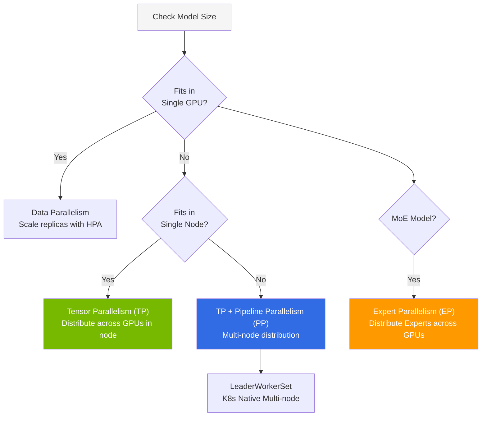
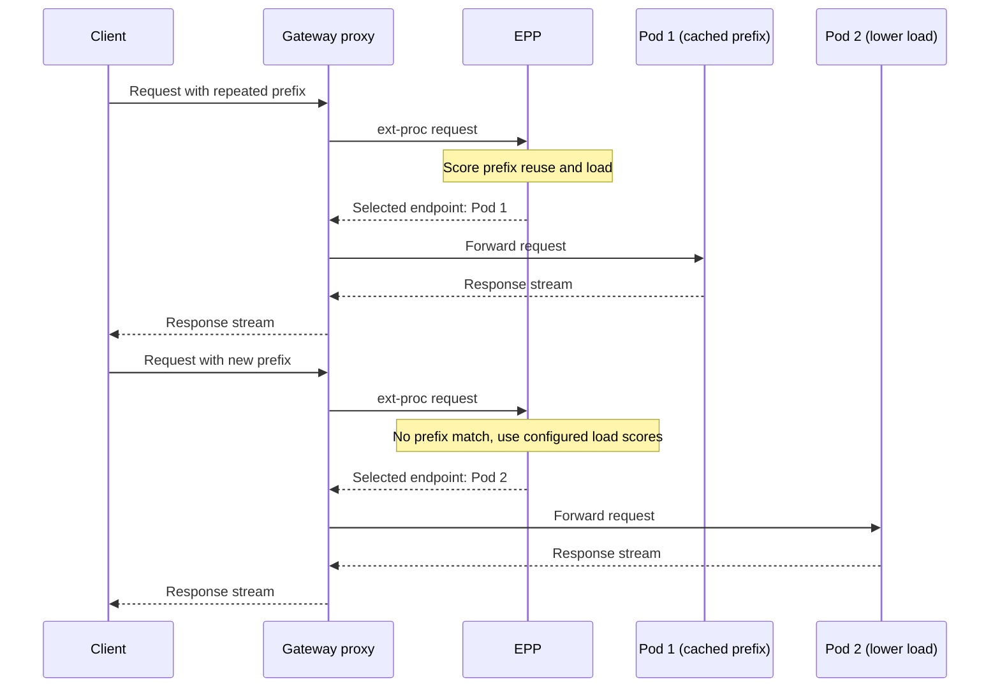
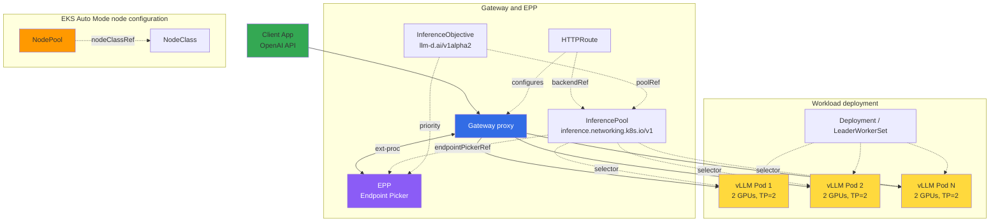

## Overview

LLM inference engine performance largely depends on how efficiently KV cache (Key-Value Cache) is managed. This document covers vLLM's core technology stack and GPU memory design principles, as well as **KV Cache-Aware Routing** strategies (llm-d vs NVIDIA Dynamo) for sharing and reusing KV cache across multiple Pods.

## vLLM Deep Dive

### Core Technology Stack

vLLM is a widely adopted open-source LLM inference engine. The table below describes each technology's mechanism; the "Reported effect" column cites the condition under which a published number was measured, because the magnitude depends on model, hardware, workload and the combination of features enabled. The numbers are not additive and are not guaranteed for an arbitrary deployment.

**Table 1. vLLM technology reported effects and mechanisms**

| Technology | Reported effect (with source and condition) | Mechanism |
|------|---------|------|
| **PagedAttention** | The original [vLLM announcement](https://blog.vllm.ai/2023/06/20/vllm.html) reports that existing serving systems waste 60–80% of KV-cache memory to fragmentation and over-reservation, and that PagedAttention cuts that waste to under 4%. The reduction is in wasted memory, not a 60–80% cut of total memory. | Stores each sequence's KV cache in fixed-size, non-contiguous blocks mapped through a block table, analogous to OS virtual-memory paging |
| **Continuous Batching** | The same announcement reports up to 24× higher end-to-end throughput than HuggingFace Transformers and 2.2–3.5× over TGI for LLaMA-7B/13B on A10G/A100 with ShareGPT traffic. This is a whole-system result, not the isolated effect of batching. | Adds and removes requests at iteration granularity instead of waiting for a whole batch to finish |
| **FP8 KV Cache** | Storing the KV cache in FP8 roughly halves the KV-cache footprint, letting more tokens fit in the pool; it does not halve model weights or total GPU memory ([vLLM quantized KV cache](https://docs.vllm.ai/en/latest/features/quantization/quantized_kvcache.html)). | Stores KV cache tensors in FP8 (`fp8_e4m3`/`fp8_e5m2`) with per-tensor or per-head scales |
| **Prefix Caching** | Reduces time-to-first-token and prefill compute for requests that share a prefix; the magnitude depends on hit rate and prefix length and is not a fixed multiplier. | Reuses already-computed KV-cache blocks of a shared prefix (hash-based, full blocks only) |
| **Speculative Decoding** | vLLM documents this as a qualitative latency optimization whose gain "depends on your model family, traffic pattern, hardware, and sampling settings" ([method-selection guide](https://docs.vllm.ai/en/latest/features/speculative_decoding/)); no fixed speedup is published. | A draft proposer predicts several tokens that the target model verifies in one step |
| **Chunked Prefill** | Trades prefill latency against decode throughput; the balance depends on chunk size and traffic. | Splits long prefills into chunks and mixes them with decode steps in the same batch |

### GPU Memory Calculation

Accurate GPU memory planning is required before model deployment. Total process memory is the sum of the model weights, the framework/activation overhead, and the KV-cache pool that holds every concurrent sequence:

```
Total process GPU memory ≈ Model Weights + Non-torch Memory + PyTorch Activation + KV-cache pool

KV cache per token = 2 (K and V) × num_layers × num_kv_heads × head_dim × bytes_per_element
KV-cache pool ≈ KV cache per token × (sum of sequence lengths across the running batch)
```

The KV-cache size scales with the per-token term above and with the total number of cached tokens (sequence length × concurrency), not with a fixed "× batch size" multiplier. Models with grouped-query or multi-head latent attention (for example Kimi K2.5's MLA) have a much smaller `num_kv_heads` term and therefore a smaller KV cache than the head count alone would suggest.

**Raw weight estimate by precision.** The figures below are the weights-only estimate (`parameters × bytes-per-parameter`); they are a lower bound on required VRAM, not total VRAM, because activations, framework overhead and the KV-cache pool are added on top. For a mixture-of-experts model, use the total parameter count for the weight estimate even though only a subset is activated per token.

**Table 2. Bytes per parameter and 70B/32B weights-only estimates by precision**

| Precision | Bytes per Parameter | 70B weights only | 32B weights only |
|--------|---------------|---------|---------|
| FP32 | 4 | 280GB | 128GB |
| BF16/FP16 | 2 | 140GB | 64GB |
| INT8 | 1 | 70GB | 32GB |
| INT4 | 0.5 | 35GB | 16GB |

### Parallelization Strategy Selection Criteria

**Figure 1. Parallelization strategy selection flow by model size and MoE status**



**Example Configurations by Model Size:**

These rows are illustrative starting points, not validated capacity figures. The required GPU count depends on the exact checkpoint and quantization, the context length and concurrency you target (which set the KV-cache pool), and the headroom you leave; size each deployment against the memory arithmetic above and your own benchmark. Expert Parallelism (EP) is an experimental vLLM feature that must be enabled explicitly with `--enable-expert-parallel` and is normally combined with data parallelism (`EP_SIZE = TP × DP`); it is not automatic for MoE models ([vLLM EP deployment](https://docs.vllm.ai/en/latest/serving/expert_parallel_deployment.html)).

**Table 3. Example GPU configuration and parallelism settings by model size**

| Model Example | Total / Active Params | Precision | Example GPU Configuration | Parallelism (must be configured) |
|-----------|---------|--------|---------|--------|
| Qwen3-32B | 32B dense | FP8 | 1× H100 80GB (short context) | None |
| Llama-3.3-70B | 70B dense | BF16 | 4× H100 (TP=4) | Tensor Parallel |
| Kimi K2.5 | 1T total / 32B active MoE (MLA, 384 experts, 8 active) | native INT4 | Multi-GPU node; the [model card](https://huggingface.co/moonshotai/Kimi-K2.5) recommends vLLM/SGLang/KTransformers but does not fix a GPU count — size against context and headroom | Tensor Parallel, optionally Expert Parallel (`--enable-expert-parallel`) |
| GLM-5 | 744B total / 40B active MoE | FP8 | Multi-node (e.g. PP + TP across nodes) | Pipeline + Tensor Parallel, optionally Expert Parallel |

### Core Performance Parameters

```bash
vllm serve Qwen/Qwen3-32B-FP8 \
  --gpu-memory-utilization=0.95 \
  --max-model-len=32768 \
  --enable-prefix-caching \
  --kv-cache-dtype=fp8 \
  --enable-auto-tool-choice \
  --tool-call-parser=hermes
```

Flag meanings (comments are kept out of the command so each backslash is immediately followed by a newline and line continuation is not broken):

- `--gpu-memory-utilization=0.95` — the fraction of each GPU's memory vLLM may use for the **whole model executor** (weights, activations and the KV-cache pool together), not a KV-cache-only ratio. Its default is `0.9` in v0.19 and `0.92` in v0.24 ([v0.19 `cache.py`](https://github.com/vllm-project/vllm/blob/v0.19.0/vllm/config/cache.py), [v0.24 `cache.py`](https://github.com/vllm-project/vllm/blob/v0.24.0/vllm/config/cache.py)). The KV-cache pool is whatever remains after weights and overhead.
- `--max-model-len=32768` — maximum sequence length; it bounds how large a single sequence's KV cache can grow.
- `--enable-prefix-caching` — reuse KV-cache blocks for shared prefixes (enabled by default since the KV-cache config made it the default).
- `--kv-cache-dtype=fp8` — store the **KV cache** in FP8, roughly halving the KV-cache footprint only; it does not change the weight precision or total memory.
- `--enable-auto-tool-choice` / `--tool-call-parser=hermes` — enable automatic tool calling and select the parser.

### Quantization Strategy Comparison

Quantization "trades off model precision for smaller memory footprint" ([vLLM quantization guide](https://docs.vllm.ai/en/latest/features/quantization/)). The savings below are the weight-bit arithmetic relative to BF16/FP16 (for example 8-bit weights ≈ half the weight bytes, 4-bit ≈ a quarter); they are not a measured reduction of total GPU memory, which also includes activations and the KV-cache pool, and they are not a fixed quality or speed ranking. Quality and throughput depend on the specific variant, model and backend, and each format is only supported on specific hardware — vLLM publishes a per-architecture support matrix (Volta/Turing/Ampere/Ada/Hopper, AMD, Intel, CPU) that you should check before choosing one.

**Table 4. Weight-bit footprint and pre-adoption checks by quantization format**

| Quantization | Weight-bit footprint vs BF16 | What to verify before adopting |
|--------|----------|------------|
| **FP8 (W8A8)** | ~½ the weight bytes | Supported from Ada/Hopper (and AMD) only; measure quality on your model |
| **AWQ** | 4-bit weights, ~¼ the weight bytes | Not on Volta/AMD; weight-only, so activation-heavy stages see less speedup |
| **GPTQ** | 4-bit weights, ~¼ the weight bytes | Offline calibration; broad GPU support; verify accuracy per model |
| **GGUF** | Multiple bit-widths (2–8 bit) | Convenient for mixed/offline use; throughput varies by bit-width and kernel |

Pick a variant by matching your target hardware to vLLM's support matrix and by benchmarking quality and throughput on your own model rather than relying on a fixed ranking.

## KV Cache-Aware Routing

### Existing Problem: Round-Robin Limitations

Two mechanisms are involved. Inside one vLLM instance, Automatic Prefix Caching (enabled by default in the vLLM v0.25.0 engine configuration; check `--enable-prefix-caching` for the version you run) reuses the KV blocks of an earlier request that shares a prefix, regardless of how the request reached that instance. Across instances, the load balancer decides which instance's cache a request can use. A policy that ignores cache state, such as round-robin (the baseline in the llm-d comparison below) or random endpoint selection, sends requests that share a system prompt to different Pods. Each Pod then computes that prefill once before it can reuse it, and the cached blocks compete with other traffic for each Pod's KV cache. The extra prefill work and the resulting TTFT increase grow with the number of replicas and distinct prefixes, and shrink when a few long prefixes stay resident on every replica.

### Solution: KV Cache State-Aware Routing

llm-d and NVIDIA Dynamo add cache awareness to endpoint selection: they estimate or track which Pods hold a request's prefix and weigh that against load, so requests that share a prefix tend to reach a Pod that can reuse it.

This flow is a simplified example of configured EPP plugins. A Pod with cached prefixes may still lose selection because of load.

**Figure 2. KV cache-aware routing flow by prefix reuse and load score**



:::note Routing decision and model inference are separate operations
In KV cache-aware routing, **the routing decision itself is not model inference.** Three distinct mechanisms are involved, and no single component performs all of them:

- **Tokenization and block-key generation**: the prompt is tokenized and hashed per fixed-size block. vLLM's Automatic Prefix Caching computes `hash(parent block hash, block tokens, extra values such as LoRA ID / multi-modal / cache salt)` for full blocks only, with no model forward pass ([vLLM Automatic Prefix Caching design](https://github.com/vllm-project/vllm/blob/v0.24.0/docs/design/prefix_caching.md)).
- **Index (producer) maintenance**: in the Gateway API Inference Extension, an "approximate prefix cache data producer" prepares the match information (`PrefixCacheMatchInfo`) about which Pod has cached which prefix blocks, before scheduling.
- **Scorer evaluation**: the `prefix-cache-scorer` **does not hash prompts or maintain cache state.** It only converts the already-prepared `PrefixCacheMatchInfo` into a per-endpoint `score = matchBlocks / totalBlocks` ([llm-d prefix-cache-scorer README](https://github.com/llm-d/llm-d-router/blob/v0.9.0/pkg/epp/framework/plugins/scheduling/scorer/prefix/README.md)). Hashing and matching are the producer's job; scoring is the scorer's.

**Semantic (context-aware) routing** is one configured routing method, not all of context-aware routing. It passes the prompt through an encoder/classifier model (BERT family) to classify intent, so one lightweight inference happens on the routing path (vLLM Semantic Router). The prefix-hash lookup above, by contrast, performs no model inference.

In both cases the **final workload on the selected Pod is LLM inference**. "Is the routing decision inference?" and "is the final workload inference?" must therefore be judged separately.
:::

**Effects of KV Cache-Aware Routing (qualitative):**

The direction of each effect is predictable, but the magnitude depends on prefix-hit rate, prefix length, model, hardware and load, so the table gives conditional effects rather than guaranteed percentages. The one published point estimate comes from llm-d: **3× higher output throughput and 2× faster TTFT** with prefix-cache-aware routing versus round-robin, measured on Llama 3.1 70B on 4× AMD MI300X ([llm-d README, Performance Highlights](https://github.com/llm-d/llm-d/blob/v0.8.1/README.md)). Treat other numbers as workload-specific and measure them yourself.

**Table 5. KV Cache-Aware Routing effects on TTFT, prefill compute, and throughput by scenario (qualitative)**

| Scenario | TTFT | GPU prefill compute | Throughput | Caveat |
|---------|----------|-------------|-----------|--------|
| Shared system prompt (high hit rate) | Lower (prefill of the shared prefix is skipped) | Reduced | Higher | Only while the cached Pod is not overloaded |
| RAG with repeated context | Lower for the reused portion | Partially reused | Higher | Depends on how much context actually repeats |
| Mostly unique requests | No improvement; routing adds a small scoring overhead | No reuse | Falls back to load balancing | Over-concentrating on a cached Pod can raise its queue latency |

### llm-d vs NVIDIA Dynamo Comparison

Both projects provide KV Cache-aware routing but with different approaches. The llm-d review is pinned to [v0.8.1 (2026-06-26)](https://github.com/llm-d/llm-d/releases/tag/v0.8.1); note that the README at that tag still describes the v0.7 feature set. The Dynamo column is pinned to [v1.2.1](https://github.com/ai-dynamo/dynamo/tree/v1.2.1). Routing to a Pod that holds cached prefixes is separate from configuring KV transfer or offloading across Pods.

**Table 6. Item-by-item comparison of llm-d v0.8.1 and NVIDIA Dynamo v1.2.x**

| Item | llm-d v0.8.1 | NVIDIA Dynamo v1.2.x |
|------|------------|-------------------|
| **Governance** | CNCF sandbox project (Apache 2.0), founded by Red Hat, Google Cloud, IBM Research, CoreWeave and NVIDIA | NVIDIA (Apache 2.0) |
| **KV Cache Indexing** | Prefix-aware routing | Flash Indexer (radix tree) |
| **KV Cache Transfer** | NIXL | NIXL |
| **Routing** | Gateway API + Envoy EPP | Dynamo Router + custom EPP |
| **Pod Scheduling** | K8s default scheduler | KAI Scheduler (GPU-aware) |
| **Autoscaling** | HPA/KEDA integration | Planner (SLO-based profiling) |
| **KV Cache Tiering** | [HBM → CPU RAM → filesystem](https://github.com/llm-d/llm-d/blob/v0.8.1/docs/well-lit-paths/foundations/tiered-prefix-cache.md), with connector and storage configuration | KVBM unified memory layer spanning GPU HBM, host/remote DRAM, local SSD and remote file/object/cloud storage over NIXL ([KVBM README](https://github.com/ai-dynamo/dynamo/blob/v1.2.1/docs/components/kvbm/README.md)) |
| **Complexity** | Lower (K8s-native stack) | Higher (more components to operate) |
| **Published benchmark** | 3× output throughput and 2× TTFT with prefix-cache routing vs round-robin (Llama 3.1 70B, 4× MI300X); 13.9× with hierarchical KV offloading at 250 concurrent users vs GPU-only (4× H100) — see [README](https://github.com/llm-d/llm-d/blob/v0.8.1/README.md) | NVIDIA reports up to 7× with disaggregation + wide EP on GB200 NVL72; this is NVIDIA's figure on NVIDIA hardware, not a like-for-like comparison with llm-d |

:::tip Selection Criteria
These are starting points, not a mandatory migration path; validate against your own workload.
- **K8s-native, Gateway API-first stacks**: llm-d integrates with Gateway API, HPA/KEDA and tiered KV offloading, and is operationally lighter.
- **Maximum throughput on NVIDIA GB200/large EP topologies**: Dynamo's Flash Indexer, SLO-based Planner and KVBM tiering target that case; the 7× figure is specific to NVIDIA's benchmark configuration.
- **Long context (128K+)**: both offer CPU/storage offloading; evaluate capacity and transfer cost for your workload.
- **Starting small**: either project can be adopted on its own. Both use NIXL for KV transfer, so a later move between them is feasible, but it is not required by scale and should be driven by measured need.
:::

### Gateway Architecture: llm-d Deployment Configuration

This is a single-Gateway example of [llm-d v0.8.1 Gateway Mode](https://github.com/llm-d/llm-d/blob/v0.8.1/docs/architecture/core/router/proxy.md). Solid lines show traffic/ext-proc calls; dotted lines show configuration references. InferencePool (`inference.networking.k8s.io/v1`) selects Pods and connects the EPP; optional InferenceObjective (`llm-d.ai/v1alpha2`) defines request priority. The historical `InferenceModel` is not a workload definition. Images, replicas, and GPU requests belong in the workload; the counts are illustrative.

**Figure 3. llm-d v0.8.1 single-Gateway, EPP, and workload deployment**



## References

### Official Documentation
- [vLLM Official Documentation](https://docs.vllm.ai) — Optimization and tuning guide
- [vLLM GitHub](https://github.com/vllm-project/vllm) — v0.19.x release notes
- [llm-d GitHub](https://github.com/llm-d/llm-d) — K8s native distributed inference
- [NVIDIA Dynamo](https://developer.nvidia.com/dynamo) — Distributed inference framework

### Papers & Technical Blogs
- [PagedAttention Paper (SOSP 2023)](https://arxiv.org/abs/2309.06180) — "Efficient Memory Management for Large Language Model Serving with PagedAttention"
- [Flash Indexer Design (NVIDIA)](https://developer.nvidia.com/blog/introducing-nvidia-dynamo-a-low-latency-distributed-inference-framework-for-scaling-reasoning-ai-models/) — Radix tree-based KV Cache indexing
- [Red Hat llm-d Blog](https://llm-d.ai/blog) — KV Cache-aware routing design

### Related Documentation
- [Disaggregated Serving + LWS Multi-Node](./disaggregated-serving.md) — Prefill/Decode separation, NIXL KV transfer
- [GPU Autoscaling & Large Model Deployment Operations](./gpu-autoscaling-operations.md) — KEDA scaling, monitoring
- [vLLM-based FM Deployment and Performance Optimization](../inference-frameworks/vllm-model-serving.md) — vLLM detailed guide
- [llm-d-based EKS Distributed Inference](../inference-frameworks/llm-d-eks-automode.md) — llm-d deployment guide
- [NVIDIA GPU Software Stack](../gpu-infrastructure/nvidia-gpu-stack.md) — GPU Operator, DCGM, Dynamo
- [Cache-Hit Strategy](./cache-hit-strategy.md) — Unified strategy across the KV/Prompt/Semantic 3-layer cache
- [Semantic Caching Strategy](./semantic-caching-strategy.md) — Gateway-level semantic caching design principles
