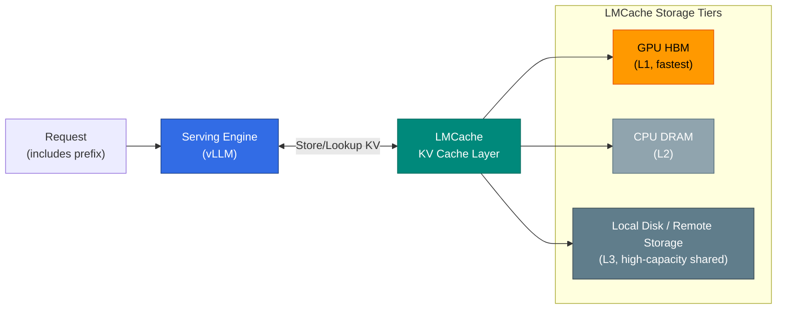

## Overview

**LMCache** is a KV cache tier that offloads the LLM inference KV cache (Key-Value Cache) beyond GPU memory to CPU DRAM, local disk, or remote storage, and makes it reusable across multiple inference instances. Integrated with serving engines such as vLLM, it shares KV cache — previously confined to a single Pod's GPU memory — across a broader scope.

This document explains what LMCache is and where it fits in the inference infrastructure. For the fundamentals of KV cache itself (PagedAttention, Prefix Caching), see [KV Cache Optimization](./kv-cache-optimization.md), and for the strategy that raises the cache hit rate, see [Cache-Hit Strategy](./cache-hit-strategy.md).

## Background: Why Offload KV Cache

vLLM's in-GPU Prefix Caching reuses prefill computation for requests that share the same prefix. However, this cache has two limitations.

- **Capacity constraint**: KV cache occupies GPU memory (HBM), so when contexts are long or concurrent requests are many, the cache is evicted and recomputation occurs.
- **Scope constraint**: The in-GPU cache is **valid only within a single serving-engine instance and the distributed workers that belong to it**. Here a serving-engine instance means one `vllm serve` launch unit; even when it spans multiple Pods or nodes via tensor parallelism or pipeline parallelism, that single instance shares its KV cache ([vLLM Parallelism and Scaling](https://docs.vllm.ai/en/latest/serving/parallelism_scaling.html)). Independently deployed replicas, by contrast, do not automatically share the in-GPU cache: a request routed to a different replica cannot reuse it even for the same prefix.

LMCache mitigates both limitations by moving the KV cache to a layer outside the GPU. KV blocks evicted from the GPU are not discarded but stored in CPU or disk and brought back, and sharing external storage lets **independently deployed serving-engine instances reuse the same KV cache**.

## Position of LMCache

LMCache sits between the serving engine and the routing layer, handling KV cache storage and lookup. Its position in the overall inference infrastructure corresponds to L5 (cache layer) in the layered tuning model of the [Inference Infrastructure Overview](../index.md).



The diagram above is a **conceptual model** of how KV cache is placed across tiers of differing access speed and capacity. The flow in which a block evicted from the fastest GPU HBM moves to CPU DRAM, then down to disk or remote storage, and is pulled back upward in reverse order on reuse is one example; which tier actually holds a block, and when, depends on the chosen storage and prefetch policy. For instance, MP mode's `--l2-store-policy default` stores a block to L2 while keeping it in L1, and `--l2-prefetch-policy retain` keeps prefetched blocks permanently in L1, so the automatic demotion of "move down only after eviction" is not guaranteed for every engine and block (see [MP Configuration Reference](https://docs.lmcache.ai/mp/configuration.html) for per-policy behavior).

## vLLM Integration Setup

LMCache has two execution modes, and **the currently recommended one is MP (multiprocess) mode**. LMCache runs as a standalone service that the vLLM engine connects to over ZMQ, which enables process isolation, cache sharing across Pods, and scaling cache memory independently of the GPU. The older in-process mode is classified as legacy. The flags and config keys below were checked against the official docs as of 2026-08; because LMCache does not pin a minimum version for MP mode and recommends the latest dev branch, re-check at adoption time.

First, start the LMCache server.

```bash
lmcache server \
  --l1-size-gb 100 \
  --eviction-policy LRU \
  --port 5555 \
  --http-port 8080
```

The vLLM engine connects over the ZMQ port (default 5555). The HTTP port (`--http-port`, default 8080) is a management/health-check FastAPI frontend, and Prometheus metrics are exposed at `/metrics` on a separate `--prometheus-port` (default 9090).

On the vLLM side, specify the connector and connection info.

```bash
vllm serve Qwen/Qwen3-8B \
  --port 8000 \
  --kv-transfer-config '{"kv_connector":"LMCacheMPConnector","kv_connector_module_path":"lmcache.integration.vllm.lmcache_mp_connector","kv_role":"kv_both","kv_connector_extra_config":{"lmcache.mp.host":"localhost","lmcache.mp.port":5555}}'
```

Passing a server list (or a comma-separated string) such as `"tcp://host1:6667,tcp://host2:6667"` to `lmcache.mp.server_urls` lets a single vLLM deployment target multiple LMCache servers. As of LMCache v0.5.5, this multi-server mode has the following constraints (see [MP Configuration Reference](https://docs.lmcache.ai/mp/configuration.html)).

- When set, `server_urls` takes precedence over the single-server `host`/`port` keys.
- vLLM's world size must be divisible by the number of servers; global ranks are sliced into contiguous blocks, one block per server, and each worker connects only to its locally-assigned server. So it cannot simply be appended to the single-worker example above that sets no TP — for example, with two servers you must set `--tensor-parallel-size` to a multiple of 2.
- Multi-server mode currently supports tensor parallelism only; pipeline parallelism (`pp_size > 1`) and data parallelism (`dp_size > 1`) are rejected with a clear error.

:::warning Connector resolution varies by vLLM version

The example above targets vLLM 0.20.0 or later. `kv_connector_module_path` is a top-level field alongside `kv_connector`, not nested inside `kv_connector_extra_config`. Specifying `"kv_connector_module_path":"lmcache.integration.vllm.lmcache_mp_connector"` selects the implementation shipped by LMCache. If omitted, the version vendored into vLLM is selected, whereas the LMCache distribution reflects the latest server protocol and fixes first.

Below vLLM 0.20.0, `LMCacheMPConnector` always resolves to vLLM's bundled connector, with no way to redirect to the LMCache distribution.

:::

The main server flags are as follows.

| Flag | Default | Role |
|------|---------|------|
| `--l1-size-gb` | (required) | L1 cache pool size (GB) |
| `--eviction-policy` | (required) | `LRU` / `IsolatedLRU` / `noop` |
| `--chunk-size` | 256 | Tokens per KV chunk |
| `--hash-algorithm` | `blake3` | `builtin` / `sha256_cbor` / `blake3` |
| `--eviction-trigger-watermark` | 0.8 | Memory usage ratio at which eviction starts |
| `--max-workers` | 1 | Worker count (set per-pool with `--max-gpu-workers` / `--max-cpu-workers`) |

:::tip When you need hash reproducibility

Only when using `--hash-algorithm builtin` must you unify `PYTHONHASHSEED` to a fixed value for cross-process hash reproducibility. This does not apply to the default `blake3`.

:::

## Choosing a Storage Backend

In MP mode, L1 is the cache pool held by the LMCache server, and the L2 tier below it is attached by passing JSON to `--l2-adapter`. Multiple adapters can be specified to form a cascade.

```bash
lmcache server --l1-size-gb 100 --eviction-policy LRU \
  --l2-adapter '{"type": "nixl_store", "backend": "POSIX", "backend_params": {"file_path": "/data/ssd/l2"}, "pool_size": 64}'
```

The main adapter `type` values are as follows.

| Category | `type` values |
|----------|---------------|
| Local filesystem / block | `fs`, `fs_native`, `nixl_store`, `nixl_store_dynamic`, `raw_block`, `dax` |
| Distributed KV store | `mooncake_store`, `aerospike` |
| Redis family | `resp`, `valkey` |
| Object / managed storage | `s3`, `bigtable`, `hfbucket`, `sagemaker-hyperpod` |
| Extension / test | `plugin`, `native_plugin`, `mock`, `fault_inject` |

The backend-selection criterion is not only performance but **sharing scope**. A node-local filesystem shares cache only with Pods on the same node, so to reuse cache after scale-out you need a cluster-scoped backend such as `mooncake_store`, `resp`, or `s3`. The store policy is controlled by `--l2-store-policy` (`default` | `skip_l1`) and prefetch by `--l2-prefetch-policy` (`default` | `retain`); for the required parameters per backend, see the [MP Configuration Reference](https://docs.lmcache.ai/mp/configuration.html).

:::info Note on tier naming

The L1/L2 in LMCache MP mode are **internal tier names within the LMCache server**, a different axis from the L1 (GPU HBM) / L2 (CPU DRAM) / L3 labeled in the diagram above. The GPU HBM in the diagram is a region managed directly by vLLM.

:::

## Kubernetes Deployment Shape

The official deployment guide recommends a **DaemonSet + Deployment pattern**, not a sidecar. One LMCache server per node (DaemonSet) is shared by multiple vLLM Pods (Deployment) on the same node.

| Item | Detail |
|------|--------|
| `hostNetwork: true` | Used by the official DaemonSet pattern **for service discovery**. vLLM Pods find the server via `status.hostIP`, not Service DNS. It is independent of the IPC transfer mechanism, so removing the `/dev/shm` requirement below does not by itself remove the `hostNetwork` requirement |
| `/dev/shm` host mount | The official example mounts it on both containers for CUDA IPC memory sharing in the default (legacy) mode. **Removable by enabling isolated IPC on both sides** (see transfer paths below) |
| GPU resources | The DaemonSet does not request GPUs. But because the container runtime provides GPU access for IPC transfers, it must be scheduled only on GPU nodes; on nodes without a GPU it crashes with a CUDA initialization error |

### Requirements by Transfer Path

`--supported-transfer-mode` determines which transfer paths the server loads.

| Mode | Path | Use |
|------|------|-----|
| `auto` | loads both | any device-type worker can connect |
| `lmcache_driven` (default) | server-driven — CUDA devices use IPC, CPU devices use SHM | GPU-direct transfer |
| `engine_driven` | engine (worker) driven | CPU-only / non-CUDA accelerator workers |

`--supported-transfer-mode` determines only **which transfer paths the server loads**; which path a worker (vLLM client) actually uses is decided by the client setting `lmcache.mp.mp_transfer_mode` (default `auto` — CUDA devices → `lmcache_driven`, others → `engine_driven`). So changing only the server to `engine_driven` leaves a CUDA vLLM client still attempting the default server-driven path; the two settings must be matched.

`--shm-name` controls the SHM pool behavior when the non-GPU path is loaded (`auto` / `engine_driven`); an empty string (the default) uses the pickle-based transfer path instead of SHM.

:::warning Check admission policy before deploying

`hostNetwork: true` and the `/dev/shm` hostPath mount are items prohibited by the baseline and restricted profiles of Pod Security Standards, and are also blocked on clusters that impose equivalent constraints via Kyverno or Validating Admission Policy. In other words, **the required privileges can decide adoption feasibility independently of performance**. The two items are distinct requirements and must be handled separately.

- **Removing the `/dev/shm` (= `hostIPC`) dependency**: the method the official docs specify is **isolated IPC**. Setting `--isolated-ipc` on the server and `lmcache.mp.isolated_ipc: true` on the client — on **both** sides — switches KV registration to raw CUDA IPC handles and event ordering to timeline-semaphore events, so it works without a shared `/dev/shm`. Enabling only one side fails immediately on an event-handle mismatch. As of LMCache v0.5.5, isolated IPC is supported by the vLLM MP connector only and is incompatible with VMM allocations (`expandable_segments` / sleep mode) ([MP Deployment Guide](https://docs.lmcache.ai/mp/deployment.html)).
- **Removing `hostNetwork`**: isolated IPC removes only the `/dev/shm` / `hostIPC` requirement; `hostNetwork` is the discovery choice by which a vLLM Pod finds the server via `status.hostIP`, so it must be replaced separately with another discovery mechanism such as Service DNS.
- `engine_driven` + pickle transfer is another path that avoids the `/dev/shm` dependency because it does not use GPU-direct IPC at all, but it too requires matching the server's `--supported-transfer-mode` with the client's `lmcache.mp.mp_transfer_mode`, gives up the GPU-direct transfer advantage of the server-driven path, and its performance difference must be measured directly for your workload.

For the per-profile constraints, see the workload-security section of [Security & Governance](../../../eks-best-practices/security-authn/index.md).

:::

## Relationship with Adjacent Technologies

LMCache does not operate in isolation; it is used together with other inference optimization technologies.

| Technology | Relationship | Notes |
|------|------|------|
| **vLLM Prefix Cache** | LMCache extends it beyond the GPU | LMCache catches and preserves blocks evicted from the in-GPU cache |
| **NIXL** | KV transfer path | Used to move KV from prefill to decode in Disaggregated Serving (see [Disaggregated Serving](./disaggregated-serving.md#nixl-common-kv-cache-transfer-engine)) |
| **kvaware Routing** | Leverages LMCache's shared cache | Raises hit rate when the router is integrated to know where the cache resides |

In particular, **kvaware/prefixaware routing** can benefit from a shared KV layer like LMCache, but that benefit does not arise automatically from the mere presence of shared storage. The router must know which engine holds which KV blocks, so you must separately configure a **cache-visibility integration** such as the router's prefix index or a KV-events feed ([llm-d prefix scorer](https://github.com/llm-d/llm-d-router)). Hits then fall into three kinds — an engine-local hit (no re-transfer), a remote retrieve (pulled from LMCache's external store, incurring transfer cost), and endpoint load — so raising the prefix hit rate alone does not necessarily lower end-to-end latency; the net benefit of the routing strategy must be measured on your workload. This routing strategy is covered in [KV Cache-Aware Routing](./kv-cache-optimization.md#kv-cache-aware-routing), and the router options (EPP · HyperPod · Dynamo) and intelligent model routing are covered in [Routing Strategy — L2 options compared](../inference-routing/routing-strategy.md#l2-options-compared-epp-vs-hyperpod-inference-operator-vs-dynamo).

In AWS managed environments, the SageMaker HyperPod Inference Operator provides KV cache configuration compatible with LMCache. For details, see [HyperPod Inference Operator — KV Cache Configuration](../inference-frameworks/hyperpod-inference-operator.md#kv-cache-configuration-l1l2-cache-and-routing-strategies).

## Adoption Considerations

- **CPU offload trade-off**: GPU↔CPU KV transfer uses PCIe bandwidth, so for short contexts where transfer is slower than recomputation, the gain is small. The effect is large for long contexts and high prefix-sharing ratios.
- **Shared storage consistency**: When multiple Pods share external storage, KV block integrity and model/version consistency must be guaranteed.
- **Version compatibility**: LMCache is tightly coupled with the serving engine, so verify compatible versions with vLLM and the Inference Operator before adoption.

## References

### Official Documentation
- [LMCache GitHub](https://github.com/LMCache/LMCache) — LMCache open-source project repository
- [LMCache Compatibility](https://docs.lmcache.ai/getting_started/compatibility.html) — Per-vLLM-version connector loading and configuration location
- [LMCache MP Mode](https://docs.lmcache.ai/mp/index.html) — Overview of the recommended execution mode
- [MP Configuration Reference](https://docs.lmcache.ai/mp/configuration.html) — Full reference for server flags and L2 adapters
- [MP Deployment Guide](https://docs.lmcache.ai/mp/deployment.html) — K8s DaemonSet deployment pattern
- [vLLM Documentation](https://docs.vllm.ai/) — vLLM serving engine and KV cache management

### Papers / Tech Blogs
- [CacheBlend (EuroSys 2025)](https://arxiv.org/abs/2405.16444) — Research on reusing non-prefix KV cache
- [PagedAttention (SOSP 2023)](https://arxiv.org/abs/2309.06180) — Foundational paper on vLLM KV cache management

### Related Documents (Internal)
- [KV Cache Optimization](./kv-cache-optimization.md) — PagedAttention · Prefix Caching · KV Cache-Aware Routing
- [Cache-Hit Strategy](./cache-hit-strategy.md) — Unified strategy across the KV/Prompt/Semantic 3-layer cache
- [Semantic Caching Strategy](./semantic-caching-strategy.md) — Gateway-level semantic caching design principles
- [Disaggregated Serving](./disaggregated-serving.md) — NIXL-based KV transfer and Prefill/Decode disaggregation
