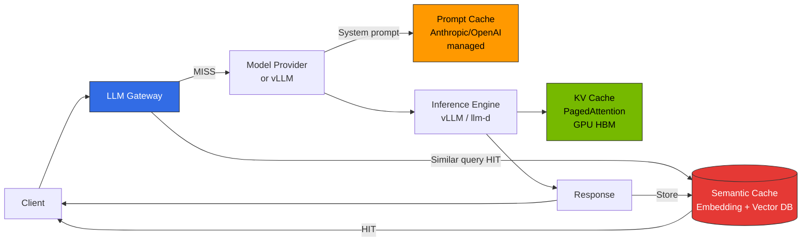
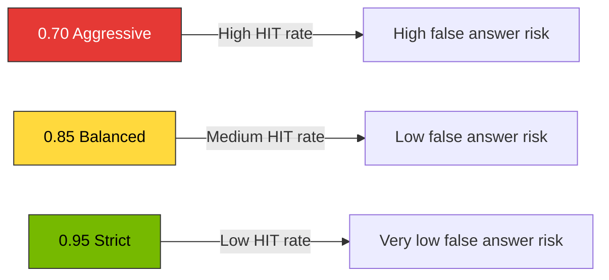

This document covers design principles and operational considerations for **gateway-level semantic caching** in LLM inference pipelines.

**Implementation Guide**: For tool comparison tables, gateway integration patterns, configuration examples, and deployment snippets, refer to [Inference Gateway Setup Guide — Semantic Caching Implementation Options](../../reference-architecture/inference-gateway/setup/advanced-features).

## 1. Overview

### Why Semantic Cache is Needed

In large-scale LLM services, user queries are often **semantically identical but differently expressed**. Traditional caches (HTTP cache, Redis key-value) that match exact strings cannot eliminate such duplicates. A semantic cache detects semantically similar requests using **embedding-based similarity** and reuses previous responses, simultaneously improving three issues:

- **Token Cost Reduction**: Skip LLM calls on cache HITs, saving API costs and GPU time
- **Latency Reduction**: On a HIT, the cache path replaces full generation (hundreds of ms to seconds) with embedding the query plus a vector-similarity lookup. The lookup itself is typically a few ms, but the end-to-end HIT latency also includes embedding computation (local model or embedding-API call), so measure it for your embedding model rather than assuming lookup time alone.
- **GPU Capacity Expansion**: On self-hosted vLLM/llm-d, avoided generations free GPU time for other requests; the realized throughput gain depends on your HIT rate and traffic mix.

### Expected Savings by Threshold

Savings depend on **user query repetitiveness**, **domain** (FAQ/customer support/code generation), and **prompt structure**. The figures below are **illustrative planning ranges, not measurements from a specific published benchmark** — the public implementations and vendor blogs that discuss semantic caching report different numbers under different models, datasets, and cost accounting, so they cannot be combined into one authoritative band. Treat these as starting hypotheses and establish your own numbers through **progressive rollout** and A/B evaluation before relying on them.

**Table 1. Operation policy and illustrative savings range by similarity threshold**

| Similarity Threshold | Operation Policy | Illustrative Savings Range | Characteristics |
|---------------------|------------------|------------------------|----------------|
| **0.95 (Strict)** | Cache only nearly identical queries | lower | Very low false positive risk, strict quality requirements |
| **0.85 (Balanced)** | Allow same meaning with different expressions | moderate | Recommended default for general LLM chat/assistants |
| **0.70 (Aggressive)** | Group related topics together | higher, but with higher false-positive risk | Only for FAQ/static KB with very high repetition |

Here "savings" means the share of requests served from cache (and the token/API cost they would have incurred); the absolute percentage is workload-specific. Reference material on semantic-cache mechanics: [Redis — Semantic caching (RedisVL)](https://redis.io/docs/latest/develop/ai/redisvl/user_guide/how_to_guides/llmcache/), [Portkey Semantic Cache docs](https://docs.portkey.ai/docs/product/ai-gateway/cache-simple-and-semantic), [Helicone Caching docs](https://docs.helicone.ai/features/advanced-usage/caching), [GPTCache README](https://github.com/zilliztech/GPTCache). These sources document how the caches work; they do not jointly establish the ranges above.

:::warning Always Validate Savings Numbers
The above figures are **rough ranges** based on public materials. Not all domains achieve the same HIT rate. Measure **actual HIT rate and false-positive rate for your workload** with dashboards (§6) before finalizing thresholds.
:::

---

## 2. Cache Layer Distinctions

LLM inference pipelines have **3 different cache layers**. Each operates at different positions, stores different units, and has different cost impacts. A semantic cache **complements rather than replaces** the other two layers.

### 3-Layer Cache Flow

**Figure 1. Request flow across the Gateway and the Semantic/Prompt/KV three-layer cache**

### Layer-by-Layer Comparison

**Table 2. KV, Prompt, and Semantic cache compared by operation location, storage unit, and cost impact**

| Aspect | KV Cache (vLLM PagedAttention) | Prompt Cache (Anthropic/OpenAI managed) | Semantic Cache (Gateway level) |
|--------|--------------------------------|----------------------------------------|-------------------------------|
| **Operation Location** | Inside inference engine (GPU HBM) | Model provider side | Gateway (Bifrost/LiteLLM/Portkey) front |
| **Storage Unit** | Token-level KV blocks | Anthropic: sections marked with `cache_control` / OpenAI: automatic prefix caching (no marker) | Entire response object (text/JSON) |
| **Matching Method** | **Prefix exact match** | **Prefix exact match** (provider-internal; reuse requires the rendered prefix to match) | **Embedding cosine similarity** |
| **Primary Purpose** | TTFT & throughput improvement | Repeated system prompt cost reduction | **Eliminate duplicate LLM calls entirely** |
| **Cost Impact** | GPU time savings (self-hosted) | Input token price discount (managed) | Skip API calls entirely |
| **Failure Impact** | Performance degradation only | Cache not applied → regular pricing | **Direct response quality impact** (false answer risk) |
| **Related Docs** | [vLLM Model Serving](../../model-serving/inference-frameworks/vllm-model-serving.md) | Provider official docs | This document |

:::tip The Three Layers Address Different Reuse and Can Be Combined
The three layers reuse different things: a semantic cache reuses a whole prior **response** across similar queries; provider prompt caching and vLLM prefix caching reuse computation over a shared **prefix** of a single request. Because they act on different units, they can be enabled together — on a MISS, the provider/engine call can still benefit from prefix reuse. They are not strictly independent, though: a semantic-cache HIT skips the downstream call entirely (so prompt/KV reuse never runs for that request), and provider prompt caching and self-hosted prefix caching are **alternative implementations of prefix reuse** for the same request, not two stages you stack. Enable the layers your deployment actually has (a managed provider gives you prompt caching; self-hosted vLLM/llm-d gives you prefix caching), not all three by default.
:::

### Application Timing Comparison

Prefix reuse exists in two forms — **provider-managed** (OpenAI/Anthropic prompt caching, available only when you call that provider) and **self-hosted** (vLLM/llm-d automatic prefix caching, available only when you run the engine). You get whichever matches your serving path; you do not configure both for the same request.

- **Prototype/single model**: Prefix reuse (provider prompt caching if you call a managed provider, or vLLM/llm-d prefix caching if self-hosted) usually covers early needs. Add a semantic cache only once you observe repeated, semantically similar queries that a response cache could absorb.
- **Multi-tenant/multi-provider**: A gateway-level semantic cache absorbs identical queries repeated across users — but only add it after measuring that such repetition exists in your traffic, and design keys/namespaces (§5) before enabling it.
- **FAQ/chatbot/fixed KB**: A lower semantic-cache threshold (0.80-0.85) enables more aggressive reuse; validate false-positive rates (§3, §6) before lowering.
- **Code generation/IDE agents**: Apply a semantic cache **conservatively** (0.95) or disable it — similar queries often carry different file contexts, so reusing a response risks a wrong answer.

---

## 3. Similarity Threshold Design

### Threshold Trade-offs

**Figure 2. Trade-off between HIT rate and false-answer risk by similarity threshold**

### Threshold Selection Criteria

**Table 3. Suitable and unsuitable workloads by similarity threshold**

| Threshold | Suitable Workloads | Unsuitable Workloads | Notes |
|-----------|-------------------|---------------------|-------|
| **0.95 and above** | Code generation, legal/medical assistants, financial advisory | (Broadly applicable) | Only HITs on identical queries with minimal expression differences |
| **0.85-0.94 (Recommended)** | General chatbots, customer support, document summarization, product Q&A | Code generation (context-sensitive) | Same meaning with different expressions allowed. Default for most services |
| **0.75-0.84** | FAQ, static KB, internal document search explanations | Conversational reasoning, multi-turn | Increased false positives — response validation layer needed |
| **0.70 and below** | Rarely used — limited to high-volume FAQ | All general services | Risk of grouping unrelated queries |

### Considerations When Setting Thresholds

A similarity score measures embedding proximity, **not answer correctness**: two queries can be close in embedding space yet require different answers (opposite polarity via negation, different quantities, different entities, or different freshness/time context). No fixed score and no embedding-model ranking makes a threshold "safe" on its own — validate it with a labeled evaluation set for your model and domain that deliberately includes negation, numeric differences, entity identity, and time-sensitive cases.

1. **User Error Tolerance**: Where an approximate "closest answer" is acceptable (some customer-support flows), a lower threshold may be tolerable; code and calculations need high thresholds. This is a product decision, not a safety guarantee.
2. **Domain Vocabulary**: Domains with many synonyms (medical/legal) may *appear* to group meanings well, but these domains also carry the highest cost of a wrong reuse. Do not lower the threshold on the assumption that synonym richness makes grouping safe; confirm it against labeled false matches.
3. **Embedding Model Quality**: A stronger embedding (e.g., `text-embedding-3-large`, `bge-m3`) can improve retrieval quality, but it does **not** by itself make a lower threshold safe — these are retrieval models, not correctness oracles, and their documentation makes no cache-safety claim. Re-measure the false-positive rate whenever you change the embedding model.
4. **Similarity vs. Distance**: Confirm whether your cache library compares a **similarity** (higher = closer, e.g., cosine similarity) or a **distance** (lower = closer, e.g., cosine distance in RedisVL). A threshold is meaningless until you know which convention applies, because the comparison direction reverses.
5. **Conversation Context**: Multi-turn conversations must include previous turns in cache keys (§5).
6. **Language/Locale**: Multilingual services should separate namespaces by language to prevent cross-contamination.

:::warning Thresholds are Not Fixed Values but Tuning Targets Based on Observation
Start conservatively (for example 0.90, interpreted in your library's similarity/distance convention), then adjust in small increments **only when a labeled evaluation shows the change does not increase false matches**. Monitor **HIT rate and user dissatisfaction metrics (👎, regenerate clicks)** on Langfuse/Grafana dashboards as leading indicators, not as a substitute for labeled evaluation.
:::

---

## 4. Implementation Considerations

When implementing a semantic cache, select solutions considering these factors.

### Key Considerations

1. **Existing Infrastructure Reusability**: Can implement without additional backends if Redis/Milvus vector DB already exists
2. **Gateway Integration Needs**: Whether to integrate routing, guardrails, and cache in unified management or separate layers
3. **Managed vs Self-hosted**: Operational burden, compliance, cost trade-offs
4. **Observability Requirements**: Cache HIT/MISS tracking, false-positive monitoring level
5. **Vector Search Engine Preference**: Organization's standard stack among Redis/Milvus/FAISS/Qdrant

### Implementation Patterns

**Pattern A: Gateway All-in-one** — Routing, cache, and observability in a single product (e.g., Portkey)
- Pros: Integrated configuration, rapid deployment
- Cons: Vendor lock-in, advanced features depend on managed plans
- Note on caching type: confirm whether the product's cache is **semantic** (embedding-similarity) or **exact-match response** caching before relying on it to deduplicate paraphrased queries. Portkey documents a semantic cache. Helicone's documented caching is **exact-match response caching** (it hashes the request body and stores complete responses on an edge KV store), not semantic caching; use Helicone for exact-request reuse and observability, and pair it with a semantic layer if you need similarity matching.

**Pattern B: Modular** — Gateway (Bifrost/LiteLLM) + independent cache layer (RedisVL, GPTCache)
- Pros: Independent layer replacement possible, open source first
- Cons: Increased integration complexity

**Pattern C: Managed** — Redis Enterprise LangCache, Portkey SaaS
- Pros: Minimal operational burden; the vendor operates the service
- Cons: Cost, region constraints; **verify each vendor's specific compliance certifications against your own regulatory requirements** rather than assuming a generic "certified" status — the applicable certifications (e.g., SOC 2, ISO 27001, HIPAA eligibility) differ by product, plan, and region.

For specific tool comparison tables, configuration examples, and deployment snippets, refer to [Inference Gateway Setup Guide — Semantic Caching Implementation Options](../../reference-architecture/inference-gateway/setup/advanced-features).

---

## 5. Cache Key Design and Multi-tenancy

Since a semantic cache sits **at the gateway front** and skips LLM calls entirely, cache key design and namespace separation directly impact response quality, security, and multi-tenancy.

### Cache Key Components

The simplest key is just `embedding(user_query)`, but in real services, the following elements **must** be included in the key:

**Required Components:**
- `model_id`: Prevent cross-contamination between model types/versions (e.g., `glm-5` ≠ `qwen3-4b`)
- `system_prompt_hash`: Different system prompts produce completely different answers
- `tenant_id | user_id`: Multi-tenant/per-user isolation
- `language | locale`: Prevent language cross-contamination
- `tool_set_hash`: Agent's available tool set
- `embedding(user_query)`: Semantic similarity matching target

Also bind any request or authorization state that changes the answer, or a cached response may be reused when it should not be:
- **Decoding parameters** that affect output (e.g., `temperature`, `top_p`, `max_tokens`, `seed`) — reuse across different decoding settings can return an answer the caller did not ask for
- **Response format / structured-output schema** (e.g., OpenAI `text.format`, `response_format`) — a JSON-schema request must not reuse a free-text answer
- **Retrieved context / data version** for RAG or tool-grounded answers — a response grounded on stale documents must expire when the underlying data changes
- **Authorization scope** — the retrieving user's permissions, so a cached answer is only served to callers allowed to see it (see §8)

### Multi-tenant Namespace Strategy

**Table 4. Namespace pattern and purpose by multi-tenant isolation layer**

| Layer | Namespace Pattern Example | Isolation Purpose |
|-------|--------------------------|-------------------|
| **Organization / Tenant** | `cache:{tenantId}:*` | Data isolation, audit boundaries |
| **User** | `cache:{tenantId}:{userId}:*` | Prevent cross-user leakage of PII-containing queries |
| **Language** | `cache:{tenantId}:ko:*` / `:en:*` | Prevent cross-contamination in multilingual services |
| **Domain** | `cache:{tenantId}:support:*` / `:billing:*` | Block reuse between domains with different contexts |
| **Model Version** | `cache:{...}:glm-5:v2026-03:*` | Enable bulk invalidation on model upgrades |

### Non-determinism Handling

Two different concerns are often conflated here. **Sampling variability**: with `temperature > 0` or `top_p < 1`, the model *may* return a different response on each call, so reusing one sampled answer can surprise users who expected variety. **Non-reproducible execution**: tool calls, retrieval, or any step that reads changing external state can make the "same" request produce a different, freshness-dependent answer. Both reduce how safely a response can be reused, but for different reasons — the first is about expected variety, the second is about correctness against current data.

**Recommended Policy:**
- **Default cache disabled** for streaming and agent-type (tool-using) requests until you have evaluated reuse for them
- Treat endpoints such as `/summarize` or `/classify` as **candidates** that are *more likely* to be reproducible — not guaranteed. An endpoint name does not establish reproducibility; verify that its output does not depend on changing data or sampling before caching it
- Prefer caching requests pinned to deterministic settings (e.g., `temperature=0`, and a fixed `seed` where the provider supports one), and still bind the decoding parameters into the key (above) so a later non-deterministic request does not reuse the deterministic entry

For specific gateway integration patterns (kgateway, LiteLLM, Bifrost), configuration examples, and code snippets, refer to [Inference Gateway Setup Guide — Semantic Caching Implementation Options](../../reference-architecture/inference-gateway/setup/advanced-features).

---

## 6. Observability (Langfuse Integration)

A semantic cache returns a previous answer directly to the user. Monitor whether those reused answers are appropriate, as well as how often the cache is used. Collect the following data with Langfuse or an equivalent observability stack:

### Langfuse Trace Tags

Attach these attributes to each request trace. In Langfuse, **tags** are strings only (max 200 characters each) used to categorize and filter; typed or numeric values such as `similarity_score` belong in **metadata** (structured) or in a numeric score/observation, not in tags. Use tags for low-cardinality labels (e.g., `cache_hit`, `cache_source`) and metadata for the typed fields:

- `cache_hit`: `true` / `false` (tag or boolean metadata)
- `similarity_score`: e.g. `0.92` (numeric metadata — on HIT, highest matched similarity; interpret per your similarity/distance convention, §3)
- `cache_source`: `redis-semantic` / `portkey` / `helicone`, etc. (tag)
- `cache_namespace`: `{tenant}:{lang}:{domain}` (metadata; no PII)
- `cache_ttl_remaining_s`: Remaining TTL in seconds (numeric metadata, for debugging)
- `cache_eviction_reason`: MISS cause (`below_threshold`, `namespace_miss`, `ttl_expired`) (tag or metadata)

### Recommended Dashboard Panels

Visualize the following with Langfuse custom dashboards or Prometheus + Grafana. The expressions below are **conceptual definitions, not executable PromQL or Langfuse queries** — translate them to the metric names and query language of the backend you use.

**Table 5. Recommended dashboard panels for cache observability with target values**

| Panel | Concept (not literal query) | Target Value |
|-------|--------------|--------------|
| **Overall HIT Rate** | HITs ÷ total cache lookups | 15-40% (workload-specific; not a target to force) |
| **HIT Rate by Namespace** | HIT rate grouped by `cache_namespace` | Monitor tenant variance |
| **similarity_score Distribution** | histogram of `similarity_score` on HIT | Watch for excessive bins near threshold |
| **False-positive Proxy** | rate of 👎 feedback / regenerate clicks among `cache_hit=true` responses | No increase vs baseline |
| **Total Saved Tokens** | sum of `tokens_saved` on HIT | Cost reporting |
| **Cache Store Size** | count of cache entries in the cache's index/namespace (e.g., `FT.INFO` on a RedisVL index, or a `SCAN`-based count of the namespace), plus Redis memory usage | Check TTL & eviction policy |

Define `tokens_saved` explicitly before reporting it: it is an **estimate**, typically the input+output token count the avoided generation would have produced for that request (e.g., the token usage of the stored response, or the request's prompt tokens plus the stored completion tokens). State which convention you use so the cost figure is reproducible. Note that Redis `DBSIZE` returns the number of keys in the **entire database** (an O(1) whole-DB count), not the size of a single cache namespace — use an index count (`FT.INFO`) or a namespace-scoped scan when you want per-namespace size.

### Alert Rules

The thresholds below are **proposed starting values, not validated limits**. Before alerting on them, establish a per-workload baseline and confirm each rule against your traffic mix, request rate, and the sample size (denominator) behind the metric — a hit-rate comparison is unstable when the window has few lookups. In particular, a high absolute hit rate (e.g., 70%) is **not by itself** abnormal: it is expected for highly repetitive FAQ traffic. Treat these as triggers to **investigate**, correlated with the false-positive proxy and labeled quality outcomes, not as direct evidence of a root cause.

**Table 6. Cache quality and performance alert rules (starting values) with items to investigate**

| Alert | Condition (starting point) | Severity | Investigate |
|-------|-----------|----------|----------|
| HIT Rate Plunge | HIT rate &lt; 50% of previous 24h average (same workload, sufficient sample) | Warning | Possible embedding/Redis failure — verify before concluding |
| HIT Rate Increase with Quality Drop | HIT rate rises **and** false-positive proxy rises together | Critical | Suspected threshold misconfiguration; a rate rise alone is not enough |
| similarity_score Concentration | HIT ratio within threshold ±0.02 &gt; 40% | Warning | Excessive borderline matching |
| Redis Latency | P99 &gt; 20ms (tune to your SLO) | Warning | Cache becoming a bottleneck |

### Langfuse OTel Integration Reference

For Bifrost/LiteLLM OTel transmission configuration, follow existing [LLMOps Observability](../../operations-mlops/observability/llmops-observability) and [Inference Gateway Setup Guide](../../reference-architecture/inference-gateway/setup) documents. Cache-related tags are added as span attributes at the application/gateway plugin layer.

---

## 7. Practical Checklist

### Security & Privacy

- Place Guardrails **before** the semantic cache to keep PII-bearing prompts out of the store — but note this guards the **input** only. Also authorize at **retrieval** (serve a cached answer only to callers allowed to see it, §8) and validate the **stored response**, because an input filter does not remove user-specific content that is already inside a cached answer.
- Prohibit cache storage on prompt injection detection
- Prevent cross-tenant leakage (enforce namespace design with unit tests)
- **Audit-log retention is set by your own regulatory/organizational policy** (what to log — HIT/MISS, namespace, similarity_score — and for how long). "90 days" is only an example starting point; confirm the period your compliance obligations actually require.

### Operations & Lifecycle

- **TTL (examples, tune per data volatility)**: static KB on the order of days-to-weeks; product info hours; news/time-series disabled. These are starting points, not fixed rules — set TTL from how fast each data source changes.
- **Model Version Replacement**: Include version in key (`glm-5:v2026-03`) → natural expiration
- **Embedding Model Replacement**: Namespace the index by embedding model/version. Entries embedded with the old model are **not comparable** to new-model query vectors, so route new traffic to a new namespace and retire the old one as its TTL elapses or after backfilling. A full, immediate rebuild is one option (simplest, highest cost); versioned namespaces with gradual migration avoid a hard cutover. State which you choose and when old entries are retired.
- **Failure Fallback**: Fail-open on Redis failure (secure original rate limit in advance)
- **Progressive Rollout**: Validate new policies with A/B testing

### Quality Guardrails

- Prohibit or use short TTL for large responses & tool call results
- Auto-evict entries on user 👎 feedback
- Weekly evaluation of cache HIT samples (Ragas/LLM-judge)

### Pre-deployment Checklist

- [ ] Cache key includes `model_id`, `system_prompt_hash`, `tenant_id`, `language`
- [ ] Guardrails positioned before cache
- [ ] Record `cache_hit`, `similarity_score` in Langfuse traces
- [ ] Configure HIT rate / false-positive dashboard
- [ ] Validate Redis failure fail-open scenario

---

## 8. Domain-specific Application Patterns

Even with the same semantic cache engine, **key composition, thresholds, and TTL** vary significantly by domain.

**Table 7. Domain-specific application patterns for threshold, TTL, and key composition**

| Domain | Threshold | TTL | Characteristics |
|--------|-----------|-----|----------------|
| **FAQ / Product Q&A** | 0.80-0.85 | 24-72h | Repetitive queries, fixed answers. Key: `tenant+language+product_version` |
| **Internal KB** | 0.85-0.90 | 1-7d | Prioritize isolation by permission. Key: `tenant+role_hash+language` |
| **Customer Support** | 0.85 | 6-24h | **Only cache answers that are not user-specific.** For personalized answers, include `user_id` (or an authorization scope) in the key and re-check permissions at retrieval. Key for public answers: `tenant+intent+language`; key for personalized answers: `tenant+user_id+intent+language`. Redacting PII from the *input* does not make the stored *response* safe to share. |
| **Code Generation/IDE** | 0.97+ or disabled | 30m-2h | High context dependency. Disable for refactoring/debugging |

**Considerations:**
- FAQ/Product Q&A: Natural invalidation via `product_version` key on product changes
- Internal KB: Flush user namespace on ACL changes, and apply access filters at retrieval
- Customer Support: Input redaction (names, order numbers) through Guardrails is **not sufficient** on its own — a response generated for one user can still contain that user's account state. Cache only explicitly public, context-independent answers under a shared key; key personalized answers by validated `user_id`/authorization scope and revalidate on ACL changes
- Code Generation: Different file/repo contexts require different answers for the same query

---

## 9. FAQ

**Q1. How do a semantic cache and RAG differ?**  
RAG retrieves context from vector DB to generate new responses; a semantic cache reuses existing complete responses. RAG augments input before LLM calls; a semantic cache avoids LLM calls entirely.

**Q2. Can streaming responses be cached?**  
Yes, but reassembly/replay complexity is high. Recommend starting with non-streaming endpoints.

**Q3. What are embedding model selection criteria?**  
Multilingual: `bge-m3`, `text-embedding-3-large`. English-only: `text-embedding-3-small`. Full cache invalidation required on model changes.

**Q4. Why is caching `temperature > 0` requests risky?**  
Users deliberately set high temperature for diverse answers; returning the same answer violates expectations. Disable cache by default for creative endpoints.

**Q5. What if cache HIT rate is low?**  
Diagnose before loosening the threshold. In order: (1) check for a **labeled false-match / quality** problem — if hits are already producing wrong answers, raising the HIT rate makes it worse; (2) check **eligibility and keys** — over-segmented namespaces or keys that include volatile fields prevent legitimate reuse; (3) evaluate **embedding model quality** on a labeled set. Only after those, consider lowering the similarity threshold in small steps, and only if a labeled evaluation shows false matches do not increase. A low HIT rate can be the *correct* outcome for low-repetition traffic; there is no universal "normal" value, so set a target from your own workload rather than a fixed percentage.

**Q6. What about compliance for cached responses?**  
Medical/financial/legal domains may require audit log recording even for cache HITs. Always log `cache_hit=true` and comply with regulatory retention periods.

---

## 10. References

### Official Documentation & Repositories

- [Redis — Semantic Caching (RedisVL)](https://redis.io/docs/latest/develop/ai/redisvl/user_guide/how_to_guides/llmcache/)
- [Redis LangCache (managed)](https://redis.io/langcache/)
- [Portkey — Semantic Cache](https://docs.portkey.ai/docs/product/ai-gateway/cache-simple-and-semantic)
- [Helicone — Caching](https://docs.helicone.ai/features/advanced-usage/caching)
- [LiteLLM — Caching](https://docs.litellm.ai/docs/proxy/caching)
- [Bifrost Official Docs](https://www.getmaxim.ai/bifrost/docs)
- [GPTCache (Zilliz)](https://github.com/zilliztech/GPTCache)

### Related Documents

- **Implementation Guide**: [Inference Gateway Setup Guide — Semantic Caching Implementation Options](../../reference-architecture/inference-gateway/setup/advanced-features) — Tool comparison tables, configuration examples, deployment snippets
- [Inference Gateway Routing Strategy](../../model-serving/inference-routing/routing-strategy)
- [OpenClaw AI Gateway Deployment](../../model-serving/inference-routing/openclaw-example.md)
- [LLMOps Observability](../../operations-mlops/observability/llmops-observability)
- [Milvus Vector Database](../../operations-mlops/data-infrastructure/milvus-vector-database)
- [Ragas Evaluation](../../operations-mlops/governance/ragas-evaluation)

### Research & Background

- [Anthropic — Prompt Caching](https://docs.anthropic.com/en/docs/build-with-claude/prompt-caching)
- [OpenAI — Prompt Caching](https://platform.openai.com/docs/guides/prompt-caching)
- [vLLM — PagedAttention (KV Cache)](https://docs.vllm.ai/en/latest/design/paged_attention.html)
