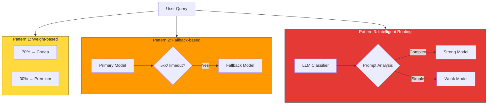
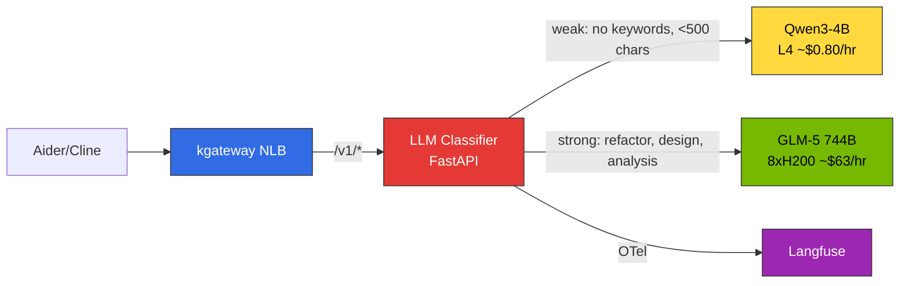
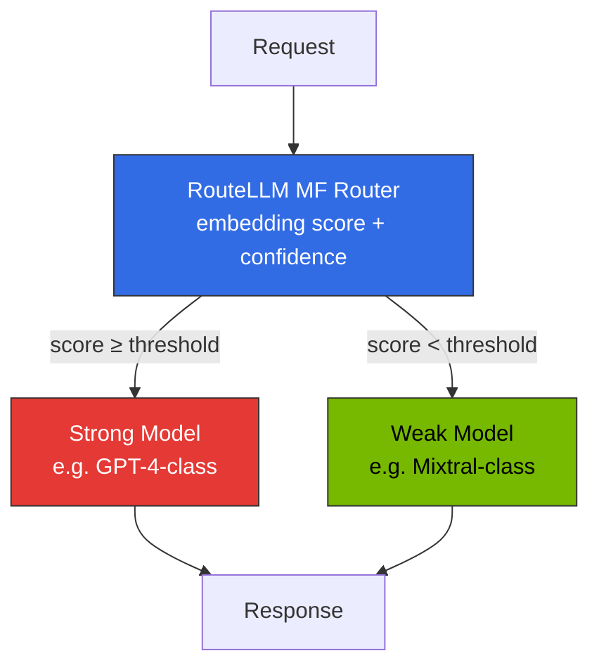

This document covers the implementation approaches (LLM Classifier, LiteLLM, vLLM Semantic Router) and selection criteria for **Request Cascading**, which analyzes request complexity and automatically distributes requests to the appropriate model. For the 2-Tier gateway architecture and overall routing strategy, see [Gateway Routing Strategy](./routing-strategy.md).

## Request Cascading: Intelligent Model Routing

### Concept

**Request Cascading** selects a model according to request complexity and predefined quality criteria. It can route simple requests to smaller models and requests requiring more complex reasoning to more capable models. Misclassification can lead to retries that increase cost or latency, so measure per-request quality and total processing cost together. IDEs use a single endpoint, and the platform manages the model-selection rules.

### Three Cascading Patterns

**Table 1. Description, implementation, and use case of the three cascading patterns**

| Pattern | Description | Implementation | Use Case |
|------|------|------|----------|
| **1. Weight-based** | Distribute traffic across backends by fixed ratio | kgateway `backendRef weight` | A/B testing, gradual model migration |
| **2. Fallback-based** | Retry on error against the next backend in a provider-defined priority/failover order | Provider-specific failover (e.g., LiteLLM `fallbacks`, Bifrost provider routing). Gateway API `backendRefs` weights + HTTPRoute retries do **not** by themselves define a cheap→frontier model order | Availability improvement, rate limit avoidance |
| **3. Intelligent routing** | Auto-select model after request analysis | **LLM Classifier** / LiteLLM / vLLM Semantic Router | Cost optimization, quality maintenance |

**Figure 1. Request flow of the three cascading patterns**



### Practical Request Cascading Implementation

Intelligent cascade routing analyzes request complexity and auto-routes to appropriate models. This section describes approaches we evaluated for self-hosted environments; the deployment choices and prices below are from our own non-published design evaluation, not an independently reproduced benchmark.

#### Approach A: LLM Classifier (Our Chosen Approach for Self-hosted vLLM) {#approach-a-llm-classifier-recommended--field-validated}

**LLM Classifier** is a Python FastAPI-based lightweight router that directly analyzes prompt content to auto-select SLM/LLM. It runs as a standalone HTTP service behind kgateway and proxies to backend vLLM instances; clients use only a single endpoint (`/v1`). Note that this is a plain OpenAI-compatible HTTP proxy — it is **not** an Envoy External Processing (ext_proc) processor. Envoy `ext_proc` is a bidirectional gRPC stream protocol (`ProcessingRequest`/`ProcessingResponse`), so integrating this classifier as an ext_proc filter would require implementing that gRPC interface rather than a REST endpoint.

**Figure 2. LLM Classifier-based request routing architecture**



**Table 2. LLM Classifier weak/strong classification criteria**

| Criteria | weak (SLM) | strong (LLM) |
|------|-----------|-------------|
| **Keywords** | None | Refactor, architecture, design, analysis, debug, optimization, migration, etc. (both English and Korean forms) |
| **Input length** | < 500 characters | ≥ 500 characters |
| **User turns** | ≤ 5 user messages | > 5 user messages |

**Core Classification Logic:**

The OpenAI chat `content` field is either a string or an array of content parts (`{"type": "text", "text": ...}`, image parts, etc.), so joining it directly would raise `TypeError` on array content; the helper below extracts text parts only. The threshold is a **character** count (not tokens), the inclusive boundary matches the table (`>= 500`), and a "turn" is counted as a `user`-role message (system/assistant/tool messages are excluded). Non-text modalities (images, audio) and tool messages are out of scope for this heuristic.

```python
STRONG_KEYWORDS = ["refactor", "architect", "design", "analyze",
                   "optimize", "debug", "migration", "complex",
                   "리팩터", "아키텍처", "설계", "분석", "최적화",
                   "디버그", "마이그레이션"]
CHAR_THRESHOLD = 500  # characters, not tokens

def _text(content) -> str:
    # content may be a string or a list of content parts
    if isinstance(content, str):
        return content
    if isinstance(content, list):
        return " ".join(
            part.get("text", "")
            for part in content
            if isinstance(part, dict) and part.get("type") == "text"
        )
    return ""

def classify(messages: list[dict]) -> str:
    text = " ".join(_text(m.get("content")) for m in messages)
    # Keyword matching
    if any(kw in text.lower() for kw in STRONG_KEYWORDS):
        return "strong"
    # Input length (characters)
    if len(text) >= CHAR_THRESHOLD:
        return "strong"
    # User turns
    user_turns = sum(1 for m in messages if m.get("role") == "user")
    if user_turns > 5:
        return "strong"
    return "weak"
```

**Pros**: No client modification needed, direct prompt analysis, direct Langfuse OTel transmission, simple deployment (single Pod)
**Cons**: Classification accuracy depends on heuristics (can be gradually improved with ML classifier)

:::tip Why LLM Classifier is Optimal
Standard OpenAI-compatible clients (Aider, Cline, etc.) only configure **a single `base_url`**. LLM Classifier analyzes prompts behind this single endpoint and proxies directly to backend vLLM instances. Clients are completely unaware of model selection.
:::

#### Bifrost Self-hosted Cascade Limitations

We attempted to use Bifrost for self-hosted vLLM cascade but switched to **LLM Classifier**. The limitations below are what we observed in our own setup against the pinned Bifrost docs (routing-rules.mdx at commit `a9937c9`); they are our deployment constraints, not a statement that Bifrost cannot serve multiple self-hosted backends (custom providers and aliases exist).

**Table 3. Bifrost cascade deployment constraints observed in our setup**

| Limitation (as observed in our setup) | Description |
|------|------|
| **provider/model format in requests** | Requests use `openai/glm-5` form. Standard OpenAI clients (Aider, etc.) send a single model name like `model: "auto"`, so a client-side alias or front proxy is needed to bridge the two |
| **Single base_url per provider entry** | A provider entry (e.g., `openai`) carries one `network_config.base_url`. Serving SLM and LLM from different Services under one provider name requires separate provider entries / custom providers rather than one entry |
| **Raw prompt text not directly matchable in rules** | CEL routing rules expose `model`, `provider`, `request_type`, `headers[...]`, `params[...]`, org/capacity variables, and a derived `complexity_tier` (`SIMPLE`/`MEDIUM`/`COMPLEX`), but not the raw request body; keyword/regex branching on raw prompt text needs a separate classifier |
| **Model name normalization (observed, unverified)** | In our setup we saw model-name mismatches with vLLM `served-model-name`; we could not pin this to a documented normalization rule, so treat it as an unverified local observation pending an exact failing request/version |

:::warning Bifrost is Best for External LLM Provider Integration
Bifrost is optimized for **external provider integration** (OpenAI/Anthropic/Bedrock) and **failover**. For intelligent cascade routing between self-hosted vLLM instances with raw-prompt branching, LLM Classifier fit our needs better.
:::

#### RouteLLM Evaluation Results

[RouteLLM](https://github.com/lm-sys/RouteLLM) is an open-source routing framework developed by LMSYS. Its Matrix Factorization router is trained on Chatbot Arena preference data, and the [paper (arXiv:2406.18665)](https://lmsys.org/blog/2024-07-01-routellm/) reports that on MT Bench it reaches 95% of GPT-4 performance using only 26% GPT-4 calls (routing between GPT-4 and Mixtral 8x7B). Chatbot Arena data is the router's *training* data, not an accuracy benchmark, so there is no "90% Arena accuracy" figure.

In our own K8s trial we ran into the following issues (local observations, not a general verdict on the framework; we did not pin an image digest or dependency lockfile, so treat these as unverified until a reproducer is published):

- **Dependency conflicts**: large dependency trees such as `torch`, `transformers`, `sentence-transformers` collided with our vLLM environment
- **Container size**: with the classification model included, our image exceeded 10 GB (heavy for a lightweight router)
- **Deployment instability**: we hit frequent pip dependency-resolution failures
- **Maintenance**: RouteLLM is a research project and does not advertise production support

**Conclusion**: RouteLLM's MF classifier **concept** is valid; for our production deployment we chose **LLM Classifier** (lightweight heuristics) or **LiteLLM complexity routing** (external-provider environments). This is our deployment choice, not evidence that RouteLLM cannot be containerized.

#### Approach B: LiteLLM Auto Router / Load Balancing (External Provider Environment) {#approach-b-litellm-native-external-provider-environment}

LiteLLM separates two concepts that are easy to confuse:

- **Deployment load-balancing** across replicas of the *same* logical model, selected with `router_settings.routing_strategy` — the documented values are `simple-shuffle`, `latency-based-routing`, `usage-based-routing-v2`, `least-busy`, and `cost-based-routing`. There is no `complexity-based` value and no `complexity_threshold` key.
- **Complexity-based model selection** across *different* models, provided by the **Auto Router** (beta). In the pinned `v1.101.0`, you configure it as a model whose `litellm_params.model` is `auto_router/complexity_router`, mapping each tier to a model (or pool):

```yaml
model_list:
  - model_name: gpt-3.5-turbo
    litellm_params:
      model: gpt-3.5-turbo
      api_key: os.environ/OPENAI_API_KEY
  - model_name: gpt-4-turbo
    litellm_params:
      model: gpt-4-turbo-preview
      api_key: os.environ/OPENAI_API_KEY

  - model_name: smart-router
    litellm_params:
      model: auto_router/complexity_router   # Auto Router (beta), v1.101.0
      complexity_router_config:
        tiers:
          SIMPLE:    gpt-3.5-turbo
          MEDIUM:    gpt-3.5-turbo
          COMPLEX:   gpt-4-turbo
          REASONING: gpt-4-turbo
      complexity_router_default_model: gpt-3.5-turbo
```

Clients then call the `smart-router` model name. By default the complexity scorer is local (regex/keyword, sub-millisecond); `classifier_type: llm` can route classification through a model instead, trading that latency for accuracy.

**Pros**: native tier-based model selection in the pinned version, 100+ providers, Langfuse one-line integration, LangChain/LlamaIndex integration
**Cons**: Auto Router is **beta** (config keys may change across releases), Python-based lower throughput, overhead for self-hosted vLLM
([LiteLLM Auto Routing](https://docs.litellm.ai/docs/proxy/auto_routing), [LiteLLM routing](https://docs.litellm.ai/docs/routing))

#### Approach C: vLLM Semantic Router (vLLM project) {#approach-c-vllm-semantic-router-vllm-only}

[vLLM Semantic Router](https://github.com/vllm-project/semantic-router) is **not** a Python class imported from `vllm` (there is no `vllm.SemanticRouter`). It is a **standalone routing service** placed in front of the gateway (as an Envoy `ext_proc` processor). A lightweight Rust/Candle BERT classifier assigns the prompt to a category and selects the appropriate backend model. It is configured through a **YAML config file**, not Python code.

```yaml
# vLLM Semantic Router — conceptual illustration only.
# The real v0.3 schema (version/listeners/providers/routing/signals) differs;
# use the pinned config as the source of truth:
# https://github.com/vllm-project/semantic-router/blob/v0.3.0/config/config.yaml
categories:
  simple:
    description: "basic question, quick answer, definition"
    model: qwen3-4b
  complex:
    description: "explain in detail, analyze, step by step"
    model: glm-5-744b
similarity_threshold: 0.85
```

The service accepts OpenAI-compatible requests and proxies to the backend based on the classification result. Its routing *decision* runs as an Envoy `ext_proc` gRPC callback on the gateway, while the request data path is proxied to the chosen backend (deployed as a separate Pod/service alongside an Envoy-family gateway).

**Pros**: under the vLLM project, lightweight classification, integrates in front of the gateway
**Cons**: requires deploying a standalone service, categories must be pre-defined. Latency depends on the embedding/classifier model and hardware; benchmark it in your environment rather than assuming a fixed figure.

### Cascade Routing Implementation Selection Guide

**Table 4. Recommended cascade routing approach by environment**

| Environment | Recommended Approach | Reason |
|------|----------|------|
| **Self-hosted vLLM (Aider/Cline)** | **LLM Classifier** | Direct prompt analysis, single endpoint, no client modification |
| **External providers (OpenAI/Anthropic)** | **LiteLLM** | 100+ providers, load-balancing strategies + Auto Router (beta) tier selection |
| **vLLM + classifier service available** | **vLLM Semantic Router** | vLLM-project router (standalone ext_proc service), lightweight |
| **Hybrid (external + self-hosted)** | **LLM Classifier + LiteLLM** | Self-hosted via Classifier, external via LiteLLM |

### Cascade Routing Strategy (Fallback-based)

Try **cheap -> balanced -> frontier** models progressively based on complexity.

**Complexity Classification Criteria** (illustrative model/price mapping — the per-1M input/output prices below are example placeholders, not a dated quote from a provider price page; confirm current pricing before using them):

**Table 5. Conditions, recommended models, and example prices by complexity**

| Complexity | Conditions | Recommended Model | Input / Output ($/1M) |
|--------|------|----------|-----------|
| **Simple** | Tokens < 200, no keywords | Haiku 4.5 / GPT-4.1 nano | $1.00 / $5.00 |
| **Medium** | Tokens 200-1000, code included | Sonnet 4.6 / Gemini 2.5 Flash | $3.00 / $15.00 |
| **Complex** | Tokens 1000+, reasoning keywords | Opus 4.7 / GPT-4.1 | $5.00 / $25.00 |

**Fallback Conditions**: HTTP 5xx, rate limit exceeded, timeout, and optionally a Quality Score below 0.7. "Quality Score" is **not** a provider response field; it is an optional score produced by a separate evaluator you run (e.g., a judge model or heuristic) on the response, within an explicit error/retry budget. Streaming and tool-calling responses constrain what a post-hoc evaluator can inspect, so define that scope before enabling it.

### Cost Savings Effect {#cost-savings-effect-as-of-2026-04}

10,000 requests/day scenario, using the illustrative rates above (Haiku 4.5 $1.00/$5.00, Sonnet 4.6 $3.00/$15.00, Opus 4.7 $5.00/$25.00 per 1M input/output tokens):
- Simple (50%, 5,000 req): Haiku 4.5 — 50 tok in, 100 tok out → $2.75/day
- Medium (30%, 3,000 req): Sonnet 4.6 — 500 tok in, 500 tok out → $27.00/day
- Complex (15%, 1,500 req): Opus 4.7 — 1500 tok in, 1000 tok out → $48.75/day
- Very Complex (5%, 500 req): Opus 4.7 — 3000 tok in, 2000 tok out → $32.50/day

**Routed total: $111.00/day ($3,330/month)**

Running the **same workload** (identical per-tier token counts) entirely on Opus 4.7 costs $140.00/day ($4,200/month), so routing saves about **20.7%** before accounting for misroute retries. (A naive "all requests at 1,000 in / 1,000 out on Opus" baseline would be $300/day, but that is a heavier workload than the routed scenario, so comparing against it overstates the savings.)

**Self-hosted LLM Classifier Scenario** (Spot pricing, hypothetical — not a measured bill; the GLM node cost assumes an autoscaling schedule, see note):
- Qwen3-4B weak tier (g6.xlarge L4 Spot ~$0.31/hr × 24h × 30d, always on) = ~$223/month
- GLM-5 744B strong tier (p5en.48xlarge 8×H200 Spot ~$16/hr × 24h × 30d × **0.30 node-hours**) = ~$3,456/month
- Langfuse + AMP/AMG = $200/month

**Total: ~$3,879/month** vs GLM-5 alone running the same node always-on (~$16/hr × 24h × 30d = ~$11,520/month) → **~66% savings**

:::warning The 0.30 factor is billed node-hours, not request share
A GPU node is billed per node-hour whether it serves 30% or 100% of requests, so routing 30% of *requests* to the strong model does **not** by itself cut the GPU bill. The ~66% figure only holds if the GLM-5 node actually runs ~30% of the time — i.e., an autoscaling / scale-to-zero schedule that spins the node down when idle, with cold-start latency and warm-standby cost accounted for separately. Treat this as a hypothetical target to validate with measured node-hours, utilization, and startup cost, not a guaranteed saving.

### Enterprise Model Routing Patterns

**Implementation Location Priority**: Gateway > IDE > Client

**Table 6. Advantages and suitable environment by routing implementation location**

| Location | Advantages | Suitable Environment |
|------|------|----------|
| **Gateway (LLM Classifier)** | Prompt analysis, central control, no client modification | Self-hosted **(Recommended)** |
| **Gateway (LiteLLM/Bifrost)** | Multi-provider, policy consistency | External providers |
| **IDE (Claude Code)** | Context awareness | Dev tool vendors |
| **Client (SDK)** | High flexibility | Prototype |

**Field Recommendation**: In self-hosted environments, deploy with **kgateway → LLM Classifier → vLLM** structure for centralized routing. Developers use only a single endpoint (`/v1`), and platform teams manage classification policies. For detailed deployment guide, refer to [Inference Gateway Deployment: LLM Classifier](../../reference-architecture/inference-gateway/setup/advanced-features.md#llm-classifier-deployment).

---

## Research Reference: RouteLLM

**RouteLLM** is an open-source LLM routing framework developed by LMSYS. Its Matrix Factorization (MF) router scores each prompt against learned model-capability embeddings and routes between a strong and a weak model. This is a **different algorithm** from our rule-based LLM Classifier (keywords + character length + user turns); the two are compared below, not combined.

**Figure 3. Branch flow of the RouteLLM Matrix Factorization router**



**Table 7. RouteLLM vs. our LLM Classifier**

| Item | RouteLLM (Research) | LLM Classifier (our rule-based router) |
|------|----------------|---------------------|
| **Classification method** | Matrix Factorization over learned embeddings | Keywords + character length + user turns |
| **Input** | User prompt + conversation history | User prompt + conversation history |
| **Output** | Strong/Weak + confidence score | Strong/Weak |
| **Added latency** | MF scoring plus any embedding/network cost — measure in your environment (the LMSYS paper reports accuracy/cost, not a serving-latency SLA) | Rule-based, sub-millisecond locally |
| **Dependencies** | torch, transformers, sentence-transformers | FastAPI, httpx (lightweight) |
| **K8s deployment** | Unstable in our trial (dependency conflicts) — unverified, no pinned image | Stable in our setup (~50 MB image) — our measurement |

:::warning RouteLLM Production Deployment Caution
RouteLLM is a research project. In our own trial we hit dependency conflicts and a large image (10 GB+), so we did not take it to production; this is a local observation, not a general verdict, and we did not pin an image digest to reproduce it. The MF classifier **concept** is useful; for production we chose the **LLM Classifier** (self-hosted) or **LiteLLM Auto Router / `complexity_router`** (external-provider environments; see Approach B above, pinned v1.101.0, beta).
:::

For detailed deployment code, refer to [Inference Gateway Deployment Guide: LLM Classifier](../../reference-architecture/inference-gateway/setup/advanced-features.md#llm-classifier-deployment).

---

## References

### Official Documentation
- [LiteLLM Routing](https://docs.litellm.ai/docs/routing) — LiteLLM built-in routing strategies and custom strategies
- [vLLM Semantic Router](https://github.com/vllm-project/semantic-router) — Standalone routing service under the vLLM project
- [RouteLLM](https://github.com/lm-sys/RouteLLM) — LMSYS open-source LLM routing framework

### Related Documents (Internal)
- [Gateway Routing Strategy](./routing-strategy.md) — 2-Tier architecture, Gateway API Inference Extension, solution comparison
- [Cascade Routing Tuning](./cascade-routing-tuning.md) — Classification threshold/keyword tuning, misroute detection, cost drift alerting
- [Inference Gateway Deployment: Advanced Features](../../reference-architecture/inference-gateway/setup/advanced-features.md) — LLM Classifier deployment code
