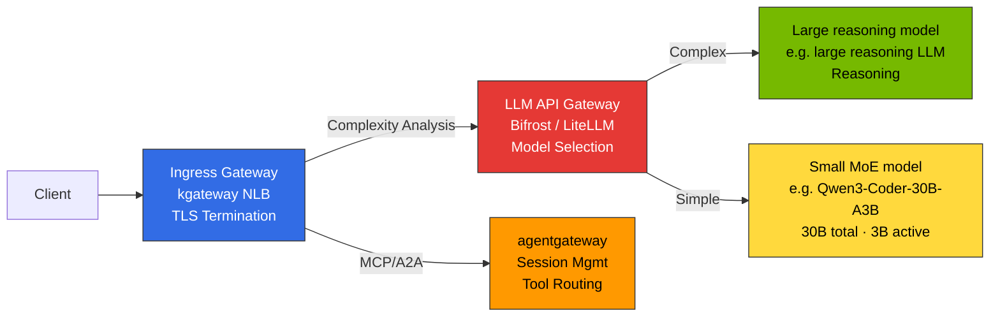
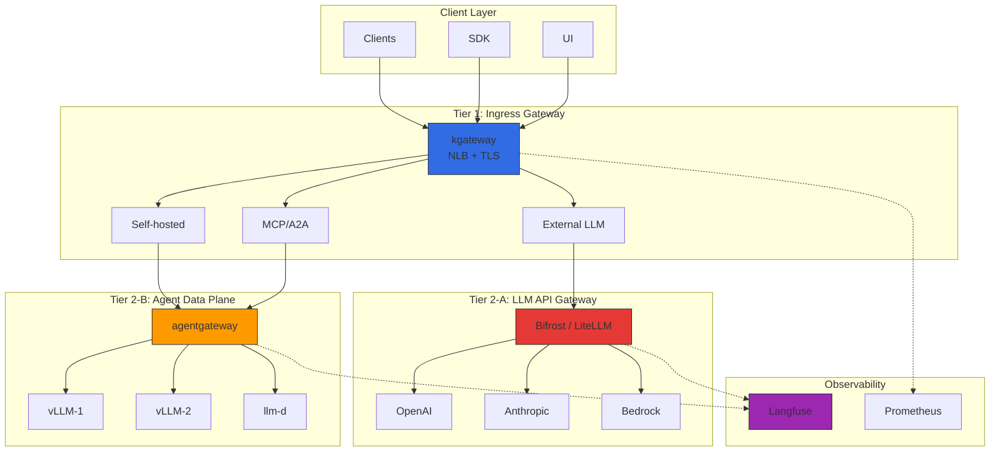
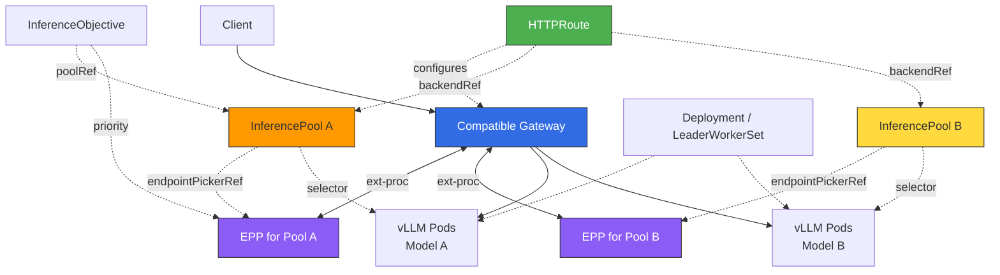
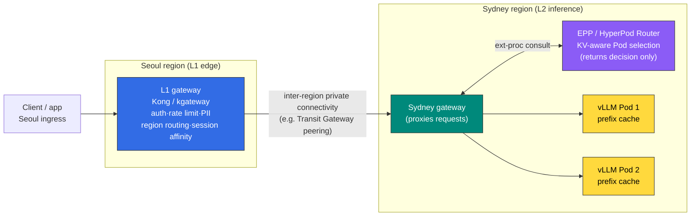

This document covers **design principles** for 2-Tier gateway architecture and routing strategies (Cascade / Semantic Router / Hybrid). For actual **deployment procedures** including Helm installation, HTTPRoute manifests, and OTel integration, refer to [Inference Gateway Deployment Guide](../../reference-architecture/inference-gateway/setup/).

## Overview

In large-scale AI model serving environments, distinguishing **infrastructure traffic management** from **LLM provider abstraction** helps clarify responsibilities. The 2-Tier layout below is a design option for separating ownership, policies, and scaling; it is not a requirement for two traffic gateways in every llm-d deployment.

**2-Tier Gateway Architecture**:
- **L1 (Ingress Gateway)**: kgateway — Kubernetes Gateway API standard, traffic routing, mTLS, rate limiting
- **L2-A (Inference Gateway)**: Bifrost/LiteLLM — Provider integration, cascade routing, semantic caching
- **L2-B (Data Plane)**: agentgateway — MCP/A2A protocols, stateful session management

Each tier is managed independently, separating infrastructure and AI workloads.

---

## 2-Tier Gateway Architecture

:::tip Gateway layer definitions are unified in a dedicated document
The platform-wide gateway-layer terminology and role definitions are consolidated in [Tiered Gateway Architecture](./tiered-gateway-architecture.md). This document focuses on the routing strategy of **Tier 2-A (LLM API Gateway)**. For in-cluster inference pod routing (Tier 2 ① Inference Extension), see the [Gateway API Inference Extension](#gateway-api-inference-extension) section below.
:::

### Gateway Layer Separation

LLM inference platforms must clearly distinguish **3 different Gateway roles**. (For the full layer definitions, see [Tiered Gateway Architecture](./tiered-gateway-architecture.md))

**Table 1. Gateway roles, implementations, and locations by type**

| Gateway Type | Role | Implementation | Location |
|-------------|------|-------|------|
| **Ingress Gateway** | External traffic ingress, TLS termination, path-based routing | kgateway (NLB integration) | Tier 1 |
| **LLM API Gateway** | Model selection, intelligent routing, request cascading (external/internal model abstraction) | Bifrost / LiteLLM | Tier 2-A |
| **Agent Data Plane** | MCP/A2A protocols, stateful sessions, tool routing | agentgateway | Tier 2-B |

> **Terminology note**: Here, **Tier 2-A "LLM API Gateway"** is a provider proxy (Bifrost/LiteLLM) that abstracts the model API. It serves a different purpose from the **Gateway API Inference Extension** (Tier 2 ①, later in this document) that routes to in-cluster inference pods.

**Figure 1. Request distribution across the 2-Tier Gateway layers**



**Responsibilities assigned in this design:** (These are responsibilities this 2-Tier layout assigns to each component, not exclusive product capabilities. Not all three components are required.)
- **Ingress Gateway (kgateway)**: In this design, handles network-level traffic control only; model selection is delegated to the L2-A gateway.
- **LLM API Gateway (Bifrost/LiteLLM)**: Analyzes requests to select a model and tracks cost. Complexity-based selection is not automatic — it requires explicitly configuring a classifier/policy, such as LiteLLM's `complexity_router` (classifier_type: heuristic/llm/etc.) or Bifrost routing rules.
- **Agent Data Plane (agentgateway)**: In this design, handles AI-specific protocols (MCP/A2A) and maintains stateful sessions. agentgateway can itself route LLM providers and inference endpoints, but here that responsibility is kept at L2-A to separate roles.

### Overall Architecture

**Figure 2. End-to-end 2-Tier Gateway architecture with observability links**



### Responsibility Separation by Tier

**Table 2. Components, responsibilities, and protocols by tier**

| Tier | Component | Responsibility | Protocol |
|------|----------|------|----------|
| **Tier 1** (Ingress Gateway) | kgateway (Envoy-based) | Traffic routing, mTLS, rate limiting, network policies | HTTP/HTTPS, gRPC |
| **Tier 2-A** (LLM API Gateway) | Bifrost / LiteLLM | Intelligent model selection, cost tracking, request cascading, semantic caching | OpenAI-compatible API |
| **Tier 2-B** (Agent Data Plane) | agentgateway | MCP/A2A session management, self-hosted inference routing, Tool Poisoning prevention | HTTP, JSON-RPC, MCP, A2A |

### Traffic Flow

**External LLM**: Client → kgateway → Bifrost/LiteLLM (Cascade + Cache) → OpenAI → Response + Cost tracking
**Self-hosted vLLM**: Client → kgateway → agentgateway → vLLM → Response

---

## kgateway (L1 Inference Gateway)

### Gateway API-based Routing

kgateway implements the Kubernetes Gateway API standard, enabling vendor-neutral configuration.

import { ComponentStructureTable } from '@site/src/components/InferenceGatewayTables';

<ComponentStructureTable />

Gateway API v1.6.0 was released on 2026-06-29, graduating UDPRoute and TCPRoute to GA (standard channel). kgateway's Gateway API support is pinned per release and is for the **standard channel**: kgateway 2.4.x (released 2026-07-23) supports Gateway API 1.4–1.6, 2.3.x (2026-05-19) supports 1.3–1.5, and 2.2.x/2.1.x support 1.2–1.4. So v1.6 is not "future" — it is already supported by kgateway 2.4.x. Before using a specific feature, confirm the exact kgateway version and Gateway API channel (standard/experimental) combination against the [kgateway version support table](https://kgateway.dev/docs/envoy/latest/reference/versions/).

### Dynamic Routing Concepts

**Table 3. Criteria and use cases by dynamic routing type**

| Routing Type | Criteria | Use Case |
|------------|------|----------|
| **Header-based** | `x-model-id`, `x-provider` | Backend selection by model/provider |
| **Path-based** | `/v1/chat/completions`, `/v1/embeddings` | Service separation by API type |
| **Weight-based** | backendRef weight | Canary deployment, A/B testing |
| **Composite conditions** | Headers + Path + Tier | Premium/standard customer backends |

Canary deployments start with 5-10% traffic and gradually increase, with immediate rollback via weight=0 on issues.

### Load Balancing Strategies

**Table 4. Load balancing strategies and suitable scenarios**

| Strategy | Description | Suitable Scenario |
|------|------|--------------|
| **Least Request** | Routes to the backend with the fewest requests (default when no kgateway BackendConfigPolicy is set) | General workloads with uneven processing times |
| **Round Robin** | Sequential distribution | Uniform model instances |
| **Random** | Random distribution | Large backend pools |
| **Consistent Hash** | Same key → Same backend | KV Cache reuse, session affinity |

When no load balancing algorithm is set in a kgateway BackendConfigPolicy, the default is **least request** (pick the instance with the fewest requests), not round robin.

Consistent Hash **can help** with prefix cache reuse in LLM inference, but the TTFT benefit is conditional, not guaranteed. Hit rates improve only when the same user's requests **actually share a prefix**, that prefix is **still resident (warm)** on the target vLLM instance, and hash membership is stable. Adding/removing backends reshuffles the hash ring, and differing prefixes erase the benefit — so measure hit rate and TTFT on your actual workload to confirm.

### Topology-Aware Routing (same-AZ preference) {#topology-aware-routing-kubernetes-133}

Prioritizing same-AZ Pod-to-Pod communication can reduce cross-AZ data transfer cost and latency. This is not applied automatically by a Kubernetes version alone; it depends on **which mechanism you explicitly configure**, and these are distinct layers:

- **Service `trafficDistribution: PreferClose`** (GA in Kubernetes 1.31): a Service-level setting that hints kube-proxy/EndpointSlice to prefer same-zone endpoints. It supersedes the older `service.kubernetes.io/topology-mode: Auto` (topology-aware hints).
- **Gateway/EPP path**: when a Gateway API data plane or EPP (Inference Extension) routes directly to Pod addresses, it may bypass kube-proxy, so Service-level topology hints do not apply as-is. On that path, locality must be controlled by the gateway's/scheduler's own locality or zone-aware settings.

So do not infer "locality is guaranteed because the cluster is at version X." State the actual data plane handling the traffic (kube-proxy Service path vs. gateway/EPP direct routing) and the topology mechanism configured there.

import { TopologyEffectsTable } from '@site/src/components/InferenceGatewayTables';

<TopologyEffectsTable />

### Failure Handling Concepts

**Table 5. Failure-handling mechanisms and LLM inference considerations**

| Mechanism | Description | LLM Inference Considerations |
|----------|------|-------------------|
| **Timeout** | Maximum processing time per request | LLM long response generation takes tens of seconds. Adequate timeout needed (120s+) |
| **Retry** | Auto-retry on 5xx, timeout, connection failure | Max 3 retries. Infinite retries cause system overload |
| **Circuit Breaker / outlier detection** | Temporarily eject backends on passive health signals (e.g. consecutive failures) | `maxEjectionPercent` caps the **share of backends ejected at once**; it does not guarantee a number of available backends. The panic threshold (default 50%) and active health checks also affect availability, so "at least half available" does not hold |

Envoy outlier detection is **passive** health checking: it ejects hosts based on failures observed in request results. `maxEjectionPercent` only caps the share of hosts that may be ejected; it does not guarantee any specific number of available hosts, and actual availability also depends on active health checks and the panic threshold.

In Gateway API timeouts, `backendRequest` is the **per-try timeout covering the entire backend response**, and `request` is the total request time including retries. So `backendRequest` is not a "first byte" timeout — it covers the whole backend response for that attempt, which means a long SSE streaming response can be cut off by it. For streaming, set first-byte (TTFB), idle, and whole-stream timeouts distinctly as appropriate. POST retries require idempotency guarantees (caution with tool calls).

---

## LLM Gateway Solution Comparison

### Major Solution Comparison Table

**Table 6. LLM Gateway solutions compared by features, cascade routing, and license**

| Solution | Language | Key Features | Cascade Routing | License | Best For |
|--------|------|-----------|-----------------|----------|-----------|
| **Bifrost** | Go | High-performance gateway; conditional routing rules (CEL) over `complexity_tier`/`model`/`params`/capacity signals; failover | Routing rules (`complexity_tier`) + external classifier | Apache 2.0 | High performance, low cost, self-hosted |
| **LiteLLM** | Python | 100+ providers; multi-strategy routing (latency/usage/cost/least-busy) + native `complexity_router` (v1.101.0) + custom strategies | Native complexity_router (SIMPLE/MEDIUM/COMPLEX/REASONING) or custom strategy | MIT | Python ecosystem, rapid prototyping |
| **vLLM Semantic Router** | Standalone service (Envoy ext_proc) | A vLLM-project signal-driven router deployed **standalone** in front of OpenAI-compatible backends (not vLLM-only); embedding-similarity classification | Embedding similarity-based | Apache 2.0 | vLLM and other OpenAI-compatible backends |
| **Portkey** | TypeScript | SOC2 certified, semantic caching, Virtual Keys | Supported | Proprietary + OSS | Enterprise, compliance |
| **Kong AI Gateway** | Lua/C | MCP support, leverages existing Kong infra. Note: complexity/semantic routing via `ai-proxy-advanced` is a **Kong Enterprise (paid) edition** plugin and differs from the OSS `ai-proxy` | Plugin (edition-dependent) | Apache 2.0 (core) / Enterprise (advanced AI plugins) | Existing Kong users |
| **Helicone** | Rust | Gateway + Observability integrated, high performance | Supported | Apache 2.0 | High performance + observability needed |
| **OpenRouter** | SaaS (hosted) | Unified API for 400+ models·60+ providers, provider fallback, OpenAI-compatible | Provider routing supported | SaaS (commercial) | Fast multi-provider integration, prototyping |

:::note Why this design does not combine LiteLLM and Kong (a local simplification)
In this design we use **only one** of LiteLLM or Kong AI Gateway as the LLM API gateway (Tier 2-A). Their roles overlap, so standardizing on one is a **design choice** to reduce operational complexity — not a claim that combining them (e.g. Kong in front + LiteLLM behind) is technically impossible or prohibited. That combination simply adds hops, configuration, and observability points, and lacks a widely published verified reference. For selection criteria from the tenancy-model and budget-enforcement perspective, see [AI Gateway Multi-Tenancy — Selection Criteria](../../operations-mlops/governance/ai-gateway-multi-tenancy.md#4-selection-criteria-litellm-vs-kong).
:::

:::info Connecting L1 Budget Signals to Fallback Routing
Among L1 signals, **budget** is directly tied to governance policy. When a tenant's budget is exhausted, the L1 gateway can block the request (hard budget) or take a fallback path that downgrades to a lower-cost model. For per-tenant budget hierarchies and enforcement, see [AI Gateway Multi-Tenancy](../../operations-mlops/governance/ai-gateway-multi-tenancy.md); for the block/alert/fallback policy matrix on budget overrun, see [LLM FinOps Chargeback](../../operations-mlops/governance/llm-finops-chargeback.md). These policy decisions all happen at L1; L2 (KV-aware Pod selection) does not handle budget signals.
:::

:::note Self-hosted vs SaaS
In the table above, Bifrost·LiteLLM·Helicone·vLLM Semantic Router are **self-hosted** (deployed in-cluster), whereas **OpenRouter is hosted SaaS**. SaaS provides instant access to 400+ models and delegates provider fallback/billing, which is advantageous for fast integration and prototyping. However, since prompts are sent to an external service, review the [governance considerations](../../operations-mlops/governance/ai-gateway-guardrails.md#openrouter-등-saas-게이트웨이-데이터-주권) for environments with data sovereignty or regulatory requirements.
:::

### Bifrost vs LiteLLM

**Bifrost**: A Go-based high-performance gateway offering lower memory use and higher throughput than Python (public benchmark: ~11 µs (&lt;100 µs) overhead @ 5k RPS; "50x faster than LiteLLM" is a tagline summarizing the vendor's own head-to-head benchmark — public, but not third-party verified — reporting 54x P99, 40x overhead, 9.5x throughput; distinguish latency vs overhead vs throughput and do not infer performance or security from language alone). Beyond performance, supply-chain/security posture can also factor in: a single static Go binary has a smaller runtime dependency surface than a broad Python dependency tree, though actual risk varies by version/configuration and should be checked against each project's security advisories at adoption time. Conditional routing rules are CEL expressions that can read `model`, `headers`, `params`, capacity metrics (`budget_used`/`tokens_used`/`request`), and an auto-classified **`complexity_tier` — only "SIMPLE", "MEDIUM", or "COMPLEX" (there is no REASONING tier)** computed by embedding the prompt and matching the nearest reference phrase; when classification is unavailable, `complexity_tier` is treated as unknown and the rule does not match. Helm Chart deployment, OpenAI-compatible API. ([Bifrost routing rules](https://docs.getbifrost.ai/providers/routing-rules))

**LiteLLM**: 100+ provider support; multi-strategy routing (`simple-shuffle`·`latency-based-routing`·`usage-based-routing-v2`·`least-busy`·`cost-based-routing`) and custom strategies via `CustomRoutingStrategyBase`. As of v1.101.0, complexity-based routing is provided by a **native `complexity_router` (auto-router)** with built-in tiers SIMPLE/MEDIUM/COMPLEX/REASONING and a configurable `classifier_type` (heuristic·llm·heuristic_first·hybrid·custom·heuristic_v2). It is **not** enabled by a one-line `routing_strategy: complexity-based` toggle (that string does not exist); you configure a complexity_router block. For Langfuse, see the "Langfuse Integration" section (the one-line `success_callback: ["langfuse"]` is the SDK-callback path). Direct LangChain/LlamaIndex integration. However, being Python-based, it has lower throughput and higher memory use than Go. ([LiteLLM routing](https://docs.litellm.ai/docs/routing), [complexity_router v1.101.0](https://github.com/BerriAI/litellm/blob/v1.101.0/litellm/router_strategy/complexity_router/complexity_router.py))

### Selection Criteria

**Table 7. Recommended solution and rationale by use case**

| Use Case | Recommended Solution | Reason |
|-----------|-----------|------|
| Intelligent cascade (convenience priority) | **LiteLLM** | Native `complexity_router` + 100+ providers, Python ecosystem |
| Intelligent cascade (performance priority) | **Bifrost** | Routing rules (`complexity_tier`) + external classifier, low Go overhead |
| vLLM standalone environment | **vLLM Semantic Router** | vLLM-project router (standalone ext-proc service), lightweight classification |
| High performance, low cost self-hosted | **Bifrost** | Go-based low overhead (~tens of µs), low memory |
| Python ecosystem (LangChain) | **LiteLLM** | Native integration, 100+ providers |
| Enterprise compliance | **Portkey** | SOC2/HIPAA/GDPR, Semantic Cache |
| High performance + observability integrated | **Helicone** | Rust-based All-in-one |

### Recommended Combinations by Scenario

**Table 8. Recommended gateway stacks by operational scenario**

| Scenario | Recommended Stack | Reason |
|----------|----------|------|
| **Startup/PoC** | kgateway + LiteLLM | Low cost, 100+ provider integration. Deployment time depends on environment and cluster readiness (a simple PoC can be up in tens of minutes) |
| **Self-hosted focused (performance)** | kgateway + Bifrost (CEL routing rules) + agentgateway | High performance, external+self-hosted pool 2-Tier |
| **Enterprise multi-provider** | kgateway + Portkey + Langfuse | Many-provider integration and observability. Compliance is not achieved by integration alone — verify Portkey's certification (e.g. SOC2) scope and your own operational/audit requirements separately |
| **Hybrid (external+self-hosted)** | kgateway + Bifrost/LiteLLM + agentgateway | External via Bifrost/LiteLLM, self-hosted via agentgateway |
| **Global deployment** | Cloudflare AI Gateway + kgateway | Edge caching, DDoS protection |

> These "recommendations" summarize typical fit for each stack. Provider counts and certification scope change by product, edition, and date, so confirm them against each vendor's docs at adoption time, and judge "deployed" by acceptance criteria (health checks passing, end-to-end request success) rather than an "n-minute deployment" figure.

---

## Request Cascading: Intelligent Model Routing

**Request Cascading** is an intelligent optimization technique that automatically analyzes request complexity and routes to the appropriate model. The three patterns (weight-based, fallback-based, intelligent routing), implementation approach comparison (LLM Classifier, LiteLLM, vLLM Semantic Router), RouteLLM research reference, and cost savings are covered in detail in [Request Cascading — Intelligent Model Routing](./request-cascading.md).

For threshold/keyword tuning and misroute detection operations, see [Cascade Routing Tuning](./cascade-routing-tuning.md).

---

## Gateway API Inference Extension

Kubernetes Gateway API enables managing LLM inference as Kubernetes-native resources through **Inference Extension**.

### Core CRDs (Custom Resource Definitions)

The reviewed baseline is llm-d v0.8.1 (2026-06-26), router v0.9.0, GIE v1.5.0, and Gateway API v1.5.1. Primary schemas: [llm-d v0.8.1](https://github.com/llm-d/llm-d/releases/tag/v0.8.1), [InferencePool v1](https://github.com/kubernetes-sigs/gateway-api-inference-extension/blob/v1.5.0/config/crd/bases/inference.networking.k8s.io_inferencepools.yaml), [InferenceObjective v1alpha2](https://github.com/llm-d/llm-d-router/blob/v0.9.0/config/crd/bases/llm-d.ai_inferenceobjectives.yaml), [HTTPRoute v1](https://github.com/kubernetes-sigs/gateway-api/blob/v1.5.1/config/crd/standard/gateway.networking.k8s.io_httproutes.yaml).

**Table 9. Owner, responsibility, and example of each Inference Extension CRD**

| Resource | Owner / API | Responsibility | Example |
|----------|-------------|----------------|---------|
| **Deployment / LeaderWorkerSet** | Kubernetes / separate workload API | Images, model arguments, Pod GPU requests, replica counts | Workload `replicas: 3` and `nvidia.com/gpu` |
| **InferencePool** | GIE, `inference.networking.k8s.io/v1` | Select same-namespace Pods and define ports/EPP reference | `selector.matchLabels`, `targetPorts`, `endpointPickerRef` |
| **InferenceObjective** | llm-d, `llm-d.ai/v1alpha2` (alpha, optional) | Request priority for a specific pool | `poolRef`, integer `priority: 10` |
| **HTTPRoute** | Gateway API, `gateway.networking.k8s.io/v1` | Select pools by path, header, or weight | `backendRefs.kind: InferencePool` |

`InferenceModel` is the historical name of the earlier policy API. This baseline uses llm-d InferenceObjective. `criticality: high`, model images, GPU requests, and replica counts are not InferenceObjective/InferencePool fields. Distinguish the GIE v1 InferencePool API from the llm-d alpha policy API.

There is no `LLMRoute` kind in the reviewed GIE or llm-d Router CRDs. Even the router's [`llmroute.yaml` test file](https://github.com/llm-d/llm-d-router/blob/v0.9.0/test/sidecar/config/gateway/llmroute.yaml) uses `kind: HTTPRoute`. Do not treat a filename as an API kind or copy that test file's old API group.

### Gateway API Inference Extension Integration

In [Gateway Mode](https://github.com/llm-d/llm-d/blob/v0.8.1/docs/architecture/core/router/proxy.md), one compatible Gateway can handle both traditional Services and InferencePools. The EPP returns its selection to the Gateway and does not proxy inference traffic itself. A separate edge Gateway is an option when retaining existing ingress or separating security/ownership; account for extra hops, operational cost, and consistent timeout, retry, streaming, and authentication-header handling.

Solid lines show requests/responses and EPP calls; dotted lines show configuration references.

**Figure 3. Resource and EPP wiring of the Gateway API Inference Extension**



This example defines routing resources only. It requires an existing `llm-d` namespace, `inference-gateway` Gateway, `inference-epp` Service (EPP on port 9002 configured for `gpu-pool`), and model-server Pods labeled `app: vllm` listening on port 8000. Install Gateway API v1.5.1, the GIE v1.5.0 InferencePool CRD, the router v0.9.0 InferenceObjective CRD, and compatible controllers.

```yaml
apiVersion: inference.networking.k8s.io/v1
kind: InferencePool
metadata:
  name: gpu-pool
  namespace: llm-d
spec:
  selector:
    matchLabels:
      app: vllm
  targetPorts:
    - number: 8000
  endpointPickerRef:
    name: inference-epp
    kind: Service
    port:
      number: 9002
    failureMode: FailClose
---
apiVersion: llm-d.ai/v1alpha2
kind: InferenceObjective
metadata:
  name: interactive
  namespace: llm-d
spec:
  poolRef:
    group: inference.networking.k8s.io
    kind: InferencePool
    name: gpu-pool
  priority: 10
---
apiVersion: gateway.networking.k8s.io/v1
kind: HTTPRoute
metadata:
  name: inference-route
  namespace: llm-d
spec:
  parentRefs:
    - name: inference-gateway
  rules:
    - matches:
        - path:
            type: PathPrefix
            value: /v1
      backendRefs:
        - group: inference.networking.k8s.io
          kind: InferencePool
          name: gpu-pool
          port: 8000
```

`priority: 10` is an illustrative policy that prioritizes requests over priority 0 requests in the same pool. When using [flow control](https://github.com/llm-d/llm-d/blob/v0.8.1/docs/architecture/core/router/epp/flow-control.md), enable the EPP `flowControl` feature gate and have a trusted authentication layer set `x-llm-d-inference-objective: interactive`. Creating the Objective alone does not automatically classify all requests. Validate or replace externally supplied headers to prevent clients from self-assigning priority. This value does not reserve dedicated GPUs or define a Pod `PriorityClass`.

### Two routing layers — keep them distinct

An LLM inference platform separates **model/provider selection** from **in-model Pod selection**. The difference in logical roles does not by itself require two physical gateways: a supported Gateway can connect both roles using HTTPRoute together with an EPP.

**Table 10. Decision question, signals, and implementations of the two routing layers (L1/L2)**

| Layer | Decision question | Signals | Unit | Implementations |
|--------|----------|------|------|--------|
| **L1 — LLM proxy / edge** | "Which provider/model/region?" | cost·budget·provider health·auth·PII·semantic similarity | model/provider target | Kong, Bifrost, LiteLLM, Portkey, (kgateway) |
| **L2 — inference routing (KV-aware)** | "Which GPU Pod?" | vLLM internal metrics (KV cache util·prefix location·queue depth) | individual Pod | **EPP(GIE)**, HyperPod router, Dynamo, vLLM production-stack |

> GIE's official docs present combining a higher-level AI Gateway (LiteLLM, Solo AI Gateway, Apigee) on top of EPP as an integration example (not a mandate). L1 (across-model) and L2 (within-model) are complementary.

:::note A routing "decision" is not inference — KV-aware vs context-aware
In L2 KV-cache-aware (prefix-aware) routing, **the routing decision itself is not inference**: it is a mechanical prefix-block hash + index lookup, with no model forward pass. **Context-aware (semantic) routing**, by contrast, runs an encoder/classifier model to classify intent, so lightweight inference happens on the routing path. In either case the **final workload the selected Pod runs is LLM inference**. See [KV Cache Optimization — Cache-Aware Routing](../../model-serving/inference-optimization/kv-cache-optimization.md#kv-cache-aware-routing).
:::

### EPP (Endpoint Picker) — precise definition

**EPP = the GIE-defined inference-scheduler service that implements the Envoy `ext-proc` (External Processing) gRPC protocol.** The Gateway (Envoy) calls the EPP on each request to delegate "which Pod inside the InferencePool to send to."

**Three specs that make an EPP an EPP:**
1. **ext-proc gRPC implementation** — any gateway supporting ext-proc-style external processing can host an EPP (Istio, kgateway, Envoy Gateway, GKE Gateway, agentgateway, NGINX Gateway Fabric, etc.)
2. **Handles individual Pod addresses (`podIP:port`) via the InferencePool selector** — Pod-level, not a Kubernetes Service
3. **Model-server metric-based scheduling** — KV-cache/load aware, not a simple load balancer

**EPP internal pipeline** (a layered scheduler, not a single function):

> **Gateway vs EPP boundary**: HTTPRoute pool selection, weighting, and path matching are **routing performed by the Gateway (Gateway API)**, not part of the EPP pipeline. After the Gateway decides which InferencePool to send to, the EPP decides only "which Pod" within that pool.

**Table 11. Role of each layer in the EPP internal pipeline**

| Layer | Role |
|--------|------|
| Data Layer | Collects/prepares the InferencePool Pod list and vLLM metrics, and lookup data such as the prefix index |
| Flow Control | InferenceObjective request priority; priority·fairness·queueing (Saturation Detector overload defense) |
| Scheduling Layer | **scorer + picker** — selects the actual Pod within the pool |

- **scorer**: the `prefix-cache-scorer` **consumes prefix match information (PrefixCacheMatchInfo) prepared in advance by a separate producer/indexer** to score each Pod. The scorer itself does not hash/index the prompt per request; block hashing and index updates are done by the data-layer producer, and the scorer reads the result to assign scores. Other scorers include KV-cache/load-aware (load·queue-depth) and LoRA affinity.
- **picker**: aggregates scorer scores → final Pod selection (default `max-score-picker` when no picker is specified)
- Decision delivery: `x-gateway-destination-endpoint` HTTP header + `dynamic_metadata` (both must match), one fallback can be specified

**What EPP is not**: not a gateway (it only makes the routing decision; the gateway proxies). Not a model router (within-model Pod selection only). The reference implementation is **llm-d Router**; the EPP code was consolidated into llm-d, and GIE retains only the InferencePool API and the Endpoint Picker Protocol. EPP host gateways are those supporting ext-proc-style external processing: **Istio, kgateway, Envoy Gateway, GKE Gateway, agentgateway, NGINX Gateway Fabric, etc.**

### L2 options compared: EPP vs HyperPod Inference Operator vs Dynamo

This compares what you implement KV-aware routing (L2) with. The common constraint is that the InferencePool selector selects **only Pods in the same namespace**, and the KV-aware scheduler depends on vLLM workers' real-time metrics. So the L2 scheduler is premised on living in the **same cluster** as vLLM; regional locality (same-region placement) is a **recommendation** for metric freshness and latency (a different region is not forbidden so much as discouraged because of cross-region latency).

**Table 12. L2 KV-aware routing options compared (EPP, HyperPod, Dynamo)**

| Item | EPP(GIE) + Envoy gateway | HyperPod Inference Operator | NVIDIA Dynamo |
|------|---------------------------|----------------------------|---------------|
| KV-aware method | prefix-cache·kv-util scorer | kvaware/prefixaware (LMCache router) | KV router (Radix tree, KVPublisher/Indexer) |
| Management | self-managed (K8s standard) | **AWS-managed** (EKS add-on) | self-managed |
| Node auto-recovery | NMA+Auto Repair (separate) | **deep health check + spare pool, integrated** | separate |
| Distributed inference | llm-d integration | **DPD-managed** (EFA/GPUDirect RDMA) | prefill/decode + 3-tier KV offload |
| Backend engine | vLLM/TGI etc. | vLLM-only (kvaware is `/completions` only) | vLLM/SGLang/**TRT-LLM** |
| Cost | EC2 pricing | A managed premium over EC2 may apply (around +15–20% has been observed in a past ml.p5 vs p5 comparison, but it varies by instance/region/date — confirm against [SageMaker pricing](https://aws.amazon.com/sagemaker/pricing/) at adoption time) | EC2 pricing |
| Lock-in | Low (based on Gateway API/GIE standards, though an operational dependency on specific controllers/implementations remains) | Medium (SageMaker CRD, but on top of vLLM/K8s standards) | None |
| Best fit | standard·vendor-neutral·MCP integration | minimal ops·auto-recovery·governance | peak performance·multi-engine |

> **Kong has no L2 (EPP).** Kong's load balancing (consistent-hash·lowest-latency, etc.) is at the **model/provider level**, not Pod-level KV-aware scheduling, and being non-Envoy it does not implement GIE/ext-proc/InferencePool. If KV-aware is needed, keep Kong at L1 (edge) and use EPP/HyperPod/Dynamo for L2. (Re-check Kong release notes at adoption time — InferencePool is a gateway-neutral standard, so future support is possible.)

:::caution Kong's semantic cache ≠ vLLM KV-cache-aware routing
Kong AI Gateway's `ai-semantic-cache` plugin is an L1 **response cache** that reuses the "whole response" of semantically similar requests via embedding cosine similarity (eliminating duplicate LLM calls). This is a **different layer** from L2 KV-cache-aware routing, which picks a Pod by knowing the location of the vLLM Pod's prefix KV cache (three-layer cache comparison: [Semantic Caching Strategy](../inference-optimization/semantic-caching-strategy.md#2-cache-layer-distinctions)).

Also, Kong's vector store is **not embedded inside Kong but connects to an external Redis/Valkey/PGVector** (on AWS, IAM-authenticated ElastiCache, etc.), and embeddings themselves are generated by calling an external embedding API (OpenAI·Bedrock, etc.). AWS integration documents a Bedrock provider and the `ai-aws-guardrails` plugin, but direct integration with an "AWS-managed KV cache" is a separate concept. (Kong behavior differs by version, so check the [Kong AI Gateway docs](https://developer.konghq.com/ai-gateway/) at adoption time.)
:::

> **HyperPod's managed DPD/KV-aware is pinned to vLLM.** If you need the performance ceiling of a TensorRT-LLM backend, a hybrid is possible: deploy Dynamo directly on HyperPod EKS and use HyperPod only as the node-recovery/governance layer.

### Multi-region caution (e.g. Seoul ingress → Sydney inference)

L2 (KV-aware) depends on vLLM workers' real-time metrics (freshness typically on the order of hundreds of ms to seconds), and the InferencePool selector selects **only Pods in the same cluster/namespace**. So the L2 scheduler is premised on being in the same cluster as vLLM. A gateway in Seoul can hardly stand in for the L2 KV-aware decision of a cluster in Sydney: as cross-region RTT grows (it varies by region pair and path — the Seoul–Sydney leg is typically measured in the tens to ~150 ms range, but measure it) metrics go stale, and above all the InferencePool cannot select Pods in another cluster. Under that premise, split roles as follows:

- **Seoul = L1** (Kong/Bifrost/kgateway): provider/region routing, auth, $budget, PII, failover, **session affinity** (preserving the prefix cache)
- **Sydney = L2** (EPP/HyperPod router/Dynamo) + vLLM: KV-aware Pod selection
- The KV cache benefit occurs **only inside the Sydney cluster** (a cross-region hop cannot be shortened by the cache). Mind cross-region egress cost and added TTFT.

**Figure 4. Multi-region L1 (Seoul) and L2 (Sydney) role separation**



In this layout, routing runs over AWS VPC/network-level connectivity. Seoul L1 makes the region/session decision ("this is an inference request, send to Sydney"), and on the Sydney side the **gateway proxies the request** while consulting the EPP (L2) over ext-proc to delegate only which Pod (the EPP returns a decision and does not proxy traffic itself — the same separation as the earlier Gateway Mode diagram). The two clusters need not be merged into a single mesh; secure a private network path via Transit Gateway inter-region peering or similar. Note, however, that Transit Gateway is a **network-connectivity mechanism** and does not stand in for application authentication (auth/authz is handled separately at the gateway layer), nor is it a service guaranteed to be "always one hop" (the path depends on route tables, subnets, and peering configuration, which is out of scope here). To preserve multi-turn prefix reuse, the key is **session affinity**: L1 consistently sends the same session to the same Sydney endpoint.

---

## Semantic Caching

Semantic Caching detects semantically similar prompts and reuses previous responses, which can reduce LLM API cost and latency. At the Gateway level (Bifrost/LiteLLM/Portkey) it is a **response cache** that determines HIT/MISS by embedding similarity; exact-match caching and KV Cache are different layers.

**Threshold**: a single value like 0.85 is not a universal default. The right threshold depends on the embedding model, distance metric (cosine/L2), and domain, and a high numeric score does not guarantee "same meaning" (similar wording with different meaning causes false hits). So calibrate it per model within an acceptable false-hit budget, include tenant/user/data scope in the cache key for isolation, and try an exact-match lookup first to avoid unnecessary embedding cost.

**Cache layers**: the Gateway's semantic response cache and vLLM's KV Cache can be combined independently. However, a provider-managed "Prompt Cache" is not a separate independent cache kind so much as a **prefix cache the provider runs internally, which overlaps with the KV-cache concept** (e.g. reusing a shared prefix). The three are therefore not fully orthogonal — distinguish what each cache keys on and which layer it operates at.

Design principles (3-tier cache comparison, similarity threshold tradeoffs, tool comparison table, cache key design, observability·production checklist) are covered in detail in separate documentation.

- **Design Principles**: [Semantic Caching Strategy](../inference-optimization/semantic-caching-strategy.md)
- **Production Deployment Example**: LiteLLM + Redis configuration in [OpenClaw AI Gateway Deployment](./openclaw-example.md)

---

## agentgateway Data Plane

### Overview

**agentgateway** is an AI workload-dedicated data plane for kgateway. Traditional Envoy is optimized for stateless HTTP/gRPC, but AI agents have special requirements like stateful JSON-RPC sessions, MCP protocols, and Tool Poisoning prevention.

### Envoy vs agentgateway Comparison

**Table 13. Envoy data plane vs agentgateway**

| Item | Envoy Data Plane | agentgateway |
|------|---------------------|---------------------------|
| **Session Management** | Stateless, HTTP cookie-based | MCP session tracking (`Mcp-Session-Id`), optional session store — sessions are optional per the MCP spec and stateless operation is allowed |
| **Protocols** | HTTP/1.1, HTTP/2, gRPC | MCP (Model Context Protocol), A2A (Agent-to-Agent) |
| **Security** | mTLS, RBAC | Tool Poisoning prevention, per-session Authorization |
| **Routing** | Path/header-based | Session ID-based, tool call validation |
| **Observability** | HTTP metrics, Access Log | LLM token tracking, tool call chains, cost |

### Core Features

**1. Session Management**: MCP Streamable HTTP (2025-06-18 spec) tracks sessions via the **`Mcp-Session-Id`** header (not `X-MCP-Session-ID`). Session management is **optional** per the spec, and servers may operate statelessly. Where agentgateway does sticky-session routing or inactive-session cleanup, the timeout value (e.g. 30 minutes) is a **configurable value**, not a spec-fixed default; confirm the applied value in your deployment configuration.

**2. MCP/A2A Protocol Support**: routes MCP and A2A traffic. Paths such as `/mcp/v1` and `/a2a/v1` are **example paths you configure in deployment**, not spec-mandated fixed paths (the actual endpoint path is set in configuration).

**3. Tool guardrails (require configuration)**: an allowed-tool list (allowlist), blocking of dangerous tools, response size limits, and integrity verification can be set **as policy**. This is not a guarantee that Tool Poisoning is "automatically and fully prevented" or that SHA-256 verification "always" runs — the applied scope depends on which guardrail policies the operator configures. See the [agentgateway MCP guardrails post](https://agentgateway.dev/blog/2026-06-29-mcp-guardrails-microsoft-agent-governance-toolkit/).

**4. Authorization**: per-session authorization policies such as JWT token verification and role-based tool access can be configured. Session-hijacking prevention is an effect of configuring these authentication/authorization policies correctly, not something guaranteed automatically without configuration.

:::info agentgateway Project Status
agentgateway is an AI-dedicated data plane separated from the kgateway project in late 2025, currently under active development. Features are continuously added to keep pace with rapid evolution of MCP and A2A protocols.
:::

---

## Monitoring & Observability

### Core Metrics

Core metrics to monitor in AI inference gateways. The metric **names in the table below are examples**. kgateway's gateway proxy is Envoy, so the actual time series are exposed as Envoy-exported series (e.g. downstream/upstream request and connection series); confirm exact metric names and labels against the [kgateway Gateway proxy metrics docs](https://kgateway.dev/docs/envoy/latest/observability/gateway-metrics/) for the version you deploy and against an actual scrape before writing queries/recording rules.

import { MonitoringMetricsTable } from '@site/src/components/InferenceGatewayTables';

<MonitoringMetricsTable />

**Table 14. Core inference-gateway metric categories and their meaning**

| Metric Category | Key Item | Meaning |
|----------------|----------|------|
| **Latency** | TTFT (Time to First Token) | Time until first token generation. User-perceived responsiveness |
| **Throughput** | TPS (Tokens Per Second) | Tokens generated per second. Model serving efficiency |
| **Error Rate** | 5xx / Total Requests | Backend failure ratio (the threshold below is a starter example) |
| **Cache Hit Rate** | Cache Hit / Total Requests | Semantic Cache efficiency (target depends on workload) |
| **Cost** | Σ (usage × unit price) for input/output/cached tokens separately | Input/output/cached token prices differ, so account for them separately |

> The thresholds above are **starting-point examples, not universal defaults**. Error-rate, cache-hit, and P99 targets vary with traffic volume, measurement window, minimum sample size, and endpoint scope, so define the metric type/labels/window and tune to each service's SLO. Cost must be computed per token type because input/output/cached token prices differ and effective cost depends on the cache hit rate.

### Langfuse Integration {#langfuse-otel-integration}

Send traces from Bifrost/LiteLLM to Langfuse to track prompts/completions, token usage, cost, and tool call chains. In LiteLLM there are two distinct paths:

- **OpenTelemetry path (recommended)**: the `langfuse_otel` preset (OpenTelemetry v2), recommended for Langfuse v3/v4; it sends traces to the OTLP endpoint.
- **SDK-callback path (legacy)**: `success_callback: ["langfuse"]` is a callback that uses the Langfuse Python SDK (`langfuse>=4.7,<5`). It is **not** the same as "sending OTel traces," and requires configuring the credentials (`LANGFUSE_PUBLIC_KEY`·`LANGFUSE_SECRET_KEY`·`LANGFUSE_HOST`) and SDK version.

Bifrost enables OTel export via its `otel` plugin. For detailed configuration, see the [LiteLLM Langfuse integration docs](https://docs.litellm.ai/docs/observability/langfuse_integration) and [Monitoring Stack Setup](../../reference-architecture/integrations/monitoring-observability-setup.md).

### Recommended Alert Rules (starter examples) {#recommended-alert-rules}

The conditions below are **starting-point examples, not universal defaults**. Define a measurement window, minimum sample size, and target endpoint scope for each, express them in PromQL against the actual metric names/labels (e.g. the series Envoy/kgateway exports), and tune to your service SLO.

**Table 15. Example alert rules and severity**

| Alert | Condition (example) | Severity |
|------|------|--------|
| High error rate | 5xx ratio > 5% (5-min window, once minimum request count is met) | Critical |
| High latency | P99 > 30s (5-min window) | Warning |
| Circuit breaker / outlier active | relevant state metric == 1 | Critical |
| Cache hit rate drop | Cache hit < target (workload-specific) | Warning |
| Budget approaching | Budget > 80% | Warning |

---

## Related Documentation

### Production Deployment Guides

For actual code examples and YAML manifests, refer to Reference Architecture section:

- [Request Cascading — Intelligent Model Routing](./request-cascading.md) - Comparison of LLM Classifier, LiteLLM, and vLLM Semantic Router implementation approaches
- [Inference Gateway Deployment Guide](../../reference-architecture/inference-gateway/setup/) - kgateway, Bifrost, agentgateway installation and YAML manifests
- [OpenClaw AI Gateway Deployment](./openclaw-example.md) - OpenClaw + Bifrost + Hubble production deployment
- [Custom Model Deployment](../../reference-architecture/model-lifecycle/custom-model-deployment.md) - vLLM/llm-d deployment guide

### Cost and Observability

- [Coding Tools & Cost Analysis](../../reference-architecture/integrations/coding-tools-cost-analysis.md) - Aider/Cline connection, NLB unified routing patterns
- [Monitoring Stack Setup](../../reference-architecture/integrations/monitoring-observability-setup.md) - Langfuse OTel integration, Prometheus, Grafana dashboards
- [LLMOps Observability](../../operations-mlops/observability/llmops-observability.md) - Langfuse/LangSmith-based LLM observability

### Governance & Tenancy

- [AI Gateway Multi-Tenancy](../../operations-mlops/governance/ai-gateway-multi-tenancy.md) - L1 gateway tenant isolation and budget enforcement
- [LLM FinOps Chargeback](../../operations-mlops/governance/llm-finops-chargeback.md) - Fallback/block policies on budget exhaustion and cost allocation

### Related Infrastructure

- [GPU Resource Management](../../model-serving/gpu-infrastructure/gpu-resource-management.md) - Dynamic resource allocation strategies
- [llm-d Distributed Inference](../../model-serving/inference-frameworks/llm-d-eks-automode.md) - EKS Auto Mode-based distributed inference
- [Agent Monitoring](../../operations-mlops/observability/agent-monitoring.md) - Langfuse integration guide

---

## References

### Official Documentation

- [Kubernetes Gateway API](https://gateway-api.sigs.k8s.io/)
- [Gateway API Inference Extension (Proposal)](https://github.com/kubernetes-sigs/gateway-api/issues/2813)
- [kgateway Official Documentation](https://kgateway.dev/docs/)
- [agentgateway GitHub](https://github.com/agentgateway/agentgateway)
- [Bifrost Official Documentation](https://www.getmaxim.ai/bifrost/docs)
- [LiteLLM Official Documentation](https://docs.litellm.ai/)
- [LiteLLM Complexity Routing](https://docs.litellm.ai/docs/routing)
- [vLLM Semantic Router](https://github.com/vllm-project/semantic-router)

### LLM Providers

- [OpenAI API Reference](https://platform.openai.com/docs/api-reference)
- [Anthropic Claude API](https://docs.anthropic.com/claude/reference)
- [AWS Bedrock](https://docs.aws.amazon.com/bedrock/)

### Related Protocols

- [Model Context Protocol (MCP) Spec](https://modelcontextprotocol.io/specification)
- [Agent-to-Agent (A2A) Protocol](https://a2a-protocol.org/latest/specification/)

### Research Papers & Patterns

- [RouteLLM: Learning to Route LLMs with Preference Data (arXiv)](https://arxiv.org/abs/2406.18665)
- [LMSYS Chatbot Arena Leaderboard](https://arena.ai/leaderboard/text)
- [LLM Router Pattern: Model Switching](https://markaicode.com/llm-router-pattern-model-switching/)
