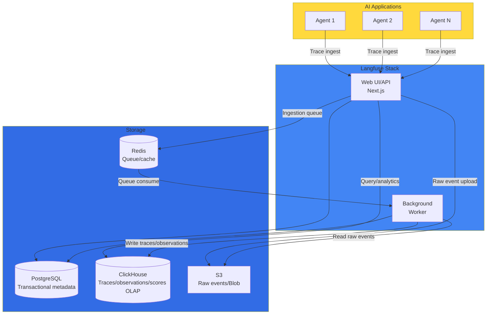
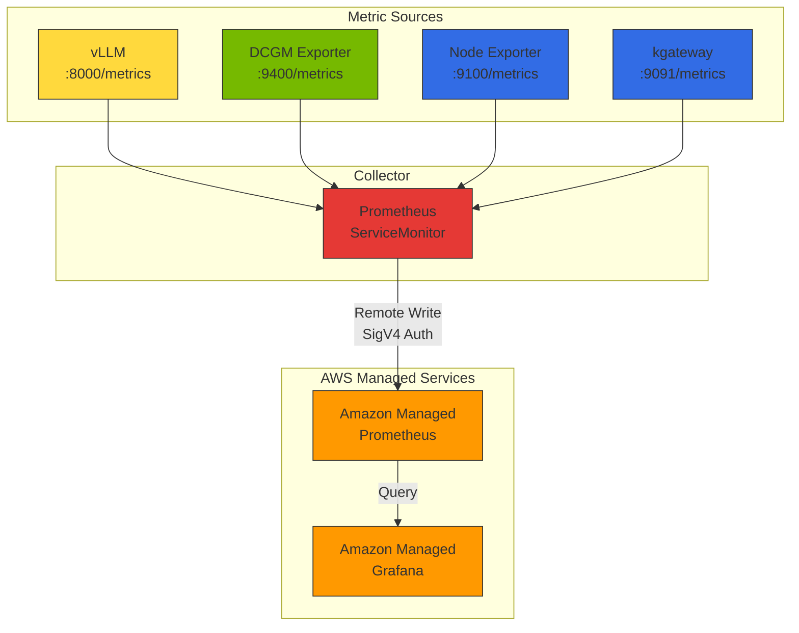
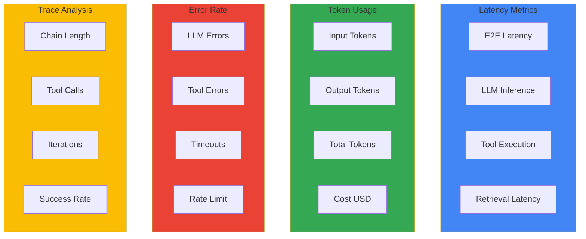
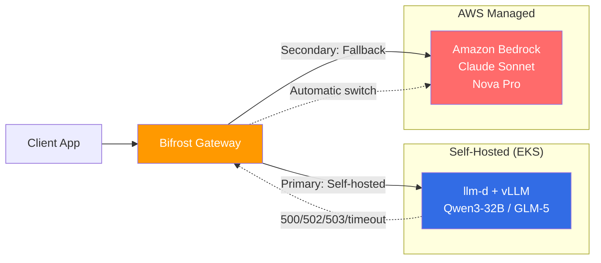

import {
  LatencyMetricsTable,
  TokenUsageMetricsTable,
  ErrorRateMetricsTable,
  DailyChecksTable,
  WeeklyChecksTable,
  MaturityModelTable
} from '@site/src/components/AgentMonitoringTables';

This document covers the monitoring architecture, key metric design, and alerting strategy for Agentic AI applications at a conceptual level.

:::info Production Deployment Guide
For Langfuse Helm deployment, AMP/AMG configuration, ServiceMonitor YAML, and Grafana dashboard JSON, see the [Monitoring Stack Setup Guide](../../reference-architecture/integrations/monitoring-observability-setup.md).
:::

## 1. Overview

Agentic AI applications perform complex reasoning chains and various tool calls, making it difficult to achieve sufficient visibility with traditional APM (Application Performance Monitoring) tools alone. LLM-specialized observability tools like Langfuse and LangSmith provide the following core capabilities:

- **Trace tracking**: Full flow tracking of LLM calls, tool execution, and agent reasoning processes
- **Token usage analysis**: Input/output token counts and cost calculation
- **Quality evaluation**: Response quality scoring and feedback collection
- **Debugging**: Problem diagnosis through prompt and response content review

:::info Target Audience
This document is intended for platform operators, MLOps engineers, and AI developers. Basic understanding of Kubernetes and Python is required.
:::

---

## 2. Monitoring Architecture

### Langfuse Architecture Overview

Langfuse v3 (2024-12 stable and later) consists of the following components. v3 uses a Postgres (transactional data), ClickHouse (OLAP for traces/observations/scores), Redis (queue/cache), and S3 (raw event uploads) architecture, which increased self-hosting complexity compared to v2:

**Figure 1. Langfuse v3 stack and storage composition**



### AMP/AMG Integrated Data Flow

**Figure 2. Data flow from metric sources to AMP and AMG**



### Monitoring Data Layers

**Table 1. Collection tools and visible items by monitoring data layer**

| Layer | Collection Tool | Metric Pattern | Visible Items |
|-------|----------------|---------------|---------------|
| **LLM Inference** | Langfuse | trace, generation | Token usage, cost, TTFT, per-user patterns |
| **Model Server** | vLLM Prometheus | `vllm_*` | Request count, batch size, KV cache utilization, TPS |
| **GPU** | DCGM Exporter | `DCGM_FI_DEV_*` | GPU utilization, temperature, power, memory usage |
| **Infrastructure** | Node Exporter | `node_*` | CPU, memory, network, disk I/O |
| **Gateway** | kgateway | `envoy_*` | Request count, latency, error rate, upstream status |

---

## 3. Key Monitoring Metrics

Defines the key metrics to track in Agentic AI applications.

### Metric Categories

**Figure 3. Key monitoring metric categories (latency, tokens, errors, traces)**



### Latency Metrics

<LatencyMetricsTable />

### Token Usage Metrics

<TokenUsageMetricsTable />

### Error Rate Metrics

<ErrorRateMetricsTable />

---

## 4. PromQL Query Reference

### GPU Metrics

```prometheus
# Overall GPU average utilization
avg(DCGM_FI_DEV_GPU_UTIL)

# Per-node GPU utilization
avg(DCGM_FI_DEV_GPU_UTIL) by (Hostname)

# GPU memory utilization (%) — divide by used+free to keep the range 0-100%
# FB_USED/FB_FREE exceeds 100% as free approaches 0, so it is not used.
# Aggregate per device with the gpu label (or GPU_I_ID when using MIG); reserved memory counts as used.
avg(
  DCGM_FI_DEV_FB_USED
  / (DCGM_FI_DEV_FB_USED + DCGM_FI_DEV_FB_FREE)
  * 100
) by (gpu)
```

### vLLM Metrics

```prometheus
# vLLM v1 engine metrics all use the vllm: prefix and a model_name label.
# The queries below are fleet aggregates summed across instances;
# to view per instance, group by (model_name, instance) instead of by (model_name).

# Overall TPS (tokens generated per second, fleet sum)
sum(rate(vllm:generation_tokens_total[5m]))

# Per-model TPS
sum(rate(vllm:generation_tokens_total[5m])) by (model_name)

# TTFT P99 (Time to First Token, fleet aggregate)
histogram_quantile(0.99, sum(rate(vllm:time_to_first_token_seconds_bucket[5m])) by (le))

# TTFT P95
histogram_quantile(0.95, sum(rate(vllm:time_to_first_token_seconds_bucket[5m])) by (le))

# E2E Latency P99
histogram_quantile(0.99, sum(rate(vllm:e2e_request_latency_seconds_bucket[5m])) by (le))

# Average batch size (running requests; mean of the per-instance gauge)
avg(vllm:num_requests_running)
```

### Gateway Metrics

```prometheus
# 5xx error rate (%) — numerator and denominator share the same downstream request population.
sum(rate(envoy_http_downstream_rq_xx{envoy_response_code_class="5"}[5m]))
/
sum(rate(envoy_http_downstream_rq_xx[5m])) * 100

# Upstream connection failure count (rate) — a counter of failed new connection attempts,
# distinct from active health-check failures (health checks use the envoy_cluster_health_check_failure family).
sum(rate(envoy_cluster_upstream_cx_connect_fail[5m])) by (envoy_cluster_name)
```

### Cost Metrics

```prometheus
# Daily total cost
sum(increase(llm_cost_dollars_total[24h]))

# Per-tenant daily cost
sum(increase(llm_cost_dollars_total[24h])) by (tenant_id)

# Per-model cost ratio
sum(increase(llm_cost_dollars_total[24h])) by (model)
/ ignoring(model) group_left
sum(increase(llm_cost_dollars_total[24h]))

# Budget utilization (monthly)
sum(increase(llm_cost_dollars_total[30d])) by (tenant_id)
/ on(tenant_id) group_left
tenant_monthly_budget_usd
```

---

## 5. Alerting Strategy

### Alert Threshold Design

**Table 2. Alert conditions, severity, and duration**

| Alert | Condition | Severity | Duration |
|-------|----------|----------|----------|
| **Agent High Latency** | P99 latency > 10s | Warning | 5 min |
| **Agent High Error Rate** | Error rate > 5% | Critical | 5 min |
| **LLM Rate Limit** | Rate limit errors > 10/5min | Warning | 2 min |
| **Daily Cost Budget** | Daily cost > $100 | Warning | Immediate |
| **GPU High Temperature** | GPU temp > 85C | Warning | 5 min |
| **GPU Memory Full** | GPU memory > 95% | Critical | 3 min |
| **vLLM High Latency** | P99 E2E latency > 30s | Warning | 5 min |

### Alert Hierarchy

1. **Infrastructure layer**: GPU temperature, memory, power anomalies
2. **Model server layer**: vLLM latency increase, KV cache shortage
3. **Application layer**: Agent error rate, Rate limit
4. **Business layer**: Cost overrun, SLA violations

:::tip Monitoring Best Practices

1. **Cross-layer metric correlation**: Analyze correlations — LLM request increase -> GPU utilization rise -> infrastructure load increase
2. **Anomaly detection**: When P99 latency suddenly increases, simultaneously check GPU temperature and memory usage
3. **Capacity planning**: Consider provisioning additional GPU nodes when average GPU utilization exceeds 70%
4. **Cost optimization**: Prioritize models with lower TTFT to improve user experience + increase throughput
:::

---

## 6. Cascade Fallback Strategy

When self-hosted models (vLLM/llm-d) are overloaded or failing, configuring Cascade Routing that automatically falls back to Amazon Bedrock managed models reduces the requests that fail during GPU failures or Spot interruptions. This configuration does not guarantee uninterrupted service, however. Fallback runs only on retryable failures and provider timeouts; it does not run when the request's own deadline has expired or the client cancelled the request. An error after a streaming response has started reaching the client cannot be stitched onto another provider's response, and if Bedrock-side quotas or throttling apply, the fallback request fails too. Bifrost (or LiteLLM) acts as the gateway and switches requests to Bedrock on response failures or timeouts.

**Figure 4. Cascade fallback flow switching to Bedrock on self-hosted failure**



### Fallback Condition Configuration

Bifrost configures fallback via the request body's `fallbacks` array and governance `routing_rules` (CEL expressions + weighted targets). The fallback triggers are the failures Bifrost classifies by fixed rules: 5xx and network errors, a 429 that remains after retries and key rotation, and provider timeouts. For latency, a rule can set a first-token wait limit for streaming requests (`ttft_timeout_ms`); if the first token does not arrive within the limit, Bifrost moves to the next fallback (as of 2026-10-29). Fallback on arbitrary status-code or error-rate conditions was a feature request as of 2026-05 (issue #3261).

The `targets` weights in the example below are a split that selects a target probabilistically for each request. With a 0.8/0.2 setting, about 20% of requests therefore go to Bedrock even at steady state when self-hosted has spare capacity. To send traffic to Bedrock only at peak, use a separate rule or fallback conditioned on capacity metrics (`request`, `tokens_used`, `budget_used`: usage as a percentage of the configured rate limit or budget) instead of a weighted split.

```yaml
# Bifrost config governance.routing_rules structure, written as YAML
governance:
  routing_rules:
    - name: cost-optimized-cascade
      enabled: true
      cel_expression: "model == 'qwen3-32b'"
      targets:
        - provider: "self-hosted"
          model: "qwen3-32b"
          weight: 0.8  # selected probabilistically per request; weights sum to 1
        - provider: "bedrock"
          model: "claude-sonnet"
          weight: 0.2
      fallbacks:
        - "bedrock/claude-sonnet"  # tried in order
      scope: "global"
      priority: 10
```

### Availability and Cost Comparison

**Table 3. Availability and cost of self-hosted-only versus a Cascade configuration**

| Aspect | Self-hosted only | Cascade (Self-hosted + Bedrock) |
|--------|------------------|---------------------------------|
| **Availability** | Service outage on GPU failure | Bedrock fallback on retryable failures and timeouts (within the deadline and Bedrock quotas) |
| **Cost** | Fixed GPU cost | Fixed self-hosted GPU cost + pay-per-use cost of requests sent to Bedrock |
| **Capacity planning** | Provision GPUs for peak traffic | GPUs for base traffic only, overflow to Bedrock via capacity-conditioned rules and fallback |
| **Cold Start** | Several-minute delay on Spot interruption | Bedrock serves the requests that fall back during the Spot interruption (Bedrock response latency and quotas apply) |

:::tip Cost optimization pattern
A hybrid pattern that handles base traffic on self-hosted and sends only the peak overflow to Bedrock through a capacity-conditioned rule reduces the need to provision GPUs for peak. The 0.8/0.2 weighted split in the example above always sends about 20% to Bedrock regardless of peak, so it is a different cost structure from peak offload. Actual savings vary widely by traffic pattern (third-party estimate 30-70%) and are hard to generalize.
:::

A 3-tier Cascade (On-Prem -> Cloud -> Bedrock) that also includes an on-premises GPU farm is covered in [Hybrid GPU Workloads and SR-IOV Networking](/docs/eks-hybrid-nodes/compute-gpu/gpu-sriov-networking); for gateway-level routing tuning, see [Cascade Routing Tuning](../../model-serving/inference-routing/cascade-routing-tuning.md).

---

## 7. Cost Tracking {#6-cost-tracking}

### Cost Tracking Concepts

This section covers the **observation** of cost — metric collection, PromQL queries, and dashboards. For the methodology of **allocating** observed costs to tenants (showback/chargeback) and budget policy design, see [LLM FinOps — Chargeback and Cost Allocation](../governance/llm-finops-chargeback.md); for gateway-level budget enforcement, see [AI Gateway Multi-Tenancy](../governance/ai-gateway-multi-tenancy.md).

Track LLM usage costs by the following criteria:

- **Per-model**: Total cost and request count per model, identifying the most expensive models
- **Per-tenant**: Per-tenant/team daily token usage and budget utilization
- **Per-time**: Peak time analysis, cost trends

### Per-Model Cost Reference (public pricing snapshot as of 2026-10)[^1] {#per-model-cost-reference-2026-04-baseline1}

The table below is a reference snapshot of each provider's public standard (non-batch) pricing taken at 2026-10. Prices change frequently, so re-check the official pages in the footnote before any actual estimate. If you need the price on a specific past date (such as 2026-04-17), capture the snapshot from that date separately; do not substitute current values for past ones.

**Table 4. Input/output pricing and features by model tier**

| Tier | Model | Input ($/1M tok) | Output ($/1M tok) | Features |
|------|-------|----------------|----------------|----------|
| **Frontier** | Claude Opus 4.7 | $5 | $25 | Highest quality reasoning |
| **Frontier** | GPT-4.1 | $2 | $8 | Complex reasoning (OpenAI standard pricing) |
| **Frontier** | o3 | See official page | See official page | Reasoning-only model, succeeded by the GPT-5 line (check the official page for pricing) |
| **Frontier** | Gemini 2.5 Pro | $1.25 | $5 | Enhanced multimodal |
| **Balanced** | Claude Sonnet 4.6 | $3 | $15 | Quality-cost balance |
| **Balanced** | GPT-4.1 mini | $0.40 | $1.60 | Fast inference |
| **Balanced** | Gemini 2.5 Flash | $0.10 | $0.40 | High throughput |
| **Fast/Cheap** | Claude Haiku 4.5 | $0.80 | $4 | Simple tasks |
| **Fast/Cheap** | GPT-4.1 nano | $0.10 | $0.40 | Ultra-low cost |
| **Fast/Cheap** | Gemini 2.5 Flash-Lite | $0.05 | $0.20 | Minimal latency |
| **Open-weight** | DeepSeek V3.1 | Self-hosted | Self-hosted | Open license |
| **Open-weight** | Llama 4 Scout | Self-hosted | Self-hosted | Meta official |
| **Open-weight** | Qwen3-32B | Self-hosted | Self-hosted | Alibaba Cloud (largest Qwen3 dense model) |

[^1]: Check each provider's official pricing page for current prices: [OpenAI Pricing](https://openai.com/api/pricing/), [Anthropic Pricing](https://www.anthropic.com/pricing), [Google AI Pricing](https://ai.google.dev/pricing)

:::tip Cost Optimization Tips

1. **Model selection optimization**: Use cheaper models (GPT-4.1 nano, Haiku 4.5, Gemini 2.5 Flash-Lite) for simple tasks
2. **Prompt optimization**: Reduce input tokens by removing unnecessary context
3. **Caching**: Reuse results of repeated queries. Prompt Caching reuses the input-token processing of a shared prefix, whereas Semantic Caching returns a stored response for a similar query and skips the model call entirely, so the two save cost by different mechanisms.
4. **Cascade Routing**: Try a low-cost model first and fall back to a high-performance model on failure. The savings depend on the price gap between the two models and the share of queries the low-cost model handles successfully. For example, if a low-cost model whose input/output price is one-tenth handles 70% of queries, the total cost is about 37% (= 0.7×0.1 + 0.3×1.0) of a single high-performance model, a worked example of roughly 63% savings. The actual savings vary with traffic mix and success rate, so this is an example, not a measured value.
5. **Open-weight models**: Convert to fixed costs with DeepSeek V3.1, Llama 4, Qwen3 when self-hosting
:::

---

## 8. Operations Checklist {#7-operations-checklist}

### Daily Checks

<DailyChecksTable />

### Weekly Checks

<WeeklyChecksTable />

---

## 9. Monitoring Maturity Model {#8-monitoring-maturity-model}

<MaturityModelTable />

---

## 10. Next Steps {#9-next-steps}

- [Monitoring Stack Setup Guide](../../reference-architecture/integrations/monitoring-observability-setup.md) - AMP/AMG deployment, Langfuse Helm installation, ServiceMonitor, Grafana dashboard production setup
- [LLMOps Observability Comparison Guide](./llmops-observability.md) - In-depth comparison of Langfuse vs LangSmith vs Helicone
- [Agentic AI Platform Architecture](../../design-architecture/foundations/agentic-platform-architecture.md) - Overall platform design
- [RAG Evaluation Framework](../governance/ragas-evaluation.md) - Quality evaluation with Ragas

## References

- [Langfuse Documentation](https://langfuse.com/docs)
- [LangSmith Documentation](https://docs.smith.langchain.com/)
- [CloudWatch Generative AI Observability](https://aws.amazon.com/blogs/mt/launching-amazon-cloudwatch-generative-ai-observability-preview/)
- [OpenTelemetry Documentation](https://opentelemetry.io/docs/)
- [Prometheus Monitoring](https://prometheus.io/docs/)
