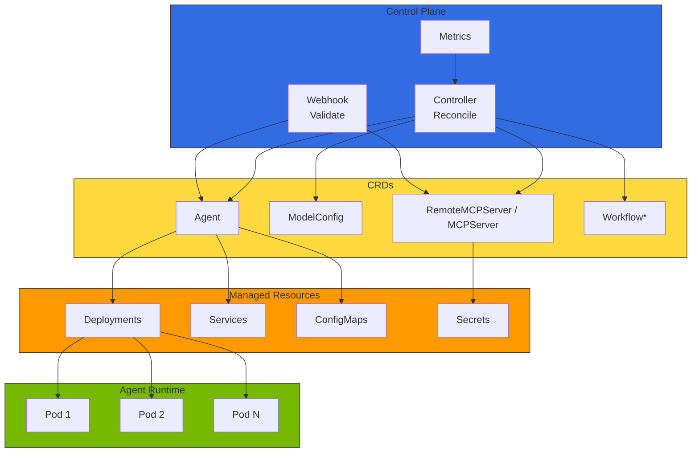
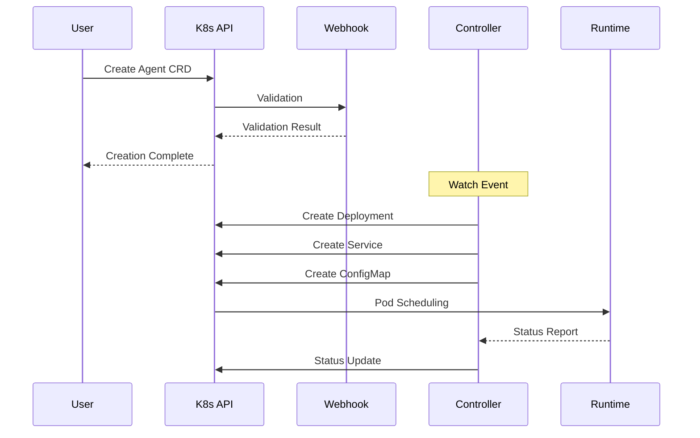
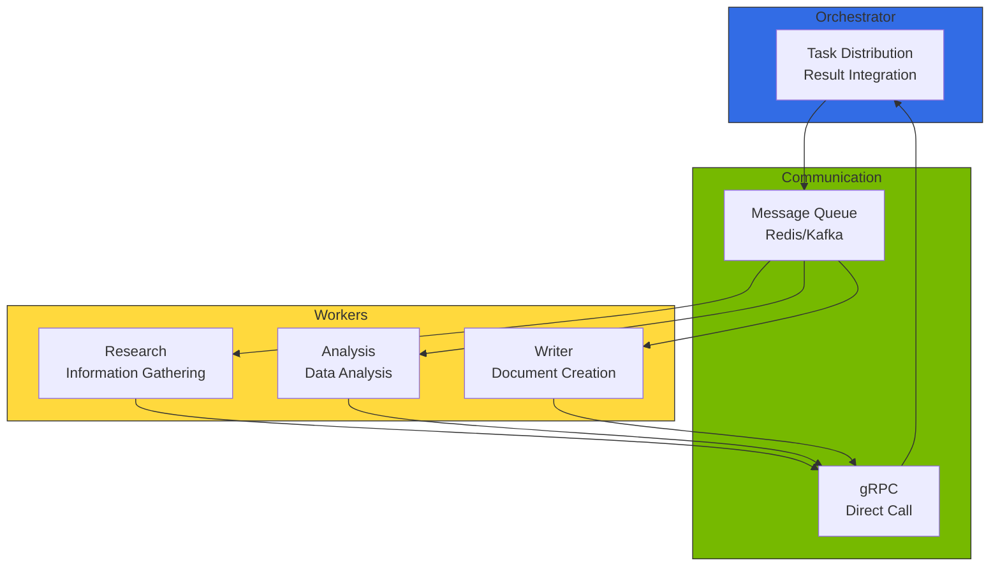
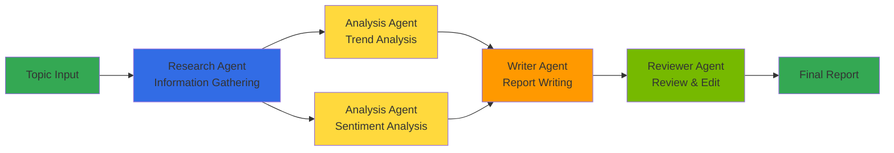

In a multi-model ecosystem, AI agents must call multiple LLMs/SLMs, connect to tools and other agents via MCP/A2A protocols, and dynamically scale based on traffic. Kubernetes' **Operator pattern** is the most natural approach for declaratively defining such agents as CRDs and automatically managing their lifecycles. Kagent is a reference architecture that applies this pattern to AI agents.

## 1. Overview

Kagent declaratively defines agents, tools, and workflows through Custom Resource Definitions (CRDs), with an Operator automatically deploying and managing them. Instead of manually writing Deployments, Services, and ConfigMaps, a single `Agent` CRD integrates model connections, tool bindings, and scaling policies.

:::warning Kagent Project Status and Scope of This Document
Kagent is a CNCF Sandbox open-source project created by Solo.io. As of 2026-10-15 the latest release is `v1.0.0-alpha13` (Apache-2.0). The project is public but still at the alpha stage, so its API and installation method can change between releases. In this document, the Agent/Tool/Memory specs in §3 follow the official `kagent.dev/v1alpha2` API, whereas the Operator architecture diagram in §2 and the multi-agent orchestration patterns in §4 are design proposals not defined by the official API and require a separate controller and CRDs to implement. For production environments, also evaluate alternatives such as **Bedrock AgentCore**, **KubeAI**, or **LangGraph Platform**.

For installation and deployment guides and the current API, see the [Kagent official documentation](https://kagent.dev/docs/) and the [GitHub repository](https://github.com/kagent-dev/kagent).
:::

### Alternative Solutions Comparison

import { SolutionsComparisonTable } from '@site/src/components/KagentTables';

<SolutionsComparisonTable />

Another open-source self-improving agent runtime is **hermes-agent** (NousResearch, MIT). It supports MCP, 40+ tools, and subagent spawning, and is model-agnostic — it can use OpenRouter and other [LLM API Gateways](../../model-serving/inference-routing/tiered-gateway-architecture.md) (Tier 2 ②) as model providers, forming the **Layer 4 (agent runtime) → Layer 5 (gateway)** flow directly. Consider Kagent when you need Kubernetes-native declarative management, and hermes-agent when you need a standalone self-improving agent.

### Key Features

- **Declarative agent management**: YAML-based agent definition and deployment
- **Tool registry**: Central management of tools available to agents via CRDs
- **Auto-scaling integration**: Dynamic scaling by attaching a separately installed HPA or KEDA ScaledObject to the controller-created Deployment (see §5)
- **Multi-agent orchestration**: Inter-agent collaboration for complex workflows (design proposal)
- **Observability integration**: Native integration with Langfuse/LangSmith, OpenTelemetry

:::info Target Audience
This document is intended for Kubernetes administrators, platform engineers, and MLOps engineers. Understanding of basic Kubernetes concepts (Pod, Deployment, CRD) is required.
:::

:::tip re:Invent 2025 Related Session

**CNS421: Streamline Amazon EKS Operations with Agentic AI** — A code talk session covering automated EKS cluster management, real-time issue diagnosis, and automatic recovery using AI agents like Kagent.

**Key Topics:**
- **Model Context Protocol (MCP)**: Standard protocol for AI agent integration with AWS services
- **Automated Incident Response**: Automatic diagnosis and recovery for Pod failures, resource shortages, network issues
- **AWS Service Integration**: Native integration with CloudWatch, Systems Manager, EKS API

[Watch the session](https://www.youtube.com/watch?v=4s-a0jY4kSE)
:::

---

## 2. Kagent Architecture

Kagent follows the Kubernetes Operator pattern, consisting of Controller, CRDs, and Webhooks.

**Figure 1. Kagent Operator architecture (control plane, CRDs, managed resources, runtime)**



Agent, ModelConfig, and RemoteMCPServer/MCPServer are CRDs defined by the official `kagent.dev/v1alpha2` API. Tools and memory are not separate CRDs; they are embedded in the Agent spec, so they are not drawn as independent CRDs. The asterisk on `Workflow*` indicates that multi-agent orchestration is a design proposal not part of the official API and requires a separate CRD and controller to implement (see §4).

### Component Description

import { ComponentsTable } from '@site/src/components/KagentTables';

<ComponentsTable />

### Component Interaction

**Figure 2. Component interaction from Agent CRD creation to Pod scheduling**



### Prerequisites

- Kubernetes cluster (a maintained version, v1.34+ recommended — v1.33 reached end of life on 2026-06-28)
- kubectl CLI tool
- Helm v3 (for Helm installation)
- cert-manager (Webhook TLS certificate management)

---

## 3. CRD Structure

### Agent CRD

The Agent CRD declaratively defines the settings for an AI agent. Below is the core spec of the kagent `v1alpha2` Declarative Agent. The model is not written inline; it references a separate `ModelConfig` resource via `modelConfig`, and tools are bound from an MCP server with `type: McpServer`:

```yaml
apiVersion: kagent.dev/v1alpha2
kind: Agent
metadata:
  name: customer-support-agent
  namespace: kagent
spec:
  description: "AI agent that responds to customer inquiries and creates tickets"
  type: Declarative
  declarative:
    # The model references a separate ModelConfig resource (not inline)
    modelConfig: default-model-config

    # System prompt
    systemMessage: |
      You are a friendly and professional customer support agent.

    # Tool list (binds tools from an MCP server)
    tools:
      - type: McpServer
        mcpServer:
          name: kagent-tool-server
          kind: RemoteMCPServer
          apiGroup: kagent.dev
          toolNames:
            - search-knowledge-base
            - create-ticket
          # Destructive tools pause for user approval before running
          requireApproval:
            - create-ticket

    # Memory (built on the Google ADK implementation, stored in pgvector)
    memory:
      modelConfig: default-model-config   # References the embedding ModelConfig
      ttlDays: 30                         # Default is 15 days
```

The referenced `ModelConfig` resource defines the model provider and model ID. For example, to use an Amazon Bedrock Titan embedding model:

```yaml
apiVersion: kagent.dev/v1alpha2
kind: ModelConfig
metadata:
  name: default-model-config
  namespace: kagent
spec:
  provider: Bedrock
  model: amazon.titan-embed-text-v2:0
  bedrock:
    region: us-east-1
```

### Tool (nested type in the Agent spec) {#tool-crd}

A Tool is not an independent CRD; it is defined in the Agent spec's `tools: []Tool` array. The tool type is one of `McpServer` or `Agent` (kagent v1alpha2 API).

**Table 1. Key Tool fields by type with examples**

| Field | Description | Example |
|-------|-------------|---------|
| `type` | Tool type | `McpServer`, `Agent` |
| `mcpServer` | MCP server reference (when `type` is McpServer) | RemoteMCPServer or MCPServer name |
| `agent` | Reference to another Agent (when `type` is Agent) | Agent name |

### Memory (field in the Agent spec) {#memory-crd}

In v1alpha2, Memory is no longer an independent CRD; it is consolidated into the Agent spec's `memory: MemorySpec` field.

**Table 2. Key features of Memory (field in the Agent spec)**

| Feature | Description |
|---------|-------------|
| **Embedding model reference** | References a ModelConfig resource via the `modelConfig` field |
| **TTL setting** | Sets the memory retention period via the `ttlDays` field |
| **Storage** | Built-in implementation based on Google ADK, stored in pgvector (redis/in-memory not selectable) |

### Workflow CRD

Define multi-agent workflows using the Workflow CRD.

**Table 3. Core Workflow CRD spec fields**

| Field | Description |
|-------|-------------|
| `spec.input` | Workflow input parameter definition |
| `spec.steps` | Per-step agent execution definition (sequential/parallel) |
| `spec.steps[].dependsOn` | Dependency step specification (DAG construction) |
| `spec.steps[].parallel` | Parallel execution flag |
| `spec.output` | Workflow final output mapping |
| `spec.errorHandling` | Behavior on step/workflow failure |
| `spec.timeout` | Overall workflow timeout |
| `spec.concurrency` | Concurrent execution limit (queue/reject/replace) |

---

## 4. Multi-Agent Orchestration

Define workflows where multiple agents collaborate to handle complex tasks.

### Inter-Agent Communication Patterns

**Figure 3. Inter-agent communication across orchestrator, worker, and communication layers**



### Orchestration Patterns

**Table 4. Multi-agent orchestration patterns and suitable use cases**

| Pattern | Description | Suitable For |
|---------|-------------|-------------|
| **Sequential Pipeline** | Step-by-step sequential execution, previous step output feeds next input | Data processing, ETL |
| **Parallel Fan-out** | Same input sent to multiple agents in parallel | Multi-angle analysis, A/B comparison |
| **DAG Workflow** | Dependency-based directed acyclic graph execution | Complex research, report generation |
| **Loop** | Repeated execution until condition is met | Review-revision cycles, quality verification |
| **Routing** | Branch to different agents based on input content | Inquiry classification, domain distribution |

### Workflow Example: Research Report

**Figure 4. Agent stages in the research report generation workflow**



Workflow execution status is tracked via `WorkflowRun` CRD:

**Table 5. WorkflowRun execution states and meaning**

| Status | Description |
|--------|-------------|
| `Pending` | Waiting for execution |
| `Running` | One or more steps are running |
| `Succeeded` | All steps completed successfully |
| `Failed` | One or more steps failed (retries exhausted) |

---

## 5. Agent Lifecycle Management

### Operator-Managed Resources

When an Agent CRD is created, the Controller creates/manages the following resources:

```
Agent CRD Creation
  ├── Deployment (agent Pod management)
  ├── Service (network access)
  ├── ConfigMap (agent configuration)
  └── Secret reference (API keys, credentials)
```

The kagent controller does not automatically create autoscaling resources (an HPA or a KEDA ScaledObject). A HorizontalPodAutoscaler requires metrics-server, and a KEDA ScaledObject requires the KEDA operator; each must be installed separately and then authored directly against the Deployment the controller created. The scaling-strategy table below is a design target to apply to such a separately configured autoscaler, not a set of fields provided by the kagent API.

### Update Strategies

**Table 6. Agent update strategies and recommended scenarios**

| Strategy | Description | Recommended Scenario |
|----------|-------------|---------------------|
| **Rolling Update** | Default strategy. Progressively replace Pods | General config changes |
| **Canary Deployment** | Test new version with separate Agent CRD | Model changes, major prompt revisions |
| **Blue-Green** | Run two versions simultaneously, switch traffic | Zero-downtime migration |

### Scaling Strategies

**Table 7. Scaling metrics and threshold examples**

| Metric | Description | Threshold Example |
|--------|-------------|------------------|
| CPU utilization | Basic resource-based scaling | 70% |
| Memory utilization | Scale out on memory pressure | 80% |
| Active session count | KEDA + Prometheus custom metric | 50 sessions/Pod |
| Request throughput | Requests per second based | 100 RPS/Pod |

---

## 6. Observability Integration

Agent execution traces are sent to Langfuse, LangSmith, or CloudWatch Generative AI Observability. For a comparison of each tool, see [LLMOps Observability Comparison](llmops-observability.md).

Deployment guides:
- **Langfuse**: [Architecture](agent-monitoring.md), [Helm Deployment](../../reference-architecture/integrations/monitoring-observability-setup.md)
- **LangSmith**: [LangSmith Official Documentation](https://docs.smith.langchain.com/)
- **CloudWatch**: [AWS Generative AI Observability](https://docs.aws.amazon.com/cloudwatch/)

### Key Alert Rules

**Table 8. Agent key alert rules with conditions and severity**

| Alert | Condition | Severity |
|-------|----------|----------|
| Agent error rate increase | Error rate > 5% (5 min sustained) | Critical |
| Agent response delay | P99 > 30s (5 min sustained) | Warning |
| Pod availability degradation | Ready Pods < 50% (5 min sustained) | Critical |

---

## 7. Conclusion

Using Kagent enables declarative management of AI agents in Kubernetes environments. Key benefits include:

- **Declarative management**: YAML-based agent definitions support GitOps workflows
- **Automated operations**: Automatic recovery and scaling through the Operator pattern
- **Standardization**: Agent definition standardization through CRDs
- **Scalability**: Leveraging Kubernetes-native scaling mechanisms
- **Observability**: Integrated monitoring and tracing support

:::tip Next Steps

- [Agentic AI Platform Architecture](../../design-architecture/foundations/agentic-platform-architecture.md) - Overall platform design
- [Agent Monitoring](agent-monitoring.md) - Langfuse/LangSmith integration guide
- [GPU Resource Management](../../model-serving/gpu-infrastructure/gpu-resource-management.md) - Dynamic resource allocation

:::

---

## References

### Official Documentation
- [Kagent Concepts and Design Patterns](https://github.com/kagent-dev/kagent)
- [KubeAI - Kubernetes AI Platform](https://github.com/substratusai/kubeai)
- [Bedrock AgentCore](https://docs.aws.amazon.com/bedrock-agentcore/latest/devguide/what-is-bedrock-agentcore.html)
- [LangGraph Platform](https://langchain-ai.github.io/langgraph/)
- [Kubernetes Operator Pattern](https://kubernetes.io/docs/concepts/extend-kubernetes/operator/)
- [KEDA Documentation](https://keda.sh/docs/)
- [re:Invent 2025 CNS421 - Streamline EKS Operations with Agentic AI](https://www.youtube.com/watch?v=4s-a0jY4kSE)

### Related Documentation
- [Agentic AI Platform Architecture](../../design-architecture/foundations/agentic-platform-architecture.md)
- [Agent Monitoring](./agent-monitoring.md)
- [GPU Resource Management](../../model-serving/gpu-infrastructure/gpu-resource-management.md)
