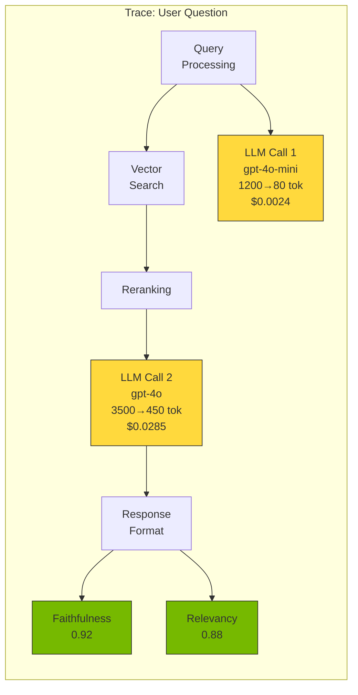
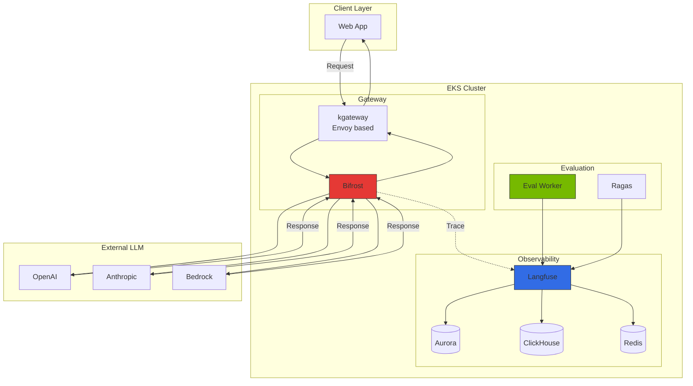
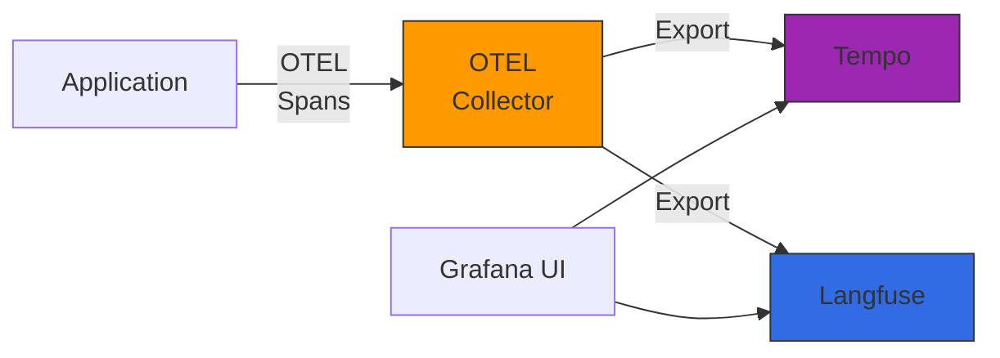

## 1. Overview

### 1.1 Why Traditional APM Falls Short for LLM Workloads

HTTP latency and error telemetry from an APM is not sufficient on its own to assess LLM response quality and cost. Collect and manage the following information as well.

- **Tokens and cost**: Record input/output tokens, the model and provider used, and the applied pricing.
- **Prompts and evaluation**: Connect each answer to its prompt-template version and retain A/B test and quality-evaluation results.
- **Agent execution steps**: Link retrieval, tool calls, and model calls into one request trace.
- **Response quality**: Evaluate answer accuracy and support from evidence separately from latency and throughput.

### 1.2 Four Core Areas of LLMOps Observability

1. **Tracing**: Track entire request lifecycle (prompt -> LLM -> response), visibility into nested chain/agent steps
2. **Evaluation**: Measure response quality through automated/manual assessment (accuracy, faithfulness, relevance, toxicity, etc.)
3. **Prompt Management**: Prompt template version control, A/B testing, production deployment pipeline
4. **Cost Tracking**: Real-time aggregation of token costs by provider/model. Cost tracking in observability tools stops at **visibility**; per-team/project budget **enforcement** is handled at the gateway level ([AI Gateway Multi-Tenancy](../governance/ai-gateway-multi-tenancy.md)), and cost **allocation** is covered by FinOps methodology ([LLM FinOps Chargeback](../governance/llm-finops-chargeback.md))

:::info Practical Deployment Guide
For practical configuration including Langfuse Helm deployment, Redis/ClickHouse setup, kgateway sub-path routing, and Bifrost OTel integration, refer to [Monitoring Stack Configuration Guide](../../reference-architecture/integrations/monitoring-observability-setup.md).
:::

---

## 2. Core Concepts

### 2.1 Trace Structure

**Figure 1. Trace and span structure produced by a single user question**

The token counts, costs ($0.0024, $0.0285), and quality scores (Faithfulness 0.92, Relevancy 0.88) in the figure above are illustrative values that show the trace and span structure; they are not measured values.

### 2.2 Key Concept Definitions

**Table 1. Key LLMOps Observability concept definitions**

| Concept | Description |
|---------|-------------|
| **Trace** | Top-level unit representing entire request lifecycle. User question -> multiple LLM calls -> final response |
| **Span** | Individual step composing a trace (LLM call, tool call, vector search, post-processing) |
| **Generation** | LLM API call details: input/output tokens, model name, parameters, latency, cost |
| **Score** | Response quality evaluation metrics: automated (LLM-as-Judge), manual (human feedback) |
| **Session** | Context grouping multiple traces in conversational applications |

---

## 3. Solution Comparison

### 3.1 Langfuse

**Open-source LLMOps Observability platform** (MIT license, full self-hosted support)

**Core Features**:
- **Tracing**: Native integration with LangChain, LlamaIndex, OpenAI SDK, complete visibility into nested chains/agents
- **Prompt Management**: Prompt template version management, A/B testing, production/staging environment separation
- **Evaluation**: LLM-as-Judge, rule-based automated evaluation, annotation queue manual evaluation, dataset management
- **Architecture**: PostgreSQL (metadata) + ClickHouse (analytics) + Redis (cache)

**Advantages**: Complete data ownership, scaling without plan limits (within the infrastructure capacity the operator provides), robust evaluation pipeline, cost efficiency (self-hosted)

**Disadvantages**: Operational overhead (PG+CH+Redis management), initial configuration complexity

### 3.2 LangSmith

**Cloud-based Observability platform provided by LangChain AI**

**Core Features**:
- Zero-code integration with LangChain/LangGraph
- Hub (Prompt marketplace): Community sharing, version management, fork/share
- Evaluator library: Pre-defined evaluators, comparison mode
- Annotation queue: Team collaboration, RLHF data source

**Advantages**: Tight integration with LangChain and LangGraph makes chain-tracing setup simple, and it is a managed service that requires no infrastructure operation.

**Disadvantages**: It is designed around the LangChain ecosystem, so the benefits are reduced with other frameworks or custom code. The default offering is managed cloud; self-hosting is available on the enterprise plan. Billing is per trace.

### 3.3 Helicone

**Rust-based high-performance LLM Gateway + Observability integrated solution**

**Core Features**:
- Integration method: Point an OpenAI-compatible SDK's base URL at the Helicone AI Gateway and add your Helicone API key in the Authorization header, and requests are logged automatically. Model calls use either Helicone credits or your own provider keys (BYOK).
- Built-in gateway features: Rate limiting, caching, retries, load balancing
- Real-time cost dashboard

**Advantages**: Integration is simple using only the SDK base URL and an API key, with built-in gateway features. Helicone's own benchmark describes the latency its proxy adds as negligible relative to direct calls (see the source below for the measurement conditions).

**Disadvantages**: It does not run evaluation orchestration itself; instead it ingests and analyzes evaluation scores reported from external frameworks, and nested span tracking is limited.

For integration requirements see the Helicone [Quickstart](https://docs.helicone.ai/getting-started/quick-start), and for the proxy latency benchmark see the [Latency Impact](https://docs.helicone.ai/references/latency-affect) page (both verified 2026-10-15). The latency benchmark measured 500 requests with the `text-ada-001` model; absolute latency depends on the workload and network.

### 3.4 Solution Comparison Table

The per-feature levels (High, Medium, Low) in the table below are the author's qualitative assessment, not measured values.

**Table 2. Feature comparison of Langfuse, LangSmith, and Helicone**

| Feature | Langfuse | LangSmith | Helicone |
|---------|----------|-----------|----------|
| **License** | MIT (open-source; `/ee` enterprise modules under a separate commercial license) | Proprietary | Apache-2.0 (open-source, self-hosted available) |
| **Self-hosted** | Full support | Enterprise only | Supported |
| **Tracing** | High | High | Medium |
| **Prompt Management** | High (Version, A/B) | High (Hub) | Supported (versioning) |
| **Evaluation** | High (Pipeline) | High | Score ingestion (reports external-framework results) |
| **Cost Tracking** | High | High | High |
| **LangChain Integration** | High | High | Medium |
| **Framework Neutrality** | High | Medium | High |
| **Gateway Features** | None | None | High |
| **Scale Limits** | No plan limits (self-hosted, bounded by infrastructure capacity) | Plan limits | Plan limits |
| **Data Sovereignty** | High (when self-hosted) | Low (SaaS default) | High (when self-hosted) |

"No plan limits" in the Scale Limits row means that self-hosted Langfuse has no pricing-plan usage limits; the actual throughput limit is set by the capacity of the storage (Postgres, ClickHouse, and so on) and workers the operator configures. This document has not measured that capacity limit, so confirm it with a load test at your target traffic. The Data Sovereignty level assumes a self-hosted deployment, and it does not hold if trace data flows out to external evaluators (LLM-as-Judge) or model providers (see Table 6 in §7 for the conditions per scenario).

### 3.5 AWS Native Observability: CloudWatch Generative AI Observability

Amazon CloudWatch Generative AI Observability is an AWS-native solution for LLM and AI agent monitoring:

- **Infrastructure-agnostic monitoring**: Supports AI workloads across Bedrock, EKS, ECS, on-premises, and more
- **Agent/tool tracking**: Built-in views for agents, knowledge bases, and tool calls
- **End-to-end tracing**: Tracking across the entire AI stack
- **Framework compatibility**: Support for external frameworks like LangChain, LangGraph, CrewAI

Using Langfuse v3.x (self-hosted data sovereignty) together with CloudWatch Gen AI Observability (AWS-native integration) provides the most comprehensive observability.

---

## 4. Hybrid Architecture Recommendation

### 4.1 Why Single Solution Is Insufficient

Enterprise environments have complex requirements:

1. **Gateway Separation Needed**: Rate limiting, caching, failover managed independently from observability
2. **Multi-Framework Support**: Mix of LangChain, LlamaIndex, and custom code
3. **Data Sovereignty and Cost**: Cannot send sensitive data to cloud, billing spikes with large-scale traffic
4. **Advanced Evaluation Pipeline**: Integration with specialized frameworks like Ragas, CI/CD regression test automation

### 4.2 Recommended Combination: kgateway + Bifrost (Gateway) + Langfuse (Observability)

**Figure 2. kgateway, Bifrost, and Langfuse hybrid architecture**

**Benefits**:
- **Gateway Responsibility Separation**: kgateway (Envoy based) handles traffic management, authentication, rate limiting; Bifrost handles provider routing and caching
- **Observability Specialization**: Langfuse handles tracing, evaluation, and prompt management. Langfuse also runs a Worker that processes events asynchronously and an object store (S3-compatible) that persists events and large inputs/outputs.
- **Self-hosted gateway and observability components**: The gateway and observability application components run on EKS. External model services such as OpenAI, Anthropic, and Amazon Bedrock remain external dependencies, shown as External LLM in the figure.
- **Scalability**: Scale each layer independently

### 4.3 Helicone Standalone vs Bifrost+Langfuse Comparison

**Table 3. Comparison of Helicone standalone and the Bifrost+Langfuse combination**

| Aspect | Helicone Standalone | Bifrost + Langfuse |
|--------|---------------------|---------------------|
| **Integration Complexity** | Very low (URL change only) | Medium (SDK integration needed) |
| **Prompt Management** | Supported (versioning) | Strong (version, A/B testing) |
| **Evaluation Pipeline** | Score ingestion (reports external-framework results) | Full support (Ragas integration) |
| **Chain Tracking** | Limited | Perfect (nested spans) |
| **Scalability** | Gateway/Observability combined | Independent scaling |
| **Suitable Scenario** | MVP, simple API calls | Enterprise, complex chains |

---

## 5. OpenTelemetry Integration Architecture

### 5.1 Why Integrate OpenTelemetry

Langfuse provides LLM-specific observability, but overall application context is managed by existing APM. Using OpenTelemetry:

- **Unified Dashboard**: LLM trace + existing APM trace on one screen
- **Correlation Analysis**: Entire flow tracking: HTTP request -> DB query -> LLM call
- **Single Instrumentation SDK**: Send to both Langfuse and existing APM using only OpenTelemetry

### 5.2 OTel Semantic Conventions Mapping

Distinguish the `gen_ai.*` semantic-convention attributes from Langfuse-specific `langfuse.*` attributes. The Langfuse column describes the ingested meaning, not SDK method parameter names.

**Table 4. OTel GenAI and Langfuse-specific span attribute mapping**

| Namespace | Span attribute | Meaning in Langfuse |
|---|---|---|
| GenAI | `gen_ai.request.model` | Requested model name |
| GenAI | `gen_ai.usage.input_tokens` | Input token usage |
| GenAI | `gen_ai.usage.output_tokens` | Output token usage |
| GenAI | `gen_ai.request.temperature` | Model invocation parameter |
| Langfuse-specific | `langfuse.observation.input` | Observation input as a string or JSON string |
| Langfuse-specific | `langfuse.observation.output` | Observation output as a string or JSON string |
| Langfuse-specific | `langfuse.observation.cost_details` | Explicit cost details as a JSON string |

Check names and types against the [GenAI attribute registry](https://github.com/open-telemetry/semantic-conventions-genai/blob/0c87594975195608dc91b3f702e250a7b240c151/docs/registry/attributes/gen-ai.md) and [Langfuse OTel property mapping](https://langfuse.com/integrations/native/opentelemetry#property-mapping). GenAI conventions are evolving, so manage their version across instrumentation, collectors, and dashboards. Cost details are values supplied to Langfuse, not an automatically calculated GenAI standard attribute. Define the collection scope and redaction policy before recording potentially sensitive input or output content.

### 5.3 Grafana Tempo + Langfuse Combination

**Figure 3. Simultaneous export to Grafana Tempo and Langfuse via the OTEL Collector**

---

## 6. Evaluation Pipeline Concept

### 6.1 Evaluation Methods

Langfuse Evaluation supports three methods:

1. **LLM-as-Judge**: Evaluate response quality using separate LLM (Faithfulness, Relevancy, etc.)
2. **Rule-based**: Custom evaluation logic with Python functions (regex matching, keyword checks)
3. **Manual Evaluation**: Human evaluation directly in annotation queue (RLHF data collection)

### 6.2 Evaluation Metrics

**Table 5. Evaluation metrics by range, description, and method**

| Metric | Range | Description | Evaluation Method |
|--------|-------|-------------|-------------------|
| **Faithfulness** | 0-1 | Is response faithful to provided context? | LLM-as-Judge |
| **Answer Relevancy** | 0-1 | Is response relevant to question? | Ragas (embedding similarity) |
| **Context Precision** | 0-1 | Are relevant contexts ranked near the top? (rank-weighted) | Ragas |
| **Context Recall** | 0-1 | Is ground truth included in retrieved context? | Ragas |
| **Toxicity** | 0-1 | Does response contain harmful content? | Detoxify library |
| **Latency** | ms | Response generation latency | Auto-collected |
| **Cost** | USD | Cost per request | Auto-calculated |

### 6.3 Ragas Integration

Ragas is a RAG system-specific evaluation framework that integrates with Langfuse to provide more sophisticated evaluation. For details, refer to [RAG Evaluation with Ragas](../governance/ragas-evaluation.md) documentation.

---

## 7. Recommendations by Scenario

**Table 6. Recommended solution and rationale by scenario**

| Scenario | Recommended Solution | Reason |
|----------|----------------------|--------|
| **LangChain/LangGraph Centric Development** | LangSmith | Native LangChain integration, full chain tracking with one line of code |
| **Data Sovereignty Required (Finance/Healthcare)** | Langfuse (self-hosted) | Direct control over where telemetry is stored and how it is configured. GDPR/HIPAA and similar compliance must be determined per deployment, and outbound data flows to external evaluators and model providers must also be reviewed |
| **Quick Start (MVP/PoC)** | Helicone | Immediate tracking with URL change only, built-in gateway features |
| **Prompt Engineering Team Operations** | Langfuse | Prompt version management, A/B testing, dataset + automated evaluation |
| **Enterprise Hybrid** | Bifrost + Langfuse | Gateway/Observability responsibility separation, independent scaling |
| **Full-stack GenAI Platform** | kgateway + Bifrost + Langfuse + Ragas | API management + LLM routing + tracking + quality evaluation |
| **Large-scale Traffic (10M+ traces/month)** | Langfuse + ClickHouse cluster | Horizontal scaling possible, cost efficiency |

---

## 8. Summary

1. **LLMOps Observability is Essential**: HTTP latency and error telemetry from an APM alone is not enough to judge token cost, prompt quality, and chain tracking for LLM workloads; add LLM-specific instrumentation and evaluation as well.
2. **Three Major Solutions**: Langfuse (open-source, self-hosted, evaluation pipeline), LangSmith (LangChain optimized, managed), Helicone (proxy-based, Gateway+Observability integration)
3. **Hybrid Architecture Recommendation**: Under the assumptions of separating gateway and observability responsibilities and needing data sovereignty and independent scaling, the Bifrost (Gateway) + Langfuse (Observability) combination is useful for enterprise environments.
4. **OpenTelemetry Integration**: Connect existing APM and LLMOps observability with unified dashboard
5. **Evaluation Pipeline**: Automated/manual quality evaluation using LLM-as-Judge, Ragas, Annotation Queue

---

## References

### Official Documentation
- [Langfuse Documentation](https://langfuse.com/docs)
- [LangSmith Documentation](https://docs.smith.langchain.com)
- [Helicone Documentation](https://docs.helicone.ai)
- [OpenTelemetry LLM Semantic Conventions](https://opentelemetry.io/docs/specs/semconv/gen-ai/)
- [Ragas Documentation](https://docs.ragas.io)

### Related Documentation
- [Monitoring Stack Configuration Guide](../../reference-architecture/integrations/monitoring-observability-setup.md)
- [Inference Gateway Routing](../../model-serving/inference-routing/routing-strategy.md)
- [RAG Evaluation with Ragas](../governance/ragas-evaluation.md)
- [Agent Monitoring](./agent-monitoring.md)
- [LLM FinOps Chargeback](../governance/llm-finops-chargeback.md) — Cost allocation and budget policy methodology
- [AI Gateway Multi-Tenancy](../governance/ai-gateway-multi-tenancy.md) — Gateway-level budget enforcement
