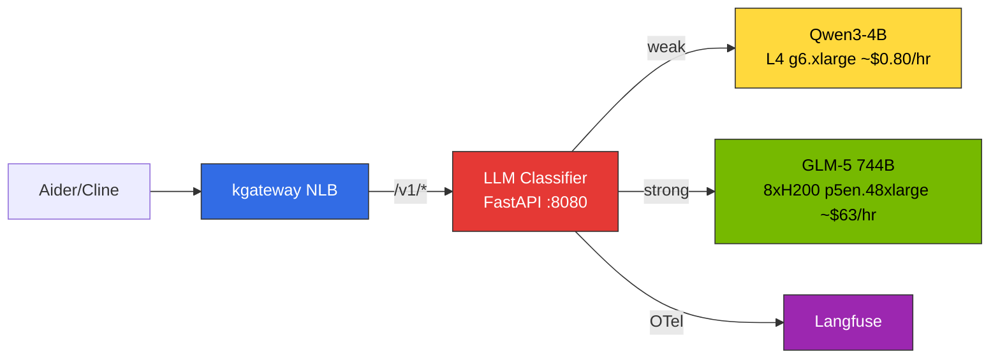
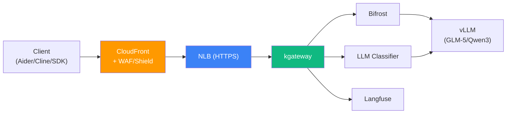
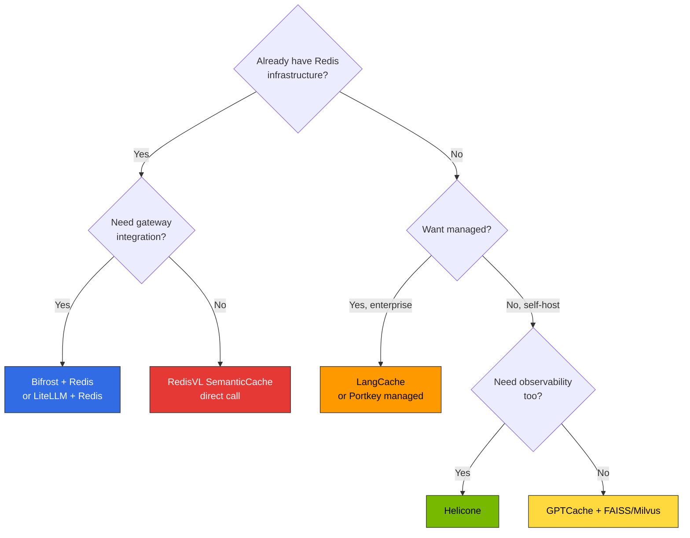

This document covers advanced configurations for production environments. Add prompt-based automatic routing (LLM Classifier), security layer (CloudFront + WAF/Shield), and cost optimization (Semantic Caching) to complete a full inference pipeline.

:::tip Time Required
**Learning**: 45 min | **Deployment**: 60-90 min
:::

:::info Prerequisites
The components in this document assume [Basic Deployment](./basic-deployment.md) is complete. Verify that kgateway, HTTPRoute, and Bifrost are operational first.
:::

---

## 1. LLM Classifier Deployment {#llm-classifier-deployment}

### 1.1 Architecture Overview

LLM Classifier is a **Python FastAPI-based lightweight router** that operates behind kgateway. It receives OpenAI-compatible requests from clients (Aider, Cline, etc.), analyzes prompt content, and automatically proxies to weak (SLM) or strong (LLM) backends.

**Figure 1. Prompt-based weak/strong backend routing flow of the LLM Classifier**



**Key Features:**
- Clients request with `model: "auto"` (or any model name); the proxy rewrites it to the selected backend's served model name before forwarding
- Classification based on keyword matching + input character length + conversation turn count
- Direct trace transmission via Langfuse OTel SDK
- Container image under 50MB (FastAPI + httpx)

### 1.2 Classification Logic (extproc_http.py)

```python
"""LLM Classifier — Prompt-based automatic model routing"""
import os, contextlib, httpx
from fastapi import FastAPI, Request, Response
from fastapi.responses import StreamingResponse

# A single, long-lived AsyncClient reused across requests. It must outlive the
# streaming response iterator, so it is NOT opened with `async with` inside the
# handler — doing so closes the client (and its connection pool) before the
# StreamingResponse body is read. It is closed once on application shutdown.
client = httpx.AsyncClient(timeout=300)

@contextlib.asynccontextmanager
async def lifespan(app: FastAPI):
    yield
    await client.aclose()

app = FastAPI(lifespan=lifespan)

# --- Classification Settings ---
STRONG_KEYWORDS = [
    "refactor", "architect", "design", "analyze", "optimize", "debug",
    "migration", "complex", "performance", "security", "review",
]
# Heuristic over raw characters, not tokens — rename accordingly so the
# threshold is not mistaken for a token budget.
CHAR_THRESHOLD = 500
TURN_THRESHOLD = 5

# --- Backend Settings ---
# Each tier maps to a (base URL, served model name) pair. The served model name
# is the id the backend was started with (vLLM `--served-model-name`); the proxy
# rewrites the client's `model` field to it so that `model: "auto"` actually
# resolves to a model the backend will accept.
WEAK_URL = os.getenv("WEAK_BACKEND", "http://qwen3-serving:8000")
STRONG_URL = os.getenv("STRONG_BACKEND", "http://glm5-serving:8000")
WEAK_MODEL = os.getenv("WEAK_MODEL", "qwen3-4b")
STRONG_MODEL = os.getenv("STRONG_MODEL", "glm-5")

def _text(content) -> str:
    """Flatten OpenAI message content: a plain string, or an array of
    {type, text} parts (array form is used by multimodal clients)."""
    if isinstance(content, str):
        return content
    if isinstance(content, list):
        return " ".join(
            part.get("text", "")
            for part in content
            if isinstance(part, dict) and part.get("type") == "text"
        )
    return ""

def classify(messages: list[dict]) -> str:
    """Analyze prompt content → decide weak / strong"""
    content = " ".join(_text(m.get("content")) for m in messages if m.get("content"))
    lower = content.lower()
    # 1. Keyword matching
    if any(kw in lower for kw in STRONG_KEYWORDS):
        return "strong"
    # 2. Input length (character count, not tokens)
    if len(content) > CHAR_THRESHOLD:
        return "strong"
    # 3. Conversation turn count
    if len(messages) > TURN_THRESHOLD:
        return "strong"
    return "weak"

# GET is needed so the documented `GET /v1/models` smoke check reaches a backend
# instead of returning 405; POST carries chat/completion requests.
@app.api_route("/v1/{path:path}", methods=["GET", "POST"])
async def proxy(path: str, request: Request):
    # GET (e.g. /v1/models) has no prompt to classify — forward to the weak
    # backend and relay its status and body verbatim.
    if request.method == "GET":
        resp = await client.get(f"{WEAK_URL}/v1/{path}", params=request.query_params)
        return Response(
            content=resp.content,
            status_code=resp.status_code,
            media_type=resp.headers.get("content-type"),
        )

    body = await request.json()
    messages = body.get("messages", [])
    tier = classify(messages)
    backend, model = (
        (STRONG_URL, STRONG_MODEL) if tier == "strong" else (WEAK_URL, WEAK_MODEL)
    )
    # Rewrite the client-supplied model (e.g. "auto") to the backend's served
    # model name; otherwise the backend rejects an unknown model id.
    body["model"] = model
    target = f"{backend}/v1/{path}"

    if body.get("stream"):
        req = client.build_request("POST", target, json=body)
        resp = await client.send(req, stream=True)

        async def relay_body():
            # Closing the downstream iterator (normal completion, client
            # cancellation, or an exception) also closes the upstream response.
            try:
                async for chunk in resp.aiter_bytes():
                    yield chunk
            finally:
                await resp.aclose()

        return StreamingResponse(
            relay_body(),
            status_code=resp.status_code,
            headers={"content-type": resp.headers.get("content-type", "text/event-stream")},
        )

    resp = await client.post(target, json=body)
    # Propagate the upstream status and body instead of silently returning
    # parsed JSON with a 200 — an upstream 4xx/5xx must reach the caller.
    return Response(
        content=resp.content,
        status_code=resp.status_code,
        media_type=resp.headers.get("content-type"),
    )
```

:::tip Langfuse OTel Integration
Adding OpenTelemetry SDK to the above code allows direct recording of classification decisions + backend response times to Langfuse. Install `opentelemetry-sdk`, `opentelemetry-exporter-otlp` packages and set `OTEL_EXPORTER_OTLP_ENDPOINT` to Langfuse OTLP endpoint.
:::

### 1.3 Dockerfile

```dockerfile
FROM python:3.11-slim
RUN pip install --no-cache-dir fastapi uvicorn httpx
COPY extproc_http.py /app/
WORKDIR /app
CMD ["uvicorn", "extproc_http:app", "--host", "0.0.0.0", "--port", "8080", "--workers", "2"]
```

```bash
# Build and push to ECR
docker buildx build --platform linux/amd64 \
  -t <ACCOUNT_ID>.dkr.ecr.us-east-2.amazonaws.com/llm-classifier:latest \
  --push .
```

### 1.4 K8s Deployment + Service

```yaml
apiVersion: apps/v1
kind: Deployment
metadata:
  name: llm-classifier
  namespace: ai-inference
spec:
  replicas: 2
  selector:
    matchLabels:
      app: llm-classifier
  template:
    metadata:
      labels:
        app: llm-classifier
    spec:
      containers:
      - name: classifier
        image: <ACCOUNT_ID>.dkr.ecr.us-east-2.amazonaws.com/llm-classifier:latest
        ports:
        - containerPort: 8080
          name: http
        env:
        - name: WEAK_BACKEND
          value: "http://qwen3-serving.ai-inference.svc.cluster.local:8000"
        - name: STRONG_BACKEND
          value: "http://glm5-serving.ai-inference.svc.cluster.local:8000"
        resources:
          requests:
            cpu: 250m
            memory: 256Mi
          limits:
            cpu: 500m
            memory: 512Mi
        readinessProbe:
          httpGet:
            path: /docs
            port: 8080
          initialDelaySeconds: 5
          periodSeconds: 10
        livenessProbe:
          httpGet:
            path: /docs
            port: 8080
          initialDelaySeconds: 10
          periodSeconds: 30
---
apiVersion: v1
kind: Service
metadata:
  name: llm-classifier
  namespace: ai-inference
spec:
  selector:
    app: llm-classifier
  ports:
  - name: http
    port: 8080
    targetPort: 8080
  type: ClusterIP
```

### 1.5 kgateway HTTPRoute Configuration

Route `/v1/*` path to LLM Classifier in kgateway. Use instead of direct vLLM routing or Bifrost-routed routing from basic deployment.

```yaml
apiVersion: gateway.networking.k8s.io/v1
kind: HTTPRoute
metadata:
  name: llm-classifier-route
  namespace: ai-inference
spec:
  parentRefs:
    - name: unified-gateway
      namespace: ai-gateway
  rules:
    - matches:
        - path:
            type: PathPrefix
            value: /v1/
      backendRefs:
        - name: llm-classifier
          port: 8080
      timeouts:
        request: 300s
        backendRequest: 300s
```

:::caution Timeout Settings
LLM inference can take tens of seconds. Set `timeouts.request` and `backendRequest` sufficiently (minimum 120s for GLM-5 744B, recommended 300s).
:::

### 1.6 Aider/Cline Connection

With LLM Classifier, **all clients connect to a single endpoint**. The incoming model name does not affect routing (the Classifier routes on prompt content); the proxy then rewrites it to the selected backend's served model name.

#### Aider

```bash
# LLM Classifier automatic branching — no double-prefix needed
OPENAI_API_BASE="http://<NLB_ENDPOINT>/v1" \
OPENAI_API_KEY="dummy" \
aider --model openai/auto
```

#### Cline

Settings -> API Provider -> OpenAI Compatible
- Base URL: `http://<NLB_ENDPOINT>/v1`
- Model: `auto`
- API Key: `dummy`

#### Python Client

```python
from openai import OpenAI

client = OpenAI(
    base_url="http://<NLB_ENDPOINT>/v1",
    api_key="dummy"
)

# Simple request → Qwen3-4B (automatic)
response = client.chat.completions.create(
    model="auto",
    messages=[{"role": "user", "content": "Hello"}]
)

# Complex request → GLM-5 744B (automatic)
response = client.chat.completions.create(
    model="auto",
    messages=[{"role": "user", "content": "Refactor this code and analyze the architecture"}]
)
```

:::info Advantages over Bifrost
The `provider/model` format (`openai/glm-5`) and Aider double-prefix trick (`openai/openai/glm-5`) required when routing via Bifrost are **completely unnecessary**. All clients connect with the same `model: "auto"`.
:::

### 1.7 Routing Endpoint Structure (With LLM Classifier)

```
http://<NLB_ENDPOINT>/v1/*           → LLM Classifier → Qwen3-4B or GLM-5 (automatic branching)
http://<NLB_ENDPOINT>/langfuse/*     → Langfuse (Observability UI)
http://<NLB_ENDPOINT>/_next/*        → Langfuse (Static Assets)
http://<NLB_ENDPOINT>/api/public/*   → Langfuse (API + OTel)
https://<AMG_ENDPOINT>               → Grafana (Separate managed service)
```

---

## 2. Gateway API Inference Extension (InferencePool + EPP) {#inference-extension}

Where the LLM Classifier and Bifrost decide "which **model**" (L1, across-model), the **Gateway API Inference Extension (GIE)** decides "which **Pod**" (L2, within-model) from vLLM real-time metrics (KV cache location and load). kgateway (Envoy-based) delegates each request to the **EPP (Endpoint Picker)** via `ext-proc` to pick the optimal Pod within an InferencePool. For the layer definitions and selection criteria, see [Routing Strategy — The two routing layers](../../../model-serving/inference-routing/routing-strategy.md#two-routing-layers--keep-them-distinct).

:::info Version and status
GIE reached v1.0.0 GA in 2025-09, and InferencePool is `inference.networking.k8s.io/v1`. The EPP code was consolidated into llm-d, and the policy CRD (`InferenceObjective`) lives in llm-d (`llm-d.ai/v1alpha2`, alpha). The GIE repository owns the InferencePool API and the Endpoint Picker Protocol. ([GIE docs](https://gateway-api-inference-extension.sigs.k8s.io/))
:::

### 2.1 Install CRDs

Install GIE CRDs such as InferencePool from the release manifest.

```bash
# Check the latest release tag: github.com/kubernetes-sigs/gateway-api-inference-extension/releases
export IGW_RELEASE=v1.5.0
kubectl apply -f https://github.com/kubernetes-sigs/gateway-api-inference-extension/releases/download/${IGW_RELEASE}/manifests.yaml
```

### 2.2 Deploy InferencePool + EPP (Helm)

The official GIE Helm chart **installs EPP and InferencePool together**. Select vLLM Pods with `modelServers.matchLabels`.

```bash
export IGW_CHART_VERSION=${IGW_RELEASE}
export POOL_NAME=glm5-pool

helm install ${POOL_NAME} \
  oci://registry.k8s.io/gateway-api-inference-extension/charts/inferencepool \
  --version ${IGW_CHART_VERSION} \
  --namespace ai-inference \
  --set inferencePool.modelServers.matchLabels.app=glm5-serving \
  --set provider.name=none   # none for kgateway/Envoy-family; specify the provider for GKE/Istio etc.
```

:::note provider.name
Set `provider.name` to match the gateway implementation. kgateway is Envoy-family, so leave it as `none` with no separate provider integration, deploy only InferencePool/EPP, then reference the InferencePool as a backend in the HTTPRoute below. Confirm the exact value and options against the deployment-time [GIE v1.5.0 InferencePool chart values](https://github.com/kubernetes-sigs/gateway-api-inference-extension/blob/v1.5.0/config/charts/inferencepool/values.yaml).
:::

The InferencePool the chart creates has the following form (for reference when authoring directly — fields follow `inference.networking.k8s.io/v1`):

```yaml
apiVersion: inference.networking.k8s.io/v1
kind: InferencePool
metadata:
  name: glm5-pool
  namespace: ai-inference
spec:
  selector:
    matchLabels:
      app: glm5-serving       # vLLM Pod label
  targetPorts:
    - number: 8000            # vLLM container port (not targetPortNumber)
  endpointPickerRef:           # EPP service reference (not extensionRef)
    name: glm5-pool-epp
    port:
      number: 9002
    failureMode: FailClose     # FailOpen | FailClose (default)
```

### 2.3 HTTPRoute → InferencePool

Make the HTTPRoute's `backendRefs` point to an **InferencePool** (group `inference.networking.k8s.io`) instead of a Service. Use instead of direct vLLM routing from basic deployment.

```yaml
apiVersion: gateway.networking.k8s.io/v1
kind: HTTPRoute
metadata:
  name: inferencepool-route
  namespace: ai-inference
spec:
  parentRefs:
    - name: unified-gateway
      namespace: ai-gateway
  rules:
    - matches:
        - path:
            type: PathPrefix
            value: /v1/
      backendRefs:
        - group: inference.networking.k8s.io
          kind: InferencePool
          name: glm5-pool
      timeouts:
        request: 300s
        backendRequest: 300s
```

### 2.4 Verification

```bash
# InferencePool status — confirm Accepted=True, ResolvedRefs=True
kubectl get inferencepool glm5-pool -n ai-inference -o yaml

# Check EPP Pod/Service
kubectl get pods,svc -n ai-inference -l app.kubernetes.io/name=inferencepool

# Routing test (EPP selects a Pod KV-aware)
curl -s http://<NLB_ENDPOINT>/v1/models | jq .
```

:::tip Using it together with L1
If you need across-model governance (budget, multi-provider, semantic cache), place L1 (Bifrost/LiteLLM/LLM Classifier) in front and this InferencePool+EPP (L2) behind for KV-aware Pod selection, composing `L1 → InferencePool(EPP) → vLLM`. If you serve only a single self-hosted model, `kgateway → InferencePool(EPP) → vLLM` without L1 is sufficient.
:::

---

## 3. CloudFront + WAF/Shield Security Layer {#cloudfront-waf}

In production, do not expose NLB directly; configure **CloudFront + WAF/Shield** at the front to perform DDoS defense, request filtering, and TLS termination.

### Architecture

**Figure 2. Request path through the CloudFront + WAF/Shield security layer**



### 3.1 Configure NLB TLS Listener {#21-configure-nlb-tls-listener}

Convert existing HTTP Gateway to HTTPS. Requires ACM certificate.

```bash
# 1. Request ACM certificate (NLB region — us-east-2)
# Match the certificate domain to the HTTPRoute hostname (api.example.com).
# Replace with your own owned domain, but use the same hostname across
# CloudFront, NLB, and HTTPRoute so TLS validation and Host routing stay
# consistent.
aws acm request-certificate \
  --domain-name "api.example.com" \
  --validation-method DNS \
  --region us-east-2

# 2. Confirm ARN after DNS validation complete
export NLB_CERT_ARN=$(aws acm list-certificates --region us-east-2 \
  --query "CertificateSummaryList[?DomainName=='api.example.com'].CertificateArn" \
  --output text)
```

Update Gateway resource to HTTPS:

```yaml
apiVersion: gateway.networking.k8s.io/v1
kind: Gateway
metadata:
  name: unified-gateway
  namespace: ai-gateway
  annotations:
    service.beta.kubernetes.io/aws-load-balancer-type: "external"
    service.beta.kubernetes.io/aws-load-balancer-nlb-target-type: "ip"
    service.beta.kubernetes.io/aws-load-balancer-scheme: "internet-facing"
    # TLS termination
    service.beta.kubernetes.io/aws-load-balancer-ssl-cert: "${NLB_CERT_ARN}"
    service.beta.kubernetes.io/aws-load-balancer-ssl-ports: "443"
    # SG restriction: Allow only CloudFront IP ranges
    service.beta.kubernetes.io/aws-load-balancer-security-groups: "${CF_RESTRICTED_SG_ID}"
spec:
  gatewayClassName: kgateway
  listeners:
    - name: https
      protocol: HTTPS
      port: 443
      tls:
        mode: Terminate
        certificateRefs:
          - name: nlb-tls-cert
      allowedRoutes:
        namespaces:
          from: All
```

:::warning Restrict NLB Security Group
NLB's Security Group should **allow only CloudFront Managed Prefix List**. Opening `0.0.0.0/0` will be automatically blocked by company policy.

```bash
# Check CloudFront Managed Prefix List
aws ec2 describe-managed-prefix-lists \
  --filters "Name=prefix-list-name,Values=com.amazonaws.global.cloudfront.origin-facing" \
  --query "PrefixLists[0].PrefixListId" --output text

# Allow only CloudFront prefix list in SG
aws ec2 authorize-security-group-ingress \
  --group-id ${CF_RESTRICTED_SG_ID} \
  --ip-permissions "IpProtocol=tcp,FromPort=443,ToPort=443,PrefixListIds=[{PrefixListId=${CF_PREFIX_LIST_ID}}]"
```
:::

:::warning Add distribution-specific origin access control
The CloudFront Managed Prefix List only allows **the IP ranges of the entire CloudFront fleet**; it does not authenticate "this distribution." Other CloudFront distributions on the same fleet (including other accounts) can also reach the NLB, so fleet IP filtering must be distinguished from authenticating this distribution. The AWS reference example validates a custom header on an ALB, but this design uses an NLB, so you must implement equivalent validation at **the kgateway layer that actually terminates HTTP**.

1. Add a distribution-specific secret header (e.g. `X-Origin-Verify: <random token>`) via CloudFront `OriginCustomHeaders`. Manage the token in Secrets Manager or similar and rotate it periodically.
2. In a kgateway HTTPRoute or policy, reject requests whose header value does not match (a header-match condition or an ext-proc/filter). This lets through only "requests sent by this distribution," not "any request from the CloudFront fleet."
3. The secret header is only meaningful when the CloudFront→NLB hop is TLS-protected, so use it together with `OriginProtocolPolicy: https-only` above.
:::

### 3.2 Create WAF WebACL {#22-create-waf-webacl}

```bash
# Create WAF WebACL (CloudFront must be in us-east-1)
aws wafv2 create-web-acl \
  --name "inference-gateway-waf" \
  --scope CLOUDFRONT \
  --region us-east-1 \
  --default-action '{"Allow":{}}' \
  --rules '[
    {
      "Name": "AWSManagedRulesCommonRuleSet",
      "Priority": 1,
      "Statement": {
        "ManagedRuleGroupStatement": {
          "VendorName": "AWS",
          "Name": "AWSManagedRulesCommonRuleSet"
        }
      },
      "OverrideAction": {"None":{}},
      "VisibilityConfig": {
        "SampledRequestsEnabled": true,
        "CloudWatchMetricsEnabled": true,
        "MetricName": "CommonRuleSet"
      }
    },
    {
      "Name": "RateLimit",
      "Priority": 2,
      "Statement": {
        "RateBasedStatement": {
          "Limit": 2000,
          "AggregateKeyType": "IP"
        }
      },
      "Action": {"Block":{}},
      "VisibilityConfig": {
        "SampledRequestsEnabled": true,
        "CloudWatchMetricsEnabled": true,
        "MetricName": "RateLimit"
      }
    },
    {
      "Name": "AWSManagedRulesKnownBadInputsRuleSet",
      "Priority": 3,
      "Statement": {
        "ManagedRuleGroupStatement": {
          "VendorName": "AWS",
          "Name": "AWSManagedRulesKnownBadInputsRuleSet"
        }
      },
      "OverrideAction": {"None":{}},
      "VisibilityConfig": {
        "SampledRequestsEnabled": true,
        "CloudWatchMetricsEnabled": true,
        "MetricName": "KnownBadInputs"
      }
    }
  ]' \
  --visibility-config '{
    "SampledRequestsEnabled": true,
    "CloudWatchMetricsEnabled": true,
    "MetricName": "InferenceGatewayWAF"
  }'
```

**Table 1. WAF rules with purpose and configuration**

| Rule | Purpose | Configuration |
|------|---------|---------------|
| **AWSManagedRulesCommonRuleSet** | SQL Injection, XSS, general attack defense | AWS Managed |
| **RateLimit** | Per-IP request limit | 2,000 req/5min (adjustable) |
| **KnownBadInputsRuleSet** | Block Log4j, known malicious patterns | AWS Managed |

### 3.3 Create CloudFront Distribution {#23-create-cloudfront-distribution}

```bash
# Confirm NLB DNS name
export NLB_DNS=$(kubectl get gateway unified-gateway -n ai-gateway \
  -o jsonpath='{.status.addresses[0].value}')

# Create CloudFront distribution
aws cloudfront create-distribution \
  --distribution-config "{
    \"CallerReference\": \"inference-gateway-$(date +%s)\",
    \"Origins\": {
      \"Quantity\": 1,
      \"Items\": [{
        \"Id\": \"nlb-origin\",
        \"DomainName\": \"${NLB_DNS}\",
        \"CustomOriginConfig\": {
          \"HTTPPort\": 80,
          \"HTTPSPort\": 443,
          \"OriginProtocolPolicy\": \"https-only\",
          \"OriginSslProtocols\": {\"Quantity\": 1, \"Items\": [\"TLSv1.2\"]}
        }
      }]
    },
    \"DefaultCacheBehavior\": {
      \"TargetOriginId\": \"nlb-origin\",
      \"ViewerProtocolPolicy\": \"https-only\",
      \"AllowedMethods\": {
        \"Quantity\": 7,
        \"Items\": [\"GET\",\"HEAD\",\"OPTIONS\",\"PUT\",\"POST\",\"PATCH\",\"DELETE\"],
        \"CachedMethods\": {\"Quantity\": 2, \"Items\": [\"GET\",\"HEAD\"]}
      },
      \"CachePolicyId\": \"4135ea2d-6df8-44a3-9df3-4b5a84be39ad\",
      \"OriginRequestPolicyId\": \"216adef6-5c7f-47e4-b989-5492eafa07d3\",
      \"Compress\": true
    },
    \"Enabled\": true,
    \"WebACLId\": \"${WAF_ACL_ARN}\",
    \"Comment\": \"Inference Gateway - kgateway + Bifrost\",
    \"PriceClass\": \"PriceClass_200\",
    \"ViewerCertificate\": {
      \"CloudFrontDefaultCertificate\": true
    }
  }"
```

:::tip Cache Policy (managed policies — cannot be combined with ForwardedValues)
LLM inference API (`/v1/chat/completions`) is a **POST request** so it is not cached in CloudFront. Using the managed `CachingDisabled` cache policy (`4135ea2d-6df8-44a3-9df3-4b5a84be39ad`) and the managed `AllViewer` origin request policy (`216adef6-5c7f-47e4-b989-5492eafa07d3`) forwards all headers, query strings, and cookies to the origin.

**Note**: `CachePolicyId` and the legacy `ForwardedValues` **cannot be specified at the same time** (the CloudFront API rejects it). When you use the managed policies, do not include a `ForwardedValues` block. Only Langfuse static assets (`/_next/*`) benefit from caching.
:::

:::warning Align origin host, certificate, and routing host
In the example above the origin `DomainName` is the NLB's raw DNS name (`${NLB_DNS}`), but the NLB's ACM certificate CN is `api.example.com` and the HTTPRoute `hostnames` is also `api.example.com`. With `OriginProtocolPolicy: https-only`, if CloudFront uses the raw NLB DNS name as the SNI/Host when establishing TLS to the origin, it will not match the certificate CN and validation fails. Align the following.

1. Set the origin `DomainName` to a dedicated origin hostname that matches the certificate CN (a DNS record pointing `api.example.com` at the NLB), or forward `Host: api.example.com` via `OriginCustomHeaders` and configure the CloudFront origin SNI to use the same name.
2. The HTTPRoute `hostnames` (`api.example.com`) and the forwarded `Host` header must match so kgateway routes to the intended route.
3. Validate both the CloudFront→NLB (viewer→origin) and NLB→kgateway TLS/HTTP hops separately: use `curl --resolve api.example.com:443:<CF_IP>` for the viewer side and verify the NLB certificate chain for the origin side.
:::

### 3.4 Shield Standard {#24-shield-standard}

CloudFront distributions automatically include **AWS Shield Standard** (no additional cost). Includes L3/L4 DDoS defense.

For large-scale services, consider Shield Advanced upgrade ($3,000/month):
- L7 DDoS defense
- AWS DDoS Response Team (DRT) support
- WAF cost exemption
- Cost protection (refund for scaling costs due to DDoS)

### 3.5 Change Client Endpoints {#25-change-client-endpoints}

After deployment, access via CloudFront domain:

```bash
# Confirm CloudFront domain
export CF_DOMAIN=$(aws cloudfront list-distributions \
  --query "DistributionList.Items[?Comment=='Inference Gateway - kgateway + Bifrost'].DomainName" \
  --output text)

echo "Endpoint: https://${CF_DOMAIN}/v1"
```

**IDE/Client Configuration Changes**:

```bash
# Aider
OPENAI_API_BASE="https://${CF_DOMAIN}/v1" \
OPENAI_API_KEY="dummy" \
aider --model openai/auto

# Python SDK
from openai import OpenAI
client = OpenAI(
    base_url=f"https://{CF_DOMAIN}/v1",
    api_key="dummy"
)
```

### 3.6 Verification {#26-verification}

```bash
# 1. Verify CloudFront → NLB → kgateway path
curl -s https://${CF_DOMAIN}/v1/models | jq .

# 2. Verify WAF operation (block SQL Injection patterns)
curl -s -o /dev/null -w "%{http_code}" \
  "https://${CF_DOMAIN}/v1/models?id=1%20OR%201=1"
# Expected: 403 (WAF blocked)

# 3. Verify Rate Limit behavior (bounded, pre-authorized test)
# Do not actually exceed the production 2000 req/5min limit. Temporarily apply
# a low threshold (e.g. 10 req/5min) on a dedicated test-only WebACL and check
# only whether that threshold trips. The loop below observes the 429/403
# transition against that test threshold (10); it does not demonstrate the
# production 2000 limit.
# (Run load tests only in a pre-authorized, test-only environment.)
for i in $(seq 1 20); do
  curl -s -o /dev/null -w "%{http_code}\n" \
    https://${CF_DOMAIN}/v1/models
done

# 4. Verify NLB direct access blocked (SG allows only CF prefix)
curl -s -o /dev/null -w "%{http_code}" \
  "https://${NLB_DNS}/v1/models"
# Expected: timeout (direct access blocked)
```

### 3.7 Connection Path Summary {#27-connection-path-summary}

```
Before: Client → NLB (HTTP, public) → kgateway → Bifrost → vLLM
After: Client → CloudFront (HTTPS, WAF/Shield) → NLB (HTTPS, CF only) → kgateway → Bifrost → vLLM
```

**Table 2. Protocol and security per connection-path segment**

| Segment | Protocol | Security |
|---------|----------|----------|
| Client → CloudFront | HTTPS (TLS 1.2+) | WAF rules + Shield Standard + Rate Limit |
| CloudFront → NLB | HTTPS (TLS 1.2) | SG: Allow only CloudFront Prefix List |
| NLB → kgateway | HTTP (inside cluster) | VPC internal communication, NetworkPolicy |
| kgateway → Bifrost/vLLM | HTTP (inside cluster) | Service-to-service communication |

---

## 4. Semantic Caching Implementation Options (Advanced) {#semantic-caching-implementation-options-advanced}

:::info Concepts and Design Principles
For Semantic Caching concepts, similarity threshold design, cache key structure, and observability strategies, refer to [Semantic Caching Strategy](../../../model-serving/inference-optimization/semantic-caching-strategy.md). This section covers tool comparisons and deployment configurations for actual implementation.
:::

### 4.1 Implementation Tool Comparison (2026-04 baseline) {#31-implementation-tool-comparison-2026-04-baseline}

Major options organized based on official documentation and repositories. Features change rapidly, so always verify official documentation at deployment time.

**Table 3. License, backend, and trade-offs of Semantic Caching implementation tools**

| Tool | License | Backend | Key Advantages | Limitations | Official Resources |
|------|---------|---------|----------------|-------------|-------------------|
| **GPTCache** | OSS (MIT) | Redis / Milvus / FAISS / SQLite | Various backends, rich adapters, specialized for Semantic Cache from the start | Release frequency decreased after 2024, community-driven vs. LangChain/LiteLLM | [GitHub](https://github.com/zilliztech/GPTCache) |
| **Redis Semantic Cache (RedisVL)** | OSS (MIT) | Redis Stack / Redis 8+ | Reuse existing Redis infrastructure, native `SemanticCache` class, built-in vector search | Application must configure embedding pipeline and TTL policies directly | [RedisVL — Semantic Cache](https://redis.io/docs/latest/develop/ai/redisvl/user_guide/how_to_guides/llmcache/) |
| **Portkey** | SaaS + Self-host (OSS Gateway, Apache 2.0) | Built-in store / Redis | Gateway all-in-one (routing/guardrails/cache integrated), multi-tenant with Virtual Keys | Advanced features depend on managed plans, self-host configuration complex | [Portkey Semantic Cache](https://docs.portkey.ai/docs/product/ai-gateway/cache-simple-and-semantic) |
| **Helicone** | OSS (Apache 2.0) / SaaS | ClickHouse (observability) + Redis/S3 (cache) | Observability·logging and cache integrated, low latency with Rust gateway | Self-host full stack has many dependencies, cache defaults to exact-match (Semantic is advanced feature) | [Helicone Caching](https://docs.helicone.ai/features/advanced-usage/caching) |
| **Bifrost** | OSS (Apache 2.0) | Redis | Low latency with Go, customize cache keys with routing rules, reuse existing Bifrost deployment, native semantic_cache plugin (direct + semantic modes) | Requires v1.5.0+, vector store configuration (Redis/Weaviate/Qdrant/Pinecone) | [Bifrost Semantic Caching](https://docs.getbifrost.ai/features/semantic-caching) |
| **LangCache (Redis)** | Managed SaaS (Redis Cloud) | Redis Cloud | Fully managed, includes embedding model·governance, Free 30MB database included | Public Preview (2025-09~, not GA as of 2026-07), region constraints | [Redis LangCache](https://redis.io/docs/latest/develop/ai/context-engine/langcache/) |

### 4.2 Tool Selection Decision Tree {#32-tool-selection-decision-tree}

**Figure 3. Decision tree for selecting a Semantic Caching tool**



### 4.3 Scenario-Based Recommendations {#33-scenario-based-recommendations}

**Table 4. Recommended combinations and rationale by operating scenario**

| Scenario | Recommended Combination | Reason |
|----------|------------------------|--------|
| **Existing EKS + Redis operations** | Bifrost + Redis + RedisVL | Reuse existing infrastructure without introducing new vendors |
| **Managed + compliance** | Portkey managed or LangCache | SOC2/HIPAA certifications, minimal operational burden |
| **Observability priority** | Helicone | Cache·routing·logging in single product |
| **Initial PoC / prototype** | LiteLLM + Redis (`cache: true`) | Activate with 1-2 lines of configuration, fast validation |
| **Strong open source constraint** | GPTCache + Milvus | No vendor lock-in, free backend choice |

### 4.4 Gateway Integration Patterns {#34-gateway-integration-patterns}

#### LiteLLM

Basic activation (exact-match):

```yaml
# litellm_config.yaml
litellm_settings:
  cache: true
  cache_params:
    type: "redis"
    host: "redis-service.default.svc.cluster.local"
    port: 6379
```

Semantic cache activation:

```yaml
litellm_settings:
  cache: true
  cache_params:
    type: "redis-semantic"          # semantic cache type (the basic cache is "redis")
    similarity_threshold: 0.85       # similarity threshold
    redis_semantic_cache_embedding_model: "text-embedding-3-small"  # embedding model name defined in model_list
    host: "redis-service.default.svc.cluster.local"
    port: 6379
```

:::note Predefine the embedding model
The `redis_semantic_cache_embedding_model` value must be the name of an embedding model registered in `model_list`. Confirm the exact parameters in the [LiteLLM Caching documentation](https://docs.litellm.ai/docs/proxy/caching) as of your deployment date.
:::

For detailed options, refer to [LiteLLM Caching documentation](https://docs.litellm.ai/docs/proxy/caching).

#### Bifrost Native Semantic Cache {#bifrost--redisvl-sidecar}

Bifrost v1.5.0+ provides a native `semantic_cache` plugin that supports both direct (hash, exact-match) mode and semantic (embedding-similarity) mode. You can enable it with config.json settings alone, without a separate proxy or sidecar.

**config.json example (Redis backend)**:

```json
{
  "plugins": [
    {
      "enabled": true,
      "name": "semantic_cache",
      "config": {
        "provider": "openai",
        "embedding_model": "text-embedding-3-small",
        "dimension": 1536,
        "threshold": 0.8,
        "vector_store": {
          "type": "redis",
          "url": "redis://redis-service:6379"
        }
      }
    }
  ]
}
```

**Key configuration items**:
- `provider`: embedding model provider (openai, anthropic, bedrock, etc.)
- `embedding_model`: embedding model name
- `dimension`: embedding dimension (text-embedding-3-small is 1536). Setting `dimension: 1` enables exact-match-only mode
- `threshold`: similarity threshold (0.8 = cache hit when ≥ 80% similar)
- `vector_store.type`: redis, weaviate, qdrant, pinecone, valkey supported

It can also be toggled on from Settings → Caching in the Web UI.

**Exact-match-only mode** (no embedding, speed first):
```json
{
  "plugins": [
    {
      "enabled": true,
      "name": "semantic_cache",
      "config": {
        "dimension": 1,
        "vector_store": {
          "type": "redis",
          "url": "redis://redis-service:6379"
        }
      }
    }
  ]
}
```

For detailed configuration, refer to the [Bifrost Semantic Caching documentation](https://docs.getbifrost.ai/features/semantic-caching).

#### Portkey

Portkey is gateway all-in-one with built-in cache support.

```typescript
import Portkey from "portkey-ai";

const portkey = new Portkey({
  apiKey: "YOUR_PORTKEY_API_KEY",
  config: {
    cache: {
      mode: "semantic",
      max_age: 3600,  // TTL 1 hour
    },
    strategy: {
      mode: "fallback",
      targets: [
        { provider: "openai", model: "gpt-4o" },
        { provider: "anthropic", model: "claude-sonnet-4" },
      ],
    },
  },
});

const response = await portkey.chat.completions.create({
  messages: [{ role: "user", content: "Hello" }],
  model: "gpt-4o",
});
```

Can also separate cache policies per tenant with Virtual Keys. For details, refer to [Portkey Semantic Cache documentation](https://docs.portkey.ai/docs/product/ai-gateway/cache-simple-and-semantic).

#### Helicone

Helicone controls cache with request headers.

```bash
curl https://oai.helicone.ai/v1/chat/completions \
  -H "Authorization: Bearer YOUR_OPENAI_KEY" \
  -H "Helicone-Auth: Bearer YOUR_HELICONE_KEY" \
  -H "Helicone-Cache-Enabled: true" \
  -H "Helicone-Cache-Seed: prod-v1" \
  -d '{
    "model": "gpt-4o",
    "messages": [{"role": "user", "content": "Hello"}]
  }'
```

Semantic mode is an advanced feature, verify in [Helicone Caching documentation](https://docs.helicone.ai/features/advanced-usage/caching).

### 4.5 Cache Key Design Example (YAML) {#35-cache-key-design-example-yaml}

Pseudo-code example for generating cache keys in actual implementation.

```yaml
# Cache key generation logic (pseudo-code)
cache_key_components:
  model_id: "glm-5"                      # Model type
  system_prompt_hash: "a3f2e1b"          # System prompt SHA256 (8 chars)
  tenant_id: "org-12345"                 # Organization/tenant
  language: "ko"                         # Language
  tool_set_hash: "c9d8e7f"               # Agent tool set hash
  embedding: [0.12, -0.34, ...]         # User query embedding (stored in vector DB)

# Redis key format
redis_key: "cache:org-12345:ko:glm-5:a3f2e1b:c9d8e7f"
# Vector DB searches embedding similarity → on HIT above threshold, retrieves response with redis_key
```

### 4.6 Pre-Deployment Checklist {#36-pre-deployment-checklist}

- [ ] Set initial threshold to 0.90 (conservative start)
- [ ] Document TTL policies (apply differentially by domain)
- [ ] Verify Guardrails (PII redaction) placed **before** cache
- [ ] Add `cache_hit`, `similarity_score` tags to Langfuse traces
- [ ] Verify fail-open scenario on Redis failure
- [ ] Gradual rollout with A/B testing (traffic 10% → 50% → 100%)

---

## Next Steps

After checking the features you configured, use the guides below to resolve errors, complete monitoring, and establish operational processes.

1. **Troubleshooting**: If errors occurred during deployment, refer to [Troubleshooting Guide](./troubleshooting-guide.md).
2. **Enhanced Monitoring**: Complete OTel integration and dashboards by referring to [Langfuse Deployment Guide](../../integrations/monitoring-observability-setup.md).
3. **Operational Processes**: Establish production operations by referring to [Agent Monitoring](../../../operations-mlops/observability/agent-monitoring.md).

---

## References

- [Troubleshooting Guide](./troubleshooting-guide.md) - Diagnosing and resolving errors in advanced features such as LLM Classifier and Semantic Caching
- [Basic Deployment](./basic-deployment.md) - kgateway, HTTPRoute, and Bifrost base configuration
- [Semantic Caching Strategy](../../../model-serving/inference-optimization/semantic-caching-strategy.md) - Concepts, threshold design, observability, domain-specific patterns
- [Inference Gateway Routing](../../../model-serving/inference-routing/routing-strategy.md) - kgateway architecture and routing strategies
- [Langfuse Deployment Guide](../../integrations/monitoring-observability-setup.md) - Helm installation, OTel integration, Redis/ClickHouse configuration
- [Agent Monitoring](../../../operations-mlops/observability/agent-monitoring.md) - Langfuse architecture and components
