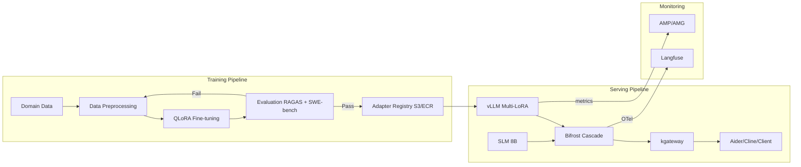
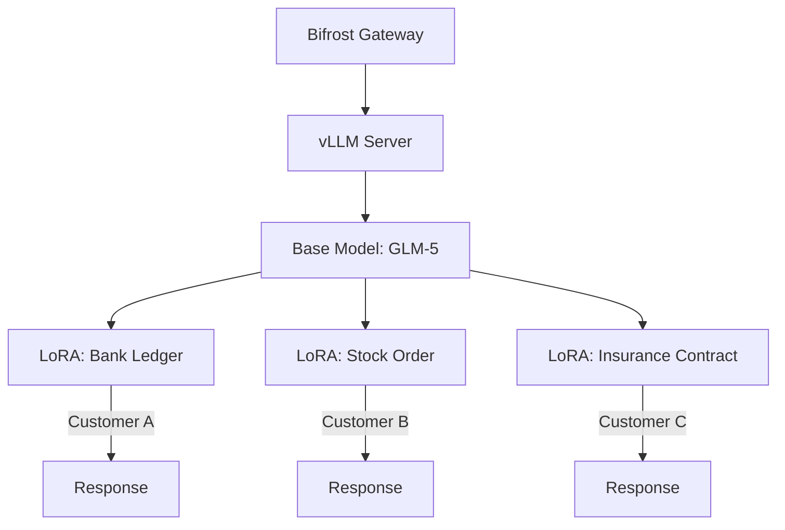
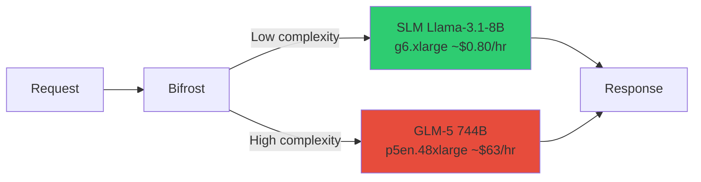
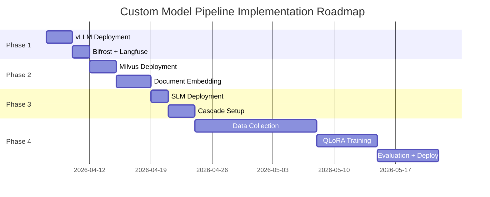

## Overview

### Why You Need a Custom Model Pipeline

SaaS-based AI coding tools (e.g., Kiro, GitHub Copilot) offer a quick start, but they hit fundamental limitations in enterprise environments.

**Table 1. Constraint comparison: SaaS vs self-hosted pipeline**

| Constraint | SaaS (Kiro, etc.) | Self-hosted Pipeline |
|-----------|-------------------|---------------------|
| **LoRA Fine-tuning** | Not possible | Domain-specific adapter training |
| **Data Sovereignty** | Code sent externally | Stays within VPC |
| **Model Selection** | Limited to provided models | Free choice of open-source models |
| **Cost Control** | Fixed per-token pricing | Measure Cascade effects from request mix, routing quality, and per-model cost |
| **Per-customer Optimization** | Shared general-purpose model | Multi-LoRA for customer-specific specialization |

:::info Core Strategy
The **Base Model + LoRA adapter** pattern serves multiple domain-specialized models simultaneously on a single GPU. Since base model weights are shared, GPU memory efficiency is maximized.
:::

### End-to-End Pipeline Flow

**Figure 1. End-to-end training, serving, and monitoring pipeline flow**



The training pipeline uses QLoRA to train adapters on domain data and registers only adapters that pass evaluation. The serving pipeline loads multiple adapters simultaneously with vLLM Multi-LoRA and uses Bifrost Cascade to route requests between SLM and LLM backends for cost optimization.

:::tip Related Documentation
- [Operations & MLOps](../../operations-mlops/index.md) - Full operations architecture
- [Custom Model Deployment Guide](./custom-model-deployment.md) - Includes Kiro vs. self-hosted comparison
:::

---

## LoRA Training & Deployment Pipeline (Domain Specialization)

This section covers how to implement LoRA Fine-tuning and Multi-LoRA hot-swap deployment in the domain specialization strategy. For strategic background and decision criteria for domain specialization, see [Domain Customization (LoRA + RAG)](../../operations-mlops/governance/domain-customization.md).

---

### LoRA Fine-tuning Pipeline

#### QLoRA GPU Savings

**QLoRA** (Quantized LoRA) trains only the LoRA adapter while keeping the base model quantized to INT4. This dramatically reduces GPU requirements compared to full fine-tuning.

**Table 2. GPU, VRAM, training time, and cost by training method**

| Model | Full Fine-tuning | LoRA (FP16) | QLoRA (INT4) |
|-------|-----------------|------|-------|
| **Llama-3.3-70B** | H100×16+ (impractical) | H100×2-4 | **H100×1** |
| **VRAM** | ~840 GB (BF16+AdamW) | ~142-180 GB | **~40 GB** |
| **Training Time** | - | 5 days | **2-3 days** |
| **Cost** | - | $8,000 | **$2,000** |

:::warning INT4 Quantization Precision
QLoRA keeps base model weights in INT4 during training, so tasks requiring extremely precise numerical computations (e.g., financial calculations) may show slight accuracy differences compared to LoRA (FP16). Always validate in the domain evaluation stage.
:::

#### Training Data Format

Prepare training data as input-output pairs in JSONL format.

```json
{
  "input": "COBOL: PERFORM CALC-INTEREST USING WS-PRINCIPAL WS-RATE.",
  "output": "Java: @Transactional public BigDecimal calcInterest(BigDecimal principal, BigDecimal rate) { return principal.multiply(rate).setScale(2, RoundingMode.HALF_UP); }"
}
```

**Table 3. Training-data sources, transformation methods, and expected volume**

| Source | Transformation Method | Expected Data Volume |
|--------|----------------------|---------------------|
| Legacy COBOL code | Generate COBOL → Java translation pairs | 10,000+ modules |
| Internal frameworks | Framework pattern → code pairs | 5,000+ patterns |
| Code review history | Pre-fix → post-fix pairs | 20,000+ commits |
| Technical docs | Documentation → implementation code pairs | 3,000+ pages |

:::tip Data Quality Determines Model Quality
**Quality** matters more than quantity. 1,000 high-quality pairs reviewed by senior developers are more effective than 10,000 auto-generated ones. Start with at least 500 reviewed pairs.
:::

#### Training Frameworks

#### NeMo Framework (NVIDIA)

NVIDIA's official framework optimized for large-scale model training. Natively supports multi-GPU and multi-node distributed training.

```bash
python train_lora.py \
  --config-path=conf \
  --config-name=llama3_70b_lora \
  model.data.train_ds.file_path=cobol_to_java.jsonl \
  model.peft.lora_tuning.adapter_dim=16
```

:::info Key NeMo Configuration Parameters
- `adapter_dim` (rank): 16 is typical. Can increase to 32-64 for complex domains
- `adapter_dropout`: 0.05 recommended (prevents overfitting)
- `target_modules`: attention layers (`q_proj`, `k_proj`, `v_proj`, `o_proj`)
:::

#### Unsloth (2× Faster Training)

An open-source library that speeds up LoRA/QLoRA training on a single node by up to 2× while reducing VRAM usage by up to 70% (per Unsloth's own benchmark).

The code below is a fragment that shows only model loading and adapter configuration. To run it, you must additionally import `SFTTrainer` from `trl`, load a JSONL dataset into `train_dataset`, and define a data formatting function and an `SFTConfig` (batch size, learning rate, number of steps, etc.). Pin the unsloth and trl versions you use for reproducibility.

```python
from unsloth import FastLanguageModel

model, tokenizer = FastLanguageModel.from_pretrained(
    model_name="meta-llama/Llama-3.3-70B-Instruct",
    max_seq_length=4096,
    load_in_4bit=True,  # QLoRA: INT4 quantization
)

model = FastLanguageModel.get_peft_model(
    model,
    r=16,                # LoRA rank
    lora_alpha=32,       # LoRA scaling factor
    target_modules=["q_proj", "k_proj", "v_proj"],
)

trainer = SFTTrainer(
    model=model,
    train_dataset=dataset,
    max_seq_length=4096,
)
trainer.train()
```

**Table 4. Strengths and best fit of the NeMo and Unsloth training frameworks**

| Framework | Strengths | Best For |
|-----------|----------|---------|
| **NeMo** | Multi-node distributed training, official NVIDIA support | H100 cluster available, large-scale training |
| **Unsloth** | 2× faster training, memory savings, simple API | Single node, rapid prototyping |

#### Checkpoint Management

Trained LoRA adapters are stored in S3 with version management via MLflow.

```bash
# Adapter storage structure (per-version directories)
s3://model-registry/
  └── lora-adapters/
      ├── bank-ledger/
      │   ├── v1.0/
      │   │   ├── adapter_model.safetensors
      │   │   ├── adapter_config.json   # base_model_name_or_path, r, lora_alpha, etc.
      │   │   └── metadata.json         # compatible base-model revision, training commit
      │   └── v1.1/
      │       ├── adapter_model.safetensors
      │       ├── adapter_config.json
      │       └── metadata.json
      ├── stock-order/
      │   └── v1.0/adapter_model.safetensors
      └── insurance-contract/
          └── v1.0/adapter_model.safetensors
```

S3 has no symlinks, so which version is `latest` is expressed by a pointer that the application or the MLflow registry maintains (for example a version tag recorded in `latest.json`, or MLflow's `latest` stage). The serving side resolves this pointer to load the corresponding version directory and uses `adapter_config.json` and `metadata.json` to confirm compatibility with the base-model revision.

:::tip MLflow Integration
Recording training metrics (loss, accuracy) alongside adapter paths in MLflow lets you track which dataset and hyperparameter combinations are optimal.
:::

- Reference: [NeMo Framework Checkpoint Management](../../model-serving/inference-frameworks/nemo-framework.md)

---

### Multi-LoRA Hot-swap Deployment

#### Architecture

Leveraging vLLM's Multi-LoRA feature, you can load multiple LoRA adapters simultaneously on top of a single base model to serve customized responses per customer.

**Figure 2. Multi-LoRA adapter serving architecture on a single base model**



:::info Multi-LoRA Memory Efficiency
The base model (e.g., 70B) is loaded into GPU memory only once. Each LoRA adapter at rank 16 is approximately **100-200MB**, so even loading 10 adapters simultaneously adds less than 2GB of additional memory.
:::

#### vLLM Multi-LoRA Configuration

```bash
vllm serve meta-llama/Llama-3.3-70B-Instruct \
  --enable-lora \
  --lora-modules \
    bank-ledger=/models/lora/bank \
    stock-order=/models/lora/stock \
    insurance-contract=/models/lora/insurance \
  --max-lora-rank 16
```

**Table 5. Key vLLM Multi-LoRA options and their defaults**

| Option | Description | Default |
|--------|------------|---------|
| `--enable-lora` | Enable Multi-LoRA | `false` |
| `--lora-modules` | Register adapters as `name=path` | - |
| `--max-lora-rank` | Maximum LoRA rank | 16 |
| `--max-loras` | Maximum adapters loaded on the GPU together in a batch | 1 |
| `--max-cpu-loras` | Number of adapters cached in CPU memory (awaiting GPU load) | - |

:::caution Hot-swap Considerations
`--max-loras` is the number of adapters that can be on the GPU together within one batch, while `--max-cpu-loras` is the number of adapters cached in CPU memory. When a requested adapter is not resident on the GPU, it must be swapped in from the CPU cache or storage, which adds latency. The size of this swap latency depends on the adapter's rank and size and on the storage location; it is not a measured value, so measure it on your workload and set `--max-loras` to match the number of frequently used adapters.
:::

#### Specifying Adapters in Requests

Make requests via the OpenAI-compatible API and pass the adapter name registered with `--lora-modules` as `model`. vLLM's OpenAI-compatible Multi-LoRA selects the adapter by the `model` value, so passing the base model ID would serve the base model rather than the adapter.

```python
response = client.chat.completions.create(
    model="bank-ledger",  # adapter name registered via --lora-modules
    messages=[{"role": "user", "content": "Convert this COBOL ledger code to Java"}],
)

# Confirm the request was served by the intended adapter via the model field.
assert response.model == "bank-ledger"
```

#### Per-customer Routing (Bifrost + X-Customer-Domain Header)

Use kgateway's HTTPRoute for HTTP header-based per-customer backend routing. The example below shows only the routing rule that sends requests carrying the `X-Customer-Domain: bank` header to `vllm-svc`.

```yaml
# kgateway HTTPRoute - Per-customer LoRA routing
apiVersion: gateway.networking.k8s.io/v1
kind: HTTPRoute
metadata:
  name: lora-routing
spec:
  parentRefs:
  - name: agentic-gateway   # Gateway this route attaches to (defined separately)
  rules:
  - matches:
    - headers:
      - name: X-Customer-Domain
        value: bank
    backendRefs:
    - name: vllm-svc
      port: 8000
```

:::caution A header match alone does not select the adapter
The HTTPRoute above only sends the request to `vllm-svc`; it does not translate the `X-Customer-Domain` header into `model=bank-ledger` (the registered adapter name). Completing per-customer adapter selection requires three more pieces. First, attach this route to an actual Gateway via `parentRefs`. Second, write an explicit rule in Bifrost or the backend that maps the header value to the registered adapter name (`model`) — the `model=<adapter name>` rule from CPIPE-005. Third, add authorization that maps the caller's trusted identity to the corresponding customer domain, so an arbitrary client cannot request another customer's adapter.
:::

#### Per-customer Inference Tracking and Cost Billing

Track each customer's inference requests with an LLM tracing system to monitor per-adapter performance and bill monthly costs.

```python
# langfuse>=3.0 (OpenTelemetry-based SDK). The legacy langfuse.trace() was removed.
from langfuse import observe, get_client

langfuse = get_client()

@observe(name="inference")
def run_inference(prompt: str):
    response = client.chat.completions.create(
        model="bank-ledger",
        messages=[{"role": "user", "content": prompt}],
    )
    # Record measured token usage and trace attributes on the current observation.
    langfuse.update_current_trace(
        user_id="customer-bank-A",
        metadata={"lora": "bank-ledger", "model": "glm-5", "domain": "ledger"},
    )
    langfuse.update_current_generation(usage_details=response.usage)
    return response
```

**Table 6. Example per-customer monthly requests, tokens, GPU time, and cost allocation**

| Customer | Requests | Tokens | GPU Time | Cost (allocation example) |
|----------|---------|---------|----------|------|
| **Bank A** | 100,000 | 500M | 50 hours | $2,500 |
| **Securities B** | 50,000 | 250M | 25 hours | $1,250 |
| **Insurance C** | 30,000 | 150M | 15 hours | $750 |

The costs in the table above are not measured actual charges; they illustrate an allocation method. Allocate cost by measuring each customer's GPU time and multiplying by a GPU-hour rate your organization sets, and record that rate and the measurement period so the allocation can be reconciled against actual billing.

For implementation details, see [Agent Monitoring](../../operations-mlops/observability/agent-monitoring.md) and [LLM Tracing Deployment](../integrations/monitoring-observability-setup.md).

---

## SLM Cascade Routing (Cost Optimization)

### Cascade Architecture

The example below assumes that 70% of requests can be routed to a small model (SLM) while meeting the quality gate. This is an input assumption, not a measured result; evaluate the request-complexity distribution and SLM response quality before applying it.

**Figure 3. Complexity-based SLM/LLM Cascade routing architecture**



### Assumption-Based Cost Example

This table uses a simplified model in which monthly cost scales linearly with the share of requests. Given assumed monthly costs of $500 for the SLM and $8,900 for the LLM, the Cascade cost is `0.7 × $500 + 0.3 × $8,900 = $3,020`. Self-hosted costs may not scale linearly because idle GPUs and minimum capacity remain allocated, and quality must be measured separately for routed requests.

| | SLM Only | LLM Only | **Cascade (Assumed 70:30)** |
|---|---|---|---|
| **Assumed Monthly Cost** | $500 | $8,900 | **$3,020** |
| **Quality** | Measure on the workload | Measure on the workload | Re-evaluate after routing |
| **Calculated Difference** | - | - | **$5,880/month (about 66%) below LLM-only** |

:::tip Validate Before Adoption
The approximately 66% figure is the result of the inputs and linear cost model above, not a measured savings rate. Include the observed request mix, routing errors, quality gates, minimum GPU capacity, idle time, operations labor, and observability costs in an adoption decision.
:::

### Bifrost Cascade Config

```json
{
  "providers": {
    "openai": {
      "keys": [
        {
          "name": "slm",
          "value": "dummy",
          "weight": 0.7,
          "models": ["llama-8b"]
        },
        {
          "name": "llm",
          "value": "dummy",
          "weight": 0.3,
          "models": ["glm5"]
        }
      ],
      "network_config": {
        "base_url": "http://glm5-serving:8000"
      }
    }
  }
}
```

:::info Bifrost Complexity Router (supported since 2026-06)
Bifrost supports the Complexity Router starting with the governance plugin v1.5.19, released on 2026-06-12. It automatically classifies requests into SIMPLE/MEDIUM/COMPLEX/REASONING tiers and exposes the tier through the `complexity_tier` CEL variable for use in routing rules. Only the tier classification is automatic; you must author the routing rules yourself. See the [Bifrost Complexity Router guide](https://docs.getbifrost.ai/features/governance/complexity-router).
:::

### SLM Deployment YAML

```yaml
apiVersion: apps/v1
kind: Deployment
metadata:
  name: vllm-slm
  namespace: agentic-serving
spec:
  replicas: 1
  selector:
    matchLabels:
      app: vllm-slm
  template:
    metadata:
      labels:
        app: vllm-slm
    spec:
      nodeSelector:
        node.kubernetes.io/instance-type: g6.xlarge
      containers:
      - name: vllm
        image: vllm/vllm-openai:v0.23.0  # pin the tag (do not use :latest)
        command: ["vllm", "serve"]
        args:
          - "meta-llama/Llama-3.1-8B-Instruct"
          - "--served-model-name=llama-8b"
          - "--tensor-parallel-size=1"
          - "--max-model-len=32768"
          - "--host=0.0.0.0"
          - "--port=8000"
        resources:
          limits:
            nvidia.com/gpu: 1
        ports:
        - containerPort: 8000
          name: http
      tolerations:
      - key: nvidia.com/gpu
        operator: Exists
        effect: NoSchedule
---
apiVersion: v1
kind: Service
metadata:
  name: vllm-slm-svc
  namespace: agentic-serving
spec:
  selector:
    app: vllm-slm
  ports:
  - port: 8000
    targetPort: 8000
    protocol: TCP
```

:::info g6.xlarge Instance Specs and Prerequisites
- GPU: 1× NVIDIA L4 (24GB VRAM)
- Cost: ~$0.805/hr (On-Demand), ~$0.19-0.49/hr (Spot, region-dependent). Confirm against the official AWS pricing page for your deployment region.
- Sufficient for serving 8B models
- `meta-llama/Llama-3.1-8B-Instruct` is a gated model that requires access approval, so a HuggingFace token (`HF_TOKEN` environment variable or secret) and model-use approval must be in place first.
- To avoid re-downloading the model on every restart, mount a persistent volume (PVC) for the model cache at `/root/.cache/huggingface`.
- To fit the KV cache and concurrent requests within 24GB VRAM, tune `--max-model-len` and `--gpu-memory-utilization` for your workload. The 32768-token setting above may need to be lowered depending on required concurrency.
:::

- Reference: [Cost Threshold Analysis](../integrations/coding-tools-cost-analysis.md#5-cost-threshold-analysis-bedrock-vs-kiro-vs-self-hosting)

---

## Evaluation Pipeline

### LoRA Adapter Evaluation Matrix

Trained adapters must pass multiple evaluations before deployment.

**Table 8. LoRA adapter evaluation methods, purposes, tools, and automation**

| Evaluation Method | Purpose | Tool | Automation |
|------------------|---------|------|-----------|
| **RAGAS** | RAG accuracy (faithfulness, relevancy) | ragas | CI/CD integration |
| **SWE-bench** | Coding quality (real issue resolution) | swe-bench | CI/CD integration |
| **Domain Expert Review** | Business correctness validation | Langfuse Annotation | Manual |
| **Red-teaming** | Security/safety (prompt injection, etc.) | Garak | CI/CD integration |

:::warning Evaluation Thresholds
Minimum criteria for adapter deployment:
- RAGAS Faithfulness: ≥ 0.85
- SWE-bench Resolved: ≥ 30%
- Domain expert approval: At least 2 out of 3
- Garak security test: 0 critical findings
:::

### LoRA A/B Testing

Before deploying a new adapter version, compare performance using LLM tracing system tags for A/B testing. Recording the `lora` version in request metadata as a tag allows per-adapter performance comparison in the dashboard. For the comparison to be valid, assign the same request distribution to both versions (or send the same requests to both) and measure quality with the same evaluation criteria; otherwise workload differences are misread as metric differences.

For implementation examples, see [Agent Monitoring - A/B Testing](../../operations-mlops/observability/agent-monitoring.md).

**Table 9. LoRA A/B test comparison metrics and measurement methods**

| Metric | Measurement | Meaning |
|--------|------------|---------|
| Accuracy | SWE-bench / domain tests | Code conversion correctness |
| Latency | LLM tracing p50/p95 | Response speed |
| Output/input length ratio | output_tokens / input_tokens | Ratio of output to input length (not standalone efficiency) |
| User Satisfaction | Annotation Score | Real user evaluation |

- Reference: [RAGAS Evaluation Framework](../../operations-mlops/governance/ragas-evaluation.md)
- Reference: [LLMOps Observability Evaluation Pipeline](../../operations-mlops/observability/llmops-observability.md)

---

## Phased Implementation Roadmap

**Table 10. Components, timeline, cost, and key actions by phase**

| Phase | Timeline | Components | Cost (USD) | Key Actions |
|-------|----------|-----------|-----------|------------|
| **1** | Immediate | Base Model + Steering | $8,900/mo (GPU) | vLLM deployment, Bifrost + Langfuse integration |
| **2** | 1-2 weeks | + VectorRAG | +infra | Milvus deployment, internal document embedding |
| **3** | 2-4 weeks | + SLM Cascade | +$500/mo | SLM deployment, Bifrost cascade configuration |
| **4** | 1-2 months | + LoRA Fine-tuning | +$2K (one-time) | Training data collection → QLoRA → Evaluation → Multi-LoRA deployment |

**Figure 4. Custom model pipeline implementation roadmap Gantt chart**



:::tip Assumption-Based Benefit Calculation
The following inputs illustrate a calculation method; they are not measured outcomes.
- **COBOL→Java migration**: 10,000 modules × 1.5 hours × $50/hour = **$750,000 worth of time**
- **LoRA training cost**: **$2,000** (one-time assumption)
- **Cascade cost difference**: **$5,880/month** under the earlier linear cost model

The ratio `$750,000 ÷ $2,000 = 375` uses only training cost as its denominator, so it is not a complete return-on-investment figure. An actual ROI calculation must include data preparation, evaluation, idle GPU capacity, operations labor, and incident response, and must measure migration-time savings separately from the Cascade cost difference.
:::

---

## References

### Official Documentation

**Table 11. Official documentation references and links**

| Resource | Link |
|----------|------|
| LoRA Paper (Hu et al., 2021) | [arxiv.org/abs/2106.09685](https://arxiv.org/abs/2106.09685) |
| QLoRA Paper (Dettmers et al., 2023) | [arxiv.org/abs/2305.14314](https://arxiv.org/abs/2305.14314) |
| vLLM Multi-LoRA | [docs.vllm.ai/en/latest/features/lora/](https://docs.vllm.ai/en/latest/features/lora/) |
| Unsloth Fast Training | [github.com/unslothai/unsloth](https://github.com/unslothai/unsloth) |
| NeMo Framework | [docs.nvidia.com/nemo-framework](https://docs.nvidia.com/nemo-framework/user-guide/latest/) |
| RAGAS Evaluation | [docs.ragas.io](https://docs.ragas.io/) |
| Bifrost AI Gateway | [docs.getbifrost.ai](https://docs.getbifrost.ai/) |
| Agent Monitoring | [agent-monitoring.md](../../operations-mlops/observability/agent-monitoring.md) |
| LLM Tracing Deployment | [monitoring-observability-setup.md](../integrations/monitoring-observability-setup.md) |
| Custom Model Deployment Guide | [custom-model-deployment.md](./custom-model-deployment.md) |
| MLOps Pipeline (Kubeflow, MLflow, ArgoCD) | [mlops-pipeline-eks.md](./mlops-pipeline-eks.md) |
| Continuous Training Pipeline | [continuous-training/index.md](./continuous-training/index.md) |
