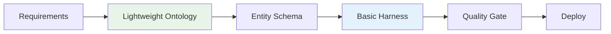
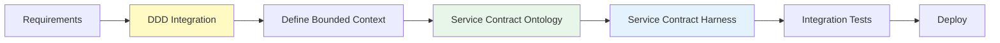

AIDLC application guide for simple services through synchronous MSA with relatively low complexity.

## Level 1: Simple Service CRUD

**Characteristics:**
- Single service, single database
- REST API (CRUD endpoints)
- Clear transaction boundaries
- Simple rollback (DB transactions)

**AIDLC Application:**

**Figure 1. AIDLC application flow for Level 1 simple CRUD**



### Ontology Level

**Lightweight Schema:** Entity definitions, attributes, basic relationships only
- YAML/JSON schema files
- No complex domain modeling required

**Example Ontology:**

The `invariants` entries below are illustrative domain notation written for human readers, not an executable constraint syntax. The actual validation rules are implemented in the service's schema and validation code.

```yaml
# ontology/user-service.yaml
entities:
  User:
    attributes:
      - id: string (UUID)
      - name: string
      - email: string (unique)
      - createdAt: timestamp
    invariants:
      - email must be valid format
      - name length 2-50 characters

  Role:
    attributes:
      - id: string
      - name: string
      - permissions: list<string>

relationships:
  - User hasMany Role
```

### Harness Checklist

- Include: API contract verification
- Include: Data validation (input/output)
- Include: Basic unit tests
- Include: Integration tests (with DB)
- Exclude: Distributed transaction verification (not needed)

### Application Strategy

- Full AIDLC can be applied immediately when domain and data risk is low (even an L1 CRUD service in a regulated or sensitive domain such as finance, healthcare, or PII needs the heavier harness and review path)
- Leverage agent-based code generation
- Ontology at schema definition level is sufficient
- Start with basic Quality Gate harness

## Level 2: Synchronous MSA Orchestration

**Characteristics:**
- Multiple independent services
- REST/gRPC synchronous calls
- Orchestrator pattern (order service calls inventory/payment)
- Distributed DB, orchestrated by synchronous calls but with no atomic (ACID) transaction across services (cross-service consistency still needs sagas/outbox even at L2)

**AIDLC Application:**

**Figure 2. AIDLC application flow for Level 2 synchronous MSA orchestration**



### Ontology Level

**Standard Ontology:** Entities + relationships + invariants
- Separate ontology per Bounded Context
- Explicit service contracts (API specs)

**Example Ontology (Service Contract):**

```yaml
# ontology/order-service.yaml
boundedContext: OrderManagement

entities:
  Order:
    attributes:
      - orderId: string
      - userId: string
      - items: list<OrderItem>
      - status: OrderStatus (PENDING, CONFIRMED, CANCELLED)
    invariants:
      - total amount must match sum of item prices
      - order must have at least 1 item

serviceContracts:
  - name: CreateOrder
    input: CreateOrderRequest
    output: OrderResponse
    dependencies:
      - InventoryService.checkStock
      - PaymentService.processPayment
    timeout: 5s
    retryPolicy: exponentialBackoff(3)
```

When retrying a money-moving call such as `PaymentService.processPayment`, pass an idempotency key and retry only on idempotent or clearly-failed outcomes. An unknown outcome (such as a timeout) must not be retried blindly; query the payment status to reconcile it before deciding.

### Harness Checklist

- Include: Service contract verification (OpenAPI/gRPC)
- Include: Inter-service integration tests
- Include: Timeout + retry policies
- Include: Circuit breaker verification
- Exclude: Compensating transactions (not yet needed)

### Application Strategy

- DDD integration required (define Bounded Contexts)
- Explicit service contract ontology
- Add timeout/retry/circuit breaker to harness
- Introduce Contract Testing (Pact, Spring Cloud Contract)

## Next Steps

Guides covering more complex async patterns and Saga patterns:

- [Level 3-4: Async Events & Saga](./l3-l4-async-saga.md)
- [Level 5: Event Sourcing](./l5-event-sourcing.md)
