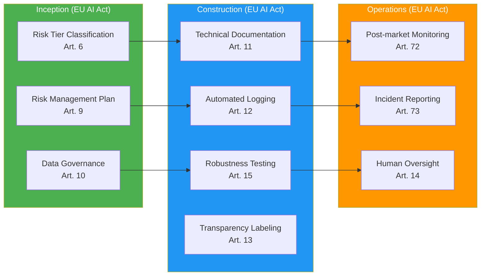

## Overview

**EU AI Act** is the world's first comprehensive AI regulation, adopted in May 2024 and **enforced in phases starting from 2026**.

**Enforcement Timeline:**
- **February 2025**: Prohibited AI systems enforcement begins (Art. 5)
- **August 2025**: General Purpose AI (GPAI) provider obligations apply (Arts. 53-55)
- **August 2026**: General application of the Regulation and Annex III high-risk AI system obligations apply
- **August 2027**: High-risk AI systems embedded in Annex I product-safety-regulated products apply

---

## Risk Tier Classification

EU AI Act classifies AI systems into **4 risk tiers**:

| Risk Tier | Definition | Examples | Regulatory Level |
|-----------|------|------|----------|
| **Prohibited** | Unacceptable risk | Social credit scoring, real-time remote biometric identification in public spaces (only narrow, pre-authorised law-enforcement exceptions) | **Banned** |
| **High-risk** | High risk | Recruitment tools, credit scoring, critical infrastructure management | **Strict obligations** |
| **Limited risk** | Limited risk | Chatbots, emotion recognition (some uses) | **Transparency obligations** |
| **Minimal risk** | Minimal risk | Spam filters, AI games | **Self-regulation** |

The biometric row above is a summary. The Art. 5 ban on real-time remote biometric identification is not a blanket carve-out but a prohibition with only narrow, pre-authorised law-enforcement exceptions. Emotion recognition is also treated differently by use: emotion recognition in the workplace and in education is prohibited under Art. 5, and only other uses fall under Limited risk with transparency obligations.

**Code Generation AI (AIDLC target) Classification:**
- **Limited risk**: Developers aware of AI-generated code → transparency obligations
- **High-risk** (conditional): Automatic code generation for critical infrastructure (healthcare, finance, power)

---

## High-risk AI Obligations

**Articles 9-15 Core Requirements:**

### 1. Risk Management System (Art. 9)
- Full lifecycle risk assessment
- Identification, analysis, mitigation, monitoring

### 2. Data Governance (Art. 10)
- Training data quality assurance
- Bias minimization

### 3. Technical Documentation (Art. 11)
- Documentation of system design, development, testing
- Must be submittable to auditing authorities

### 4. Automated Logging (Art. 12, Art. 19) {#4-automated-logging-art-12}
- Art. 12: automatic recording of events (logs) over the system's lifetime to ensure traceability
- Art. 19: retention of the automatically generated logs under the provider's control for at least 6 months (unless a longer period is set by other law)

### 5. Transparency (Art. 13)
- Provide deployers the information needed to use and interpret the system
- Explainable outputs

### 6. Human Oversight (HITL) (Art. 14)
- Art. 14 requires effective human oversight — enabling people to understand, monitor, and intervene in, stop, or override the system. The Article does not uniformly mandate prior final approval of every critical decision.
- As a stronger internal rule, this guide requires a human to give final approval on critical decisions.
- Override authority guaranteed

### 7. Accuracy, Robustness, Cybersecurity (Art. 15)
- Define performance metrics
- Defense against adversarial attacks

---

## GPAI (General Purpose AI) Provider Obligations

**Articles 53-55**: Obligations for general-purpose AI (GPAI) model providers like Claude, GPT-4 (Art. 51 defines the systemic-risk classification criteria and Art. 52 the classification procedure)

- **All GPAI providers (Art. 53)**: draw up the model's technical documentation and make it available to the AI Office and national competent authorities on request; provide downstream providers who integrate the model into their own systems the information and documentation they need to do so; put a copyright-compliance policy in place; and publish a sufficiently detailed summary of the training data
- **Systemic-risk GPAI providers (Art. 55, e.g. exceeding 10^25 FLOP)**: in addition to the above, carry out model evaluation and adversarial testing, assess and mitigate systemic risks, track and report serious incidents, and ensure cybersecurity protection

---

## Violation Penalties

| Violation Type | Penalty |
|----------|--------|
| Use of prohibited AI | **35M€** or **7% of global annual turnover** (whichever is higher) |
| High-risk AI obligation violation | **15M€** or **3% of turnover** |
| Providing inaccurate information | **7.5M€** or **1% of turnover** |

---

## AIDLC Mapping

### Inception Stage Checklist

- [ ] Risk Tier classification (Limited/High-risk determination)
- [ ] Risk management plan establishment (risk identification & mitigation strategy)
- [ ] Data governance policy definition (training data sources, bias mitigation)

### Construction Stage Checklist

- [ ] Auto-generation of technical documentation (design, development, testing docs)
- [ ] Audit log implementation (record all AI decisions)
- [ ] Robustness testing (adversarial attacks, boundary cases)
- [ ] Record a provenance comment on AI-generated code (`# AI-GENERATED: ...`)

The `# AI-GENERATED` comment at the top of source code is provenance metadata for tracking where the code came from; by itself it does not satisfy an EU AI Act transparency duty. The regulatory transparency of Art. 13 (information to deployers) and Art. 50 (transparency to users) is met by disclosing to users that they are interacting with, or receiving output from, an AI system, and is not substituted by an in-code comment.

### Operations Stage Checklist

- [ ] Post-market monitoring (continuous production performance tracking)
- [ ] Serious-incident reporting by providers of high-risk AI systems (Art. 73): without undue delay, generally within 15 days / within 2 days for a widespread infringement or an Art. 3(49)(b) serious incident / within 10 days where a death is involved
- [ ] Human oversight process operation (critical decision approval)

---

## References

**Official Documents:**
- [Regulation (EU) 2024/1689 (Official Text)](https://eur-lex.europa.eu/legal-content/EN/TXT/?uri=CELEX:32024R1689)
- [EU AI Act Timeline (European Commission)](https://digital-strategy.ec.europa.eu/en/policies/regulatory-framework-ai)

**Related Documentation:**
- [Regulatory Compliance Overview](../index.md)
- [Governance Framework](../../governance-framework.md)
- [Harness Engineering](../../../methodology/harness-engineering.md)
