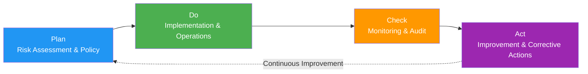

## Overview

**ISO/IEC 42001:2023** is the **AI Management System (AIMS) international standard** published in December 2023.

**Key Features:**
- **Certifiable**: Same structure as ISO 9001 (quality), ISO 27001 (information security)
- **PDCA-based**: Plan-Do-Check-Act cycle
- **Integrable**: Can be integrated with ISMS (ISO 27001), QMS (ISO 9001)

---

## PDCA Structure

**Figure 1. PDCA structure of ISO/IEC 42001**



### Plan
- Define AI management system scope
- Assess risks and opportunities
- Establish AI policies
- Set objectives

### Do
- Develop and deploy AI systems
- Implement operational controls
- Training and awareness building
- Documentation

### Check
- Performance monitoring
- Internal audit
- Management review
- Compliance assessment

### Act
- Correct nonconformities
- Continuous improvement
- Feedback loop
- Lessons learned

---

## Annex A Controls (9 Categories)

ISO/IEC 42001:2023 Annex A groups 38 controls under nine control objectives, A.2 through A.10. The numbers, titles and control counts in the table below were checked against published secondary sources (as of 2026-10-29). The normative text is paid, so it was not compared directly; when you write a Statement of Applicability (SoA), use the control numbers and wording of the standard itself.

**Table 1. Number of Controls and key content by Annex A category**

| Category | # of Controls | Key Content |
|----------|-------------|----------|
| **A.2 Policies related to AI** | 3 | AI policy, alignment with other policies, periodic review |
| **A.3 Internal organization** | 2 | AI roles and responsibilities, reporting of concerns |
| **A.4 Resources for AI systems** | 5 | Documenting data, tooling, compute and human resources |
| **A.5 Assessing impacts of AI systems** | 4 | Impact assessment for individuals, groups and society |
| **A.6 AI system life cycle** | 9 | Design, development, verification, deployment, operation and monitoring |
| **A.7 Data for AI systems** | 5 | Data acquisition, quality, provenance, preparation |
| **A.8 Information for interested parties** | 4 | User information, external reporting, incident communication |
| **A.9 Use of AI systems** | 3 | Processes and objectives for responsible use, intended use |
| **A.10 Third-party and customer relationships** | 3 | Allocating responsibilities among suppliers, partners and customers |

Later sections of this page (AIDLC Mapping, ISMS/QMS Integration, AIDLC Integration Examples) use A.10 Operations, A.11 Performance, A.12 Security, A.5 Policy and sub-numbers such as A.7.1, A.10.2 and A.11.1. These come from the page's own earlier numbering and do not match the published Annex A numbers. Read them as illustrative labels only, and redo any actual control mapping with the numbers in the standard.

**AIDLC Mapping:**
- **A.7 Data**: Inception → Data governance policy
- **A.10 Operations**: Construction → Harness Quality Gates
- **A.11 Performance**: Operations → Continuous monitoring

---

## Certification Process

**ISO/IEC 42001 Certification 4 Stages:**

### 1. Gap Analysis
- Analyze current state vs ISO 42001 requirements
- Identify missing Controls
- Establish implementation roadmap

### 2. Stage 1 Audit (Documentation Review)
- Review policies, procedures, technical documentation
- Assess AI management system design adequacy
- Verify Stage 2 Audit readiness

### 3. Stage 2 Audit (On-site Assessment)
- Verify actual implementation
- Review operational evidence
- Interviews and observations
- Identify nonconformities

### 4. Certification Issuance and Maintenance
- Validity: 3 years
- Annual surveillance audit
- Recertification audit every 3 years

**AIDLC Response**: [Governance Framework](../../governance-framework.md) steering files assist ISO 42001 Controls mapping (supporting draft mapping and tracking rather than fully automating it)

---

## ISMS/QMS Integration

**ISO 42001 + ISO 27001 Integration Synergy:**
- **A.12 Security** (ISO 42001) ↔ **A.8 Asset Management** (ISO 27001)
- **A.10 Operations** (ISO 42001) ↔ **A.12 Operations Security** (ISO 27001)
- Depending on the scope agreed with the certification body, both certifications can be assessed and renewed together in a single (combined) audit (availability depends on the certification body and scope)

**ISO 42001 + ISO 9001 Integration:**
- **A.11 Performance** (ISO 42001) ↔ **8. Operations** (ISO 9001)
- **A.5 Policy** (ISO 42001) ↔ **5. Leadership** (ISO 9001)
- Integrated operation of quality management system and AI management system

---

## AIDLC Integration Examples

### Inception Stage: A.7 Data Governance

```yaml
# .aidlc/compliance/iso-42001-data-governance.yaml
data_governance:
  # A.7.1: Data Collection
  collection:
    sources:
      - "GitHub public repositories"
      - "Stack Overflow"
    # licensing is an illustrative value. Actual licenses vary by source and
    # must be verified and recorded per source at collection time. For example,
    # Stack Overflow posts are CC BY-SA; GitHub public repositories vary
    # (including repositories with no stated license).
    licensing_per_source: "Verify and record each source's actual license at collection"

  # A.7.3: Data Quality
  quality:
    validation_rules:
      - "syntax correctness"
      - "no PII/credentials"
    rejection_criteria:
      - "license violation"
      - "malicious code"

  # A.7.5: Bias Mitigation
  bias_mitigation:
    strategy: "Balance across diverse languages/frameworks"
    monitoring: "Track language distribution in generated code"
```

### Construction Stage: A.10 Operational Controls

```yaml
# .aidlc/harness/iso-42001-controls.yaml
operational_controls:
  # A.10.2: Risk Management
  - control_id: A.10.2
    name: "AI System Risk Management"
    implementation: "Quality Gates (SAST, independent review)"

  # A.10.5: Human Intervention
  - control_id: A.10.5
    name: "Human Oversight"
    implementation: "Mandatory Senior Developer code review"

  # A.10.10: Continuous Monitoring
  - control_id: A.10.10
    name: "Continuous Monitoring"
    implementation: "Grafana dashboard (performance metrics)"
```

### Operations Stage: A.11 Performance Measurement

```yaml
# .aidlc/monitoring/iso-42001-performance.yaml
performance_kpis:
  # A.11.1: Performance Metrics
  - metric: "code_quality"
    target: "Code coverage >= 80%"
    measurement: "SonarQube"

  - metric: "security_compliance"
    target: "0 critical vulnerabilities"
    measurement: "Bandit, Semgrep"

# A.11.3: Continuous Improvement
improvement_process:
  frequency: "quarterly"
  review: "Management review meeting"
  actions:
    - "Process improvement when metrics fall short"
    - "Best practice updates"
```

---

## References

**Official Documents:**
- [ISO/IEC 42001:2023 (ISO Store)](https://www.iso.org/standard/81230.html)
- [ISO/IEC 42001 AI Management System (BSI)](https://www.bsigroup.com/en-GB/products-and-services/standards/iso-42001-ai-management-system/)

**Certification Bodies:**
- [BSI (British Standards Institution)](https://www.bsigroup.com/)
- [DNV (Det Norske Veritas)](https://www.dnv.com/)
- [TÜV SÜD](https://www.tuvsud.com/)

**Related Documentation:**
- [Regulatory Compliance Overview](../index.md)
- [Governance Framework](../../governance-framework.md)
- [Harness Engineering](../../../methodology/harness-engineering.md)
