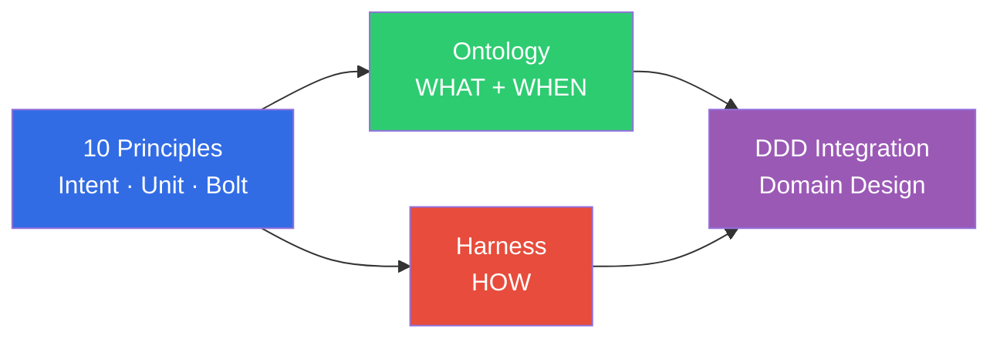

# AIDLC Methodology

:::info Official AIDLC reference
This section builds on [AWS Labs AIDLC Workflows](https://github.com/awslabs/aidlc-workflows) (v0.1.7, 2026-04-02), adding DDD, Ontology, and Harness extensions. It follows the official 5 principles, 11 Common Rules, and 7-stage Adaptive Execution as published, while engineering-playbook adds the ontology and harness axes as its own extension for **enterprise reliability**.
:::

This track explains how AIDLC organizes collaboration between people and AI during development. It introduces the Intent → Unit → Bolt execution model, then explains how domain schemas, validation controls, and domain-driven design support that workflow.

## Structure

The methodology track consists of 6 documents (4 core documents plus 2 official-alignment documents). Reading them in order will help you understand the entire theoretical framework of AIDLC. The figure below shows the reading order of the 4 core documents.

**Figure 1. Reading order and relationships of the four core methodology-track documents**

**Table 1. Methodology-track document structure and the core question of each document**

| Order | Document | Core Question |
|------|------|----------|
| 1 | [10 Principles and Execution Model](./principles-and-model.md) | What is AIDLC and how does it work? (official 5 principles + Intent/Unit/Bolt mapping) |
| 2 | [Ontology Engineering](./ontology-engineering.md) (extension) | How do we ensure the **accuracy** of AI-generated code? (extension) |
| 3 | [Harness Engineering](./harness-engineering.md) (extension) | How do we architecturally enforce the **safety** of AI execution? (extension) |
| 4 | [DDD Integration](./ddd-integration.md) | How do we transform business domains into designs that AI can understand? |
| 5 | [Common Rules](./common-rules.md) (official) | What are the 11 official AIDLC Common Rules and how are they applied? |
| 6 | [Adaptive Execution](./adaptive-execution.md) (official) | When and how do the official Inception 7-stage flow and the Construction per-Unit loop run? |

> (official) AWS Labs official AIDLC alignment document  
> (extension) engineering-playbook's own extension (enterprise reliability)

## Relationship with Other Tracks

- **[Enterprise Adoption](/docs/aidlc/enterprise)**: Interprets the methodology's concepts (ontology, harness) as organizational transformation and cost effectiveness.
- **[Tools & Implementation](/docs/aidlc/toolchain)**: Covers concrete tools (Kiro, Q Developer, EKS) that realize the methodology.
- **[AgenticOps](/docs/aidlc/operations)**: Builds a circular structure where operational data feeds back into the ontology Outer Loop.
