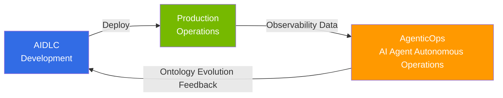

# AgenticOps: AI Agent-Based Autonomous Operations

AgenticOps uses AI agents to turn production telemetry into operational decisions and actions. In the **detection → decision → execution** loop described here, an agent collects evidence, chooses a response, and executes it within predefined guardrails or escalates it for human review. The results feed back into the software developed through [AIDLC](/docs/aidlc/methodology).

## Relationship with AIDLC

AIDLC describes how software is developed; AgenticOps describes how operational evidence informs its maintenance and improvement. Constraints in the [ontology](/docs/aidlc/methodology/ontology-engineering) guide agent decisions. The **Outer Loop** returns findings from production to the people and processes that revise those constraints.

**Figure 1. Feedback flow between AIDLC development and AgenticOps operations**

## Structure

Reading in the order **1 → 2 → 3** allows you to follow the entire journey from data-based construction to autonomous operations realization.

**Table 1. AgenticOps track document structure and core questions**

| Order | Document | Core Question |
|------|------|----------|
| 1 | [Observability Stack](./observability-stack.md) | How do we collect and analyze operational data? |
| 2 | [Predictive Operations](./predictive-operations.md) | How do we predict and prevent failures in advance? |
| 3 | [Autonomous Response](./autonomous-response.md) | How do AI agents respond autonomously? |

## Core Foundation: AWS Open Source Strategy

AWS provides core Kubernetes ecosystem tools as EKS add-ons (as of 2026-10-29, the AWS add-ons list in the EKS User Guide has 22 or more entries). Prometheus and Grafana are offered as managed services (AMP, AMG), and OpenTelemetry as an AWS-supported distribution (ADOT, also installable as an EKS add-on). On this foundation, this guide proposes using **Kiro + MCP (Model Context Protocol)** as the core tool for AgenticOps. Most servers in the AWS Labs MCP repository (50 or more as of 2026-10-29) are open-source servers that run in the user's environment; some are AWS-hosted managed servers, and some are in preview or deprecated. Through these servers, an agent can query and control EKS clusters, analyze CloudWatch metrics, and analyze costs within the IAM permissions it has been granted.

## References

- [Proactive EKS Monitoring with CloudWatch](https://aws.amazon.com/blogs/containers/proactive-amazon-eks-monitoring-with-amazon-cloudwatch-operator-and-aws-control-plane-metrics/)
- [AWS MCP Servers (50+ GA)](https://github.com/awslabs/mcp)
- [Kagent - Kubernetes AI Agent](https://github.com/kagent-dev/kagent)
- [Strands Agents SDK](https://github.com/strands-agents/sdk-python)
