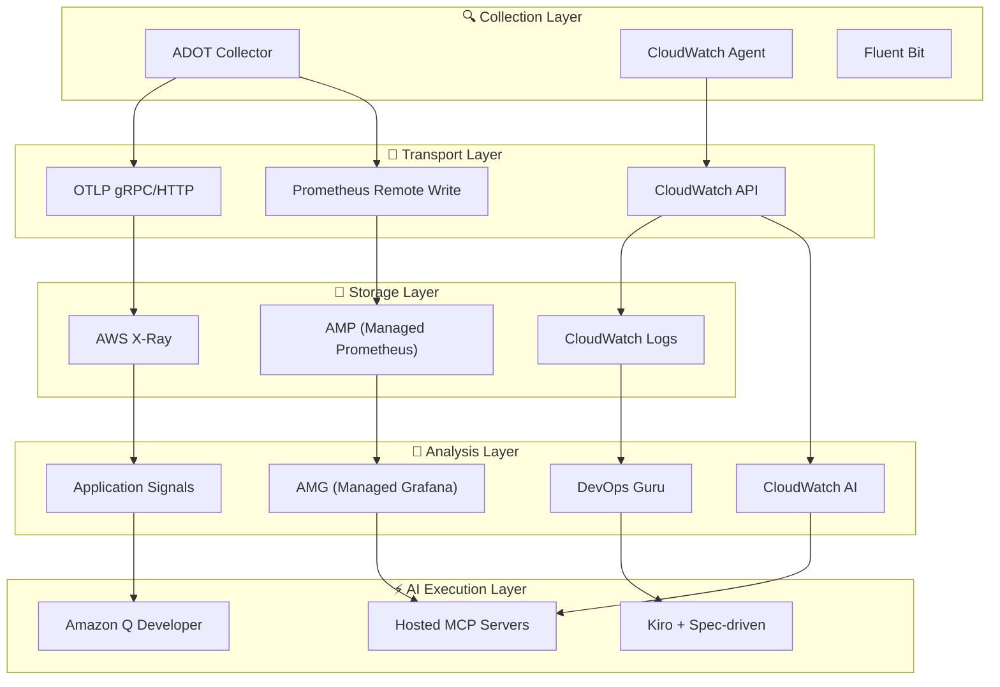
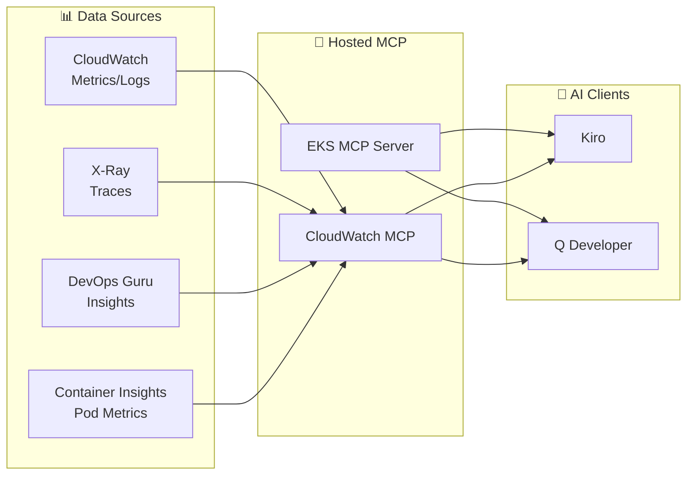
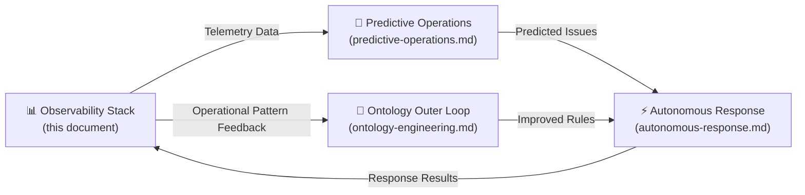

import { ObservabilityPillars, ArchitectureLayers, StackSelectionPatterns } from '@site/src/components/ObservabilityStackTables';

> **The data foundation of AIDLC Operations** — building operational intelligence through 3-Pillar telemetry + AI analysis layer

---

## 1. Overview

### 1.1 Why Observability is the Data Foundation of AgenticOps

**Observability** is the ability to understand a system's internal state through external outputs (metrics, logs, traces). In EKS environments with hundreds of Pods, complex service meshes, and dynamic scaling, traditional monitoring alone makes it difficult to identify root causes.

**Role of observability in the AgenticOps context**:

- **[Predictive Operations](./predictive-operations.md)**: Learning historical telemetry patterns → predicting future issues
- **[Autonomous Response](./autonomous-response.md)**: Real-time metric-based auto-scaling and self-healing
- **[Ontology Engineering](../methodology/ontology-engineering.md) Outer Loop**: Feeding operational data back for continuous ontology improvement

:::tip AIDLC Reliability Dual Axis
The observability stack supplies evidence for the **AIDLC harness**. The ontology defines expected domain behavior; metrics, logs, and traces help check whether the running system behaves as expected. Harness controls use those checks to decide whether an action may continue, should stop, or needs review.
:::

### 1.2 3-Pillar Observability + AI Analysis Layer

<ObservabilityPillars />

**AI Analysis Layer Addition**:
- **CloudWatch AI Natural Language Queries**: Analysis in natural language without PromQL/Logs Insights syntax
- **CloudWatch Investigations**: AI-based root cause analysis automation when alarms trigger
- **DevOps Guru**: ML-based anomaly detection and insights
- **MCP Integration**: AI Agents (Kiro/Q Dev) directly query and analyze observability data

### 1.3 Core Challenges of EKS Observability

- **Dynamic Infrastructure**: Pods frequently created/deleted, dynamic node provisioning by Karpenter
- **Microservice Complexity**: Complex service call chains making failure propagation paths difficult to trace
- **Multi-layer Issues**: Multi-tier structure including application, container, node, network, and AWS services
- **Cost Optimization**: Right-sizing through resource usage pattern analysis
- **Compliance**: Audit logs, access records, and other compliance requirements

---

## 2. 5-Layer Observability Architecture

### 2.1 Layer Structure

<ArchitectureLayers />

**Data Flow**:



### 2.2 Core Role by Layer

**1. Collection Layer**:
- **ADOT (OpenTelemetry)**: Unified collection of metrics, logs, traces, CNCF standard
- **CloudWatch Agent**: Container Insights Enhanced, Application Signals
- **Fluent Bit**: High-performance log forwarding

**2. Transport Layer**:
- **OTLP (OpenTelemetry Protocol)**: Vendor-neutral standard protocol
- **Prometheus Remote Write**: Long-term metric storage
- **CloudWatch API**: AWS native integration

**3. Storage Layer**:
- **AMP**: Long-term metric storage (150 days by default, configurable), PromQL support
- **CloudWatch Logs**: Log centralization, Insights queries
- **X-Ray**: Distributed tracing storage

**4. Analysis Layer (AI Analysis)**:
- **AMG**: Grafana dashboards (AMP/CW/XRay integration)
- **CloudWatch AI**: Natural language queries + Investigations (root cause analysis)
- **DevOps Guru**: ML-based anomaly detection
- **Application Signals**: Zero-code instrumentation service map

**5. AI Execution Layer (Action)**:
- **MCP Servers**: Provide observability data to AI Agents
- **Kiro**: Spec-driven autonomous response (IaC code generation)
- **Q Developer**: Conversational operations support

### 2.3 Observability Stack Selection Patterns

<StackSelectionPatterns />

:::tip ADOT (OpenTelemetry) Collection Layer
Regardless of which backend you choose, **using ADOT as the collection layer provides freedom in backend replacement**. Since OpenTelemetry is a CNCF standard, data can be exported to most backends including Prometheus, Datadog, and Sumo Logic. AWS offers ADOT as a managed collection option alongside the CloudWatch Agent, not as a replacement for it.
:::

---

## 3. AWS Managed Observability Stack

### 3.1 Building on Managed Add-ons

**EKS Managed Add-ons** reduce operational complexity by having AWS manage installation, patches, and version-compatibility validation for observability agents. However, add-on version upgrades must be triggered by the customer, and application-side instrumentation is not within the managed scope.

| Add-on | Role | Version Example |
|--------|------|----------|
| **adot** | ADOT Collector (OpenTelemetry) | v0.40.0-eksbuild.1 |
| **amazon-cloudwatch-observability** | Container Insights + Application Signals | v2.2.0-eksbuild.1 |

**Installation Example**:

```bash
# ADOT Add-on
aws eks create-addon \
  --cluster-name my-cluster \
  --addon-name adot \
  --addon-version v0.40.0-eksbuild.1 \
  --service-account-role-arn arn:aws:iam::ACCOUNT_ID:role/adot-collector-role

# CloudWatch Observability Add-on
aws eks create-addon \
  --cluster-name my-cluster \
  --addon-name amazon-cloudwatch-observability \
  --service-account-role-arn arn:aws:iam::ACCOUNT_ID:role/cloudwatch-agent-role
```

:::info ADOT vs Self-Deployed OpenTelemetry
When using ADOT Add-on:
- Automatic OpenTelemetry Operator installation
- Built-in AWS service authentication (SigV4)
- AWS guarantees EKS version compatibility
- AWS manages installation and patching, but version upgrades are triggered by the customer
:::

### 3.2 AMP + AMG Integration

**Amazon Managed Prometheus (AMP)**:
- Configurable metric retention, 150 days by default, adjustable up to 1095 days (3 years) (can reduce cost vs self-hosted)
- Full PromQL compatibility
- Auto-scales with ingestion volume, subject to service quotas (e.g., active series limits)

**Amazon Managed Grafana (AMG)**:
- You choose a Grafana major version when creating a workspace (as of 2026-10, versions 9/10/12/13 are supported), and AWS manages the platform for the chosen version
- Integrated AMP/CloudWatch/X-Ray data sources
- Built-in SAML/SSO authentication

**Data Flow**:

```
ADOT Collector → Prometheus Remote Write → AMP
                                            ↓
AMG ← PromQL Query ← Grafana Dashboard
```

### 3.3 Observability Backend Comparison

| Backend | Advantages | Disadvantages | Suitable Scenarios |
|--------|------|------|--------------|
| **AWS Native (AMP+AMG+CW)** | EKS integration optimized, IAM auth, minimal management | Multi-cloud disadvantaged | AWS-centric infrastructure |
| **OSS (Prometheus+Grafana)** | Full control, cost transparency | Operational burden (HA, storage management) | Self-operation capability available |
| **3rd Party (Datadog)** | Unified platform, rich dashboards | High cost, vendor lock-in | Multi-cloud environments |

---

## 4. Container Insights Enhanced + Application Signals

### 4.1 Container Insights Enhanced

Enhanced Container Insights collects **Control Plane metrics** reported by the API server along with Pod and node metrics. Separately, for **EKS 1.28+** clusters, CloudWatch provides basic Control Plane metrics in the `AWS/EKS` namespace at no additional cost, and EKS exposes kube-scheduler and kube-controller-manager metrics in Prometheus format under the `metrics.eks.amazonaws.com` API group (checked against AWS documentation as of 2026-10-29). The list below shows metrics available through these paths together.

**Collected Metric Scope**:
- **Pod Metrics**: CPU, memory, network, disk I/O
- **Node Metrics**: Resource utilization, Kubelet status
- **Control Plane Metrics** (EKS 1.28+):
  - **API Server**: `apiserver_request_total`, `apiserver_request_duration_seconds`
  - **etcd** (storage metrics reported by the API server): `apiserver_storage_db_total_size_in_bytes`, `apiserver_storage_objects`
  - **Scheduler**: `scheduler_schedule_attempts_total`, `scheduler_scheduling_attempt_duration_seconds`
  - **Controller Manager**: `workqueue_depth`, `workqueue_adds_total`

:::warning Cost Considerations
Enhanced Container Insights incurs additional costs. "$50-200/month" is an author's estimate, not a measured result. The actual cost depends on collection scale, such as the number of nodes, Pods, and containers, so estimate it from the CloudWatch pricing page. Recommended to use basic Container Insights for dev/staging, Enhanced only for production.
:::

### 4.2 Application Signals

**Auto-instrumentation** generates service maps, SLI/SLO, and call graphs without application code changes. This zero-code behavior applies only to the auto-instrumented runtimes listed below, not to cases such as Node.js that require manual instrumentation.

**Prerequisites**: The CloudWatch Observability add-on (or the OpenTelemetry Operator) must be installed, and the target Pod must enable injection via the annotation shown below.

**Supported Languages (as of 2026-10, verify against AWS docs)**:
- **Java**: Spring Boot, Tomcat, Jetty (auto-instrumentation)
- **Python**: Django, Flask, FastAPI (auto-instrumentation)
- **.NET**: ASP.NET Core (auto-instrumentation)
- **Node.js**: Express, Nest.js (manual instrumentation)

**Auto-generated Items**:
- **Service Map**: Visualize inter-service call relationships (with error rates and latency)
- **SLI Auto-configuration**: Automatically measure availability (error rate), latency (P99), throughput
- **SLO Configuration**: Set targets based on SLIs (e.g., 99.9% availability, P99 < 500ms)

**Activation Method**:

```yaml
# Auto-instrumentation by just adding Pod annotation
apiVersion: apps/v1
kind: Deployment
metadata:
  name: my-java-app
spec:
  template:
    metadata:
      annotations:
        instrumentation.opentelemetry.io/inject-java: "app-signals"
    spec:
      containers:
        - name: app
          image: my-java-app:latest
```

---

## 5. CloudWatch AI Natural Language Queries + Investigations

### 5.1 CloudWatch AI Natural Language Queries

Enables **analysis in natural language without PromQL or Logs Insights syntax**.

**Actual Query Examples**:

```
Question: "Which EKS nodes exceeded 80% CPU usage in the last hour?"
→ Automatically generates CloudWatch Metrics Insights query

Question: "When did payment-service have the most 5xx errors?"
→ Automatically generates CloudWatch Logs Insights query

Question: "Which services have slower API response times today vs yesterday?"
→ Automatically generates comparison analysis query
```

**Regional Availability (as of 2026-10-29, per the CloudWatch Metrics Insights natural-language query generation documentation)**: The feature is generally available in 10 Regions, and the Region where the feature is available differs from the Region that processes the prompt. If you have data-location requirements, decide based on the processing Region below; check the processing Regions for Logs Insights query generation separately in that feature's AWS documentation.
- **Processed in the same Region**: us-east-1, us-west-2, ap-northeast-1, eu-central-1
- **Prompt sent to a US Region**: us-east-2, eu-west-1, eu-north-1 → us-east-1; ap-east-1 (Hong Kong), ap-southeast-1, ap-southeast-2 → us-west-2

### 5.2 CloudWatch Investigations

**AI-based root cause analysis tool** that automatically collects and analyzes related metrics, logs, and traces when alarms trigger.

**Analysis Process**:
1. **Alarm Trigger**: CloudWatch Alarm or DevOps Guru insight occurs
2. **Context Collection**: Automatically collect related metrics, logs, traces, configuration change history
3. **AI Analysis**: AI analyzes collected data to suggest candidate root causes (not a proven finding, but an estimate requiring human confirmation)
4. **Timeline Generation**: Organize event sequence chronologically
5. **Recommended Actions**: Present specific solutions

**Output Example**:

```
[CloudWatch Investigation Result]
━━━━━━━━━━━━━━━━━━━━━━━━━━━━━━━━━━
📋 Investigation Summary: payment-service latency increase

⏱️ Timeline:
  14:23 - RDS connection pool utilization spike (70% → 95%)
  14:25 - payment-service P99 latency 500ms → 2.3s
  14:27 - Downstream order-service also affected
  14:30 - CloudWatch Alarm triggered

🔍 Candidate Root Cause (needs confirmation):
  RDS instance (db.r5.large) connection count approaching
  max_connections, causing new connection creation delays

📌 Recommended Actions:
  1. Upgrade RDS instance class or adjust max_connections
  2. Optimize connection pooling library (HikariCP/PgBouncer) settings
  3. Consider RDS Proxy adoption
━━━━━━━━━━━━━━━━━━━━━━━━━━━━━━━━━━
```

:::tip Investigation + Hosted MCP
CloudWatch Investigations results can be queried directly in Kiro through **Hosted MCP servers**. "Any ongoing Investigations?" → MCP returns Investigation status → Kiro generates response code. After code generation, however, human review/approval, execution, and result verification follow, so this is not a fully closed autonomous loop but a flow of **AI analysis → human confirmation → execution → verification**.
:::

---

## 6. MCP Server-Based Integrated Analysis

### 6.1 Changes MCP Brings to Observability

Previously, diagnosing issues required opening CloudWatch console, Grafana dashboards, and X-Ray console separately. Using **AWS MCP servers** (individual local 50+ GA or Fully Managed Preview) enables **unified querying of all observability data in Kiro/Q Developer**.



### 6.2 EKS MCP Server Key Tools

The tool names in the table below (`list_pods`, etc.) are illustrative pseudo-tools for explanation and do not map 1:1 to the published schema of any specific MCP server. Check the actual tool names and arguments in the documentation of the server you use (e.g., awslabs' EKS MCP and CloudWatch MCP).

| Tool (illustrative) | Function | Usage Example |
|------|------|----------|
| **list_pods** | Query Pod list by namespace | "What's the Pod status in payment namespace?" |
| **get_pod_logs** | Query Pod logs (tail support) | "What are the last 100 lines of payment-xxx Pod logs?" |
| **describe_node** | Node details and resource utilization | "What's the CPU/memory status of node i-0abc123?" |
| **query_metrics** | CloudWatch metrics query | "What's the RDS connection count trend?" |
| **get_insights** | DevOps Guru insights query | "What are the current active insights?" |
| **get_investigation** | CloudWatch Investigation results | "What's the result of investigation INV-xxxx?" |

### 6.3 Integrated Analysis Scenario

**Scenario: Report of "payment-service is slow"**

Integrated analysis process in Kiro through MCP. The calls below (`list_pods`, etc.) reuse the illustrative tool names from 6.2 as a conceptual flow.

```
[Kiro + MCP Integrated Analysis]

1. EKS MCP: list_pods(namespace="payment") → 3/3 Running, 0 Restarts ✓
2. EKS MCP: get_pod_logs(pod="payment-xxx", tail=100) → Multiple DB timeout errors
3. CloudWatch MCP: query_metrics("RDSConnections") → Connection count reached 98%
4. CloudWatch MCP: get_insights(service="payment") → DevOps Guru insight exists
5. CloudWatch MCP: get_investigation("INV-xxxx") → Confirmed RDS connection pool saturation

→ Kiro automatically:
   - Generate IaC code for RDS Proxy adoption
   - Create PR for HikariCP connection pool settings optimization
   - Adjust Karpenter NodePool (memory-based scaling)
```

:::info Programmatic Observability Automation
The core value of MCP is **unifying multiple data sources through a single interface**. Giving AI Agents access to CloudWatch metrics, X-Ray traces, EKS API, and DevOps Guru insights at once can potentially make diagnosis faster and more accurate than manually navigating multiple consoles. Whether it actually does must be confirmed by measuring diagnosis time and accuracy on the workload in question.
:::

---

## 7. SLO/SLI + Alert Optimization

### 7.1 Alert Fatigue Problem

Alert fatigue is a serious operational issue in EKS environments. The alert counts and ratios below are illustrative figures (a hypothetical scenario, not measured data); confirm the actual values from your cluster's alert history:

- **Average EKS cluster**: 50-200 alerts per day
- **Alerts requiring actual action**: 10-15% of total
- **Alert Fatigue result**: Important alerts ignored, delayed incident response

### 7.2 SLO-Based Alert Strategy

Configuring alerts based on **SLO (Service Level Objectives)** significantly reduces Alert Fatigue.

**Error Budget Concept**:

| Item | Description | Example (SLO 99.9%) |
|------|------|------------------|
| **SLO (Target)** | Availability target the service must achieve | 99.9% (43 min downtime allowed/month) |
| **SLI (Indicator)** | Actual measured availability | 99.95% (current measurement) |
| **Error Budget** | Allowable failure budget | 0.1% (43 min/month) |
| **Error Budget Burn Rate** | Rate at which Error Budget is consumed | 50% consumed in 2 hours → quick intervention needed |

**SLO-Based Alert Example**:

```yaml
# Error Budget burn rate-based alert
apiVersion: monitoring.coreos.com/v1
kind: PrometheusRule
metadata:
  name: payment-service-slo
spec:
  groups:
    - name: slo.payment-service
      rules:
        # SLI: Error rate (short 5m and long 1h windows)
        - record: sli:payment_error_rate:5m
          expr: |
            sum(rate(http_requests_total{service="payment",status=~"5.."}[5m]))
            / sum(rate(http_requests_total{service="payment"}[5m]))
        - record: sli:payment_error_rate:1h
          expr: |
            sum(rate(http_requests_total{service="payment",status=~"5.."}[1h]))
            / sum(rate(http_requests_total{service="payment"}[1h]))

        # Error Budget burn rate: fire only when both the long (1h) and short (5m) windows exceed the threshold
        - alert: PaymentErrorBudgetBurn
          expr: |
            sli:payment_error_rate:1h > (1 - 0.999) * 14.4
            and sli:payment_error_rate:5m > (1 - 0.999) * 14.4
          for: 2m
          labels:
            severity: critical
            service: payment
          annotations:
            summary: "Payment service Error Budget burning fast"
            description: "Current error rate consuming Error Budget at 14.4x rate"
```

### 7.3 CloudWatch Composite Alarms

Logically combine multiple alarms to reduce noise.

```bash
# Alert only when both CPU AND Memory are high
aws cloudwatch put-composite-alarm \
  --alarm-name "EKS-Node-Resource-Pressure" \
  --alarm-rule 'ALARM("EKS-Node-HighCPU") AND ALARM("EKS-Node-HighMemory")' \
  --alarm-actions "arn:aws:sns:ap-northeast-2:ACCOUNT_ID:ops-team"
```

### 7.4 Alert Optimization Checklist

| Item | Current Problem | After Optimization |
|------|----------|----------|
| **Alert Frequency** | 200/day | 20-30/day (~90% reduction, example) |
| **False Positive Rate** | 85% | 15% (false-positive rate; a different metric from accuracy) |
| **Average Response Time** | 45 min | 5 min (~90% reduction, example) |
| **Alert Fatigue** | High (important alerts ignored) | Low (immediate response) |

**Optimization Strategies**:
- ✅ Transition to SLO-based alerts (minimize resource threshold alerts)
- ✅ Use Composite Alarms (combine multiple conditions). Note that CloudWatch has service limits on how many alarms a rule expression can reference and how deeply they nest, so design the combination within those limits
- ✅ Alert aggregation (consolidate duplicate alerts within 5-min window to 1)
- ✅ Redefine severity levels (Critical: 50% Error Budget consumed, Warning: 20% consumed)
- ✅ Set quiet hours (maintenance windows, deployment periods). Suppression applies per target alarm and time period, not globally, so state the suppression scope and when it lifts

### 7.5 Log Cost Optimization

**CloudWatch Logs Pricing** (ap-northeast-2):
- **Ingestion**: $0.50/GB
- **Storage (Standard)**: $0.03/GB/month
- **Storage (Infrequent Access)**: $0.01/GB/month (70% savings)
- **Analysis (Insights queries)**: $0.005/GB scanned

**Cost Optimization Strategies**:

```bash
# Create the log group in the Infrequent Access class (the class is set at creation and cannot be changed afterward)
aws logs create-log-group \
  --log-group-name /eks/my-cluster/application \
  --log-group-class INFREQUENT_ACCESS

# S3 Export: copies (does not move) logs for the given time range to S3. --from/--to are required (epoch ms)
aws logs create-export-task \
  --log-group-name /eks/my-cluster/application \
  --from 1704067200000 \
  --to 1704672000000 \
  --destination eks-logs-archive \
  --destination-prefix logs/

# Set the log group's own retention separately (e.g., delete from CloudWatch after 7 days)
aws logs put-retention-policy \
  --log-group-name /eks/my-cluster/application \
  --retention-in-days 7
```

**50-node Cluster Cost Comparison**:

The amounts below are unvalidated illustrative estimates (a hypothetical scenario, not measured data). Log cost is determined not by node count but by ingestion volume, compression, query scan volume, retention period, S3 requests and storage, and Regional prices, so a before/after comparison must assume the same daily log ingestion volume for both cases. The savings rate also varies with how the ends of the ranges are combined, so 70%+ savings is not guaranteed.

- **Before Optimization**: $1,500-3,000/month (all CloudWatch Logs)
- **After Optimization**: $400-600/month (7-day CW + long-term S3)
- **Savings**: $1,100-2,400/month (70%+ savings)

---

## 8. Conclusion

### 8.1 AIDLC Operations Integration Flow



**Key Integration Points** (the following is a proposed target architecture, not an implemented closed loop):
- **Observability → Prediction**: Learn historical telemetry patterns → predict future issues
- **Prediction → Autonomous**: Automatically handle predicted issues (scaling, self-healing)
- **Autonomous → Observability**: Feed response results back to observability stack
- **Observability → Ontology**: Continuously improve ontology by analyzing operational data

### 8.2 Next Steps

1. **[Predictive Operations](./predictive-operations.md)**: DevOps Guru ML-based anomaly detection and predictive scaling
2. **[Autonomous Response](./autonomous-response.md)**: Kiro + Spec-driven autonomous response patterns
3. **[Ontology Engineering](../methodology/ontology-engineering.md)**: Integrate operational feedback into ontology

### 8.3 References

**AWS Official Documentation**:
- [Amazon EKS Observability Best Practices Guide](https://aws-observability.github.io/observability-best-practices/)
- [ADOT (AWS Distro for OpenTelemetry) Documentation](https://aws-otel.github.io/docs/introduction)
- [CloudWatch Container Insights for EKS](https://docs.aws.amazon.com/AmazonCloudWatch/latest/monitoring/ContainerInsights.html)
- [CloudWatch Application Signals](https://docs.aws.amazon.com/AmazonCloudWatch/latest/monitoring/CloudWatch-Application-Monitoring-Sections.html)
- [AWS MCP Servers](https://github.com/awslabs/mcp)

**Community Resources**:
- [OpenTelemetry Operator for Kubernetes](https://opentelemetry.io/docs/kubernetes/operator/)
- [Prometheus Operator Documentation](https://prometheus-operator.dev/)
- [SLO Calculator (Google SRE)](https://sre.google/workbook/implementing-slos/)

---

> **Next**: [Predictive Operations](./predictive-operations.md) — DevOps Guru ML-based anomaly detection and predictive scaling strategies
