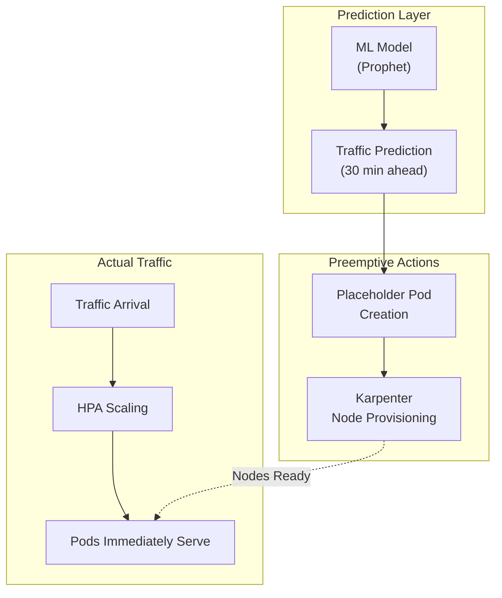
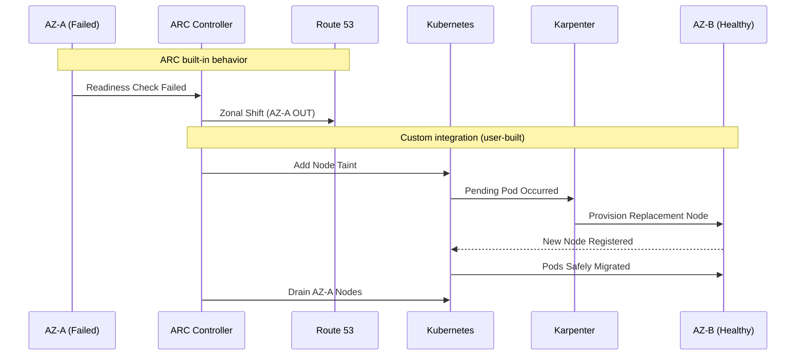
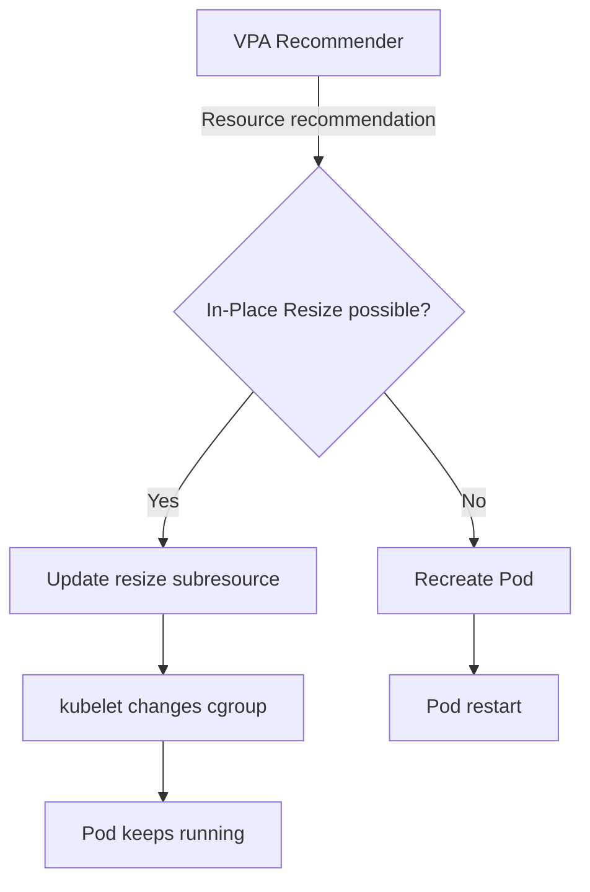

import { ScalingComparison, MLModelComparison, MaturityTable } from '@site/src/components/PredictiveOpsTables';

> **Core**: From reactive to predictive operations — ML-based predictive scaling, anomaly detection, and automatic optimization

---

## 1. Overview

### From Reactive to Predictive

Traditional EKS operations are **reactive**. HPA starts scaling **after** CPU/memory exceeds thresholds, so users are already impacted when traffic spikes.

**Predictive Operations** uses ML models to learn traffic patterns and **scales out proactively before increases**, maintaining service quality. This benefit appears only when the forecast matches actual traffic; when the forecast is wrong, under- or over-provisioning results. Predictive scaling therefore runs alongside reactive scaling rather than replacing it. HPA can take custom and external metrics as scaling inputs in addition to CPU/memory, so exposing the forecast as a custom metric, as in Section 2.3, lets HPA or KEDA use the predictive signal together with current metrics.

```
Reactive Scaling Problem:
  HPA threshold exceeded → scale-out begins → Pod startup 30s-2min
  Karpenter node provisioning → 1-3min additional delay
  → Performance degradation period → user impact

Predictive Scaling Solution:
  ML prediction (30 min ahead) → preemptive scale-out → actual traffic arrives
  → Nodes/Pods ready → degradation minimized if the forecast is accurate
```

### Core Value

- **Minimize User Impact**: Eliminate cold start delays
- **Cost Efficiency**: No need for excessive spare resources, expand only when needed
- **Complex Failure Response**: Multi-dimensional anomaly detection, not single metrics
- **Automatic Optimization**: Resource right-sizing automation with VPA + AI

---

## 2. ML-Based Predictive Scaling

### 2.1 HPA Limitations

HPA (Horizontal Pod Autoscaler) only reacts to **current metrics**, causing structural limitations.

<ScalingComparison />

The response-time, accuracy, and complexity ratings in the comparison above and the figure below are qualitative assumptions to explain the difference between approaches, not measured results. The accuracy of the predictive and autonomous approaches depends on how well the forecast model and the agent have been validated on the actual workload.

```
[HPA Reactive]
Traffic ████████████████████████░░░░░░░░░
                      ↑ threshold exceeded
Pods    ██████████░░░░████████████████████
                  ↑ scale-out starts (delayed)
User    ✓✓✓✓✓✓✓✓✗✗✗✓✓✓✓✓✓✓✓✓✓✓✓✓✓✓
Experience        ↑ performance degradation

[ML Predictive]
Traffic ████████████████████████░░░░░░░░░
             ↑ prediction point (30 min ahead)
Pods    ██████████████████████████████████
             ↑ preemptive scale-out
User    ✓✓✓✓✓✓✓✓✓✓✓✓✓✓✓✓✓✓✓✓✓✓✓✓✓✓
Experience (minimal degradation if the forecast is accurate)
```

### 2.2 Time Series Prediction Models

Representative ML models for predicting EKS workload traffic patterns:

<MLModelComparison />

**Model Selection Guide**:
- **Strong periodicity workloads** (daily/weekly patterns): Prophet
- **Trend-focused**: ARIMA
- **Complex non-linear patterns**: LSTM

The Prophet/ARIMA/LSTM models here forecast future load values and feed preemptive scaling. They serve a different purpose from the anomaly-detection bands of CloudWatch Anomaly Detection described in Section 4. Anomaly-detection bands learn a metric's normal range and judge whether the current value falls outside it; they do not forecast future values. Use the bands for anomaly alerting and the forecast models for preemptive scaling, keeping the two uses distinct.

### 2.3 Implementation Pattern

```python
# Prophet-based traffic prediction example
from prophet import Prophet
import pandas as pd

def predict_scaling(metrics_df, forecast_hours=2):
    """Predict future traffic with Prophet"""
    df = metrics_df.rename(columns={'timestamp': 'ds', 'value': 'y'})

    model = Prophet(
        changepoint_prior_scale=0.05,
        seasonality_mode='multiplicative',
        daily_seasonality=True,
        weekly_seasonality=True
    )
    model.fit(df)

    future = model.make_future_dataframe(periods=forecast_hours * 12, freq='5min')
    forecast = model.predict(future)

    # make_future_dataframe includes the training window, so select only the
    # future rows (after the last training timestamp) for preemptive scaling.
    last_train_ts = df['ds'].max()
    future_forecast = forecast[forecast['ds'] > last_train_ts]
    return future_forecast[['ds', 'yhat', 'yhat_upper', 'yhat_lower']]

def calculate_required_pods(forecast_df, pod_capacity_rps=100):
    """Calculate required Pod count from the validated future forecast upper bound (yhat_upper)"""
    # Use the max upper bound (yhat_upper) over the horizon for safety margin
    predicted_rps = forecast_df['yhat_upper'].max()
    required = int(predicted_rps / pod_capacity_rps) + 1
    return max(required, 2)
```

> **Precondition**: The calculation above is trustworthy only after the model passes validation on a holdout window (for example, checking an error metric such as MAPE). Wiring an unvalidated forecast directly into scaling can cause under- or over-provisioning. The values passed to `Prophet()`, such as `changepoint_prior_scale=0.05` and `seasonality_mode='multiplicative'`, and the forecast window `forecast_hours=2` are example starting values, not tuned values. Before use, backtest with Prophet's `cross_validation` over the horizon you will actually use, and check the error metrics and `coverage` from `performance_metrics` (the share of actual values that fall inside `yhat_lower` to `yhat_upper`; with the default `interval_width=0.8`, about 80% is expected) to confirm that the hyperparameters and the forecast horizon fit the workload.

**Automation Pattern**:
- Run predictions every 15 minutes with CronJob
- Collect last 7 days metrics from AMP
- Expose prediction results as Prometheus Custom Metric
- HPA or KEDA scales based on Custom Metric

---

## 3. Karpenter + AI Prediction

### 3.1 Karpenter Basic Operation

Karpenter detects Pending Pods and performs **Just-in-Time** node provisioning. However, node startup takes 1-3 minutes.

### 3.2 AI Prediction-Based Preemptive Provisioning

Combining with ML predictions enables **preparing nodes in advance**.



**Preemptive Provisioning Pattern**:

```yaml
# Placeholder Pods to reserve nodes preemptively
apiVersion: apps/v1
kind: Deployment
metadata:
  name: capacity-reservation
  namespace: scaling
spec:
  replicas: 0  # Dynamically adjusted by prediction scaler
  selector:
    matchLabels:
      app: capacity-reservation
  template:
    metadata:
      labels:
        app: capacity-reservation
    spec:
      priorityClassName: capacity-reservation  # Low priority
      terminationGracePeriodSeconds: 0
      containers:
        - name: pause
          image: registry.k8s.io/pause:3.9
          resources:
            requests:
              cpu: "1"
              memory: 2Gi
---
apiVersion: scheduling.k8s.io/v1
kind: PriorityClass
metadata:
  name: capacity-reservation
value: -10  # Evicted by actual workloads
globalDefault: false
description: "For Karpenter preemptive node provisioning"
```

**How It Works**:
1. ML model predicts traffic increase in 30 minutes
2. Increase Placeholder Pod replicas
3. Karpenter detects Pending Pods and provisions nodes
4. When actual traffic arrives, HPA creates actual Pods
5. Placeholder Pods are evicted due to low priority, and actual Pods are scheduled onto the freed nodes
6. Because nodes are prepared in advance, the node-provisioning delay disappears, but the time for container image pull, application startup, and passing the readiness probe remains. Application warmup (cache priming, connection-pool initialization, and so on) must therefore complete before real traffic is served.

To run this pattern in production, also define the following. First, set a scale-down condition for when the reserve Pods (replicas) are reduced again after the predicted traffic passes, so idle reserve capacity does not keep incurring cost. Second, cap the maximum node capacity that preemptive provisioning can acquire with the Karpenter NodePool `limits` (CPU/memory), so a prediction error does not drive unbounded node growth. Third, align the Placeholder Pod resource requests with the real workload so the reserved nodes can actually hold the real Pods.

### 3.3 ARC + Karpenter Integration (AZ Failure Auto-Evacuation)

**ARC (Application Recovery Controller)** automatically detects AZ failures and moves traffic to healthy AZs. Integration with Karpenter enables **node-level auto-recovery**.

In the flow below, the step ARC performs directly as a documented feature is the Route 53 Zonal Shift (removing the failed AZ from DNS responses). The subsequent steps — adding a node taint, Pending Pods appearing, Karpenter provisioning a replacement node, and draining AZ-A nodes — are not ARC's built-in behavior; they are a custom integration (for example, an event-driven controller or automation script) that you must build to react to the Zonal Shift signal. Read the two parts as distinct.



---

## 4. CloudWatch Anomaly Detection

### 4.1 Anomaly Detection Bands

CloudWatch Anomaly Detection uses ML to automatically learn **normal range bands** for metrics and detects anomalies outside the bands.

```bash
# Create Anomaly Detection model
aws cloudwatch put-anomaly-detector \
  --namespace "ContainerInsights" \
  --metric-name "pod_cpu_utilization" \
  --dimensions Name=ClusterName,Value=my-cluster \
  --stat "Average"
```

### 4.2 EKS Application Patterns

**Key Metrics** (CloudWatch `ContainerInsights` namespace):
- `pod_cpu_utilization`: Pod CPU utilization (%), relative to node CPU capacity (`pod_cpu_usage_total / node_cpu_limit`). Detects spikes outside normal patterns
- `pod_memory_utilization`: Pod memory utilization (%), relative to node memory capacity (`pod_memory_working_set / node_memory_limit`). Early memory leak detection
- `pod_network_rx_bytes`: Bytes per second received over the network by the pod. Abnormal network traffic detection
- `pod_number_of_container_restarts`: Cumulative count of container restarts in the pod. Restart pattern anomaly detection
- `node_cpu_utilization`: Node CPU utilization (%), `node_cpu_usage_total / node_cpu_limit`. Node-level bottleneck detection

### 4.3 Anomaly Detection-Based Alarms

```bash
# CloudWatch Alarm based on Anomaly Detection
aws cloudwatch put-metric-alarm \
  --alarm-name "EKS-CPU-Anomaly" \
  --comparison-operator GreaterThanUpperThreshold \
  --threshold-metric-id ad1 \
  --evaluation-periods 3 \
  --metrics '[
    {
      "Id": "m1",
      "MetricStat": {
        "Metric": {
          "Namespace": "ContainerInsights",
          "MetricName": "pod_cpu_utilization",
          "Dimensions": [{"Name": "ClusterName", "Value": "my-cluster"}]
        },
        "Period": 300,
        "Stat": "Average"
      }
    },
    {
      "Id": "ad1",
      "Expression": "ANOMALY_DETECTION_BAND(m1, 2)"
    }
  ]' \
  --alarm-actions "arn:aws:sns:ap-northeast-2:ACCOUNT_ID:ops-alerts"
```

**Characteristics**:
- Unlike fixed thresholds, the alarm compares against a learned normal-range band, so for workloads with periodicity it tends to reduce false positives. The amount of reduction depends on the workload pattern and the band width (standard-deviation multiplier) and is not a guaranteed figure.
- Learns daily/weekly periodicity and seasonal changes and reflects them in the band.

The example alarm above fires when `Period` 300-second data points exceed the band for `evaluation-periods` 3 consecutive times (about 15 minutes). The alarm only **detects and notifies**: it delivers a notification via the SNS action but does not itself perform any action such as scaling or restarting. If automatic action is needed, build separate automation (Lambda, EventBridge, and so on) that receives the notification.

---

## 5. AI Right-Sizing

### 5.1 Container Insights-Based Recommendations

CloudWatch Container Insights analyzes actual Pod resource usage patterns to recommend appropriate sizing.

```promql
# Compare actual CPU usage vs requests (aggregate to the same per-pod population)
sum(rate(container_cpu_usage_seconds_total{namespace="payment"}[1h]))
  by (pod)
/ sum(kube_pod_container_resource_requests{resource="cpu", namespace="payment"})
  by (pod)
* 100

# Compare actual Memory usage vs requests (aggregate to the same per-pod population)
sum(container_memory_working_set_bytes{namespace="payment"})
  by (pod)
/ sum(kube_pod_container_resource_requests{resource="memory", namespace="payment"})
  by (pod)
* 100
```

The numerator (actual usage) is per pod while the denominator (requests) is per container, so aggregate both vectors to a per-pod total with `sum ... by (pod)` to match populations. For a per-container ratio, aggregate both sides `by (pod, container)`. Grouping with `avg` distorts the ratio in multi-container Pods depending on the container count, so use `sum`.

### 5.2 VPA + ML-Based Auto Right-Sizing

```yaml
# VPA (Vertical Pod Autoscaler) configuration
apiVersion: autoscaling.k8s.io/v1
kind: VerticalPodAutoscaler
metadata:
  name: payment-service-vpa
  namespace: payment
spec:
  targetRef:
    apiVersion: apps/v1
    kind: Deployment
    name: payment-service
  updatePolicy:
    updateMode: "Auto"  # Off, Initial, Auto
  resourcePolicy:
    containerPolicies:
      - containerName: app
        minAllowed:
          cpu: 100m
          memory: 128Mi
        maxAllowed:
          cpu: "2"
          memory: 4Gi
        controlledResources: ["cpu", "memory"]
```

### 5.3 In-Place Pod Vertical Scaling (K8s 1.33+)

Starting with Kubernetes 1.33, **In-Place Pod Vertical Scaling** entering Beta resolves VPA's biggest drawback: **Pod restart issues**.

**Previous VPA Problem**:
- Pod restart required for resource changes
- Difficult to use with StatefulSets, DBs, caches, and other stateful workloads
- Possible service interruption during restart

**In-Place Resize Solution**:
- Dynamically adjust resources of running Pods without recreating the Pod
- Real-time cgroup limit changes
- In many cases resources are adjusted without a container restart, but depending on the kind of change and the container's `resizePolicy` a container restart may still be required (for example, a memory decrease). Even then the Pod itself is not recreated; only the container restarts inside the same Pod.
- In other words, "avoiding Pod recreation" and "avoiding container restart" are separate. In-Place Resize always guarantees the former, while the latter is conditional.

The table below shows the Kubernetes upstream maturity stages of In-Place Pod Vertical Scaling (Feature Gate `InPlacePodVerticalScaling`). The "Stable" row for 1.35 and later and the EKS dates below are projections as of 2026-10-15 based on public roadmaps, not confirmed schedules. Confirm actual support against the Kubernetes KEP-1287 and EKS release notes.

| Kubernetes Version | Status | Feature Gate | Notes |
|----------------|------|--------------|------|
| 1.27 | Alpha | `InPlacePodVerticalScaling` | Experimental |
| 1.33 | Beta | Default enabled | Production testing recommended |
| 1.35+ | Stable (expected) | Default enabled | Projected per upstream roadmap |

**EKS Support** (projected as of 2026-10-15, not confirmed):
- **EKS 1.33** (expected around April 2026): Beta activation available
- **EKS 1.35** (expected around November 2026): Stable support expected

**VPA Automatic In-Place Resize**:

```yaml
apiVersion: autoscaling.k8s.io/v1
kind: VerticalPodAutoscaler
metadata:
  name: payment-service-vpa
  namespace: payment
spec:
  targetRef:
    apiVersion: apps/v1
    kind: Deployment
    name: payment-service
  updatePolicy:
    updateMode: "Auto"  # Adjusts without restart when In-Place Resize supported
  resourcePolicy:
    containerPolicies:
      - containerName: app
        minAllowed:
          cpu: 100m
          memory: 128Mi
        maxAllowed:
          cpu: "4"
          memory: 8Gi
        controlledResources: ["cpu", "memory"]
        mode: Auto  # Enables autoscaling for this container (Auto or Off)
```

**Operation Flow**:



**Constraints**:
- CPU can be resized freely
- Memory can be both increased and decreased, but depending on the container's `resizePolicy` a memory decrease may require a container restart
- A Pod's QoS class (Guaranteed/Burstable/BestEffort) is fixed at creation time and cannot be changed. An In-Place Resize request that would change the QoS class is rejected; changing the QoS class requires creating a replacement Pod, not merely a container restart

:::warning VPA Cautions (K8s 1.34 and below)
In K8s 1.34 and below, VPA `Auto` mode restarts Pods to adjust resources. For StatefulSets or restart-sensitive workloads, recommend using `Off` mode to check recommendations only and apply manually. VPA and HPA conflicts can occur when simultaneously using the same metrics (CPU/Memory).
:::

### 5.4 Right-Sizing Impact

**Expected Cost Savings** (illustrative figures, not measured results; actual savings depend on the workload's load variation and its current request settings):
- Over-provisioning reduced from 40-60% to 20-30%
- 30-50% annual cluster cost savings
- Increased node consolidation efficiency

---

## 6. Maturity Model

<MaturityTable />

This maturity model is a classification proposed by this document, not an industry-standard model. The three stages in the table above simplify Level 0-4 below: Reactive corresponds roughly to Level 0, Predictive to Level 1-2, and Autonomous to Level 3-4. The KPIs in the table (MTTR, MTTD, daily alert count) are illustrative targets that show the difference between stages, not measured values.

**Level 0: Reactive**
- Basic HPA/VPA configuration
- Fixed threshold-based alarms
- Manual scaling

**Level 1: Prediction Ready**
- Container Insights enabled
- Anomaly Detection adopted
- Metrics collection 7+ days history

**Level 2: Predictive Scaling**
- Prophet/ARIMA-based traffic prediction
- Karpenter preemptive provisioning
- CronJob-based automation

**Level 3: Auto-Optimization**
- VPA Auto mode applied
- In-Place Resize utilization (K8s 1.33+)
- CloudWatch Anomaly Detection-based automatic actions

**Level 4: Autonomous Operations**
- AI Agent-based automatic incident response
- Chaos Engineering + AI feedback loop
- Autonomous learning and improvement

---

## 7. References

**Related Documentation**:
- [Observability Stack](./observability-stack.md) — Metric collection and analysis foundation
- [Autonomous Response](./autonomous-response.md) — AI Agent-based incident response
- [EKS Declarative Automation](../toolchain/eks-declarative-automation.md) — GitOps-based automation

**AWS Official Documentation**:
- [CloudWatch Anomaly Detection](https://docs.aws.amazon.com/AmazonCloudWatch/latest/monitoring/CloudWatch_Anomaly_Detection.html)
- [Karpenter Best Practices](https://aws.github.io/aws-eks-best-practices/karpenter/)
- [Container Insights](https://docs.aws.amazon.com/AmazonCloudWatch/latest/monitoring/ContainerInsights.html)
- [Application Recovery Controller](https://docs.aws.amazon.com/r53recovery/latest/dg/what-is-route53-recovery.html)

**Kubernetes Official Documentation**:
- [In-Place Pod Vertical Scaling (KEP-1287)](https://github.com/kubernetes/enhancements/tree/master/keps/sig-node/1287-in-place-update-pod-resources)
- [VPA](https://github.com/kubernetes/autoscaler/tree/master/vertical-pod-autoscaler)
