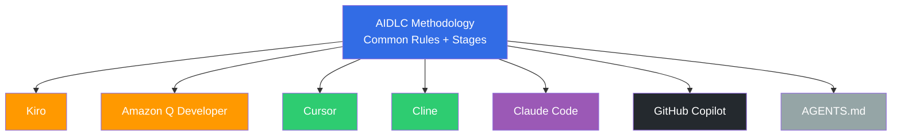

import { AiCodingAgentComparison } from '@site/src/components/AidlcTables';

This document covers AI coding agent strategies for implementing design as code in the AIDLC Construction phase. It first summarizes the **seven platforms officially supported by AWS Labs AIDLC**, then goes deeper into Kiro's Spec-Driven approach and Amazon Q Developer's real-time build and test. It then closes with MCP-based context collection, CI/CD integration patterns, and an agent selection guide.

## 0. The Seven Officially Supported AIDLC Platforms

AWS Labs [AIDLC Workflows](https://github.com/awslabs/aidlc-workflows) defines **seven officially supported platforms** on which the AIDLC methodology runs. Each platform must implement the Common Rules and the Inception/Construction workflows, and the artifact format follows the common convention.



### 0.1 Kiro
- **AIDLC application**: Spec-Driven built in. The `requirements.md → design.md → tasks.md` file structure maps almost 1:1 to Inception artifacts. MCP native, with immediate integration to AWS Hosted MCP servers
- **Strengths**: Full support for all 11 Common Rules. Recognizes organizational Extensions (opt-in.md). Tight integration with AWS services (EKS, DynamoDB, etc.)
- **Limits**: AWS-ecosystem-centric, so it constrains multi-cloud teams. Limited IDE choices

### 0.2 Amazon Q Developer
- **AIDLC application**: Centered on Construction-phase real-time build/test/security scan. Combine with a separate Kiro/Claude Code for Inception
- **Strengths**: Automatic build/test execution triggers the Loss Function immediately. Strong CodeCatalyst/GitHub Actions integration. `/transform` supports legacy migration (Java, .NET)
- **Limits**: The Inception (requirements/design) phase needs another tool in parallel. For high-freedom experimentation/prototyping, tools like Cursor are more flexible

### 0.3 Cursor
- **AIDLC application**: Code-context-based Spec-Driven. Part of the Common Rules can be expressed via the `.cursor/rules/` directory. Multi-file editing with the Composer feature
- **Strengths**: Strong at large-scale refactoring and code comprehension. The Apply feature merges proposed code after validation. High editor UX completeness
- **Limits**: Does not support the AIDLC Extension System → organizational rules are supplemented via manual prompts. Limited automatic audit-log generation

### 0.4 Cline
- **AIDLC application**: A VS Code Extension-based autonomous agent. Suited to CLI-centric workflows. Its Plan Mode / Act Mode split fits Adaptive Execution well
- **Strengths**: Fully open source, Bring Your Own Key (BYOK). Free control of the local filesystem/terminal. Natural creation/modification of AIDLC artifact files
- **Limits**: Lower IDE-integration UX than Cursor. No commercial support (community-dependent)

### 0.5 Claude Code
- **AIDLC application**: Supports both CLI and IDE integration. Sub-agent-based decomposition of complex tasks. Expresses Common Rules via AGENTS.md / CLAUDE.md
- **Strengths**: Anthropic Claude models by default. Sub-agents can split Inception (planner) + Construction (executor). Smooth integration with the MCP ecosystem
- **Limits**: Cost burden when using the Opus model. Team-wide adoption needs license/rate-limit management

### 0.6 GitHub Copilot
- **AIDLC application**: Centered on code auto-completion. Partial Spec-Driven support via Copilot Chat + Workspace. AGENTS.md recognition expanding in Copilot Enterprise
- **Strengths**: The broadest IDE support (VS Code · JetBrains · Neovim). Already familiar to most developers. GitHub-native integration
- **Limits**: AIDLC Stage Transition and Checkpoint Approval concepts are not in Copilot's base features — manual operation needed. Limited prompt customization

### 0.7 AGENTS.md
- **AIDLC application**: Rather than a platform, a **tool-independent document specification**. Describes the Common Rules, Extensions, and Stage conventions in plain text via an `AGENTS.md` file
- **Strengths**: Any AI agent that reads `AGENTS.md` can be made to follow AIDLC rules (supported by Claude Code, Cursor, Cline). Easy Git tracking and review
- **Limits**: Automatic execution/enforcement is impossible → the agent may ignore the file. Audit/Checkpoint requires separate tools

### 0.8 Platform Selection Summary

| Platform | AIDLC Common Rules | Inception | Construction | Audit | License | Recommended Case |
|--------|-------------------|-----------|--------------|-------|---------|-----------|
| Kiro | Full | Full | Full | Full | Commercial (AWS) | AWS enterprise, security-sensitive |
| Amazon Q Developer | Full | Partial | Full | Full | Commercial (AWS) | AWS + CI/CD real-time validation |
| Cursor | Partial | Partial | Full | Manual | Commercial | Large-scale refactoring/exploratory development |
| Cline | Partial | Partial | Full | Manual | OSS (BYOK) | Cost saving/customization |
| Claude Code | Full | Full | Full | Partial | Commercial (Anthropic) | Sub-agent-based complex tasks |
| GitHub Copilot | Partial | Limited | Full | Limited | Commercial (GitHub) | Broad IDE support/low learning curve |
| AGENTS.md | Full (docs) | Full (docs) | Full (docs) | Manual | OSS | Tool-independent convention management |

:::tip Hybrid Strategy Recommended
Instead of using a single platform, a **hybrid** that combines the best tool per stage — such as **Kiro (Inception) + Q Developer (Construction) + GitHub Copilot (per-file completion)** — is the most efficient in practice. Because artifacts are standardized in Markdown + YAML, the cost of moving between platforms is low.
:::

## 1. AI Coding Agents Overview

The AIDLC Construction phase transforms Inception phase outputs (requirements, design, ontology) into **executable code and infrastructure**. AI coding agents automate this transformation and perform the following roles:

1. **Requirements → Code Transformation** — Convert natural language requirements into structured specifications (Spec), then generate code
2. **Real-time Build & Test** — Immediately build and test generated code to detect errors early (Loss Function)
3. **Security Scanning** — Automatically detect and suggest fixes for security vulnerabilities in Kubernetes manifests and application code
4. **CI/CD Integration** — Automatically integrate with GitOps pipelines like GitHub Actions and Argo CD
5. **Real-time Context Collection** — Reflect current infrastructure state, costs, and workload information via MCP servers

Amazon Q Developer and Kiro use **Anthropic Claude** models by default, and Kiro also supports [open-weight models](./open-weight-models.md) for cost optimization and specialized domain extensions.

## 2. Kiro — Spec-Driven Development

### 2.1 Spec-Driven Inception

Kiro systematizes Inception phase outputs into **Spec files**, structuring the entire process from natural language requirements to code. The `requirements.md → design.md → tasks.md` flow below is the output structure this guide pins to the AIDLC Vibe workflow; it does not necessarily match the file names and stages used by Kiro's own built-in Spec feature. Verify each tool's actual Spec behavior against that tool's current documentation.

```
requirements.md → design.md → tasks.md → code generation → validation
```

#### EKS Example: Payment Service Deployment

**requirements.md**

```markdown
# Payment Service Deployment Requirements

## Functional Requirements
- REST API endpoint: /api/v1/payments
- Integration with DynamoDB table
- Asynchronous event processing via SQS

## Non-Functional Requirements
- P99 latency: < 200ms
- Availability: 99.95%
- Auto-scaling: 3-20 Pods (minimum 3, HPA max 20)
- EKS 1.35+ compatible
```

The design above assumes an EKS 1.35+ cluster with the ACK controllers (DynamoDB, SQS), Karpenter, and HPA already installed.

**design.md**

```markdown
# Payment Service Architecture

## Infrastructure Configuration
- EKS Deployment (replicas: 3, HPA max 20)
- ACK DynamoDB Table (on-demand)
- ACK SQS Queue (FIFO)
- HPA (CPU 70%, Memory 80%)
- Karpenter NodePool (graviton, spot)

## Observability
- ADOT sidecar (traces → X-Ray)
- Application Signals (automatic SLI/SLO)
- CloudWatch Logs (/eks/payment-service)

## Security
- Pod Identity (replaces IRSA)
- NetworkPolicy (namespace isolation)
- Secrets Manager CSI Driver
```

**tasks.md**

```markdown
# Implementation Tasks

## Bolt 1: Infrastructure
- [ ] Write ACK DynamoDB Table CRD
- [ ] Write ACK SQS Queue CRD
- [ ] Define KRO ResourceGroup (integrate DynamoDB + SQS)
- [ ] Configure Karpenter NodePool (graviton, spot)

## Bolt 2: Application
- [ ] Implement Go REST API
- [ ] Integrate DynamoDB SDK
- [ ] Implement SQS consumer
- [ ] Dockerfile + multi-stage build

## Bolt 3: Deployment
- [ ] Write Helm chart
- [ ] Define Argo CD Application
- [ ] Write HPA manifest
- [ ] Write NetworkPolicy

## Bolt 4: Observability
- [ ] Configure ADOT sidecar
- [ ] Add Application Signals annotation
- [ ] Create CloudWatch dashboard
- [ ] Set up SLO alerts
```

### 2.2 Spec-Driven vs. Directive Approach

:::tip Core Value of Spec-Driven
**Directive Approach**: "Create DynamoDB" → "Need SQS too" → "Now deploy" → Manual instructions each time, risk of context loss

**Spec-Driven**: Kiro analyzes `requirements.md` → generates `design.md` → breaks down `tasks.md` → auto-generates code → connects to validation with consistent Context Memory
:::

Because the Spec-Driven approach keeps the full context, tooling can assist in tracking the scope of impact when requirements change. The tracking is not fully automatic; it requires the artifacts to be in sync and a person to confirm the result. For DDD (Domain-Driven Design) integration patterns, see [DDD Integration](../methodology/ddd-integration.md).

### 2.3 MCP Native Architecture

Kiro is designed MCP (Model Context Protocol) native, collecting **real-time infrastructure state** via AWS Hosted MCP servers during the Inception phase.

The calls and responses below are illustrative of the interaction; the actual tool names, schemas, and response formats of each MCP server follow the documentation of the server version you use.

```
[Kiro + MCP Interaction]

Kiro: "Check EKS cluster status"
  → EKS MCP Server: get_cluster_status()
  → Response: { version: "1.35", nodes: 5, status: "ACTIVE" }

Kiro: "Analyze costs"
  → Cost Analysis MCP Server: analyze_cost(service="EKS")
  → Response: { monthly: "$450", recommendations: [...] }

Kiro: "Analyze current workload"
  → EKS MCP Server: list_deployments(namespace="payment")
  → Response: { deployments: [...], resource_usage: {...} }
```

This enables **realistic designs reflecting current infrastructure state and costs** when generating `design.md`. For details on MCP integration architecture, refer to the AIDLC MCP strategy document.

### 2.4 Open-Weight Model Support

Kiro supports open-weight models (Llama 3.1 405B, Mixtral 8x22B, DeepSeek R1, etc.) in addition to Claude, providing the following benefits:

- **Cost Optimization** — Process simple code generation tasks with smaller models (1/10 token cost)
- **Specialized Domain Extension** — Utilize domain-specific fine-tuned models for finance, healthcare, etc.
- **On-Premises Deployment** — When the model is self-hosted for inference within an EKS cluster, inference data is not sent externally. This data boundary applies only to the self-hosted inference path, not to calls to an externally hosted model.

For open-weight model deployment strategies, see [Open-Weight Models](./open-weight-models.md).

## 3. Amazon Q Developer — Real-time Build and Test

AWS announced **Amazon Q Developer's automatic build and test capability** on January 31, 2025. This is an approach where AI generates code, then **automatically builds and runs tests to validate results** before presenting to developers. The capability works when the project has build and test commands configured (for example, specifying the commands via a Devfile) and runnable tests exist.

It's a core mechanism in the AIDLC Construction phase for **activating the Loss Function early** to prevent errors from propagating downstream.

### 3.1 Real-time Code Execution Mechanism

Traditional AI coding tools required developers to manually build and test after code generation. Q Developer automates this process.

```
Traditional Approach:
  AI code generation → developer manual build → developer manual test → error discovery → feedback to AI → regeneration
  (iteration cycle: 5-10 minutes)

Q Developer Real-time Execution:
  AI code generation → automatic build → automatic test → result validation → (auto-retry on error) → developer review
  (iteration cycle: 1-2 minutes, minimal developer intervention)
```

**Core Mechanisms**

This automatic build and test works when the project has build and test commands configured (for example, specifying the run commands via a Devfile) and runnable tests exist.

1. **Automatic Build Pipeline**
   - Automatically execute project build tools (Maven, Gradle, npm, pip, etc.)
   - Immediately detect compilation errors and dependency conflicts
   - On build failure, analyze error messages and automatically retry code fixes

2. **Automatic Test Execution**
   - Automatically run unit tests and integration tests
   - On test failure, analyze failure causes and fix code or tests
   - Maintain existing test coverage while adding new code

3. **Validation Before Developer Review**
   - When the automatic fixes succeed, the developer receives code that **passed build and tests**. If the automatic fixes still fail after retries, the agent surfaces the failures and unresolved errors to the developer rather than passing code.
   - Developer focuses on business logic and design review (Loss Function role)
   - Validates "Is this the right code?" not "Does the code work?"

### 3.2 Automatic Security Scan Fixes

Q Developer automatically scans Kubernetes YAML and application code for security vulnerabilities and provides fix suggestions.

**Kubernetes YAML Security Scan**

1. **Root Privilege Detection** — Detects `runAsUser: 0` or `runAsNonRoot: false`, suggests `runAsUser: 1000`, `runAsNonRoot: true`
2. **Privileged Container Detection** — Detects `securityContext.privileged: true`, suggests explicitly adding only necessary capabilities
3. **Missing securityContext Detection** — When Pod/Container lacks `securityContext`, suggests settings following least privilege principle

**Automatic Fix Suggestion Example**

Manifest with the problem detected by Q Developer:

```yaml
apiVersion: v1
kind: Pod
metadata:
  name: payment-pod
spec:
  containers:
    - name: payment
      image: payment:v1
      securityContext:
        runAsUser: 0  # ⚠️ Using root privileges
        privileged: true  # ⚠️ Privileged mode
```

Fixed manifest suggested by Q Developer:

```yaml
apiVersion: v1
kind: Pod
metadata:
  name: payment-pod
spec:
  securityContext:
    runAsNonRoot: true
    runAsUser: 1000
    fsGroup: 1000
    seccompProfile:
      type: RuntimeDefault
  containers:
    - name: payment
      image: payment:v1
      securityContext:
        allowPrivilegeEscalation: false
        readOnlyRootFilesystem: true
        capabilities:
          drop:
            - ALL
          add:
            - NET_BIND_SERVICE  # Add only necessary capabilities
```

### 3.3 Feedback Loop Reduction Effect

```
Traditional Construction Phase:
  [Developer] Write code (30 min)
    → [Developer] Manual build (2 min)
    → [Developer] Manual test (5 min)
    → [Developer] Discover errors (10 min debugging)
    → [Developer] Fix code (20 min)
    → Repeat...
  Total time: 2-3 hours

Q Developer Real-time Execution:
  [AI] Code generation (1 min)
    → [AI] Automatic build & test (30 sec)
    → [AI] Error detection and automatic fix (1 min)
    → [Developer] Loss Function validation (10 min)
    → [Developer/approval gate] Approve deployment
    → [Argo CD] Sync the approved change
  Total time: 15-20 minutes (illustrative; varies with the size of the work)
```

The times above are illustrative of the flow, not measured values. Deployment proceeds only after Loss Function validation and the approval gate; it is not deployed automatically without review.

:::tip Q Developer's Value in AIDLC
Q Developer's real-time execution implements AIDLC's core principle of **"Minimize Stages, Maximize Flow"**. By automating each stage of code generation → build → test → validation, it eliminates handoffs, allowing developers to focus only on **decision-making (Loss Function)**. This is the core mechanism that reduces traditional SDLC's week/month cycles to AIDLC's hour/day cycles.
:::

## 4. AI Coding Agent Comparison

<AiCodingAgentComparison />

## 5. MCP-Based Real-time Context Collection

Kiro's MCP native architecture collects **real-time infrastructure state** via AWS Hosted MCP servers during the Construction phase to reflect in design.

### 5.1 AWS Hosted MCP Server Utilization

**EKS MCP Server**

```typescript
// Kiro queries EKS cluster status in real-time
const cluster = await mcp.call('eks-mcp-server', 'get_cluster_status', {
  clusterName: 'prod-eks'
});

// Response: { version: "1.35", nodes: 5, status: "ACTIVE", capacityType: "SPOT" }
// → Reflects current cluster version when generating design.md
```

**Cost Analysis MCP Server**

```typescript
// Optimize design with cost analysis
const cost = await mcp.call('cost-analysis-mcp', 'analyze_cost', {
  service: 'EKS',
  timeRange: 'last_30_days'
});

// Response: { monthly: "$450", recommendations: ["Use Spot for dev clusters", "Enable Karpenter consolidation"] }
// → Reflects cost optimization strategies in design.md
```

**Workload MCP Server**

```typescript
// Determine resource allocation with current workload analysis
const workload = await mcp.call('eks-mcp-server', 'list_deployments', {
  namespace: 'payment'
});

// Response: { deployments: [...], resource_usage: { cpu: "60%", memory: "75%" } }
// → Used to determine HPA thresholds and NodePool settings
```

### 5.2 MCP Integration Benefits

1. **Context-Based Design** — Generate realistic designs reflecting current infrastructure state
2. **Cost Optimization** — Automatically suggest cost reduction strategies like Spot and Graviton based on actual usage patterns
3. **Resource Efficiency** — Optimize HPA and Karpenter settings based on current workload state
4. **Consistency Assurance** — Minimize gap between design and reality with real-time data

## 6. CI/CD Integration

Integrate AI coding agents into CI/CD pipelines to implement **Quality Gate automation**.

### 6.1 GitHub Actions Integration

In the workflow below, `aws/amazon-q-developer-action@v1` and its inputs (scan-type, auto-fix, action: build-and-test) are **illustrative pseudo-config showing where the security scan and build/test steps belong, not a published action**. In a real pipeline, replace them with commands from the current documentation of the Q Developer CLI/integration you use, and install external tools such as `kube-linter` in the job first.

```yaml
# .github/workflows/aidlc-construction.yml
name: AIDLC Construction Quality Gate
on:
  pull_request:
    types: [opened, synchronize]

jobs:
  q-developer-validation:
    runs-on: ubuntu-latest
    steps:
      - uses: actions/checkout@v4

      # 1. Q Developer Security Scan (pseudo-config — replace with a real command)
      - name: Q Developer Security Scan
        uses: aws/amazon-q-developer-action@v1
        with:
          scan-type: security
          source-path: .
          auto-fix: true  # Apply automatic fix suggestions

      # 2. Real-time Build and Test (pseudo-config — replace with a real command)
      - name: Q Developer Build & Test
        uses: aws/amazon-q-developer-action@v1
        with:
          action: build-and-test
          test-coverage-threshold: 80

      # 3. Kubernetes Manifest Validation (install kube-linter first)
      - name: Install kube-linter
        run: |
          curl -sSL https://github.com/stackrox/kube-linter/releases/latest/download/kube-linter-linux.tar.gz | tar xz
          sudo mv kube-linter /usr/local/bin/
      - name: K8s Manifest Security Check
        run: |
          kube-linter lint deploy/ --config .kube-linter.yaml

      # 4. Allow Argo CD Sync Only on Pass
      - name: Approve for GitOps
        if: success()
        run: echo "Quality Gate passed. Ready for Argo CD sync."
```

### 6.2 Argo CD Integration

Argo CD's `syncPolicy.automated` only syncs to the revision that `targetRevision` points to; it does not enforce a "sync only when the Quality Gate passes" condition on its own. To actually reflect the gate, pin `targetRevision` to the commit SHA that passed the Quality Gate, or add a separate promotion step that records only approved revisions.

```yaml
apiVersion: argoproj.io/v1alpha1
kind: Application
metadata:
  name: payment-service
  namespace: argocd
spec:
  project: default
  source:
    repoURL: https://github.com/org/payment-service
    # Pin to the validated commit SHA that passed the Quality Gate (bind to the validated revision, not a branch)
    targetRevision: 2f1a9c4e8b7d6a5c4b3a2918f7e6d5c4b3a21908
    path: deploy/
  destination:
    server: https://kubernetes.default.svc
    namespace: payment
  syncPolicy:
    automated:
      prune: true
      selfHeal: true
    syncOptions:
      - CreateNamespace=true
    retry:
      limit: 3
      backoff:
        duration: 5s
        factor: 2
        maxDuration: 3m
```

### 6.3 Quality Gate Workflow

1. **PR Creation** — Developer submits Kiro-generated code as PR
2. **Security Scan** — Q Developer scans Kubernetes manifests and application code
3. **Build & Test** — Q Developer automatically builds and runs tests
4. **Validation Pass** — When all CI checks (security scan, build, test) pass, Argo CD accepts that revision as a sync target. This means CI passed; it is separate from rollout completion.
5. **Rollout Outcome** — Argo CD applies the resources to the EKS cluster, and the rollout completes when the Pods become Ready/Healthy. Application Signals is not enabled automatically; metrics are collected only if the instrumentation setup has been applied to the application.

This workflow is a core implementation pattern of [Harness Engineering](../methodology/harness-engineering.md).

## 7. Agent Selection Guide

AI coding agent selection criteria by project characteristics.

### 7.1 By Project Scale

| Project Scale | Recommended Agent | Reason |
|--------------|------------------|--------|
| Small (1-5 microservices) | Amazon Q Developer | IDE integration, fast feedback, security scan |
| Medium (6-20 microservices) | Kiro + Q Developer | Spec-Driven consistency, Q Developer real-time validation |
| Large (21+ microservices) | Kiro + Open-Weight Models | Cost optimization, domain-specialized model utilization |

The scale bands above are divided so they do not overlap. Beyond scale, also weigh regulatory sensitivity (whether regulated data such as finance/healthcare is handled) and compatibility with the existing stack (AWS-centric vs. multi-cloud). For example, even with few services, prefer a combination that allows on-premises inference when regulated data is involved.

### 7.2 By Domain

| Domain | Recommended Agent | Reason |
|--------|------------------|--------|
| General Web Applications | Amazon Q Developer | General language/framework support, rapid prototyping |
| EKS Infrastructure Automation | Kiro + MCP | Reflect real-time cluster state, ACK/KRO integration |
| Finance/Healthcare Specialized Domains | Kiro + Fine-tuned Open Models | Regulatory compliance, on-premises deployment |
| Legacy Migration | Amazon Q Developer `/transform` | Automatic Java 8→17, .NET Framework→Core conversion |

### 7.3 By Team Maturity

| Team Maturity | Recommended Agent | Reason |
|--------------|------------------|--------|
| First AI Tool Adoption | Amazon Q Developer | IDE integration, low learning curve, AWS official support |
| DevOps Skilled Team | Kiro + Q Developer | Spec-Driven structure, CI/CD automation, MCP utilization |
| AI Platform Operations Team | Kiro + Open-Weight Models | Custom model deployment, cost optimization, special requirements |

### 7.4 Cost Considerations

| Monthly Request Volume | Recommended Strategy | Estimated Cost |
|----------------------|---------------------|----------------|
| < 10,000 requests | Amazon Q Developer only | ~$50-100 |
| 10,000 - 100,000 requests | Kiro + Claude (simple tasks use smaller models) | ~$200-500 |
| > 100,000 requests | Kiro + Open-Weight Models (EKS self-hosting) | ~$100-300 (infrastructure cost) |

The dollar figures above are illustrative examples, not measured values. They vary greatly with tokens per request, the model used, the region, and the self-hosting infrastructure configuration, so compute the actual cost by applying each strategy's token usage and prices to your own environment. The open-weight self-hosting cost depends on the assumptions of the inference infrastructure.

## 8. Practical Application Patterns

### 8.1 Hybrid Strategy

For many teams working on AWS, the **Amazon Q Developer + Kiro hybrid** is an effective option:

1. **Early Development** — Rapid prototyping with Q Developer, real-time feedback
2. **After Design Confirmation** — Consistent implementation with Kiro Spec-Driven
3. **Security Validation** — Early vulnerability detection with Q Developer automatic scan
4. **Deployment Automation** — Deployment configuration reflecting current cluster state with Kiro MCP

### 8.2 Ontology-Based Code Generation

When providing Kiro with ontology built during the Inception phase, it generates **code reflecting domain terms and relationships**:

```markdown
# ontology.md (provided to Kiro)

## Domain Model
- Payment → Order → Customer
- Payment.status: [pending, completed, failed]
- Payment.method: [card, bank_transfer, wallet]

## Business Rules
- When creating Payment, Order.status must be "confirmed"
- Payment.amount must match Order.total_amount
- Only on a clearly-failed Payment, send to the SQS retry queue with an idempotency key (max 3 times); on an unknown outcome such as a timeout, reconcile by querying payment status instead of retrying
```

Kiro generates `design.md` and code based on this ontology, ensuring domain term consistency.

### 8.3 Continuous Learning

AI coding agents can improve their output by **reflecting team feedback into the prompt context**. Items 1-3 below update the context the agent references (conventions, ontology, MCP) without changing model weights; only item 4, fine-tuning, actually changes model weights. In other words, the phrase "the agent learns from feedback on its own" does not apply to items 1-3.

1. **Code Review Feedback** — Capture team coding conventions from PR comments and reflect them in rule docs/prompt context
2. **Ontology Updates** — Update `ontology.md` when new domain concepts are added (context update)
3. **MCP Server Extension** — Integrate MCP servers when new infrastructure services are added (context update)
4. **Fine-tuning** — Fine-tune open-weight models with the team codebase — the only step that changes model weights (optional)

## References

- [AWS DevOps Blog: Enhancing Code Generation with Real-Time Execution in Amazon Q Developer](https://aws.amazon.com/blogs/devops/enhancing-code-generation-with-real-time-execution-in-amazon-q-developer/) (2025-02-06)
- [Amazon Q Developer Official Documentation](https://docs.aws.amazon.com/amazonq/latest/qdeveloper-ug/)
- [Model Context Protocol (MCP) Specification](https://modelcontextprotocol.io/)
- [Open-Weight Model Deployment Guide](./open-weight-models.md)
- [DDD Integration](../methodology/ddd-integration.md)
- [Harness Engineering](../methodology/harness-engineering.md)
