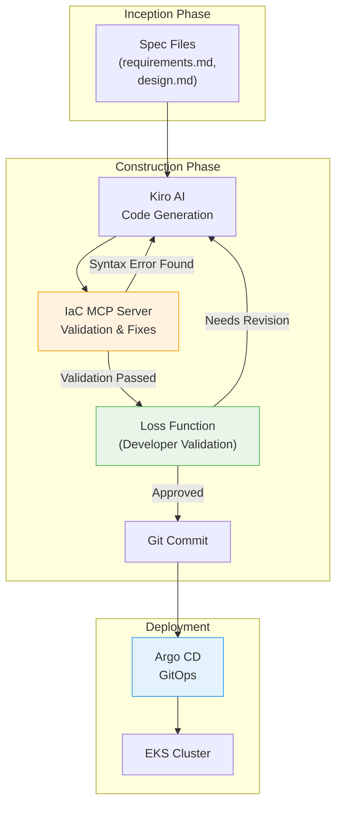

import { EksCapabilities, AidlcPipeline } from '@site/src/components/AidlcTables';

EKS Capabilities (Nov 2025) provides popular open-source tools as AWS managed services, serving as the core infrastructure for declaratively deploying AIDLC Construction phase outputs and continuously managing them in the Operations phase.

<EksCapabilities />

## 1. EKS Capabilities Overview

This guide groups the following five components into one pipeline. Separating what AWS provides as EKS managed capabilities from the community controllers you install and run yourself keeps the ownership boundaries clear.

AWS provides these three components as EKS managed capabilities:

1. **Managed Argo CD** — GitOps-based continuous deployment
2. **ACK (AWS Controllers for Kubernetes)** — Manage AWS resources as K8s CRDs
3. **KRO (Kubernetes Resource Orchestrator)** — Orchestrate composite resources as single deployment units

The following two are open-source/add-on controllers you install and operate in the cluster yourself; they are not offered as EKS managed services:

4. **Gateway API (AWS Load Balancer Controller)** — L4/L7 traffic routing and advanced networking
5. **Node Readiness Controller** — Declarative node readiness state management

Combining these tools forms a pipeline where Kiro-generated code is pushed to Git, a GitOps controller syncs it to EKS, and in the Operations phase an AI Agent monitors and proposes changes.

---

## 2. Managed Argo CD — GitOps Pattern

Managed Argo CD operates GitOps as a managed service on AWS infrastructure. When Kiro-generated code is pushed to Git, it's automatically deployed to EKS.

### Core Concepts

- **Application CRD**: Declares single environment (e.g., production) deployment
- **ApplicationSet**: Automatically generates multi-environment (dev/staging/production)
- **Self-healing**: Automatically syncs when Git state and cluster state diverge
- **Progressive Delivery**: Automates canary/blue-green deployments

### AIDLC Integration

| Phase | Role |
|-------|------|
| **Construction** | Kiro-generated Helm chart/Kustomize Git commit → Argo CD automatic deployment |
| **Operations** | Promotion, rollout, and rollback are carried out by Argo CD syncing the state committed to Git. The AI Agent monitors deployment status and SLOs and, when a rollback is needed, proposes the target state as a Git commit (or PR) rather than mutating live resources directly |

### References

- [EKS User Guide: Managed Argo CD](https://docs.aws.amazon.com/eks/latest/userguide/argocd.html)
- [Argo CD Best Practices](https://argo-cd.readthedocs.io/en/stable/operator-manual/declarative-setup/)

---

## 3. ACK — AWS Resource CRD Management

ACK declaratively manages 50+ AWS services as K8s CRDs (as of November 2025; the supported-service count keeps growing, so check the ACK docs for the current list). Kiro-generated Domain Design infrastructure elements (DynamoDB, SQS, S3, etc.) are deployed with `kubectl apply` and naturally integrate into Argo CD's GitOps workflow.

### Core Value

With ACK, **AWS resources outside the cluster can also be managed with the K8s declarative model**. Creating/modifying/deleting DynamoDB, SQS, S3, RDS, etc. as K8s CRDs is the strategy to "declaratively manage all infrastructure centered around K8s." So that deleting a CRD does not necessarily delete the AWS resource, ACK provides an annotation to set a per-resource deletion policy. For example, setting `services.k8s.aws/deletion-policy: retain` on a resource keeps the underlying AWS resource intact even when the CRD is deleted.

### AIDLC Integration

- **Inception**: Analyze domain boundaries in [DDD Integration](../methodology/ddd-integration.md) → Identify ACK resource needs
- **Construction**: Kiro automatically generates ACK CRD manifests
- **Operations**: Monitor ACK resource status in [Observability Stack](../operations/observability-stack.md)

### References

- [AWS Controllers for Kubernetes (ACK)](https://aws-controllers-k8s.github.io/community/)
- [EKS managed ACK capability](https://docs.aws.amazon.com/eks/latest/userguide/ack.html)

---

## 4. KRO — ResourceGraphDefinition Orchestration {#4-kro--resourcegroup-orchestration}

KRO defines a **ResourceGraphDefinition (RGD)** that turns a set of K8s resources into a single custom API. An RGD describes the API schema and the resources behind it; KRO turns that definition into a CRD, watches for instances of the API, and reconciles the underlying resources for each instance. It directly maps to AIDLC's Deployment Unit concept, creating Deployment + Service + HPA + ACK resources as one instance.

### Core Concepts

- **ResourceGraphDefinition**: Defines a logical deployment unit as a single API (e.g., Payment Service = Deployment + Service + DynamoDB Table)
- **Dependencies**: Automatically manages resource dependencies inferred from CEL expressions (e.g., Deployment starts after DynamoDB Table creation)
- **Rollback**: KRO continuously reconciles the instance spec. It does not guarantee an atomic rollback of the whole graph at once, so on a partial failure where only some resources were created you recover by committing a spec that reverts the change and letting KRO reconcile

### Mapping with DDD Aggregate

The table below is one example convention for mapping DDD concepts onto KRO resources, not a prescribed standard. You can map differently to fit your domain and team.

| DDD Concept | KRO Implementation |
|-------------|-------------------|
| Aggregate Root | ResourceGraphDefinition (RGD) |
| Entity | Deployment, StatefulSet |
| Value Object | ConfigMap, Secret |
| Repository | ACK DynamoDB/RDS CRD |

### References

- [Kubernetes Resource Orchestrator (KRO)](https://github.com/awslabs/kro)
- [EKS managed kro capability](https://docs.aws.amazon.com/eks/latest/userguide/kro.html)

---

## 5. Gateway API — L4/L7 Traffic Routing

AWS Load Balancer Controller (LBC) provides general availability (GA) support for the Kubernetes Gateway API, serving L4 routing with an NLB and L7 routing with an ALB. The sections below separate what the Gateway API specification defines from the subset the AWS LBC actually implements.

### Gateway API Design Philosophy

Gateway API is designed role-oriented, allowing infrastructure operators, cluster operators, and application developers to manage traffic within their respective responsibilities.

| Resource | Owner | Responsibility |
|----------|-------|---------------|
| **GatewayClass** | Infrastructure Operator | Define load balancer type (ALB/NLB) |
| **Gateway** | Cluster Operator | Define listeners (port, TLS), namespace access control |
| **HTTPRoute/GRPCRoute** | Application Developer | Path-based routing, canary deployment, header transformation |

### Gateway API Routing the LBC Implements {#supported-features-lbc-v214}

Per the AWS LBC documentation, the LBC is built for Gateway API v1.3.0 and reconciles the following routes. The versions below are LBC release versions.

1. **L4 Routes** (NLB, v2.13.3+)
   - TCPRoute, UDPRoute, TLSRoute
   - SNI-based TLS routing; QUIC/HTTP3 is supported on NLB UDP/TCP_UDP listeners

2. **L7 Routes** (ALB, v2.14.0+)
   - HTTPRoute: Path/header/query-based routing
   - GRPCRoute: gRPC method-based routing
   - Weight-based canary deployment (`weight` on HTTPRoute `backendRefs`) and header transformation (RequestHeaderModifier, ResponseHeaderModifier) are L7 features defined by the Gateway API specification

JWT validation is not a Gateway-level feature of the Gateway API specification; it is a separate ALB feature at the listener-rule level, surfaced in the LBC as an Ingress-level action. The LBC Gateway API implementation does not guarantee Gateway-level JWT validation, so check the LBC release notes for the current supported scope.

### YAML Example (3-resource separation pattern)

```yaml
# GatewayClass — Defined by infrastructure operator
apiVersion: gateway.networking.k8s.io/v1
kind: GatewayClass
metadata:
  name: aws-alb
spec:
  controllerName: gateway.alb.aws.amazon.com/controller
---
# Gateway — Defined by cluster operator
apiVersion: gateway.networking.k8s.io/v1
kind: Gateway
metadata:
  name: payment-gateway
  namespace: production
spec:
  gatewayClassName: aws-alb
  listeners:
    - name: https
      protocol: HTTPS
      port: 443
      # The HTTPS listener requires TLS configuration as a prerequisite. The
      # Secret (or ACM certificate) referenced by certificateRefs must exist.
      tls:
        mode: Terminate
        certificateRefs:
          - kind: Secret
            name: payment-tls
---
# HTTPRoute — Defined by application developer
apiVersion: gateway.networking.k8s.io/v1
kind: HTTPRoute
metadata:
  name: payment-api-route
  namespace: production
spec:
  parentRefs:
    - name: payment-gateway
  rules:
    - matches:
        - path:
            type: PathPrefix
            value: /api/v1/payments
      backendRefs:
        - name: payment-service-v1
          port: 8080
          weight: 90  # Canary deployment: v1 90%
        - name: payment-service-v2
          port: 8080
          weight: 10  # v2 10%
```

### AIDLC Construction Phase Utilization

1. **Define API Routing Requirements in Kiro Spec**
   - Specify requirements like "route 10% traffic to v2 with canary deployment" in `requirements.md`
   - Kiro automatically generates HTTPRoute manifest

2. **Declarative Deployment via GitOps Workflow**
   - Deploy Gateway and HTTPRoute with single Git commit
   - Argo CD automatically syncs changes to EKS
   - LBC provisions ALB/NLB and applies routing rules

3. **Integration with Operations Phase**
   - Monitor each version's SLO with CloudWatch Application Signals
   - HTTPRoute weight is owned by the state committed to Git as the single source of truth, which Argo CD syncs. The AI Agent therefore does not mutate the live HTTPRoute directly; on an SLO violation it proposes a weight-reverting change as a Git commit (or PR). If both the live resource and Git wrote the weight, they would drift, so a single writer—Git—is kept

### Gateway API vs Ingress

**Ingress** defines all routing rules in a single resource, mixing infrastructure operator and developer responsibilities. **Gateway API** separates roles into GatewayClass (infrastructure), Gateway (cluster), and HTTPRoute (application), allowing each team to work independently. This aligns with AIDLC's **Loss Function** concept — validate at each layer to prevent error propagation.

### References

- [Kubernetes Gateway API v1.4 Release](https://kubernetes.io/blog/2025/11/06/gateway-api-v1-4/) (2025-11-06)
- [AWS Load Balancer Controller — Gateway API Docs](https://kubernetes-sigs.github.io/aws-load-balancer-controller/latest/guide/gateway/gateway/)
- [Kubernetes Gateway API in Action (AWS Blog)](https://aws.amazon.com/blogs/containers/kubernetes-gateway-api-in-action/)

---

## 6. Node Readiness Controller — Declarative Node Readiness Management

**Node Readiness Controller (NRC)** is a controller that declaratively defines conditions a Kubernetes node must meet before accepting workloads. It's a key tool for expressing infrastructure requirements as code in the AIDLC Construction phase and automatically applying them via GitOps.

### Core Concepts

NRC is a controller that uses the `NodeReadinessRule` CRD to declare the extra readiness conditions a node must meet and automatically manages a node taint to block scheduling until those conditions are satisfied (it provides the Kubernetes NodeReadinessGates enhancement, KEP 5233, as an out-of-band implementation for any cluster). Traditionally node readiness was decided by kubelet's single "Ready" condition, but with NRC you can **declaratively inject application-specific requirements into the infrastructure layer as node conditions and taints**.

It works as follows. A rule specifies one or more node conditions (e.g., `type: example.com/CNIReady`, `requiredStatus: "True"`) and declares the taint to apply while they are unmet (e.g., `effect: NoSchedule`). When a problem detector such as NPD or a custom daemon reports those conditions, NRC adds or removes the taint based on whether the conditions are satisfied. Multiple conditions can be combined with an `allOf` or `anyOf` policy, and when it is enforced is chosen by the enforcement mode: `bootstrap-only` stops re-evaluating once node bootstrap completes, while continuous mode enforces the conditions throughout runtime.

- **Declarative Policy**: Define node readiness conditions and taints in YAML as `NodeReadinessRule`
- **GitOps Compatible**: Version control and automatically deploy node readiness policies via Argo CD
- **Workload Protection**: Use a taint to block scheduling until the conditions for essential components (CNI, CSI, security agents, etc.) are ready

### AIDLC Phase Utilization

| Phase | NRC Role | Example |
|-------|----------|---------|
| **Inception** | AI analyzes workload requirements → Automatically defines necessary NodeReadinessRule | "GPU workloads schedule only after NVIDIA device plugin is ready" |
| **Construction** | Include NRC rules in a Helm chart and deploy them. Which path you use—for example a Terraform EKS Blueprints add-on—is an illustrative choice to match your environment | Kiro automatically generates `NodeReadinessRule` manifest |
| **Operations** | NRC automatically manages node readiness at runtime, AI analyzes rule effects | Example: measure and monitor node readiness delay time (configure the metric collection to fit your environment) |

### Infrastructure as Code Perspective

NRC extends AIDLC's "infrastructure as code, test infrastructure too" principle to the node level.

1. **GitOps-Based Policy Management**
   - Store `NodeReadinessRule` CRD in Git repository
   - Argo CD automatically syncs to EKS cluster
   - Apply to entire cluster with single Git commit when policy changes

2. **Kiro + MCP Automation**
   - Kiro parses workload requirements from `design.md` in Inception phase
   - [AI Coding Agent](./ai-coding-agents.md) checks current cluster daemonset status
   - Automatically generates necessary `NodeReadinessRule` and adds to IaC repository

### YAML Example: GPU Workload NodeReadinessRule

```yaml
apiVersion: readiness.node.x-k8s.io/v1alpha1
kind: NodeReadinessRule
metadata:
  name: gpu-node-readiness
spec:
  # Apply only to GPU nodes
  nodeSelector:
    matchLabels:
      node.kubernetes.io/instance-type: p4d.24xlarge
  # Keep the taint to block scheduling until the conditions below become "True".
  # The conditions must be reported onto the node by a reporter such as a device plugin or NPD.
  conditions:
    - type: "example.com/NvidiaDevicePluginReady"
      requiredStatus: "True"
    - type: "example.com/DcgmExporterReady"
      requiredStatus: "True"
  taint:
    key: "readiness.k8s.io/GpuReady"
    effect: "NoSchedule"
    value: "pending"
  # bootstrap-only: stop re-evaluating once node bootstrap completes.
  enforcementMode: "bootstrap-only"
```

### Practical Use Cases

The table below lists example scenarios of readiness conditions you can express with NRC; each row is one application that gates on a given component's readiness. Define the actual condition names and taints to match the reporters and add-ons your environment uses.

| Scenario | NRC Rule | Effect |
|----------|----------|--------|
| **Cilium CNI Cluster** | Wait until Cilium agent is Ready | Prevent Pod scheduling before network initialization |
| **GPU Cluster** | Wait for NVIDIA device plugin + DCGM exporter readiness | Block workload scheduling before GPU resource exposure |
| **Security-Hardened Environment** | Wait for Falco, OPA Gatekeeper readiness | Prevent workload execution before security policy application |
| **Storage Workload** | Wait for EBS CSI driver + snapshot controller readiness | Prevent volume mount failures |

### References

- [Kubernetes Blog: Introducing Node Readiness Controller](https://kubernetes.io/blog/2026/02/03/introducing-node-readiness-controller/) (2026-02-03)
- [Node Readiness Controller GitHub Repository](https://github.com/kubernetes-sigs/node-readiness-controller)

---

## 7. MCP-Based IaC Automation

AWS announced **AWS Infrastructure as Code (IaC) MCP Server** on November 28, 2025. This is a programmatic interface where AI tools like Kiro CLI can search CloudFormation and CDK documentation, automatically validate templates, and provide AI support for deployment troubleshooting.

### AWS IaC MCP Server Overview

AWS IaC MCP Server provides the following capabilities via Model Context Protocol:

- **Documentation Search**: Real-time search of CloudFormation resource types, CDK syntax, and best practices
- **Template Validation**: Automatically detect and suggest fixes for IaC template syntax errors
- **Deployment Troubleshooting**: Analyze root causes of stack deployment failures and provide solutions
- **Programmatic Access**: Native integration with AI tools like Kiro and Amazon Q Developer

### AIDLC Construction Phase Integration

1. **Kiro Spec → IaC Code Generation Validation**
   - Kiro generates IaC code such as CDK/CloudFormation based on `design.md` from the Inception phase
   - The IaC MCP Server validates CloudFormation templates for syntax and schema with cfn-lint, and provides CloudFormation/CDK documentation search and CDK best practices. Its validation targets are CloudFormation and CDK; it does not validate other tools such as Terraform/Helm, nor the security-policy compliance of arbitrary code
   - For CloudFormation templates, it catches errors that cfn-lint detects—such as resource type typos and incorrect properties—before deployment

2. **Deployment Troubleshooting and Documentation Reference**
   - It provides a troubleshooting tool that analyzes root causes of stack deployment failures and suggests fixes
   - Used alongside other MCP servers (EKS MCP Server, Cost Analysis MCP), you can separately query cluster state or cost, but that work is performed by those servers, not by the IaC MCP Server alone

3. **Role as Loss Function**
   - Only code that passes validation moves to the deployment stage, blocking template-level errors before they reach production
   - Aligning the domain boundaries defined in [DDD Integration](../methodology/ddd-integration.md) with infrastructure requirements is a human review step; the MCP server does not guarantee it automatically

### References

- [AWS DevOps Blog: Introducing the AWS IaC MCP Server](https://aws.amazon.com/blogs/devops/introducing-the-aws-infrastructure-as-code-mcp-server-ai-powered-cdk-and-cloudformation-assistance/) (2025-11-28)

---

## 8. AIDLC Pipeline Integration

When EKS Capabilities are combined, the outputs Kiro generates from Spec can be **deployed across the entire stack with a single Git push**. That "single push," however, presumes that only changes approved through the preceding Loss Function review (IaC MCP validation and developer approval) are committed to Git. In other words, the review, approval, and evidence steps are not skipped; rather, deployment after approval happens with one push. This is the core of the Construction → Operations transition.

<AidlcPipeline />

### Integration Flow



### Core Principles

1. **Declarative**: Define all infrastructure, application, and networking configurations in YAML/HCL
2. **GitOps**: Use Git as Single Source of Truth
3. **Automation**: Minimize manual intervention with Kiro + MCP + Argo CD
4. **Validation**: Loss Function catches errors early at each stage

---

## Summary

EKS Capabilities are the core infrastructure for declaratively automating AIDLC's Construction/Operations phases. The components and validation gates below are this guide's chosen example stack, not a prescriptive requirement. For instance, you could use Flux instead of Argo CD as the GitOps controller, Helm/Kustomize instead of KRO for composing resources, or Ingress instead of the Gateway API for traffic routing.

- **Managed Argo CD**: GitOps-based continuous deployment
- **ACK**: Manage AWS resources as K8s CRDs
- **KRO**: Orchestrate composite resources as single deployment units
- **Gateway API**: Role-separated traffic routing, aligns with AIDLC Loss Function
- **Node Readiness Controller**: Declarative node readiness state management
- **IaC MCP Server**: AI-based IaC code validation and troubleshooting

These tools form the complete pipeline where Kiro-generated code deploys the entire stack with a single Git push, and AI Agents automatically monitor and respond in the Operations phase.
