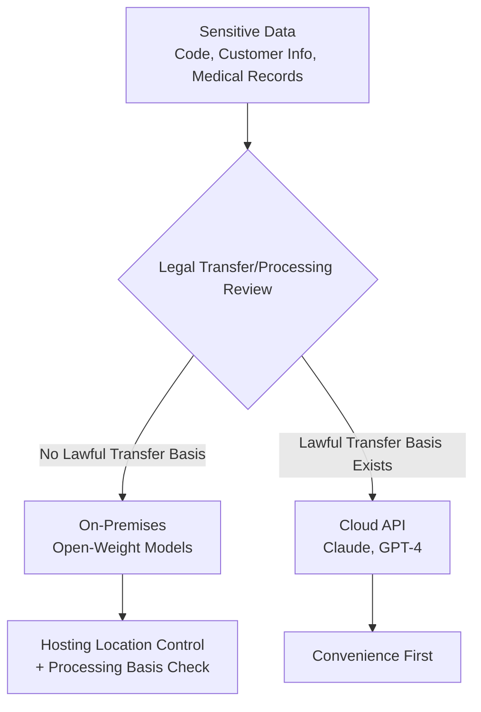
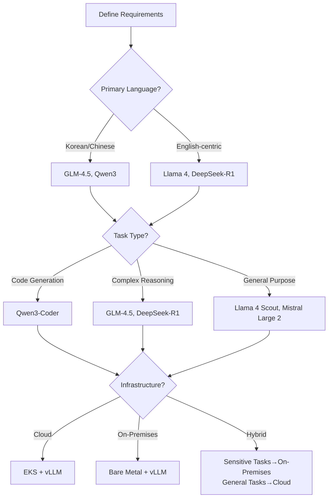
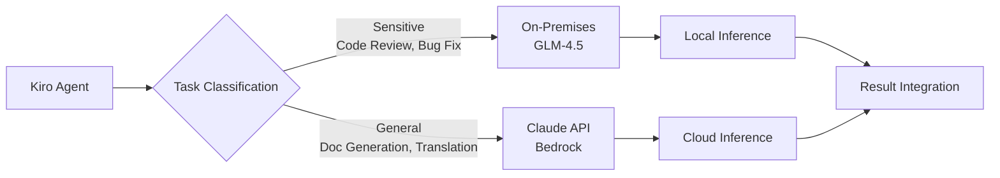
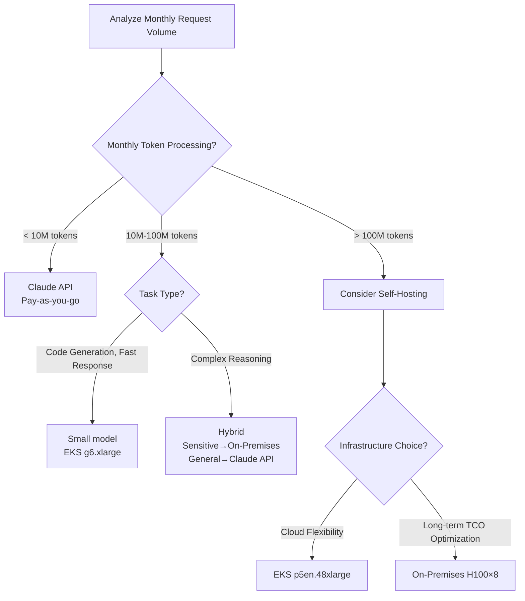

Self-hosted open-weight models let a team choose where to run inference and how to customize the model. When comparing them with cloud APIs (Claude, GPT-4) for enterprise AIDLC, evaluate three requirements: **data residency**, **total cost of ownership (TCO)**, and **domain-specific behavior**. Self-hosting changes who operates the infrastructure and how costs accrue; the deployment and operating plan determine whether it meets those requirements.

## Why Open-Weight Models

### Three Core Drivers

#### 1. Data Residency Requirements

In finance, healthcare, and public sectors, the processing and cross-border transfer of sensitive data is restricted by regulations. What the regulation governs is a legal question — "may this data be lawfully transferred and processed?" — which is separate from the hosting choice of on-premises versus cloud. On-premises deployment alone does not establish compliance; the lawful basis for processing, consent, contracts, and transfer mechanisms must also be satisfied.

- **Compliance Obligations**: GDPR, HIPAA, and financial privacy laws define the lawful basis for processing and the conditions for cross-border transfer, which are not satisfied by physical storage location alone
- **Internal Codebase Protection**: Process source code on-premises without sending to external APIs
- **Sovereign AI**: Nations/enterprises directly control AI inference infrastructure



#### 2. Cost Optimization

When processing millions of tokens per month, self-hosted open models can be cheaper than cloud APIs.

- **Exit Pay-Per-Use**: Shift from per-API-call charges to fixed infrastructure costs
- **Maximize GPU Utilization**: Minimize idle time in 24-hour operations
- **Break-Even Point**: Self-hosting becomes advantageous when processing over 100M tokens/month (varies by GPU type)

#### 3. Domain Customization

Open-weight models can be optimized for specific domains through fine-tuning, prompt engineering, and ontology injection.

- **Improve Technical Terminology Accuracy**: Enhance medical, legal, financial term processing
- **Control Output Format**: Enforce JSON schema and code style guide compliance
- **Ontology Integration**: Inject domain knowledge combined with [Ontology Engineering](../methodology/ontology-engineering.md)

## Model Landscape (April 2026)

| Model | Provider | Parameters | Key Features | License | Recommended Deployment |
|-------|----------|-----------|--------------|---------|----------------------|
| **GLM-4.5** | Zhipu AI (Z.ai) | 355B total, 32B active (MoE) | Multilingual (KO/ZH/EN) strength, excellent math/reasoning | Weights MIT, code Apache 2.0 | p5en.48xlarge (H200×8) |
| **Qwen3-Coder** | Alibaba | 480B total, 35B active (MoE) / 30B total, 3B active variant | Coding specialized, agentic tasks | Apache 2.0 | p5.48xlarge (H100×8) / g6e.xlarge (L40S×1) |
| **Qwen3-235B** | Alibaba | 235B total, 22B active (MoE) | MoE architecture, text-only | Apache 2.0 | p5.48xlarge (H100×8) |
| **DeepSeek-R1** | DeepSeek | 671B total, 37B active (MoE) | CoT reasoning specialized, RL-based training | MIT | p5en.48xlarge (H200×8) |
| **Llama 4 Scout / Maverick** | Meta | Scout 109B total·17B active (16 experts) / Maverick 400B total·17B active (128 experts) | Broad ecosystem, natively multimodal | Llama 4 Community License | p5.48xlarge (H100×8) |
| **Mistral Large 2** | Mistral | 123B | European data sovereignty considered design | Mistral License | p4d.24xlarge (A100×8) |

GLM-4.5 has different licenses for its weights and its code. As of 2026-10-29, the Hugging Face model card (`zai-org/GLM-4.5`, revision `cbb2c7c`) lists the weight license as MIT, and the code in the GitHub repository `zai-org/GLM-4.5` is under the Apache 2.0 license. When adopting the model, check the license again for the revision you use.

The "Recommended Deployment" column is an example sizing. Where FP16 weights (parameters × 2 bytes) would exceed the listed GPU memory, the cell assumes the vendor-published 8-bit checkpoint: Qwen3-Coder 480B-A35B on H100×8 and 30B-A3B on a single L40S (48GB) assume the `-FP8` checkpoints Qwen publishes, and the Llama 4 Maverick cell follows Meta's statement that it runs on a single H100 host. FP16 serving needs roughly twice the memory; see "Infrastructure Requirements" below.

### Selection Criteria



## Deployment Patterns

### Pattern 1: EKS + vLLM Serving (Cloud)

Serve open models in cloud environments to maintain data residency while delegating infrastructure management to AWS.

```yaml
# GLM-4.5 deployment example (EKS Standard Mode, illustrative manifest)
apiVersion: apps/v1
kind: Deployment
metadata:
  name: glm45-vllm
spec:
  replicas: 1
  template:
    spec:
      nodeSelector:
        node.kubernetes.io/instance-type: p5en.48xlarge
      containers:
      - name: vllm
        image: vllm/vllm-openai:v0.18.2
        args:
        - --model
        - zai-org/GLM-4.5
        - --served-model-name
        - glm45
        - --tensor-parallel-size
        - "8"
        - --max-model-len
        - "8192"
        - --trust-remote-code
        resources:
          limits:
            nvidia.com/gpu: "8"
```

**Advantages**:
- Cost savings with Auto Scaling and Spot instances
- Dynamic node provisioning via Karpenter
- CloudWatch and Prometheus integrated monitoring

**Disadvantages**:
- Hourly GPU instance costs (p5en.48xlarge: ~$98/h)
- Data stays within VPC but infrastructure depends on cloud

### Pattern 2: On-Premises Bare Metal + vLLM

Used when complete data sovereignty is required or cloud transmission is prohibited.

```bash
# Deploy vLLM on NVIDIA H100×8 server (example)
# Bind the port to an internal address only; expose externally via an
# authenticated reverse proxy rather than directly.
docker run --gpus all \
  -p 127.0.0.1:8000:8000 \
  -v /data/models:/models \
  vllm/vllm-openai:v0.18.2 \
  --model /models/GLM-4.5 \
  --served-model-name glm45 \
  --tensor-parallel-size 8 \
  --max-model-len 8192 \
  --api-key "$VLLM_API_KEY" \
  --trust-remote-code
```

**Infrastructure Requirements**:
- GLM-4.5 (355B total, 32B active): H100×8 or H200×8. FP16 weights are about 710GB (355B × 2 bytes); including KV cache and activation memory, H200×8 (~1,128GB) leaves headroom.
- Qwen3-Coder 30B-A3B (30B total): FP16 weights about 60GB, servable on L40S×2 or H100×1; a single L40S (48GB) needs the FP8 checkpoint, whose weights are about 30GB (30B × 1 byte). These are weight lower bounds; actual demand grows with batch size and context length.
- Network: Bind the inference endpoint to the internal network only (the `127.0.0.1` binding above or a dedicated subnet), and restrict outbound traffic with security groups/firewall to only required destinations such as the model registry. `--trust-remote-code` executes code from the model repository, so use it only on models whose artifact provenance you have verified by signature/checksum.

**Advantages**:
- Absolute data control
- Minimize network latency (on-premises 10G network)
- Long-term cloud cost savings

**Disadvantages**:
- CapEx burden (H100 server ~$300K)
- Operational personnel required (GPU management, model updates)
- Power consumption even during idle time

### Pattern 3: Hybrid Configuration

Mix on-premises and cloud APIs based on task sensitivity.



**Implementation Example (LiteLLM Routing)**:

```yaml
# litellm-config.yaml
model_list:
  - model_name: sensitive-tasks
    litellm_params:
      model: openai/glm45  # name the on-prem vLLM exposed via served-model-name
      api_base: http://on-prem-vllm.internal:8000/v1
      api_key: os.environ/VLLM_API_KEY
  - model_name: general-tasks
    litellm_params:
      model: bedrock/anthropic.claude-sonnet-4-20250514
      aws_region_name: us-east-1

router_settings:
  routing_strategy: simple-shuffle
  fallbacks:
    - sensitive-tasks: []  # Fallback disabled. An empty list only means "no fallback"; it does not block external transmission itself.
    - general-tasks: [openai/gpt-4o]
# Prohibiting external transmission must be an enforced control, not a config comment.
# e.g., isolate sensitive-tasks on a LiteLLM instance restricted to internal endpoints, or
#       block outbound traffic to external providers (openai/bedrock) with security groups / egress policy.
```

## TCO Comparison Framework

### Cost Items

The figures below are **illustrative estimates** based on public pricing (Bedrock token rates, EC2 on-demand rates), not measured results. They change with assumptions such as token volume, instance type, utilization, and operations-staff share. Review each table's notes and the assumptions below, then recompute with your own numbers.

#### Cloud API (Claude, GPT-4)

| Item | Claude Sonnet 4.5 | Notes |
|------|-------------------|-------|
| Input Tokens | $3/1M tokens | Bedrock pricing |
| Output Tokens | $15/1M tokens | Output is 5x more expensive than input |
| Operations Staff | $0 | No management required |
| Initial Investment | $0 | Pay-as-you-go |

**Monthly Cost Calculation Example**:
- Process 50M input tokens, 10M output tokens per month
- Input: 50M × $3/1M = $150
- Output: 10M × $15/1M = $150
- Total: **$300/month**

#### Self-Hosted Open Model (EKS + vLLM)

The following are monthly cost **examples** for a small model (single small GPU) and a large model (multi-GPU). Instance rates vary, so recompute with your actual regional/committed-use pricing.

| Item | Small model (g6.xlarge, L4×1) | GLM-4.5 (p5en.48xlarge) |
|------|---------------------------|----------------------------|
| GPU Instance | $1.01/h × 730h = $737/month | $98/h × 730h = $71,540/month |
| Storage (Model) | ~$5/month | ~$355/month (710GB) |
| Network Egress | Internal traffic free | Internal traffic free |
| Operations Staff | 0.2 FTE (~$2,000/month) | 0.5 FTE (~$5,000/month) |
| Total | **~$2,742/month** | **~$76,895/month** |

**On-Premises Bare Metal (3-year amortization)**:

| Item | H100×8 Server | Notes |
|------|--------------|-------|
| Hardware | $300,000 / 36 months = $8,333/month | Initial CapEx |
| Power | 10.2kW × $0.12/kWh × 730h = $893/month | Regional electricity rate variation |
| Data Center | ~$1,000/month | Cooling, space |
| Operations Staff | 1 FTE (~$10,000/month) | 24/7 support |
| Total | **~$20,226/month** | ~$11,893/month after 3 years (hardware cost excluded) |

### Break-Even Point Guide

The break-even points below are rough guides based on the cost **examples** above. Because the compared bases differ (cloud per-token charges vs. self-hosted fixed infrastructure), do not apply them directly; re-validate with your organization's token volume and utilization.



**Decision Criteria**:

1. **Less than 10M tokens/month**: Use Claude API or GPT-4 (no management overhead)
2. **10M-100M tokens/month**: Hybrid configuration based on task type and sensitivity
3. **Over 100M tokens/month**: Consider self-hosting (EKS or on-premises)
4. **CapEx investment possible + 3+ year operation planned**: On-premises bare metal is cheapest

## AIDLC Integration

### Kiro + Open-Weight Models

[AI Coding Agent Kiro](./ai-coding-agents.md) can use open-weight models as backend to perform Spec-Driven development.

The `kiro-config.ts` below is a **proposed, illustrative configuration**, not a documented Kiro feature. Check the Kiro documentation for the actual configuration schema.

```typescript
// kiro-config.ts (example — proposed configuration)
export const kiroConfig = {
  models: {
    sensitive: {
      provider: 'vllm',
      endpoint: 'http://on-prem-vllm.internal:8000/v1',
      model: 'glm45',
      use_cases: ['code-review', 'security-audit', 'refactoring']
    },
    general: {
      provider: 'bedrock',
      model: 'anthropic.claude-sonnet-4-20250514',
      region: 'us-east-1',
      use_cases: ['documentation', 'translation', 'test-generation']
    }
  },
  routing: {
    strategy: 'by-file-path',
    rules: [
      { pattern: 'src/core/**', model: 'sensitive' },
      { pattern: 'docs/**', model: 'general' }
    ]
  }
};
```

### Steering Files: Model-Specific Prompt Optimization

Open-weight models have different training data and architectures, so they may respond differently to the same prompts. The examples below use the configuration file (`.aider.conf.yml`) format of the **[Aider](https://aider.chat)** CLI. Aider does not accept a system prompt as a config key, so coding conventions are placed in a conventions file (e.g., `CONVENTIONS.md`) loaded into the model context via `read`.

**GLM-4.5 Steering File**:

```yaml
# .aider.conf.yml (GLM-4.5 profile)
model: openai/glm45
edit-format: diff
auto-commits: false
stream: true
# Put coding conventions in the file below (instead of an unsupported prompts.system).
read:
  - CONVENTIONS.glm45.md
```

Example conventions file `CONVENTIONS.glm45.md`:

```markdown
You are a professional software engineer.
When modifying code, always respond in unified diff format.
Write explanations of changes in Korean, but keep technical terms in English.
```

**Qwen3-Coder Steering File**:

```yaml
# .aider.conf.yml (Qwen3-Coder profile)
model: openai/qwen3-coder
edit-format: whole
# Qwen3-Coder is more stable with complete file replacement approach
read:
  - CONVENTIONS.qwen3.md
```

Example conventions file `CONVENTIONS.qwen3.md`:

```markdown
You are a coding assistant specialized in Python and TypeScript.
Always return the complete modified file.
Use type hints and follow PEP 8 style guide.
```

### Ontology Injection

Inject domain ontology built in [Ontology Engineering](../methodology/ontology-engineering.md) into open model context to improve accuracy.

```python
# ontology_injection.py
import json
from pathlib import Path
from typing import Dict

class OntologyInjector:
    def __init__(self, ontology_path: str):
        self.ontology = self.load_ontology(ontology_path)

    def inject_context(self, prompt: str, domain: str) -> str:
        """Add domain ontology to prompt"""
        domain_terms = self.ontology.get(domain, {})

        context = "# Domain Knowledge\n"
        for term, definition in domain_terms.items():
            context += f"- {term}: {definition}\n"

        return f"{context}\n# Task\n{prompt}"

    def load_ontology(self, path: str) -> Dict[str, Dict[str, str]]:
        """Load an ontology file in JSON/YAML format.
        For YAML, install PyYAML and use yaml.safe_load."""
        text = Path(path).read_text(encoding="utf-8")
        if path.endswith((".yaml", ".yml")):
            import yaml  # requires PyYAML
            return yaml.safe_load(text)
        return json.loads(text)

# Usage example
injector = OntologyInjector("/data/ontology/finance.json")
prompt = injector.inject_context(
    "Analyze the following transaction records to find anomaly patterns.",
    domain="finance"
)
```

**Expected Benefits (hypotheses to validate)**: The items below are not confirmed results but expected benefits that must be validated by measurement after adoption.
- Measure whether financial terminology (e.g., arbitrage, short selling) interpretation accuracy improves, using an evaluation set
- Measure whether domain-specific rule (e.g., KYC, AML) compliance strengthens, using a rule-violation rate
- Measure the change in token usage when replacing few-shot examples with the ontology

## Security and Compliance

### Model License Review

Even open-weight models may have commercial use restrictions depending on license.

| License | Commercial Use | Derivative Model Distribution | Notes |
|---------|---------------|------------------------------|-------|
| **Apache 2.0** | ✅ Allowed | ✅ Allowed | Includes patent protection clause |
| **MIT** | ✅ Allowed | ✅ Allowed | Disclaimer required |
| **Llama 4 Community License** | ✅ Allowed (conditional) | ⚠️ Limited | If monthly active users exceed 700M, a separate license must be requested from Meta; must comply with license conditions such as "Built with Llama" attribution on outputs |
| **Mistral (varies by model)** | ⚠️ Check per model | ⚠️ Limited | Mistral Large 2 is released under the Mistral Research License (non-commercial), so commercial use requires a separate commercial license. Licenses differ per model; check the specific model card |

**Recommended Process**:
1. Review license with legal team (especially Llama, Mistral)
2. Track model provenance (check Hugging Face Model Card)
3. Review dataset licenses when fine-tuning

### Output Auditing

Open models may have sensitive information in training data, so output filtering is necessary.

```python
# output_filter.py
import re
from typing import List

class OutputFilter:
    def __init__(self):
        # These regexes are best-effort examples, not complete PII redaction.
        # Identifiers in other formats (e.g., Korean resident number, 6-7 digits) need separate patterns.
        self.patterns = [
            (r'\b\d{3}-\d{2}-\d{4}\b', '[SSN-REDACTED]'),  # US SSN format (not a Korean resident number)
            (r'\b[\w\.-]+@[\w\.-]+\.\w+\b', '[EMAIL-REDACTED]'),  # Email (simple pattern)
            (r'\b\d{4}-\d{4}-\d{4}-\d{4}\b', '[CARD-REDACTED]')  # Card-number format (no validation)
        ]

    def filter(self, text: str) -> str:
        """Automatically remove sensitive information"""
        for pattern, replacement in self.patterns:
            text = re.sub(pattern, replacement, text)
        return text

    def audit_log(self, text: str, redacted_count: int) -> None:
        """Record filtering history"""
        # Send to CloudWatch Logs or S3
        pass
```

### AI Act Compliance

The European AI Act and the Korean AI Basic Act do not impose the same obligations on all AI; they vary requirements by the system's risk tier and by the provider versus deployer role. The items below apply to uses that these regulations classify as high-risk, such as healthcare, finance, and recruitment, and each organization must first determine whether its use and role fall under high-risk. The applicable provisions differ depending on whether you are a deployer integrating a general-purpose model into a service or a provider supplying the model.

Where a high-risk use applies, the following are generally required:

1. **Explainability**: Provide model decision basis (attention weights, RAG sources)
2. **Human Oversight**: Humans perform final decision-making
3. **Bias Monitoring**: Measure output fairness by race, gender, age
4. **Incident Response Procedures**: Model malfunction rollback process

The list above is a summary of requirements; the scope, timing, and exact provisions must be confirmed against the statutory text and a legal review.

**AIDLC Application**:
- Establish model governance policies in [Governance Framework](../enterprise/governance-framework.md)
- Log all inference requests/responses via Langfuse
- Perform bias audits quarterly (e.g., [RAGAS](../../agentic-ai-platform/operations-mlops/governance/ragas-evaluation.md) evaluation)

## References

### Internal Documentation
- [Governance Framework](../enterprise/governance-framework.md) — Data sovereignty policies
- [Cost Effectiveness](../enterprise/cost-estimation.md) — Detailed TCO calculations
- [AI Coding Agents](./ai-coding-agents.md) — Kiro integration guide
- [Ontology Engineering](../methodology/ontology-engineering.md) — Ontology injection patterns

### Official Model Documentation
- [GLM-4.5 GitHub](https://github.com/zai-org/GLM-4.5) — model weights MIT, repository code Apache 2.0 license
- [Qwen3 Model Card](https://huggingface.co/Qwen/Qwen3-235B-A22B) — MoE architecture details
- [DeepSeek-R1 Paper](https://arxiv.org/abs/2501.12948) — RL training methodology
- [vLLM Documentation](https://docs.vllm.ai/en/v0.18.2/) — Serving optimization

### Cost Analysis Tools
- [AWS Pricing Calculator](https://calculator.aws/) — EKS GPU instance costs
- [Hugging Face LLM Leaderboard](https://huggingface.co/spaces/open-llm-leaderboard/open_llm_leaderboard) — Model performance comparison

## Next Steps

1. **Pilot Project**: Deploy a small coding model (e.g., Qwen3-Coder 30B-A3B) to a small project
2. **Cost Tracking**: Compare cloud API vs self-hosting TCO over 2 months
3. **Sensitivity Classification**: Classify codebase as sensitive/general to design hybrid configuration
4. **Governance Policy**: Specify open model usage rules in [Governance Framework](../enterprise/governance-framework.md)
5. **Scale Up**: Expand to GLM-4.5 or DeepSeek-R1 after pilot success
