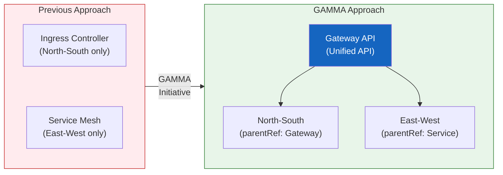

import {
  GammaInfographic,
  GammaSupportTable,
} from '@site/src/components/GatewayApiTables';

## What is GAMMA?

**GAMMA (Gateway API for Mesh Management and Administration)** is an initiative that extends the [Gateway API](../gateway-api-adoption-guide/index.md) into the service mesh domain.

- **GA achieved**: Gateway API v1.1.0 (May 2024, service mesh support GA)
- **Unified scope**: North-South (ingress) + East-West (service mesh) traffic
- **Core concept**: Previously, ingress controllers and service meshes had entirely separate configuration systems — GAMMA unifies them under a single API
- **Role-based configuration**: Applies Gateway API's role separation principles equally to mesh traffic

With GAMMA, cluster operators no longer need to learn and manage two different APIs. Both ingress and mesh can be managed with the same Gateway API resources.



## Core Goals & Mesh Configuration Patterns

<GammaInfographic locale="en" />

## GAMMA Support Status

The following shows GAMMA support status across major service mesh implementations. For a detailed comparison of architecture, features, and operations, see the [Service Mesh Comparison Guide](./index.md).

<GammaSupportTable locale="en" />

:::tip GAMMA in AWS Environments
In AWS environments, the **AWS Gateway API Controller** exposes VPC Lattice through the Gateway API (ACK is a separate controller that manages AWS resources and is not the Gateway API controller). This is a Gateway-parent HTTPRoute integration, however, which is distinct from GAMMA mesh-profile conformance (where a Service is the parent). Classifying VPC Lattice as GAMMA GA requires a pinned mesh conformance report first.

VPC Lattice provides TLS, IAM/SigV4-based request authentication, CloudWatch/X-Ray observability, and fault injection through AWS FIS. IAM/SigV4 is request authentication and is not certificate-based mutual TLS (mTLS).
:::

## Advantages of GAMMA

### 1. Reduced Learning Curve
Teams only need to learn one API (Gateway API) to manage both ingress and mesh.

### 2. Configuration Consistency
Manage both North-South/East-West traffic with the same YAML structure and patterns.

```yaml
# Ingress (North-South)
spec:
  parentRefs:
    - kind: Gateway
      name: external-gateway

---
# Mesh (East-West)
spec:
  parentRefs:
    - group: ""          # Core Service API group (defaults to gateway.networking.k8s.io if omitted)
      kind: Service
      name: backend-service
```

### 3. Role-Based Separation
For ingress (North-South), infra teams manage Gateways and dev teams manage HTTPRoutes. For mesh (East-West), Routes bind directly to a Service rather than a Gateway, so the team that owns a Service (the producer) manages the Routes attached to it while the calling team (the consumer) manages its outbound Routes. In both cases, namespaces and Kubernetes RBAC separate access to each resource.

### 4. Vendor Neutrality
Multiple mesh implementations can be managed with the same API, preventing vendor lock-in.

## References

### Official Documentation
- [GAMMA Initiative](https://gateway-api.sigs.k8s.io/docs/mesh/gamma/) — Official Gateway API GAMMA specification, goals, and configuration patterns
- [Gateway API for Service Mesh](https://gateway-api.sigs.k8s.io/docs/mesh/mesh-overview/) — Official guide for applying Gateway API to mesh traffic

### Related Documents (Internal)
- [Service Mesh Comparison Guide](./index.md) — Architecture, feature, and operations comparison of Istio, Cilium, Linkerd, and VPC Lattice
- [Gateway API Adoption Guide](../gateway-api-adoption-guide/index.md) — North-South traffic management, implementation comparison, migration strategy
- [East-West Traffic Optimization](../east-west-traffic-best-practice.md) — Post-adoption latency and cross-AZ cost optimization
