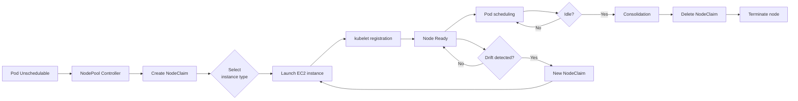
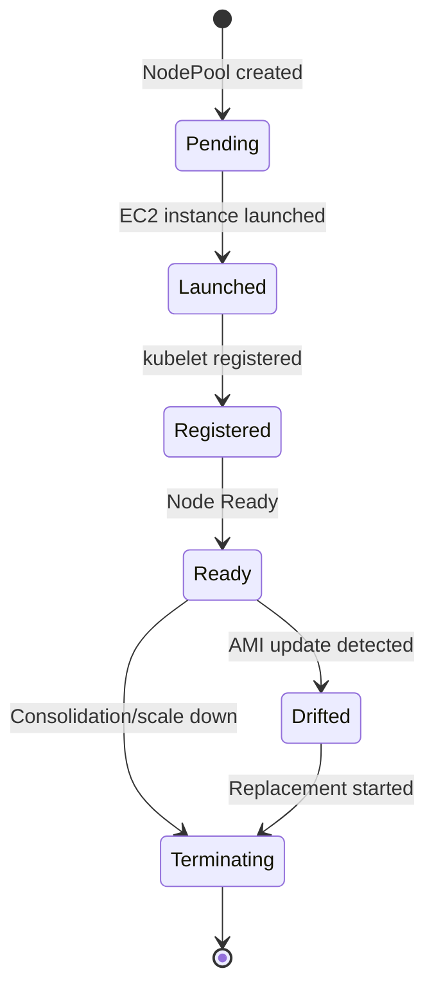

EKS Auto Mode is an operational model in which AWS fully manages node provisioning, networking, and storage. While convenient, the reduced management surface also changes the debugging approach.

## Auto Mode vs Standard Mode Differences

**Table 1. Item-by-item differences and debugging impact between Standard Mode and Auto Mode**

| Item | Standard Mode | Auto Mode | Debugging Impact |
|------|---------------|-----------|------------|
| **Node management** | User (MNG/Karpenter) | AWS-managed (NodePool) | Check state via NodePool CRD; EC2 API access is limited |
| **VPC CNI** | Manual configuration/upgrade | Automatically managed | Custom CNI configuration unavailable; ENI debugging simplified |
| **GPU Driver** | GPU Operator installation | AWS-managed (NVIDIA/Neuron) | Allow GPU instances via NodePool; avoid duplicate GPU Operator install |
| **Storage** | Separate EBS CSI installation | EBS CSI controller managed; create StorageClass yourself | References `ebs.csi.eks.amazonaws.com`; EFS requires separate install |
| **CoreDNS** | Add-on management | Automatically managed | Custom CoreDNS configuration is restricted |
| **Node SSH** | Available (MNG/Karpenter) | No direct SSH/SSM access | Use `kubectl debug node`/NodeDiagnostic |
| **Auto Scaling** | Karpenter/CA | NodePool auto-scaling | Spot interruption handling is automated |
| **Network Policy** | Calico/Cilium installable | VPC CNI Network Policy | Feature limitations exist |

## NodePool Architecture

Auto Mode node lifecycle:

**Figure 1. Auto Mode node lifecycle flow**



## NodePool Debugging

### Check NodePool Status

```bash
# List NodePools
kubectl get nodepools

# Example output
# NAME              READY   AGE
# default           True    7d
# gpu-nodepool      True    2d

# NodePool details
kubectl describe nodepool default

# Key items to check:
# - Conditions: Ready, CapacityAvailable
# - Instance Types: allowed instance types
# - Constraints: labels, taints, availability zones
```

### NodeClaim Lifecycle

```bash
# List NodeClaims (actual node requests)
kubectl get nodeclaims

# Example output
# NAME                      TYPE           CAPACITY    READY   AGE
# default-abc123            t3.xlarge      4           True    2d
# default-def456            t3.xlarge      4           True    1d
# gpu-nodepool-xyz789       g5.2xlarge     8           True    6h

# NodeClaim details
kubectl describe nodeclaim <nodeclaim-name>

# Key fields:
# - status.conditions: Launched, Registered, Initialized, Ready
#   (plus disruption conditions such as Drifted)
# - status.nodeName: corresponding Kubernetes node name
# - status.providerID: provider ID pointing to the EC2 instance
```

### NodeClaim State Transitions

The diagram below shows the provisioning and termination flow conceptually for a NodeClaim that initializes normally. It is not a single `status` enum field; the state is expressed through `status.conditions` (Launched, Registered, Initialized, Ready) and disruption conditions such as Drifted.

**Figure 2. NodeClaim state transition diagram (conceptual)**



### Instance Type Selection Failure

**Symptom:** Pod stays in Pending, NodeClaim is not created

```bash
# Check Pod events
kubectl describe pod <pod-name>

# Example error:
# Warning  FailedScheduling  No nodes available to schedule pod

# Check NodePool constraints
kubectl get nodepool <nodepool-name> -o yaml | grep -A 10 requirements

# Common causes:
# 1. Pod resource request exceeds every instance type in the NodePool
# 2. Availability zone constraint (insufficient capacity in specific AZs)
# 3. Spot capacity shortage (capacityType: spot)
```

**Resolution:**

The built-in `general-purpose`/`system` NodePools cannot be modified, so add a custom NodePool when you need a larger instance type. Auto Mode NodePools use the `karpenter.sh/v1` group and reference a NodeClass (group `eks.amazonaws.com`) through `spec.template.spec.nodeClassRef`.

```yaml
# Custom NodePool: allow a larger instance type
apiVersion: karpenter.sh/v1
kind: NodePool
metadata:
  name: custom
spec:
  template:
    spec:
      nodeClassRef:
        group: eks.amazonaws.com
        kind: NodeClass
        name: default  # reference an existing valid NodeClass
      requirements:
        - key: node.kubernetes.io/instance-type
          operator: In
          values:
            - t3.large
            - t3.xlarge
            - t3.2xlarge  # ← added
        - key: karpenter.sh/capacity-type
          operator: In
          values:
            - spot
            - on-demand  # ← On-Demand fallback when Spot is unavailable
```

## Storage Debugging

### Auto Mode Storage Constraints

Auto Mode manages the EBS CSI controller but does not create a StorageClass for you, so you must create a StorageClass that references the `ebs.csi.eks.amazonaws.com` provisioner. Volume type (`type`), encryption (`encrypted`, `kmsKeyId`), and IOPS/throughput are set in the StorageClass `parameters`. To use a custom KMS key, set `parameters.kmsKeyId` to the key ARN and grant the EKS cluster role permission to use that KMS key.

**Table 2. Storage support differences between Standard Mode and Auto Mode by storage type**

| Storage Type | Standard Mode | Auto Mode | Constraints |
|--------------|---------------|-----------|----------|
| **gp3** | Requires EBS CSI installation | Create an `ebs.csi.eks.amazonaws.com` StorageClass | `type: gp3` is the default |
| **gp2** | Supported | Supported via `type: gp2` | gp3 is the default; specify gp2 if needed |
| **io2** | Supported | Supported via `type: io2` | io2 Block Express (`sbp1`/`sbg1`) is a separate type |
| **EFS** | Install EFS CSI | EFS CSI installation required | Not automatically supported |
| **FSx for Lustre** | Install FSx CSI | FSx CSI installation required | Not automatically supported |
| **EBS encryption** | Custom KMS key possible | Enable with `encrypted: "true"` | Not encrypted unless set; custom key via `kmsKeyId` + IAM |

### PVC Pending Debugging

```bash
# Check PVC status
kubectl get pvc

# Example output (issue)
# NAME      STATUS    VOLUME   CAPACITY   ACCESS MODES   STORAGECLASS   AGE
# my-pvc    Pending                                      gp3            5m

# Check PVC events
kubectl describe pvc my-pvc

# Common errors:
# 1. "waiting for a volume to be created" → check storage driver
# 2. "failed to provision volume" → check IAM permissions
# 3. "io2-block-express is not supported" → switch to gp3
```

### Check StorageClass

Auto Mode does not create a StorageClass for you. To use EBS storage you must create a StorageClass that references the `ebs.csi.eks.amazonaws.com` provisioner. Using `allowedTopologies` to bind to `eks.amazonaws.com/compute-type: auto` nodes ensures volumes are not provisioned on non-Auto nodes.

```bash
# List the current StorageClasses
kubectl get storageclass
```

```yaml
# Create an Auto Mode EBS StorageClass
apiVersion: storage.k8s.io/v1
kind: StorageClass
metadata:
  name: auto-ebs-sc
  annotations:
    storageclass.kubernetes.io/is-default-class: "true"
allowedTopologies:
  - matchLabelExpressions:
      - key: eks.amazonaws.com/compute-type
        values:
          - auto
provisioner: ebs.csi.eks.amazonaws.com
volumeBindingMode: WaitForFirstConsumer
parameters:
  type: gp3
  encrypted: "true"  # optional; uses the default aws/ebs key
```

## Networking Debugging

### VPC CNI Auto Management

Auto Mode provides Pod networking as a managed component, so you do not install VPC CNI as an add-on or edit the `aws-node` DaemonSet/ConfigMap directly. Adjust networking behavior through the NodeClass and cluster networking settings.

```bash
# Check node networking settings in the NodeClass
kubectl get nodeclass
kubectl describe nodeclass <nodeclass-name>

# Check node/networking-related events
kubectl get events --field-selector involvedObject.kind=Node
```

**Constraints:**

- Supported: Pod IP auto-allocation (ENI), Pod network policy, IPv4/IPv6, secondary CIDR blocks
- Cannot configure directly: manual VPC CNI tuning via the `aws-node` ConfigMap, manually disabling Prefix Delegation, manual ENI management

The security group configuration for the subnet a Pod uses and the IP (ENI) capacity a node can allocate are separate concerns. The former is a networking configuration; the latter is determined by the instance type.

### Pod Networking Issues

```bash
# Check Pod IP allocation
kubectl get pods -o wide

# Check ENI allocation state (node level)
kubectl describe node <node-name> | grep -A 5 "Allocatable"

# Example output:
# Allocatable:
#   vpc.amazonaws.com/pod-eni: 38  # ← ENI-based IP count
```

### CoreDNS Debugging

Auto Mode provides cluster DNS as a managed component. Instead of editing the CoreDNS Deployment directly, diagnose resolution failures through Pod status and logs. Collect CoreDNS Pod logs by label as shown below; for node-level logs, use NodeDiagnostic on Auto Mode nodes. In a mixed cluster with both Auto Mode and non-Auto nodes (such as MNG), to change behavior only on the non-Auto nodes you must add a configuration branch that applies only to the CoreDNS Deployment.

```bash
# CoreDNS Pod status
kubectl get pods -n kube-system -l k8s-app=kube-dns

# Check CoreDNS logs
kubectl logs -n kube-system -l k8s-app=kube-dns --tail=100

# DNS resolution test
kubectl run -it --rm debug --image=busybox -- nslookup kubernetes.default

# Common issues:
# 1. CoreDNS Pod not Running → node resource shortage
# 2. DNS query timeout → verify Security Group allows UDP 53
```

## GPU Workloads with Auto Mode

Auto Mode provides NVIDIA and Neuron GPU drivers and device plugins as managed components. The default approach is therefore to run GPU workloads on a custom NodePool that allows GPU instances in Auto Mode. Do not install a separate GPU Operator in this case, because it would duplicate and conflict with the drivers and device plugins Auto Mode already provides.

```yaml
# Custom NodePool that allows GPU instances
apiVersion: karpenter.sh/v1
kind: NodePool
metadata:
  name: gpu
spec:
  template:
    spec:
      nodeClassRef:
        group: eks.amazonaws.com
        kind: NodeClass
        name: default
      requirements:
        - key: eks.amazonaws.com/instance-family
          operator: In
          values:
            - g5
            - g6
        - key: karpenter.sh/capacity-type
          operator: In
          values:
            - on-demand
  limits:
    nvidia.com/gpu: "8"
```

When a GPU Pod requests GPUs via `limits.nvidia.com/gpu`, Auto Mode provisions a suitable instance. No separate Taint/Toleration or device-plugin installation is required.

### When an MNG Hybrid Is Needed {#hybrid-configuration-recommended}

Consider adding an MNG (Managed Node Group) hybrid only when you have a concrete requirement that Auto Mode's managed GPU stack does not meet — for example, you need a specific GPU Operator/DCGM version, or an accelerator instance that Auto Mode does not support. In a hybrid, clearly separate which component each node group provides so you do not install the same component in two places.

**Figure 3. Hybrid configuration of Auto Mode and MNG with scheduling paths**

```mermaid
flowchart TB
    subgraph "EKS Cluster (Hybrid)"
        subgraph "Auto Mode NodePool"
            A[General workloads]
            B[Web servers]
            C[Batch jobs]
        end

        subgraph "Managed Node Group (GPU)"
            D[GPU Operator<br/>MNG nodes only]
            E[vLLM Pod]
            F[Training Job]
        end
    end

    G[Scheduler] --> A
    G --> B
    G --> C
    G -.Taint: nvidia.com/gpu.-> E
    G -.Taint: nvidia.com/gpu.-> F
```

### GPU MNG Configuration

Apply this configuration only for the MNG hybrid case described above. Pin the MNG accelerated AMI and GPU Operator version combination, confirm which components each node class already provides, and disable only those components. Scope the GPU Operator operands to MNG nodes with `nodeSelector`, and after configuring, verify the MNG nodes still advertise the `nvidia.com/gpu` resource.

```yaml
# ClusterPolicy: apply to MNG nodes only; disable only components the AMI provides
apiVersion: nvidia.com/v1
kind: ClusterPolicy
metadata:
  name: gpu-cluster-policy
spec:
  operator:
    defaultRuntime: containerd
  # Scope operands to the GPU MNG nodes (so they are not installed on Auto Mode nodes)
  daemonsets:
    tolerations:
      - key: nvidia.com/gpu
        operator: Exists
        effect: NoSchedule
  driver:
    enabled: true   # set to false if the MNG AMI already includes the driver
  devicePlugin:
    enabled: true   # set to false if the MNG AMI provides the device plugin
  dcgm:
    enabled: true
  gfd:
    enabled: true
  nodeStatusExporter:
    enabled: true
```

```yaml
# Add a Taint to MNG nodes (GPU workloads only)
apiVersion: v1
kind: Node
metadata:
  name: gpu-node-1
spec:
  taints:
    - key: nvidia.com/gpu
      value: "true"
      effect: NoSchedule
```

```yaml
# GPU Pod: match the GPU count to a single node's available GPUs and set placement with nodeSelector
# The nvidia.com/gpu: 4 below assumes a single node with 4 GPUs (e.g. g5.12xlarge).
# Framework parallelism (TP/world-size) is configured in the application, separately from scheduling.
apiVersion: v1
kind: Pod
metadata:
  name: vllm-server
spec:
  nodeSelector:
    workload: gpu  # GPU MNG node label
  tolerations:
    - key: nvidia.com/gpu
      operator: Equal
      value: "true"
      effect: NoSchedule
  containers:
    - name: vllm
      image: vllm/vllm-openai:latest
      resources:
        limits:
          nvidia.com/gpu: 4  # matches the GPU count of a single node
```

For detailed GPU debugging, see [GPU/AI Workload Debugging](./gpu-ai-workload.md).

## Auto Mode Constraint Summary

### Supported Features

- NodePool-based auto-scaling
- Automatic Spot/On-Demand fallback
- gp3 StorageClass created by you (EBS CSI controller managed)
- Automatic VPC CNI management (including Pod network policy)
- Karpenter-like Consolidation
- Drift detection and automatic replacement
- NVIDIA/Neuron GPU drivers and device plugins managed; DCGM/GFD metrics

### Limitations

- Custom VPC CNI configuration not available
- Conflict if a GPU Operator is also installed (Auto Mode provides drivers and device plugins)
- io2 Block Express (`sbp1`/`sbg1`) is a separate volume type
- EFS/FSx CSI require separate installation
- Custom CoreDNS configuration restricted
- No direct node SSH/SSM access (use NodeDiagnostic/EC2 console output/`kubectl debug node`)
- Direct EC2 instance management not available

## Hybrid Configuration (Auto Mode + MNG)

### When Is Hybrid Needed?

**Table 3. Auto Mode-only suitability and hybrid necessity by scenario**

| Scenario | Auto Mode Only | Hybrid (Auto Mode + MNG) |
|---------|---------------|----------------------------|
| General web/API servers | Sufficient | Not needed |
| GPU inference/training | Supported via NodePool | Only for a specific Operator version/unsupported accelerator |
| High-performance storage (io2 BE) | Not supported | Available on MNG |
| Custom VPC CNI | Not supported | Available on MNG |
| Use of a specific AMI | Limited | MNG Launch Template |

### Hybrid Configuration Example

The following is an outline of the order of steps, not a complete set of commands. A real deployment also needs each step's prerequisites (cluster role, subnets, security groups), region/profile flags, and waits for creation to complete (`aws eks wait`). Decide first which side provides the GPU driver and device plugin — the Auto Mode managed stack or the MNG's accelerated AMI/GPU Operator — and avoid installing them twice.

```bash
# 1. Create Auto Mode cluster (outline)
aws eks create-cluster \
  --name hybrid-cluster \
  --compute-config enabled=true
# → aws eks wait cluster-active --name hybrid-cluster

# 2. Add GPU MNG (outline)
# Choose a supported accelerated AMI type (e.g. AL2023_x86_64_NVIDIA).
# The EC2 Taint effect uses the uppercase enum (NO_SCHEDULE).
aws eks create-nodegroup \
  --cluster-name hybrid-cluster \
  --nodegroup-name gpu-nodes \
  --node-role <node-role-arn> \
  --subnets <subnet-ids> \
  --ami-type AL2023_x86_64_NVIDIA \
  --instance-types g5.2xlarge \
  --scaling-config minSize=0,maxSize=10,desiredSize=2 \
  --labels workload=gpu \
  --taints 'key=nvidia.com/gpu,value=true,effect=NO_SCHEDULE'
# → aws eks wait nodegroup-active --cluster-name hybrid-cluster --nodegroup-name gpu-nodes

# 3. Install GPU Operator (targeting MNG nodes, only components the AMI does not provide)
# Disable driver/devicePlugin if the chosen AMI already provides them.
helm install gpu-operator nvidia/gpu-operator \
  --namespace gpu-operator --create-namespace \
  --set operator.defaultRuntime=containerd
```

## Diagnostic Command Collection

```bash
# === NodePool ===
# NodePool status
kubectl get nodepools -o wide
kubectl describe nodepool <nodepool-name>

# NodeClaim status
kubectl get nodeclaims -o wide
kubectl describe nodeclaim <nodeclaim-name>

# NodeClaim to Node mapping
kubectl get nodeclaims -o json | jq -r '.items[] | "\(.metadata.name) → \(.status.nodeName)"'

# === Storage ===
# PVC status
kubectl get pvc -A
kubectl describe pvc <pvc-name>

# Check StorageClasses
kubectl get storageclass

# Check EBS volumes (AWS CLI)
# Auto Mode volumes are tagged with eks:eks-cluster-name.
# An empty result from the legacy kubernetes.io/cluster/<name> filter is inconclusive, not proof of no volumes.
# If managed resources are hidden from the console/API, enable managed resource visibility to see them.
aws ec2 describe-volumes --filters "Name=tag:eks:eks-cluster-name,Values=<cluster-name>"

# === Networking ===
# Node networking settings (NodeClass)
kubectl get nodeclass
kubectl describe nodeclass <nodeclass-name>

# Pod IP allocation
kubectl get pods -A -o wide

# CoreDNS status
kubectl get pods -n kube-system -l k8s-app=kube-dns
kubectl logs -n kube-system -l k8s-app=kube-dns --tail=50

# DNS test
kubectl run -it --rm debug --image=busybox -- nslookup kubernetes.default

# === GPU (hybrid configuration) ===
# GPU Operator status (MNG nodes only)
kubectl get clusterpolicy -A
kubectl get pods -n gpu-operator

# Check GPU resources
kubectl get nodes -o json | jq -r '.items[] | select(.status.allocatable."nvidia.com/gpu" != null) | "\(.metadata.name): \(.status.allocatable."nvidia.com/gpu") GPUs"'

# === Node debugging ===
# Auto Mode nodes are managed instances; direct SSH/SSM access is not allowed.
# Collect node logs with a NodeDiagnostic resource (node monitoring agent).
# For boot/kernel-level issues, retrieve the EC2 console output.
aws ec2 get-console-output --instance-id <instance-id> --latest --output text

# Run a debug Pod on the node with a privileged profile (host namespace access).
# Using the sysadmin profile requires appropriate RBAC; clean up the debug Pod after use.
kubectl debug node/<node-name> -it --profile=sysadmin --image=public.ecr.aws/amazonlinux/amazonlinux:2023
```

## Checklist by Problem

### Pod Stuck in Pending (NodeClaim Not Created)

- [ ] Do any NodePool instance types satisfy the Pod's resource request?
- [ ] Are there availability zone constraints on the NodePool?
- [ ] Spot capacity shortage? (add On-Demand fallback)
- [ ] Do NodePool labels/taints match the Pod?

### PVC Stuck in Pending

- [ ] Is the StorageClass gp3? (io2 Block Express not supported)
- [ ] Is the PVC size within allowed range?
- [ ] Are IAM permissions correct? (EBS creation)
- [ ] Is EBS capacity sufficient in the availability zone?

### GPU Workload Scheduling Failure

- [ ] Is there a NodePool that allows GPU instances? (Auto Mode supports GPUs natively)
- [ ] Does the Pod's `nvidia.com/gpu` request match the GPU count of a single eligible node?
- [ ] For an MNG hybrid, do the node Taint and Pod Toleration match?
- [ ] For an MNG hybrid, do the nodes advertise the `nvidia.com/gpu` resource?

### VPC CNI Configuration Not Possible

- [ ] Auto Mode manages VPC CNI automatically (no manual `aws-node` ConfigMap tuning)
- [ ] If a specific CNI configuration is required, add an MNG
- [ ] Pod network policy is supported

## References

- [GPU/AI Workload Debugging](./gpu-ai-workload.md) - GPU Operator integration with Auto Mode
- [Karpenter Debugging](./karpenter.md) - Similar concepts to NodePool
- [Node Debugging](./node.md) - Node-level diagnosis
- [AWS EKS Auto Mode Official Documentation](https://docs.aws.amazon.com/eks/latest/userguide/automode.html)
