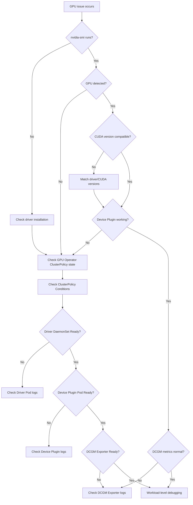

This document covers common issues and solutions when operating GPU-based AI workloads on EKS.

## GPU Node Diagnostic Workflow

When a GPU issue occurs, diagnose in the following order:

**Figure 1. GPU issue diagnosis order flowchart**



## Basic GPU Node Diagnostics

### Check nvidia-smi

```bash
# Start a debug Pod on the GPU node. The Pod created by `kubectl debug node/...` accesses the
# host namespaces (PID/network) and host filesystem (`/host`), but the container can see GPU
# devices only if the NVIDIA runtime/driver is configured on the node.
# (This needs cluster-admin privileges; run it only as a pre-authorized action.)
kubectl debug node/<gpu-node-name> -it --image=nvidia/cuda:12.2.0-base-ubuntu22.04

# Inside the container: first verify GPU device access, then run nvidia-smi
ls -l /host/dev/nvidia*        # check the host GPU device nodes
nvidia-smi                     # if accessible, output looks like below

# Example output (normal)
+-----------------------------------------------------------------------------+
| NVIDIA-SMI 535.104.05   Driver Version: 535.104.05   CUDA Version: 12.2   |
|-------------------------------+----------------------+----------------------+
| GPU  Name        Persistence-M| Bus-Id        Disp.A | Volatile Uncorr. ECC |
| Fan  Temp  Perf  Pwr:Usage/Cap|         Memory-Usage | GPU-Util  Compute M. |
|===============================+======================+======================|
|   0  NVIDIA H100 80G...  On   | 00000000:10:1C.0 Off |                    0 |
| N/A   32C    P0    68W / 700W |      0MiB / 81559MiB |      0%      Default |
+-------------------------------+----------------------+----------------------+

# If nvidia-smi does not run or reports no devices, do not conclude a driver failure from this
# single command; inspect the node's driver/runtime configuration as well.
# Always clean up the debug Pod afterward.
kubectl delete pod -n default node-debugger-<gpu-node-name>-<suffix>
```

### Check GPU Resources

```bash
# Check allocatable GPU count on a node
kubectl describe node <gpu-node-name> | grep nvidia.com/gpu
# Example output
#  nvidia.com/gpu:     8
#  nvidia.com/gpu:     8

# Check GPUs allocated to Pods
kubectl get pods -A -o json | jq '.items[] | select(.spec.containers[].resources.limits."nvidia.com/gpu" != null) | {name: .metadata.name, namespace: .metadata.namespace, gpu: .spec.containers[].resources.limits."nvidia.com/gpu"}'
```

## CUDA/NCCL Error Patterns

Common CUDA XID errors on GPU workloads, with their meaning and a first-level classification. The exact meaning and severity of an XID can depend on the driver and firmware version, so before acting, confirm the XID's meaning against your driver version and the [NVIDIA XID Errors documentation](https://docs.nvidia.com/deploy/xid-errors/index.html). The "Action class" below is not a command to run directly; it points to where the error fits in the staged recovery procedure that follows.

**Table 1. Meaning and first-level action class for major CUDA XID error codes**

| XID | Meaning | Cause (typical) | Action class |
|-----|------|------|------|
| 13 | Graphics Engine Exception | Kernel execution error | Application level (check driver/CUDA version, then retry) |
| 31 | GPU memory page fault | Invalid memory access | Application level (inspect memory-access code/version) |
| 43 | GPU stopped responding | GPU unresponsive | Node level (authorized drain, then reset/reboot) |
| 45 | Preemptive cleanup | Context switch error | Application level |
| 48 | Double bit ECC error | Hardware memory defect | Hardware escalation (possible permanent defect) |
| 62 | Internal micro-controller error | Firmware error | Node level (check driver/firmware, then reset) |
| 74 | NVLink error | GPU-to-GPU communication failure | Node level → hardware escalation if persistent |
| 79 | GPU has fallen off the bus | PCIe communication loss | Hardware escalation (possible hardware defect) |
| 94 | Contained/Uncontained error | Memory integrity error | Node level → hardware escalation if recurring |

**Staged recovery procedure (action class → actual action):**

1. **Preserve evidence**: before acting, collect `dmesg`/`nvidia-smi -q`/XID logs and the time, node, and GPU identifier. Replacing a node destroys this evidence.
2. **Application level**: restart only the workload (or Pod) and confirm driver/CUDA version alignment. Do not touch the whole node.
3. **Node level (authorization required)**: if it recurs, cordon and drain the node, then perform a GPU reset (`nvidia-smi --gpu-reset`) or node reboot through an approved procedure. This is an operation that typically requires authorization.
4. **Hardware escalation**: if a permanent ECC/PCIe/NVLink defect is suspected, follow the ownership model before replacing a node arbitrarily. For managed nodes (EKS-managed AMI/instances), AWS owns the hardware and AMI, so handle it through EC2 instance health checks/replacement and the support path rather than a self-managed swap.

Cloud/AMI ownership model: if the node is managed (EKS-optimized AMI, Auto Mode, etc.), the party responsible for driver, AMI, and hardware replacement may differ from you. Before "replacing a node," confirm who owns the component and handle it through that path.

### How to Check XID Errors

```bash
# Search for XID errors in kernel logs
kubectl debug node/<gpu-node-name> -it --image=ubuntu
# Inside the container
dmesg | grep -i "xid"

# Example output (issue)
# [  123.456789] NVRM: Xid (PCI:0000:10:1c): 79, pid=12345, GPU has fallen off the bus.
```

### NCCL Error Debugging

NCCL timeouts during multi-GPU or multi-node distributed training:

```bash
# Enable NCCL debug logs
env:
  - name: NCCL_DEBUG
    value: "INFO"
  - name: NCCL_DEBUG_SUBSYS
    value: "ALL"
  - name: NCCL_SOCKET_IFNAME
    value: "eth0"  # VPC CNI default interface
  - name: NCCL_IB_DISABLE
    value: "1"     # Disable InfiniBand (not used on EKS)
```

**Common NCCL failure causes:**

1. **Network connectivity issues**
   - NCCL workers need both TCP bootstrap (rendezvous) and data transport between them. If the nodes/Pods share a Security Group, add **self-referencing ingress/egress** on that SG, but scope the port range to the ports NCCL and EFA actually use rather than opening everything.
   - Verify connectivity against a **port that is actually listening and a known path**, not an arbitrary port. For example, when the master listens on `MASTER_PORT`, check the bootstrap path with `kubectl exec -it <pod> -- nc -zv <master-pod-ip> <MASTER_PORT>` (an arbitrary port like `12345` with no listener yields nothing meaningful).

2. **EFA misconfiguration** (p4d, p5 instances)
   - Confirm the EFA Device Plugin is installed and the `vpc.amazonaws.com/efa` resource request is present.
   - A resource request alone does not prove EFA is in use, so validate the EFA path with an EFA/NCCL test (e.g. `fi_info -p efa` to confirm the provider, the `NET/OFI ... EFA` selection message in NCCL logs, or nccl-tests).

3. **Mismatch between GPU count and parallelism settings** (the following assumes single-node Tensor Parallel only, or one-process-per-GPU DDP)
   - vLLM: `--tensor-parallel-size` must match the **local GPU count assigned to that Pod**. When Pipeline/Data Parallel are also used across nodes, TP is the per-node GPU count and total parallelism is TP×PP×DP, counted separately.
   - PyTorch DDP: `WORLD_SIZE` is the **global** worker count, while the local rank count is the per-node GPU count. Confusing the two causes rendezvous failures.
   - Model constraints: the Tensor Parallel size must divide the model's attention-head count (for example, with 64 heads, TP ∈ {2,4,8,16,32,64}); also confirm the model supports the chosen parallel layout.

## vLLM Debugging

### Out of Memory (OOM) vs KV Cache Shortage

Memory shortage in vLLM has two root causes:

```python
# Hypothetical calculation in the shape of vLLM startup logs (not a measured value)
# GPU memory utilization: 0.90
# Total GPU memory: 80.00 GiB
# → Budget available to vLLM: 0.90 × 80.00 = 72.00 GiB
# Reserved for model weights: 45.23 GiB
# Reserved for activation: 8.00 GiB
# → Left for KV cache: 72.00 - 45.23 - 8.00 = 18.77 GiB (runtime overhead such as CUDA graphs is separate)
#   If this is too low, long-context requests fail.
```

**Table 2. vLLM memory shortage symptoms with cause and action**

| Symptom | Cause | Action |
|------|------|------|
| OOM during model load | Model is larger than GPU memory | Use larger GPU, apply quantization (AWQ, GPTQ) |
| "No available blocks" during inference | KV cache capacity shortage | Increase `gpu_memory_utilization` (0.9→0.95) |
| Short requests succeed, long requests fail | KV cache shortage | Reduce `max_model_len`, reduce `max_num_batched_tokens` |
| Random OOM, hard to reproduce | Fragmentation | Restart server; lower `gpu_memory_utilization` to leave headroom |

### vLLM Parameter Tuning

The example below targets vLLM **0.6.x (the V0 engine)**. `swap_space` swaps KV blocks to CPU in V0; its behavior and meaning changed in the V1 engine, so confirm whether the flag applies in the vLLM release you run. On V1, diagnose model weights, KV, activation, and CUDA-graph memory independently.

```yaml
args:
  - --model=/models/llama-3.1-70b
  - --tensor-parallel-size=4        # must match GPU count
  - --gpu-memory-utilization=0.85   # default 0.9; decrease on OOM, increase if wasted
  - --max-model-len=8192           # max context length; determines KV cache size
  - --max-num-batched-tokens=8192  # batched tokens; balances throughput/latency
  - --max-num-seqs=256            # concurrent sequences
  - --swap-space=4                # (V0 only) CPU memory swap (GiB)
```

**Tuning guide:**

1. **On OOM:**
   - Reduce `gpu_memory_utilization` from 0.9 → 0.85 → 0.8 stepwise
   - Reduce `max_model_len` (16k → 8k → 4k)
   - Reduce `max_num_seqs`

2. **Performance optimization:**
   - If GPU utilization is low, increase `max_num_batched_tokens`
   - For long-context needs, increase `max_model_len` (ensure sufficient KV cache)

3. **Tensor Parallel configuration:**
   - H100 80GB × 8: `--tensor-parallel-size=8` (70B model)
   - A100 80GB × 4: `--tensor-parallel-size=4` (70B model, quantized)
   - **Note:** TP count should be a divisor of the model's hidden dimension for best results (2, 4, 8)

## GPU Operator Debugging

### Check ClusterPolicy Status

```bash
# ClusterPolicy status
kubectl get clusterpolicy -A

# Detailed status
kubectl describe clusterpolicy gpu-cluster-policy

# Component status
kubectl get pods -n gpu-operator

# Example output (normal)
# NAME                                       READY   STATUS    RESTARTS   AGE
# gpu-operator-1234567890-abcde              1/1     Running   0          7d
# gpu-feature-discovery-xxxxx                1/1     Running   0          7d
# nvidia-container-toolkit-daemonset-xxxxx   1/1     Running   0          7d
# nvidia-cuda-validator-xxxxx                0/1     Completed 0          7d
# nvidia-dcgm-exporter-xxxxx                 1/1     Running   0          7d
# nvidia-device-plugin-daemonset-xxxxx       1/1     Running   0          7d
# nvidia-driver-daemonset-xxxxx              1/1     Running   0          7d
# nvidia-operator-validator-xxxxx            1/1     Running   0          7d
```

### Check Driver Pod Logs

```bash
# On driver installation failure
kubectl logs -n gpu-operator nvidia-driver-daemonset-<pod-id>

# Common errors:
# 1. "Kernel headers not found" → AMI requires kernel-devel package
# 2. "Driver compilation failed" → check kernel-to-driver compatibility
# 3. "nouveau driver is loaded" → blacklist nouveau during AMI build
```

### Check Device Plugin Logs

```bash
# When Device Plugin does not detect GPUs
kubectl logs -n gpu-operator nvidia-device-plugin-daemonset-<pod-id>

# Normal logs:
# "Detected NVIDIA devices: 8"
# "Device: 0, Name: NVIDIA H100 80GB HBM3, UUID: GPU-xxxxx"

# Error log:
# "No NVIDIA devices found" → check nvidia-smi, verify driver installation
```

## GPUs on EKS Auto Mode

:::info GPU support in Auto Mode
EKS Auto Mode **directly manages the NVIDIA and Neuron kernel drivers and device plugins as built-in components** (see the [EKS Auto Mode documentation](https://docs.aws.amazon.com/eks/latest/userguide/automode.html)). Therefore, **do not install the NVIDIA GPU Operator on Auto Mode nodes** — it conflicts with the drivers and device plugins Auto Mode manages. A GPU workload that requests the `nvidia.com/gpu` resource causes Auto Mode to provision an appropriate GPU instance.
:::

### When to Use MNG + GPU Operator

Install the GPU Operator on a separate managed node group (MNG) only when you have a **concrete requirement** that Auto Mode's built-in GPU support does not meet — for example, a specific driver/CUDA version combination Auto Mode does not provide, fine-grained DCGM metrics, or a custom Operator configuration. "We need GPUs" alone is satisfied by Auto Mode.

When building an MNG hybrid, follow these rules:

- Pin the MNG node AMI and the GPU Operator version explicitly to ensure compatibility (use a combination you have validated).
- Keep **one owner per component** (driver, device plugin). Separate Auto Mode and MNG nodes with taints/labels, and scope the GPU Operator ClusterPolicy operands with nodeSelector/affinity so they are not scheduled onto Auto Mode nodes.
- Because Auto Mode already manages the driver, disable any device plugin on the MNG Operator that would overlap Auto Mode nodes.

### Auto Mode + MNG Hybrid Example {#auto-mode-gpu-configuration}

```yaml
# GPU Operator ClusterPolicy for the MNG only (scoped so it does not apply to Auto Mode nodes)
# The nodeSelector below is an example of restricting operands to a label applied only to MNG nodes.
apiVersion: nvidia.com/v1
kind: ClusterPolicy
metadata:
  name: gpu-cluster-policy
spec:
  operator:
    defaultRuntime: containerd
  driver:
    enabled: true
  devicePlugin:
    enabled: false  # ← avoid conflict with the device plugin Auto Mode manages
  dcgm:
    enabled: true
  gfd:
    enabled: true
  nodeStatusExporter:
    enabled: true
```

**Auto Mode + GPU workload patterns:**

1. **Use Auto Mode directly (recommended)**
   - A `nvidia.com/gpu` request alone has Auto Mode provision the GPU node and manage the driver and plugins.
   - No separate Operator to install, so operational overhead is lowest.

2. **Hybrid (Auto Mode + MNG)** — only when the "when to use MNG" conditions above apply
   - Auto Mode: general workloads and standard GPU workloads
   - MNG (GPU): dedicated to GPU workloads with specific needs Auto Mode does not meet
   - Pin AMI/Operator versions; separate via taint: `nvidia.com/gpu=true:NoSchedule`

See [Auto Mode Debugging](./auto-mode.md) for details.

## Diagnostic Command Collection

```bash
# === GPU node checks ===
# nvidia-smi (in a node debug Pod)
kubectl debug node/<gpu-node-name> -it --image=nvidia/cuda:12.2.0-base-ubuntu22.04
# Inside the container
nvidia-smi
nvidia-smi -q  # detailed information

# GPU resource allocation
kubectl describe node <gpu-node-name> | grep -A 10 "Allocated resources"

# === GPU Operator ===
# ClusterPolicy status
kubectl get clusterpolicy -A -o wide
kubectl describe clusterpolicy gpu-cluster-policy

# GPU Operator Pod status
kubectl get pods -n gpu-operator -o wide

# Driver Pod logs
kubectl logs -n gpu-operator -l app=nvidia-driver-daemonset --tail=100

# Device Plugin logs
kubectl logs -n gpu-operator -l app=nvidia-device-plugin-daemonset --tail=100

# DCGM Exporter logs (metric issues)
kubectl logs -n gpu-operator -l app=nvidia-dcgm-exporter --tail=100

# === vLLM Pod debugging ===
# vLLM startup logs (check memory allocation)
kubectl logs <vllm-pod-name> | head -50

# NCCL debug logs
kubectl logs <vllm-pod-name> | grep NCCL

# GPU memory usage (from inside the Pod)
kubectl exec -it <vllm-pod-name> -- nvidia-smi

# === Network debugging (multi-node training) ===
# Pod-to-Pod communication test
kubectl run -it --rm debug --image=nicolaka/netshoot -- bash
# Inside the container
nc -zv <target-pod-ip> 12345

# Check Security Group (node level)
aws ec2 describe-security-groups --group-ids <sg-id>

# === NCCL test ===
# Do not attach to a running training Pod; run this isolated as a separate diagnostic Job.
# Each process owns one GPU (single node, N GPUs: torchrun --nproc_per_node=N),
# and the all_reduce(SUM) result must equal the number of participating processes (world size).
# For multi-node, run torchrun on each node with --nnodes / --node_rank / --master_addr.
cat > /tmp/nccl_check.py <<'PY'
import os, datetime, torch, torch.distributed as dist
# rendezvous/ranks are injected by torchrun via LOCAL_RANK/RANK/WORLD_SIZE/MASTER_ADDR
dist.init_process_group(backend="nccl",
                        timeout=datetime.timedelta(seconds=60))  # bound to avoid a hang
local_rank = int(os.environ["LOCAL_RANK"])
torch.cuda.set_device(local_rank)                                # process-to-GPU mapping
t = torch.ones(1, device=f"cuda:{local_rank}")
dist.all_reduce(t, op=dist.ReduceOp.SUM)
world = dist.get_world_size()
assert int(t.item()) == world, f"expected {world}, got {t.item()}"
if dist.get_rank() == 0:
    print(f"OK: all_reduce sum = {int(t.item())} (= world size {world})")
dist.destroy_process_group()                                     # teardown
PY
# Single-node example (set N = GPU count on nproc_per_node)
kubectl exec -it <diagnostic-pod> -- torchrun --nproc_per_node=<N> /tmp/nccl_check.py
```

## Checklist by Problem

### "GPU not found" (nvidia-smi failure)

- [ ] Is the driver installed? (`lsmod | grep nvidia`)
- [ ] Is GPU Operator ClusterPolicy Ready?
- [ ] Is the Driver DaemonSet Pod Running?
- [ ] Does the node have the `nvidia.com/gpu.present=true` label?

### "Insufficient nvidia.com/gpu" (scheduling failure)

- [ ] Is the Device Plugin Pod Running?
- [ ] Does `kubectl describe node` show `nvidia.com/gpu` resources?
- [ ] Is `devicePlugin=false` set in Auto Mode?
- [ ] Does the Pod's GPU request exceed the node's GPU count?

### vLLM OOM

- [ ] Is `gpu_memory_utilization` set appropriately? (default 0.9)
- [ ] Is `max_model_len` too large?
- [ ] Does `tensor-parallel-size` match the GPU count?
- [ ] Does the model size fit in GPU memory?

### NCCL Timeout (Multi-Node)

- [ ] Do Security Groups allow all inter-node communication?
- [ ] Is the EFA Device Plugin installed when EFA is required?
- [ ] Does `NCCL_SOCKET_IFNAME` point to the correct network interface?
- [ ] Are `WORLD_SIZE` and `RANK` environment variables set correctly?

## References

- [Auto Mode Debugging](./auto-mode.md) - GPU constraints and resolutions under Auto Mode
- [Node Debugging](./node.md) - Node-level issue diagnosis
- [NVIDIA GPU Operator Official Documentation](https://docs.nvidia.com/datacenter/cloud-native/gpu-operator/latest/)
- [vLLM Official Documentation](https://docs.vllm.ai/)
