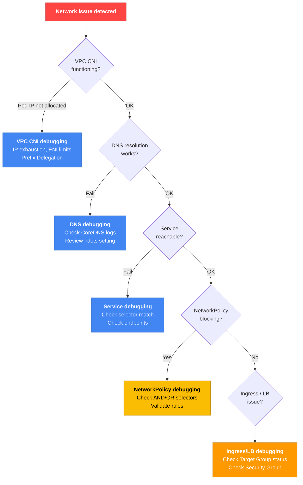

## Networking Debugging Workflow

**Figure 1. Networking debugging workflow**



## VPC CNI Debugging

### Basic Checks

```bash
# Check VPC CNI Pod status
kubectl get pods -n kube-system -l k8s-app=aws-node

# Check VPC CNI logs
kubectl logs -n kube-system -l k8s-app=aws-node --tail=50

# Check current VPC CNI version
kubectl describe daemonset aws-node -n kube-system | grep Image
```

### Resolving IP Exhaustion

```bash
# Check available IPs by subnet
aws ec2 describe-subnets --subnet-ids <subnet-id> \
  --query 'Subnets[].{ID:SubnetId,AZ:AvailabilityZone,Available:AvailableIpAddressCount}'

# Enable Prefix Delegation (16x IP capacity)
kubectl set env daemonset aws-node -n kube-system ENABLE_PREFIX_DELEGATION=true

# Confirm Prefix Delegation is enabled
kubectl get daemonset aws-node -n kube-system -o yaml | grep ENABLE_PREFIX_DELEGATION
```

:::tip What Is Prefix Delegation?
In the default mode, each ENI receives individual secondary IPs. Enabling Prefix Delegation assigns a /28 prefix (16 IPs) per ENI, increasing the number of Pod IPs a single ENI can supply.

The address capacity supplied by ENIs and IPs is distinct from the `maxPods` cap the kubelet allows on a node. The default AMI computes the ENI-based `maxPods` as `(number of ENIs × (IPs per ENI − 1)) + 2`; the trailing `+ 2` accounts for the VPC CNI and kube-proxy, which do not consume a Pod IP (see [How maxPods is determined](https://docs.aws.amazon.com/eks/latest/userguide/choosing-instance-type.html#determine-max-pods)).

**Example**: c5.xlarge instance (4 ENIs, 15 IPs per ENI)
- Default-mode ENI-based `maxPods` = (4 × (15 − 1)) + 2 = 58
- Enabling Prefix Delegation lets each ENI supply far more Pod IPs through multiple /28 prefixes, so address capacity grows substantially. However, on managed node groups without a custom AMI, EKS enforces `maxPods` at 110 for instances with fewer than 30 vCPUs and 250 for instances with more, so the Pods a node actually accepts do not exceed that cap.
:::

:::caution Temporary Changes vs. Persistent Configuration
Updates to VPC CNI values changed with `kubectl set env` depend on conflict resolution. `PRESERVE` can retain them, while `OVERWRITE` can replace managed fields. When moving settings to the add-on API after diagnosis, merge the changes into the complete current configurationValues object: existing advanced settings omitted from a new `--configuration-values` object can revert to defaults. For `NetworkAddressUsageLimitExceeded`, check VPC NAU; for `InsufficientFreeAddressesInSubnet`, check the actual selected AZ and subnet. Free addresses in another subnet do not establish capacity in the selected subnet. See [IP Capacity Planning and Karpenter Node Sizing](../../networking-performance/ip-capacity-planning-karpenter.md).
:::

### ENI and IP Limits

Each EC2 instance type limits the number of attachable ENIs and IPs per ENI.

```bash
# ENI limits by instance type
aws ec2 describe-instance-types \
  --instance-types c5.xlarge c5.2xlarge m5.xlarge \
  --query 'InstanceTypes[].[InstanceType,NetworkInfo.MaximumNetworkInterfaces,NetworkInfo.Ipv4AddressesPerInterface]' \
  --output table

# Current ENI utilization on nodes
kubectl get nodes -o json | jq -r '.items[] | {
  name: .metadata.name,
  allocatable_pods: .status.allocatable.pods,
  max_pods: .status.capacity.pods
}'
```

## DNS Troubleshooting

### CoreDNS Basic Checks

```bash
# CoreDNS Pod status
kubectl get pods -n kube-system -l k8s-app=kube-dns

# CoreDNS logs
kubectl logs -n kube-system -l k8s-app=kube-dns --tail=50

# DNS resolution test
kubectl run -it --rm debug --image=busybox --restart=Never -- nslookup kubernetes.default

# CoreDNS ConfigMap
kubectl get configmap coredns -n kube-system -o yaml

# Restart CoreDNS
kubectl rollout restart deployment coredns -n kube-system
```

### CoreDNS OOM Issues

When one CoreDNS Pod is OOMKilled, only the queries it was handling are affected; if other healthy replicas remain, resolution continues partially. DNS resolution fails effectively cluster-wide only when all replicas are repeatedly OOMKilled. Before raising memory, first measure the number of healthy endpoints, the restart/OOM history, the query load, and cache behavior to decide whether this is a partial or total outage and whether memory is actually the cause.

```bash
# Check healthy CoreDNS endpoints and replica status
kubectl get endpoints kube-dns -n kube-system
kubectl get pods -n kube-system -l k8s-app=kube-dns -o wide

# Check restart/OOM history
kubectl describe pods -n kube-system -l k8s-app=kube-dns | grep -iE 'restart|oomkilled|last state'

# Check memory usage and query load
kubectl top pods -n kube-system -l k8s-app=kube-dns
# Use CoreDNS metrics (coredns_dns_requests_total, cache hit ratio, etc.) to assess query volume and cache behavior
```

Adjust limits only when measurements show memory is the actual bottleneck. Note that CoreDNS on EKS is owned by the managed add-on, so changes made directly to the Deployment can be reverted during add-on reconciliation. Apply persistent changes through the add-on's configuration values, and if query load is the cause, adjust the replica count or distribute caching with NodeLocal DNSCache.

```bash
# When measurements show memory is the bottleneck, adjust CoreDNS memory limits (values are a measurement-based example)
kubectl set resources deployment coredns -n kube-system \
  --limits=memory=300Mi --requests=memory=100Mi
```

:::warning CoreDNS OOM Causes
- Query surge in large clusters (5,000+ Pods)
- Repeated queries due to missing DNS caching
- Malicious DNS amplification attacks

**Resolution**: Confirm the cause by measurement, then choose the applicable action among adjusting memory, adjusting replicas, or using NodeLocal DNSCache
:::

### ndots:5 Issue and Resolutions

Kubernetes' default `resolv.conf` setting `ndots:5` causes unnecessary DNS queries when reaching external domains.

```bash
# Check resolv.conf inside a Pod
kubectl exec <pod-name> -- cat /etc/resolv.conf
# nameserver 10.100.0.10
# search default.svc.cluster.local svc.cluster.local cluster.local
# options ndots:5

# With ndots:5, names with fewer than 5 dots are first tried against the search list.
# Based on the search list above (3 entries), the lookup order for api.example.com (2 dots) is, for example:
# 1. api.example.com.default.svc.cluster.local (fail)
# 2. api.example.com.svc.cluster.local (fail)
# 3. api.example.com.cluster.local (fail)
# 4. api.example.com (succeed)
# The actual packet count varies with the resolver implementation, simultaneous A/AAAA lookups, and cache state,
# so this is an illustrative order derived from the search list, not a guaranteed fixed number of queries.
```

#### Resolution 1: Adjust ndots Value

```yaml
apiVersion: v1
kind: Pod
metadata:
  name: app
spec:
  dnsConfig:
    options:
    - name: ndots
      value: "2"  # Reduce from default 5 to 2
  containers:
  - name: app
    image: my-app:latest
```

#### Resolution 2: Add Trailing Dot to FQDN

```bash
# When calling external domains from application code
curl https://api.example.com.  # ← trailing dot forces immediate external DNS resolution
```

#### Resolution 3: Use NodeLocal DNSCache

NodeLocal DNSCache provides per-node DNS caching, reducing load on CoreDNS. The upstream manifest contains placeholders such as `__PILLAR__DNS__DOMAIN__`, `__PILLAR__DNS__SERVER__`, and `__PILLAR__LOCAL__DNS__`, so do not apply it as-is: substitute the cluster domain (default `cluster.local`), the kube-dns service ClusterIP, and the local listen address the node will use, then apply it. Because the substituted values and the kubelet `--cluster-dns` setting depend on the kube-proxy mode (iptables/ipvs), follow the procedure in the [Kubernetes NodeLocal DNSCache documentation](https://kubernetes.io/docs/tasks/administer-cluster/nodelocaldns/).

```bash
# Download the manifest from a pinned release tag instead of master, then substitute placeholders and review
curl -fsSL -o nodelocaldns.yaml \
  https://raw.githubusercontent.com/kubernetes/kubernetes/v1.31.0/cluster/addons/dns/nodelocaldns/nodelocaldns.yaml
# Substitute <cluster-domain>, <kube-dns-cluster-ip>, <node-local-address> with your environment values
sed -i "s/__PILLAR__DNS__DOMAIN__/cluster.local/g; s/__PILLAR__DNS__SERVER__/<kube-dns-cluster-ip>/g; s/__PILLAR__LOCAL__DNS__/<node-local-address>/g" nodelocaldns.yaml

# Apply the substituted manifest
kubectl apply -f nodelocaldns.yaml

# Verify installation
kubectl get pods -n kube-system -l k8s-app=node-local-dns
```

Before applying, confirm the nodes are Linux nodes that accept the DaemonSet and that the kube-dns service ClusterIP and the local listen address do not conflict with the node network. To roll back, remove the DaemonSet with `kubectl delete -f nodelocaldns.yaml`, and restore the kubelet `--cluster-dns` or NodeLocal address to their original values if you changed them.

:::info VPC DNS Throttling Limits
Traffic each network interface can send to the Amazon-provided Route 53 Resolver is capped at **1,024 packets per second per network interface** (see [Amazon VPC quotas](https://docs.aws.amazon.com/vpc/latest/userguide/amazon-vpc-limits.html#vpc-limits-dns)). This allowance applies per interface and is shared across the lookups of every Pod using that interface. The limit is measured in packets, not DNS queries, so a single query can consume multiple packets when retries or TCP fallback occur. Measure the actual per-interface traffic and the node networking mode to decide on NodeLocal DNSCache adoption, replica placement, and application lookup patterns.
:::

## Service Debugging

### Service Connectivity Failure Patterns

#### Pattern 1: Selector Label Mismatch

```bash
# Check Service status
kubectl get svc <service-name>

# Check Endpoints (verify backend Pods are connected)
kubectl get endpoints <service-name>
# NAME         ENDPOINTS
# web-service  <none>  ← issue: Endpoints is empty

# Check Service selector
kubectl get svc <service-name> -o jsonpath='{.spec.selector}'
# {"app":"web","version":"v1"}

# Check Pods matching the selector
kubectl get pods -l app=web,version=v1
# No resources found  ← issue: no matching Pod

# Check actual Pod labels
kubectl get pods --show-labels
# NAME        READY   STATUS    LABELS
# web-abc     1/1     Running   app=web,ver=v1  ← label is typo "ver"
```

**Resolution**: Correct the Pod's typo label (`ver`) to the intended `version` key so it matches the Service selector. Keep the selector at the intended `version=v1`; the Pod label is the side that is wrong.

```bash
# Option 1: fix the label in the controller (e.g., Deployment) Pod template and roll it out
# Changing ver to version in spec.template.metadata.labels makes new Pods carry the correct label
kubectl patch deployment web -p '{"spec":{"template":{"metadata":{"labels":{"version":"v1"}}}}}'
kubectl rollout status deployment web
# Do not leave the typo key (ver) in the selector; if needed, restore the selector to the intended value:
kubectl patch svc web-service -p '{"spec":{"selector":{"app":"web","version":"v1"}}}'

# Option 2: temporarily relabel a single Pod for an immediate check (not a permanent fix; the controller reverts it)
kubectl label pod web-abc version=v1 --overwrite

# After the change, verify the Pod is registered in the EndpointSlice
kubectl get endpointslices -l kubernetes.io/service-name=web-service
```

#### Pattern 2: port vs targetPort Mismatch

```yaml
# Service configuration
apiVersion: v1
kind: Service
metadata:
  name: web-service
spec:
  selector:
    app: web
  ports:
  - port: 80          # ← port exposed by Service
    targetPort: 8080  # ← port Pod listens on (wrong value causes connectivity failure)
```

```bash
# containerPort is only a declared value, so inspect the socket the Pod actually listens on
kubectl exec <pod-name> -- ss -ltnp
# Or confirm the real bind port in the application config/logs
# Declared containerPort (for reference only)
kubectl get pod <pod-name> -o jsonpath='{.spec.containers[*].ports[*].containerPort}'
# Example: the application listens on 9090 but the Service targetPort is set to 8080

# Align the Service targetPort with the port the backend actually listens on
# port is the Service port clients reach; targetPort is the port the backend Pod receives on — they are distinct values
kubectl patch svc web-service -p '{"spec":{"ports":[{"port":80,"targetPort":9090}]}}'

# When using a load balancer, the health-check port is the Service NodePort or the Pod port
# depending on the target type (instance/ip) and configuration, so align it separately from targetPort
```

#### Pattern 3: Endpoints Check

```bash
# Endpoint details
kubectl describe endpoints <service-name>

# If Endpoints is empty:
# 1. Check Service selector vs Pod label alignment
# 2. Ensure Pods are Ready (NotReady Pods are excluded from Endpoints)
kubectl get pods -l app=web -o wide
```

### Common Service Issues

**Table 1. Common Service issues with symptom, check, and resolution**

| Symptom | Check | Resolution |
|------|----------|------|
| Endpoints empty | Service selector vs Pod label mismatch | Fix label |
| ClusterIP unreachable | Is kube-proxy running? | `kubectl logs -n kube-system -l k8s-app=kube-proxy` |
| NodePort unreachable | Is 30000-32767 allowed in Security Group? | Add SG inbound rule |
| LoadBalancer Pending | Is AWS Load Balancer Controller installed? | Install controller and verify IAM permissions |

## NetworkPolicy Debugging

### AND vs OR Selector Confusion

The most common NetworkPolicy mistake is confusing **AND vs OR selectors**.

```yaml
# AND logic (two selectors inside the same from item)
# Allows only "Pods in the alice namespace with role=client"
apiVersion: networking.k8s.io/v1
kind: NetworkPolicy
metadata:
  name: allow-alice-client-only
spec:
  podSelector:
    matchLabels:
      app: web
  ingress:
  - from:
    - namespaceSelector:
        matchLabels:
          user: alice
      podSelector:
        matchLabels:
          role: client
```

```yaml
# OR logic (separated into multiple from items)
# Allows "all Pods in alice namespace" OR "Pods with role=client in the same namespace as this policy"
apiVersion: networking.k8s.io/v1
kind: NetworkPolicy
metadata:
  name: allow-alice-or-client
spec:
  podSelector:
    matchLabels:
      app: web
  ingress:
  - from:
    - namespaceSelector:
        matchLabels:
          user: alice
    - podSelector:
        matchLabels:
          role: client
```

:::danger AND vs OR Caution
The two YAMLs above differ by one indentation level and result in completely different security policies. In AND logic, `namespaceSelector` and `podSelector` are inside the **same `- from` item**; in OR logic, they are **separate `- from` items**. A peer that has only a `podSelector` and no `namespaceSelector` selects Pods only in the NetworkPolicy's own namespace. To intentionally allow `role: client` Pods from every namespace, put `namespaceSelector: {}` in the same peer; because any team's namespace can then gain access just by applying that label, record the security reason for widening the scope in a policy comment or the review record.
:::

### Debugging NetworkPolicy Blocking

A NetworkPolicy takes effect only when a CNI enforces it. On EKS with the VPC CNI, the add-on's NetworkPolicy feature must be enabled; otherwise policies are declared but do not control traffic. First confirm enforcement is on and that policy and namespace labels match as intended, then test both a flow that should be allowed and a flow that should be denied.

```bash
# Confirm VPC CNI NetworkPolicy enforcement is enabled
kubectl get daemonset aws-node -n kube-system \
  -o jsonpath='{.spec.template.spec.containers[*].args}' | tr ',' '\n' | grep -i network-policy

# Check that applied policies and their selectors match the namespace/Pod labels
kubectl get networkpolicy -n <namespace> -o yaml
kubectl get ns <namespace> --show-labels
kubectl get pods -n <namespace> --show-labels

# Allowed-flow test: reach the target from a source workload carrying the labels the policy permits
kubectl exec -n <namespace> deploy/<allowed-client> -- \
  curl -sS -m 5 http://<target-service>.<namespace>.svc.cluster.local:<port>/

# Denied-flow test: reach it from a source workload the policy does not permit (failure is expected)
kubectl exec -n <namespace> deploy/<denied-client> -- \
  curl -sS -m 5 http://<target-service>.<namespace>.svc.cluster.local:<port>/
```

An ad-hoc debug Pod may not carry the labels, direction, or ports the policy selectors expect, which makes results easy to misread. Where possible, test with the identity (labels) of the controller-managed workloads for the intended direction (ingress/egress) and ports.

#### Missing Allow Rules After Default Deny

```yaml
# Default Deny (blocks all ingress)
apiVersion: networking.k8s.io/v1
kind: NetworkPolicy
metadata:
  name: default-deny-ingress
  namespace: production
spec:
  podSelector: {}
  policyTypes:
  - Ingress
  # No ingress rules → all ingress blocked
```

```yaml
# Add Allow rule (permit specific traffic)
apiVersion: networking.k8s.io/v1
kind: NetworkPolicy
metadata:
  name: allow-from-frontend
  namespace: production
spec:
  podSelector:
    matchLabels:
      app: backend
  ingress:
  - from:
    - podSelector:
        matchLabels:
          app: frontend
    ports:
    - protocol: TCP
      port: 8080
```

:::warning Default Deny Requires Care
The `default-deny-ingress` above lists only `Ingress` in `policyTypes`, so it **blocks ingress only** and does not restrict egress. To control egress or DNS, you must define and test a separate `Egress` policy; and because blocking all egress also blocks DNS to kube-dns, be sure to include a DNS allow rule. Also, the `podSelector: {app: frontend}` in `allow-from-frontend` has no `namespaceSelector`, so the rule refers only to frontend Pods **within the same `production` namespace**. To allow frontend in other namespaces, add a `namespaceSelector`. Before applying to production, write all necessary Allow rules and validate both ingress and egress flows in a test environment.
:::

## Using netshoot

[netshoot](https://github.com/nicolaka/netshoot) is a container image that includes all tools needed for network debugging.

```bash
# Add an ephemeral container to an existing Pod
kubectl debug <pod-name> -it --image=nicolaka/netshoot

# Run a standalone debug Pod
kubectl run tmp-shell --rm -i --tty --image nicolaka/netshoot

# Tools available inside:
# - curl, wget: HTTP tests
# - dig, nslookup: DNS tests
# - tcpdump: packet capture
# - iperf3: bandwidth tests
# - ss, netstat: socket states
# - traceroute, mtr: path tracing
```

### Real-world Scenario: Pod-to-Pod Communication Check

```bash
# From netshoot Pod, test connection to another Service
kubectl run tmp-shell --rm -i --tty --image nicolaka/netshoot -- bash

# DNS resolution
dig <service-name>.<namespace>.svc.cluster.local

# TCP connection test
curl -v http://<service-name>.<namespace>.svc.cluster.local:<port>/health

# Packet capture (traffic to a specific Pod IP)
tcpdump -i any host <pod-ip> -n

# Path tracing
traceroute <pod-ip>

# Socket states
ss -tunap
```

## Ingress / LoadBalancer Debugging

### AWS Load Balancer Controller Issues

```bash
# Controller status
kubectl get pods -n kube-system -l app.kubernetes.io/name=aws-load-balancer-controller

# Controller logs
kubectl logs -n kube-system -l app.kubernetes.io/name=aws-load-balancer-controller --tail=100

# Ingress status
kubectl describe ingress <ingress-name>
```

### Target Group Health Check Failures

For AWS Load Balancer Target Group health check failures, see the [Health Check Mismatch doc](./health-check-mismatch.md).

**Common causes**:
- Health Check path differs from the Pod's actual endpoint
- Health Check port differs from the Pod's containerPort
- Security Group does not allow the Health Check port
- readinessProbe failure keeps the Pod NotReady

```bash
# Check Target Group health
aws elbv2 describe-target-health \
  --target-group-arn <tg-arn>

# Check Security Group inbound rules
aws ec2 describe-security-groups \
  --group-ids <sg-id> \
  --query 'SecurityGroups[].IpPermissions'
```

## Networking Issue Checklist

### Layer 3/4 (Basic Connectivity)

- [ ] Does the Pod have an IP? (`kubectl get pod -o wide`)
- [ ] Does the subnet have available IPs?
- [ ] Does the Security Group allow required ports?
- [ ] Is a NetworkPolicy blocking traffic?

### Layer 7 (Application)

- [ ] Do Service selector and Pod label match?
- [ ] Do Service port and Pod containerPort match?
- [ ] Does DNS resolution work? (`nslookup <service-name>`)
- [ ] Is the Pod's readinessProbe succeeding?
- [ ] Is the Ingress Health Check path correct?

### DNS-Specific

- [ ] Are CoreDNS Pods Running?
- [ ] Has CoreDNS been OOMKilled?
- [ ] Is the ndots setting appropriate? (for many external domain calls, ndots:2 is recommended)
- [ ] Is NodeLocal DNSCache installed? (large clusters)

---

## Related Documents

- [Workload Debugging](./workload.md) - Pod state-based troubleshooting
- [Storage Debugging](./storage.md) - PVC mount failures
- [Health Check Mismatch](./health-check-mismatch.md) - ALB/NLB Target Group Health Check issues
- [IP Capacity Planning and Karpenter Node Sizing](../../networking-performance/ip-capacity-planning-karpenter.md) - Subnet and NAU budgets, IP consumption on size fallback
