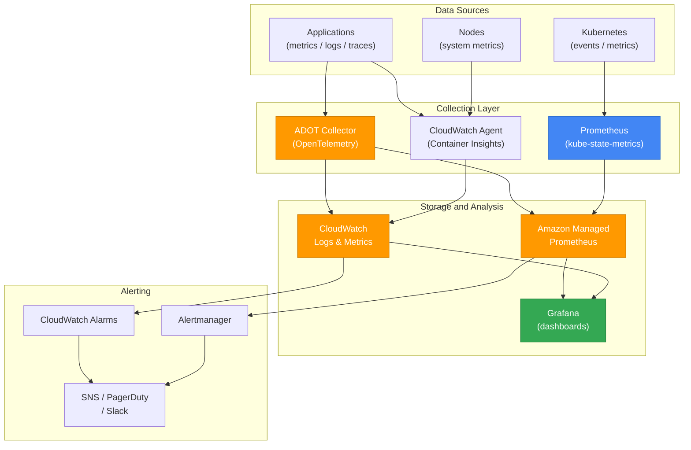
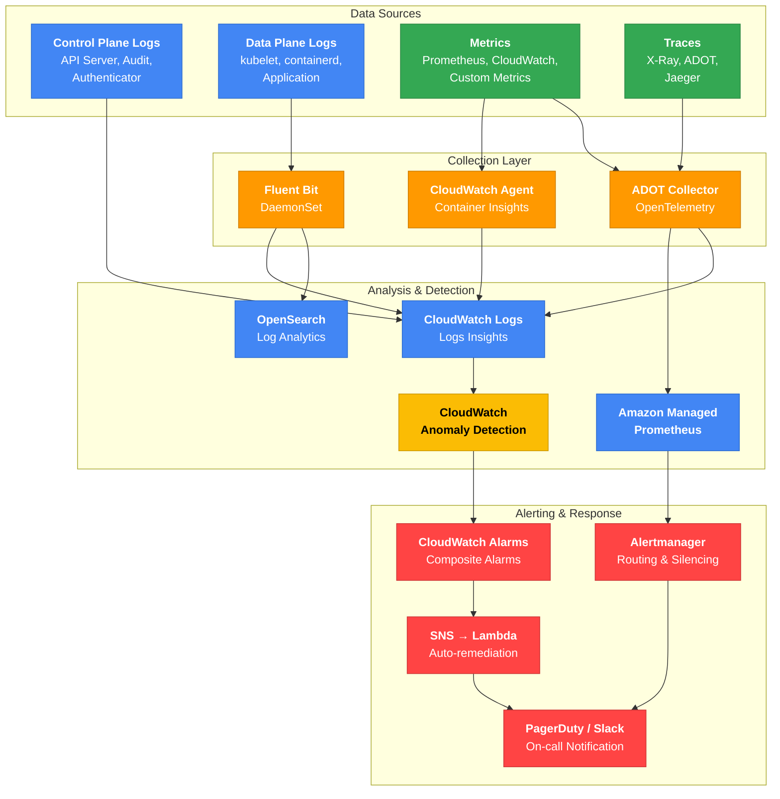

import { IncidentEscalationTable, ZonalShiftImpactTable } from '@site/src/components/EksDebugTables';

## Observability Stack Architecture

**Figure 1. Observability stack architecture**



## Container Insights Setup

The following is a partial installation fragment. The `amazon-cloudwatch-observability` add-on deploys the CloudWatch Agent and Fluent Bit to collect metrics and logs; for those components to send data to CloudWatch, the node or service account needs an IAM identity with CloudWatch write permissions (such as `CloudWatchAgentServerPolicy`). Before using the add-on, configure these permissions through Pod Identity or IRSA, and set the collection scope (which namespaces/nodes' metrics and logs are sent) through the add-on configuration values. If you already run a separate CloudWatch Agent or Fluent Bit, reconcile them to avoid duplicate collection.

```bash
# Install Container Insights Add-on (prerequisite: an IAM identity with CloudWatch write permissions)
aws eks create-addon \
  --cluster-name <cluster-name> \
  --addon-name amazon-cloudwatch-observability

# Verify installation: check not only Pod health but that telemetry actually reaches the backend
kubectl get pods -n amazon-cloudwatch
# Confirm Container Insights log groups and metrics are created in CloudWatch
aws logs describe-log-groups --log-group-name-prefix "/aws/containerinsights/<cluster-name>"
```

## Metric Debugging: PromQL Queries

### CPU Throttling Detection

```promql
sum(rate(container_cpu_cfs_throttled_periods_total{namespace="production"}[5m]))
/ sum(rate(container_cpu_cfs_periods_total{namespace="production"}[5m])) > 0.25
```

:::info CPU Throttling Threshold
The 25% used here is not a measured value but an illustrative starting threshold to tune against. Set the real threshold by measuring your workload's SLOs and the per-container correlation between throttling and latency. Removing CPU limits eliminates throttling, but when a node is oversubscribed a container can monopolize CPU, so removal is not a blanket recommendation — it trades isolation for performance. Many organizations set only CPU requests without limits, but that is a decision made together with node sizing and QoS policy.
:::

### OOMKilled Detection

```promql
kube_pod_container_status_last_terminated_reason{reason="OOMKilled"} > 0
```

### Pod Restart Rate

```promql
sum(rate(kube_pod_container_status_restarts_total[15m])) by (namespace, pod) > 0
```

### Node CPU Utilization (Warn Above 80%)

```promql
100 - (avg by(instance)(rate(node_cpu_seconds_total{mode="idle"}[5m])) * 100) > 80
```

### Node Memory Utilization (Warn Above 85%)

```promql
(1 - node_memory_MemAvailable_bytes / node_memory_MemTotal_bytes) * 100 > 85
```

## Log Debugging: CloudWatch Logs Insights

### Error Log Analysis

```sql
fields @timestamp, @message, kubernetes.container_name, kubernetes.pod_name
| filter @message like /ERROR|FATAL|Exception/
| sort @timestamp desc
| limit 50
```

### Latency Analysis

The query below extracts the integer after `latency=` or `latency:` from log messages, assuming milliseconds. If the application logs seconds or microseconds, the result units become mixed, so align the regex and units with the actual log schema.

```sql
fields @timestamp, @message
| filter @message like /latency|duration|elapsed/
| parse @message /latency[=:]\s*(?<latency_ms>\d+)/
| stats avg(latency_ms) as avg_ms, max(latency_ms) as max_ms, pct(latency_ms, 99) as p99_ms by bin(5m)
```

### Error Pattern Analysis for a Specific Pod

The `count()` below is the number of **log lines** matching the pattern, not unique incidents; a single incident can emit multiple lines.

```sql
fields @timestamp, @message
| filter kubernetes.pod_name like /api-server/
| filter @message like /error|Error|ERROR/
| stats count() as error_log_lines by bin(1m)
| sort bin asc
```

### OOMKilled Event Tracking

```sql
fields @timestamp, @message
| filter @message like /OOMKilled|oom-kill|Out of memory/
| sort @timestamp desc
| limit 20
```

### Container Restart Events

The `count()` below is likewise the number of **log lines** in which the `Back-off restarting` message appeared, not the actual restart count. Use the `kube_pod_container_status_restarts_total` metric for the exact restart count.

```sql
fields @timestamp, @message, kubernetes.pod_name
| filter @message like /Back-off restarting failed container|CrashLoopBackOff/
| stats count() as restart_log_lines by kubernetes.pod_name
| sort restart_log_lines desc
```

## Alert Rules: PrometheusRule Example

The `PrometheusRule` below has prerequisites. Exporters and scrape configuration that collect the metrics it references (such as `kube_pod_container_status_restarts_total` from kube-state-metrics, node-exporter, and similar) must exist, and the Prometheus Operator must be installed to evaluate the `PrometheusRule` custom resource. The rule is loaded only when the `ruleSelector`/`ruleNamespaceSelector` configured on the Operator's `Prometheus` resource match this rule's labels and namespace. By contrast, when you use the managed ruler of Amazon Managed Service for Prometheus (AMP), the path differs: instead of deploying a `PrometheusRule` resource to the cluster, you upload rule groups to the AMP ruler. After applying, confirm the rule is loaded and evaluated and that alerts route to Alertmanager/SNS.

```yaml
apiVersion: monitoring.coreos.com/v1
kind: PrometheusRule
metadata:
  name: kubernetes-alerts
spec:
  groups:
  - name: kubernetes-pods
    rules:
    - alert: PodCrashLooping
      # Fire when a restart occurred within the last 15 minutes and that state persists for 15 minutes (recent-restart semantics)
      expr: increase(kube_pod_container_status_restarts_total[15m]) > 0
      for: 15m
      labels:
        severity: warning
      annotations:
        summary: "Pod {{ $labels.namespace }}/{{ $labels.pod }} container {{ $labels.container }} is crash looping"
        description: "Container {{ $labels.container }} (Pod {{ $labels.pod }}) restarted within the last 15 minutes and the state persisted for 15 minutes."

    - alert: PodOOMKilled
      expr: kube_pod_container_status_last_terminated_reason{reason="OOMKilled"} > 0
      for: 0m
      labels:
        severity: critical
      annotations:
        summary: "Pod {{ $labels.namespace }}/{{ $labels.pod }} OOMKilled"
        description: "Pod {{ $labels.pod }} was terminated due to memory exhaustion. Adjust memory limits."

  - name: kubernetes-nodes
    rules:
    - alert: NodeNotReady
      expr: kube_node_status_condition{condition="Ready",status="true"} == 0
      for: 5m
      labels:
        severity: critical
      annotations:
        summary: "Node {{ $labels.node }} is NotReady"

    - alert: NodeHighCPU
      expr: 100 - (avg by(instance)(rate(node_cpu_seconds_total{mode="idle"}[5m])) * 100) > 80
      for: 10m
      labels:
        severity: warning
      annotations:
        summary: "Node {{ $labels.instance }} CPU usage above 80%"

    - alert: NodeHighMemory
      expr: (1 - node_memory_MemAvailable_bytes / node_memory_MemTotal_bytes) * 100 > 85
      for: 10m
      labels:
        severity: warning
      annotations:
        summary: "Node {{ $labels.instance }} memory usage above 85%"
```

## ADOT (AWS Distro for OpenTelemetry) Debugging

ADOT is the AWS-managed distribution of OpenTelemetry that collects traces, metrics, and logs and forwards them to various AWS services (X-Ray, CloudWatch, AMP, etc.).

```bash
# Check ADOT Add-on status
aws eks describe-addon --cluster-name $CLUSTER \
  --addon-name adot --query 'addon.{status:status,version:addonVersion}'

# Check ADOT Collector Pods
kubectl get pods -n opentelemetry-operator-system
kubectl logs -n opentelemetry-operator-system -l app.kubernetes.io/name=opentelemetry-operator --tail=50

# Check OpenTelemetryCollector CR
kubectl get otelcol -A
kubectl describe otelcol -n $NAMESPACE $COLLECTOR_NAME
```

### Common ADOT Issues

It helps to separate two areas when diagnosing. The Operator area covers webhook certificates and admission/reconciliation problems; the Collector area covers pipeline configuration and actual export (backend delivery) errors. If the Operator does not come up, Collector CRs are not applied; and even when the Operator is healthy, a wrong exporter configuration or IAM permission on the Collector causes delivery alone to fail.

**Table 1. Common ADOT issues with symptom, cause, and resolution**

| Symptom | Cause | Resolution |
|------|------|----------|
| Operator Pod `CrashLoopBackOff` or webhook errors | Webhook certificate not configured | First confirm the real cause from the Operator logs and events. The ADOT operator needs a compatible certificate solution such as cert-manager for webhook certificates; if one is already installed, check its owner/version. If installation is needed, install a pinned patch of a [cert-manager release](https://github.com/cert-manager/cert-manager/releases) compatible with the cluster's Kubernetes version, after confirming CRD/webhook ownership and upgrade scope |
| Collector fails to send to AMP (prometheusremotewrite exporter) | Insufficient IAM permissions | Add `aps:RemoteWrite` to IRSA/Pod Identity |
| X-Ray traces not received (awsxray exporter) | Insufficient IAM permissions | Add `xray:PutTraceSegments`, `xray:PutTelemetryRecords` to IRSA/Pod Identity |
| CloudWatch metrics not received (awsemf exporter) | Insufficient IAM permissions | Add `cloudwatch:PutMetricData` to IRSA/Pod Identity |
| CloudWatch Logs not received (awsemf/awscloudwatchlogs exporter) | Insufficient IAM permissions | Add `logs:PutLogEvents` to IRSA/Pod Identity; if log groups/streams are auto-created, add `logs:CreateLogGroup`, `logs:CreateLogStream` |
| Collector Pod `OOMKilled` | Insufficient resources | Increase Collector `resources.limits.memory` when collecting high volumes of traces/metrics |

:::warning ADOT Permission Separation
Each configured exporter requires different AWS API permissions. AMP remote write, X-Ray, CloudWatch metrics, and CloudWatch Logs each require different permissions, so ensure the IAM Role includes the permissions for every backend the Collector sends to.
:::

---

## Incident Detection Mechanisms and Logging Architecture

### Incident Detection Strategy Overview

To detect incidents quickly in EKS environments, a 4-layer pipeline of **data source → collection → analysis & detection → alerting & response** must be systematically configured. The layers must connect cohesively to minimize MTTD (Mean Time To Detect).

Each signal has a different collection path. EKS control plane logs (API Server, Audit, Authenticator, and others) are sent by EKS **directly** to CloudWatch Logs once the log types are enabled, so they do not pass through Fluent Bit. For downstream analysis, forward them from CloudWatch Logs to destinations such as OpenSearch using subscription filters. Node/application logs, by contrast, are collected by the Fluent Bit DaemonSet; metrics by the CloudWatch Agent or ADOT; and traces by ADOT — each configured separately. Kubernetes event export is yet another path. The diagram below keeps these signals distinct.

**Figure 2. Four-layer incident detection pipeline**



#### Four-Layer Architecture

**Table 2. Role and core components of each layer in the four-layer architecture**

| Layer | Role | Core Components |
|---|---|---|
| **Data Sources** | Generate all observable signals in the cluster | Control Plane Logs, Data Plane Logs, Metrics, Traces |
| **Collection Layer** | Standardize data from various sources and ship centrally | Fluent Bit, CloudWatch Agent, ADOT Collector |
| **Analysis & Detection** | Analyze collected data and detect anomalies | CloudWatch Logs Insights, AMP, OpenSearch, Anomaly Detection |
| **Alerting & Response** | Notify appropriate channels about detected incidents and run auto-remediation | CloudWatch Alarms, Alertmanager, SNS → Lambda, PagerDuty/Slack |

### Recommended Logging Architectures

#### Option A: AWS-Native Stack (Small to Medium Clusters)

An architecture centered on AWS managed services to minimize operational overhead.

**Table 3. Components and purpose per layer for the AWS-managed-centered configuration (Option A)**

| Layer | Component | Purpose |
|---|---|---|
| Collection | Fluent Bit (DaemonSet) | Node/container log collection |
| Transport | CloudWatch Logs | Central log store |
| Analysis | CloudWatch Logs Insights | Query-based analysis |
| Detection | CloudWatch Anomaly Detection | ML-based anomaly detection |
| Alerting | CloudWatch Alarms → SNS | Threshold/anomaly-based alerts |

**Fluent Bit DaemonSet deployment example:**

The DaemonSet below references `serviceAccountName: fluent-bit` and a `fluent-bit-config` ConfigMap, but neither is defined in this example. To deploy it for real, you also need: (1) the `amazon-cloudwatch` namespace, a `fluent-bit` ServiceAccount, and the RBAC needed to read and ship node logs; (2) an IAM identity with CloudWatch Logs write permissions (`logs:CreateLogGroup`, `logs:CreateLogStream`, `logs:PutLogEvents`) bound to the ServiceAccount via IRSA or Pod Identity; and (3) a `fluent-bit-config` ConfigMap containing the region/cluster name and the OUTPUT (cloudwatch_logs) configuration. Basing this on the EKS-provided [Fluent Bit for CloudWatch setup](https://docs.aws.amazon.com/AmazonCloudWatch/latest/monitoring/Container-Insights-setup-logs-FluentBit.html) manifests gives you the ServiceAccount, RBAC, and ConfigMap together. After deployment, verify logs reach the expected CloudWatch log groups (such as `/aws/containerinsights/<cluster-name>/application`). If you already run the `amazon-cloudwatch-observability` add-on, it manages Fluent Bit, so deploying this DaemonSet separately causes duplicate collection — reconcile them so only one is in operation.

```yaml
apiVersion: apps/v1
kind: DaemonSet
metadata:
  name: fluent-bit
  namespace: amazon-cloudwatch
  labels:
    app.kubernetes.io/name: fluent-bit
spec:
  selector:
    matchLabels:
      app.kubernetes.io/name: fluent-bit
  template:
    metadata:
      labels:
        app.kubernetes.io/name: fluent-bit
    spec:
      serviceAccountName: fluent-bit
      containers:
        - name: fluent-bit
          image: public.ecr.aws/aws-observability/aws-for-fluent-bit:2.32.0
          resources:
            limits:
              memory: 200Mi
            requests:
              cpu: 100m
              memory: 100Mi
          volumeMounts:
            - name: varlog
              mountPath: /var/log
              readOnly: true
            - name: varlogpods
              mountPath: /var/log/pods
              readOnly: true
            - name: fluent-bit-config
              mountPath: /fluent-bit/etc/
      volumes:
        - name: varlog
          hostPath:
            path: /var/log
        - name: varlogpods
          hostPath:
            path: /var/log/pods
        - name: fluent-bit-config
          configMap:
            name: fluent-bit-config
```

:::tip Fluent Bit vs Fluentd
Fluent Bit uses more than 10× less memory than Fluentd (~10MB vs ~100MB). Deploying Fluent Bit as a DaemonSet is the standard pattern in EKS. The `amazon-cloudwatch-observability` Add-on installs Fluent Bit automatically.
:::

#### Option B: Open-Source-Based Stack (Large / Multi-Cluster)

An architecture combining open-source tools with AWS managed services for scalability and flexibility at scale.

**Table 4. Components and purpose per layer for the open-source and AWS-managed hybrid configuration (Option B)**

| Layer | Component | Purpose |
|---|---|---|
| Collection | Fluent Bit + ADOT Collector | Unified collection of logs/metrics/traces |
| Metrics | Amazon Managed Prometheus (AMP) | Time-series metrics store |
| Logs | Amazon OpenSearch Service | Large-scale log analysis |
| Traces | AWS X-Ray / Jaeger | Distributed tracing |
| Visualization | Amazon Managed Grafana | Unified dashboards |
| Alerting | Alertmanager + PagerDuty/Slack | Advanced routing, grouping, silencing |

:::info Multi-Cluster Architecture
In multi-cluster environments, a hub-and-spoke pattern where each cluster's ADOT Collector sends metrics to a central AMP workspace is recommended. Grafana can then monitor all clusters from a single dashboard.
:::

### Incident Detection Patterns

#### Pattern 1: Threshold-Based Detection

The simplest detection method. Alerts fire when a predefined threshold is exceeded.

```yaml
# PrometheusRule - threshold-based alert example
apiVersion: monitoring.coreos.com/v1
kind: PrometheusRule
metadata:
  name: eks-threshold-alerts
  namespace: monitoring
spec:
  groups:
    - name: eks-thresholds
      rules:
        - alert: HighPodRestartRate
          expr: increase(kube_pod_container_status_restarts_total[1h]) > 5
          for: 10m
          labels:
            severity: warning
          annotations:
            summary: "Pod {{ $labels.namespace }}/{{ $labels.pod }} restart count increasing"
            description: "{{ $value }} restarts occurred within the last hour"

        - alert: NodeMemoryPressure
          expr: (1 - node_memory_MemAvailable_bytes / node_memory_MemTotal_bytes) > 0.85
          for: 5m
          labels:
            severity: critical
          annotations:
            summary: "Node {{ $labels.instance }} memory utilization above 85%"

        - alert: PVCNearlyFull
          expr: kubelet_volume_stats_used_bytes / kubelet_volume_stats_capacity_bytes > 0.9
          for: 15m
          labels:
            severity: warning
          annotations:
            summary: "PVC {{ $labels.persistentvolumeclaim }} utilization above 90%"
```

#### Pattern 2: Anomaly Detection

ML-based approaches learn normal patterns and detect deviations. Useful when thresholds are hard to define in advance.

```bash
# Configure CloudWatch Anomaly Detection
aws cloudwatch put-anomaly-detector \
  --single-metric-anomaly-detector '{
    "Namespace": "ContainerInsights",
    "MetricName": "pod_cpu_utilization",
    "Dimensions": [
      {"Name": "ClusterName", "Value": "'$CLUSTER'"},
      {"Name": "Namespace", "Value": "production"}
    ],
    "Stat": "Average"
  }'

# Create alarm based on Anomaly Detection
aws cloudwatch put-metric-alarm \
  --alarm-name "eks-cpu-anomaly" \
  --alarm-description "Detect EKS CPU utilization anomalies" \
  --evaluation-periods 3 \
  --comparison-operator LessThanLowerOrGreaterThanUpperThreshold \
  --threshold-metric-id ad1 \
  --metrics '[
    {
      "Id": "m1",
      "MetricStat": {
        "Metric": {
          "Namespace": "ContainerInsights",
          "MetricName": "pod_cpu_utilization",
          "Dimensions": [
            {"Name": "ClusterName", "Value": "'$CLUSTER'"},
            {"Name": "Namespace", "Value": "production"}
          ]
        },
        "Period": 300,
        "Stat": "Average"
      }
    },
    {
      "Id": "ad1",
      "Expression": "ANOMALY_DETECTION_BAND(m1, 2)"
    }
  ]' \
  --alarm-actions $SNS_TOPIC_ARN
```

:::info Matching Dimensions Between Detector and Alarm
The example above aligns the detector and the alarm's metric m1 to use the same `ClusterName` and `Namespace=production` dimensions and the `Average` statistic. An anomaly detection model is specific to a metric and its statistic/dimension combination, so if the detector and the alarm point at different dimension sets, the alarm's band (`ad1 = ANOMALY_DETECTION_BAND(m1, 2)`) watches a different time series than the trained model. Also decide the evaluation window (`evaluation-periods`) and the missing-data behavior (`--treat-missing-data`).
:::

:::warning Anomaly Detection Training Period
CloudWatch Anomaly Detection trains its model on **up to two weeks** of historical data, and you can enable it even without a full two weeks of data. In other words, two weeks is not a required minimum; the model is continuously re-trained as more data accumulates. Early after deployment, when there is little data, the band may be wide and less accurate, so as an operational choice it is advisable to use threshold-based alerts alongside it.
:::

#### Pattern 3: Composite Alarms

Combine multiple individual alarms logically to reduce noise and detect real incidents accurately.

```bash
# Combine individual alarms with AND/OR
aws cloudwatch put-composite-alarm \
  --alarm-name "eks-service-degradation" \
  --alarm-rule 'ALARM("high-error-rate") AND (ALARM("high-latency") OR ALARM("pod-restart-spike"))' \
  --alarm-actions $SNS_TOPIC_ARN \
  --alarm-description "Service degradation: error rate increase + latency increase or Pod restart spike"
```

:::tip Composite Alarm Tips
Individual alarms generate many false positives. Composite alarms that combine multiple signals can reliably detect real incidents. Example: "error rate increase AND latency increase" indicates a service outage; "error rate increase AND Pod restarts" indicates an application crash.
:::

#### Pattern 4: Log-Based Metric Filters

Detect specific patterns in CloudWatch Logs, convert them to metrics, and set alerts. The field paths in a filter pattern must match the actual log schema. The `/aws/eks/<cluster>/cluster` log group contains only control plane logs, and container termination reasons such as OOMKilled do not appear as a field in this group's audit logs — they appear in kubelet logs or Kubernetes events. So filter OOMKilled against the log group where that signal is actually collected (for example, the Container Insights application/event log groups) and that schema's fields. The audit-based filter below parses `responseStatus.code` and works only when audit logs are enabled at a sufficient level; validate it with representative matching and non-matching records before applying.

```bash
# OOMKilled events: filter against the log group and schema where this signal is actually collected
# (e.g., Container Insights application/event log groups; the control plane log group has no reason field)
aws logs put-metric-filter \
  --log-group-name "<oomkilled-signal-log-group>" \
  --filter-name "OOMKilledEvents" \
  --filter-pattern '{ $.reason = "OOMKilled" || $.reason = "OOMKilling" }' \
  --metric-transformations \
    metricName=OOMKilledCount,metricNamespace=EKS/Custom,metricValue=1,defaultValue=0

# 403 responses: count "denied requests" to review, not a confirmed security incident
# (the responseStatus.code field exists only when audit logs are enabled at a sufficient level)
aws logs put-metric-filter \
  --log-group-name "/aws/eks/$CLUSTER/cluster" \
  --filter-name "DeniedRequests" \
  --filter-pattern '{ $.responseStatus.code = 403 }' \
  --metric-transformations \
    metricName=DeniedRequestCount,metricNamespace=EKS/Security,metricValue=1,defaultValue=0
```

### Incident Detection Maturity Model

Classify organizational detection capability into four levels to diagnose the current level and define a roadmap to the next.

**Table 5. Incident detection maturity levels with stage, detection method, tools, and target MTTD**

| Level | Stage | Detection Method | Tools | Target MTTD |
|---|---|---|---|---|
| Level 1 | Basic | Manual monitoring + basic alarms | CloudWatch Alarms | < 30 min |
| Level 2 | Standard | Thresholds + log metric filters | CloudWatch + Prometheus | < 10 min |
| Level 3 | Advanced | Anomaly detection + Composite Alarms | Anomaly Detection + AMP | < 5 min |
| Level 4 | Automated | Auto-detection + auto-remediation | Lambda + EventBridge + FIS | < 1 min |

:::info MTTD (Mean Time To Detect)
Average time from incident occurrence to detection. The goal is to continuously reduce MTTD as an organization matures from Level 1 to Level 4. Choose the appropriate level based on the organization's SLOs.
:::

### Auto-Remediation Pattern

A pattern where EventBridge and Lambda run remediation actions when a specific incident is detected. The snippet below is **only a fragment of an EventBridge rule's event pattern**; the rule alone performs no remediation. For remediation to actually happen, you must connect to this rule: (1) a Lambda function target, (2) a resource policy that lets EventBridge invoke the function, (3) IAM permissions for the function to perform the remediation actions, (4) an application-implemented dry-run and a bounded action scope, and (5) retry/idempotency handling and a validation step.

```bash
# EventBridge rule (event-pattern fragment): match a Pod OOMKilled alarm state change
aws events put-rule \
  --name "eks-oom-auto-remediation" \
  --event-pattern '{
    "source": ["aws.cloudwatch"],
    "detail-type": ["CloudWatch Alarm State Change"],
    "detail": {
      "alarmName": ["eks-oom-killed-alarm"],
      "state": {"value": ["ALARM"]}
    }
  }'
# Remediation logic runs only after you attach a Lambda target and permissions with put-targets
```

:::danger Auto-Remediation Caution
Apply auto-remediation to production only after thorough testing. Incorrect auto-remediation logic can worsen an incident. Start by running in `DRY_RUN` mode to validate logic by receiving alerts only, then expand the automation scope gradually.
:::

### Recommended Alert Channel Matrix

The following is one example of a routing/response policy an organization defines. The channels (PagerDuty, Slack, and so on) and response SLAs (such as 15 minutes) are not universal recommendations but values set to match an organization's on-call structure and SLOs; the numbers in the table are a starting point to tune, not a fixed standard. Separating alert channels and response SLAs by severity reduces alert fatigue and helps focus on important incidents. This table is an in-article example and is distinct from the `IncidentEscalationTable` component imported at the top of the page.

**Table 6. Alert channels, response SLA, and examples by incident severity (organization-defined example)**

| Severity | Alert Channels | Response SLA | Examples |
|---|---|---|---|
| P1 (Critical) | PagerDuty + Phone Call | Within 15 min | Full service outage, risk of data loss |
| P2 (High) | Slack DM + PagerDuty | Within 30 min | Partial outage, severe performance degradation |
| P3 (Medium) | Slack channel | Within 4 hours | Increased Pod restarts, resource utilization warnings |
| P4 (Low) | Email / Jira ticket | Next business day | Disk usage increase, certificate nearing expiration |

:::warning Alert Fatigue
Too many alerts lead ops teams to ignore them (alert fatigue). Route P3/P4 alerts only to Slack channels and send only genuine incidents (P1/P2) to PagerDuty. Review alert rules periodically and remove false positives.
:::

---

## Related Documents

- [Workload Debugging](./workload.md) - Pod state-based troubleshooting
- [Networking Debugging](./networking.md) - Service and DNS issues
- [Storage Debugging](./storage.md) - PVC mount failures
- [Kubernetes Event Retention and AI Agent Query Architecture](../k8s-event-management.md) - Event export pipelines and MCP-based queries
