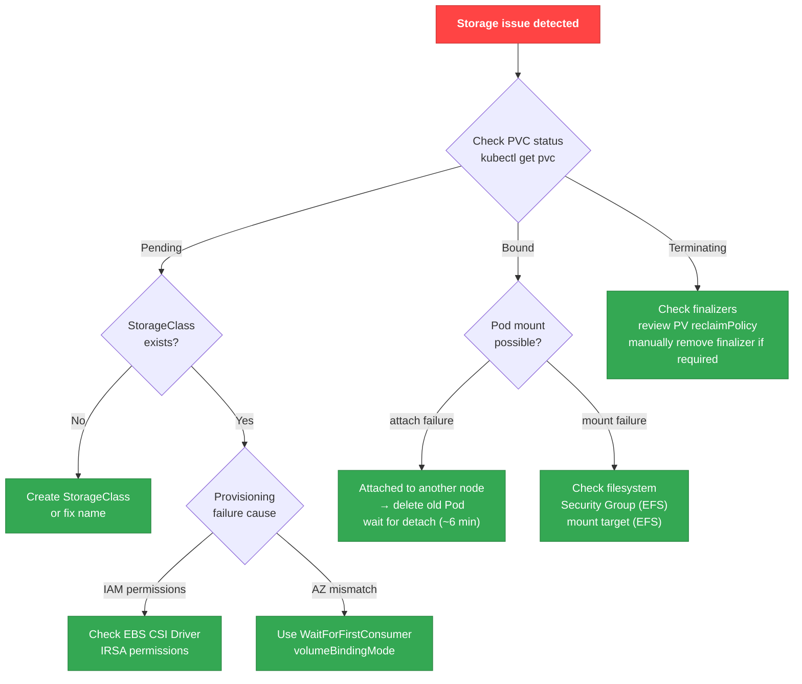

## Storage Debugging Decision Tree

**Figure 1. Storage debugging decision tree**



## EBS CSI Driver Debugging

### Basic Checks

```bash
# Check EBS CSI Driver Pod status
kubectl get pods -n kube-system -l app.kubernetes.io/name=aws-ebs-csi-driver

# Check Controller logs
kubectl logs -n kube-system -l app=ebs-csi-controller -c ebs-plugin --tail=100

# Check Node logs
kubectl logs -n kube-system -l app=ebs-csi-node -c ebs-plugin --tail=100

# Check the controller's actual credential path
# If using Pod Identity: check the association
aws eks list-pod-identity-associations --cluster-name <cluster-name> \
  --query 'associations[?serviceAccount==`ebs-csi-controller-sa`]'
# If using IRSA: check the ServiceAccount's role-arn annotation and trust policy
kubectl describe sa ebs-csi-controller-sa -n kube-system
```

The controller obtains AWS credentials through either a Pod Identity association or an IRSA trust policy. When diagnosing a permission problem, first confirm which path is actually in use, then inspect the policy attached to that path.

### EBS CSI Driver Error Patterns

**Table 1. EBS CSI Driver error messages with cause and resolution**

| Error Message | Cause | Resolution |
|-------------|------|----------|
| `could not create volume` | Missing permission on the credential path, or a service limit was reached | Read the AWS error code in the message (e.g., `UnauthorizedOperation`, `VolumeLimitExceeded`) and grant that action to the Pod Identity association or IRSA role the controller actually uses |
| `volume is already attached to another node` | Not yet detached from previous node | Clean up prior Pod/node, wait for EBS detach (~6 min) |
| `could not attach volume: already at max` | Instance EBS attachment limit exceeded | Move to an instance type/size with a larger `MaximumEbsAttachments`/`AttachmentLimitType`, or redistribute PVC workloads (the limit varies by type and size) |
| `failed to provision volume with StorageClass` | StorageClass missing or misconfigured | Verify StorageClass name/parameters |

### Checking per-Instance EBS Volume Limits

```bash
# EBS attachment limit and limit type for an instance type
aws ec2 describe-instance-types \
  --instance-types c5.xlarge m5.2xlarge \
  --query 'InstanceTypes[].{Type:InstanceType,MaxEBS:EbsInfo.MaximumEbsAttachments,LimitType:EbsInfo.AttachmentLimitType}' \
  --output table

# Current EBS volume usage on a node
aws ec2 describe-volumes \
  --filters "Name=attachment.instance-id,Values=<instance-id>" \
  --query 'Volumes[].{VolumeId:VolumeId,State:Attachments[0].State}' \
  --output table
```

Most Nitro instances with `AttachmentLimitType` of `shared` share the EBS attachment budget with network interfaces and NVMe instance store volumes, so the number of EBS volumes you can actually add is `MaximumEbsAttachments` minus the already-attached network interfaces and instance store volumes. Types with `AttachmentLimitType` of `dedicated` can use the full EBS attachment limit regardless of other devices. If the query returns empty or an error (for example, insufficient permissions or an unsupported Region), do not guess the limit—re-check your credentials and the instance type.

### Recommended StorageClass Configuration

```yaml
apiVersion: storage.k8s.io/v1
kind: StorageClass
metadata:
  name: topology-aware-ebs
provisioner: ebs.csi.aws.com
parameters:
  type: gp3
  encrypted: "true"
  # gp3 performance parameters (optional)
  iops: "3000"        # default 3,000 IOPS
  throughput: "125"   # default 125 MB/s
volumeBindingMode: WaitForFirstConsumer
allowVolumeExpansion: true
reclaimPolicy: Delete
```

:::tip WaitForFirstConsumer
With `volumeBindingMode: WaitForFirstConsumer`, the PVC binds at Pod scheduling time. This **creates the volume in the AZ where the Pod is scheduled**, preventing AZ mismatch issues.
:::

## PVC Mount Failure Patterns

### Pattern 1: AZ Mismatch

EBS volumes exist in a single AZ, so scheduling a Pod to a node in a different AZ causes mount failures.

```bash
# Symptom: Pod stuck in ContainerCreating
kubectl describe pod <pod-name>
# Events:
#   Warning  FailedAttachVolume  AttachVolume.Attach failed : ... volume is in a different availability zone

# Check the PV's AZ
kubectl get pv <pv-name> -o jsonpath='{.metadata.labels.topology\.kubernetes\.io/zone}'

# Check the node affinity pinned on the PV (the scheduler places Pods only in this AZ)
kubectl get pv <pv-name> -o jsonpath='{.spec.nodeAffinity}'

# Check the AZ of the node where the Pod was scheduled
kubectl get node <node-name> -o jsonpath='{.metadata.labels.topology\.kubernetes\.io/zone}'
```

A PV backed by an EBS volume pins the volume's AZ in `spec.nodeAffinity`. If the scheduler cannot find an available node in that AZ, the Pod lands in a different AZ and the attachment fails.

**Resolution**: For volumes you provision and bind anew, use `volumeBindingMode: WaitForFirstConsumer`. This delays PVC binding until Pod scheduling so the volume is created in the AZ where the Pod lands; it does not move an existing volume already created in another AZ.

```yaml
apiVersion: storage.k8s.io/v1
kind: StorageClass
metadata:
  name: ebs-sc
provisioner: ebs.csi.aws.com
parameters:
  type: gp3
volumeBindingMode: WaitForFirstConsumer  # ← prevents AZ mismatch for new provisioning
```

If an existing volume that already holds data is pinned to another AZ, schedule the Pod into the volume's AZ (using node affinity or a node selector), or perform a deliberate snapshot-and-restore/copy migration into the target AZ.

### Pattern 2: EBS Volume Limit Exceeded

Each instance type has a maximum number of attachable EBS volumes.

```bash
# Symptom: Pod stuck in ContainerCreating
kubectl describe pod <pod-name>
# Events:
#   Warning  FailedAttachVolume  AttachVolume.Attach failed : ... maximum number of attachments

# Check the number of attached volumes on a node
kubectl get node <node-name> -o json | jq '.status.volumesAttached | length'

# Check maximum volume count for the instance type
aws ec2 describe-instance-types \
  --instance-types <instance-type> \
  --query 'InstanceTypes[0].EbsInfo.{Max:MaximumEbsAttachments,LimitType:AttachmentLimitType}'
```

**Resolution**:
- Use an instance type/size with a larger `MaximumEbsAttachments` (the attachment limit varies by type and size)
- Redistribute PVC-using workloads across multiple nodes
- When `AttachmentLimitType` is `shared`, the root EBS volume, network interfaces, and NVMe instance store volumes consume the same limit, so calculate the actually available EBS count separately (available EBS = `MaximumEbsAttachments` − network interfaces − instance store volumes)

### Pattern 3: ReadWriteOnce Constraint

An EBS volume created from an ordinary gp3 filesystem PVC binds as `ReadWriteOnce` (RWO) and can be mounted on only one node at a time.

```bash
# Symptom: the second Pod stuck in ContainerCreating
kubectl describe pod <pod-name-2>
# Events:
#   Warning  FailedAttachVolume  Multi-Attach error for volume ... Volume is already exclusively attached

# Check the PVC's accessModes
kubectl get pvc <pvc-name> -o jsonpath='{.spec.accessModes}'
# ["ReadWriteOnce"]
```

Choose the access mode by requirement. `ReadWriteOnce` (RWO) allows read-write on a single node (multiple Pods on that node are fine), `ReadWriteOncePod` (RWOP) restricts access to a single Pod when the CSI driver supports it, and `ReadWriteMany` (RWX) allows concurrent access from multiple nodes. The EBS CSI ordinary gp3 filesystem volume does not offer RWX, so use EFS when multiple nodes need concurrent access. (EBS Multi-Attach is a separate feature that requires io1/io2 volumes and a cluster-aware application, and is outside the scope of this ordinary filesystem example.)

**Resolution**:
- Design a single Pod to use the PVC (StatefulSet recommended); declare the PVC as `ReadWriteOncePod` to enforce single-Pod access
- For concurrent access from multiple Pods, use EFS (supports ReadWriteMany)

```yaml
# When ReadWriteMany is required, use EFS
apiVersion: v1
kind: PersistentVolumeClaim
metadata:
  name: shared-data
spec:
  accessModes:
    - ReadWriteMany  # only supported by EFS
  storageClassName: efs-sc
  resources:
    requests:
      storage: 10Gi
```

```yaml
# When ReadWriteMany is required, use EFS
apiVersion: v1
kind: PersistentVolumeClaim
metadata:
  name: shared-data
spec:
  accessModes:
    - ReadWriteMany  # only supported by EFS
  storageClassName: efs-sc
  resources:
    requests:
      storage: 10Gi
```

### Pattern 4: Volume Detach Delay

Even after the previous Pod is deleted, the EBS volume may not detach immediately, delaying the new Pod's start.

```bash
# Symptom: new Pod stuck in ContainerCreating for 6 minutes after prior Pod deletion
kubectl describe pod <pod-name>
# Events:
#   Warning  FailedAttachVolume  Volume is already attached to another node

# Check volume status in the AWS console
aws ec2 describe-volumes --volume-ids <volume-id> \
  --query 'Volumes[0].Attachments[0].State'
# "detaching" or "attached"

# Check the CSI VolumeAttachment and the previous node's status
kubectl get volumeattachment | grep <volume-id>
kubectl get node <old-node-name>
```

**Cause**: When the previous node shut down abnormally and Kubernetes cannot detach the volume safely, the controller holds off a forced detach until the node recovers or a conditional timeout (about 6 minutes by default) elapses.

**Resolution**: Proceed in an order that preserves data integrity.

1. Inspect the CSI `VolumeAttachment` and the previous node's status to verify no writer (Pod or node) is still using the volume.
2. If the previous Pod and node are healthy, delete the Pod normally so the ordinary unmount/detach completes. If the node is unrecoverable, fence the writer by cordoning and draining or removing that node.
3. Only when all paths above are blocked and the volume is confirmed stuck on a specific unhealthy node, use a forced detach as a last resort. A forced detach can detach while writes are incomplete and risks filesystem corruption, so take a snapshot first and run a filesystem check/repair (`fsck`) after detaching.

```bash
# Last resort: forced detach (filesystem corruption risk — snapshot first, fsck after)
aws ec2 create-snapshot --volume-id <volume-id> --description "pre-force-detach"
aws ec2 detach-volume --volume-id <volume-id> --force
```

For operations in a StatefulSet that require sequential termination, avoid `podManagementPolicy: Parallel` so Pods terminate and detach in order.

## EFS CSI Driver Debugging

### Basic Checks

```bash
# Check EFS CSI Driver Pod status
kubectl get pods -n kube-system -l app.kubernetes.io/name=aws-efs-csi-driver

# Check Controller logs
kubectl logs -n kube-system -l app=efs-csi-controller -c efs-plugin --tail=100

# Check EFS file system status
aws efs describe-file-systems --file-system-id <fs-id>

# Check Mount Targets (must exist in each AZ)
aws efs describe-mount-targets --file-system-id <fs-id>
```

### EFS Checklist

An EFS mount assumes that a node reaches the file system DNS name through a Mount Target in its own AZ. A Mount Target must therefore exist in each AZ where Pods may run so that the node in that AZ connects to its local Mount Target. EFS with the One Zone storage class exists in only a single AZ, so nodes in other AZs connect cross-AZ, which lowers availability if that AZ fails and incurs cross-AZ data-transfer cost; in that case, also consider scheduling Pods into the AZ where the file system resides.

- [ ] A Mount Target exists in every AZ where Pods run (for One Zone EFS, also weigh the availability and transfer cost of cross-AZ access)
- [ ] The Mount Target Security Group allows **TCP 2049 (NFS)**
- [ ] The node Security Group allows outbound TCP 2049 to the EFS Mount Target

```bash
# List Mount Targets (collect each Mount Target ID)
aws efs describe-mount-targets --file-system-id <fs-id> \
  --query 'MountTargets[].{MountTargetId:MountTargetId,SubnetId:SubnetId,AZ:AvailabilityZoneName}' \
  --output table

# Check the Security Groups applied to each Mount Target
aws efs describe-mount-target-security-groups --mount-target-id <mount-target-id>

# Check that Security Group's inbound TCP 2049 rule and its sources
aws ec2 describe-security-groups --group-ids <sg-id> \
  --query 'SecurityGroups[0].IpPermissions[?FromPort==`2049`].{Protocol:IpProtocol,From:FromPort,To:ToPort,Sources:IpRanges[].CidrIp,SourceSGs:UserIdGroupPairs[].GroupId}'

# Check the node Security Group's outbound TCP 2049 rule
aws ec2 describe-security-groups --group-ids <node-sg-id> \
  --query 'SecurityGroups[0].IpPermissionsEgress[?FromPort==`2049` || IpProtocol==`-1`]'
```

These commands are diagnostics that show each Mount Target's Security Group, the protocol, port intervals and sources, and the node's outbound path. The presence of a rule does not by itself prove end-to-end connectivity, so also check other path elements such as subnet routing and NACLs.

### Debugging EFS Mount Failures

```bash
# Check Pod events
kubectl describe pod <pod-name>
# Events:
#   Warning  FailedMount  MountVolume.SetUp failed : ... connection timed out

# Verify EFS Mount Targets exist in every AZ
aws efs describe-mount-targets --file-system-id <fs-id> \
  --query 'MountTargets[].{AZ:AvailabilityZoneName,State:LifeCycleState,IP:IpAddress}'

# Check the AZ of the node running the Pod
kubectl get pod <pod-name> -o jsonpath='{.spec.nodeName}' | \
  xargs -I {} kubectl get node {} -o jsonpath='{.metadata.labels.topology\.kubernetes\.io/zone}'
```

### EFS StorageClass Example

```yaml
apiVersion: storage.k8s.io/v1
kind: StorageClass
metadata:
  name: efs-sc
provisioner: efs.csi.aws.com
parameters:
  provisioningMode: efs-ap  # auto-create Access Point
  fileSystemId: fs-1234567890abcdef0
  directoryPerms: "700"
  gidRangeStart: "1000"
  gidRangeEnd: "2000"
  basePath: "/dynamic_provisioning"
```

## Checking PV/PVC Status and Resolving Stuck States

### Actions by PVC Status

```bash
# Check PVC status
kubectl get pvc -n <namespace>

# Check PV status
kubectl get pv
```

**Table 2. PVC status with meaning and action**

| PVC Status | Meaning | Action |
|----------|------|------|
| **Pending** | Waiting for volume provisioning | Check StorageClass and CSI Driver logs |
| **Bound** | Successfully bound to a PV | Normal |
| **Lost** | The bound PV disappeared and the binding is broken | Investigate the lost binding and backing asset first (see below) |
| **Terminating** | In deletion (blocked by finalizer) | Diagnose the referencing Pods and controller first (see below) |

### Resolving a PVC Stuck in Terminating

A PVC stuck in Terminating means a finalizer is still waiting for cleanup it has not finished (terminating attached Pods, detaching the volume, and so on). Diagnose the cause before deleting the finalizer.

```bash
# 1. Check whether any Pod still references the PVC
kubectl get pods -n <namespace> -o json \
  | jq -r '.items[] | select(.spec.volumes[]?.persistentVolumeClaim.claimName=="<pvc-name>") | .metadata.name'

# 2. Check the remaining finalizers and controller behavior
kubectl get pvc <pvc-name> -n <namespace> -o jsonpath='{.metadata.finalizers}'
kubectl describe pvc <pvc-name> -n <namespace>
```

If a referencing Pod remains, clean it up first and confirm from the logs that the CSI controller is working; the finalizer being removed automatically is the normal path. Only after the finalizer's cleanup has been fulfilled explicitly (for example, confirming the volume is detached and backed up) should you remove the specific finalizer you understand. Do not null out all finalizers at once.

```bash
# After fulfilling the finalizer's obligation, remove only the specific finalizer you understand
# (example: kubernetes.io/pvc-protection)
kubectl patch pvc <pvc-name> -n <namespace> --type=json \
  -p='[{"op":"remove","path":"/metadata/finalizers/0"}]'
```

:::danger Caution When Manually Removing Finalizers
Manually removing a finalizer can leave the linked storage resource (e.g., EBS volume) uncleaned. First verify the volume is not in use and check the AWS console to ensure no orphan volumes are created.
:::

### Handling a PVC in Lost

A Lost PVC means the PV it was bound to has disappeared, so before recreating anything, investigate why the binding broke and whether the backing EBS volume still exists.

```bash
# Check the PV the PVC referenced and the backing volume's status
kubectl describe pvc <pvc-name> -n <namespace>
kubectl get pv -o json | jq -r '.items[] | select(.spec.claimRef.name=="<pvc-name>") | {name:.metadata.name, phase:.status.phase, policy:.spec.persistentVolumeReclaimPolicy}'
```

To reuse the data intentionally, first quiesce the workloads that are using it and set the PV's reclaimPolicy to `Retain` to prevent deletion. Record which PVC is the owner, then reserve (prebind) the intended new PVC on that PV by setting the PV's `claimRef`, and finally restore the chosen reclaimPolicy. Clear an existing `claimRef` for reuse only when that is the intended cleanup; do not blank the `claimRef` without investigation.

```bash
# Only when reuse is intended: reserve a specific PV for a specific PVC (prebind)
kubectl patch pv <pv-name> --type=merge \
  -p '{"spec":{"claimRef":{"namespace":"<namespace>","name":"<new-pvc-name>"}}}'
```

### Investigating Orphan EBS Volume Candidates {#cleaning-up-orphan-ebs-volumes}

The command below lists EBS volume **candidates** that may no longer be in use. A volume being `available` and carrying a PVC tag does not by itself make it safe to delete.

```bash
# List EBS volume candidates created by Kubernetes that are currently available
aws ec2 describe-volumes \
  --filters "Name=tag:kubernetes.io/created-for/pvc/name,Values=*" \
  --query 'Volumes[?State==`available`].{VolumeId:VolumeId,PVC:Tags[?Key==`kubernetes.io/created-for/pvc/name`]|[0].Value,Size:Size,Created:CreateTime}' \
  --output table
```

Confirm the following before deleting. First, determine which account, Region, and cluster the volume belongs to (for example, the `kubernetes.io/cluster/<name>` tag) to rule out ownership by a currently running cluster. Next, confirm that no PV, PVC, or VolumeAttachment still references the volume and that there is no retention (backup/snapshot) or recovery requirement. Finally, obtain the intended owner's decision to delete and a recoverable backup (snapshot), and then delete only the specific volume confirmed to be abandoned.

```bash
# Delete only the specific volume once all conditions above are met and it is confirmed abandoned
aws ec2 create-snapshot --volume-id <volume-id> --description "pre-delete backup"
aws ec2 delete-volume --volume-id <volume-id>
```

## Storage Performance Optimization

### Adjusting gp3 IOPS/Throughput

gp3 volumes allow independent tuning of IOPS and throughput.

```yaml
apiVersion: storage.k8s.io/v1
kind: StorageClass
metadata:
  name: fast-ebs
provisioner: ebs.csi.aws.com
parameters:
  type: gp3
  iops: "16000"      # example value (choose to match the workload)
  throughput: "1000" # example value (choose to match the workload)
volumeBindingMode: WaitForFirstConsumer
```

:::info gp3 Limits
- Default: 3,000 IOPS / 125 MiB/s (included at no extra cost)
- Maximum (standard Regions): 80,000 IOPS / 2,000 MiB/s. Maximum IOPS requires a volume size of 160 GiB or larger (500 IOPS/GiB); maximum throughput requires 8,000 IOPS or higher and 16 GiB or larger.
- Maximum (Outposts): 16,000 IOPS / 1,000 MiB/s
- Throughput is capped at a maximum of 0.25 MiB/s per provisioned IOPS (e.g., 16,000 IOPS allows up to 4,000 MiB/s by the ratio but is bound by the 2,000 MiB/s product ceiling). The `iops`/`throughput` values in the StorageClass above are example choices; set actual values within the product ceiling and this ratio to match the workload.
:::

### Volume Expansion

```bash
# Increase PVC size (requires allowVolumeExpansion: true)
kubectl patch pvc <pvc-name> -p '{"spec":{"resources":{"requests":{"storage":"50Gi"}}}}'

# Check expansion progress and events
kubectl describe pvc <pvc-name>
# Conditions:
#   Type                      Status  LastTransitionTime                 Reason
#   ----                      ------  ------------------                 ------
#   FileSystemResizePending   True    ...                                Waiting for user to restart pod
```

First check the Conditions and events from `kubectl describe pvc` to see how far the expansion has progressed. The EBS CSI driver and many filesystems support online expansion, in which case the controller expands the block device and filesystem without a Pod restart. Only if the `FileSystemResizePending` condition remains and a restart is required, first identify the controller that owns the Pod (Deployment, StatefulSet, and so on) and the application's shutdown/availability procedure, then recreate the Pod. Do not delete all Pods arbitrarily.

```bash
# Only when a restart is required: identify the owning controller, then recreate the Pod per the availability procedure
kubectl get pod <pod-name> -o jsonpath='{.metadata.ownerReferences}'
kubectl delete pod <pod-name>
```

:::warning Volume Shrinking Not Supported
Neither Kubernetes nor EBS support volume shrinking. To reduce size, create a new PVC and migrate data.
:::

## Storage Issue Checklist

### PVC Pending

- [ ] Does the StorageClass exist?
- [ ] Are CSI Driver Pods Running?
- [ ] Are the CSI Driver's IRSA permissions correct?
- [ ] Is sufficient EBS volume quota available?

### PVC Bound but Pod ContainerCreating

- [ ] Are Pod and PV in the same AZ? (EBS)
- [ ] Does the node exceed its EBS volume limit?
- [ ] Is the volume attached to another node?
- [ ] Does the EFS Mount Target Security Group allow TCP 2049? (EFS)

### PVC Terminating

- [ ] Are all Pods using the PVC deleted?
- [ ] Is the PV's reclaimPolicy set to Delete?
- [ ] Is a finalizer blocking PVC deletion?

---

## Related Documents

- [Workload Debugging](./workload.md) - Pod state-based troubleshooting
- [Networking Debugging](./networking.md) - Service and DNS issues
- [Observability](./observability.md) - Storage metric monitoring
