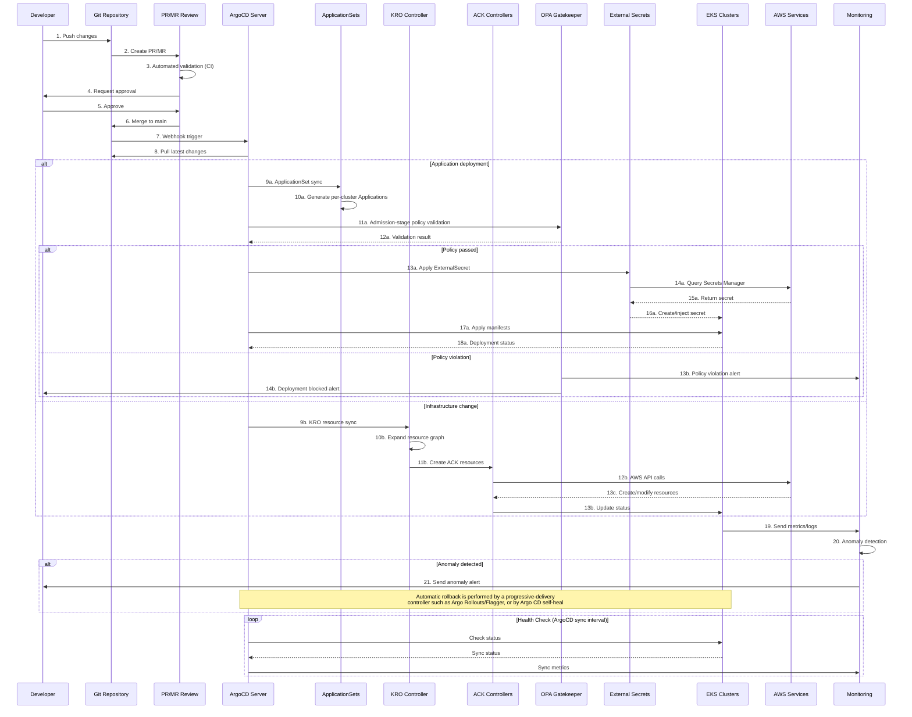

> **Reference Versions**: ArgoCD v3.x GA (v3.3+), EKS Capability for Argo CD (GA), Kubernetes 1.33+

## Overview

Stable and scalable large-scale EKS cluster operations require automated deployment and management strategies following GitOps principles. This document explains how to build production-grade cluster operational environments using ArgoCD, KRO/ACK, and Infrastructure as Code patterns.

### Problems Addressed

Traditional EKS cluster operations faced the following problems:

- Environment drift caused by manual configuration
- Difficulty tracking infrastructure change history
- Complexity of managing large multi-cluster fleets
- Absence of deployment verification and rollback processes
- Insufficient automation of policy compliance

This architecture is designed to address these problems.

## Technical Considerations and Architecture Summary

### Key Recommendations

**1. GitOps Platform Selection**

- Multi-cluster management with ArgoCD ApplicationSets
- Flagger integration for progressive delivery

:::tip ArgoCD as EKS Capability (re:Invent 2025)
ArgoCD is available as an **EKS Capability**. Unlike an EKS Add-on, an EKS Capability runs in an AWS-managed account **outside** the worker nodes, and AWS fully manages installation, upgrades, scaling, and HA. You can enable it from the **Capabilities** tab in the EKS console or create it with the AWS CLI/API.

```bash
# Create ArgoCD as an EKS Capability
aws eks create-capability \
  --capability-name my-argocd \
  --cluster-name my-cluster \
  --type ARGOCD \
  --role-arn arn:aws:iam::123456789012:role/eks-argocd-capability-role \
  --delete-propagation-policy RETAIN
```

**Key differences (Add-on vs Capability):**
- **Add-on**: runs inside the cluster; the user manages the resources
- **Capability**: runs in an AWS-managed account; reduces control-plane operational overhead (AWS manages installation, upgrades, patching, HA, and scaling)
- Native integration with AWS Identity Center SSO, Secrets Manager, ECR, and CodeConnections
- The customer still manages RBAC and Identity Center mappings, secrets, repository connections, and Application/ApplicationSet configuration
:::

**2. Infrastructure as Code Strategy**

- Adopt **ACK/KRO (Kubernetes Resource Orchestrator)**
  - Gradual migration from existing Terraform state
  - Operational consistency through a Kubernetes-native approach
  - More flexible resource orchestration than Helm

**3. Automation Essentials**

- Blue/Green EKS upgrade automation
- Automated testing pipelines for addon version management
- Policy as Code (OPA/Gatekeeper) governance

**4. Security and Compliance**

- External Secrets Operator + AWS Secrets Manager
- Git signing and RBAC-based approval workflows
- Real-time compliance monitoring dashboards

### Expected ROI

| Effect | Improvement |
|------|------|
| Operational burden | Reduced by automating manual work |
| Upgrade frequency | From once a year to quarterly |
| Incident recovery | Time improved through automatic rollback |

## Architecture Overview

GitOps-based EKS cluster operations treat Git as the single source of truth and automatically reconcile cluster state through declarative configuration management.

### GitOps Workflow



In the recovery flow above, monitoring does not directly instruct Argo CD to roll back. Because Argo CD reconciles to Git as the single source of truth, automatic rollback on metric degradation requires configuring a progressive-delivery controller such as Argo Rollouts or Flagger with analysis and rollback rules, or using Argo CD self-heal to revert to the Git state.

## Multi-Cluster Management Strategy {#multi-cluster-management}

### ApplicationSets-based Cluster Management

ArgoCD ApplicationSets are the core tool for managing consistent deployments across a multi-cluster environment.

**Core strategies:**

#### 1. Cluster Generator

- Dynamic application generation based on a cluster registry
- Label-based cluster grouping (by environment, region, purpose)

#### 2. Git Directory Generator

- Per-environment configuration management (dev/staging/prod)
- Per-cluster override settings

#### 3. Matrix Generator

- Managing cluster × application combinations
- Applying conditional deployment rules

## Multi-Cluster Automation

### EKS Cluster Upgrade Automation

The Blue/Green deployment pattern is an illustrative procedure that upgrades by shifting traffic to a new cluster; the steps below alone do not guarantee zero downtime. They assume data migration for stateful workloads, draining of existing connections, capacity provisioning on the new cluster, and rollback readiness; without these, downtime or data loss can occur during the transition.

**Preparation**

- Provision a new cluster (KRO)
- Verify addon compatibility
- Synchronize security policies
- Plan state/data migration for stateful workloads and provision capacity on the new cluster

**Migration**

- Gradual workload movement
- Traffic weight adjustment (0% → 100%) and draining of existing connections
- Real-time monitoring and definition of rollback criteria

**Verification and Completion**

- Automated smoke tests
- Performance metric comparison
- Remove the old cluster only after confirming traffic has fully converged on the new cluster and rollback is no longer needed

## Security and Governance

### Git Repository Structure Design

An effective GitOps implementation requires an appropriate repository structure.

**Monorepo vs Polyrepo recommendations:**

| Target | Recommended | Reason |
|------|---------|------|
| Application code | Polyrepo | Ensures per-team independence |
| Infrastructure configuration | Monorepo | Central management and consistency |
| Policy definitions | Monorepo | Enforces organization-wide standardization |

### Secret Management Architecture

:::info External Secrets Operator (ESO) recommended

**Key characteristics:**

- Centralized secret store
- Automatic rotation support
- Fine-grained access control (IRSA)
- No need to store encrypted secrets in Git

Using it together with AWS Secrets Manager implements an organization's security policy effectively.

:::

## Terraform to KRO Migration Strategy {#terraform-to-kro-migration}

Gradually transition from an existing Terraform environment to KRO. This approach minimizes risk while delivering value continuously. The phase structure and durations below are an example roadmap, not values based on measurements or actual cases. KRO composes Kubernetes resources, and the AWS resources themselves are managed by ACK (AWS Controllers for Kubernetes) controllers, so the range of AWS resources KRO can manage is limited to the resources ACK supports.

### Phase 1: Pilot (2 months)

- Target one cluster in the Dev environment
- Migrate only basic resources (VPC, Subnets, Security Groups)
- Bring existing Terraform-created resources under management with ACK's adoption feature, and verify them

### Phase 2: Expansion (3 months)

- Include the Staging environment
- Add EKS cluster and addon management
- Build automation pipelines

### Phase 3: Full Migration (4 months)

- Apply sequentially to the Production environment
- Manage the AWS resources ACK supports with KRO
- Remove Terraform only to the extent that no resources unsupported by ACK remain

### KRO Resource Definition Example

The following is an example of an EKS cluster and node group definition using KRO.

```yaml
apiVersion: kro.run/v1alpha1
kind: ResourceGraphDefinition
metadata:
  name: eks-cluster-us-east-1-prod
spec:
  schema:
    apiVersion: v1alpha1
    kind: EKSClusterStack
    spec:
      clusterName: string
      region: string | default="us-east-1"
      version: string | default="1.32"
  resources:
    # EKS cluster definition (ACK EKS Controller)
    - id: cluster
      template:
        apiVersion: eks.services.k8s.aws/v1alpha1
        kind: Cluster
        metadata:
          name: ${schema.spec.clusterName}
        spec:
          name: ${schema.spec.clusterName}
          version: ${schema.spec.version}
          roleARN: arn:aws:iam::123456789012:role/eks-cluster-role
          resourcesVPCConfig:
            subnetIDs:
              - subnet-0a1b2c3d4e5f00001
              - subnet-0a1b2c3d4e5f00002
            endpointPrivateAccess: true
            endpointPublicAccess: false

    # Node group definition (ACK EKS Controller)
    - id: nodegroup
      template:
        apiVersion: eks.services.k8s.aws/v1alpha1
        kind: Nodegroup
        metadata:
          name: ${schema.spec.clusterName}-nodegroup
        spec:
          # Reference the cluster resource so KRO orders node group creation after the cluster is ready
          clusterName: ${cluster.spec.name}
          name: ${schema.spec.clusterName}-ng-01
          instanceTypes:
            - c7i.8xlarge
          scalingConfig:
            minSize: 3
            maxSize: 50
            desiredSize: 10
          amiType: AL2023_x86_64_STANDARD
```

The `ResourceGraphDefinition` above only registers a new API (CRD) named `EKSClusterStack` in the cluster. To actually create the cluster and node group, you must apply a separate custom-resource instance of the generated kind.

```yaml
apiVersion: kro.run/v1alpha1
kind: EKSClusterStack
metadata:
  name: us-east-1-prod
spec:
  clusterName: us-east-1-prod
  region: us-east-1
  version: "1.32"
```

## EKS Capabilities: Fully Managed Platform Features (re:Invent 2025)

**EKS Capabilities**, announced at AWS re:Invent 2025, are a new approach in which AWS fully manages Kubernetes-native platform features. Unlike EKS Add-ons that run inside the cluster, EKS Capabilities **run outside the worker nodes in an AWS-managed account**.

### Three Core Capabilities at Launch

| Capability | Base Project | Role |
|-----------|------------|------|
| **Argo CD** | CNCF Argo CD | Declarative GitOps continuous delivery |
| **ACK** | AWS Controllers for Kubernetes | K8s-native AWS resource management |
| **kro** | Kube Resource Orchestrator | Higher-level K8s/AWS resource composition |

### Key Features of EKS Capability for Argo CD

**Reduced control-plane operational overhead:**
- AWS manages installation, upgrades, patching, HA, and scaling
- No need to manage the Argo CD controller, Redis, or Application Controller
- Automatic backup and disaster recovery
- The user still configures Application/ApplicationSet definitions, RBAC, secrets, and repository connections

**Hub-and-Spoke architecture:**
- Create the Argo CD Capability on a dedicated hub cluster
- Centrally manage multiple spoke clusters
- AWS handles cross-cluster communication

**AWS service-native integration:**
- **AWS Identity Center**: SSO-based authentication, RBAC role mapping
- **AWS Secrets Manager**: automatic secret synchronization
- **Amazon ECR**: native private registry access
- **AWS CodeConnections**: Git repository connections

### Self-managed vs EKS Capability Comparison

| Item | Self-managed ArgoCD | EKS Capability for ArgoCD |
|------|-------------------|--------------------------|
| Installation and upgrades | Managed directly (Helm/Kustomize) | Fully managed by AWS |
| Execution location | Inside the cluster (worker nodes) | AWS-managed account (external) |
| HA configuration | Configured directly (Redis HA, etc.) | Automatic (Multi-AZ) |
| Authentication | Configured directly (Dex, OIDC, etc.) | AWS Identity Center integration |
| Multi-cluster | kubeconfig managed directly | AWS-native cross-cluster |
| Secret management | ESO installed separately | Secrets Manager native integration |
| Cost | Consumes EC2 resources | Separate Capability charge |

:::warning Migrating from Self-managed
When migrating from an existing self-managed ArgoCD to an EKS Capability, existing Application/ApplicationSet resources are compatible. However, if you use Custom Resource Definition extensions or custom plugins, verify compatibility in advance.
:::

### How to Enable an EKS Capability

**Console:**
1. EKS console → cluster → **Capabilities** tab
2. Click **Create capabilities**
3. Select the Argo CD checkbox → specify the Capability Role
4. Configure AWS Identity Center authentication

**CLI:**
```bash
# Create the Argo CD Capability
aws eks create-capability \
  --capability-name prod-argocd \
  --cluster-name prod-hub-cluster \
  --type ARGOCD \
  --role-arn arn:aws:iam::123456789012:role/eks-argocd-role \
  --delete-propagation-policy RETAIN \
  --configuration '{
    "argoCd": {
      "awsIdc": {
        "idcInstanceArn": "arn:aws:sso:::instance/ssoins-xxxxxxxxx"
      }
    }
  }'

# Create the ACK Capability
aws eks create-capability \
  --capability-name prod-ack \
  --cluster-name prod-hub-cluster \
  --type ACK \
  --role-arn arn:aws:iam::123456789012:role/eks-ack-role \
  --delete-propagation-policy RETAIN

# Create the kro Capability
aws eks create-capability \
  --capability-name prod-kro \
  --cluster-name prod-hub-cluster \
  --type KRO \
  --role-arn arn:aws:iam::123456789012:role/eks-kro-role \
  --delete-propagation-policy RETAIN
```

## ArgoCD v3 Updates (GA) {#argocd-v3-updates-2025}

The main improvements in ArgoCD v3.x GA (current v3.3+) are as follows:

### Scalability Improvements

- **Large-cluster support**: improved performance managing thousands of Application resources
- **Sharding improvements**: stronger horizontal scaling of the Application Controller
- **Memory optimization**: reduced memory usage when processing large manifests

### Security Enhancements

- **RBAC improvements**: finer-grained permission control
- **Audit logging**: strengthened audit logs for all operations
- **Secret management**: improved integration with External Secrets Operator

### Migration Guide

Migrating from ArgoCD v2.x to v3:

1. Upgrade to v2.13 first to confirm compatibility.
2. Proceed with minor upgrades up to v2.14, reviewing each version's upgrade notes and deprecated APIs.
3. v3.0 is a major release with backward-incompatible changes, so before upgrading, review the breaking changes in the [v2.14 → v3.0 upgrade notes](https://github.com/argoproj/argo-cd/blob/release-3.3/docs/operator-manual/upgrading/2.14-3.0.md) (changes to RBAC, logging, configuration defaults, etc.) and back up Argo CD settings using the disaster recovery guide.
4. Test functionality on v3.x (current v3.3+ is stable).
5. Execute the production upgrade.

:::info ArgoCD v3 GA
ArgoCD v3.x is GA and usable in production. The current latest version is v3.3+.
:::

## Conclusion

:::tip Key Recommendations

**1. Use EKS Capabilities (ArgoCD + ACK + kro)**

- Operate ArgoCD as an EKS Capability to reduce operational overhead
- Kubernetes-native infrastructure management through ACK/kro
- SSO-based access control through AWS Identity Center integration

**2. Multi-cluster management with ArgoCD ApplicationSets**

- Central management with a Hub-and-Spoke architecture
- Consistent deployment across clusters with per-environment customization

**3. Automated Blue/Green upgrade strategy**

- Zero-downtime cluster upgrades (with the prerequisites described above)
- Automatic rollback capability

**4. Policy as Code governance**

- Policy enforcement through OPA/Gatekeeper
- Compliance automation

:::

A phased migration approach minimizes risk while realizing value quickly.
