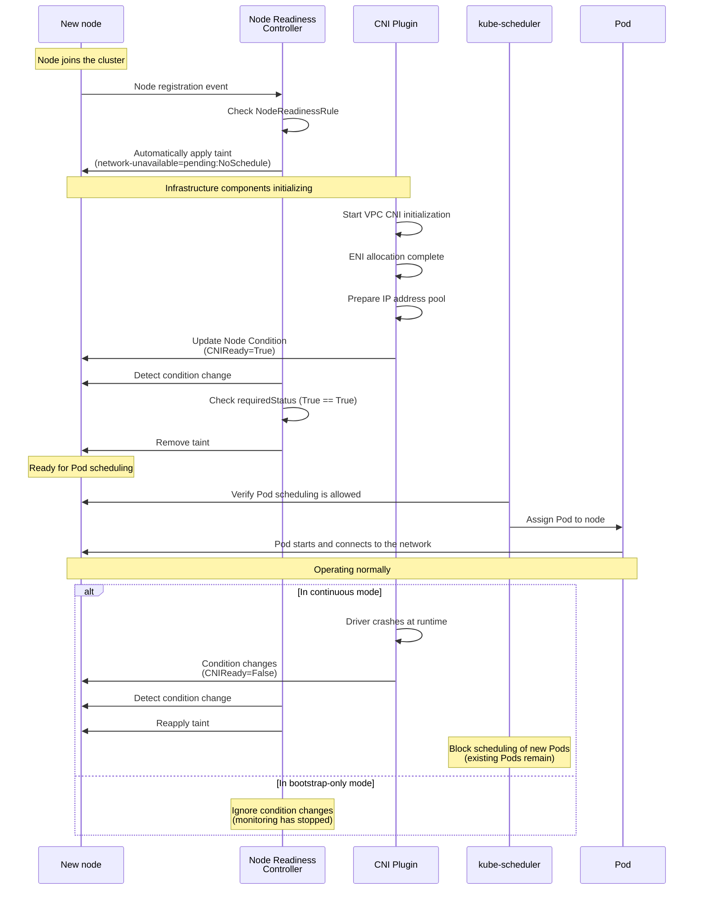
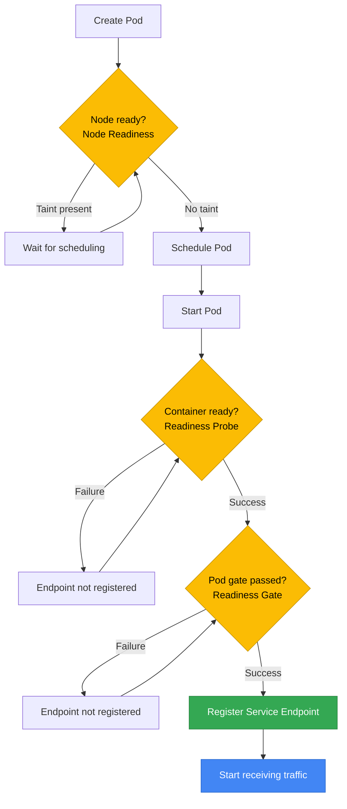

[Pod lifecycle overview](../eks-pod-health-lifecycle.md) · [Checklist and references](./checklist-references.md)

## Node Readiness Controller — managing node-level readiness {#344-node-readiness-controller--노드-수준-readiness-관리}

### Overview {#개요}

Node Readiness Controller (NRC) is an alpha feature (v0.1.1) announced on the official Kubernetes blog in February 2026. It introduces a mechanism for declaratively managing infrastructure readiness at the node level.

The existing Kubernetes node `Ready` condition provides only a simple binary state (Ready/NotReady). It cannot accurately reflect complex infrastructure dependencies such as CNI plugin initialization, GPU driver loading, and storage driver readiness. To address this limitation, NRC provides a `NodeReadinessRule` CRD for declaratively defining custom readiness gates.

**Key benefits:**
- **Granular node status control**: Manage the readiness of each infrastructure component independently
- **Automated taint management**: Automatically apply a NoSchedule taint when conditions are not met
- **Flexible enforcement modes**: Use `enforcementMode` to choose bootstrap-only (`bootstrap-only`) or continuous monitoring (`continuous`), and the separate `dryRun: true` option to validate behavior without applying actual taints
- **Selective enforcement**: Use nodeSelector to apply rules only to specific node groups

**API information:**
- API Group: `readiness.node.x-k8s.io/v1alpha1`
- Kind: `NodeReadinessRule`
- Official documentation: https://node-readiness-controller.sigs.k8s.io/

### Core features {#핵심-기능}

#### Continuous mode - ongoing monitoring {#1-continuous-모드---지속-모니터링}

Continuously monitors the specified conditions throughout the node lifecycle. If an infrastructure component fails at runtime (for example, a GPU driver crashes), it immediately applies a taint to block scheduling of new Pods.

**Use cases:**
- Monitor GPU driver health
- Continuously check network plugin health
- Check storage driver availability

#### Bootstrap-only mode - initialization only {#2-bootstrap-only-모드---초기화-전용}

Checks conditions only during node initialization and stops monitoring once they are met. It does not respond to condition changes after bootstrap.

**Use cases:**
- Initial CNI plugin bootstrap
- Verify container image pre-pull completion
- Wait for the initial security scan to complete

#### Dry-run - safe validation {#3-dry-run-모드---안전한-검증}

Setting the `dryRun: true` option simulates rule behavior without applying actual taints. `dryRun` is a boolean field separate from `enforcementMode`, and the evaluation results are recorded in the rule's `status.dryRunResults`. This is useful for validating rules before production deployment.

**Use cases:**
- Test new NodeReadinessRules
- Analyze the impact of condition changes
- Debug and diagnose issues

#### nodeSelector - selecting target nodes {#4-nodeselector---타겟-노드-선택}

Applies rules only to specific node groups based on labels. Different readiness rules can be applied to GPU nodes and general-purpose nodes.

### YAML examples {#yaml-예시}

The condition types in this section and in the EKS scenarios below (`cniplugin.example.net/NetworkReady`, `nvidia.com/gpu-driver-ready`, `nvidia.com/gpu-device-plugin-ready`, `ebs.csi.aws.com/VolumeAttachReady`, `vpc.amazonaws.com/CNIReady`, `example.com/CustomHealthCheck`) are illustrative names. We could not find evidence that the VPC CNI, the NVIDIA driver and Device Plugin, or the EBS CSI driver report node conditions with these names by default (as of 2026-10-29). NRC only reads conditions that other components write to the node and manages taints from them; it does not create conditions itself, so using these rules requires deploying a reporter that writes the conditions. A reporter can be the NRC project's `readiness-condition-reporter` (which periodically checks a component's health endpoint and writes the condition named in `CONDITION_TYPE`; see [Reporter Configuration](https://node-readiness-controller.sigs.k8s.io/reference/reporter-configuration.html)), Node Problem Detector, or a DaemonSet you implement yourself. The condition-setting code in the VPC CNI and NVIDIA examples below illustrates how to implement such a reporter yourself; it is not a feature included in those components.

#### CNI bootstrap - bootstrap-only mode {#cni-부트스트랩---bootstrap-only-모드}

```yaml
apiVersion: readiness.node.x-k8s.io/v1alpha1
kind: NodeReadinessRule
metadata:
  name: network-readiness-rule
spec:
  # Node conditions to check
  conditions:
    - type: "cniplugin.example.net/NetworkReady"
      requiredStatus: "True"

  # Taint to apply when conditions are not met
  taint:
    key: "readiness.k8s.io/network-unavailable"
    effect: "NoSchedule"
    value: "pending"

  # Stop monitoring after bootstrap completes
  enforcementMode: "bootstrap-only"

  # Apply only to worker nodes
  nodeSelector:
    matchLabels:
      node-role.kubernetes.io/worker: ""
```

**Workflow:**
1. NRC automatically applies a taint when a new node joins the cluster
2. The CNI plugin sets the `NetworkReady=True` condition after initialization completes
3. NRC checks the condition and removes the taint
4. Pod scheduling is enabled (subsequent CNI status changes are ignored)

Because NRC applies the taint after the node is registered (or `Ready`), a short race window exists between the node coming up and the taint being applied, during which Pods can be scheduled. To close this window, register the node with the taint from the start using kubelet `--register-with-taints` and let NRC remove it once the condition is met.

#### Continuous monitoring of GPU nodes {#gpu-노드-continuous-모니터링}

```yaml
apiVersion: readiness.node.x-k8s.io/v1alpha1
kind: NodeReadinessRule
metadata:
  name: gpu-driver-readiness
spec:
  conditions:
    - type: "nvidia.com/gpu-driver-ready"
      requiredStatus: "True"

  taint:
    key: "readiness.k8s.io/gpu-unavailable"
    effect: "NoSchedule"
    value: "driver-not-ready"

  # Continue monitoring at runtime
  enforcementMode: "continuous"

  # Apply only to GPU nodes
  nodeSelector:
    matchLabels:
      nvidia.com/gpu.present: "true"
```

**Workflow:**
1. Automatically apply a taint when a GPU node starts
2. The NVIDIA driver daemon sets the condition after GPU initialization completes
3. NRC removes the taint, enabling AI workload scheduling
4. **If the driver crashes at runtime:**
   - The condition changes to `False`
   - NRC immediately reapplies the taint
   - Existing Pods remain; scheduling of new Pods is blocked

#### Checking EBS CSI driver readiness {#ebs-csi-드라이버-준비-확인}

```yaml
apiVersion: readiness.node.x-k8s.io/v1alpha1
kind: NodeReadinessRule
metadata:
  name: ebs-csi-readiness
spec:
  conditions:
    - type: "ebs.csi.aws.com/VolumeAttachReady"
      requiredStatus: "True"

  taint:
    key: "readiness.k8s.io/storage-unavailable"
    effect: "NoSchedule"
    value: "csi-not-ready"

  enforcementMode: "bootstrap-only"

  # Apply only to nodes dedicated to storage workloads
  nodeSelector:
    matchLabels:
      workload-type: "stateful"
```

#### Dry-run mode - test rule {#dry-run-모드---테스트-규칙}

```yaml
apiVersion: readiness.node.x-k8s.io/v1alpha1
kind: NodeReadinessRule
metadata:
  name: test-custom-condition
spec:
  conditions:
    - type: "example.com/CustomHealthCheck"
      requiredStatus: "True"

  taint:
    key: "readiness.k8s.io/test-condition"
    effect: "NoSchedule"
    value: "testing"

  # Log actions without applying taints (a boolean separate from enforcementMode)
  dryRun: true
  enforcementMode: "continuous"

  nodeSelector:
    matchLabels:
      environment: "staging"
```

### EKS usage scenarios {#eks-적용-시나리오}

#### Waiting for VPC CNI initialization {#1-vpc-cni-초기화-대기}

**Problem:**
Network connectivity fails if Pods are scheduled immediately after a node joins the cluster, before the VPC CNI plugin is fully initialized.

**Solution:**
```yaml
apiVersion: readiness.node.x-k8s.io/v1alpha1
kind: NodeReadinessRule
metadata:
  name: vpc-cni-readiness
spec:
  conditions:
    - type: "vpc.amazonaws.com/CNIReady"
      requiredStatus: "True"
  taint:
    key: "node.eks.amazonaws.com/network-unavailable"
    effect: "NoSchedule"
    value: "vpc-cni-initializing"
  enforcementMode: "bootstrap-only"
  # nodeSelector is a required field in the CRD
  nodeSelector:
    matchLabels:
      node-role.kubernetes.io/worker: ""
```

**Set the condition in the VPC CNI DaemonSet:**
```yaml
# Init container in the aws-node DaemonSet
initContainers:
- name: set-node-condition
  image: bitnami/kubectl:latest
  command:
  - /bin/sh
  - -c
  - |
    # Wait for CNI initialization
    until [ -f /host/etc/cni/net.d/10-aws.conflist ]; do
      echo "Waiting for CNI config..."
      sleep 2
    done

    # Set the Node Condition
    kubectl patch node $NODE_NAME --subresource=status --type=json -p='[
      {
        "op": "add",
        "path": "/status/conditions/-",
        "value": {
          "type": "vpc.amazonaws.com/CNIReady",
          "status": "True",
          "lastTransitionTime": "'$(date -u +"%Y-%m-%dT%H:%M:%SZ")'",
          "reason": "CNIInitialized",
          "message": "VPC CNI is ready"
        }
      }
    ]'
  env:
  - name: NODE_NAME
    valueFrom:
      fieldRef:
        fieldPath: spec.nodeName
  # Mount the host path that the until loop checks (/host/etc/cni/net.d)
  volumeMounts:
  - name: cni-net-dir
    mountPath: /host/etc/cni/net.d
    readOnly: true
# Declare the host-path volume under the DaemonSet spec.template.spec.volumes
volumes:
- name: cni-net-dir
  hostPath:
    path: /etc/cni/net.d
    type: Directory
```

#### NVIDIA driver readiness on GPU nodes {#2-gpu-노드-nvidia-드라이버-준비}

**Problem:**
If a GPU workload is scheduled before the NVIDIA driver finishes loading, CUDA initialization fails and the Pod enters CrashLoopBackOff.

**Solution:**
```yaml
apiVersion: readiness.node.x-k8s.io/v1alpha1
kind: NodeReadinessRule
metadata:
  name: nvidia-gpu-readiness
spec:
  conditions:
    - type: "nvidia.com/gpu-driver-ready"
      requiredStatus: "True"
    - type: "nvidia.com/gpu-device-plugin-ready"
      requiredStatus: "True"
  taint:
    key: "nvidia.com/gpu-not-ready"
    effect: "NoSchedule"
    value: "driver-loading"
  enforcementMode: "continuous"
  nodeSelector:
    matchLabels:
      node.kubernetes.io/instance-type: "g5.xlarge"
```

**Set conditions in the NVIDIA Device Plugin:**
```go
// Example of a condition reporter you implement yourself (not logic included in the NVIDIA Device Plugin)
func updateNodeCondition(nodeName string) error {
    // Check GPU driver status (go-nvml returns an nvml.Return code, not an error)
    version, ret := nvml.SystemGetDriverVersion()
    if ret != nvml.SUCCESS {
        return setCondition(nodeName, "nvidia.com/gpu-driver-ready", "False")
    }
    log.Printf("NVIDIA driver version: %s", version)

    // Check Device Plugin status
    devices, ret := nvml.DeviceGetCount()
    if ret != nvml.SUCCESS || devices == 0 {
        return setCondition(nodeName, "nvidia.com/gpu-device-plugin-ready", "False")
    }

    // Set to True if both are healthy
    setCondition(nodeName, "nvidia.com/gpu-driver-ready", "True")
    setCondition(nodeName, "nvidia.com/gpu-device-plugin-ready", "True")
    return nil
}
```

The `nvml.DeviceGetCount()` call above only confirms that the driver can see GPUs. It does not prove that the Kubernetes device plugin has registered with kubelet and is advertising the `nvidia.com/gpu` resource. The `gpu-device-plugin-ready` condition is more accurately judged by whether `nvidia.com/gpu` capacity appears in the node's allocatable (that is, kubelet registration has completed).

#### Node Problem Detector integration {#3-node-problem-detector-통합}

**Problem:**
Kubernetes automatically taints nodes for some conditions to block scheduling. For example, `DiskPressure` applies the `node.kubernetes.io/disk-pressure` taint and `NetworkUnavailable` applies `node.kubernetes.io/network-unavailable`. However, arbitrary custom conditions reported by Node Problem Detector (such as `KernelDeadlock`) are not automatically acted on by Kubernetes, so those conditions must be handled by NRC.

**Solution:**
```yaml
apiVersion: readiness.node.x-k8s.io/v1alpha1
kind: NodeReadinessRule
metadata:
  name: node-problem-detector-readiness
spec:
  conditions:
    - type: "KernelDeadlock"
      requiredStatus: "False"  # False indicates healthy status
    - type: "DiskPressure"
      requiredStatus: "False"
    - type: "NetworkUnavailable"
      requiredStatus: "False"
  taint:
    key: "node.kubernetes.io/problem-detected"
    effect: "NoSchedule"
    value: "true"
  enforcementMode: "continuous"
  # nodeSelector is a required field in the CRD
  nodeSelector:
    matchLabels:
      node-role.kubernetes.io/worker: ""
```

### Workflow diagram {#워크플로우-다이어그램}

**Figure 1. Node Readiness Controller operation workflow**



### Relationship to Pod readiness {#pod-readiness와의-관계}

The Kubernetes readiness mechanism now spans three layers — container, Pod, and node:

**Table 1. Three-layer readiness mechanism: scope, action on failure and use case**

| Layer | Mechanism | Scope | Action on failure | Use case |
|------|---------|------|-------------|----------|
| **1. Container** | Readiness Probe | Health checks inside the container | Remove Service Endpoint | Check application readiness |
| **2. Pod** | Readiness Gate | External conditions at the Pod level | Remove Service Endpoint | Integrate ALB/NLB health checks |
| **3. Node** | Node Readiness Controller | Node infrastructure conditions | Block Pod scheduling (taint) | Check CNI, GPU, and storage readiness |

**Integrated scenario - layered traffic-safety coverage:**

```yaml
apiVersion: apps/v1
kind: Deployment
metadata:
  name: critical-service
spec:
  replicas: 3
  selector:
    matchLabels:
      app: critical-service
  template:
    metadata:
      labels:
        app: critical-service
    spec:
      # Apply 3-layer readiness
      containers:
      - name: app
        image: myapp:v2
        # Layer 1: container Readiness Probe
        readinessProbe:
          httpGet:
            path: /ready
            port: 8080
          periodSeconds: 5
          failureThreshold: 2

      # Layer 2: Pod Readiness Gate
      # Do not write readinessGates by hand. When the namespace carries the
      # elbv2.k8s.aws/pod-readiness-gate-inject=enabled label (target-type: ip only),
      # the AWS Load Balancer Controller injects the
      # target-health.elbv2.k8s.aws/<TargetGroupBinding name> condition at Pod creation and updates its status.

      # Layer 3: Node Readiness (handled automatically by NodeReadinessRule)
      # - Check node CNI, GPU, and storage readiness
      # - Scheduled only on nodes without taints
```

**Figure 2. Readiness verification flow from Pod creation to traffic acceptance**



### Installation and configuration {#설치-및-설정}

#### Install Node Readiness Controller {#1-node-readiness-controller-설치}

```bash
# Install with Helm (the official chart is published to an OCI registry; requires Helm 3.8+)
helm install node-readiness-controller \
  oci://registry.k8s.io/node-readiness-controller/charts/node-readiness-controller \
  --version <chart-version> \
  --namespace nrr-system --create-namespace

# Or install from source with Kustomize
kubectl apply -k https://github.com/kubernetes-sigs/node-readiness-controller/config/default
```

#### Verify installation {#2-설치-확인}

```bash
# Check controller Pod status (the standard deployment namespace is nrr-system)
kubectl get pods -n nrr-system -l control-plane=controller-manager

# Check the CRD
kubectl get crd nodereadinessrules.readiness.node.x-k8s.io

# List rules
kubectl get nodereadinessrules -A
```

#### Check node status {#3-노드-상태-확인}

```bash
# Check conditions on a specific node
kubectl get node <node-name> -o jsonpath='{.status.conditions}' | jq

# Filter for a specific condition (rules use the qualified type vpc.amazonaws.com/CNIReady)
kubectl get node <node-name> -o jsonpath='{.status.conditions[?(@.type=="vpc.amazonaws.com/CNIReady")]}' | jq

# Check taints on all nodes
kubectl get nodes -o custom-columns=NAME:.metadata.name,TAINTS:.spec.taints
```

### Debugging and troubleshooting {#디버깅-및-트러블슈팅}

#### When a taint is not removed {#taint가-제거되지-않는-경우}

```bash
# 1. Check NodeReadinessRule events (NRR is a cluster-scoped resource)
kubectl describe nodereadinessrule <rule-name>

# 2. Check node condition status
kubectl get node <node-name> -o yaml | grep -A 10 conditions

# 3. Check controller logs
kubectl logs -n nrr-system -l control-plane=controller-manager --tail=100

# 4. Set a condition manually (for testing)
kubectl patch node <node-name> --subresource=status --type=json -p='[
  {
    "op": "add",
    "path": "/status/conditions/-",
    "value": {
      "type": "vpc.amazonaws.com/CNIReady",
      "status": "True",
      "lastTransitionTime": "'$(date -u +"%Y-%m-%dT%H:%M:%SZ")'",
      "reason": "ManualSet",
      "message": "Manually set for testing"
    }
  }
]'
```

#### Test rules in dry-run mode {#dry-run-모드로-규칙-테스트}

```bash
# Change an existing rule to dry-run
kubectl patch nodereadinessrule <rule-name> \
  --type=merge \
  -p '{"spec":{"dryRun":true}}'

# Check behavior in controller logs
kubectl logs -n nrr-system -l control-plane=controller-manager -f | grep "dry-run"

# Disable dry-run after testing
kubectl patch nodereadinessrule <rule-name> \
  --type=merge \
  -p '{"spec":{"dryRun":false}}'
```

:::info Alpha feature considerations
Node Readiness Controller is currently at alpha version v0.1.1. Before applying it to production:
- Perform thorough testing in a staging environment
- Validate rule behavior in dry-run mode
- Set up controller log monitoring
- Prepare a procedure for manually removing taints if issues occur
:::

:::tip Operational best practices
1. **Choose the mode by the nature of the dependency**: The NRC documentation gives `bootstrap-only` as the example for one-time initialization that only needs to happen once per boot, such as pre-pulling images or initializing a local cache, and `continuous` for dependencies that must stay healthy for the node's whole lifetime, such as a CNI plugin or a storage daemon ([Concepts](https://node-readiness-controller.sigs.k8s.io/user-guide/concepts.html)). It does not state that either mode is sufficient in most cases, so choose the mode by whether new Pod placement must be blocked when the condition changes at runtime.
2. **Make effective use of nodeSelector**: Define rules by workload type instead of applying the same rule to all nodes.
3. **Integrate Node Problem Detector**: Using NRC and NPD together enables automated responses to hardware/OS-level issues as well.
4. **Monitoring and alerts**: Collect taint application/removal events in CloudWatch or Prometheus, and configure alerts for taints that remain in place for a long time.
:::

:::warning Interaction with PDBs
When Node Readiness Controller applies a `NoSchedule` taint, new Pods that do not tolerate it are not scheduled onto that node (Pods already running there remain). If taints are applied to many nodes at once, the reduced schedulable capacity can delay Pod placement across the cluster. Separately, a PodDisruptionBudget constrains how many Pods may be disrupted at once during voluntary disruptions (drain, eviction), not initial placement, so a strict PDB slows node replacement and draining. Review both node capacity and PDB policies when designing rules.
:::

### References {#참조-자료}

- **Official documentation**: [Node Readiness Controller](https://node-readiness-controller.sigs.k8s.io/)
- **Kubernetes Blog**: [Introducing Node Readiness Controller](https://kubernetes.io/blog/2026/02/03/introducing-node-readiness-controller/)
- **GitHub Repository**: [kubernetes-sigs/node-readiness-controller](https://github.com/kubernetes-sigs/node-readiness-controller)

---
