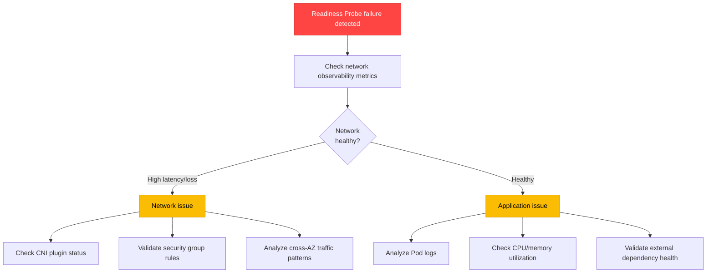
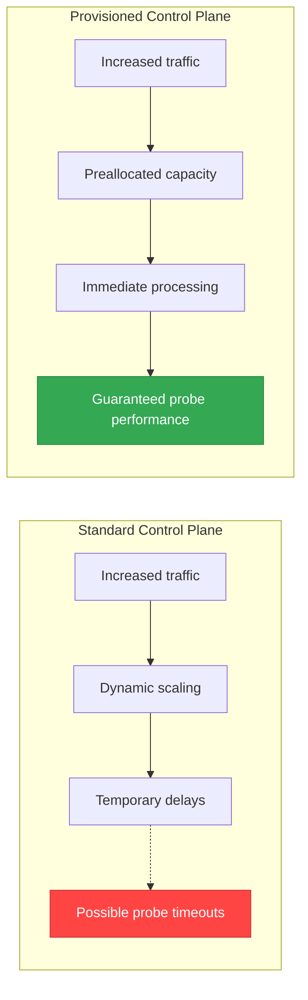
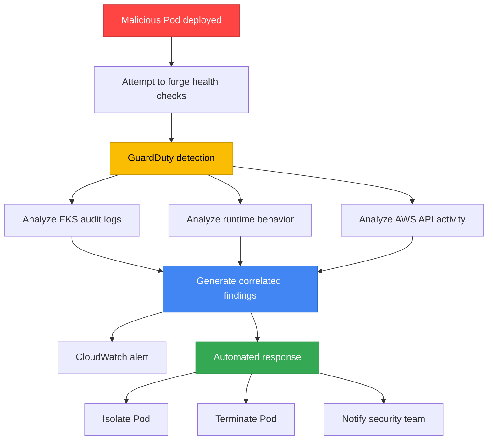

[Pod lifecycle overview](../eks-pod-health-lifecycle.md) · [Checklist and references](./checklist-references.md)

## Integrating Probes with New EKS Features in 2025-2026 {#27-2025-2026-eks-신규-기능과-probe-통합}

The new EKS observability and control features announced at AWS re:Invent 2025 further enhance probe-based health checks. This section covers how to integrate probes with the latest EKS features for more accurate and proactive health monitoring.

### Validating Probe Connectivity with Container Network Observability {#271-container-network-observability로-probe-연결성-검증}

**Overview:**

Container Network Observability (announced in November 2025) provides detailed network metrics, including communication patterns between Pods, latency, and packet loss. These metrics help clearly distinguish probe failures caused by network issues from those caused by the application itself.

**Key features:**
- Visualization of Pod-to-Pod communication paths
- Monitoring of network latency, packet loss, and retransmission rates
- Real-time detection of network traffic anomalies
- Integration with CloudWatch Container Insights

**Enabling the feature:**

Enable Container Network Observability from the EKS console, the AWS CLI, or the EKS API. Enabling it in the console automatically creates the Network Flow Monitor (NFM) Scope and Monitor resources and guides you through installing the NFM Agent EKS add-on. For IaC (such as Terraform), define the NFM Scope, NFM Monitor, and the NFM EKS add-on, and grant the add-on permissions through Pod Identity or IRSA. See the [EKS network observability documentation](https://docs.aws.amazon.com/eks/latest/userguide/network-observability.html) for the exact add-on name and command options. The VPC CNI does not expose an environment variable or ConfigMap key for enabling this feature.

**Probe connectivity validation example:**

```yaml
apiVersion: apps/v1
kind: Deployment
metadata:
  name: api-gateway
  annotations:
    # Enable collection of network observability metrics
    network-observability.amazonaws.com/enabled: "true"
spec:
  selector:
    matchLabels:
      app: "api-gateway"
  replicas: 3
  template:
    metadata:
      labels:
        app: "api-gateway"
    spec:
      containers:
      - name: gateway
        image: myapp/gateway:v2
        ports:
        - containerPort: 8080
        # Readiness Probe: check external DB connectivity
        readinessProbe:
          httpGet:
            path: /ready
            port: 8080
          periodSeconds: 5
          failureThreshold: 2
          timeoutSeconds: 3
        livenessProbe:
          httpGet:
            path: /healthz
            port: 8080
          periodSeconds: 10
          failureThreshold: 3
```

**CloudWatch Insights query - correlate probe failures with network latency:**

The following query is illustrative and works only when the `probe_result`, `probe_type`, `network_latency_ms`, and `packet_loss_percent` fields are emitted together in a single log event. These fields are not collected by default, so you must first configure your application or collection pipeline to emit the probe result and network metrics in the same event.

```sql
-- Check network latency at the time of probe failures (when the fields are collected)
fields @timestamp, pod_name, probe_type, network_latency_ms, packet_loss_percent
| filter namespace = "production"
| filter probe_result = "failed"
| filter network_latency_ms > 100 or packet_loss_percent > 1
| sort @timestamp desc
| limit 100
```

**Alert configuration example:**

The ConfigMap below only stores the alarm definition as a string; applying it does not create a CloudWatch alarm. Create the actual alarm with the ACK CloudWatch controller's `MetricAlarm` resource (`cloudwatch.services.k8s.aws/v1alpha1`), `aws cloudwatch put-metric-alarm`, or IaC. The JSON below is a reference for the parameters you would use when creating it that way.

```yaml
# Reference alarm parameters (the ConfigMap alone does not create an alarm)
apiVersion: v1
kind: ConfigMap
metadata:
  name: probe-network-alert
  namespace: monitoring
data:
  alarm-config: |
    {
      "AlarmName": "ProbeFailureWithNetworkIssue",
      "MetricName": "ReadinessProbeFailure",
      "Namespace": "ContainerInsights",
      "Statistic": "Sum",
      "Period": 60,
      "EvaluationPeriods": 2,
      "Threshold": 3,
      "ComparisonOperator": "GreaterThanThreshold",
      "Dimensions": [
        {"Name": "ClusterName", "Value": "production-eks"},
        {"Name": "Namespace", "Value": "production"}
      ],
      "AlarmDescription": "Check network latency when Readiness Probes fail"
    }
```

**Figure 1. Workflow for diagnosing network vs application causes of Readiness Probe failures**



:::tip Pod-to-Pod Path Visualization
The service map and flow table in Container Network Observability show aggregated flow metrics (retransmissions, retransmission timeouts, and data transferred) for Pod-to-Pod communication. They do not trace individual probe requests one by one, but they help narrow down where a bottleneck lies by showing which flow metrics degrade along the path a Readiness Probe uses to reach an external database.
:::

---

### CloudWatch Observability Operator + Control Plane Metrics {#272-cloudwatch-observability-operator--control-plane-메트릭}

**Overview:**

CloudWatch Observability Operator automatically collects EKS Control Plane metrics to proactively detect how API Server performance degradation affects probe responses.

**Installation:**

Install CloudWatch Observability through the EKS add-on `amazon-cloudwatch-observability`. This add-on deploys the CloudWatch Agent and operator and handles Container Insights and metrics collection. The `aws-cloudwatch-observability-operator` bundle manifest URL and the `EKSControlPlaneMetrics` CRD shown in earlier drafts do not exist in the official repositories, so they are not used. Choose which Control Plane metrics to collect and send through the EKS console or API Control Plane monitoring settings and the add-on configuration.

```bash
# Install the CloudWatch Observability add-on (EKS API)
aws eks create-addon \
  --cluster-name production-eks \
  --addon-name amazon-cloudwatch-observability
```

See the [EKS observability dashboard documentation](https://docs.aws.amazon.com/eks/latest/userguide/observability-dashboard.html) for the exact add-on configuration options and how to enable Control Plane metrics.

**Table 1. Key Control Plane metrics and their relationship to probes**

| Metric | Description | Relationship to Probes | Example Threshold |
|--------|------|-------------|------------|
| `apiserver_request_duration_seconds` | API Server request latency | Probe request processing speed | p99 < 1 second |
| `apiserver_request_total` (code=5xx) | API Server 5xx error count | Increased probe failure rate | < 1% |
| `apiserver_storage_objects` | Number of objects stored in etcd | Cluster scale limits | < 150,000 |
| `etcd_request_duration_seconds` | etcd read/write latency | Delayed Pod status updates | p99 < 100ms |
| `rest_client_requests_total` (code=429) | API rate limiting events | Restricted kubelet-apiserver communication | < 10/min |

**Predictive probe timeout alerts:**

```yaml
# MetricAlarm resource of the ACK CloudWatch controller
apiVersion: cloudwatch.services.k8s.aws/v1alpha1
kind: MetricAlarm
metadata:
  name: apiserver-slow-probe-risk
spec:
  name: "EKS-APIServer-SlowProbeRisk"
  namespace: AWS/EKS
  metricName: apiserver_request_duration_seconds
  dimensions:
    - name: ClusterName
      value: production-eks
    - name: verb
      value: GET
  period: 60
  extendedStatistic: p99
  evaluationPeriods: 2
  threshold: 0.5
  comparisonOperator: GreaterThanOrEqualToThreshold
  alarmDescription: "Risk of probe timeouts due to API Server performance degradation (response latency > 500ms)"
  alarmActions:
    - arn:aws:sns:ap-northeast-2:123456789012:eks-ops-alerts
```

**Ensuring probe performance in large clusters:**

```yaml
# Optimize probe settings for a cluster with 1000+ nodes
apiVersion: apps/v1
kind: Deployment
metadata:
  name: large-scale-api
spec:
  selector:
    matchLabels:
      app: "large-scale-api"
  replicas: 100
  template:
    metadata:
      labels:
        app: "large-scale-api"
    spec:
      containers:
      - name: api
        image: myapp/api:v1
        # Adjust probe timing to account for API Server load
        startupProbe:
          httpGet:
            path: /healthz
            port: 8080
          failureThreshold: 30
          periodSeconds: 5  # Allow time for initial startup
        livenessProbe:
          httpGet:
            path: /healthz
            port: 8080
          periodSeconds: 15  # Increase the interval at large scale
          failureThreshold: 3
          timeoutSeconds: 5
        readinessProbe:
          httpGet:
            path: /ready
            port: 8080
          periodSeconds: 10
          failureThreshold: 2
          timeoutSeconds: 3
```

**CloudWatch Dashboard - correlate Control Plane and probe metrics:**

```json
{
  "widgets": [
    {
      "type": "metric",
      "properties": {
        "title": "API Server Latency vs. Probe Failure Rate",
        "metrics": [
          ["AWS/EKS", "apiserver_request_duration_seconds", {"stat": "p99", "label": "API Server p99 Latency"}],
          ["ContainerInsights", "ReadinessProbeFailure", "ClusterName", "production-eks", {"stat": "Sum", "yAxis": "right"}]
        ],
        "period": 60,
        "region": "ap-northeast-2",
        "yAxis": {
          "left": {"label": "Latency (seconds)", "min": 0},
          "right": {"label": "Probe Failure Count", "min": 0}
        }
      }
    }
  ]
}
```

`ReadinessProbeFailure` is not a metric that Container Insights collects by default. Container Insights (including enhanced observability) provides Pod status metrics such as `pod_status_ready` and `pod_container_status_waiting_reason_crash_loop_back_off`, but no probe failure count metric (as of 2026-10-29). To use this widget and the alarm example above, you must build a pipeline that collects the kubelet's `prober_probe_total` counter (`/metrics/probes`) or a similar source and publishes it to CloudWatch, and the widget must name exactly the namespace, metric name, and dimensions (for example `ClusterName`) that the pipeline publishes. CloudWatch returns only metrics whose namespace, metric name, and dimension combination match exactly.

:::warning API Server Load in Large Clusters
A kubelet's HTTP/TCP/exec/gRPC probes call the target Pod directly from the node and do not go through the API Server, so the probes themselves do not concentrate load on the API Server. In large clusters, however, kubelet status reporting, watches, and other API calls can raise API Server load, and if Pod status updates are delayed as a result, probe results can take longer to be reflected. If the load from API-Server-dependent calls becomes a problem, adjust the interval of those calls. A Provisioned Control Plane can ease such API Server load with its preallocated control plane capacity, but it does not change the local path on which the kubelet executes probes (Section 2.7.3).
:::

---

### Ensuring Probe Performance with Provisioned Control Plane {#273-provisioned-control-plane에서-probe-성능-보장}

**Overview:**

Provisioned Control Plane (announced in November 2025) ensures predictable, high-performance Kubernetes operations with preallocated control plane capacity. It prevents probe requests in large clusters from being affected by API Server performance degradation.

**Table 2. Performance characteristics and suitable workloads by Provisioned Control Plane tier**

| Tier | API Concurrency | Maximum Nodes | Suitable Workloads |
|------|----------|------------|-------------|
| **XL** | High | 1,000 | AI Training, HPC |
| **2XL** | Very high | 2,500 | Large-scale batch processing |
| **4XL** | Ultra-fast | 5,000 | Massive-scale ML |

Per-tier probe latency guarantees are not given as figures in this table because no official source for them exists. The AWS documentation defines the tiers (XL, 2XL, 4XL, 8XL) by four attributes: API request concurrency (seats), Pod scheduling rate (pods/sec), cluster database size, and SLA; maximum node count is not a tier attribute. On EKS 1.34 and later, the API request concurrency of XL, 2XL, 4XL, and 8XL is 2,000, 4,000, 8,000, and 16,000 seats respectively (1,700, 3,400, 6,800, and 13,600 seats on 1.30-1.33), the Pod scheduling rate is 167, 283, 400, and 400 pods/sec, the database size is 16GB, and the SLA is 99.99% (as of 2026-10-29). The Maximum Nodes figures in the table (1,000/2,500/5,000) are indicative estimates rather than values confirmed against an official source. The AWS documentation also states that actual performance depends on workload patterns and configuration, so measure the actual supported scale and performance in your target environment and confirm them against the [EKS Provisioned Control Plane documentation](https://docs.aws.amazon.com/eks/latest/userguide/eks-provisioned-control-plane.html).

**Figure 2. Load handling comparison between Standard and Provisioned Control Plane**



**Creating a Provisioned Control Plane:**

The documented `aws eks create-cluster` CLI does not accept the Provisioned Control Plane selection flags shown below. The following example is a standard cluster-creation command; see the [EKS Provisioned Control Plane documentation](https://docs.aws.amazon.com/eks/latest/userguide/eks-provisioned-control-plane.html) for how to enable a Provisioned Control Plane and for the actual options.

```bash
# Create a cluster (AWS CLI)
aws eks create-cluster \
  --name production-provisioned \
  --region ap-northeast-2 \
  --kubernetes-version 1.32 \
  --role-arn arn:aws:iam::123456789012:role/eks-cluster-role \
  --resources-vpc-config subnetIds=subnet-xxx,subnet-yyy,securityGroupIds=sg-zzz
```

**Large-scale probe optimization example:**

Control-plane tier is a cluster-level API setting and cannot be set with a Deployment annotation. The example below configures a workload with short probe intervals on a Provisioned Control Plane cluster; the annotation that attempted to set the tier has been removed because it has no effect.

```yaml
# AI/ML Training cluster (1000+ GPU nodes)
apiVersion: apps/v1
kind: Deployment
metadata:
  name: training-coordinator
spec:
  selector:
    matchLabels:
      app: "training-coordinator"
  replicas: 50
  template:
    metadata:
      labels:
        app: "training-coordinator"
    spec:
      containers:
      - name: coordinator
        image: ml-training/coordinator:v3
        resources:
          requests:
            cpu: 4
            memory: 16Gi
        # Short intervals can be configured with Provisioned Control Plane
        startupProbe:
          httpGet:
            path: /healthz
            port: 9090
          failureThreshold: 30
          periodSeconds: 3  # Fast detection
        livenessProbe:
          httpGet:
            path: /healthz
            port: 9090
          periodSeconds: 5  # Shorter than Standard
          failureThreshold: 2
          timeoutSeconds: 2
        readinessProbe:
          httpGet:
            path: /ready
            port: 9090
          periodSeconds: 3
          failureThreshold: 1
          timeoutSeconds: 2
```

**Use case (hypothetical scenario): AI/ML Training cluster**

- **Problem**: When hundreds of Training Pods start simultaneously across 1,000 GPU nodes, API Server responses are delayed on the Standard Control Plane
- **Solution**: Use the Provisioned Control Plane XL tier
- **Expected effects**:
  - Reduced Pod scheduling time
  - Fewer Readiness Probe timeouts
  - Improved Training Job startup reliability

This case is a hypothetical scenario rather than a measured case, and the effects above are expected effects to be verified, not observed results. Because kubelet probes do not go through the API Server, fewer Readiness Probe timeouts can be expected only when the dependency the probe checks is affected by API Server latency. Confirm the effects by fixing the node count, the number of Pods started at once, and the chosen tier, and measuring against Standard mode.

**Cost vs. performance considerations:**

```yaml
# Provisioned Control Plane cost optimization strategy
# 1. Normal operation: Standard Control Plane
# 2. During training: use Provisioned Control Plane XL
# (The tier is a cluster-level setting; check whether and how it can be changed in the EKS Provisioned Control Plane documentation)
```

:::tip HPC and Large-Scale Batch Workloads
Provisioned Control Plane is optimized for workloads that start thousands of Pods simultaneously within a short period. By ensuring probe performance, it can reduce Job startup time for AI/ML training, scientific simulations, and large-scale data processing.
:::

---

### Integration with GuardDuty Extended Threat Detection {#274-guardduty-extended-threat-detection-연계}

**Overview:**

GuardDuty Extended Threat Detection (EKS support: June 2025) correlates signals from EKS audit logs, container runtime behavior, and AWS API activity with existing GuardDuty findings, and generates a multi-stage attack as a single Critical attack sequence finding (`AttackSequence:EKS/CompromisedCluster`). To use it for EKS, you must enable at least one of EKS Protection or Runtime Monitoring (with the EKS add-on). The AWS documentation does not describe probe endpoint access patterns or health check spoofing as detection targets ([Extended Threat Detection](https://docs.aws.amazon.com/guardduty/latest/ug/guardduty-extended-threat-detection.html), as of 2026-10-29), so a malicious workload that looks healthy to its health checks is detected from these audit log, runtime, and API signals, not from probe responses.

**Key features:**
- Correlation of EKS audit logs + runtime behavior + malware execution + AWS API activity
- AI/ML-based detection of multi-stage attack sequences
- Automatic detection of malicious workloads such as cryptomining

**Enabling the feature:**

```bash
# Enable GuardDuty Extended Threat Detection for EKS (AWS CLI)
aws guardduty update-detector \
  --detector-id <detector-id> \
  --features '[
    {
      "Name": "EKS_AUDIT_LOGS",
      "Status": "ENABLED"
    },
    {
      "Name": "EKS_RUNTIME_MONITORING",
      "Status": "ENABLED",
      "AdditionalConfiguration": [
        {
          "Name": "EKS_ADDON_MANAGEMENT",
          "Status": "ENABLED"
        }
      ]
    }
  ]'
```

**Probe endpoint security pattern:**

The `value` of an `httpGet.httpHeaders` entry is a static string and cannot reference an environment variable or Secret. The `value: "SECRET_TOKEN_FROM_ENV"` in the example below therefore sends that literal string, not the token injected through `secretKeyRef`. If you need token-based verification, have the application read and check the token itself (or handle it in a sidecar) and have the probe call an endpoint that returns the result.

```yaml
apiVersion: apps/v1
kind: Deployment
metadata:
  name: secure-api
spec:
  selector:
    matchLabels:
      app: "secure-api"
  replicas: 3
  template:
    metadata:
      labels:
        app: "secure-api"
    spec:
      containers:
      - name: api
        image: myapp/secure-api:v2
        ports:
        - containerPort: 8080
        # Health check endpoints
        livenessProbe:
          httpGet:
            path: /healthz
            port: 8080
            httpHeaders:
            - name: X-Health-Check-Token
              value: "SECRET_TOKEN_FROM_ENV"
          periodSeconds: 10
        readinessProbe:
          httpGet:
            path: /ready
            port: 8080
            httpHeaders:
            - name: X-Health-Check-Token
              value: "SECRET_TOKEN_FROM_ENV"
          periodSeconds: 5
        env:
        - name: HEALTH_CHECK_TOKEN
          valueFrom:
            secretKeyRef:
              name: api-secrets
              key: health-token
```

**Figure 3. Hypothetical scenario of GuardDuty correlated detection and automated response after a malicious Pod deployment**



**Illustrative scenario - Cryptomining:**

For reference, the cryptomining campaign in the cited AWS blog targeted EC2 and ECS using compromised IAM credentials; it is not an EKS probe/health-check bypass case. The following is a hypothetical, illustrative scenario of how an attacker could bypass health checks:

1. Disguised the workload as a legitimate container image
2. Downloaded a malicious binary after startupProbe succeeded
3. Returned healthy livenessProbe responses while running mining in the background
4. GuardDuty detected abnormal network traffic + CPU usage patterns

**Automated response after detection:**

The ConfigMap below stores an EventBridge rule pattern and a Lambda code skeleton as strings for reference; applying it does not run any response. An actual automated response requires deploying an EventBridge rule that matches GuardDuty Finding events and a Lambda function registered as its target. The Lambda function needs an IAM role that has been granted cluster access (for example through an EKS access entry) and client code that uses those credentials to call the Kubernetes API and create the NetworkPolicy. The `isolate_pod` function below only builds a kubectl command string and does not run it. In addition, `"severity": [7, 8, 9]` in the rule pattern matches only those exact values, so findings with fractional severities such as 7.5 do not match (the example pattern in the GuardDuty documentation lists the fractional values too; see [Creating an EventBridge rule](https://docs.aws.amazon.com/guardduty/latest/ug/guardduty_findings_eventbridge.html)).

```yaml
# EventBridge Rule: GuardDuty Finding → Lambda → Pod isolation
apiVersion: v1
kind: ConfigMap
metadata:
  name: guardduty-response
  namespace: security
data:
  # severity 7-8 corresponds to High, and 9 to Critical.
  eventbridge-rule: |
    {
      "source": ["aws.guardduty"],
      "detail-type": ["GuardDuty Finding"],
      "detail": {
        "service": {
          "serviceName": ["EKS"]
        },
        "severity": [7, 8, 9]
      }
    }
  lambda-action: |
    import boto3
    eks = boto3.client('eks')

    def isolate_pod(cluster_name, namespace, pod_name, app_label):
        # Isolate the Pod with a NetworkPolicy
        # The podSelector must match a label that actually exists on the target Pod.
        # The secure-api Deployment's Pods carry app=secure-api, so select by that
        # label. (Using the Pod name as a label would match nothing.)
        kubectl_command = f"""
        kubectl apply -f - <<EOF
        apiVersion: networking.k8s.io/v1
        kind: NetworkPolicy
        metadata:
          name: isolate-{pod_name}
          namespace: {namespace}
        spec:
          podSelector:
            matchLabels:
              app: {app_label}
          policyTypes:
          - Ingress
          - Egress
        EOF
        """
        # Execution logic...
```

**Security monitoring dashboard:**

```yaml
# CloudWatch Dashboard: GuardDuty + Probe status
apiVersion: cloudwatch.amazonaws.com/v1alpha1
kind: Dashboard
metadata:
  name: security-probe-monitoring
spec:
  widgets:
    - type: metric
      title: "GuardDuty Findings vs. Probe Failures"
      metrics:
        - namespace: AWS/GuardDuty
          metricName: FindingCount
          dimensions:
            - name: ClusterName
              value: production-eks
        - namespace: ContainerInsights
          metricName: ProbeFailure
          dimensions:
            - name: Namespace
              value: production
```

:::warning Health Check Endpoint Security
Probe endpoints (`/healthz`, `/ready`) are often exposed without authentication and can become an attack surface. Enable GuardDuty Extended Threat Detection and, where possible, add a simple token header to health check requests to restrict unauthorized access.
:::

**Related documentation:**
- [AWS Blog: GuardDuty Extended Threat Detection for EKS](https://aws.amazon.com/blogs/aws/amazon-guardduty-expands-extended-threat-detection-coverage-to-amazon-eks-clusters/)
- [AWS Blog: Cryptomining Campaign Detection](https://aws.amazon.com/blogs/security/cryptomining-campaign-targeting-amazon-ec2-and-amazon-ecs/)
- [EKS Security Best Practices](https://docs.aws.amazon.com/eks/latest/best-practices/security.html)

---
