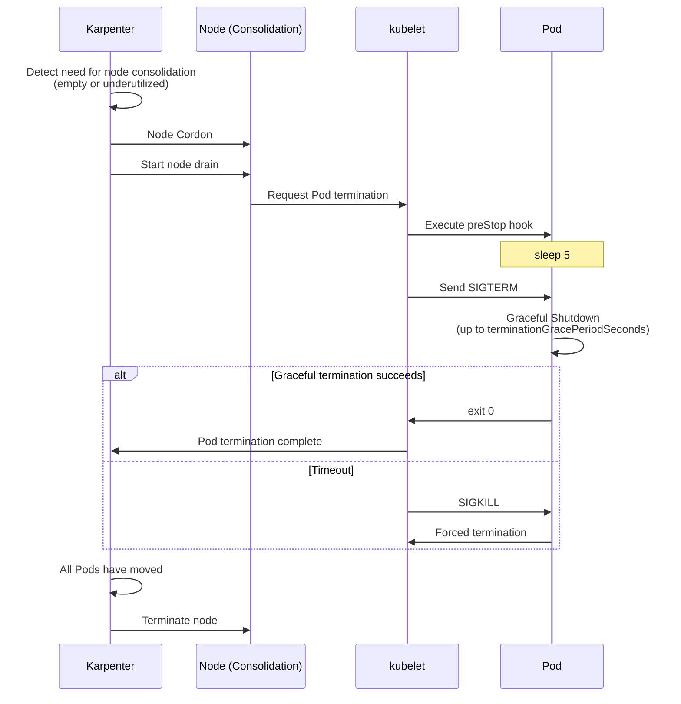
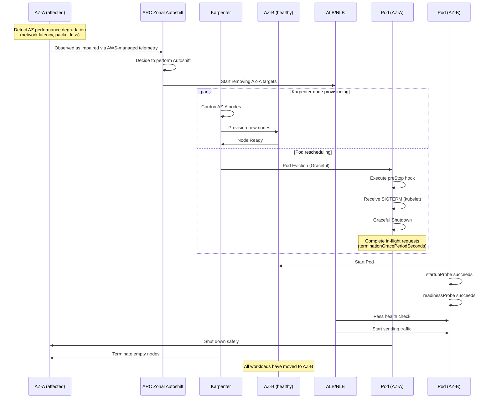

[Pod lifecycle overview](../eks-pod-health-lifecycle.md) · [Checklist and references](./checklist-references.md)

## Interaction with Karpenter and node drain {#34-karpenternode-drain과의-상호작용}

When Karpenter consolidates nodes or a Spot instance terminates, all Pods on the node must move safely.

### Karpenter disruption and graceful shutdown {#karpenter-disruption과-graceful-shutdown}

**Figure 1. Pod drain and graceful shutdown sequence during Karpenter node consolidation**



**Karpenter NodePool configuration:**

```yaml
apiVersion: karpenter.sh/v1
kind: NodePool
metadata:
  name: default
spec:
  disruption:
    consolidationPolicy: WhenEmptyOrUnderutilized
    consolidateAfter: 5m
    # Disruption budget: limit concurrent node disruptions
    # Scheduled budgets must include a duration alongside schedule to be valid
    budgets:
    - nodes: "20%"
      schedule: "0 9-17 * * MON-FRI"  # 20% during business hours
      duration: 1h
    - nodes: "50%"
      schedule: "0 0-8,18-23 * * *"   # 50% outside business hours
      duration: 1h
```

:::warning Interaction between PDB and Karpenter
If a PodDisruptionBudget is too strict (for example, `minAvailable` equals the replica count), Karpenter cannot drain nodes. For stateless workloads with multiple replicas, set the PDB to `maxUnavailable: 1` or `minAvailable: replica - 1` so that at least 1 Pod can move. However, for a singleton (replica count 1) `replica - 1` is 0, which allows all availability to be lost, and for quorum- or SLO-bound services it can drop below the required floor. For those workloads, increase the replica count or size the PDB to the real minimum number of Pods you must keep available.
:::

### AZ evacuation pattern with ARC + Karpenter integration {#343-arc--karpenter-통합-az-대피-패턴}

**Overview:**

The integration of AWS Application Recovery Controller (ARC) and Karpenter described in the [AWS Containers blog post](https://aws.amazon.com/blogs/containers/enhance-kubernetes-high-availability-with-amazon-application-recovery-controller-and-karpenter-integration/) (published on February 10, 2026) is an open source reference implementation controller that is not officially supported by AWS, and the post presents it as a stop-gap until Karpenter natively integrates with ARC zonal shift and autoshift. The setup consists of an Amazon EventBridge rule that watches for zonal autoshift events, an Amazon SQS queue that temporarily stores those events, and a controller that periodically polls the queue and removes the impaired Availability Zone (AZ) from the zone requirement of Karpenter NodePools. With the default setting, nodes in the impaired AZ are terminated and their Pods are rescheduled onto other AZs; with the `--enable-do-not-disrupt` flag, the controller keeps existing nodes the way managed node groups do (as of 2026-10-29). This pattern can be used to reduce service disruption during AZ failures or gray failures.

**About ARC Zonal Shift:**

Zonal Shift automatically shifts traffic from an AZ to other healthy AZs when a failure or performance degradation is detected in that AZ. When integrated with EKS, ARC cordons worker nodes in the impaired AZ to prevent new Pod placement, removes the endpoints of Pods running in that AZ from EndpointSlices and AWS load balancer targets to redirect traffic to healthy AZs, and temporarily reconfigures Auto Scaling groups and managed node groups so that they do not provision new capacity in the impaired AZ. Existing Pods and nodes keep running, so ARC itself does not move Pods to other AZs, and the post describes the fact that this behavior does not apply to Karpenter NodePools as the gap that the reference controller above fills.

**Table 1. Architecture components and roles of the ARC + Karpenter AZ evacuation pattern**

| Component | Role | Behavior |
|----------|------|------|
| **ARC Zonal Autoshift** | Automatically detect AZ failures and decide when to shift traffic | Autoshift shifts traffic based on AWS-managed telemetry; customer CloudWatch alarms are used for manual Zonal Shift or practice runs |
| **Karpenter** | Provision nodes in a new AZ | Create nodes in healthy AZs according to NodePool configuration |
| **AWS Load Balancer** | Control traffic routing | Remove targets in the affected AZ |
| **PodDisruptionBudget** | Ensure availability during Pod relocation | Maintain the minimum number of available Pods |

**Figure 2. Sequence from AZ failure detection to Pod evacuation into a healthy AZ**



**Configuration examples:**

**1. Enable ARC Zonal Autoshift:**

```bash
# Enable Zonal Autoshift on the load balancer
aws arc-zonal-shift update-zonal-autoshift-configuration \
  --resource-identifier arn:aws:elasticloadbalancing:ap-northeast-2:123456789012:loadbalancer/app/production-alb/1234567890abcdef \
  --zonal-autoshift-status ENABLED
```

**2. Karpenter NodePool - AZ-aware configuration:**

```yaml
apiVersion: karpenter.sh/v1
kind: NodePool
metadata:
  name: default
spec:
  disruption:
    consolidationPolicy: WhenEmptyOrUnderutilized
    consolidateAfter: 30s
    # Respond quickly to AZ failures
    budgets:
    - nodes: "100%"
      reasons:
      - "Drifted"  # Replace immediately when an AZ is cordoned
  template:
    spec:
      requirements:
      - key: "topology.kubernetes.io/zone"
        operator: In
        values:
        - ap-northeast-2a
        - ap-northeast-2b
        - ap-northeast-2c
      - key: karpenter.sh/capacity-type
        operator: In
        values:
        - on-demand  # On-Demand is recommended for AZ failure recovery
      nodeClassRef:
        group: karpenter.k8s.aws
        kind: EC2NodeClass
        name: default
---
apiVersion: karpenter.k8s.aws/v1
kind: EC2NodeClass
metadata:
  name: default
spec:
  amiFamily: AL2023
  role: "KarpenterNodeRole-production"
  subnetSelectorTerms:
  - tags:
      karpenter.sh/discovery: "production-eks"
  securityGroupSelectorTerms:
  - tags:
      karpenter.sh/discovery: "production-eks"
  # v1 EC2NodeClass requires amiSelectorTerms (alias is used on its own)
  amiSelectorTerms:
  - alias: al2023@latest
  # Enforce IMDSv2: require tokens, limit the hop limit
  metadataOptions:
    httpTokens: required
    httpPutResponseHopLimit: 2
```

**3. Deployment with PDB - distribute across AZs:**

```yaml
apiVersion: apps/v1
kind: Deployment
metadata:
  name: critical-api
spec:
  replicas: 6
  selector:
    matchLabels:
      app: critical-api
  template:
    metadata:
      labels:
        app: critical-api
    spec:
      # Ensure distribution across AZs
      topologySpreadConstraints:
      - maxSkew: 1
        topologyKey: topology.kubernetes.io/zone
        whenUnsatisfiable: DoNotSchedule
        labelSelector:
          matchLabels:
            app: critical-api
      # Avoid placement on the same node
      affinity:
        podAntiAffinity:
          preferredDuringSchedulingIgnoredDuringExecution:
          - weight: 100
            podAffinityTerm:
              labelSelector:
                matchLabels:
                  app: critical-api
              topologyKey: kubernetes.io/hostname
      containers:
      - name: api
        image: myapp/critical-api:v3
        ports:
        - containerPort: 8080
        resources:
          requests:
            cpu: 500m
            memory: 1Gi
        readinessProbe:
          httpGet:
            path: /ready
            port: 8080
          periodSeconds: 5
          failureThreshold: 2
        livenessProbe:
          httpGet:
            path: /healthz
            port: 8080
          periodSeconds: 10
        lifecycle:
          preStop:
            exec:
              command:
              - /bin/sh
              - -c
              - sleep 5
      terminationGracePeriodSeconds: 60
---
apiVersion: policy/v1
kind: PodDisruptionBudget
metadata:
  name: critical-api-pdb
spec:
  minAvailable: 4  # Maintain at least 4 of 6 (operate in 2 AZs during an AZ failure)
  selector:
    matchLabels:
      app: critical-api
```

**4. CloudWatch Alarm - detect AZ performance degradation:**

The following ConfigMap only holds an example alarm definition; applying it does not create a CloudWatch alarm. Create the alarm separately with `aws cloudwatch put-metric-alarm` or IaC. The metric uses the real `AWS/EC2` `StatusCheckFailed`, and the alarm action targets a CloudWatch-supported destination such as an SNS topic.

```yaml
apiVersion: v1
kind: ConfigMap
metadata:
  name: az-health-monitoring
  namespace: monitoring
data:
  # Example alarm definition (create separately via put-metric-alarm/IaC)
  cloudwatch-alarm: |
    {
      "AlarmName": "AZ-A-StatusCheckFailed-High",
      "MetricName": "StatusCheckFailed",
      "Namespace": "AWS/EC2",
      "Statistic": "Maximum",
      "Period": 60,
      "EvaluationPeriods": 3,
      "Threshold": 1,
      "ComparisonOperator": "GreaterThanOrEqualToThreshold",
      "Dimensions": [
        {"Name": "AvailabilityZone", "Value": "ap-northeast-2a"}
      ],
      "AlarmDescription": "AZ-A status checks failing - notify operators and review Zonal Shift",
      "AlarmActions": [
        "arn:aws:sns:ap-northeast-2:123456789012:az-health-alerts"
      ]
    }
```

**Istio locality priority and direct Service routing:**

This policy prioritizes endpoints matching the client's region and zone, followed by other zones in the same region. It works with passive outlier detection; it defines neither a fixed AZ sequence nor automatic ARC-to-VirtualService changes.

**Applicability:** This example uses the Istio 1.27.0 `v1beta1` fields. Verify that the installed release serves the required CRD. It needs an existing `critical-api` Service in `production`, an unambiguous HTTP Service port, healthy endpoints, region/zone metadata and a request path through a sidecar.

Both policies are visible only within `production`, and the VirtualService applies to mesh requests. Clients in other namespaces need an explicit visibility design. Visibility does not grant access: retain existing AuthorizationPolicy, authentication and mTLS controls.

`interval` is a passive analysis period and `baseEjectionTime` is a minimum ejection duration. These values do not define a recovery deadline. Verify replica counts, remaining capacity, retry budgets and behavior during an actual failure.

```yaml
# Service policy within production; authentication/authorization remain separate
apiVersion: networking.istio.io/v1beta1
kind: DestinationRule
metadata:
  name: critical-api-az-routing
  namespace: production
spec:
  host: critical-api.production.svc.cluster.local
  exportTo:
  - "."
  trafficPolicy:
    loadBalancer:
      localityLbSetting:
        enabled: true
        failoverPriority:
        - topology.kubernetes.io/region
        - topology.kubernetes.io/zone
    outlierDetection:
      consecutive5xxErrors: 3
      interval: 10s
      baseEjectionTime: 30s
      maxEjectionPercent: 50
---
# Direct Service route; no ARC-to-mesh automation or access grant is supplied
apiVersion: networking.istio.io/v1beta1
kind: VirtualService
metadata:
  name: critical-api-failover
  namespace: production
spec:
  hosts:
  - critical-api.production.svc.cluster.local
  exportTo:
  - "."
  gateways:
  - mesh
  http:
  - route:
    - destination:
        host: critical-api.production.svc.cluster.local
    timeout: 3s
    retries:
      attempts: 3
      perTryTimeout: 1s
```

**Gray failure handling strategies:**

A gray failure is a state of degraded performance rather than a complete failure, making it difficult to detect. Use ARC + Karpenter + Istio together to respond:

**Table 2. Detection methods and automated responses by gray failure symptom**

| Gray failure symptom | Detection method | Automated response |
|------------------|----------|----------|
| Increased network latency (50-200ms) | Container Network Observability | Istio Outlier Detection → reroute traffic |
| Intermittent packet loss (1-5%) | CloudWatch Network Metrics | Trigger ARC Zonal Shift |
| Degraded disk I/O | EBS CloudWatch Metrics | Karpenter node replacement |
| API Server response latency | Control Plane Metrics | Standard Control Plane auto-scales; or administrator upgrades to a Provisioned Control Plane tier |

The latency and loss ranges in Table 2 are example ranges; set the actual detection thresholds to match your workload and environment.

**Testing and validation:**

```bash
# Simulate an AZ failure (Chaos Engineering)
# Run the commands directly. Wrapping them in a ConfigMap only stores the text; it never executes.

# 1. Add a taint to all nodes in AZ-A (simulate an AZ failure)
kubectl taint nodes -l topology.kubernetes.io/zone=ap-northeast-2a \
  az-failure=true:NoSchedule

# 2. Verify that Karpenter creates new nodes in AZ-B and AZ-C
# A comma means AND, so use a set-based selector to OR the two zones
kubectl get nodes -l 'topology.kubernetes.io/zone in (ap-northeast-2b,ap-northeast-2c)'

# 3. Monitor Pod relocation
kubectl get pods -o wide --watch

# 4. Verify PDB compliance (maintain minAvailable)
kubectl get pdb critical-api-pdb

# 5. Check graceful shutdown logs
kubectl logs <pod-name> --previous

# 6. Recover (remove the taint)
kubectl taint nodes -l topology.kubernetes.io/zone=ap-northeast-2a \
  az-failure-
```

**Monitoring dashboard:**

```yaml
# Grafana Dashboard: AZ health and evacuation status
apiVersion: v1
kind: ConfigMap
metadata:
  name: az-failover-dashboard
  namespace: monitoring
data:
  dashboard.json: |
    {
      "panels": [
        {
          "title": "Pod distribution by AZ",
          "targets": [
            {
              "expr": "count(kube_pod_info * on(node) group_left(label_topology_kubernetes_io_zone) kube_node_labels) by (label_topology_kubernetes_io_zone)"
            }
          ]
        },
        {
          "title": "Network latency by AZ",
          "targets": [
            {
              "expr": "avg(container_network_latency_ms) by (availability_zone)"
            }
          ]
        },
        {
          "title": "Karpenter node provisioning rate",
          "targets": [
            {
              "expr": "rate(karpenter_nodes_created_total[5m])"
            }
          ]
        },
        {
          "title": "Graceful shutdown success rate",
          "targets": [
            {
              "expr": "rate(pod_termination_graceful_total[5m]) / rate(pod_termination_total[5m])"
            }
          ]
        }
      ]
    }
```

**Related resources:**
- [AWS Blog: ARC + Karpenter high-availability integration](https://aws.amazon.com/blogs/containers/enhance-kubernetes-high-availability-with-amazon-application-recovery-controller-and-karpenter-integration/)
- [AWS Blog: Istio-based end-to-end AZ recovery](https://aws.amazon.com/blogs/containers/)
- [AWS re:Invent 2025: Supercharge your Karpenter](https://www.youtube.com/watch?v=kUQ4Q11F4iQ)

:::tip Operational best practices
Although AZ evacuation is automated, validate it through regular Chaos Engineering tests. Run at least 1 AZ failure simulation per quarter to verify that PDB, Karpenter, and graceful shutdown behave as expected. In particular, measure actual shutdown time in production to ensure that `terminationGracePeriodSeconds` provides sufficient time.
:::

### Handling the 2-minute Spot instance warning {#spot-인스턴스-2분-경고-처리}

AWS Spot instances send a warning 2 minutes before termination. Handling this warning improves the chance of graceful shutdown within the 2-minute notice. The 2 minutes are not a guaranteed ceiling, so you cannot assume termination always completes within that window.

**Install AWS Node Termination Handler:**

```bash
helm repo add eks https://aws.github.io/eks-charts
helm repo update

helm install aws-node-termination-handler \
  --namespace kube-system \
  eks/aws-node-termination-handler \
  --set enableSpotInterruptionDraining=true \
  --set enableScheduledEventDraining=true
```

**How it works:**
1. Detect the 2-minute Spot termination warning
2. Immediately cordon the node (block scheduling of new Pods)
3. Drain all Pods on the node
4. Complete graceful shutdown within the Pod's `terminationGracePeriodSeconds`

**Recommended terminationGracePeriodSeconds (example ranges):**
- Standard web services: 30-60 seconds
- Long-running tasks (batch jobs, ML inference): 90-120 seconds
- Set to no more than 2 minutes (accounting for the Spot warning period). Values near or above 2 minutes may not complete before the instance is reclaimed, so keep the grace period shorter than the notice window with room for preStop and drain time.

---
