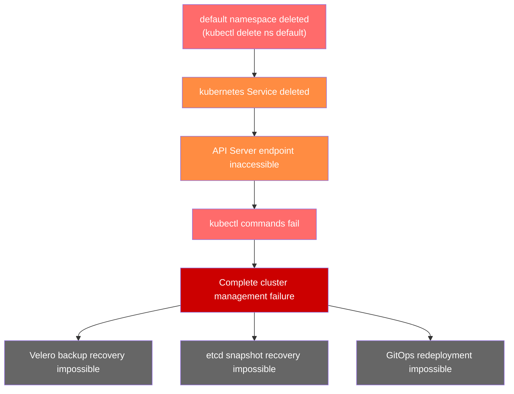
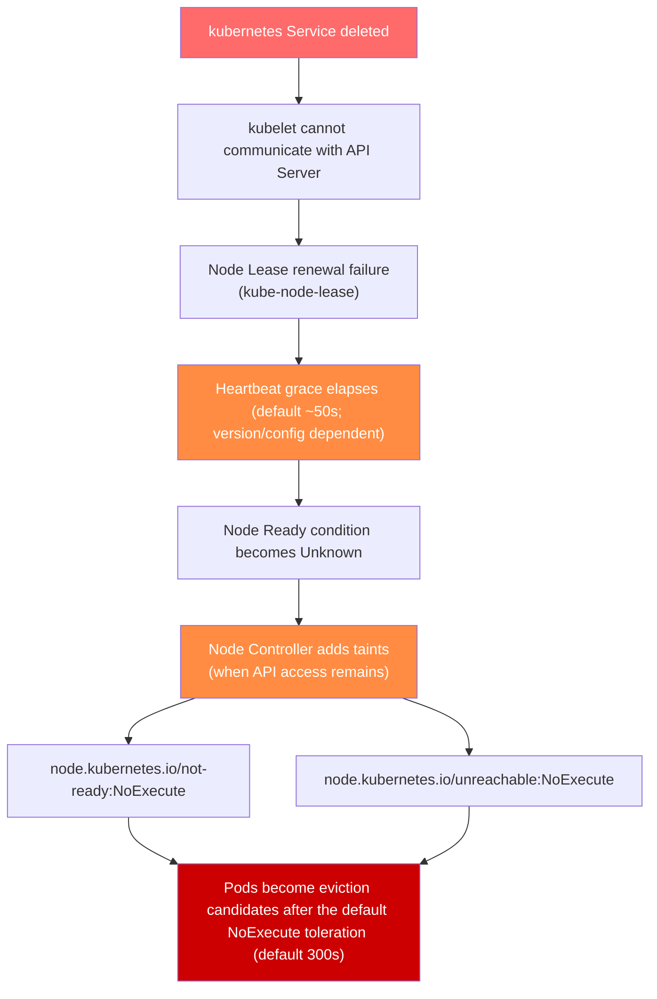

## 1. Overview (TL;DR)

:::danger Critical Alert
This document assumes the exceptional situation in which the `default` namespace has actually been deleted; it is an incident-response and hypothesis-check guide. In an ordinary cluster, Kubernetes' built-in `NamespaceLifecycle` admission plugin rejects deletion requests for the `default`, `kube-system`, and `kube-public` namespaces, so `kubectl delete ns default` being rejected is the expected behavior under a normal configuration. Therefore, observing a kubectl connection failure does not by itself prove the default namespace was deleted — diagnose network, authentication, and API health first. If deletion did occur in an environment where admission controls were weakened, the in-cluster `kubernetes` Service is deleted along with it, which can remove the **in-cluster** path to the API Server. The external API endpoint that EKS provides to kubectl is managed separately from this in-cluster Service. To prevent recurrence, strongly consider protecting critical resources with an Admission Controller or other access controls.
:::

- **Assumed incident**: The `default` namespace is deleted in an environment with weakened admission controls, taking the in-cluster `kubernetes` Service with it
- **Impact scope (if the incident occurs)**: Loss of the in-cluster components' API Server path → degraded in-cluster management → service impact (if prolonged)
- **Recovery method**: First confirm the cause with the diagnosis below; open an **AWS Support case** only if an authorized operator cannot recover

:::tip Recovery Summary
First confirm the cause with the diagnosis procedure below (network, authentication, API health, and whether the namespace was actually deleted). Only if an authorized operator cannot recover using the EKS access API or existing creator permissions, open a case with AWS Support and add your Account Team and WWSO Specialist as CC on the ticket to request recovery.
:::

---

## 2. Root Cause Analysis

### 2.1 Role of the Default Namespace

The `default` namespace is not merely a default space for deploying user workloads. Critical Kubernetes cluster resources reside in this namespace.

**Critical resources in the default namespace**:

:::warning Caution
The `kubernetes` Service is the ClusterIP path used to reach the API Server from **within** the cluster. If this Service is deleted, in-cluster clients (for example, components using ServiceAccount tokens) may be unable to reach the Control Plane over the ClusterIP. However, the external API endpoint that EKS provides to kubectl and the AWS CLI is managed separately from this in-cluster Service, so external reachability must be checked independently.
:::

### 2.2 Failure Mechanism

The following diagram illustrates the cascading failure that occurs when the `default` namespace is deleted.



**Failure sequence**:

1. **Namespace deletion command executed**: `kubectl delete namespace default`
2. **Cascading deletion**: All resources within the namespace are deleted together
3. **kubernetes Service deleted**: API Server endpoint disappears
4. **Connection severed**: Internal cluster components cannot communicate with the API Server
5. **Unmanageable state**: No kubectl commands can be executed

### Impact on Worker Nodes

When the API Server endpoint disappears and the state persists, cascading effects occur on worker nodes.



**Node state changes over time**:

:::warning Important
The transitions above describe node-disconnection behavior when the Control Plane's API Server is operating and the Node Controller can update node state. Conversely, if the Control Plane itself is inaccessible or non-operational, the Node Controller cannot update node state or add taints at all, so the taint/eviction transitions above do not occur. In that case, existing running Pods keep operating on their nodes, but new scheduling and state changes are not reflected. Diagnose the two cases separately.
:::

### Service Impact in Frozen State

When the cluster enters a frozen state, **existing workloads continue to operate for a period**, but as time passes, serious service impacts occur.

**Immediately affected areas**:

- New Pod scheduling impossible
- Pod restart/redeployment impossible
- ConfigMap and Secret change propagation impossible
- HPA (Horizontal Pod Autoscaler) scaling impossible

**Service impact over time**:

:::danger Particularly Dangerous Scenarios

- Service discovery failure due to DNS cache expiration or TLS certificate expiration causing communication loss
- If a Pod is OOMKilled or crashes, the container is **restarted locally** per its restartPolicy as long as the node is healthy and kubelet is running. However, while API access is lost, creating/replacing Pods or rescheduling onto other nodes does not happen
- If a node fails, **all workloads on that node are lost** (they cannot be rescheduled onto other nodes)
- ALB/NLB Target Group updates impossible, leading to **traffic routing failures**

The impact scope expands over time, so it is critical to **contact AWS Support as quickly as possible**.
:::

---

## 3. Incident Response Procedure

### Step 1: Confirm the Incident

When a failure caused by `default` namespace deletion is suspected, first verify the cluster state.

### 1-1. kubectl Access Test

First, check if kubectl commands work normally.

```bash
# Attempt to query cluster info
kubectl cluster-info

# Expected error messages
# Unable to connect to the server: dial tcp: lookup kubernetes on 10.100.0.10:53: no such host
# or
# The connection to the server <cluster-endpoint> was refused
```

:::warning Caution
If you see errors like the above, the kubernetes Service has been deleted and the API Server is inaccessible.
:::

### 1-2. Check Cluster Status via AWS CLI

Even if kubectl is not working, you can check the EKS cluster status through the AWS CLI.

```bash
# Check cluster status
aws eks describe-cluster \
  --name <cluster-name> \
  --query 'cluster.{Name:name,Status:status,Endpoint:endpoint,Version:version}' \
  --output table

# Expected output (cluster itself shows ACTIVE status)
# -------------------------------------------------------------------
# |                        DescribeCluster                          |
# +----------+------------------------------------------------------+
# |  Name    |  my-eks-cluster                                      |
# |  Status  |  ACTIVE                                              |
# |  Endpoint|  https://XXXXX.gr7.ap-northeast-2.eks.amazonaws.com  |
# |  Version |  1.31                                                |
# +----------+------------------------------------------------------+
```

```bash
# Check node group status
aws eks list-nodegroups --cluster-name <cluster-name>

aws eks describe-nodegroup \
  --cluster-name <cluster-name> \
  --nodegroup-name <nodegroup-name> \
  --query 'nodegroup.{Name:nodegroupName,Status:status,DesiredSize:scalingConfig.desiredSize}' \
  --output table
```

### 1-3. Incident Determination Criteria

:::tip Key Point
If the cluster appears ACTIVE in the AWS Console or CLI but kubectl commands do not work at all, you should suspect default namespace deletion.
:::

**Checkpoint**: If the above symptoms are confirmed, proceed immediately to **Step 2: Open AWS Support Case**.

### Step 2: Open AWS Support Case

If the diagnosis confirms that an authorized operator cannot recover, recovery through AWS Support is required. In that case, open a case immediately.

### 2-1. Case Information

Prepare the following before opening a case.

- Cluster name, Region, AWS account ID, Kubernetes version
- Service: Elastic Kubernetes Service (EKS)
- Category: Cluster Issue
- Severity: a value matching the demonstrated business impact (the highest severity is available if your subscribed plan supports it)
- Impact scope, occurrence time, and the diagnosis results already gathered (record them in the 2-2 template below)

### 2-2. Case Body Template

Copy the template below and paste it into the case body.

```text
[URGENT] EKS cluster Control Plane inaccessible due to default namespace deletion

■ Cluster Information
- Cluster Name: <cluster name>
- Region: <region>
- Account ID: <AWS account ID>
- Cluster Version: <Kubernetes version>

■ Incident Details
- Occurrence Time: <YYYY-MM-DD HH:MM UTC>
- Symptoms: kubectl commands fail after default namespace deletion
- Impact Scope: Complete cluster management failure

■ Confirmed Information
- Cluster status via AWS CLI: ACTIVE
- kubectl cluster-info result: Connection failed
- kubectl get ns default result: Connection failed

■ Request
Requesting recovery of the default namespace and kubernetes Service.
This is a production environment requiring urgent recovery.

■ Contact Information
- Contact Person: <name>
- Phone: <phone number>
- Email: <email>
```

### 2-3. How to Open a Case in AWS Console

1. Access AWS Support Center
2. Click **Create case**
3. Select **Technical**
4. Service: Select **Elastic Kubernetes Service (EKS)**
5. Category: Select **Cluster Issue**
6. Severity: Select a severity that matches the demonstrated business impact. The highest severity (e.g., "Business-critical system down") is available with Business Support or higher, Enterprise Support, and Unified Operations plans (plan coverage can change, so verify the current conditions of your subscribed plan). Choose severity by actual impact, not by plan type
7. Paste the template above into the body
8. Select **Phone** in Contact options (for faster response)
9. Click **Submit**

:::warning Important
After opening the case, be sure to record the case ID. You will need it when contacting the Account Team and WWSO Specialist.
:::

### Step 3: Contact Account Team/WWSO Specialist

Simultaneously with opening the AWS Support case, contact the Account Team and WWSO (Worldwide Specialist Organization) Specialist to expedite recovery.

### 3-1. Add CC to the Ticket

Add the Account Team and WWSO Specialist as CC on the AWS Support case.

1. Navigate to the **Correspondence** section of the opened case
2. Click the **Reply** button
3. Add the following content to request CC

```text
CC Request:
- AWS Account Team: <Account Manager name/email>
- WWSO EKS Specialist: <Specialist name/email (if known)>

This is a production environment requiring urgent recovery.
Requesting support from Account Team and EKS Specialist.
```

### 3-2. Direct Contact with Account Team

Contact the Account Team directly, separate from the AWS Support case.

**Email Template**:

```text
Subject: [URGENT] EKS Cluster Incident - Support Case #<case ID>

Hello,

We are contacting you regarding an urgent incident in our production EKS cluster.

■ Incident Summary
- Cluster: <cluster name>
- Symptoms: Control Plane inaccessible due to default namespace deletion
- Support Case ID: <case ID>

■ Request
Requesting priority escalation of this case and connection to an EKS Specialist.

Thank you.
<name>
<contact information>
```

**Slack/SMS Message** (if Account Team channel exists):

```text
[URGENT] EKS Cluster Incident

- Account: <account ID>
- Cluster: <cluster name>
- Issue: Control Plane inaccessible due to default namespace deletion
- Support Case: #<case ID>

Production environment - requesting urgent support.
```

### 3-3. Contact WWSO Specialist

If you know a WWSO EKS Specialist, contact them directly. Contacting a specialist allows them to use internal tickets to escalate the importance of the ticket and directly request work from the assigned engineer through the internal pipeline.

### 3-4. Contact Checklist

Confirm the following items are complete.

- Recorded the Support case ID
- Contacted the Account Team (Account Manager) with the case ID
- Contacted a WWSO EKS Specialist if one is known
- Added the Account Team/Specialist as CC on the case Correspondence
- Listed an urgently reachable contact in the case

### Step 4: Post-Recovery Verification

Once the `default` namespace is recovered through AWS Support, verify that the cluster is functioning normally.

### 4-1. Basic Connectivity Verification

```bash
# 1. Verify cluster connectivity
kubectl cluster-info

# Expected output:
# Kubernetes control plane is running at https://XXXXX.gr7.ap-northeast-2.eks.amazonaws.com
# CoreDNS is running at https://XXXXX.gr7.ap-northeast-2.eks.amazonaws.com/api/v1/namespaces/kube-system/services/kube-dns:dns/proxy
```

```bash
# 2. Verify default namespace exists
kubectl get namespace default

# Expected output:
# NAME      STATUS   AGE
# default   Active   <time>
```

```bash
# 3. Verify kubernetes Service
kubectl get svc kubernetes -n default

# Expected output:
# NAME         TYPE        CLUSTER-IP   EXTERNAL-IP   PORT(S)   AGE
# kubernetes   ClusterIP   10.100.0.1   <none>        443/TCP   <time>
```

### 4-2. Core Component Status Verification

```bash
# 4. Check node status
kubectl get nodes

# Verify all nodes are in Ready state
```

```bash
# 5. Check system Pod status
kubectl get pods -n kube-system

# Verify all Pods are in Running state
# Especially check coredns, kube-proxy, aws-node
```

```bash
# 6. Verify all namespaces
kubectl get namespaces

# Verify existence of default, kube-system, kube-public, kube-node-lease
```

### 4-3. API Server Functionality Verification

```bash
# 7. API resource query test
kubectl api-resources | head -20

# 8. Simple resource create/delete test (optional)
kubectl run test-pod --image=nginx --restart=Never -n default
kubectl get pod test-pod -n default
kubectl delete pod test-pod -n default
```

**Verification Checklist**:

- Does `kubectl cluster-info` respond normally
- Is the `default` namespace in Active state
- Does the `kubernetes` Service (ClusterIP such as 10.100.0.1) exist
- Are all nodes in Ready state
- Are the coredns, kube-proxy, and aws-node Pods in kube-system Running
- Do the `default`, `kube-system`, `kube-public`, and `kube-node-lease` namespaces all exist

### Step 5: Workload Inspection

After recovery, inspect that existing workloads are functioning normally.

### 5-1. Workload Status Inspection

```bash
# 1. Check Pod status across all namespaces
kubectl get pods --all-namespaces | grep -v Running | grep -v Completed

# Identify Pods not in Running or Completed state
```

```bash
# 2. Check Deployment status
kubectl get deployments --all-namespaces

# Verify the READY column matches desired and actual replica counts
```

```bash
# 3. Check StatefulSet status
kubectl get statefulsets --all-namespaces
```

```bash
# 4. Check DaemonSet status
kubectl get daemonsets --all-namespaces

# Verify DESIRED and READY counts match
```

### 5-2. Service Connectivity Inspection

```bash
# 5. Verify Services and Endpoints
kubectl get svc --all-namespaces
kubectl get endpoints --all-namespaces

# Verify IPs are properly assigned to Endpoints
```

```bash
# 6. Check Ingress status (if applicable)
kubectl get ingress --all-namespaces
```

### 5-3. Storage Inspection

```bash
# 7. Check PersistentVolumeClaim status
kubectl get pvc --all-namespaces

# Verify all PVCs are in Bound state
```

```bash
# 8. Check PersistentVolume status
kubectl get pv

# Verify all PVs are in Bound state
```

### 5-4. Event and Log Inspection

```bash
# 9. Check recent Warning events
kubectl get events --all-namespaces --field-selector type=Warning --sort-by='.lastTimestamp' | tail -20
```

```bash
# 10. Check logs of problematic Pods
kubectl logs <pod-name> -n <namespace> --tail=100
```

### 5-5. Workload Inspection Checklist

:::tip
Jobs or CronJobs may not have completed during the incident period. The command below selects Jobs with zero succeeded Pods (including Jobs that are still active or newly created), so do not treat its output as "failed Jobs." Before re-running, check each Job's Failed condition, `status.failed`, and completion status to avoid duplicate work.
:::

```bash
# List Jobs with zero succeeded Pods (selects unfinished/zero-success Jobs, not failed Jobs)
kubectl get jobs --all-namespaces --field-selector status.successful=0
```

**Final Checkpoint**: Once all workloads are confirmed to be in normal state, the incident response is complete. Then review **prevention measures**.

---

## 4. Critical Resource List

### 4.1 Critical Namespaces

Beyond the `default` namespace, there are system namespaces whose deletion would have fatal impacts on the cluster. These namespaces must never be deleted.

:::danger Critical Warning
If the `default` and `kube-system` namespaces are actually deleted, kubectl access becomes difficult and manual recovery is limited. When only access is blocked (e.g., a corrupted aws-auth), try to recover using creator permissions or an EKS access entry; only for namespace deletion that cannot be recovered through these paths is recovery through AWS Support required.
:::

**Detailed roles of each namespace**:

**default**:

- `kubernetes` Service: Endpoint for accessing the API Server from within the cluster
- `default` ServiceAccount: Default authentication principal for Pods without a specified ServiceAccount

**kube-system**:

- Namespace where all essential system components for cluster operations are deployed
- EKS Add-ons (CoreDNS, kube-proxy, VPC CNI) and controllers are located here

**kube-public**:

- Stores public information readable by unauthenticated users
- `cluster-info` ConfigMap contains cluster CA certificate and API Server address

**kube-node-lease**:

- Stores Lease objects for each node, serving as heartbeats
- Node Controller uses this information to determine node status

### 4.2 kube-system Core Components

The `kube-system` namespace contains essential components for cluster operations. Deleting or modifying these components individually can cause serious failures.

### EKS Core Add-ons

- CoreDNS: Handles in-cluster DNS name resolution.
- kube-proxy: Implements Service ClusterIPs as node network rules.
- Amazon VPC CNI (aws-node): The networking plugin that assigns VPC IPs to Pods.

### EKS Storage Components

- Amazon EBS CSI Driver: Provisions PersistentVolumes backed by EBS volumes.
- Amazon EFS CSI Driver: Mounts EFS file systems as PersistentVolumes (when used).

### Networking and Load Balancing Components

- AWS Load Balancer Controller: Provisions ALB/NLB from Ingress/Service (when installed).
- CoreDNS, kube-proxy, and VPC CNI together form the networking path alongside the Add-ons above.

:::tip
Components managed as EKS Add-ons (CoreDNS, kube-proxy, VPC CNI, EBS CSI Driver) can be recovered by reinstalling the Add-on through the AWS Console or CLI.
:::

```bash
# Check EKS Add-on status
aws eks list-addons --cluster-name <cluster-name>

# Before recovery, check whether the add-on resource already exists
aws eks describe-addon --cluster-name <cluster-name> --addon-name coredns

# Create only when the add-on does not exist (an existing add-on returns ResourceInUseException)
aws eks create-addon \
  --cluster-name <cluster-name> \
  --addon-name coredns

# For an existing add-on, repair/update with update-addon.
# --resolve-conflicts OVERWRITE resolves configuration conflicts; it does not convert
# create into update, and it can overwrite existing user configuration, so use with care.
aws eks update-addon \
  --cluster-name <cluster-name> \
  --addon-name coredns \
  --resolve-conflicts OVERWRITE
```

:::warning Caution
The `aws eks` commands above are AWS API calls targeting EKS managed add-ons, so they can run without kubectl access. However, if the `kube-system` namespace where the add-on is deployed has itself been deleted, recovering the add-on alone will not resolve it, and AWS Support is required.
:::

### 4.3 Cluster-Scoped Resources

Cluster-scoped resources that do not belong to any namespace can also affect the entire cluster when deleted or modified.

### RBAC-Related Resources

:::warning Particularly Dangerous ClusterRole/ClusterRoleBindings

- `system:node` ClusterRole: Kubernetes documents this role as compatibility for pre-1.8 upgrades, and its default binding is None. On modern clusters, node permissions are granted by the **Node authorizer** for the kubelet's node identity (`system:node:<nodeName>`, group `system:nodes`), so deleting this role/binding does not by itself cut off all nodes. Node access depends on the cluster's Node authorizer being enabled and its RBAC configuration
- `system:kube-controller-manager`: Deletion causes **controller manager to stop operating**
- `system:kube-scheduler`: Deletion causes **Pod scheduling to stop**
:::

### CRD (Custom Resource Definition)

:::warning CRD Deletion Warning
Deleting a CRD also cascading deletes all Custom Resources created from that CRD. For example, deleting Cert-Manager's Certificate CRD will delete all Certificate resources in the cluster.
:::

### Storage-Related Resources

### Node and Network-Related Resources

### EKS-Specific Resources

:::tip Best Practice
Always create backups before modifying or deleting cluster-scoped resources.
:::

```bash
# ClusterRole backup example
kubectl get clusterrole <role-name> -o yaml > clusterrole-backup.yaml

# Backup all ClusterRoles
kubectl get clusterroles -o yaml > all-clusterroles-backup.yaml

# CRD backup (does not include CRs)
kubectl get crd <crd-name> -o yaml > crd-backup.yaml
```

---

## 5. Prevention Strategies

### 5.1 Resource Protection via Admission Controllers

Kubernetes Admission Controllers can proactively block deletion of critical resources. Here we introduce an example using Kyverno.

### Preventing Critical Namespace Deletion with Kyverno

```yaml
apiVersion: kyverno.io/v1
kind: ClusterPolicy
metadata:
  name: protect-critical-namespaces
spec:
  validationFailureAction: Enforce
  background: false
  rules:
    - name: block-critical-namespace-deletion
      match:
        any:
          - resources:
              kinds:
                - Namespace
              names:
                - default
                - kube-system
                - kube-public
                - kube-node-lease
      exclude:
        any:
          - clusterRoles:
              - cluster-admin
      validate:
        message: "Deletion of critical namespace '{{request.object.metadata.name}}' has been blocked."
        deny:
          conditions:
            all:
              - key: "{{request.operation}}"
                operator: Equals
                value: DELETE
```

When this policy is applied, requests to delete critical namespaces from users without the `cluster-admin` role will be denied.

### Other Admission Controller Options

Various Admission Controllers can be used beyond Kyverno.

:::tip Recommendation
Choose based on your team's tech stack and policy complexity. For simple resource protection policies, Kyverno can be applied quickly.
:::

### 5.2 GitOps and KRMOps-Based Operations

Adopting GitOps and KRMOps (Kubernetes Resource Model Operations) based operational practices enables declarative management of cluster resources and rapid recovery from unintended changes.

### Managing Critical Resources with Argo CD {#eks-auto-mode-argocd-capability}

You can manage critical resources declaratively with Argo CD. Argo CD can be installed and operated yourself (self-managed) or used as managed Argo CD provided as an EKS Capability that you explicitly enable. EKS Capabilities, including managed Argo CD, are resources you create and enable individually — they are not automatically included when the cluster is created. The self-managed Argo CD example below deploys to the in-cluster target (`https://kubernetes.default.svc`). When using managed Argo CD to deploy to another cluster, use the registered target cluster's ARN as the destination, not `kubernetes.default.svc`.

```yaml
# ArgoCD Application example - Critical resource management
apiVersion: argoproj.io/v1alpha1
kind: Application
metadata:
  name: cluster-critical-resources
  namespace: argocd
spec:
  project: default
  source:
    repoURL: https://github.com/your-org/k8s-manifests.git
    targetRevision: main
    path: cluster-critical
  destination:
    server: https://kubernetes.default.svc
    namespace: default
  syncPolicy:
    automated:
      prune: false      # Prevent automatic deletion of critical resources
      selfHeal: true    # Automatic recovery on drift
    syncOptions:
      - CreateNamespace=false
```

**GitOps prevention benefits**:

:::tip
Separate critical namespaces and resources into a dedicated ArgoCD Application, and set prune: false and selfHeal: true for protection.
:::

### KRMOps Strategy with ACK and KRO

Using **ACK (AWS Controllers for Kubernetes)** and **KRO (Kube Resource Orchestrator)**, you can manage AWS infrastructure as Kubernetes Resource Model.

**AWS Resource Management with ACK**:

```yaml
# Declarative S3 bucket management example using ACK
apiVersion: s3.services.k8s.aws/v1alpha1
kind: Bucket
metadata:
  name: my-app-bucket
  namespace: default
spec:
  name: my-app-bucket-12345
  tagging:
    tagSet:
      - key: Environment
        value: Production
```

**Composite Resource Orchestration with KRO**:

```yaml
# KRO ResourceGraphDefinition example (kro.run/v1alpha1) - Application stack definition
# The following is an abbreviated scaffold showing only key fields; required Deployment/Service
# fields are omitted, so it is not runnable as-is.
apiVersion: kro.run/v1alpha1
kind: ResourceGraphDefinition
metadata:
  name: web-application
spec:
  schema:
    apiVersion: v1alpha1
    kind: WebApplication
    spec:
      name: string
      replicas: integer | default=2
  resources:
    - id: deployment
      template:
        apiVersion: apps/v1
        kind: Deployment
        metadata:
          name: ${schema.spec.name}
        spec:
          replicas: ${schema.spec.replicas}
          # ... omitted (selector, template, and other required fields)
    - id: service
      template:
        apiVersion: v1
        kind: Service
        # ... omitted (selector, ports, and other required fields)
```

**Benefits of KRMOps**:

:::tip Recommendation
Using ACK and KRO together enables Kubernetes-style unified management of not only the EKS cluster but also associated AWS resources (VPC, IAM, RDS, etc.).
:::

**References**:

- AWS Controllers for Kubernetes (ACK)
- Kube Resource Orchestrator (KRO)
- EKS Auto Mode Documentation

### 5.3 EKS Access Entry-Based Access Control

EKS Access Entry overcomes the limitations of `aws-auth` ConfigMap and provides safer cluster access management.

### Problems with aws-auth ConfigMap

The existing `aws-auth` ConfigMap approach has the following risks:

:::warning Caution
If the `aws-auth` ConfigMap is deleted or corrupted, authentication fails for the IAM identities mapped by that ConfigMap. However, not every IAM identity loses access. The cluster creator's permissions exist outside the `aws-auth` ConfigMap, and when the caller has the required IAM permissions, the EKS access API (access entries) can restore access without Kubernetes API access. Request recovery from AWS Support only when access cannot be restored through these paths.
:::

### Transitioning to EKS Access Entry

EKS Access Entry manages cluster access through the AWS API, eliminating the risks of `aws-auth` ConfigMap.

**Access Entry Creation Example**:

```bash
# Create admin Access Entry
aws eks create-access-entry \
  --cluster-name my-cluster \
  --principal-arn arn:aws:iam::XXXXXXXXXXXX:role/EKSAdminRole \
  --type STANDARD

# Associate cluster admin policy
aws eks associate-access-policy \
  --cluster-name my-cluster \
  --principal-arn arn:aws:iam::XXXXXXXXXXXX:role/EKSAdminRole \
  --policy-arn arn:aws:eks::aws:cluster-access-policy/AmazonEKSClusterAdminPolicy \
  --access-scope type=cluster
```

**Namespace-Level Access Control**:

```bash
# Set developer permissions limited to specific namespaces
aws eks create-access-entry \
  --cluster-name my-cluster \
  --principal-arn arn:aws:iam::XXXXXXXXXXXX:role/DevTeamRole \
  --type STANDARD

aws eks associate-access-policy \
  --cluster-name my-cluster \
  --principal-arn arn:aws:iam::XXXXXXXXXXXX:role/DevTeamRole \
  --policy-arn arn:aws:eks::aws:cluster-access-policy/AmazonEKSEditPolicy \
  --access-scope type=namespace,namespaces=dev,staging
```

**Benefits of EKS Access Entry**:

- Manages access through the AWS API, reducing the lockout risk from a corrupted `aws-auth` ConfigMap.
- Can be managed declaratively with CloudFormation/Terraform and tracked via CloudTrail.
- Access scope can be limited to a namespace or cluster scope to apply least privilege.

**Pre-defined Access Policies**:

- `AmazonEKSClusterAdminPolicy`: Cluster-wide administrator permissions
- `AmazonEKSAdminPolicy`: Namespace administrator permissions
- `AmazonEKSEditPolicy`: Resource create/modify permissions
- `AmazonEKSViewPolicy`: Read-only permissions

:::tip Recommendations

1. **New clusters**: To use only EKS Access Entry from the start, set `authenticationMode=API` within `--access-config` at cluster creation to select API-only access mode. Whether to grant creator admin permissions is decided separately by the `bootstrapClusterCreatorAdminPermissions` field (default `true`) in the same `--access-config`; that field by itself does not change the authentication mode
2. **Existing clusters**: Gradually migrate to Access Entry, then remove `aws-auth` ConfigMap dependency
3. **Least privilege principle**: Use namespace-scoped permissions instead of cluster-wide permissions
4. **Emergency recovery account**: Set up a separate IAM Role with cluster admin permissions via Access Entry to prepare for lockout situations
:::

**Migration Checklist**:

- Checked the current Authentication Mode and switched to `API_AND_CONFIG_MAP`
- Created an Access Entry for each mapRoles/mapUsers entry in `aws-auth`
- Pre-configured a cluster-admin Access Entry on an emergency recovery IAM Role
- Verified all entries were migrated before finally switching to `API` mode

**References**:

- EKS Cluster Access Management
- Migrating from aws-auth ConfigMap

---

## 6. Summary

### 6.1 Key Takeaways

:::danger Core Message
If the `default` or `kube-system` namespaces are actually deleted, taking the in-cluster `kubernetes` Service and system components with them, kubectl access becomes difficult and manual recovery is limited. However, a kubectl access failure does not by itself mean the namespace was deleted, so first diagnose network, authentication, and API health; when only access is blocked (e.g., a corrupted aws-auth), try to recover using creator permissions or an EKS access entry. Only when recovery through these paths is not possible should you request recovery from AWS Support.
:::

### 6.2 References

### EKS Official Documentation

- Amazon EKS Best Practices Guide
- EKS Cluster Access Management
- Migrating from aws-auth ConfigMap to Access Entries
- EKS Add-ons
- EKS Auto Mode

### Kubernetes Official Documentation

- Kubernetes RBAC Authorization
- Kubernetes Namespaces
- Admission Controllers Reference

### Admission Controller Tools

- Kyverno - Kubernetes Native Policy Management
- OPA Gatekeeper - Policy Controller for Kubernetes

### GitOps and KRMOps Tools

- ArgoCD - Declarative GitOps CD for Kubernetes
- AWS Controllers for Kubernetes (ACK)
- Kube Resource Orchestrator (KRO)
