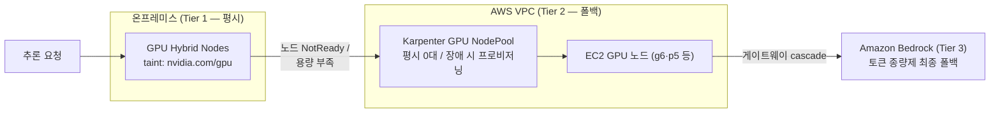

## 개요

온프레미스 GPU 서버를 하이브리드 노드로 등록하면 GPU 자원이 클러스터의 공용 스케줄링 대상이 됩니다. 아무 설정 없이 운영하면 모니터링 에이전트·시스템 애드온 같은 관리용 Pod가 GPU 노드의 CPU·메모리를 점유하고, GPU 워크로드용 Device Plugin이 클라우드 GPU 노드와 중복 배포되는 문제가 발생합니다. 본 문서는 GPU 자원 격리(taint), 하이브리드 전용 NVIDIA Device Plugin 배포, 그리고 온프레미스 GPU 장애에 대비한 Karpenter 기반 클라우드 폴백 NodePool 구성을 다룹니다. 3-Tier 하이브리드 추론 아키텍처의 전체 그림은 [GPU 워크로드와 SR-IOV 네트워킹](./gpu-sriov-networking)을 참조합니다.

## GPU 자원 격리: 노드 등록 시점 taint

GPU 노드의 taint는 노드가 클러스터에 조인하는 시점에 적용되어야 합니다. 조인 후 `kubectl taint`로 사후 적용하면, 조인과 taint 적용 사이의 시간 창에 GPU 비관련 Pod가 스케줄될 수 있습니다. `nodeadm`의 NodeConfig에서 kubelet 등록 플래그로 선언합니다.

```yaml
# nodeconfig-gpu.yaml
apiVersion: node.eks.aws/v1alpha1
kind: NodeConfig
spec:
  cluster:
    name: my-hybrid-cluster
    region: us-west-2
  hybrid:
    ssm:
      activationCode: "YOUR-ACTIVATION-CODE"
      activationId: "YOUR-ACTIVATION-ID"
  kubelet:
    flags:
      - --node-labels=node-type=hybrid-gpu,gpu.model=h200
      - --register-with-taints=nvidia.com/gpu=Exists:NoSchedule
```

- `--register-with-taints=nvidia.com/gpu=Exists:NoSchedule`은 이 taint를 tolerate하지 않는 Pod의 스케줄링을 차단합니다. taint는 `key=value:effect`가 모두 일치하는 toleration이 있어야 통과하므로, GPU 워크로드 Pod에는 `nvidia.com/gpu`를 tolerate하는 toleration을 **명시적으로 선언**해야 합니다. `nvidia.com/gpu` 리소스를 요청하는 것만으로는 자동으로 통과하지 않습니다. NVIDIA Device Plugin은 노드의 GPU를 확장 리소스(`nvidia.com/gpu`)로 광고할 뿐 Pod에 toleration을 주입하지 않습니다. 확장 리소스를 요청한 Pod에 자동으로 toleration을 추가하려면 클러스터에서 `ExtendedResourceToleration` admission controller가 활성화되어 있어야 하는데, EKS Hybrid Nodes 클러스터에서 기본 활성화 여부는 보장되지 않으므로 명시적 toleration을 기본 방식으로 사용합니다.
- CoreDNS·kube-proxy·Cilium 등 DaemonSet 류 시스템 컴포넌트는 대부분 광범위 toleration을 갖고 있어 taint의 영향을 받지 않습니다. 차단 대상은 Deployment 형태의 관리용 Pod입니다.
- 노드 레이블(`gpu.model` 등)은 이후 폴백 NodePool과의 우선순위 스케줄링에서 selector 기준이 됩니다.

## 하이브리드 전용 NVIDIA Device Plugin

Mixed mode 클러스터에서 클라우드 GPU 노드가 자체 Device Plugin 스택을 갖는지는 노드 유형에 따라 다릅니다. EKS Auto Mode GPU 노드와 EKS 최적화 Bottlerocket NVIDIA AMI는 Device Plugin을 포함해 관리하므로 별도 설치가 필요하지 않습니다. 반면 EKS 최적화 **AL2023 NVIDIA AMI는 드라이버·컨테이너 툴킷은 포함하지만 NVIDIA Kubernetes Device Plugin과 DRA 드라이버는 포함하지 않으므로 별도로 설치해야 합니다**([Manage NVIDIA GPUs on Amazon EKS](https://docs.aws.amazon.com/eks/latest/userguide/ml-eks-optimized-ami.html), 2026-10 확인). 따라서 Device Plugin을 자체 관리하는 노드(Auto Mode·Bottlerocket)에 하이브리드용 DaemonSet까지 배포되면 이중 등록·버전 충돌이 발생하므로, 하이브리드용 Device Plugin의 `nodeSelector`를 하이브리드 노드 레이블로 고정합니다. AL2023 AMI 기반 클라우드 노드처럼 Device Plugin이 없는 노드에는 해당 노드에 맞는 Device Plugin을 별도로 설치합니다.

```yaml
# nvidia-device-plugin-values.yaml (Helm)
nodeSelector:
  eks.amazonaws.com/compute-type: hybrid   # 하이브리드 노드에만 배포
tolerations:
  - key: nvidia.com/gpu
    operator: Exists
    effect: NoSchedule
gfd:
  enabled: true                            # GPU Feature Discovery — 모델별 레이블 자동 부여
```

```bash
helm repo add nvdp https://nvidia.github.io/k8s-device-plugin
helm install nvidia-device-plugin nvdp/nvidia-device-plugin \
  --namespace nvidia-device-plugin --create-namespace \
  --values nvidia-device-plugin-values.yaml
```

- `eks.amazonaws.com/compute-type: hybrid`는 EKS가 하이브리드 노드에 자동 부여하는 레이블입니다. 이 조건으로 EKS Auto Mode GPU 노드(자체 관리 스택)와의 중복 배포를 차단합니다.
- 드라이버·컨테이너 툴킷까지 포함한 전체 스택이 필요하면 GPU Operator를 사용합니다. 이때 Operator의 Helm 차트 버전을 고정(pin)하고, 하이브리드 노드는 OS·드라이버가 고객 관리 영역이므로 호스트에 사전 설치된 드라이버를 사용하도록 `driver.enabled=false`로 설정합니다. Operator의 배치 범위를 하이브리드 노드로 제한할 때는 단일 `nodeSelector`만으로 모든 operand가 제한된다고 가정하지 말아야 합니다. Operator 자체(컨트롤러)의 배치와 각 operand(Device Plugin·DCGM Exporter·Container Toolkit 등) DaemonSet의 배치는 별개로 제어되고, GPU Operator는 노드의 GPU 레이블과 노드별 opt-out 레이블(`nvidia.com/gpu.deploy.*`)로 operand를 선택하기 때문입니다. 또한 GPU Operator가 함께 배포하는 Node Feature Discovery(NFD)는 별도로 범위를 지정해야 하며, 적용 전에 렌더링된 DaemonSet의 node selector·affinity가 실제로 하이브리드 노드에만 매칭되는지(`helm template` 또는 `kubectl get daemonset -o yaml`) 확인해 클라우드 GPU 노드와의 중복 배포가 없는지 검증합니다. 호스트 드라이버 방식은 Operator의 드라이버 컨테이너 배포보다 예측 가능합니다. 정확한 operand/노드 선택 옵션은 사용하는 Operator 버전의 [GPU Operator 문서](https://docs.nvidia.com/datacenter/cloud-native/gpu-operator/latest/getting-started.html)를 확인합니다.
- DCGM Exporter를 함께 배포하면 GPU 사용률·온도·메모리 메트릭이 Prometheus 형식으로 노출됩니다 ([관측성 통합](../operations-cost/observability-monitoring)).

## 클라우드 폴백: Karpenter 기반 백업 GPU NodePool

온프레미스 GPU 서버는 하드웨어 장애·전원·회선 단선의 단일 사이트 리스크를 갖습니다. AWS VPC 안에 Karpenter(또는 EKS Auto Mode) 기반 GPU NodePool을 **평시 0대**로 정의해 두면, 온프레미스 GPU 용량이 상실됐을 때 대기 중인 Pod가 클라우드 GPU 노드를 자동으로 기동시키는 폴백 계층이 됩니다.



### NodePool 정의

아래 예시는 **Karpenter(`karpenter.sh/v1`) 기준**입니다. `nodeClassRef`가 참조하는 `gpu-fallback` EC2NodeClass(AMI 계열, 서브넷, 보안 그룹, IAM 역할 등 노드 프로비저닝 세부사항 정의)가 **사전에 생성되어 있어야** 하며, 이 문서에는 포함하지 않았습니다. EKS Auto Mode는 Karpenter와 API가 다릅니다. Auto Mode에서는 `nodeClassRef.group`만 바꾸는 것으로 전환되지 않으며, `eks.amazonaws.com` 그룹의 별도 `NodeClass`와 `eks.amazonaws.com/*` 레이블(아래 예시의 `karpenter.k8s.aws/*` 요구 사항 대신)을 사용해야 합니다. 두 방식을 혼용하지 말고 사용하는 프로비저너에 맞는 리소스로 일관되게 작성합니다.

```yaml
apiVersion: karpenter.sh/v1
kind: NodePool
metadata:
  name: gpu-fallback
spec:
  template:
    metadata:
      labels:
        node-type: cloud-gpu-fallback
    spec:
      nodeClassRef:
        group: karpenter.k8s.aws        # Karpenter EC2NodeClass (사전 생성 필요)
        kind: EC2NodeClass
        name: gpu-fallback
      requirements:
        - key: karpenter.k8s.aws/instance-gpu-manufacturer
          operator: In
          values: ["nvidia"]
        - key: node.kubernetes.io/instance-type
          operator: In
          values: ["g6.12xlarge", "g6e.12xlarge"]   # 서빙 모델 크기에 맞게 조정
        - key: karpenter.sh/capacity-type
          operator: In
          values: ["on-demand"]          # 폴백 안정성 우선 — 평시 Spot 버스트는 별도 풀로 분리
      taints:
        - key: nvidia.com/gpu
          value: "Exists"
          effect: NoSchedule
      expireAfter: 720h
  disruption:
    consolidationPolicy: WhenEmptyOrUnderutilized
    consolidateAfter: 5m                 # 온프렘 복구 후 유휴 클라우드 GPU 자동 회수
  limits:
    nvidia.com/gpu: 16                   # 폴백 규모 가드레일 — 아래 설명 참고
```

`limits`는 폴백 규모의 상한을 두는 프로비저닝 가드레일입니다. 다만 Karpenter의 프로비저닝은 고도로 병렬이고 `limits` 검사는 eventually consistent이므로, 급격한 스케일아웃 중에는 일시적으로 상한을 초과(overrun)할 수 있습니다([Karpenter NodePools](https://karpenter.sh/docs/concepts/nodepools/), 2026-10 확인). 따라서 `limits`만으로 비용이 특정 금액 이하로 보장된다고 보지 말고, EC2 서비스 쿼터, AWS Budgets 알림, 폴백 발동 알림(아래 "비용 상한" 항목)을 함께 두어 상한을 넘는 상황을 탐지·대응합니다.

### 온프렘 우선·클라우드 폴백 스케줄링

워크로드가 평시에는 온프레미스 GPU를 선점하고, 불가할 때만 폴백 풀로 넘어가도록 `preferredDuringScheduling` affinity를 사용합니다.

```yaml
# 추론 Deployment 발췌
spec:
  template:
    spec:
      affinity:
        nodeAffinity:
          preferredDuringSchedulingIgnoredDuringExecution:
            - weight: 100
              preference:
                matchExpressions:
                  - key: eks.amazonaws.com/compute-type
                    operator: In
                    values: ["hybrid"]      # 1순위: 온프렘 GPU
      tolerations:
        - key: nvidia.com/gpu
          operator: Exists
          effect: NoSchedule
      containers:
        - name: inference
          resources:
            limits:
              nvidia.com/gpu: 1
```

동작 시퀀스는 다음과 같습니다.

1. 평시: preferred affinity에 따라 온프레미스 GPU 노드에 우선 배치되고, 폴백 NodePool은 0대를 유지합니다.
2. 온프레미스 GPU 노드 장애(NotReady) 또는 DX/VPN 단선: 노드가 즉시 비워지지 않습니다. 노드 컨트롤러가 노드를 `NotReady`로 표시하면서 `node.kubernetes.io/not-ready`(또는 연결 단선 시 `node.kubernetes.io/unreachable`) taint를 `NoExecute`로 추가합니다. 대부분의 Pod는 이 두 taint에 대해 `tolerationSeconds: 300`의 toleration이 자동으로 부여되어 있어, 노드가 복구되지 않으면 약 5분(기본값) 후에 퇴출됩니다. 이 지연은 조정 가능하며, 전체 RTO 계산에 반드시 포함해야 합니다.
3. 퇴출 후 교체: 퇴출되는 것은 기존 Pod 객체이며, Deployment·ReplicaSet 등 컨트롤러가 대체 Pod를 새로 생성해 Pending 상태가 됩니다. 단선 시나리오에서는 기존 노드가 API 서버와 통신하지 못할 뿐 실제로는 계속 실행 중일 수 있으므로, 교체 Pod와 기존 Pod가 동시에 실행되는 중복 실행이 발생할 수 있습니다. 단일 실행이 중요한 워크로드(쓰기·상태 보유)는 애플리케이션 수준의 펜싱(리스·락 등)이나 StatefulSet 보장 조건을 설계에 반영해야 합니다.
4. Karpenter가 Pending Pod의 `nvidia.com/gpu` 요구를 감지해 폴백 NodePool에서 EC2 GPU 노드를 프로비저닝합니다.
5. 온프레미스 복구 후: 워크로드를 온프렘으로 재배치하면 `consolidation`이 유휴 클라우드 GPU 노드를 자동 회수합니다.

### 설계 시 검증 항목

| 항목 | 내용 |
|------|------|
| 이미지 pull 시간 | 폴백 기동 시간은 노드 프로비저닝 + 수십 GB 모델 이미지 pull의 합 — ECR 캐싱·EBS 스냅샷 기반 사전 캐시로 단축 검토 |
| 모델 아티팩트 접근 | 온프렘 스토리지의 모델 파일을 클라우드에서 접근 가능해야 함 — S3 복제본 유지 권장 ([파일 스토리지](../storage-registry/file-storage)) |
| DX/VPN 단선 시나리오 | 연결 단선 시 하이브리드 노드의 기존 Pod는 계속 실행되나 신규 스케줄링 불가 — 폴백 트리거가 노드 장애와 다르게 동작함을 런북에 반영 |
| 비용 상한 | NodePool `limits`로 폴백 규모를 제한하고, 폴백 발동 알림(Pending Pod·NodeClaim 생성 이벤트)을 구성 |
| 정기 훈련 | 분기별 폴백 훈련으로 실제 RTO를 측정합니다. 단, 노드 `cordon`만으로는 신규 스케줄링만 차단되고 기존 Pod가 퇴출되지 않아 폴백 프로비저닝이 트리거되지 않습니다. 실제 폴백을 유발하려면 `kubectl drain`(또는 노드 종료)으로 기존 Pod를 퇴출·교체해 Pending을 만들어야 합니다. 연결 단선 시나리오는 노드 장애와 트리거 경로가 다르므로(2번 단계 참조), DX/VPN 경로 차단을 모의하는 별도 훈련으로 설계하고 각 훈련마다 가용성 확인·복귀 완료 조건을 함께 정의합니다 ([노드 안전 드레이닝](https://kubernetes.io/docs/tasks/administer-cluster/safely-drain-node/)) |

이 구성의 비용 논리는 명확합니다. 평시에는 기보유 GPU 자산(고정비)만 사용하고 클라우드 GPU는 0대이므로, 동일 용량을 클라우드 GPU 상시 운영으로 확보하는 구성 대비 GPU 컴퓨트 비용이 크게 절감됩니다. 클라우드 비용은 장애·버스트 시간에만 발생하며, Bedrock(Tier 3)까지 결합하면 폴백 계층 자체도 종량제로 유지할 수 있습니다.

## 권장 사항 요약

- GPU taint는 `kubectl taint` 사후 적용이 아닌 NodeConfig의 `--register-with-taints`로 조인 시점에 적용합니다.
- NVIDIA Device Plugin·GPU Operator는 `eks.amazonaws.com/compute-type: hybrid` nodeSelector로 하이브리드 노드에만 배포해 클라우드 GPU 스택과의 중복을 차단합니다.
- 하이브리드 노드의 GPU 드라이버는 호스트 사전 설치 방식을 사용하고 Operator의 드라이버 배포는 비활성화합니다.
- 폴백 NodePool은 평시 0대·`limits` 가드레일·consolidation 자동 회수의 3요소로 구성합니다. `preferredDuringScheduling` affinity는 스케줄러가 온프렘 노드에 더 높은 점수를 주도록 하는 선호(preference)일 뿐 배치를 보장하지 않습니다. 온프렘 용량이 있으면 우선 배치되지만, 다른 스케줄링 점수나 일시적 용량 부족에 따라 클라우드 노드로 배치될 수 있고, 평시에도 클라우드 노드 0대가 항상 보장되지는 않습니다. 온프렘 전용 배치가 반드시 필요하면 `requiredDuringScheduling`(하드 제약)과 명시적 복귀(온프렘 복구 후 재배치) 정책을 함께 설계합니다.
- 폴백 RTO는 이미지 pull·모델 로딩 시간이 지배하므로 사전 캐시 전략과 정기 훈련으로 검증합니다.

## 참고 자료

### 공식 문서
- [Karpenter NodePools](https://karpenter.sh/docs/concepts/nodepools/) — NodePool 요구 사항·limits·disruption 설정
- [NVIDIA Device Plugin for Kubernetes](https://github.com/NVIDIA/k8s-device-plugin) — Helm values와 GFD 구성

### 기술 블로그
- [Run GenAI inference across environments with Amazon EKS Hybrid Nodes — AWS Containers Blog](https://aws.amazon.com/blogs/containers/run-genai-inference-across-environments-with-amazon-eks-hybrid-nodes/) — 하이브리드 노드 Device Plugin nodeSelector 구성과 GPU Operator 대안
- [Deploy production generative AI at the edge using Amazon EKS Hybrid Nodes with NVIDIA DGX — AWS Containers Blog](https://aws.amazon.com/blogs/containers/deploy-production-generative-ai-at-the-edge-using-amazon-eks-hybrid-nodes-with-nvidia-dgx/) — GPU Operator·NIM·DCGM 관측 레퍼런스

### 관련 문서 (내부)
- [GPU 워크로드와 SR-IOV 네트워킹](./gpu-sriov-networking) — 3-Tier 아키텍처와 DGX H200 고성능 네트워킹
- [관측성 통합](../operations-cost/observability-monitoring) — DCGM GPU 메트릭의 CloudWatch 통합
- [운영과 비용 최적화](../operations-cost/operations-cost-optimization) — vCPU-시간 과금과 워크로드 배치 전략
