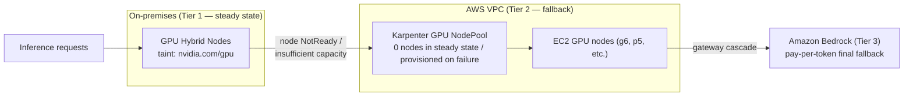

## Overview

Registering on-premises GPU servers as hybrid nodes makes their GPU resources part of the cluster's shared scheduling pool. Operated without any configuration, management Pods such as monitoring agents and system add-ons occupy the GPU nodes' CPU and memory, and the Device Plugin for GPU workloads ends up deployed redundantly with cloud GPU nodes. This document covers GPU resource isolation (taints), the hybrid-only NVIDIA Device Plugin deployment, and a Karpenter-based cloud fallback NodePool that guards against on-premises GPU failures. For the full picture of the 3-tier hybrid inference architecture, see [GPU Workloads and SR-IOV Networking](./gpu-sriov-networking).

## GPU Resource Isolation: Taints at Node Registration Time

Taints for GPU nodes must be applied at the moment the node joins the cluster. Applying them afterward with `kubectl taint` leaves a time window between join and taint application during which non-GPU Pods can be scheduled. Declare them as kubelet registration flags in the `nodeadm` NodeConfig.

```yaml
# nodeconfig-gpu.yaml
apiVersion: node.eks.aws/v1alpha1
kind: NodeConfig
spec:
  cluster:
    name: my-hybrid-cluster
    region: us-west-2
  hybrid:
    ssm:
      activationCode: "YOUR-ACTIVATION-CODE"
      activationId: "YOUR-ACTIVATION-ID"
  kubelet:
    flags:
      - --node-labels=node-type=hybrid-gpu,gpu.model=h200
      - --register-with-taints=nvidia.com/gpu=Exists:NoSchedule
```

- `--register-with-taints=nvidia.com/gpu=Exists:NoSchedule` blocks scheduling of Pods that do not tolerate this taint. A taint is only passed by a toleration whose `key=value:effect` all match, so GPU workload Pods must **declare an explicit toleration** for `nvidia.com/gpu`. Merely requesting the `nvidia.com/gpu` resource does not pass the taint automatically. The NVIDIA Device Plugin only advertises the node's GPUs as the extended resource (`nvidia.com/gpu`); it does not inject tolerations into Pods. Automatically adding a toleration to Pods that request an extended resource requires the `ExtendedResourceToleration` admission controller to be enabled on the cluster, and this is not guaranteed to be enabled by default on EKS Hybrid Nodes clusters — so use explicit tolerations as the default approach.
- DaemonSet-style system components such as CoreDNS, kube-proxy, and Cilium mostly carry broad tolerations and are unaffected by the taint. The blocked targets are Deployment-style management Pods.
- Node labels (`gpu.model`, etc.) later serve as selector criteria for priority scheduling against the fallback NodePool.

## Hybrid-Only NVIDIA Device Plugin

In a mixed-mode cluster, whether a cloud GPU node carries its own Device Plugin stack depends on the node type. EKS Auto Mode GPU nodes and the EKS-optimized Bottlerocket NVIDIA AMI include and manage the Device Plugin, so no separate install is needed. By contrast, the EKS-optimized **AL2023 NVIDIA AMI includes the driver and container toolkit but does not include the NVIDIA Kubernetes Device Plugin or the DRA driver, so these must be installed separately** ([Manage NVIDIA GPUs on Amazon EKS](https://docs.aws.amazon.com/eks/latest/userguide/ml-eks-optimized-ami.html), verified 2026-10). Therefore, if the hybrid Device Plugin DaemonSet also lands on nodes that already self-manage a Device Plugin (Auto Mode, Bottlerocket), double registration and version conflicts occur, so pin the hybrid Device Plugin's `nodeSelector` to the hybrid node label. For cloud nodes that lack a Device Plugin (such as AL2023-AMI-based nodes), install a Device Plugin appropriate to that node separately.

```yaml
# nvidia-device-plugin-values.yaml (Helm)
nodeSelector:
  eks.amazonaws.com/compute-type: hybrid   # deploy to hybrid nodes only
tolerations:
  - key: nvidia.com/gpu
    operator: Exists
    effect: NoSchedule
gfd:
  enabled: true                            # GPU Feature Discovery — auto-labels per GPU model
```

```bash
helm repo add nvdp https://nvidia.github.io/k8s-device-plugin
helm install nvidia-device-plugin nvdp/nvidia-device-plugin \
  --namespace nvidia-device-plugin --create-namespace \
  --values nvidia-device-plugin-values.yaml
```

- `eks.amazonaws.com/compute-type: hybrid` is the label EKS automatically applies to hybrid nodes. This condition blocks redundant deployment onto EKS Auto Mode GPU nodes (which have their own managed stack).
- If the full stack including drivers and the container toolkit is needed, use the GPU Operator. Pin the Operator's Helm chart version, and because the OS and drivers of hybrid nodes are customer-managed, set `driver.enabled=false` to use drivers pre-installed on the host. When restricting the Operator's placement to hybrid nodes, do not assume a single `nodeSelector` scopes every operand. Placement of the Operator itself (the controller) and placement of each operand DaemonSet (Device Plugin, DCGM Exporter, Container Toolkit, and so on) are controlled separately, and the GPU Operator selects operands via the node's GPU labels and per-node opt-out labels (`nvidia.com/gpu.deploy.*`). The Node Feature Discovery (NFD) that the GPU Operator deploys alongside must also be scoped independently. Before applying, verify that the rendered DaemonSets' node selectors and affinities actually match only hybrid nodes (`helm template` or `kubectl get daemonset -o yaml`) so there is no redundant deployment onto cloud GPU nodes. The host-driver approach is more predictable than the Operator's driver container deployment. Confirm the exact operand/node-selection options against the [GPU Operator documentation](https://docs.nvidia.com/datacenter/cloud-native/gpu-operator/latest/getting-started.html) for the Operator version you use.
- Deploying the DCGM Exporter alongside exposes GPU utilization, temperature, and memory metrics in Prometheus format ([Observability Integration](../operations-cost/observability-monitoring)).

## Cloud Fallback: Karpenter-Based Backup GPU NodePool

On-premises GPU servers carry single-site risks: hardware failure, power loss, and circuit disconnection. Defining a Karpenter (or EKS Auto Mode) GPU NodePool inside the AWS VPC at **zero nodes in steady state** creates a fallback layer where pending Pods automatically launch cloud GPU nodes when on-premises GPU capacity is lost.

**Figure 1. Three-tier fallback flow from on-premises GPU to cloud and Bedrock**



### NodePool Definition

The example below is **for Karpenter (`karpenter.sh/v1`)**. The `gpu-fallback` EC2NodeClass that `nodeClassRef` points to — which defines node provisioning details such as AMI family, subnets, security groups, and IAM role — **must already exist**; it is not included in this document. EKS Auto Mode uses a different API than Karpenter. On Auto Mode you cannot switch by changing `nodeClassRef.group` alone; you must use a separate `NodeClass` in the `eks.amazonaws.com` group and `eks.amazonaws.com/*` labels (instead of the `karpenter.k8s.aws/*` requirements in the example below). Do not mix the two; author the resources consistently for the provisioner you use.

```yaml
apiVersion: karpenter.sh/v1
kind: NodePool
metadata:
  name: gpu-fallback
spec:
  template:
    metadata:
      labels:
        node-type: cloud-gpu-fallback
    spec:
      nodeClassRef:
        group: karpenter.k8s.aws        # Karpenter EC2NodeClass (must be created beforehand)
        kind: EC2NodeClass
        name: gpu-fallback
      requirements:
        - key: karpenter.k8s.aws/instance-gpu-manufacturer
          operator: In
          values: ["nvidia"]
        - key: node.kubernetes.io/instance-type
          operator: In
          values: ["g6.12xlarge", "g6e.12xlarge"]   # adjust to the served model size
        - key: karpenter.sh/capacity-type
          operator: In
          values: ["on-demand"]          # fallback stability first — separate Spot bursts into another pool
      taints:
        - key: nvidia.com/gpu
          value: "Exists"
          effect: NoSchedule
      expireAfter: 720h
  disruption:
    consolidationPolicy: WhenEmptyOrUnderutilized
    consolidateAfter: 5m                 # auto-reclaim idle cloud GPUs after on-prem recovery
  limits:
    nvidia.com/gpu: 16                   # fallback scale guardrail — see note below
```

`limits` is a provisioning guardrail that caps the fallback scale. However, Karpenter provisioning is highly parallel and the `limits` check is eventually consistent, so during a rapid scale-out the ceiling can be temporarily overrun ([Karpenter NodePools](https://karpenter.sh/docs/concepts/nodepools/), verified 2026-10). Do not treat `limits` alone as a guarantee that cost stays under a specific amount; pair it with EC2 service quotas, AWS Budgets alerts, and fallback-activation alerts (see the "Cost ceiling" item below) to detect and respond when the ceiling is exceeded.

### On-Prem-First, Cloud-Fallback Scheduling

Use a `preferredDuringScheduling` affinity so workloads claim on-premises GPUs in steady state and spill over to the fallback pool only when that is impossible.

```yaml
# Inference Deployment excerpt
spec:
  template:
    spec:
      affinity:
        nodeAffinity:
          preferredDuringSchedulingIgnoredDuringExecution:
            - weight: 100
              preference:
                matchExpressions:
                  - key: eks.amazonaws.com/compute-type
                    operator: In
                    values: ["hybrid"]      # priority 1: on-prem GPU
      tolerations:
        - key: nvidia.com/gpu
          operator: Exists
          effect: NoSchedule
      containers:
        - name: inference
          resources:
            limits:
              nvidia.com/gpu: 1
```

The operating sequence is as follows.

1. Steady state: the preferred affinity places Pods on on-premises GPU nodes first, and the fallback NodePool stays at 0 nodes.
2. On-premises GPU node failure (NotReady) or DX/VPN disconnection: the node is not drained immediately. The node controller marks the node `NotReady` and adds a `node.kubernetes.io/not-ready` (or `node.kubernetes.io/unreachable` on disconnection) taint with `NoExecute`. Most Pods automatically carry a toleration of `tolerationSeconds: 300` for these two taints, so if the node does not recover they are evicted after about 5 minutes (the default). This delay is tunable and must be included in the overall RTO calculation.
3. Replacement after eviction: what is evicted is the existing Pod object; a controller (Deployment, ReplicaSet, etc.) creates a new replacement Pod that becomes Pending. In a disconnection scenario the old node may still be running — it merely cannot reach the API server — so the replacement Pod and the old Pod can run at the same time (duplicate execution). Workloads where single execution matters (writes, stateful) must account for this with application-level fencing (leases, locks) or StatefulSet at-most-one guarantees in the design.
4. Karpenter detects the Pending Pods' `nvidia.com/gpu` requirement and provisions EC2 GPU nodes from the fallback NodePool.
5. After on-premises recovery: once workloads are moved back on-prem, `consolidation` automatically reclaims the idle cloud GPU nodes.

### Design Verification Items

**Table 1. Fallback design checklist and detail**

| Item | Detail |
|------|--------|
| Image pull time | Fallback spin-up time is node provisioning plus pulling model images of tens of GB — consider shortening with ECR caching or EBS-snapshot-based pre-caching |
| Model artifact access | Model files on on-prem storage must be reachable from the cloud — keeping an S3 replica is recommended ([File Storage](../storage-registry/file-storage)) |
| DX/VPN disconnection scenario | On disconnection, existing Pods on hybrid nodes keep running but new scheduling is impossible — reflect in the runbook that the fallback trigger behaves differently from a node failure |
| Cost ceiling | Cap the fallback scale with NodePool `limits`, and configure fallback-activation alerts (Pending Pods, NodeClaim creation events) |
| Regular drills | Measure actual RTO with quarterly fallback drills. Note that `cordon` alone only blocks new scheduling and does not evict existing Pods, so it does not trigger fallback provisioning. To actually induce fallback, evict and replace the existing Pods with `kubectl drain` (or node shutdown) so they become Pending. The connectivity-disconnection scenario takes a different trigger path than node failure (see step 2), so design it as a separate drill that simulates blocking the DX/VPN path, and for each drill define the availability-check and return-complete conditions ([Safely Drain a Node](https://kubernetes.io/docs/tasks/administer-cluster/safely-drain-node/)) |

The cost logic of this design is clear. In steady state, only the already-owned GPU assets (fixed cost) are used and cloud GPUs stay at zero, so GPU compute cost drops significantly compared to provisioning the same capacity as always-on cloud GPUs. Cloud cost accrues only during failures and bursts, and combining Bedrock (Tier 3) keeps even the fallback layer itself pay-per-use.

## Summary of Recommendations

- Apply GPU taints at join time via `--register-with-taints` in the NodeConfig, not after the fact with `kubectl taint`.
- Deploy the NVIDIA Device Plugin/GPU Operator only to hybrid nodes with the `eks.amazonaws.com/compute-type: hybrid` nodeSelector, blocking overlap with the cloud GPU stack.
- Use host-pre-installed GPU drivers on hybrid nodes and disable the Operator's driver deployment.
- Build the fallback NodePool on three elements — 0 nodes in steady state, a `limits` guardrail, and consolidation auto-reclaim. A `preferredDuringScheduling` affinity is only a preference that makes the scheduler score on-prem nodes higher; it does not guarantee placement. Pods land on on-prem first when capacity exists, but depending on other scheduling scores or transient capacity shortages they can land on cloud nodes, and even in steady state zero cloud nodes is not always guaranteed. If on-prem-only placement is strictly required, design it with `requiredDuringScheduling` (a hard constraint) together with an explicit return policy (rescheduling back on-prem after recovery).
- Fallback RTO is dominated by image pull and model load time, so validate with a pre-caching strategy and regular drills.

## References

### Official Documentation
- [Karpenter NodePools](https://karpenter.sh/docs/concepts/nodepools/) — NodePool requirements, limits, and disruption settings
- [NVIDIA Device Plugin for Kubernetes](https://github.com/NVIDIA/k8s-device-plugin) — Helm values and GFD configuration

### Technical Blogs
- [Run GenAI inference across environments with Amazon EKS Hybrid Nodes — AWS Containers Blog](https://aws.amazon.com/blogs/containers/run-genai-inference-across-environments-with-amazon-eks-hybrid-nodes/) — Device Plugin nodeSelector configuration for hybrid nodes and the GPU Operator alternative
- [Deploy production generative AI at the edge using Amazon EKS Hybrid Nodes with NVIDIA DGX — AWS Containers Blog](https://aws.amazon.com/blogs/containers/deploy-production-generative-ai-at-the-edge-using-amazon-eks-hybrid-nodes-with-nvidia-dgx/) — GPU Operator, NIM, and DCGM observability reference

### Related Documents (Internal)
- [GPU Workloads and SR-IOV Networking](./gpu-sriov-networking) — The 3-tier architecture and DGX H200 high-performance networking
- [Observability Integration](../operations-cost/observability-monitoring) — CloudWatch integration of DCGM GPU metrics
- [Operations and Cost Optimization](../operations-cost/operations-cost-optimization) — vCPU-hour billing and workload placement strategy
