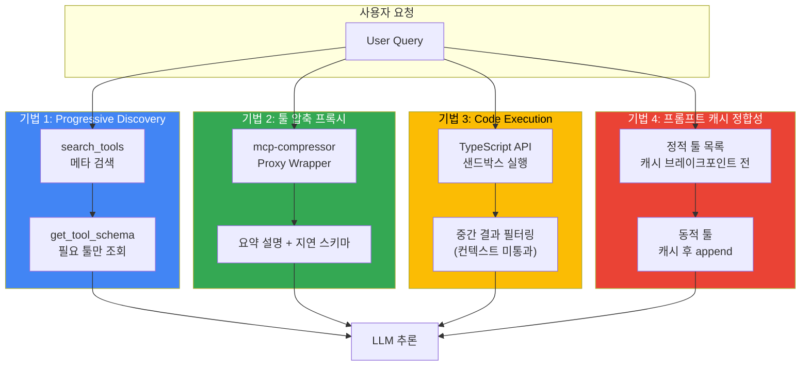

## 개요

Model Context Protocol(MCP) 서버는 `tools/list` 요청에 모든 툴 정의를 반환합니다. 모든 정의를 연결 즉시 컨텍스트에 주입할지는 MCP 명세가 규정하지 않고 호스트(클라이언트)가 결정하므로, "연결 시 모든 툴을 업프론트 로딩한다"는 것은 MCP 명세가 강제하는 동작이 아니라 **단순 호스트 구현에서 흔히 나타나는 전략**입니다([MCP 명세: Tools](https://modelcontextprotocol.io/specification/2025-06-18/server/tools), [MCP Client Best Practices](https://modelcontextprotocol.io/docs/develop/clients/client-best-practices)). 이 전략에서는 툴 1개당 JSON Schema가 300~1,000+ 토큰을 소비하므로, 예컨대 10개 서버 × 20개 툴 × 평균 500토큰이라는 **가정 하의 산술 계산**으로는 사용자 입력 전에 약 **100,000 토큰**이 컨텍스트 윈도우를 점유합니다(이 수치는 공개된 실측값이 아니라 가정값을 곱한 결과입니다). 이 문서는 토큰 오버헤드를 정량화하는 방법과, Progressive Discovery·툴 압축·Code Execution·프롬프트 캐시 정합성이라는 4가지 최적화 기법을 제시합니다.

:::info 문서 위치
- 본 문서: MCP 토큰 최적화 기법 (설계 관점)
- [Tiered Gateway Architecture](../../model-serving/inference-routing/tiered-gateway-architecture.md): Agent Data Plane 아키텍처 컨텍스트
- [AI Gateway Guardrails](../../operations-mlops/governance/ai-gateway-guardrails.md): MCP 서버 Tool Allow-list·보안 정책
:::

---

## 배경: 문제 정량화

### 업프론트 로딩 비용

MCP 서버는 `tools/list` 호출 시 모든 툴 메타데이터(이름, 설명, JSON Schema)를 반환합니다(명세상 이 응답은 `cursor`/`nextCursor` 기반 페이지네이션을 지원합니다). 호스트가 이 정의를 그대로 시스템 프롬프트에 포함하여 LLM에 전달하면, **노출하는 툴 개수가 많을수록 컨텍스트 윈도우 초기 점유율이 증가**합니다. 즉 점유율은 서버가 강제하는 것이 아니라 호스트의 주입 전략에 따라 달라집니다.

#### 인용 사례 (출처별 구성이 다름에 유의) {#실측-사례-출처-명시}

아래 세 사례는 서로 다른 툴 구성·처리 데이터·방법론을 사용하므로 수치를 서로 치환하거나 합산할 수 없습니다.

- **StackOne 분석 (가정 산술)**: 10개 MCP 서버 × 20개 툴 × 평균 500토큰 = **100,000 토큰**이라는 계산은 실측이 아니라 가정값을 곱한 예시입니다. 실제 값은 툴 구성과 토크나이저에 따라 달라집니다 ([출처](https://www.stackone.com/blog/mcp-token-optimization/))
- **Atlassian 실측**: GitHub MCP 서버(94개 툴) 무압축 시 툴 설명이 약 **17,600 토큰**을 차지 ([출처](https://www.atlassian.com/blog/developer/mcp-compression-preventing-tool-bloat-in-ai-agents))
- **Anthropic 사례 (툴 정의 로딩)**: 수백~수천 개 툴 정의를 모두 선로딩하는 대신 코드 실행 환경에서 필요한 정의만 온디맨드로 로딩하여 **150,000 → 2,000 토큰 (98.7% 절감)**. 이 수치는 **툴 정의 로딩** 시나리오에 대한 것이며, 아래 "기법 3"에서 설명하는 중간 결과(스프레드시트) 필터링 예시와는 별개입니다 ([출처](https://www.anthropic.com/engineering/code-execution-with-mcp))

### 복합 비용

토큰 오버헤드는 다음 세 가지 차원에서 비용을 증가시킵니다.

| 차원 | 영향 | 정량 예시 |
|------|------|----------|
| **입력 토큰 비용** | 매 요청마다 툴 정의 전송 | Claude Sonnet 4.5 기준 $3/M 토큰 → 100k 툴 정의 = $0.30/요청 |
| **컨텍스트 윈도우 소진** | 사용자 대화 길이 제약 | 200k 윈도우 중 100k 선점 → 실질 50% 가용 |
| **프롬프트 캐시 히트율 저하** | 툴 목록 변동 시 캐시 무효화 | 동적 툴 추가·제거마다 재전송 |

---

## 아키텍처: 4가지 최적화 기법



---

## 기법 1: Progressive Discovery

### 개념

툴 정의를 **필요 시점에 지연 로딩(lazy loading)** 합니다. 초기 연결 시에는 툴 이름과 한 줄 설명만 전달하고, LLM이 특정 툴을 선택하면 그때 상세 스키마를 조회합니다.

### 3단계 플로우

MCP Client Best Practices는 다음 3계층(Catalog→Inspect→Execute) 패턴을 권장합니다. 여기서 `search_tools`·`get_tool_schema`·`invoke_tool`은 MCP 와이어 메서드가 아니라 **호스트가 정의한 메타 툴**이며, 이름은 구현마다 다릅니다(예: MCP 공식 문서는 Inspect 단계에 `get_tool_details`를 사용). 내부적으로는 여전히 MCP의 `tools/list`·`tools/call`을 호출합니다.

1. **Catalog (검색)**: `search_tools(query="file operations")` → 툴 이름과 한 줄 설명 반환
2. **Inspect (스키마 조회)**: `get_tool_schema(tool_name="read_file")` → 해당 툴 하나의 JSON Schema 반환
3. **Execute (호출)**: `invoke_tool(tool_name="read_file", args={...})` → 실제 실행

### 하이브리드 임계값

MCP Client Best Practices는 **컨텍스트 윈도우의 1~5%**를 임계값 예시로 제시합니다. 툴 정의 토큰이 임계값을 초과하면 Progressive Discovery로 전환하는 하이브리드 접근이 실용적입니다. 아래는 구현 전 **개념 설명용 의사코드**이며, 실제 와이어 호출·토큰 집계·서버별 식별자 처리는 어댑터에서 구현해야 합니다.

```python
# pseudo-code (개념 예시): 임계값 기반 로딩 전략
# 주의: 아래는 설계 개념을 보이기 위한 비실행 의사코드입니다.
def plan_tool_exposure(mcp_servers: list, context_window: int):
    threshold = context_window * 0.05  # 예: 5%
    budget_used = 0
    exposed = []          # 전체 스키마를 선노출할 툴
    catalog = []          # 카탈로그(이름+설명)만 노출할 툴

    for server in mcp_servers:
        # tools/list는 cursor/nextCursor로 페이지네이션됨
        for tool in paginate(server.list_tools()):
            # 전체 스키마 토큰
            full_tokens = estimate_tokens(tool.input_schema)
            # 카탈로그 항목도 이름+설명만큼 토큰을 소비한다 (0이 아님)
            catalog_tokens = estimate_tokens(tool.name, tool.description)
            # 서버 간 이름 충돌을 막기 위해 서버 한정 식별자를 유지
            qualified = f"{server.name}/{tool.name}"
            if budget_used + full_tokens < threshold:
                exposed.append(qualified)       # 선노출(업프론트)
                budget_used += full_tokens
            else:
                catalog.append(qualified)       # 카탈로그만 노출
                budget_used += catalog_tokens   # 카탈로그 토큰도 예산에 가산

    # search_tools/get_tool_schema 래퍼 자체의 토큰도 예산에 포함해야 하며,
    # get_tool_schema 호출 시 어댑터가 원본 서버에서 진짜 inputSchema를 하이드레이트한다.
    return exposed, catalog
```

위 의사코드의 핵심 수정 사항은 다음과 같습니다. 카탈로그(지연) 항목도 이름·설명 토큰을 소비하므로 예산에 반드시 포함해야 하며(스키마 토큰만 세면 대규모 카탈로그에서 1~5% 한도를 초과할 수 있음), `schema: "lazy"` 같은 문자열은 유효한 와이어 `inputSchema`가 아니라 카탈로그 플레이스홀더일 뿐입니다. 또한 서버 간 툴 이름이 충돌할 수 있으므로 서버 한정 식별자(`server/tool`)를 유지하고, 실제 호출 시 어댑터가 원본 정의를 하이드레이트해야 합니다.

### 트레이드오프

| 장점 | 단점 |
|------|------|
| 초기 컨텍스트에서 상세 스키마 제거 (절감 폭은 툴 세트 구성에 따라 상이) | 툴 호출마다 스키마 조회 왕복이 추가되어 지연 증가 |
| 컨텍스트 윈도우 가용 공간 확보 | LLM이 전체 툴 목록을 한눈에 파악 불가 |
| 프롬프트 캐시 안정성 향상 | 멀티스텝 추론 시 반복 조회 가능 |

---

## 기법 2: 툴 압축 프록시

### Atlassian mcp-compressor

Atlassian Labs는 기존 MCP 서버를 래핑하여 툴 설명 오버헤드를 줄이는 프록시를 오픈소스(`mcp-compressor`)로 공개했습니다. 핵심은 서버의 전체 툴 목록을 작은 래퍼 인터페이스로 치환하고, 개별 툴의 전체 스키마는 **필요할 때만** 확장(온디맨드 조회)하는 것입니다. 다음 두 래퍼 툴이 항상 노출됩니다.

1. **get_tool_schema**: 특정 툴 하나의 전체 입력 스키마·문서 조회
2. **invoke_tool**: 구조화된 입력으로 원본 서버에 실제 호출 위임

가장 공격적인 압축 단계에서는 선택적으로 세 번째 헬퍼를 추가합니다.

3. **list_tools (선택)**: 에이전트가 명시적으로 요청할 때만 툴 이름과 짧은 설명을 열거

즉 절감은 파라미터를 삭제해서가 아니라, 초기 프롬프트에서 상세 메타데이터를 빼고 **온디맨드 조회 단계로 옮겨서** 발생합니다. 전체 스키마는 `get_tool_schema`로 언제든 조회할 수 있으므로 호출 충실도는 유지됩니다.

### 압축 강도별 성능

Atlassian 실측 기준 GitHub MCP 서버(94개 툴). 아래 토큰 수는 **초기 프롬프트에 노출되는 툴 설명 분량**을 가리키며, 전체 스키마는 조회 시점에 별도로 반환됩니다.

| 압축 강도 | 초기 노출 토큰 | 절감률 | 비고(설명 상세도) |
|----------|--------|-------|------|
| 무압축 | 17,600 | 0% | 전체 스키마를 초기 프롬프트에 노출 |
| Low | 3,900 | 78% | 설명을 간략화하되 상세도 유지 |
| Medium | 3,300 | 81% | 설명을 더 축약 |
| High | 2,200 | 87% | 이름 + 최소 설명 |
| Extreme | 500 | 97% | 이름 + 한 줄 설명 중심(가장 공격적인 단계) |

절감률(70~97%)은 Atlassian이 공개한 범위이며, 각 단계의 토큰 수는 서버·토크나이저에 따라 달라질 수 있습니다. 프록시 방식이므로 원본 MCP 서버와 에이전트 코드를 변경하지 않고 도입할 수 있으며, 압축 강도는 프록시 설정으로 조절합니다.

### 적합 시나리오

- **대규모 툴 세트**: 50개 이상 툴을 사용하는 에이전트
- **정적 툴 구성**: 툴 목록이 자주 변하지 않는 환경
- **토큰 비용 최적화 우선**: 지연보다 비용이 중요한 경우

---

## 기법 3: Code Execution / Programmatic Tool Calling

### 개념

툴을 JSON Schema가 아닌 **프로그래밍 API**(예: TypeScript 파일 트리)로 노출하고, LLM이 샌드박스에서 코드를 작성·실행하여 툴을 호출합니다. 중간 결과는 실행 환경 내에서 필터링되므로 **모델 컨텍스트를 통과하지 않습니다**.

### Anthropic 사례

Anthropic의 공개 글은 코드 실행이 **두 가지 서로 다른 비효율**을 각각 어떻게 줄이는지 구분해 설명합니다. 두 예시는 성격이 다르므로 수치를 서로 옮겨 쓰면 안 됩니다.

- **툴 정의 로딩 절감**: 수백~수천 개 툴 정의를 모두 선로딩하는 대신, 툴을 파일 트리(TypeScript)로 노출하고 필요한 정의만 온디맨드로 읽는 방식입니다. 이 시나리오에서 **150,000 → 2,000 토큰 (98.7% 절감)**이 보고되었습니다. 즉 98.7%는 **툴 정의** 절감 수치입니다.
- **중간 결과 필터링**: 대용량 중간 결과(예: 회의록 전사, 대형 스프레드시트)를 모델 컨텍스트로 왕복시키지 않고, 실행 환경 안에서 코드로 걸러 필요한 행만 반환하는 방식입니다. 원문은 이 유형의 예로 Google Drive 전사본을 Salesforce로 옮기는 TypeScript 코드 예시를 들며, 2시간 분량 회의록이 약 50,000 토큰을 추가로 소비할 수 있다고 설명합니다. 원문에는 "10,000행 → 5행" 같은 특정 토큰 전후 쌍이 제시되어 있지 않으므로, 이 유형에 98.7% 수치를 적용하지 않습니다.

([출처](https://www.anthropic.com/engineering/code-execution-with-mcp))

위 수치는 Anthropic이 자사 예시 환경에서 보고한 값이며, 이 문서가 설명하는 게이트웨이 아키텍처나 특정 과금에 그대로 이전되지 않습니다.

### Cloudflare Code Mode

Cloudflare의 "Code Mode"는 **LLM이 생성한 코드**를 격리된 샌드박스(Workers의 Dynamic Worker isolate, V8 런타임)에서 실행합니다. 원본 MCP 서버 자체가 이 샌드박스 안에서 돌아가는 것은 아닙니다. Cloudflare는 MCP 툴을 TypeScript API로 변환해 코드에 노출하고, 생성된 코드가 그 API를 호출하면 바인딩을 통해 외부 MCP 서버·API 접근을 **중개(broker)**하며 권한을 통제합니다. 즉 경계는 "생성 코드가 도는 isolate"와 "실제 툴을 수행하는 외부 서버"로 나뉩니다.

([출처](https://blog.cloudflare.com/code-mode-mcp/))

### 트레이드오프

| 장점 | 단점 |
|------|------|
| 툴 정의 선로딩 제거로 큰 토큰 절감 가능(Anthropic 보고 사례의 툴 정의 절감은 98.7%) | 샌드박스 인프라 필요 (Cloudflare Workers, Lambda 등) |
| 중간 결과 필터링으로 대량 데이터 처리 가능 | 보안·리소스 격리 비용 |
| 툴 정의 토큰 → 코드 실행 토큰으로 전환 | LLM의 코드 생성 능력 의존 |

### 보안 고려사항

Code Execution은 임의 코드 실행을 허용하므로 **샌드박스 격리**가 필수입니다. [AI Gateway Guardrails](../../operations-mlops/governance/ai-gateway-guardrails.md) 문서의 Tool Allow-list·Scoped Token 섹션을 참조하여 실행 가능한 API 범위를 제한해야 합니다.

---

## 기법 4: 프롬프트 캐시 정합성

### 문제

MCP 서버가 동적 툴을 추가·제거하면 `tools` 배열의 **변경 지점 이후** 캐시된 접두부(prefix)가 무효화됩니다. 단, 캐시는 접두부 단위로 적용되므로 변경 지점 **앞의 안정적인 접두부**는 재사용될 수 있습니다. 즉 "모든 변경이 전체 캐시를 무효화한다"는 것은 과장이며, 변경 위치가 캐시 경계보다 앞인지 뒤인지에 따라 영향 범위가 달라집니다.

### 배치 전략

Anthropic API에서 캐시는 **`tools` → `system` → `messages` 순서의 전체 접두부**를 대상으로 하며, `cache_control`을 지정한 블록까지가 캐시됩니다. 따라서 자주 바뀌지 않는 **정적 툴 정의를 `tools` 앞쪽에 두고 그 지점에 `cache_control`을 지정**하고, 세션별로 바뀌는 동적 툴은 그 뒤에 배치해 캐시 경계 밖에 두는 것이 핵심입니다.

아래는 Anthropic Messages API 형태를 본뜬 **개념 예시**입니다(실행 코드가 아니며, `tools`는 시스템 문자열에 문자열로 덤프하는 것이 아니라 네이티브 `tools` 필드로 전달해야 캐시·툴 등록이 정상 동작합니다).

```python
# pseudo-code (개념 예시): cache_control을 사용한 캐시 친화적 배치
request = {
    "model": "claude-sonnet-4-5",
    "system": "당신은 고객 지원 에이전트입니다.",
    "tools": [
        # 정적 툴: 안정적인 접두부. 마지막 정적 툴 블록에 cache_control을 지정하면
        # 여기까지의 tools+system 접두부가 캐시된다.
        {"name": "search_kb",     "input_schema": {"...": "..."}},
        {"name": "create_ticket", "input_schema": {"...": "..."},
         "cache_control": {"type": "ephemeral"}},
        # 동적 툴: 캐시 경계 뒤에 배치 → 변경되어도 앞 접두부 캐시는 유지된다.
        {"name": "session_custom_action", "input_schema": {"...": "..."}},
    ],
    "messages": [{"role": "user", "content": user_query}],
}
```

여기서 `<cache_breakpoint />` 같은 **리터럴 문자열은 어떤 공급자의 캐시도 활성화하지 않으며**, 캐시는 `cache_control` 필드로만 지정됩니다. 또한 툴 정의를 시스템 프롬프트 문자열에 JSON으로 덤프하면 모델에 **네이티브 툴로 등록되지 않으므로**, 반드시 네이티브 `tools` 필드로 전달해야 합니다.

### 정적 vs 동적 분류 기준

| 툴 유형 | 예시 | 배치 위치 |
|---------|------|----------|
| **정적** | `search_kb`, `create_ticket`, `get_weather` | 캐시 브레이크포인트 **전** |
| **동적** | 사용자별 커스텀 액션, 세션 임시 툴 | 캐시 브레이크포인트 **후** |

### 효과

Anthropic Prompt Caching에서 **90% 절감**은 캐시 **히트(읽기) 시 입력 토큰 단가**에 적용되는 할인입니다. 이는 당시 Claude Sonnet 4.5 기준 입력 $3/M → 캐시 읽기 $0.30/M이라는 **특정 모델·시점 단가**에 대한 값이며, 요청 전체 비용이나 **첫 캐시 쓰기** 비용의 절감이 아닙니다. 캐시 **쓰기**는 오히려 기본 입력가보다 비싸고(5분 TTL·1시간 TTL에 따라 할증), 캐시 미스 시에는 할인이 없습니다. 따라서 순절감은 (쓰기 비용 + 히트율 + TTL) 조건에 따라 달라집니다.

정적 툴 **100k 토큰을 전부 캐시에서 읽는다**고 가정하면, 위 Sonnet 4.5 단가에서 요청당 입력 비용은 $0.30(=100k×$3/M)에서 $0.03(=100k×$0.30/M)으로 줄어 **요청당 약 $0.27 절약**이 됩니다. 이 값은 100k 전체가 캐시 히트일 때의 상한이며, 첫 요청의 캐시 쓰기 할증과 히트율을 반영하면 실측 평균 절감은 더 작습니다. 참고로 공개 가격표의 모델명·단가는 갱신될 수 있으므로 적용 전 [최신 Prompt caching 가격](https://platform.claude.com/docs/en/build-with-claude/prompt-caching)을 확인하십시오.

---

## Deep Dive: 게이트웨이 레벨 통합

### Agent Data Plane과의 관계

[Tiered Gateway Architecture](../../model-serving/inference-routing/tiered-gateway-architecture.md)는 모델 요청을 라우팅하는 Tier 1~2와, 도구 호출·MCP/A2A 연결·상태가 있는 세션을 처리하는 Agent Data Plane을 구분합니다. MCP/A2A도 전송 수단으로 HTTP를 사용할 수 있습니다. 여기서 나누는 기준은 전송 방식이 아니라 각 구성요소가 맡는 역할입니다.

토큰 최적화는 다음 계층에서 적용됩니다.

| 계층 | 최적화 책임 | 구현 방법 |
|------|------------|----------|
| **Agent Data Plane (agentgateway)** | MCP 서버 검색·스키마 조회 (Progressive Discovery) | `search_tools` / `get_tool_schema` API 제공 |
| **Tier 2 ② LLM API Gateway (Bifrost/LiteLLM)** | 프롬프트 캐시 정합성, 툴 압축 프록시 통합 | 정적/동적 툴 분리 배치, mcp-compressor 래핑 |
| **Client SDK** | Code Execution 샌드박스 호출 | TypeScript/Python API 노출, 실행 결과 필터링 |

### 거버넌스 통합

Tool Allow-list·MCP 서버 Fingerprint·Scoped Token 정책은 [AI Gateway Guardrails](../../operations-mlops/governance/ai-gateway-guardrails.md) 문서의 "§5.2 Tool Allow-list + Scoped Token" 섹션을 참조합니다. 토큰 최적화는 **효율**을 다루고, Guardrails는 **보안**을 다룹니다. 두 관점은 독립적이며 동시에 적용되어야 합니다.

---

## 결론

먼저 토큰이 어디에 쓰이는지 나누어 측정합니다. 툴 정의가 큰 비중을 차지하면 필요한 정의를 나중에 불러오는 Progressive Discovery나 툴 압축 프록시를 검토합니다. 툴이 반환하는 중간 데이터가 많다면 Code Execution으로 실행 환경에서 데이터를 줄인 뒤 필요한 결과만 모델에 전달할 수 있습니다. 이 방식에는 샌드박스 운영이 필요합니다.

프롬프트 캐시는 반복되는 입력의 과금을 줄이는 수단이므로, 컨텍스트에 전달하는 토큰 수를 줄이는 기법과 효과를 구분해 집계합니다. 앞서 인용한 사례들은 툴 구성과 처리 데이터가 서로 다릅니다. 같은 요청 집합에서 입력 토큰 수, 실제 비용, 툴 호출 정확도를 비교한 뒤 조합을 선택하세요.

---

## 참고 자료

### 공식 문서

- [MCP Client Best Practices](https://modelcontextprotocol.io/docs/develop/clients/client-best-practices) — Progressive Discovery, 1-5% 임계값, Catalog→Inspect→Execute 플로우
- [Anthropic Engineering: Code Execution with MCP](https://www.anthropic.com/engineering/code-execution-with-mcp) — 98.7% 토큰 절감 사례, 샌드박스 아키텍처
- [Anthropic Engineering: Advanced Tool Use](https://www.anthropic.com/engineering/advanced-tool-use) — Tool-use 최적화 패턴

### 기술 블로그

- [StackOne: MCP Token Optimization](https://www.stackone.com/blog/mcp-token-optimization/) — 100,000 토큰 업프론트 로딩 문제 분석
- [Atlassian Labs: MCP Compression](https://www.atlassian.com/blog/developer/mcp-compression-preventing-tool-bloat-in-ai-agents) — mcp-compressor, 94-tool 서버 실측(17,600 → 500 토큰)
- [Cloudflare: Code Mode with MCP](https://blog.cloudflare.com/code-mode-mcp/) — Workers 샌드박스 기반 Code Execution

### 관련 문서 (내부)

- [Tiered Gateway Architecture](../../model-serving/inference-routing/tiered-gateway-architecture.md) — Agent Data Plane(agentgateway), MCP/A2A 프로토콜 계층
- [AI Gateway Guardrails](../../operations-mlops/governance/ai-gateway-guardrails.md) — Tool Allow-list, MCP 서버 Fingerprint, Scoped Token
- [AWS Native Agentic Platform](../platform-selection/aws-native-agentic-platform.md) — Bedrock AgentCore·Strands와의 MCP 통합 맥락
